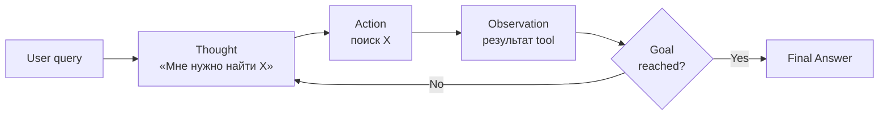
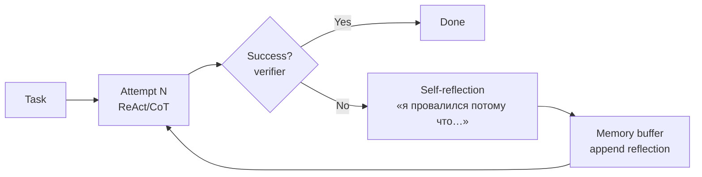
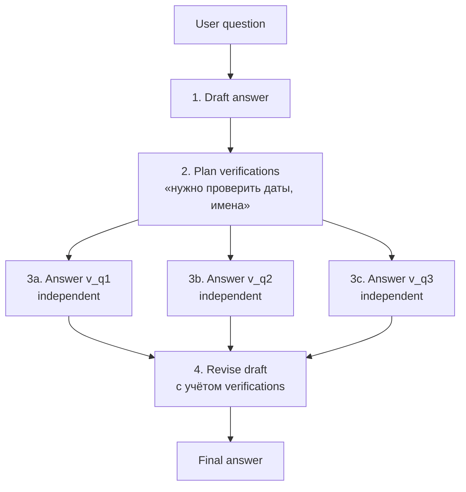
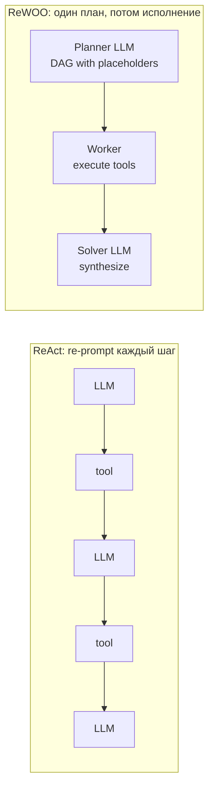
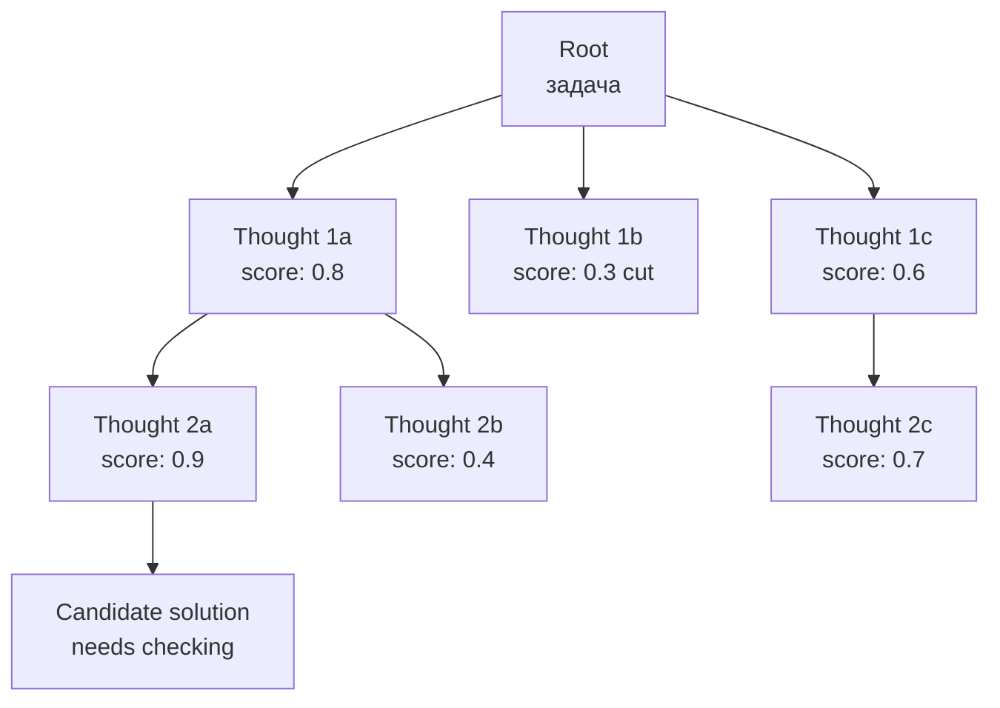

# Вопросы на собеседовании: Паттерны агентных систем

**Паттерн агентной системы** — способ организовать несколько шагов работы модели и приложения: выбор действия, обработку результата, проверку и завершение. Отдельный паттерн может включать рассуждение, инструменты или несколько исполнителей; все эти элементы сразу не обязательны.

Ниже разобраны подходы к организации агентных систем и близкие стратегии работы с моделью: `ReAct`, `Reflexion`, `Plan-and-Execute`, `Tree-of-Thoughts`, `Self-Refine`, `Chain-of-Verification`, `ReWOO`, `Self-Consistency`, `Best-of-N`, `Voyager`. Их можно сочетать, когда задача требует нескольких механизмов. На интервью полезно объяснять, что именно даёт каждый подход и при каких условиях он нужен.

## Полезные ссылки

### Original papers и авторитетные источники

- [ReAct: Synergizing Reasoning and Acting in Language Models (Yao et al. 2022)](https://arxiv.org/abs/2210.03629) — базовый Thought→Action→Observation loop
- [Reflexion: Language Agents with Verbal Reinforcement Learning (Shinn et al. 2023)](https://arxiv.org/abs/2303.11366) — self-reflection без gradient updates
- [Tree of Thoughts (Yao et al. 2023)](https://arxiv.org/abs/2305.10601) — branching reasoning + evaluation
- [Self-Refine (Madaan et al. 2023)](https://arxiv.org/abs/2303.17651) — generate → critique → refine
- [Chain-of-Verification (Dhuliawala et al. 2023)](https://arxiv.org/abs/2309.11495) — снижение hallucinations через verification questions
- [ReWOO (Xu et al. 2023)](https://arxiv.org/abs/2305.18323) — Plan/Worker/Solver без перепрогона LLM на каждом observation
- [Plan-and-Solve Prompting (Wang et al. 2023)](https://arxiv.org/abs/2305.04091) — planner + executor
- [Self-Consistency (Wang et al. 2022)](https://arxiv.org/abs/2203.11171) — majority vote по N CoT
- [Voyager (Wang et al. 2023)](https://voyager.minedojo.org/) — skill library + curriculum
- [Generative Agents (Park et al. 2023)](https://arxiv.org/abs/2304.03442) — memory stream + reflection
- [Toolformer (Schick et al. 2023)](https://arxiv.org/abs/2302.04761) — self-supervised tool use
- [Anthropic: Building Effective Agents](https://www.anthropic.com/research/building-effective-agents) — практические patterns от Anthropic

## Содержание

- [Полезные ссылки](#полезные-ссылки)
- [See also](#see-also)

**Основы**
- [Q1. (!) Что такое agentic pattern и чем он отличается от prompt-техники?](#q1--что-такое-agentic-pattern-и-чем-он-отличается-от-prompt-техники)
- [Q2. По какому принципу здесь группируют паттерны агентных систем?](#q2-по-какому-принципу-здесь-группируют-паттерны-агентных-систем)
- [Q3. (!) Зачем нужны паттерны, если модель уже умеет рассуждать?](#q3--зачем-нужны-паттерны-если-модель-уже-умеет-рассуждать)

**Базовые паттерны (ReAct / CoT / Self-Consistency)**
- [Q4. (!) Что такое ReAct и как выглядит его цикл?](#q4--что-такое-react-и-как-выглядит-его-цикл)
- [Q5. (!) Как завершается цикл в приведённом псевдокоде ReAct-агента?](#q5--как-завершается-цикл-в-приведённом-псевдокоде-react-агента)
- [Q6. Что такое Self-Consistency и когда работает?](#q6-что-такое-self-consistency-и-когда-работает)
- [Q7. Auto-CoT vs Manual CoT — в чём разница?](#q7-auto-cot-vs-manual-cot--в-чём-разница)

**Reflection-based (Reflexion / Self-Critique / CoVe)**
- [Q8. (!) Что такое Reflexion и чем отличается от обычного retry?](#q8--что-такое-reflexion-и-чем-отличается-от-обычного-retry)
- [Q9. Self-Refine / Self-Critique — pattern и pseudo-code](#q9-self-refine--self-critique--pattern-и-pseudo-code)
- [Q10. (!) Chain-of-Verification (CoVe) — как снижает hallucinations?](#q10--chain-of-verification-cove--как-снижает-hallucinations)
- [Q11. Чем self-critique без external feedback опасен?](#q11-чем-self-critique-без-external-feedback-опасен)

**Plan-based (Plan-Execute / ReWOO)**
- [Q12. (!) Plan-and-Execute pattern — структура и use case](#q12--plan-and-execute-pattern--структура-и-use-case)
- [Q13. (!) Что такое ReWOO и чем выигрывает у ReAct?](#q13--что-такое-rewoo-и-чем-выигрывает-у-react)
- [Q14. Когда re-planning важнее изначального плана?](#q14-когда-re-planning-важнее-изначального-плана)

**Tree-based (ToT / Best-of-N)**
- [Q15. (!) Tree-of-Thoughts — структура дерева и evaluation](#q15--tree-of-thoughts--структура-дерева-и-evaluation)
- [Q16. BFS vs DFS в ToT — когда что?](#q16-bfs-vs-dfs-в-tot--когда-что)
- [Q17. Best-of-N sampling: pattern и trade-off с verifier](#q17-best-of-n-sampling-pattern-и-trade-off-с-verifier)

**Memory patterns (Voyager / Generative Agents)**
- [Q18. (!) Паттерн Voyager: библиотека навыков, авто-curriculum, итеративный prompting](#q18--паттерн-voyager-библиотека-навыков-авто-curriculum-итеративный-prompting)
- [Q19. Generative Agents (Stanford): поток памяти и reflection](#q19-generative-agents-stanford-поток-памяти-и-reflection)
- [Q20. OODA Loop (Observe-Orient-Decide-Act) — как адаптируется к LLM-агентам?](#q20-ooda-loop-observe-orient-decide-act--как-адаптируется-к-llm-агентам)
- [Q21. Toolformer-подход: учим модель вызывать API через self-supervision](#q21-toolformer-подход-учим-модель-вызывать-api-через-self-supervision)

**Composition и stopping**
- [Q22. (!) Композиция паттернов: ReAct + Reflexion, Plan-Execute + Self-Critique](#q22--композиция-паттернов-react--reflexion-plan-execute--self-critique)
- [Q23. (!) Stopping conditions: как агент решает, что закончить?](#q23--stopping-conditions-как-агент-решает-что-закончить)
- [Q24. Implementation: LangChain / LlamaIndex / Vercel AI SDK — где какой pattern из коробки?](#q24-implementation-langchain--llamaindex--vercel-ai-sdk--где-какой-pattern-из-коробки)

**Anti-patterns и evaluation**
- [Q25. (!) Anti-patterns: pattern без необходимости, recursive без bound, context bloat](#q25--anti-patterns-pattern-без-необходимости-recursive-без-bound-context-bloat)
- [Q26. Сравнительная таблица паттернов: complexity, latency, use case](#q26-сравнительная-таблица-паттернов-complexity-latency-use-case)
- [Q27. Какой pattern когда выбирать: ReAct / Reflexion / ToT / Self-Critique / CoVe](#q27-какой-pattern-когда-выбирать-react--reflexion--tot--self-critique--cove)
- [Q28. (!) Evaluation patterns: harness, метрики (success rate, # steps, tokens)](#q28--evaluation-patterns-harness-метрики-success-rate--steps-tokens)
- [Q29. Reasoning models делают patterns внутри — нужны ли они снаружи?](#q29-reasoning-models-делают-patterns-внутри--нужны-ли-они-снаружи)
- [Q30. Какие паттерны хорошо переносятся на multi-agent системы?](#q30-какие-паттерны-хорошо-переносятся-на-multi-agent-системы)

## Q1. (!) Что такое agentic pattern и чем он отличается от prompt-техники?

Промпт-техника задаёт **формулировку или структуру входа модели**: например, few-shot добавляет примеры в запрос. Паттерн агентной системы задаёт **организацию выполнения**: как выбирают следующий шаг, передают результат инструмента, проверяют промежуточный результат и завершают работу. Одна и та же промпт-техника может использоваться на разных шагах процесса.

| Свойство | Промпт-техника | Паттерн выполнения |
|----------|----------------|--------------------|
| Что задаёт | Вход модели в отдельном шаге | Связь шагов, решений и результатов |
| Число вызовов | Сама по себе не определяет | Зависит от задачи и хода выполнения |
| Инструменты | Может описывать их использование | Может включать вызов и обработку результата |
| Примеры | Few-shot, инструкция о формате ответа | ReAct, цепочка шагов, цикл оценки и доработки |

Это различие описывает **уровень управления**, а не обязательное число вызовов или наличие инструментов. Например, несколько выборок Chain-of-Thought с последующим голосованием образуют стратегию Self-Consistency; её не требуется считать агентом только из-за нескольких вызовов. См. [Building effective agents](https://www.anthropic.com/engineering/building-effective-agents) и [оригинальную работу о Self-Consistency](https://arxiv.org/abs/2203.11171).

## Q2. По какому принципу здесь группируют паттерны агентных систем?

В этой шпаргалке паттерны сгруппированы **по ведущему механизму**: какую организацию работы они добавляют к отдельному вызову модели. Это учебная группировка, а не общепринятая строгая таксономия.

1. **Reasoning-action loops** — `ReAct`, `OODA`. Базовое чередование «думаю — действую».
2. **Reflection-based** — `Reflexion`, `Self-Refine`, `Chain-of-Verification`. Агент критикует собственный вывод.
3. **Plan-based** — `Plan-and-Execute`, `ReWOO`. Сначала план, потом исполнение.
4. **Search/sampling-based** — `Tree-of-Thoughts`, `Best-of-N`, `Self-Consistency`. Несколько кандидатов и выбор результата; это близкие стратегии, не обязательно агентные циклы.
5. **Memory-based** — `Voyager`, `Generative Agents`. Долговременная память, накопление навыков.
6. **Multi-agent** — `Debate`, `Society-of-Mind` (в отдельной шпаргалке про orchestration).

Группы **не взаимоисключающие**: система может сочетать планирование, работу с инструментами и проверку результата. Например, исполнитель плана может использовать ReAct для получения данных, а отдельный шаг — оценивать итог. Другие источники выбирают иной набор групп; см. [практическую группировку Anthropic](https://www.anthropic.com/engineering/building-effective-agents).

## Q3. (!) Зачем нужны паттерны, если модель уже умеет рассуждать?

Модель с внутренним рассуждением может решать часть задач без инструкции «думай пошагово». Это **не организует работу приложения**: нужно решить, когда вызвать инструмент, передать модели его результат, сохранить состояние и остановить цикл. Модель может предложить вызов инструмента, но инструмент исполняет внешняя среда.

Для простого вопроса может хватить одного вызова. Если ответ зависит от актуальных данных или действий во внешней системе, приложение должно организовать вызовы и проверить полученные результаты. При длинной задаче ему также нужны управление состоянием и условия остановки. Внутреннее рассуждение само по себе не подтверждает факты по независимому источнику и не гарантирует качество ответа.

Промпты с явной цепочкой рассуждений для некоторых reasoning models избыточны; это **не означает**, что Self-Refine, Self-Consistency или внешняя проверка всегда становятся бесполезными. Их пользу оценивают на конкретной задаче. Возможности вызова инструментов зависят от модели и API. См. [рекомендации OpenAI по reasoning models](https://developers.openai.com/api/docs/guides/reasoning-best-practices) и [описание агентных циклов Anthropic](https://www.anthropic.com/engineering/building-effective-agents).

## Q4. (!) Что такое ReAct и как выглядит его цикл?

**ReAct** (Reasoning + Acting, Yao et al.) сочетает шаги рассуждения и действия: модель выбирает действие с учётом текущего контекста, среда выполняет его и возвращает наблюдение. В исходной работе модель порождает явные фрагменты рассуждения; конкретный API может не показывать внутреннее рассуждение пользователю. См. [статью ReAct](https://arxiv.org/abs/2210.03629).

Цикл из трёх шагов:

1. **Thought** — модель намечает следующий шаг в формате исходного ReAct.
2. **Action** — модель предлагает действие, которое выполняет среда.
3. **Observation** — среда возвращает результат действия в контекст следующего шага.

Повтор до тех пор, пока модель не выдаст `Final Answer`.



**Условный trace (вычисление):**
```
Question: Сколько будет 17 × 19?
Thought: Проверю умножение калькулятором.
Action: calculator["17 * 19"]
Observation: 323
Thought: Вычисление получено; можно ответить.
Final Answer: 323.
```

Явные шаги рассуждения в исходном ReAct показывают, почему выбран следующий запрос, и помогают разбирать траекторию решения. Это не гарантия правильного выбора инструмента или достоверности ответа.

**Минусы:**
- Если без ограничения передавать всю историю на каждом шаге, расход токенов растёт вместе с ней.
- Ошибку инструмента нужно вернуть модели как наблюдение и предусмотреть обработку сбоя.
- Без условия остановки и предела шагов агент может зациклиться.

## Q5. (!) Как завершается цикл в приведённом псевдокоде ReAct-агента?

Ниже учебный вариант текстового протокола ReAct; `llm.complete`, `parse_action` и `extract_final_answer` обозначают операции, а не API конкретной библиотеки.

```python
def react_agent(query, tools, max_steps=10):
    history = [{"role": "user", "content": query}]
    for step in range(max_steps):
        # 1. LLM генерирует Thought + Action (или Final Answer)
        response = llm.complete(
            system=REACT_SYSTEM_PROMPT,  # описание tools, формат
            messages=history,
        )
        history.append({"role": "assistant", "content": response})

        # 2. Парсим ответ
        if "Final Answer:" in response:
            return extract_final_answer(response)

        action_name, action_args = parse_action(response)

        # 3. Выполняем tool
        try:
            observation = tools[action_name](**action_args)
        except Exception:
            observation = "Tool error"  # передаём безопасное описание сбоя

        # 4. Кладём observation обратно
        history.append({
            "role": "user",
            "content": f"Observation: {observation}",
        })

    raise RuntimeError("ReAct step limit reached")
```

**Ключевые места, на которые смотрят на собеседовании:**
- `parse_action` — уязвимое место текстового протокола: разбор свободного текста может ошибиться. Если API поддерживает структурированные вызовы инструментов, следует использовать их формат вместо разбора строки.
- `max_steps` — защитный предел реализации. Сам ReAct может завершиться раньше, но без внешнего ограничения есть риск зацикливания.
- Ошибку инструмента возвращают модели как `Observation`, чтобы она могла выбрать следующий шаг; текст исключения предварительно приводят к безопасному сообщению.

## Q6. Что такое Self-Consistency и когда работает?

**Self-Consistency** (Wang et al.) — стратегия выбора ответа для задач с цепочками рассуждений: вместо одного пути получают несколько разных, извлекают итог каждого и выбирают наиболее частый ответ. Разные пути могут прийти к одному решению, но совпадение само по себе не доказывает его правильность. См. [исходную статью](https://arxiv.org/abs/2203.11171).

Три шага:

1. Получить `N` разных выборок цепочки рассуждений; параметры генерации подбирают так, чтобы пути не были одинаковыми.
2. Извлечь и при необходимости нормализовать итоговый ответ из каждой.
3. Выбрать наиболее частый ответ; заранее определить поведение при равенстве голосов.

```python
def self_consistency(question, n=20, temperature=0.7):
    answers = []
    for _ in range(n):
        cot = llm.complete(question, temperature=temperature)
        answers.append(extract_answer(cot))
    ranked = Counter(answers).most_common(2)
    if len(ranked) > 1 and ranked[0][1] == ranked[1][1]:
        raise ValueError("tie between answers")
    return ranked[0][0]
```

**Когда применять:**
- Итоговые ответы можно надёжно привести к сравнимому виду: например, к числу или варианту из списка.
- Задача допускает разные пути решения, а проверка на целевом наборе показывает выигрыш от дополнительных выборок.

**Ограничения:**
- Для развёрнутых ответов простое сравнение строк не подходит; нужен отдельный способ сопоставления ответов.
- Если выборки повторяют одну и ту же ошибку, голосование её закрепит.
- Дополнительные выборки увеличивают расход токенов; задержка зависит от того, выполняются ли вызовы последовательно или параллельно.

Для reasoning models эффект дополнительного семплирования нужно измерять на своей задаче, а не выводить из предположений об их скрытом рассуждении.

## Q7. Auto-CoT vs Manual CoT — в чём разница?

Разница в одном: **кто подбирает примеры рассуждений** для few-shot CoT-промпта — человек или сама модель. Всё остальное (показываем модели образцы `Question + Reasoning + Answer`, чтобы она рассуждала по аналогии) у них общее.

**Manual CoT** — человек подбирает и пишет примеры `Question + Reasoning + Answer` для задачи. Их подготовка требует ручной работы; качество зависит от самих примеров.

**Auto-CoT** (Zhang et al., [исходная статья](https://arxiv.org/abs/2210.03493)):
1. Берём пул вопросов из задачи.
2. Получаем embedding каждого, кластеризуем (K-means).
3. Из каждого кластера выбираем вопрос-репрезентант.
4. Для каждого репрезентанта генерируем CoT (`Let's think step by step`) — это и есть exemplars.
5. Используем как few-shot для нового вопроса.

**Плюс Auto-CoT:** подбор разных вопросов снижает ручной труд и помогает разнообразить примеры.
**Ограничение:** сгенерированные рассуждения могут содержать ошибки, которые затем попадут в few-shot-промпт.

Пользу few-shot-примеров нужно проверять для выбранной модели и задачи; некоторые reasoning models не требуют явной инструкции «думай по шагам».

## Q8. (!) Что такое Reflexion и чем отличается от обычного retry?

**Reflexion** (Shinn et al., [исходная статья](https://arxiv.org/abs/2303.11366)) добавляет к повторным попыткам словесный разбор полученной обратной связи. Агент сохраняет вывод о предыдущей попытке в памяти и использует его в следующем запросе. Под «обычным повтором» здесь понимается новый запуск без такого вывода.

Авторы называют это **verbal reinforcement learning**: веса модели не обновляются, а сохранённый текст помогает скорректировать последующую попытку. Обратная связь может быть числовой или текстовой, от внешнего проверяющего либо от внутренней оценки.



**Чем отличается от обычного retry:**
| Свойство | Plain retry | Reflexion |
|----------|-------------|-----------|
| Что передаётся между попытками | Нет сформулированного вывода | Текст разбора и нужная обратная связь |
| Как меняется следующий запрос | Повтор без анализа ошибки | Учитывает сохранённый вывод |
| Обратная связь | Может отсутствовать | Нужна для осмысленного разбора; формат зависит от задачи |

В экспериментах авторов результат на HumanEval достиг 91% pass@1 против 80% у приведённого ими базового GPT-4. Это результат конкретной настройки эксперимента, а не гарантия для других задач.

**Что обязательно нужно, чтобы паттерн работал:**
- **Обратная связь** о результате попытки: например, тесты для кода или оценка в среде. Она может быть не только бинарной.
- Достаточный **контекст** для сохранённых выводов либо способ отбирать нужные воспоминания.
- **Предел попыток** как защитное условие реализации: без него повтор может затянуться.

## Q9. Self-Refine / Self-Critique — pattern и pseudo-code

**Self-Refine** (Madaan et al. 2023) — это цикл «создать черновик → получить от модели отзыв → исправить черновик» в рамках одной задачи. В базовой схеме модель формулирует отзыв по своему результату без обязательной внешней оценки. Дополнительные тесты или источники можно включить в прикладную систему, но это уже внешняя опора для проверки, а не свойство самого Self-Refine.

```python
def self_refine(task, max_refinements=3):
    draft = llm.complete(f"Solve: {task}")
    for _ in range(max_refinements):
        feedback = llm.complete(
            f"Task: {task}\nDraft: {draft}\n"
            "Review the draft against the task. If no changes are needed, reply 'OK'."
        )
        if feedback.strip() == "OK":
            break
        draft = llm.complete(
            f"Task: {task}\nDraft: {draft}\nFeedback: {feedback}\n"
            "Revise the draft in light of the feedback."
        )
    return draft
```

**Где полезен:** для задач, где отзыв можно привязать к заданию и доступному материалу: проверить связность текста, требования к формату, полноту пересказа относительно исходника. Для кода тесты дают более надёжную проверку поведения, чем одна текстовая критика.

**Ограничение:** модель может не заметить собственную ошибку или предложить ошибочную правку. Проверка фактов, вычислений и исполняемого кода требует источника, калькулятора или тестов, когда точность существенна. Предел итераций защищает от бесконечного цикла, но сам по себе не подтверждает качество.

**Отличие от Reflexion:**
- Self-Refine правит текущий черновик по отзыву модели; внешняя оценка не обязательна для базового цикла.
- Reflexion сохраняет текстовый вывод по обратной связи о попытке и использует его в следующих попытках. Обратная связь может поступать от среды или проверяющего механизма и не обязана быть бинарной; повторные попытки могут относиться к той же задаче.

## Q10. (!) Chain-of-Verification (CoVe) — как снижает hallucinations?

**Chain-of-Verification** (Dhuliawala et al. 2023) — приём проверки фактических утверждений в собственном черновике: модель составляет вопросы к сомнительным фактам, отвечает на них и пересматривает ответ. В варианте с раздельными проверками ответы на вопросы получают без доступа к черновику, чтобы уменьшить его влияние. Это снижает часть ошибок в исследованных задачах, но не делает ответы на проверочные вопросы автоматически истинными.

4-шаговый pattern для **fact-heavy ответов**:

1. **Draft answer** — модель пишет первичный ответ.
2. **Plan verifications** — модель формулирует список проверочных вопросов (что именно надо перепроверить).
3. **Answer verifications** — в раздельном варианте отвечаем на каждый вопрос без черновика в контексте.
4. **Revise** — исправляем черновик с учётом проверочных ответов; для значимых фактов дополнительно сверяем их с источниками.



**Почему может помочь:** раздельный ответ на проверочный вопрос меньше зависит от формулировки черновика. Затем модель явно сопоставляет два результата и исправляет найденное расхождение. Если проверочный ответ тоже ошибочен, схема не даёт гарантии точности.

**Пример:**
- Draft: «В документе срок ответа — 30 дней».
- Verification question: «Какой срок ответа указан в документе?» — вопрос проверяется отдельно от черновика по самому документу.
- Revised: если в документе указано «45 дней», итоговый ответ исправляют на 45 дней.

**Стоимость:** проверочные вопросы и пересмотр требуют дополнительных вызовов модели; точное число зависит от способа объединения шагов. При высокой цене ошибки полезно подключать первичные источники, поскольку самопроверка модели не заменяет их.

## Q11. Чем self-critique без external feedback опасен?

Главная ловушка: модель, которая критикует сама себя, **не получает независимый источник истины** только от повторного вызова. Критика может улучшить форму ответа, но не гарантирует исправления фактической или логической ошибки. Возможные проблемы:

1. **Пропуск ошибки** — отзыв повторяет ошибочную предпосылку черновика.
2. **Ложная критика** — модель предлагает изменить уже корректный фрагмент.
3. **Нет опоры на факты** — без документа, теста или вычисления отзыв не доказывает истинность утверждения.
4. **Уход от задания** — после нескольких правок текст может потерять исходные требования.

**Меры:** дать проверке независимую опору — тесты для кода, первичные источники для фактов, вычисление для арифметики. Отдельно ограничить число правок и сравнивать результат с требованиями задачи. Другая модель-критик может предложить иной взгляд, но сама по себе не становится независимым источником фактов.

## Q12. (!) Plan-and-Execute pattern — структура и use case

**Plan-and-Execute** разделяет предварительное планирование и выполнение шагов. План задаёт ориентир, исполнитель использует результаты предыдущих шагов, а при необходимости оставшуюся часть плана пересматривают. Это организационный паттерн агента; **Plan-and-Solve** — отдельная техника промптинга для пошагового решения задач, поэтому их не следует отождествлять. Исполнитель может сам использовать цикл ReAct.

Типичные роли:

1. **Planner** — составляет упорядоченный план на основе задачи.
2. **Executor** — выполняет очередной шаг, учитывая накопленные результаты; может обращаться к инструментам.
3. **Re-planner** — при существенном отклонении обновляет ещё не выполненные шаги. Это может быть тот же компонент, что построил исходный план.

```python
def plan_and_execute(task, planner, executor, max_replans=2):
    pending_steps = list(planner.plan(task))
    completed = []
    replans = 0
    while pending_steps:
        step = pending_steps.pop(0)
        result = executor.run(step, history=completed)
        if needs_replan(result):
            if replans >= max_replans:
                raise RuntimeError("Re-planning limit reached")
            pending_steps = list(planner.replan(task, completed, step, result))
            replans += 1
            continue
        completed.append((step, result))
    return synthesize(task, completed)
```

**Сценарии применения** — задачи с несколькими зависимыми этапами, для которых полезно заранее наметить порядок:
- Multi-step research («собери информацию о компании X: финансы, продукт, команда»).
- Code refactoring («разбей класс на 3, добавь тесты, обнови doc»).
- Долгие workflow с известными фазами.

**Сравнение с ReAct:** ReAct выбирает очередное действие с учётом текущего наблюдения; Plan-and-Execute сначала намечает несколько шагов и выполняет их с возможностью перепланирования. Подходы можно сочетать: исполнитель отдельного шага может работать по ReAct. Экономия вызовов и качество зависят от реализации и задачи, а не следуют из одного названия паттерна.

## Q13. (!) Что такое ReWOO и чем выигрывает у ReAct?

**ReWOO** (Reasoning WithOut Observation, Xu et al. 2023) разделяет планирование, исполнение инструментов и сборку ответа. Планировщик задаёт шаги и ссылки на будущие результаты **до получения наблюдений**. Исполнитель подставляет фактические результаты в зависимые вызовы, а решатель использует собранные данные для ответа. Планировщик не вызывается заново после каждого наблюдения, поэтому в подходящих задачах можно сократить расход токенов по сравнению с пошаговым перепланированием.

Три роли:

1. **Planner** — заранее записывает шаги и ссылки на результаты (`#E1`, `#E2`), которые ещё не получены.
2. **Worker** — выполняет вызовы инструментов; если следующий вызов использует прежний результат, подставляет его значение. Независимые вызовы допускают параллельное исполнение.
3. **Solver** — получает исходный вопрос и собранные результаты, затем составляет ответ.



**Пример plan:**
```
Plan:
  E1 = search("страна организации из вопроса")
  E2 = search("столица страны #E1")
Solver: «Организация находится в стране #E1; её столица — #E2»
```

**Преимущества перед ReAct:**
- **Меньше повторных вызовов планировщика** — ему не передают всю растущую историю после каждого инструмента; величина экономии зависит от задачи и реализации.
- **Возможность параллельной работы** — независимые вызовы можно выполнять одновременно; зависимые ждут предыдущего результата.

**Минусы** — оборотная сторона жёсткого плана:
- Планировщик не меняет решение на основе промежуточных наблюдений в этом проходе. Если результат показывает, что прежний план неверен, приложению нужен отдельный путь исправления или новый план.
- Зависимые вызовы с подстановкой результата допустимы; труднее случай, когда **сам выбор следующего действия** становится понятен только после наблюдения.

## Q14. Когда re-planning важнее изначального плана?

Re-planning нужен, когда наблюдение или новое требование делает оставшиеся шаги исходного плана неверными или бесполезными. Он меняет **ещё не выполненную часть** плана с учётом уже полученных результатов.

Сигналы, что пора re-plan:

- Tool вернул error / пусто / результат, не совпадающий с ожиданием.
- Появились новые факты, меняющие приоритет шагов.
- Бюджет шагов близок к пределу, а цель не достигнута: нужно выбрать достижимый остаток либо остановиться.
- Пользователь вмешался с уточнением.
- Проверка цели (goal-predicate) провалилась там, где план считал задачу завершённой.

**Упрощённый цикл:**
```python
pending_steps = list(planner.plan(task))
history = []
while pending_steps and within_budget():
    step = pending_steps.pop(0)
    result = executor.run(step)
    history.append((step, result))
    if requires_replan(result, task, history):
        pending_steps = list(planner.replan(task, history))
# Если бюджет исчерпан до достижения цели, сообщаем о неполном результате.
```

**Где re-plan важнее изначального плана:**
- Web automation — страница изменилась, кнопки уже не там.
- Длительные агентные задачи, где новые наблюдения меняют последовательность следующих шагов.
- Research-задачи с неизвестным объёмом — нашёл новую информацию, поменял подход.

**Где пересмотр нужен реже:** структурированные процессы со стабильными входами и известным порядком. Даже там ошибку исполнения нужно обработать, а не бесконечно продолжать исходный план.

## Q15. (!) Tree-of-Thoughts — структура дерева и evaluation

**Tree-of-Thoughts** (Yao et al. 2023) превращает CoT из одной линейной цепочки в **дерево с поиском**: на каждом шаге модель порождает несколько вариантов «следующей мысли», оценивает их и развивает только перспективные ветки, отбрасывая тупиковые. Это даёт то, чего нет у обычного CoT — возможность откатиться и попробовать другой путь.

Каждое состояние — частичное рассуждение, ветви — альтернативные продолжения. Четыре шага:

1. **Thought decomposition** — задаём гранулярность шага: одна мысль = одна строка / одно равенство / один ход в игре.
2. **Thought generator** — LLM предлагает `k` вариантов следующей мысли из текущего состояния.
3. **State evaluator** — оценивает промежуточное состояние, например с помощью модели, внешней эвристики или проверяемого ограничения; оценка может быть словесной или числовой.
4. **Search** — обход дерева (BFS / DFS / beam-search) с отсечением веток с низким score.



**Pseudo-code (BFS):**
```python
def tot_bfs(task, k_per_step=3, beam=2, depth=5):
    frontier = [State(task=task, path=[])]
    for _ in range(depth):
        candidates = []
        for state in frontier:
            for thought in llm.generate_thoughts(state, k=k_per_step):
                candidate = state.extend(thought)
                if candidate.is_valid_solution():
                    return candidate
                candidate.score = evaluate(candidate)
                candidates.append(candidate)
        if not candidates:
            return None
        frontier = sorted(candidates, key=lambda x: -x.score)[:beam]
    return None  # лучшее промежуточное состояние не считаем готовым ответом
```

**Где применяют** — задачи с дискретными шагами, где промежуточное состояние можно оценить и при ошибке откатиться:
- Game of 24 (эксперимент авторов): поиск по нескольким промежуточным состояниям помог лучше справляться с задачей, чем одна линейная цепочка рассуждений.
- Crosswords, мини-puzzles.
- Step-by-step planning с возможностью отката.

**Стоимость:** без отсечения число ветвей может расти экспоненциально с глубиной. Ограничение ширины и глубины уменьшает расход, но может отсечь путь к решению. Оценка промежуточного состояния не заменяет проверку итогового ответа.

## Q16. BFS vs DFS в ToT — когда что?

Выбор зависит от формы пространства поиска, бюджета памяти и того, можно ли рано отбрасывать бесперспективные состояния. В обоих случаях качество оценки и правила отсечения влияют на результат.

**BFS (breadth-first):**
- Расширяет состояния по уровням и хранит фронт текущего уровня. Без ограничения ширины память может быстро расти.
- Удобен, если нужно систематически проверить короткие решения или сравнить несколько альтернатив одинаковой глубины.

**DFS (depth-first):**
- Развивает одну ветвь, при тупике возвращается к ещё не рассмотренной альтернативе. Порядок ветвей может задавать оценка.
- Хранит меньше одновременных состояний, но без предела глубины может надолго уйти по неудачной ветви.

**Beam search** — отдельный вариант: на каждом уровне сохраняют лишь несколько наиболее оценённых состояний. Это ограничивает память и вызовы, но может навсегда отбросить нужную ветвь; не следует называть такой проход полным BFS.

Для ToT заранее задают предел глубины, ширины и вызовов, а итоговое решение проверяют по условиям задачи. Универсального выбора между BFS, DFS и beam search нет.

## Q17. Best-of-N sampling: pattern и trade-off с verifier

**Best-of-N** — способ потратить больше вычислений на выбор ответа: модель генерирует `N` кандидатов, проверяющий механизм оценивает их и выбирает одного. Проверяющим может быть тест, правило, модель оценки или LLM-судья. Польза зависит и от разнообразия кандидатов, и от того, насколько оценка соответствует настоящей цели задачи.

```python
def best_of_n(task, n=10, verifier=None):
    candidates = [llm.complete(task, temperature=0.7) for _ in range(n)]
    return max(candidates, key=verifier)
```

**Компромиссы:**
- Для `N` кандидатов нужны `N` генераций и оценка каждого; расход вычислений растёт с размером выборки.
- Слабая оценка может выбрать худший ответ даже при наличии хорошего кандидата. Если она поощряет неверный признак, увеличение выборки способно усилить эту ошибку.
- Прирост качества не гарантирован и зависит от задачи, разнообразия кандидатов и качества оценки; `N` выбирают по измеренному результату и бюджету.

**Где работает** — там, где есть надёжный способ проверить ответ:
- Code generation + unit-tests как verifier.
- Math + символьный verifier.
- Открытые ответы — модель оценки ранжирует кандидатов, если её качество проверено на этой задаче.

**Отличие от Self-Consistency:** Best-of-N выбирает кандидата по оценке проверяющего, а Self-Consistency агрегирует ответы нескольких траекторий по их согласованности.

**Отличие от ToT:** в Best-of-N варианты независимы, общего состояния нет; в ToT поиск инкрементальный, с общим деревом и pruning.

## Q18. (!) Паттерн Voyager: библиотека навыков, авто-curriculum, итеративный prompting

**Voyager** (Wang et al. 2023) — агент для исследования мира Minecraft, который постепенно осваивает навыки. В статье описаны три связанные части: выбор новых задач, библиотека исполняемых навыков и повторная доработка программ по обратной связи среды.

Три компонента:

1. **Библиотека навыков** хранит исполняемые программы. Агент ищет подходящие навыки по описаниям и может составлять из них более сложные действия.
2. **Автоматический учебный план** предлагает следующие задачи с учётом состояния агента и уже достигнутого прогресса, чтобы продолжать исследование мира.
3. **Итеративные подсказки** помогают написать программу, запустить её и исправить по сигналам среды, ошибкам выполнения и самопроверке результата.

Эти три части решают разные задачи: учебный план выбирает, **что** осваивать; библиотека сохраняет, **что уже освоено**; итеративный цикл проверяет и улучшает, **как** выполняется текущая задача. Результаты статьи относятся к экспериментам в Minecraft; при переносе подхода в другую среду его нужно проверять заново.

## Q19. Generative Agents (Stanford): поток памяти и reflection

**Generative Agents** (Park et al. 2023) — архитектура агентов для симуляции поведения жителей виртуального городка. Чтобы действия опирались на прошлый опыт, она сочетает поток записей, выборку уместных воспоминаний, обобщающие размышления и планы.

Компоненты:

1. **Поток памяти** пополняется записями о наблюдениях. В нём также сохраняются результаты размышлений и планы.
2. **Выборка** оценивает записи по свежести, важности и смысловой близости к текущей ситуации. В реализации статьи нормализованные оценки складываются с весами, а в контекст попадают наиболее высоко оценённые записи, которые помещаются в окно модели.
3. **Размышление (reflection)** периодически выводит из нескольких записей более общие заключения и сохраняет их в том же потоке памяти. Поводом служит накопленная значимость новых событий.
4. **Планирование** строит распорядок от общего плана дня к более подробным действиям и допускает пересмотр при новых событиях.

Важная граница: выборка извлекает уже записанный опыт, а размышление создаёт новую обобщающую запись. В статье эти механизмы оценивались в симуляции; их эффективность для других задач нельзя выводить только из этого эксперимента.

## Q20. OODA Loop (Observe-Orient-Decide-Act) — как адаптируется к LLM-агентам?

**OODA** — цикл принятия решений Джона Бойда: **Observe** (наблюдать), **Orient** (осмыслить обстановку), **Decide** (принять решение), **Act** (действовать). После действия новые сведения снова влияют на наблюдение и оценку обстановки. Это общая модель принятия решений, возникшая раньше LLM-агентов и ReAct; считать её разновидностью ReAct некорректно. [Исходные материалы Бойда](https://www.govinfo.gov/app/details/GOVPUB-D301-PURL-gpo94257) и [статья ReAct](https://arxiv.org/abs/2210.03629) описывают разные подходы.

Для LLM-агента четыре стадии можно использовать как **схему проектирования**:

1. **Observe** — получить текущее состояние и результаты прошлых действий, например ответ инструмента.
2. **Orient** — интерпретировать их с учётом задачи, контекста и при необходимости памяти или поиска.
3. **Decide** — выбрать следующее действие, запросить уточнение либо завершить работу.
4. **Act** — выполнить выбранное действие и передать его результат в следующий цикл.

Такое разложение помогает отдельно проверять качество наблюдений, интерпретации, выбора и исполнения. В ReAct модель чередует рассуждение, действие и наблюдение; эти описания циклов можно сопоставлять при проектировании, но они не тождественны и не требуют отдельных вызовов модели для каждой стадии OODA.

## Q21. Toolformer-подход: учим модель вызывать API через self-supervision

**Toolformer** (Schick et al. 2023) обучает модель решать, когда и какой API вызвать и как использовать результат при продолжении текста. Это подход к **обучению модели**, а не только правило для агента во время выполнения. Для каждого API авторы задают несколько примеров формата вызова; массовую разметку мест вызова получают автоматически.

Схема из [оригинальной работы](https://arxiv.org/html/2302.04761v1):

1. Модель предлагает возможные вызовы API в тексте из обучающего корпуса.
2. Предложенные вызовы выполняют и вставляют полученные ответы.
3. Сохраняют вставки, которые достаточно снижают ошибку предсказания последующих токенов по сравнению с текстом без полезного результата вызова.
4. На дополненном корпусе дообучают модель; при генерации она может сама предлагать вызовы доступных API.

Критерий полезности вычисляется по сигналу языкового моделирования, а не по ручной пометке каждого места вызова или по одному лишь успешному ответу API. В работе проверялись калькулятор, поиск, система ответов на вопросы, перевод и календарь. Из неё нельзя выводить, каким именно способом обучены функции вызова инструментов в других моделях.

## Q22. (!) Композиция паттернов: ReAct + Reflexion, Plan-Execute + Self-Critique

Паттерны можно сочетать, если они решают **разные задачи** внутри одного процесса. Связка должна иметь понятный порядок шагов, критерий проверки и причину дополнительной сложности. Примеры ниже — возможные конструкции, а не обязательный состав любой агентной системы.

**ReAct + Reflexion:** ReAct управляет действиями и наблюдениями внутри одной попытки. После оценки результата Reflexion сохраняет текстовый вывод об ошибке и использует его в следующей попытке. Такая связка имеет смысл, когда возможны повторные попытки и есть обратная связь, например результат тестов.

**Plan-and-Execute + Self-Critique:** планировщик задаёт шаги, исполнитель получает их результаты, затем отдельная критическая проверка оценивает промежуточный или итоговый ответ. Если проверка нашла дефект, приложение решает, исправлять ответ, повторять шаг либо пересматривать план. Пример задачи — отчёт, где после сбора данных нужно проверить полноту и обоснованность выводов.

Композиция добавляет вызовы и новые условия остановки, поэтому её стоит применять после проверки более простой схемы на той же задаче. [ReAct](https://arxiv.org/abs/2210.03629), [Reflexion](https://arxiv.org/abs/2303.11366), [Self-Refine](https://arxiv.org/abs/2303.17651) и [пример Plan-and-Execute](https://raw.githubusercontent.com/langchain-ai/langgraphjs/main/examples/plan-and-execute/plan-and-execute.ipynb) описывают составляющие; их конкретное сочетание здесь является проектным решением.

## Q23. (!) Stopping conditions: как агент решает, что закончить?

У агента с повторяющимися шагами полезно различать **успешное завершение** и **остановку по ограничению**. Лимит шагов сам по себе сообщает лишь, что дальнейшую работу прекратили; он не доказывает, что задача решена.

- **Успех:** задача достигла проверяемого состояния, например необходимые данные собраны и проверка результата прошла. В некоторых задачах достаточно явного финального ответа модели, в других нужен внешний тест или проверка состояния.
- **Ограничение:** исчерпан допустимый бюджет шагов, времени, токенов либо попытки не дают нового результата. В этом случае агент должен сообщить о незавершённости, а не выдавать её за успех.
- **Ожидание человека:** если для продолжения требуется уточнение или решение пользователя, работу приостанавливают до ответа.

Конкретные пределы и критерии зависят от задачи. [Практическое руководство Anthropic](https://www.anthropic.com/research/building-effective-agents) описывает завершение по выполнению задачи и дополнительные пределы числа итераций для контроля работы агента. В приложении полезно хранить причину остановки рядом с результатом, чтобы отличать успешный ответ от прерванного цикла.

## Q24. Какие средства дают готовый цикл инструментов в LangChain, LlamaIndex и AI SDK, а где задают явный граф?

API библиотек меняются, поэтому выбор следует сверять с документацией используемой версии. На 5 октября 2026 года сравнение выглядит так:

| Библиотека | Готовый цикл инструментов | Управляемый процесс |
|------------|---------------------------|---------------------|
| **LangChain Python** | `create_agent` вызывает модель и инструменты в цикле | Для собственных узлов, переходов и состояния используют LangGraph |
| **LlamaIndex Python** | `FunctionAgent` работает с моделями, поддерживающими вызов функций; `ReActAgent` реализует ReAct | Для своих шагов есть Workflows и `AgentWorkflow` |
| **Vercel AI SDK** | `ToolLoopAgent` ведёт многошаговый цикл с инструментами и условиями остановки | Для заданного порядка шагов используют обычный код и функции SDK |

Готовый инструментальный цикл не означает, что библиотека автоматически выполняет именно Plan-and-Execute, Reflexion или Tree-of-Thoughts. Эти схемы требуют собственной логики планирования, памяти, оценки или ветвления. LangGraph полезен, когда приложению нужен явно заданный граф, но не является обязательным для каждого агента.

Источники: [LangChain Agents](https://docs.langchain.com/oss/python/langchain/agents), [LangGraph overview](https://docs.langchain.com/oss/python/langgraph/overview), [LlamaIndex Building an agent](https://developers.llamaindex.ai/python/framework/understanding/agent/), [AI SDK Agents](https://ai-sdk.dev/docs/agents/overview). Названия API относятся к указанным актуальным страницам, а не ко всем версиям библиотек.

## Q25. (!) Простой агент с инструментами не хуже сложного стека, но стек дороже, зацикливается и раздувает историю. Как изменить систему?

Для этих трёх проблем нужны разные меры:

1. **Лишняя сложность.** Начать с простого варианта и измерить его на задачах. Добавлять планирование, критику или несколько агентов, когда виден конкретный недостаток простого решения.
2. **Неограниченный цикл.** Задать условие успеха и предел шагов, времени или бюджета. При достижении предела сообщать о незавершённости; для вложенных вызовов учитывать и глубину цепочки.
3. **Разрастающийся контекст.** Не копировать всю историю в каждый запрос. Оставлять релевантные сведения, сжимать старые шаги и сохранять важное состояние отдельно. Сжатие проверяют на сохранение нужных фактов.

Пределы и состояние должны наблюдаться в трассе работы: так можно увидеть повторяющиеся вызовы и потерю контекста. Это проектные меры, а не утверждение, что у всех агентных систем одна причина отказов. Основание: [Anthropic, Building effective agents](https://www.anthropic.com/research/building-effective-agents) и [Effective context engineering for AI agents](https://www.anthropic.com/engineering/effective-context-engineering-for-ai-agents).

## Q26. Как оценивать стоимость и задержку последовательных и параллельных LLM-вызовов?

**Стоимость** складывается из фактически обработанных входных и выходных токенов каждого вызова с учётом тарифа модели; инструменты могут иметь отдельную стоимость. Число вызовов само по себе не даёт точной суммы: длина контекста, кэширование и выбор модели различаются.

**Задержка** зависит от пути выполнения. Последовательные вызовы добавляют своё время друг к другу. Параллельные ветви оплачиваются каждая, но задержка их группы определяется примерно самой медленной ветвью плюс накладные расходы. Лимиты параллелизма и повторные попытки могут изменить эту оценку.

| Схема | Что учитывают в стоимости | Что учитывают в задержке |
|-------|---------------------------|--------------------------|
| Один ответ | Токены одного вызова | Время одного вызова |
| Цикл ReAct или последовательная проверка | Токены всех реально выполненных шагов и вызовы инструментов | Сумму последовательных шагов |
| Self-Consistency или Best-of-N с параллельными кандидатами | Токены всех кандидатов и оценку, если она нужна | Самую долгую ветвь, затем этап выбора |

Для конкретной задачи сравнивают трассы на одинаковом наборе примеров: качество, суммарные токены, стоимость инструментов и время ответа. Источники по циклам и параллельной оценке: [Anthropic, Building effective agents](https://www.anthropic.com/research/building-effective-agents), [Self-Consistency](https://arxiv.org/abs/2203.11171), [Best-of-N](https://arxiv.org/abs/2408.15240). Правило критического пути — следствие параллельного исполнения, а не измеренный коэффициент для всех моделей.

## Q27. Как соотнести ReAct, Reflexion, ToT, Self-Critique и CoVe с задачами?

Выбор определяется требуемым видом работы и доступной обратной связью:

- **ReAct** чередует рассуждение с действиями и наблюдениями; подходит, когда задача требует выбора инструментов по ходу работы.
- **Reflexion** сохраняет текстовый вывод из обратной связи и использует его в следующей попытке; полезен, когда результат попытки можно оценить.
- **Tree-of-Thoughts (ToT)** исследует и оценивает несколько промежуточных ветвей решения; оправдан, когда задача допускает осмысленный поиск альтернатив.
- **Self-Critique / Self-Refine** создаёт отзыв о черновике и перерабатывает его; подходит для итеративной доработки ответа, если критерии качества понятны.
- **Chain-of-Verification (CoVe)** составляет вопросы для проверки фактов в черновике, отвечает на них отдельно и затем формирует итог; подходит для фактических утверждений с риском галлюцинаций.

Это назначение паттернов по их механике, а не универсальный рейтинг. Начать можно и с одного промпта, и с готового workflow — выбор зависит от задачи и измерений. Источники: [ReAct](https://arxiv.org/abs/2210.03629), [Reflexion](https://arxiv.org/abs/2303.11366), [Tree-of-Thoughts](https://arxiv.org/abs/2305.10601), [Self-Refine](https://arxiv.org/abs/2303.17651), [Chain-of-Verification](https://arxiv.org/abs/2309.11495).

## Q28. (!) Как сравнивать агентов по качеству, затратам и устойчивости, если число шагов одинаково, а токены и время различаются?

Оценочный стенд (eval harness) запускает варианты агента на одном наборе задач с заданной средой и критерием успеха. Он сохраняет результаты и трассы: финальные ответы, действия, вызовы инструментов и причины остановки. Так можно отличить успешное решение от случая, когда агент лишь выдал ответ или исчерпал лимит.

Сравнивают несколько сторон результата:

- **Качество:** долю задач, решённых по независимому проверяемому критерию; для открытых задач — заранее определённую шкалу и проверку оценщика.
- **Ресурсы:** число шагов, входные и выходные токены, стоимость инструментов и время ответа. Число шагов само по себе не равно цене.
- **Устойчивость:** разброс результата при повторных прогонах и поведение на важных сбоях инструментов либо изменениях входа.

Состав набора задач зависит от продукта: реальные частые случаи, сложные случаи и известные ошибки. На раннем этапе достаточно малого набора, который затем расширяют; универсального числа задач нет. Проверяют не только итоговый счёт, но и выборку трасс, чтобы находить ошибочные оценки. Основание: [Anthropic, Demystifying evals for AI agents](https://www.anthropic.com/engineering/demystifying-evals-for-ai-agents).

## Q29. Что меняется во внешних паттернах, если модель умеет рассуждать и вызывать инструменты?

Reasoning-модель может планировать следующие действия и выбирать доступные инструменты в ходе работы. В современных API рассуждение может чередоваться с вызовами и результатами инструментов. Утверждение, что reasoning-модель вообще не может вызвать инструмент, неверно. Но инструмент должен быть доступен через API или приложение: встроенный инструмент может исполнять сервис API, а клиентскую функцию исполняет приложение и возвращает результат модели.

Внутреннее рассуждение не предоставляет само по себе актуальные внешние данные и не доказывает фактическую правильность ответа. Приложение определяет доступные инструменты, ограничения доступа, бюджет, условия остановки и способ проверки результата. Готовые API могут выполнять часть цикла за разработчика; отдельный граф, память между сессиями или независимый верификатор нужны по требованиям задачи, а не по типу модели.

Нельзя заранее объявить бесполезными CoT-примеры, Self-Refine или Self-Consistency для всех reasoning-моделей. Их пользу и стоимость сравнивают на конкретном наборе задач. Источники: [OpenAI, Reasoning models](https://developers.openai.com/api/docs/guides/reasoning), [OpenAI, Function calling](https://developers.openai.com/api/docs/guides/function-calling), [Anthropic, Extended thinking](https://platform.claude.com/docs/en/build-with-claude/extended-thinking).

## Q30. Для задачи нужны результаты всех независимых направлений. Когда имеет смысл разделить эту работу между несколькими агентами?

Несколько агентов полезны, если задачу можно разделить на независимые направления поиска либо роли с разными инструментами и контекстами. Например, координатор может раздать независимые исследования и собрать результаты; автор и проверяющий могут работать с разными инструкциями и данными. Это проектные композиции, а не автоматическое свойство названий Plan-and-Execute, Self-Refine или Best-of-N.

Перед разделением нужно задать границы задач, формат передачи результатов, общее состояние, критерий проверки и условие остановки. Дополнительные агенты расходуют ресурсы и могут противоречить друг другу; польза зависит от задачи и измерений. Когда шаги тесно зависят друг от друга, простой workflow или один агент может быть яснее и дешевле.

[Anthropic, Building effective agents](https://www.anthropic.com/engineering/building-effective-agents) описывает orchestrator-workers и параллельную работу как подходы для подходящих задач. [Разбор исследовательской системы Anthropic](https://www.anthropic.com/engineering/multi-agent-research-system) показывает конкретный пример координатора с параллельными специализированными исполнителями, но не универсальное правило переносимости паттернов.

---

## See also

- [AI Agents (общая шпаргалка)](ai-agents-interview.md) — базовые понятия про агентов
- [Multi-Agent Orchestration](multi-agent-orchestration-interview.md) — паттерны взаимодействия между агентами
- [Function Calling](function-calling-interview.md) — tool use, на котором стоят ReAct/ReWOO
- [Reasoning Models](reasoning-models-interview.md) — o1/o3/R1 и как они меняют необходимость patterns
- [Prompt Engineering](prompt-engineering-interview.md) — CoT, few-shot, foundational техники
- [LLM Basics](llm-basics-interview.md) — основы LLM
- [MCP](mcp-interview.md) — Model Context Protocol для tool ecosystem
- [System Design Interview](../system-design/system-design-interview.md) — общий контекст для system-design разговоров
- [Code Agents](code-agents-interview.md) — архитектура, SWE-Bench, tool use, edit strategies, sandboxing, production…
