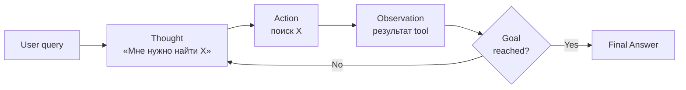
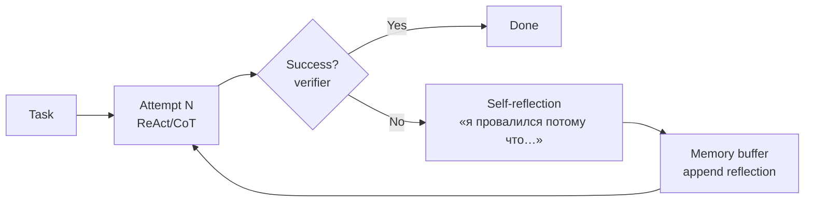
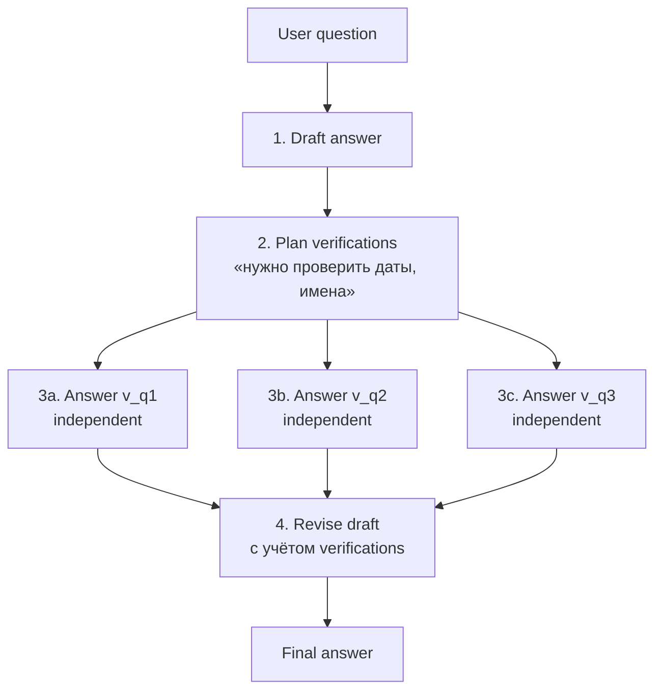
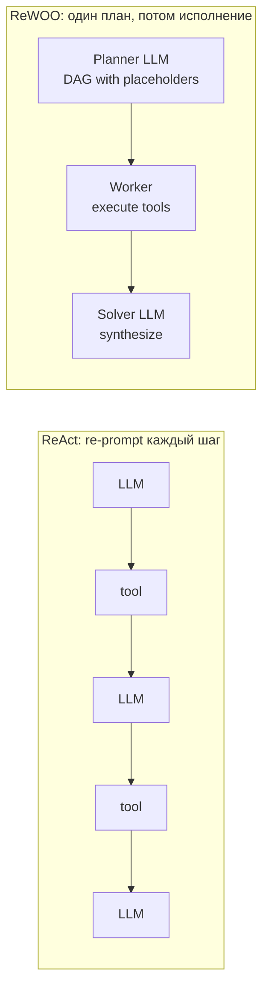
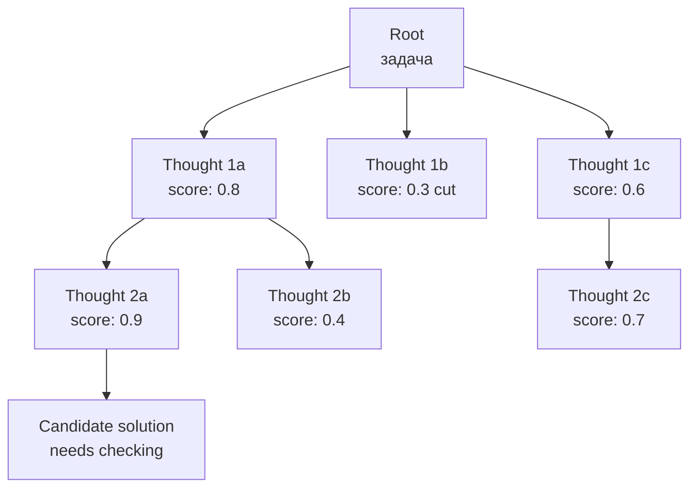

# Вопросы на собеседовании: Паттерны агентных систем

**Паттерн агентной системы** — способ организовать несколько шагов работы модели и приложения: выбор действия, обработку результата, проверку и завершение. Отдельный паттерн может включать рассуждение, инструменты или несколько исполнителей; все эти элементы сразу не обязательны.

Ниже разобраны подходы к организации агентных систем и близкие стратегии работы с моделью: `ReAct`, `Reflexion`, `Plan-and-Execute`, `Tree-of-Thoughts`, `Self-Refine`, `Chain-of-Verification`, `ReWOO`, `Self-Consistency`, `Best-of-N`, `Voyager`. Их можно сочетать, когда задача требует нескольких механизмов. На интервью полезно объяснять, что именно даёт каждый подход и при каких условиях он нужен.

## Полезные ссылки

### Original papers и авторитетные источники

- [ReAct: Synergizing Reasoning and Acting in Language Models (Yao et al. 2022)](https://arxiv.org/abs/2210.03629) — базовый Thought→Action→Observation loop
- [Reflexion: Language Agents with Verbal Reinforcement Learning (Shinn et al. 2023)](https://arxiv.org/abs/2303.11366) — self-reflection без gradient updates
- [Tree of Thoughts (Yao et al. 2023)](https://arxiv.org/abs/2305.10601) — branching reasoning + evaluation
- [Self-Refine (Madaan et al. 2023)](https://arxiv.org/abs/2303.17651) — generate → critique → refine
- [Chain-of-Verification (Dhuliawala et al. 2023)](https://arxiv.org/abs/2309.11495) — снижение hallucinations через verification questions
- [ReWOO (Xu et al. 2023)](https://arxiv.org/abs/2305.18323) — Plan/Worker/Solver без перепрогона LLM на каждом observation
- [Plan-and-Solve Prompting (Wang et al. 2023)](https://arxiv.org/abs/2305.04091) — planner + executor
- [Self-Consistency (Wang et al. 2022)](https://arxiv.org/abs/2203.11171) — majority vote по N CoT
- [Voyager (Wang et al. 2023)](https://voyager.minedojo.org/) — skill library + curriculum
- [Generative Agents (Park et al. 2023)](https://arxiv.org/abs/2304.03442) — memory stream + reflection
- [Toolformer (Schick et al. 2023)](https://arxiv.org/abs/2302.04761) — self-supervised tool use
- [Anthropic: Building Effective Agents](https://www.anthropic.com/research/building-effective-agents) — практические patterns от Anthropic

## Содержание

- [Полезные ссылки](#полезные-ссылки)
- [See also](#see-also)

**Основы**
- [Q1. (!) Что такое agentic pattern и чем он отличается от prompt-техники?](#q1--что-такое-agentic-pattern-и-чем-он-отличается-от-prompt-техники)
- [Q2. По какому принципу здесь группируют паттерны агентных систем?](#q2-по-какому-принципу-здесь-группируют-паттерны-агентных-систем)
- [Q3. (!) Зачем нужны паттерны, если модель уже умеет рассуждать?](#q3--зачем-нужны-паттерны-если-модель-уже-умеет-рассуждать)

**Базовые паттерны (ReAct / CoT / Self-Consistency)**
- [Q4. (!) Что такое ReAct и как выглядит его цикл?](#q4--что-такое-react-и-как-выглядит-его-цикл)
- [Q5. (!) Как завершается цикл в приведённом псевдокоде ReAct-агента?](#q5--как-завершается-цикл-в-приведённом-псевдокоде-react-агента)
- [Q6. Что такое Self-Consistency и когда работает?](#q6-что-такое-self-consistency-и-когда-работает)
- [Q7. Auto-CoT vs Manual CoT — в чём разница?](#q7-auto-cot-vs-manual-cot--в-чём-разница)

**Reflection-based (Reflexion / Self-Critique / CoVe)**
- [Q8. (!) Что такое Reflexion и чем отличается от обычного retry?](#q8--что-такое-reflexion-и-чем-отличается-от-обычного-retry)
- [Q9. Self-Refine / Self-Critique — pattern и pseudo-code](#q9-self-refine--self-critique--pattern-и-pseudo-code)
- [Q10. (!) Chain-of-Verification (CoVe) — как снижает hallucinations?](#q10--chain-of-verification-cove--как-снижает-hallucinations)
- [Q11. Чем self-critique без external feedback опасен?](#q11-чем-self-critique-без-external-feedback-опасен)

**Plan-based (Plan-Execute / ReWOO)**
- [Q12. (!) Plan-and-Execute pattern — структура и use case](#q12--plan-and-execute-pattern--структура-и-use-case)
- [Q13. (!) Что такое ReWOO и чем выигрывает у ReAct?](#q13--что-такое-rewoo-и-чем-выигрывает-у-react)
- [Q14. Когда re-planning важнее изначального плана?](#q14-когда-re-planning-важнее-изначального-плана)

**Tree-based (ToT / Best-of-N)**
- [Q15. (!) Tree-of-Thoughts — структура дерева и evaluation](#q15--tree-of-thoughts--структура-дерева-и-evaluation)
- [Q16. BFS vs DFS в ToT — когда что?](#q16-bfs-vs-dfs-в-tot--когда-что)
- [Q17. Best-of-N sampling: pattern и trade-off с verifier](#q17-best-of-n-sampling-pattern-и-trade-off-с-verifier)

**Memory patterns (Voyager / Generative Agents)**
- [Q18. (!) Паттерн Voyager: библиотека навыков, авто-curriculum, итеративный prompting](#q18--паттерн-voyager-библиотека-навыков-авто-curriculum-итеративный-prompting)
- [Q19. Generative Agents (Stanford): поток памяти и reflection](#q19-generative-agents-stanford-поток-памяти-и-reflection)
- [Q20. OODA Loop (Observe-Orient-Decide-Act) — как адаптируется к LLM-агентам?](#q20-ooda-loop-observe-orient-decide-act--как-адаптируется-к-llm-агентам)
- [Q21. Toolformer-подход: учим модель вызывать API через self-supervision](#q21-toolformer-подход-учим-модель-вызывать-api-через-self-supervision)

**Composition и stopping**
- [Q22. (!) Композиция паттернов: ReAct + Reflexion, Plan-Execute + Self-Critique](#q22--композиция-паттернов-react--reflexion-plan-execute--self-critique)
- [Q23. (!) Stopping conditions: как агент решает, что закончить?](#q23--stopping-conditions-как-агент-решает-что-закончить)
- [Q24. Implementation: LangChain / LlamaIndex / Vercel AI SDK — где какой pattern из коробки?](#q24-implementation-langchain--llamaindex--vercel-ai-sdk--где-какой-pattern-из-коробки)

**Anti-patterns и evaluation**
- [Q25. (!) Anti-patterns: pattern без необходимости, recursive без bound, context bloat](#q25--anti-patterns-pattern-без-необходимости-recursive-без-bound-context-bloat)
- [Q26. Сравнительная таблица паттернов: complexity, latency, use case](#q26-сравнительная-таблица-паттернов-complexity-latency-use-case)
- [Q27. Какой pattern когда выбирать: ReAct / Reflexion / ToT / Self-Critique / CoVe](#q27-какой-pattern-когда-выбирать-react--reflexion--tot--self-critique--cove)
- [Q28. (!) Evaluation patterns: harness, метрики (success rate, # steps, tokens)](#q28--evaluation-patterns-harness-метрики-success-rate--steps-tokens)
- [Q29. Reasoning models делают patterns внутри — нужны ли они снаружи?](#q29-reasoning-models-делают-patterns-внутри--нужны-ли-они-снаружи)
- [Q30. Какие паттерны хорошо переносятся на multi-agent системы?](#q30-какие-паттерны-хорошо-переносятся-на-multi-agent-системы)

## Q1. (!) Что такое agentic pattern и чем он отличается от prompt-техники?

Промпт-техника задаёт **формулировку или структуру входа модели**: например, few-shot добавляет примеры в запрос. Паттерн агентной системы задаёт **организацию выполнения**: как выбирают следующий шаг, передают результат инструмента, проверяют промежуточный результат и завершают работу. Одна и та же промпт-техника может использоваться на разных шагах процесса.

| Свойство | Промпт-техника | Паттерн выполнения |
|----------|----------------|--------------------|
| Что задаёт | Вход модели в отдельном шаге | Связь шагов, решений и результатов |
| Число вызовов | Сама по себе не определяет | Зависит от задачи и хода выполнения |
| Инструменты | Может описывать их использование | Может включать вызов и обработку результата |
| Примеры | Few-shot, инструкция о формате ответа | ReAct, цепочка шагов, цикл оценки и доработки |

Это различие описывает **уровень управления**, а не обязательное число вызовов или наличие инструментов. Например, несколько выборок Chain-of-Thought с последующим голосованием образуют стратегию Self-Consistency; её не требуется считать агентом только из-за нескольких вызовов. См. [Building effective agents](https://www.anthropic.com/engineering/building-effective-agents) и [оригинальную работу о Self-Consistency](https://arxiv.org/abs/2203.11171).

## Q2. По какому принципу здесь группируют паттерны агентных систем?

В этой шпаргалке паттерны сгруппированы **по ведущему механизму**: какую организацию работы они добавляют к отдельному вызову модели. Это учебная группировка, а не общепринятая строгая таксономия.

1. **Reasoning-action loops** — `ReAct`, `OODA`. Базовое чередование «думаю — действую».
2. **Reflection-based** — `Reflexion`, `Self-Refine`, `Chain-of-Verification`. Агент критикует собственный вывод.
3. **Plan-based** — `Plan-and-Execute`, `ReWOO`. Сначала план, потом исполнение.
4. **Search/sampling-based** — `Tree-of-Thoughts`, `Best-of-N`, `Self-Consistency`. Несколько кандидатов и выбор результата; это близкие стратегии, не обязательно агентные циклы.
5. **Memory-based** — `Voyager`, `Generative Agents`. Долговременная память, накопление навыков.
6. **Multi-agent** — `Debate`, `Society-of-Mind` (в отдельной шпаргалке про orchestration).

Группы **не взаимоисключающие**: система может сочетать планирование, работу с инструментами и проверку результата. Например, исполнитель плана может использовать ReAct для получения данных, а отдельный шаг — оценивать итог. Другие источники выбирают иной набор групп; см. [практическую группировку Anthropic](https://www.anthropic.com/engineering/building-effective-agents).

## Q3. (!) Зачем нужны паттерны, если модель уже умеет рассуждать?

Модель с внутренним рассуждением может решать часть задач без инструкции «думай пошагово». Это **не организует работу приложения**: нужно решить, когда вызвать инструмент, передать модели его результат, сохранить состояние и остановить цикл. Модель может предложить вызов инструмента, но инструмент исполняет внешняя среда.

Для простого вопроса может хватить одного вызова. Если ответ зависит от актуальных данных или действий во внешней системе, приложение должно организовать вызовы и проверить полученные результаты. При длинной задаче ему также нужны управление состоянием и условия остановки. Внутреннее рассуждение само по себе не подтверждает факты по независимому источнику и не гарантирует качество ответа.

Промпты с явной цепочкой рассуждений для некоторых reasoning models избыточны; это **не означает**, что Self-Refine, Self-Consistency или внешняя проверка всегда становятся бесполезными. Их пользу оценивают на конкретной задаче. Возможности вызова инструментов зависят от модели и API. См. [рекомендации OpenAI по reasoning models](https://developers.openai.com/api/docs/guides/reasoning-best-practices) и [описание агентных циклов Anthropic](https://www.anthropic.com/engineering/building-effective-agents).

## Q4. (!) Что такое ReAct и как выглядит его цикл?

**ReAct** (Reasoning + Acting, Yao et al.) сочетает шаги рассуждения и действия: модель выбирает действие с учётом текущего контекста, среда выполняет его и возвращает наблюдение. В исходной работе модель порождает явные фрагменты рассуждения; конкретный API может не показывать внутреннее рассуждение пользователю. См. [статью ReAct](https://arxiv.org/abs/2210.03629).

Цикл из трёх шагов:

1. **Thought** — модель намечает следующий шаг в формате исходного ReAct.
2. **Action** — модель предлагает действие, которое выполняет среда.
3. **Observation** — среда возвращает результат действия в контекст следующего шага.

Повтор до тех пор, пока модель не выдаст `Final Answer`.



**Условный trace (вычисление):**
```
Question: Сколько будет 17 × 19?
Thought: Проверю умножение калькулятором.
Action: calculator["17 * 19"]
Observation: 323
Thought: Вычисление получено; можно ответить.
Final Answer: 323.
```

Явные шаги рассуждения в исходном ReAct показывают, почему выбран следующий запрос, и помогают разбирать траекторию решения. Это не гарантия правильного выбора инструмента или достоверности ответа.

**Минусы:**
- Если без ограничения передавать всю историю на каждом шаге, расход токенов растёт вместе с ней.
- Ошибку инструмента нужно вернуть модели как наблюдение и предусмотреть обработку сбоя.
- Без условия остановки и предела шагов агент может зациклиться.

## Q5. (!) Как завершается цикл в приведённом псевдокоде ReAct-агента?

Ниже учебный вариант текстового протокола ReAct; `llm.complete`, `parse_action` и `extract_final_answer` обозначают операции, а не API конкретной библиотеки.

```python
def react_agent(query, tools, max_steps=10):
    history = [{"role": "user", "content": query}]
    for step in range(max_steps):
        # 1. LLM генерирует Thought + Action (или Final Answer)
        response = llm.complete(
            system=REACT_SYSTEM_PROMPT,  # описание tools, формат
            messages=history,
        )
        history.append({"role": "assistant", "content": response})

        # 2. Парсим ответ
        if "Final Answer:" in response:
            return extract_final_answer(response)

        action_name, action_args = parse_action(response)

        # 3. Выполняем tool
        try:
            observation = tools[action_name](**action_args)
        except Exception:
            observation = "Tool error"  # передаём безопасное описание сбоя

        # 4. Кладём observation обратно
        history.append({
            "role": "user",
            "content": f"Observation: {observation}",
        })

    raise RuntimeError("ReAct step limit reached")
```

**Ключевые места, на которые смотрят на собеседовании:**
- `parse_action` — уязвимое место текстового протокола: разбор свободного текста может ошибиться. Если API поддерживает структурированные вызовы инструментов, следует использовать их формат вместо разбора строки.
- `max_steps` — защитный предел реализации. Сам ReAct может завершиться раньше, но без внешнего ограничения есть риск зацикливания.
- Ошибку инструмента возвращают модели как `Observation`, чтобы она могла выбрать следующий шаг; текст исключения предварительно приводят к безопасному сообщению.

## Q6. Что такое Self-Consistency и когда работает?

**Self-Consistency** (Wang et al.) — стратегия выбора ответа для задач с цепочками рассуждений: вместо одного пути получают несколько разных, извлекают итог каждого и выбирают наиболее частый ответ. Разные пути могут прийти к одному решению, но совпадение само по себе не доказывает его правильность. См. [исходную статью](https://arxiv.org/abs/2203.11171).

Три шага:

1. Получить `N` разных выборок цепочки рассуждений; параметры генерации подбирают так, чтобы пути не были одинаковыми.
2. Извлечь и при необходимости нормализовать итоговый ответ из каждой.
3. Выбрать наиболее частый ответ; заранее определить поведение при равенстве голосов.

```python
def self_consistency(question, n=20, temperature=0.7):
    answers = []
    for _ in range(n):
        cot = llm.complete(question, temperature=temperature)
        answers.append(extract_answer(cot))
    ranked = Counter(answers).most_common(2)
    if len(ranked) > 1 and ranked[0][1] == ranked[1][1]:
        raise ValueError("tie between answers")
    return ranked[0][0]
```

**Когда применять:**
- Итоговые ответы можно надёжно привести к сравнимому виду: например, к числу или варианту из списка.
- Задача допускает разные пути решения, а проверка на целевом наборе показывает выигрыш от дополнительных выборок.

**Ограничения:**
- Для развёрнутых ответов простое сравнение строк не подходит; нужен отдельный способ сопоставления ответов.
- Если выборки повторяют одну и ту же ошибку, голосование её закрепит.
- Дополнительные выборки увеличивают расход токенов; задержка зависит от того, выполняются ли вызовы последовательно или параллельно.

Для reasoning models эффект дополнительного семплирования нужно измерять на своей задаче, а не выводить из предположений об их скрытом рассуждении.

## Q7. Auto-CoT vs Manual CoT — в чём разница?

Разница в одном: **кто подбирает примеры рассуждений** для few-shot CoT-промпта — человек или сама модель. Всё остальное (показываем модели образцы `Question + Reasoning + Answer`, чтобы она рассуждала по аналогии) у них общее.

**Manual CoT** — человек подбирает и пишет примеры `Question + Reasoning + Answer` для задачи. Их подготовка требует ручной работы; качество зависит от самих примеров.

**Auto-CoT** (Zhang et al., [исходная статья](https://arxiv.org/abs/2210.03493)):
1. Берём пул вопросов из задачи.
2. Получаем embedding каждого, кластеризуем (K-means).
3. Из каждого кластера выбираем вопрос-репрезентант.
4. Для каждого репрезентанта генерируем CoT (`Let's think step by step`) — это и есть exemplars.
5. Используем как few-shot для нового вопроса.

**Плюс Auto-CoT:** подбор разных вопросов снижает ручной труд и помогает разнообразить примеры.
**Ограничение:** сгенерированные рассуждения могут содержать ошибки, которые затем попадут в few-shot-промпт.

Пользу few-shot-примеров нужно проверять для выбранной модели и задачи; некоторые reasoning models не требуют явной инструкции «думай по шагам».

## Q8. (!) Что такое Reflexion и чем отличается от обычного retry?

**Reflexion** (Shinn et al., [исходная статья](https://arxiv.org/abs/2303.11366)) добавляет к повторным попыткам словесный разбор полученной обратной связи. Агент сохраняет вывод о предыдущей попытке в памяти и использует его в следующем запросе. Под «обычным повтором» здесь понимается новый запуск без такого вывода.

Авторы называют это **verbal reinforcement learning**: веса модели не обновляются, а сохранённый текст помогает скорректировать последующую попытку. Обратная связь может быть числовой или текстовой, от внешнего проверяющего либо от внутренней оценки.



**Чем отличается от обычного retry:**
| Свойство | Plain retry | Reflexion |
|----------|-------------|-----------|
| Что передаётся между попытками | Нет сформулированного вывода | Текст разбора и нужная обратная связь |
| Как меняется следующий запрос | Повтор без анализа ошибки | Учитывает сохранённый вывод |
| Обратная связь | Может отсутствовать | Нужна для осмысленного разбора; формат зависит от задачи |

В экспериментах авторов результат на HumanEval достиг 91% pass@1 против 80% у приведённого ими базового GPT-4. Это результат конкретной настройки эксперимента, а не гарантия для других задач.

**Что обязательно нужно, чтобы паттерн работал:**
- **Обратная связь** о результате попытки: например, тесты для кода или оценка в среде. Она может быть не только бинарной.
- Достаточный **контекст** для сохранённых выводов либо способ отбирать нужные воспоминания.
- **Предел попыток** как защитное условие реализации: без него повтор может затянуться.

## Q9. Self-Refine / Self-Critique — pattern и pseudo-code

**Self-Refine** (Madaan et al. 2023) — это цикл «создать черновик → получить от модели отзыв → исправить черновик» в рамках одной задачи. В базовой схеме модель формулирует отзыв по своему результату без обязательной внешней оценки. Дополнительные тесты или источники можно включить в прикладную систему, но это уже внешняя опора для проверки, а не свойство самого Self-Refine.

```python
def self_refine(task, max_refinements=3):
    draft = llm.complete(f"Solve: {task}")
    for _ in range(max_refinements):
        feedback = llm.complete(
            f"Task: {task}\nDraft: {draft}\n"
            "Review the draft against the task. If no changes are needed, reply 'OK'."
        )
        if feedback.strip() == "OK":
            break
        draft = llm.complete(
            f"Task: {task}\nDraft: {draft}\nFeedback: {feedback}\n"
            "Revise the draft in light of the feedback."
        )
    return draft
```

**Где полезен:** для задач, где отзыв можно привязать к заданию и доступному материалу: проверить связность текста, требования к формату, полноту пересказа относительно исходника. Для кода тесты дают более надёжную проверку поведения, чем одна текстовая критика.

**Ограничение:** модель может не заметить собственную ошибку или предложить ошибочную правку. Проверка фактов, вычислений и исполняемого кода требует источника, калькулятора или тестов, когда точность существенна. Предел итераций защищает от бесконечного цикла, но сам по себе не подтверждает качество.

**Отличие от Reflexion:**
- Self-Refine правит текущий черновик по отзыву модели; внешняя оценка не обязательна для базового цикла.
- Reflexion сохраняет текстовый вывод по обратной связи о попытке и использует его в следующих попытках. Обратная связь может поступать от среды или проверяющего механизма и не обязана быть бинарной; повторные попытки могут относиться к той же задаче.

## Q10. (!) Chain-of-Verification (CoVe) — как снижает hallucinations?

**Chain-of-Verification** (Dhuliawala et al. 2023) — приём проверки фактических утверждений в собственном черновике: модель составляет вопросы к сомнительным фактам, отвечает на них и пересматривает ответ. В варианте с раздельными проверками ответы на вопросы получают без доступа к черновику, чтобы уменьшить его влияние. Это снижает часть ошибок в исследованных задачах, но не делает ответы на проверочные вопросы автоматически истинными.

4-шаговый pattern для **fact-heavy ответов**:

1. **Draft answer** — модель пишет первичный ответ.
2. **Plan verifications** — модель формулирует список проверочных вопросов (что именно надо перепроверить).
3. **Answer verifications** — в раздельном варианте отвечаем на каждый вопрос без черновика в контексте.
4. **Revise** — исправляем черновик с учётом проверочных ответов; для значимых фактов дополнительно сверяем их с источниками.



**Почему может помочь:** раздельный ответ на проверочный вопрос меньше зависит от формулировки черновика. Затем модель явно сопоставляет два результата и исправляет найденное расхождение. Если проверочный ответ тоже ошибочен, схема не даёт гарантии точности.

**Пример:**
- Draft: «В документе срок ответа — 30 дней».
- Verification question: «Какой срок ответа указан в документе?» — вопрос проверяется отдельно от черновика по самому документу.
- Revised: если в документе указано «45 дней», итоговый ответ исправляют на 45 дней.

**Стоимость:** проверочные вопросы и пересмотр требуют дополнительных вызовов модели; точное число зависит от способа объединения шагов. При высокой цене ошибки полезно подключать первичные источники, поскольку самопроверка модели не заменяет их.

## Q11. Чем self-critique без external feedback опасен?

Главная ловушка: модель, которая критикует сама себя, **не получает независимый источник истины** только от повторного вызова. Критика может улучшить форму ответа, но не гарантирует исправления фактической или логической ошибки. Возможные проблемы:

1. **Пропуск ошибки** — отзыв повторяет ошибочную предпосылку черновика.
2. **Ложная критика** — модель предлагает изменить уже корректный фрагмент.
3. **Нет опоры на факты** — без документа, теста или вычисления отзыв не доказывает истинность утверждения.
4. **Уход от задания** — после нескольких правок текст может потерять исходные требования.

**Меры:** дать проверке независимую опору — тесты для кода, первичные источники для фактов, вычисление для арифметики. Отдельно ограничить число правок и сравнивать результат с требованиями задачи. Другая модель-критик может предложить иной взгляд, но сама по себе не становится независимым источником фактов.

## Q12. (!) Plan-and-Execute pattern — структура и use case

**Plan-and-Execute** разделяет предварительное планирование и выполнение шагов. План задаёт ориентир, исполнитель использует результаты предыдущих шагов, а при необходимости оставшуюся часть плана пересматривают. Это организационный паттерн агента; **Plan-and-Solve** — отдельная техника промптинга для пошагового решения задач, поэтому их не следует отождествлять. Исполнитель может сам использовать цикл ReAct.

Типичные роли:

1. **Planner** — составляет упорядоченный план на основе задачи.
2. **Executor** — выполняет очередной шаг, учитывая накопленные результаты; может обращаться к инструментам.
3. **Re-planner** — при существенном отклонении обновляет ещё не выполненные шаги. Это может быть тот же компонент, что построил исходный план.

```python
def plan_and_execute(task, planner, executor, max_replans=2):
    pending_steps = list(planner.plan(task))
    completed = []
    replans = 0
    while pending_steps:
        step = pending_steps.pop(0)
        result = executor.run(step, history=completed)
        if needs_replan(result):
            if replans >= max_replans:
                raise RuntimeError("Re-planning limit reached")
            pending_steps = list(planner.replan(task, completed, step, result))
            replans += 1
            continue
        completed.append((step, result))
    return synthesize(task, completed)
```

**Сценарии применения** — задачи с несколькими зависимыми этапами, для которых полезно заранее наметить порядок:
- Multi-step research («собери информацию о компании X: финансы, продукт, команда»).
- Code refactoring («разбей класс на 3, добавь тесты, обнови doc»).
- Долгие workflow с известными фазами.

**Сравнение с ReAct:** ReAct выбирает очередное действие с учётом текущего наблюдения; Plan-and-Execute сначала намечает несколько шагов и выполняет их с возможностью перепланирования. Подходы можно сочетать: исполнитель отдельного шага может работать по ReAct. Экономия вызовов и качество зависят от реализации и задачи, а не следуют из одного названия паттерна.

## Q13. (!) Что такое ReWOO и чем выигрывает у ReAct?

**ReWOO** (Reasoning WithOut Observation, Xu et al. 2023) разделяет планирование, исполнение инструментов и сборку ответа. Планировщик задаёт шаги и ссылки на будущие результаты **до получения наблюдений**. Исполнитель подставляет фактические результаты в зависимые вызовы, а решатель использует собранные данные для ответа. Планировщик не вызывается заново после каждого наблюдения, поэтому в подходящих задачах можно сократить расход токенов по сравнению с пошаговым перепланированием.

Три роли:

1. **Planner** — заранее записывает шаги и ссылки на результаты (`#E1`, `#E2`), которые ещё не получены.
2. **Worker** — выполняет вызовы инструментов; если следующий вызов использует прежний результат, подставляет его значение. Независимые вызовы допускают параллельное исполнение.
3. **Solver** — получает исходный вопрос и собранные результаты, затем составляет ответ.



**Пример plan:**
```
Plan:
  E1 = search("страна организации из вопроса")
  E2 = search("столица страны #E1")
Solver: «Организация находится в стране #E1; её столица — #E2»
```

**Преимущества перед ReAct:**
- **Меньше повторных вызовов планировщика** — ему не передают всю растущую историю после каждого инструмента; величина экономии зависит от задачи и реализации.
- **Возможность параллельной работы** — независимые вызовы можно выполнять одновременно; зависимые ждут предыдущего результата.

**Минусы** — оборотная сторона жёсткого плана:
- Планировщик не меняет решение на основе промежуточных наблюдений в этом проходе. Если результат показывает, что прежний план неверен, приложению нужен отдельный путь исправления или новый план.
- Зависимые вызовы с подстановкой результата допустимы; труднее случай, когда **сам выбор следующего действия** становится понятен только после наблюдения.

## Q14. Когда re-planning важнее изначального плана?

Re-planning нужен, когда наблюдение или новое требование делает оставшиеся шаги исходного плана неверными или бесполезными. Он меняет **ещё не выполненную часть** плана с учётом уже полученных результатов.

Сигналы, что пора re-plan:

- Tool вернул error / пусто / результат, не совпадающий с ожиданием.
- Появились новые факты, меняющие приоритет шагов.
- Бюджет шагов близок к пределу, а цель не достигнута: нужно выбрать достижимый остаток либо остановиться.
- Пользователь вмешался с уточнением.
- Проверка цели (goal-predicate) провалилась там, где план считал задачу завершённой.

**Упрощённый цикл:**
```python
pending_steps = list(planner.plan(task))
history = []
while pending_steps and within_budget():
    step = pending_steps.pop(0)
    result = executor.run(step)
    history.append((step, result))
    if requires_replan(result, task, history):
        pending_steps = list(planner.replan(task, history))
# Если бюджет исчерпан до достижения цели, сообщаем о неполном результате.
```

**Где re-plan важнее изначального плана:**
- Web automation — страница изменилась, кнопки уже не там.
- Длительные агентные задачи, где новые наблюдения меняют последовательность следующих шагов.
- Research-задачи с неизвестным объёмом — нашёл новую информацию, поменял подход.

**Где пересмотр нужен реже:** структурированные процессы со стабильными входами и известным порядком. Даже там ошибку исполнения нужно обработать, а не бесконечно продолжать исходный план.

## Q15. (!) Tree-of-Thoughts — структура дерева и evaluation

**Tree-of-Thoughts** (Yao et al. 2023) превращает CoT из одной линейной цепочки в **дерево с поиском**: на каждом шаге модель порождает несколько вариантов «следующей мысли», оценивает их и развивает только перспективные ветки, отбрасывая тупиковые. Это даёт то, чего нет у обычного CoT — возможность откатиться и попробовать другой путь.

Каждое состояние — частичное рассуждение, ветви — альтернативные продолжения. Четыре шага:

1. **Thought decomposition** — задаём гранулярность шага: одна мысль = одна строка / одно равенство / один ход в игре.
2. **Thought generator** — LLM предлагает `k` вариантов следующей мысли из текущего состояния.
3. **State evaluator** — оценивает промежуточное состояние, например с помощью модели, внешней эвристики или проверяемого ограничения; оценка может быть словесной или числовой.
4. **Search** — обход дерева (BFS / DFS / beam-search) с отсечением веток с низким score.



**Pseudo-code (BFS):**
```python
def tot_bfs(task, k_per_step=3, beam=2, depth=5):
    frontier = [State(task=task, path=[])]
    for _ in range(depth):
        candidates = []
        for state in frontier:
            for thought in llm.generate_thoughts(state, k=k_per_step):
                candidate = state.extend(thought)
                if candidate.is_valid_solution():
                    return candidate
                candidate.score = evaluate(candidate)
                candidates.append(candidate)
        if not candidates:
            return None
        frontier = sorted(candidates, key=lambda x: -x.score)[:beam]
    return None  # лучшее промежуточное состояние не считаем готовым ответом
```

**Где применяют** — задачи с дискретными шагами, где промежуточное состояние можно оценить и при ошибке откатиться:
- Game of 24 (эксперимент авторов): поиск по нескольким промежуточным состояниям помог лучше справляться с задачей, чем одна линейная цепочка рассуждений.
- Crosswords, мини-puzzles.
- Step-by-step planning с возможностью отката.

**Стоимость:** без отсечения число ветвей может расти экспоненциально с глубиной. Ограничение ширины и глубины уменьшает расход, но может отсечь путь к решению. Оценка промежуточного состояния не заменяет проверку итогового ответа.

## Q16. BFS vs DFS в ToT — когда что?

Выбор зависит от формы пространства поиска, бюджета памяти и того, можно ли рано отбрасывать бесперспективные состояния. В обоих случаях качество оценки и правила отсечения влияют на результат.

**BFS (breadth-first):**
- Расширяет состояния по уровням и хранит фронт текущего уровня. Без ограничения ширины память может быстро расти.
- Удобен, если нужно систематически проверить короткие решения или сравнить несколько альтернатив одинаковой глубины.

**DFS (depth-first):**
- Развивает одну ветвь, при тупике возвращается к ещё не рассмотренной альтернативе. Порядок ветвей может задавать оценка.
- Хранит меньше одновременных состояний, но без предела глубины может надолго уйти по неудачной ветви.

**Beam search** — отдельный вариант: на каждом уровне сохраняют лишь несколько наиболее оценённых состояний. Это ограничивает память и вызовы, но может навсегда отбросить нужную ветвь; не следует называть такой проход полным BFS.

Для ToT заранее задают предел глубины, ширины и вызовов, а итоговое решение проверяют по условиям задачи. Универсального выбора между BFS, DFS и beam search нет.

## Q17. Best-of-N sampling: pattern и trade-off с verifier

**Best-of-N** — самый прямолинейный способ поднять качество за счёт compute: генерируем `N` независимых вариантов ответа, а **verifier** (отдельная функция или модель) выбирает лучший. Весь паттерн стоит на verifier — он и есть потолок качества: чем точнее verifier отличает хорошее от плохого, тем больше пользы от N вариантов.

```python
def best_of_n(task, n=10, verifier=None):
    candidates = [llm.complete(task, temperature=0.7) for _ in range(n)]
    if verifier:
        return max(candidates, key=verifier)
    # fallback — LLM как judge
    return llm_judge(task, candidates)
```

**Компромиссы:**
- Стоимость генерации растёт в N раз.
- Качество verifier — потолок: плохой verifier выбирает практически случайно, и N вариантов не спасут.
- Diminishing returns: переход 1 → 4 даёт большой прирост, 4 → 64 — уже маленький.

**Где работает** — там, где есть надёжный способ проверить ответ:
- Code generation + unit-tests как verifier.
- Math + символьный verifier.
- RLHF data labeling — reward model выбирает лучший response.

**Отличие от Self-Consistency:** Best-of-N опирается на **verifier** (внешнее знание, что считать хорошим); Self-Consistency — на **agreement** (большинство голосует за ответ, никакого внешнего критерия).

**Отличие от ToT:** в Best-of-N варианты независимы, общего состояния нет; в ToT поиск инкрементальный, с общим деревом и pruning.

## Q18. (!) Паттерн Voyager: библиотека навыков, авто-curriculum, итеративный prompting

**Voyager** (Wang et al. 2023, NVIDIA) — long-horizon embodied agent для Minecraft, главная идея которого — **агент, который накапливает навыки и сам ставит себе цели**, а не решает одну фиксированную задачу. Освоенные умения сохраняются как код и переиспользуются дальше.

Три компонента:

1. **Skill library** — растущая база **исполняемого кода** (JavaScript Mineflayer API). Каждый skill — функция с docstring (`mine_diamond()`, `craft_iron_pickaxe()`). При новой задаче агент:
   - retrieves relevant skills (vector search по docstring),
   - composes их в новый код.
2. **Automatic curriculum** — отдельный LLM-prompt предлагает **следующую достижимую цель** по принципу «exploration novelty + проверка предпосылок». Прогресс не задан hardcoded, а самораскрывается.
3. **Iterative prompting** — генерация кода → запуск в среде → ошибки/feedback (game logs) → правка → повтор. Похоже на ReAct, но действиями являются **программы**, а не одиночные tool-вызовы.

**Что из этого унесли в production-агенты:**
- **Skill library** превратилась в библиотеку одобренных tool-макросов / сохранённых процедур (банковские и девопс-боты).
- **Curriculum** используют для self-improving агентов и генерации синтетических данных.
- **Code as action** — Code Agents (SmolAgents, HuggingFace) реализуют ровно эту идею: вместо вызовов tool-by-tool LLM пишет Python, который исполняется в sandbox.

## Q19. Generative Agents (Stanford): поток памяти и reflection

**Generative Agents** (Park et al. 2023) — симуляция человеческого поведения (городок Smallville). Ключевой вклад для практики — **механика долгой памяти**: как агенту хранить тысячи наблюдений и доставать из них нужное, не упираясь в context window.

Компоненты:

1. **Memory stream** — append-only лог наблюдений, у каждого timestamp и importance score (насколько событие значимо).
2. **Retrieval** — при действии память скорится по формуле `recency × importance × relevance`, где relevance — это embedding-схожесть с текущим контекстом. Так агент вспоминает то, что свежо, важно и уместно.
3. **Reflection** — периодически, когда накопилось много значимых событий, агент сжимает их в **higher-level insights** («Klaus интересуется urban gentrification → ему лучше предложить тему диссертации»).
4. **Planning** — иерархический план: день → почасовой → детальный, с перепланированием по событиям.

**Что унесли в production:**
- **Reflection** как способ сжать длинную history в abstract insights — переиспользуется в **mem0**, **MemGPT**, Anthropic **memory** (2025).
- **Importance scoring** для отбора в long-term память.
- **Hierarchical planning** для долгих agent-сессий.

**Не унесли:** социальную симуляцию (она нужна для исследований, не для tasks).

## Q20. OODA Loop (Observe-Orient-Decide-Act) — как адаптируется к LLM-агентам?

**OODA** — это ReAct, в котором шаг «думать» расщеплён на два: отдельно **интерпретация** ситуации и отдельно **выбор** действия. Эта явная граница и есть его ценность для дизайна агентов.

Фреймворк военного теоретика John Boyd для принятия решений в неопределённости:
1. **Observe** — собрать данные о ситуации.
2. **Orient** — интерпретировать их в свете знаний и контекста (самый ёмкий шаг).
3. **Decide** — выбрать курс действий.
4. **Act** — выполнить.
5. → снова Observe (цикл).

**Применение к LLM-агентам:**
- Observe = чтение state (logs, sensors, tool outputs).
- Orient = LLM reasoning + retrieval из памяти/RAG.
- Decide = выбор tool/action.
- Act = вызов tool.

Полезно это как **мысленная модель** при дизайне long-running агентов (monitoring, incident response), где каждый шаг хочется спроектировать явно: что наблюдаем, как интерпретируем, как решаем. Разделение Orient и Decide заставляет не сваливать всё в один «подумай».

**Практика:** готового «OODA-агента» в LangChain нет — это **архитектурный шаблон**, а не библиотечный примитив. Полезен на whiteboard при проектировании, в коде превращается в обычный loop.

## Q21. Toolformer-подход: учим модель вызывать API через self-supervision

**Toolformer** (Schick et al. 2023, Meta) выбивается из ряда: это паттерн не runtime, а **training-time**. Вместо prompt engineering для tool use он **встраивает умение вызывать API прямо в модель на этапе обучения** — и делает это self-supervised, без ручной разметки, где какой вызов уместен.

Pipeline:
1. Берём корпус текстов.
2. Для каждого текста вставляем кандидаты `[API call]` в потенциально полезные места.
3. Запускаем API, получаем результат.
4. Оставляем только те вставки, которые **снижают perplexity** последующего текста — то есть вызов реально помог предсказать продолжение. Это и есть self-supervised-сигнал: критерий полезности не размечен человеком, а вычислен.
5. Fine-tune модель на этом «обогащённом» корпусе.

**Результат:** небольшая GPT-J научилась пользоваться calculator, calendar, search, QA-системой и обошла GPT-3 на бенчмарках, где инструменты реально помогают.

**Связь с современностью:**
- Концепция «модель сама знает, когда дёрнуть tool» теперь стандартна — function calling в GPT-4, Claude, Gemini обучен по тому же принципу.
- **Tool tokens** (`<tool_call>...</tool_call>`) — прямое наследие Toolformer.
- Паттерн важно понимать ради вывода: tool use — это не только промпт в рантайме, но и сигнал на этапе обучения модели.

## Q22. (!) Композиция паттернов: ReAct + Reflexion, Plan-Execute + Self-Critique

Главный принцип композиции: паттерны комбинируют **по слоям, а не как альтернативы**. Каждый закрывает свой класс задач — управление потоком, проверку, память — поэтому в production обычно стоит 2-3 паттерна, каждый на своём уровне. Типичные связки:

**ReAct + Reflexion**
- Внутри попытки — ReAct loop.
- На уровне попыток — Reflexion (verifier + memory of reflections).
- Use case: coding agent с тестами (SWE-bench пайплайны).

**Plan-Execute + ReAct (в executor)**
- Planner строит шаги.
- Каждый шаг исполняет ReAct-агент с tools.
- Use case: research-агент (план «Найди A, потом B, потом сравни», каждый под-шаг — поиск + чтение).

**Plan-Execute + Self-Critique**
- После execute — критическая ревизия плана/результата перед финализацией.
- Use case: long-form report generation.

**ToT + Self-Consistency**
- На листьях дерева — несколько samples, majority vote.
- Use case: math с множественными возможными подходами.

**ReWOO + CoVe**
- ReWOO даёт план + evidence.
- CoVe на финальном synthesizer-шаге проверяет факты.
- Use case: fact-heavy answer generation.

**Voyager + ReAct**
- Voyager на верхнем уровне (curriculum + skill library).
- Внутри отдельного skill — ReAct для исполнения шагов.

**Вывод:** не выбирайте «ReAct или Reflexion» — спрашивайте, какой паттерн закрывает каждый уровень: что управляет потоком, что проверяет результат, что помнит контекст. Это и есть композиция по слоям.

## Q23. (!) Stopping conditions: как агент решает, что закончить?

Stopping conditions — критический элемент любого agentic pattern: без них агент **зацикливается** или **бесконечно жжёт токены**. Главная мысль, которую хотят услышать на собеседовании: одного `max_iterations` мало. Нужен хотя бы один **позитивный** критерий («задача решена»), а лимит шагов держать как страховку.

Типы условий:

1. **Max iterations** — самый базовый, ОБЯЗАТЕЛЬНЫЙ. `max_steps=10/20/50` в зависимости от задачи.
2. **Final answer marker** — модель явно выдаёт `FINAL_ANSWER` / финальный JSON / вызов `submit_answer` tool.
3. **Verifier passes** — для Reflexion/Best-of-N: внешняя проверка (тесты, predicate).
4. **Goal predicate** — функция от state: `len(results) >= n`, `target_url_visited`, `payment_completed`.
5. **Token budget** — кумулятивный лимит tokens (защита от growing context).
6. **Time budget** — wall clock (особенно для tool-heavy агентов с медленными API).
7. **No progress** — если N последних шагов не меняют state / повторяют действия — stop.
8. **User confirmation** — human-in-the-loop: агент сам спрашивает «продолжать?».
9. **Cost cap** — $-budget; в production важнее token cap.

**Anti-pattern:** stopping только по `max_iterations`. Это не stopping, это **timeout**. Должен быть хотя бы один **успешный** критерий + timeout как safety net.

**Implementation tip:** wrap агент в `AgentExecutor`, который держит **все** stopping conditions централизованно и пишет в лог, какое сработало.

## Q24. Implementation: LangChain / LlamaIndex / Vercel AI SDK — где какой pattern из коробки?

Главное, что стоит запомнить: **ReAct есть из коробки почти везде и выглядит примерно одинаково**, а нетривиальные паттерны (re-plan, reflection, ToT) почти везде придётся собирать вручную — и удобнее всего это делать на LangGraph. Сводка:

| Framework | ReAct | Plan-Execute | Reflexion | ToT | Self-Consistency |
|-----------|-------|--------------|-----------|-----|------------------|
| **LangChain (Python)** | `create_react_agent`, `AgentExecutor` | `PlanAndExecute` (deprecated в LangGraph), сейчас через LangGraph | через LangGraph state | не из коробки | через `RunnableParallel` + voter |
| **LangGraph** | низкоуровневые узлы, есть `create_react_agent` | composable graph (любой план) | state с reflections | можно построить вручную | parallel branches |
| **LlamaIndex** | `ReActAgent` | `StructuredPlannerAgent` | нет нативного | нет | нет |
| **Vercel AI SDK** | `streamText({ tools, maxSteps })` — manual loop | вручную | вручную | вручную | вручную |
| **Anthropic SDK (raw)** | примеры в Anthropic Cookbook | вручную | вручную | вручную | вручную |
| **CrewAI** | role-based, ReAct под капотом | через task planning | нет | нет | нет |
| **AutoGen** | conversation-driven, не строго ReAct | через GroupChat | через CritiquerAgent | нет | нет |

**Современный тренд (2026):** **LangGraph** стал стандартом для нетривиальных patterns — он даёт `nodes + edges + state`, поверх которого описывается любой pattern. ReAct-обёртки во всех фреймворках выглядят похоже; различия проявляются в более сложных композициях (re-plan, reflection, multi-agent).

**Anti-pattern:** тащить тяжёлый framework для простого ReAct из 3 tools — голый цикл из Q5 + function calling короче и понятнее.

## Q25. (!) Anti-patterns: pattern без необходимости, recursive без bound, context bloat

Большинство провалов agent-систем — это не «не тот паттерн», а **отсутствие границ**: нет bound на рекурсию, нет управления контекстом, нет независимого verifier, нет трейсинга. Восемь типичных анти-паттернов и лечение к каждому:

1. **Pattern без необходимости (over-engineering)**
   - Простой Q&A решается одним промптом — а навешено Plan-Execute + Self-Refine + Verifier.
   - Признак: 10 LLM-вызовов там, где хватило бы одного.
   - Лечение: начинать с baseline (single prompt), добавлять pattern только когда видим конкретную проблему.

2. **Recursive без bound**
   - Self-critique вызывает себя без max_iters → бесконечный цикл.
   - Tool A вызывает агента, который снова вызывает tool A.
   - Лечение: stack-depth check, дедупликация недавних состояний.

3. **Context bloat от reflection / history**
   - Каждый шаг добавляет в prompt — после 30 шагов уже 100k токенов, дорого и качество падает.
   - Лечение: **rolling window** (последние K), **summarization** (сжать историю), **scratchpad** в отдельном tool вместо context.

4. **Verifier weaker than generator**
   - Self-Critique со слабой judge-моделью — отбирает не лучшие варианты, а удобные для critic.
   - Лечение: использовать **другой** провайдер/модель для judge; ground-truth verifier там, где возможен.

5. **Implicit state via history**
   - Состояние «закодировано» в длинном history, никто его явно не моделирует.
   - При обрезке окна теряется ключевой факт.
   - Лечение: explicit state (`AgentState`/`scratchpad`), summary блоки.

6. **Tool name collision / ambiguous schemas**
   - Два tools с похожими описаниями → модель путает.
   - Лечение: чёткие docstring, тесты на disambiguation.

7. **No instrumentation**
   - Не логируется trace шагов → невозможно понять, почему agent зациклился.
   - Лечение: structured tracing (LangSmith, Helicone, custom logs), включить с первого дня.

8. **Reflection «для галочки»**
   - Pattern есть, но reflections игнорируются при retry (баг в коде).
   - Лечение: assertion в тестах, что reflections появляются в следующем prompt.

## Q26. Сравнительная таблица паттернов: complexity, latency, use case

Сводная шпаргалка по стоимости и применимости. Читать так: чем больше LLM-вызовов, тем дороже и медленнее, а колонка «Нужен verifier» отделяет паттерны, которые без внешней проверки бесполезны (Reflexion, Best-of-N), от тех, что работают на одной модели.

| Pattern | LLM calls | Cost vs baseline | Latency | Нужен verifier | Хорошо для |
|---------|-----------|------------------|---------|----------------|------------|
| `CoT (prompt)` | 1 | 1× | 1× | Нет | Простые reasoning |
| `Self-Consistency` | N | N× | ~1× (parallel) | Нет (agreement) | Численный ответ |
| `ReAct` | k шагов | k× растущий context | k× | Нет (но желателен) | General tool use |
| `Reflexion` | k × R попыток | k×R | k×R | **Да** | Coding, environment-based |
| `Self-Refine` | 2R+1 (gen+critique+refine) | 2-4× | 2-4× | Нет (рискованно) | Writing, coding draft |
| `Chain-of-Verification` | N+2 | 4-6× | sequential | Нет (LLM-self) | Fact-heavy answers |
| `Plan-and-Execute` | 1 plan + k step | 1+k | 1+k | Нет | Структурированные workflow |
| `ReWOO` | 1 plan + 1 solver | ~2× (без re-prompt) | DAG (parallel tools) | Нет | Token-конкурентные tool-heavy задачи |
| `Tree-of-Thoughts` | k^d (с pruning меньше) | high | high | LLM judge | Math/puzzles |
| `Best-of-N` | N | N× | ~1× (parallel) | **Да** | Code with tests, RLHF |
| `Voyager` | растёт со временем | amortized | long-horizon | env feedback | Embodied / continuous learning |
| `Generative Agents` | high (memory + reflection) | high | continuous | нет | Симуляция, persistent agents |

«Baseline» = одиночный CoT prompt без agentic-надстройки.

## Q27. Какой pattern когда выбирать: ReAct / Reflexion / ToT / Self-Critique / CoVe

Дефолт — `ReAct`; всё остальное добавляют, когда у задачи есть конкретная особенность: верифицируемый результат, известная структура, дискретный перебор, дорогая галлюцинация. Краткий гайд по выбору:

- **`ReAct`** — general-purpose tool use, exploratory задачи. Дефолт для агента «реши задачу X, у тебя есть tools Y».
- **`Reflexion`** — задачи с **верифицируемым результатом** (тесты, симулятор) и где модель **должна учиться на провалах**: coding agents, game-like, RL-like environments.
- **`Plan-and-Execute`** — когда **структура задачи известна** заранее или хочется явный plan для аудита. Долгие workflow с понятными фазами.
- **`ReWOO`** — когда задача состоит из **набора независимых tool calls**, и хочется сэкономить токены / распараллелить. Multi-hop QA, агрегация из нескольких API.
- **`Tree-of-Thoughts`** — задачи с **дискретным reasoning** и возможностью оценить промежуточное состояние: math, puzzles, planning over short horizon.
- **`Best-of-N`** — когда **есть программный verifier** (unit-tests, eval function) и compute не лимит.
- **`Self-Consistency`** — short factual/numeric answers, есть «канонический» ответ для majority vote.
- **`Self-Refine`** — open-ended writing, summarization, draft → polish. Без verifier — осторожно с математикой.
- **`Chain-of-Verification`** — fact-heavy ответы (биография, исторические факты, описание продукта), где hallucination дорого стоит.
- **`Voyager`** — long-horizon agents с накоплением навыков.
- **`Generative Agents`** — persistent agents с долгой памятью и социальной составляющей.

**Композиция:** в продакшене типично 2-3 pattern в стеке. Пример: `Plan-Execute (верх) + ReAct (executor) + CoVe (на финальном synth)`.

## Q28. (!) Evaluation patterns: harness, метрики (success rate, # steps, tokens)

Agentic system **нельзя** оценивать одной метрикой: high success rate ничего не стоит, если агент тратит 50 шагов и стопится по `max_iters`. Поэтому harness меряет качество (решил/не решил) **в связке** с ценой (шаги, токены, latency) и устойчивостью. Минимальный набор:

**Базовые метрики:**
- **Success rate** — % задач, решённых корректно (по ground-truth / verifier).
- **# steps to solution** — среднее/медиана шагов. Меньше — лучше, но не за счёт quality.
- **Tokens per task** — input + output + thinking. Прокси стоимости.
- **Latency (p50/p95)** — wall clock от запроса до финала.
- **Cost per task** — $ при текущих ценах.
- **Tool calls per task** — сколько раз дёрнули внешние API.

**Качественные:**
- **Tool selection accuracy** — % случаев, когда выбран правильный tool.
- **Tool argument accuracy** — корректность аргументов.
- **Hallucination rate** — % ответов с фактами, не подтверждёнными context/tools.
- **Stop-condition triggered** — какое условие сработало (final answer / max_iters / error). Высокая доля `max_iters` — плохой знак.

**Robustness:**
- **Re-run variance** — std success rate при temperature > 0.
- **Adversarial inputs** — поведение на malformed query, prompt injection.
- **Tool failure resilience** — что если tool вернул error / timeout.

**Eval-frameworks:**
- **LangSmith Evaluators** — datasets + LLM-as-judge.
- **OpenAI Evals** — generic harness.
- **AgentBench, SWE-bench, GAIA, WebArena, ALFWorld** — стандартные benchmarks для категорий агентов.
- **PromptFoo** — для regression-тестов prompts/agents.

**Принцип:** строить **regression suite** из ~30-100 задач разной сложности и гонять её на каждое изменение pattern/prompt/model.

## Q29. Reasoning models делают patterns внутри — нужны ли они снаружи?

Это уточнённая версия Q3, и ответ тот же: внутри thinking-блока модель делает только **рассуждение**, а всё, что касается внешнего мира, по-прежнему нужно строить снаружи. Граница проходит ровно по линии «думать против взаимодействовать».

Reasoning models (o1, o3, R1, Claude extended thinking, Gemini Deep Think) выполняют внутри thinking-блока:
- CoT (по определению).
- Частичный Self-Refine («wait, let me check this»).
- Эмерджентный backtracking.
- Иногда поиск по вариантам, похожий на tree-search.

**Что отпадает снаружи:**
- Self-Consistency на простой математике даёт мало прироста.
- Self-Refine без verifier — почти бесполезен, модель внутри это сделала.
- Manual CoT exemplars — лишний noise.

**Что остаётся актуальным:**
- **Tool use** — reasoning model не вызывает tools внутри thinking; нужен внешний ReAct/ReWOO loop.
- **External verification** — модель не знает реальных фактов, нужен Search/DB/CoVe с реальными запросами.
- **Long-horizon planning с реальным state** — между шагами реальность меняется (web automation, embodied).
- **Cost optimization** — reasoning model дорогая; в production обычно **routing**: простые шаги → cheap model + ReAct, сложные шаги → reasoning model.
- **Multi-agent orchestration** — patterns между агентами (debate, hierarchical) не делаются «внутри» одной модели.
- **Memory / skill libraries** — Voyager-like наследие не уходит.

**Резюме:** reasoning model заменила **prompt-уровневые** patterns; **system-уровневые** (tool use, external state, multi-agent, memory) остались полностью актуальны.

## Q30. Какие паттерны хорошо переносятся на multi-agent системы?

Правило простое: паттерн переносится на multi-agent тем легче, чем **естественнее в нём разделяются роли**. Где single-agent уже делит работу на «планировщик и исполнитель» или «автор и критик» — там каждая роль становится отдельным агентом почти даром. Где паттерн опирается на единого решателя — перенос ломается.

Какие single-agent-паттерны переходят естественно:

- **Plan-Execute → Hierarchical multi-agent**: planner-агент + executor-агенты. Manager делегирует таски workers (CrewAI, AutoGen GroupChat manager).
- **ReWOO → DAG-of-agents**: planner строит граф задач, каждая нода — отдельный agent/role. Параллелизация естественна.
- **Self-Refine / Reflexion → Debater + Critic agents**: критик — отдельный агент с другим system-prompt (часто иной моделью). Снимает confirmation bias.
- **Best-of-N → Proposer + Selector agents**: N генераторов, отдельный selector-агент с verifier.
- **Tree-of-Thoughts → Parallel exploration agents**: каждая ветка дерева — отдельный agent run, head-агент агрегирует.
- **Chain-of-Verification → Asker + Verifier agents**: специализированный verifier-agent (другая модель / другой context).
- **Voyager → Specialist library**: вместо skill code — pool of specialist agents (research-agent, code-agent, browse-agent), индексированных по описанию.

**Что НЕ переносится прямолинейно:**
- **Self-Consistency** — теряет суть, если все «голоса» — копии одного агента; для multi-agent имеет смысл, только если агенты **разные** (разные модели, разные prompts).
- **OODA** — это mental model одного решателя, не паттерн распределения.

**Главное усложнение multi-agent:** communication protocol между агентами (message passing, blackboard, debate format) и stopping condition на уровне всей системы. Это уже **orchestration**, а не pattern.

---

## See also

- [AI Agents (общая шпаргалка)](ai-agents-interview.md) — базовые понятия про агентов
- [Multi-Agent Orchestration](multi-agent-orchestration-interview.md) — паттерны взаимодействия между агентами
- [Function Calling](function-calling-interview.md) — tool use, на котором стоят ReAct/ReWOO
- [Reasoning Models](reasoning-models-interview.md) — o1/o3/R1 и как они меняют необходимость patterns
- [Prompt Engineering](prompt-engineering-interview.md) — CoT, few-shot, foundational техники
- [LLM Basics](llm-basics-interview.md) — основы LLM
- [MCP](mcp-interview.md) — Model Context Protocol для tool ecosystem
- [System Design Interview](../system-design/system-design-interview.md) — общий контекст для system-design разговоров
- [Code Agents](code-agents-interview.md) — архитектура, SWE-Bench, tool use, edit strategies, sandboxing, production…
