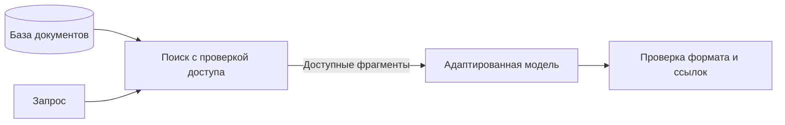
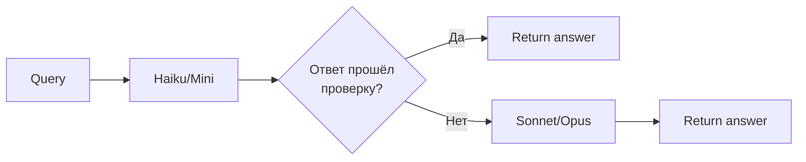
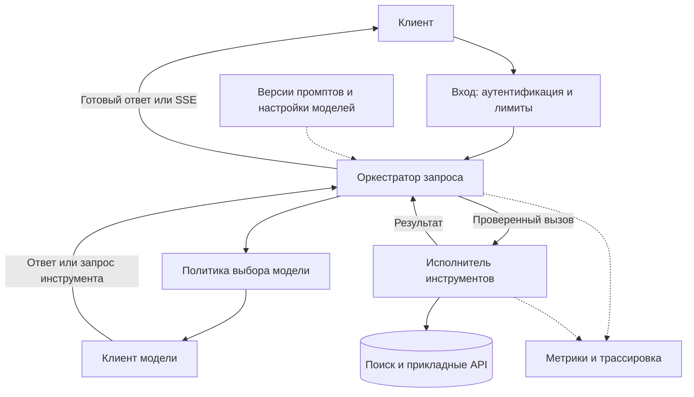
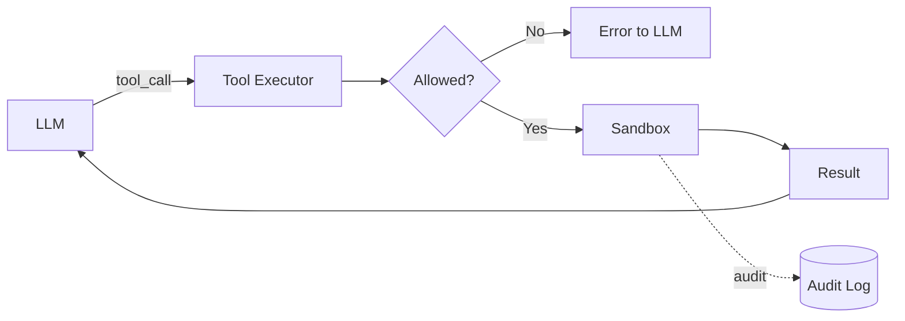
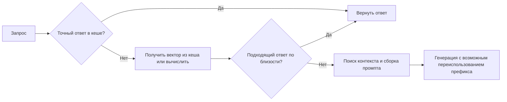
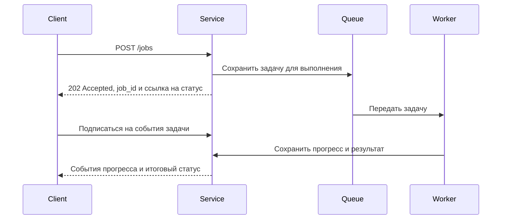
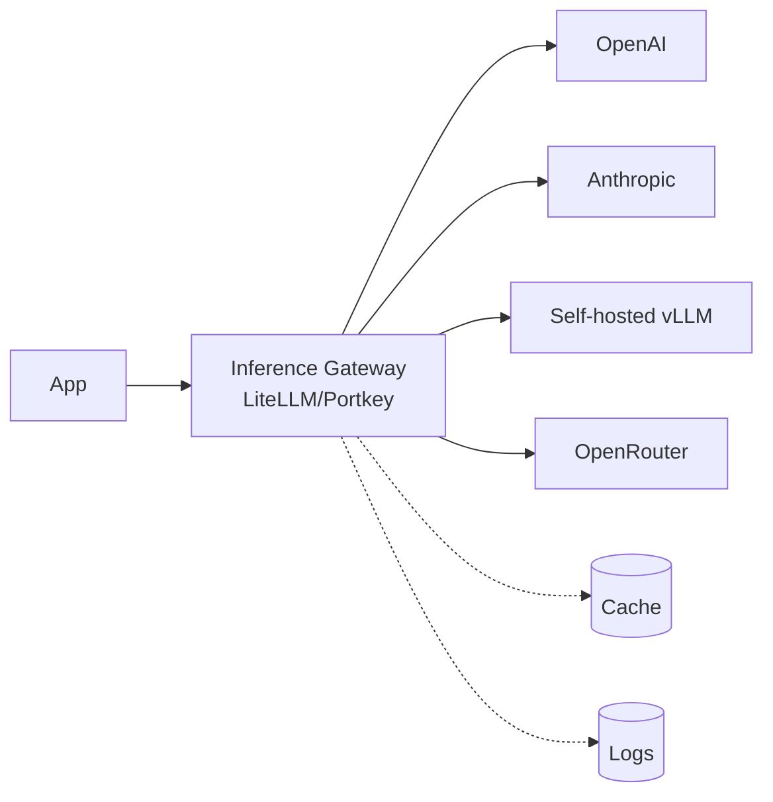
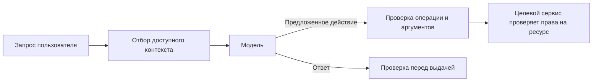
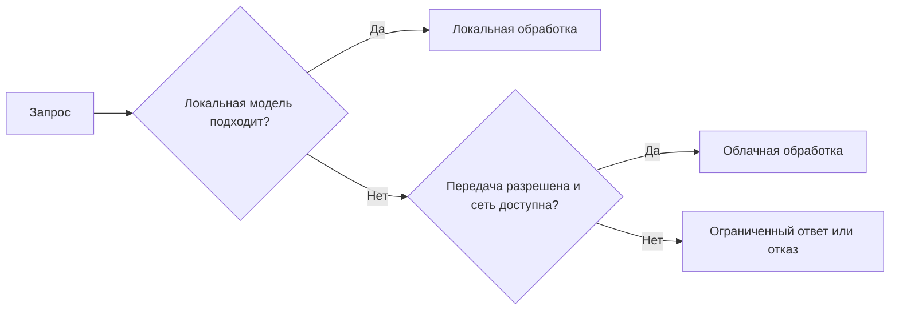

# Вопросы на собеседовании: Архитектура ИИ-приложений

Архитектура AI-приложений — это не выбор «модной» технологии, а **инженерная задача**: подобрать комбинацию `prompt + RAG + fine-tune + agents` под конкретные требования (свежесть знаний, latency, cost, compliance). На senior-интервью спрашивают про фреймворк выбора, гибридные паттерны, сквозную референсную архитектуру, бюджеты latency/cost, антипаттерны и производственные стадии.

## Полезные ссылки

### Официальная документация и авторитетные источники

- [OpenAI: Choosing between RAG, fine-tuning, and prompt engineering](https://platform.openai.com/docs/guides/optimizing-llm-accuracy)
- [Anthropic: Building effective agents](https://www.anthropic.com/research/building-effective-agents)
- [LangChain: Architecting LLM applications](https://python.langchain.com/docs/concepts/)
- [LlamaIndex: Production-ready RAG](https://docs.llamaindex.ai/en/stable/optimizing/production_rag/)
- [LiteLLM proxy — multi-provider gateway](https://docs.litellm.ai/docs/proxy/quick_start)
- [Portkey — AI gateway](https://portkey.ai/docs)
- [Eugene Yan: Patterns for building LLM systems](https://eugeneyan.com/writing/llm-patterns/)

## Содержание

- [Полезные ссылки](#полезные-ссылки)
- [See also](#see-also)

**4 base patterns**
- [Q1. (!) Какие 4 базовых паттерна AI-приложений?](#q1--какие-4-базовых-паттерна-ai-приложений)
- [Q2. (!) Когда выбрать Prompt Engineering vs RAG vs Fine-tune vs Agents?](#q2--когда-выбрать-prompt-engineering-vs-rag-vs-fine-tune-vs-agents)
- [Q3. Как выбрать паттерн по матрице требований?](#q3-как-выбрать-паттерн-по-матрице-требований)

**Hybrid patterns**
- [Q4. (!) RAG + Fine-tune — зачем комбинировать?](#q4--rag--fine-tune--зачем-комбинировать)
- [Q5. (!) Agents + RAG — retrieval как tool?](#q5--agents--rag--retrieval-как-tool)
- [Q6. Как работает каскадирование промптов (дешёвая → дорогая модель)?](#q6-как-работает-каскадирование-промптов-дешёвая--дорогая-модель)
- [Q7. Как сделать fallback с RAG на fine-tuned при низкой уверенности?](#q7-как-сделать-fallback-с-rag-на-fine-tuned-при-низкой-уверенности)

**End-to-end architecture**
- [Q8. (!) Какая референсная архитектура у production AI-приложения?](#q8--какая-референсная-архитектура-у-production-ai-приложения)
- [Q9. (!) Как работает router-слой (выбор модели по запросу)?](#q9--как-работает-router-слой-выбор-модели-по-запросу)
- [Q10. Что такое Tool Executor и как изолировать инструменты?](#q10-что-такое-tool-executor-и-как-изолировать-инструменты)

**Latency / Cost / Quality trade-offs**
- [Q11. (!) Как разложить latency-бюджет (цель < 2s)?](#q11--как-разложить-latency-бюджет-цель--2s)
- [Q12. (!) Сколько стоит запрос: prompt vs RAG vs agent?](#q12--сколько-стоит-запрос-prompt-vs-rag-vs-agent)
- [Q13. Какие метрики качества у каждого паттерна?](#q13-какие-метрики-качества-у-каждого-паттерна)
- [Q14. (!) Что такое TTFT, TPOT и зачем streaming для UX?](#q14--что-такое-ttft-tpot-и-зачем-streaming-для-ux)

**Production stages**
- [Q15. (!) Что строить на стадиях PoC → MVP → Production?](#q15--что-строить-на-стадиях-poc--mvp--production)
- [Q16. Каков путь эволюции: prompt → RAG → fine-tune → agent?](#q16-каков-путь-эволюции-prompt--rag--fine-tune--agent)

**Caching layers**
- [Q17. (!) Какие слои кеширования у AI-приложений?](#q17--какие-слои-кеширования-у-ai-приложений)
- [Q18. Semantic cache или exact match — когда что выбрать?](#q18-semantic-cache-или-exact-match--когда-что-выбрать)

**Async patterns**
- [Q19. (!) Sync, async, streaming, batch — какие паттерны потока данных?](#q19--sync-async-streaming-batch--какие-паттерны-потока-данных)
- [Q20. Webhook или SSE для долгих генераций?](#q20-webhook-или-sse-для-долгих-генераций)

**Failure modes и fallback**
- [Q21. (!) Какие бывают режимы отказа AI-системы и стратегии fallback?](#q21--какие-бывают-режимы-отказа-ai-системы-и-стратегии-fallback)
- [Q22. Что такое паттерн Inference Gateway (LiteLLM / Portkey / OpenRouter)?](#q22-что-такое-паттерн-inference-gateway-litellm--portkey--openrouter)

**Multi-tenancy и security**
- [Q23. (!) Как устроена multi-tenancy: промпты, индексы, лимиты на тенанта?](#q23--как-устроена-multi-tenancy-промпты-индексы-лимиты-на-тенанта)
- [Q24. (!) Как устроена security-архитектура: prompt injection, секреты, sandboxing?](#q24--как-устроена-security-архитектура-prompt-injection-секреты-sandboxing)
- [Q25. Как спроектировать архитектуру под compliance (PII, GDPR, residency)?](#q25-как-спроектировать-архитектуру-под-compliance-pii-gdpr-residency)
- [Q26. Как мониторить стоимость и задавать бюджеты на тенанта/фичу?](#q26-как-мониторить-стоимость-и-задавать-бюджеты-на-тенантафичу)

**Real examples и anti-patterns**
- [Q27. (!) Какие архитектурные антипаттерны встречаются в AI-проектах?](#q27--какие-архитектурные-антипаттерны-встречаются-в-ai-проектах)
- [Q28. Зачем feature flags и A/B-тестирование для AI-фич?](#q28-зачем-feature-flags-и-ab-тестирование-для-ai-фич)
- [Q29. Что такое Edge AI: маленькая модель на устройстве + тяжёлая в облаке?](#q29-что-такое-edge-ai-маленькая-модель-на-устройстве--тяжёлая-в-облаке)
- [Q30. Архитектура голосового агента: STT → LLM → TTS или Realtime API?](#q30-архитектура-голосового-агента-stt--llm--tts-или-realtime-api)
- [Q31. Build или buy: своё решение или hosted, OSS или commercial?](#q31-build-или-buy-своё-решение-или-hosted-oss-или-commercial)
- [Q32. Реальные примеры: какие паттерны у Notion AI, Cursor, Perplexity, Devin?](#q32-реальные-примеры-какие-паттерны-у-notion-ai-cursor-perplexity-devin)

**Ёмкость и перегрузка**
- [Q33. (!) Как планировать ёмкость LLM-сервиса и управлять перегрузкой?](#q33--как-планировать-ёмкость-llm-сервиса-и-управлять-перегрузкой)

## Q1. (!) Какие 4 базовых паттерна AI-приложений?

Четыре распространённых подхода меняют разные части приложения. Их можно применять по отдельности или сочетать.

| Подход | Что меняется | Что влияет на затраты |
|---|---|---|
| **Prompt Engineering** | Инструкции и примеры на входе. При поддержке API можно задать схему ответа | Подготовка и проверка промпта, число входных и выходных токенов |
| **RAG** | Перед генерацией приложение получает подходящие данные из внешнего источника и передаёт их модели | Подготовка корпуса, поиск, при необходимости переранжирование, объём контекста |
| **Fine-tuning** | Модель адаптируют на примерах, чтобы улучшить повторяемое поведение на целевой задаче | Подготовка данных, обучение, оценка и инференс выбранной модели |
| **Agents** | Модель выбирает следующие шаги и инструменты по промежуточным результатам | Число итераций, вызовы модели и инструментов, контроль действий |

Поиск помогает обосновать ответ только при наличии подходящих материалов и корректном использовании этих материалов моделью. Настроенный формат ответа также следует проверять отдельно от фактической правильности. [OpenAI — оптимизация модели](https://developers.openai.com/api/docs/guides/model-optimization) · [Anthropic — workflows и agents](https://www.anthropic.com/research/building-effective-agents)

## Q2. (!) Когда выбрать Prompt Engineering vs RAG vs Fine-tune vs Agents?

Начни с промпта и небольшой репрезентативной выборки. По ошибкам определяй, какой компонент нужно менять.

- **Модели не хватает документов или данных пользователя.** Добавь поиск либо запрос к авторитетному источнику. Для длинного корпуса подбирай релевантные фрагменты. Проверь, что фрагментов хватает для ответа на вопросы, которые требуют нескольких документов.
- **Модель знает нужные факты, но нарушает формат или правило классификации.** Уточни инструкцию, добавь примеры и, если API поддерживает, схему вывода. Если ошибки остаются, сравни fine-tuning с этим вариантом на отложенной выборке.
- **Порядок действий известен заранее.** Опиши шаги в коде. Например, получить заказ, проверить правила возврата и подготовить ответ.
- **Следующий шаг зависит от результата предыдущего и заранее перечислить ветки сложно.** Рассмотри агента с ограничениями на инструменты и число шагов. Например, он может уточнять поиск по нескольким разрешённым источникам, пока не соберёт данные для ответа.

Число примеров, цена и задержка зависят от задачи. Сравнивай варианты на одинаковой нагрузке и на одних и тех же сценариях качества. [OpenAI — оптимизация модели](https://developers.openai.com/api/docs/guides/model-optimization) · [Anthropic — выбор уровня оркестрации](https://www.anthropic.com/research/building-effective-agents)

## Q3. Как выбрать паттерн по матрице требований?

Матрица связывает требования с проверками на прототипе. Сначала исключи варианты, которые нарушают ограничения доступа к данным или пропускают обязательные шаги. Затем сравни качество и стоимость оставшихся вариантов.

| Требование | Что проверить |
|---|---|
| **Свежесть и ссылки на источники** | Когда изменения попадают в поиск, доступны ли нужные документы пользователю, подтверждают ли цитаты утверждения |
| **Стиль и формат** | Доля ответов, соответствующих схеме, и качество их содержимого. Сравнить инструкцию, примеры и адаптированную модель |
| **Задержка и стоимость** | p95 полного маршрута и стоимость на завершённую задачу с учётом поиска, инструментов, повторов и длины ответа |
| **Приватность и аудит** | Куда поступают исходные данные, что сохраняется в логах и где применяются права. Возможность развернуть модель внутри периметра покрывает только часть этих требований |
| **Сложные задачи** | Доля успешных завершений, число шагов и поведение при сбое инструмента или нехватке данных |

**Пример.** Для внутренней базы правил у ответов обязательны ссылки на действующие документы. Сначала измерь качество поиска и точность ссылок у связки RAG с обычным промптом. Если эта связка проходит ограничения по качеству и задержке, её можно выпускать. Если у неё остаётся повторяющаяся ошибка классификации, сравни её с fine-tuning при том же поиске. Методика оценки описана в Q13.

## Q4. (!) RAG + Fine-tune — зачем комбинировать?

Комбинация оправдана, если измерения показывают два разных требования. Приложение должно получать изменяемые факты из внешнего источника, а модель должна стабильнее выполнять задачу на этих фактах.



**Пример.** Ассистент поддержки ищет актуальные правила возврата по стране и передаёт найденные фрагменты в модель. Для формата карточки сначала используют инструкции и схему. Если модель регулярно путает категории обращений при корректном поиске, можно настроить её на размеченных примерах карточек с контекстом.

Сравни базовую и адаптированную модели с одинаковыми входными документами. Измеряй отдельно соблюдение формата, правильность категории, подтверждение ответа источниками и реакцию на отсутствие сведений. При плохой полноте поиска доработка корпуса или retrieval может дать больший эффект, чем обучение. [OpenAI — оптимизация модели](https://developers.openai.com/api/docs/guides/model-optimization) · [OpenAI — структурированный вывод](https://developers.openai.com/api/docs/guides/structured-outputs)

## Q5. (!) Agents + RAG — retrieval как tool?

Retrieval можно вызвать из фиксированного пайплайна или предоставить как инструмент, который модель использует по ходу задачи. Во втором случае модель может переформулировать запрос после неудачного поиска и сопоставить результаты из нескольких разрешённых источников.

**Пример.** В поддержке одна политика может зависеть от канала покупки. Агент сначала ищет общую политику, затем уточняет запрос по каналу из заказа. Если для решения обязательна актуальная политика, приложение само вызывает поиск или требует его выполнения перед ответом. При отсутствии подходящих фрагментов оно возвращает запрос на уточнение или передаёт обращение оператору.

Установи лимит шагов и общий дедлайн, а в инструменте проверяй права пользователя независимо от решения модели. Для оценки наблюдай качество отдельных вызовов поиска и итогового ответа. При простой задаче с известной последовательностью шагов фиксированный пайплайн даёт более предсказуемый маршрут. [Anthropic — workflows и agents](https://www.anthropic.com/research/building-effective-agents)

## Q6. Как работает каскадирование промптов (дешёвая → дорогая модель)?

Суть каскада: **дешёвая модель** обрабатывает запрос первой, а **дорогая** подключается только тогда, когда дешёвой не хватило. Экономия зависит от доли ответов, которые проходят проверку на первой ступени.



**Варианты каскадирования:**
- **Router-модель** — маленький LLM классифицирует intent и направляет запрос в специализированный pipeline.
- **Сначала дешёвый ответ** — генерируем им, и если ответ не проходит проверку, переспрашиваем дорогую модель.
- **Набросок + доводка** — маленькая модель пишет черновик, большая критикует и правит. Вторая модель получает черновик во входном контексте. Суммарную стоимость и качество проверяют на выборке.

**Расчёт.** Первая попытка стоит $0.001 и выполняется для всех запросов. Если 30% запросов затем требуют вызова за $0.03, средняя стоимость равна `$0.001 + 0.30 × $0.03 = $0.010` без учёта проверок. Для этих 30% к стоимости прибавляется и задержка первой ступени. В Q9 рассмотрен другой вариант: маршрутизатор выбирает модель до генерации. Порог переключения подбирают на размеченных примерах с учётом цены ошибок. [RouteLLM — оценка качества и стоимости маршрутизации](https://arxiv.org/abs/2406.18665).

## Q7. Как сделать fallback с RAG на fine-tuned при низкой уверенности?

Сначала выясните, чего не хватает RAG. Если поиск не вернул достаточных источников, смена модели сама по себе не добавит актуальных фактов. Если источников достаточно, но базовая модель плохо выполняет задачу, дообученная модель может обработать тот же контекст. Пригодность такого переключения проверяют на примерах с размеченным результатом. [OpenAI — оптимизация контекста и поведения модели](https://developers.openai.com/api/docs/guides/optimizing-llm-accuracy).

1. Оцените, содержат ли найденные документы сведения, необходимые для ответа. Retrieval score помогает ранжировать документы. Порог зависит от индекса, запроса и способа подсчёта.
2. Если контекста не хватает, уточните запрос, повторите поиск в разрешённом источнике или передайте вопрос человеку. Если ответ должен опираться на действующий документ, сообщите, что подтверждение не найдено.
3. Если задача допускает ответ без источника, используйте дообученную модель только для сценариев, где её качество проверено. Самооценку модели и фразу «не знаю» можно учитывать как сигналы вместе с другими проверками.

**Пример.** В поддержке модель может предложить проверенный сценарий диагностики по описанию сбоя. Для ответа о текущих условиях возврата нужен актуальный документ. Если поиск его не нашёл, запрос уходит сотруднику поддержки.

## Q8. (!) Какая референсная архитектура у production AI-приложения?

Типовая схема разделяет приём запроса, оркестрацию и исполнение. Для простого сервиса достаточно приложения с одним клиентом модели. Роутер, поиск по документам и инструменты добавляют, когда этого требует конкретный сценарий. На схеме показан вариант для приложения с несколькими моделями и инструментами.



| Слой | За что отвечает |
|---|---|
| Вход | Проверяет учётные данные и применяет квоту пользователя или тенанта. Приложение дополнительно ограничивает параллельность вызовов и бюджет токенов. |
| Оркестратор | Собирает контекст, выбирает версию промпта, передаёт запрос модели и управляет общим дедлайном. |
| Клиент модели | Преобразует запрос в формат провайдера и возвращает текст, структурированный результат или запрос на вызов инструмента. |
| Исполнитель инструментов | Проверяет аргументы и права для конкретной операции. Оркестратор передаёт результат модели в следующем шаге, если он нужен для ответа. |
| Данные и состояние | Поиск, кеш и история диалога подключаются по потребности. Если реплики приложения не хранят состояние в памяти процесса, длительные задачи и возобновляемые диалоги используют внешнее хранилище. |
| Наблюдаемость | Связывает шаги запроса по трассе. Для разбора задержки измеряют очередь, вызов модели и инструменты по отдельности. Запись содержимого промпта и ответа подчиняется политике обработки данных. |

Например, помощник службы поддержки получает номер заказа. Модель предлагает вызвать инструмент чтения заказа. Приложение проверяет право пользователя на этот заказ, получает разрешённые поля и возвращает их модели для составления ответа. Если запрос к заказам не уложился в дедлайн, приложение может сообщить о недоступности статуса. Переход на более быструю модель сам по себе этот сбой не устраняет.

SSE позволяет отправлять уже готовые фрагменты ответа. Время до первого фрагмента зависит также от очереди, подготовки контекста и вызовов инструментов. При росте нагрузки дополнительные реплики приложения помогают только там, где хватает ёмкости зависимостей и квоты модели.

Источники: [OpenAI — цикл вызова инструментов](https://developers.openai.com/api/docs/guides/function-calling), [OpenTelemetry — наблюдаемость GenAI](https://opentelemetry.io/docs/specs/semconv/gen-ai/).

## Q9. (!) Как работает router-слой (выбор модели по запросу)?

Router выбирает модель до генерации. Сначала исключают маршруты, которые нарушают ограничения по обработке данных, бюджету или необходимым возможностям API. Затем среди допустимых моделей применяют предпочтения тенанта, выбор по типу запроса или правила эксперимента. Резервный маршрут проходит те же проверки.

```python
def route(request):
    allowed = eligible_models(request)  # права, возможности, остаток бюджета
    for model in ranked_preferences(request):  # tenant, intent, rollout
        if model in allowed:
            return model
    return None  # кеш, отложенная задача или явный отказ согласно контракту
```

**Стратегии маршрутизации:**

| Стратегия | Когда | Плюсы | Минусы |
|---|---|---|---|
| **Статическая (по фиче)** | разным фичам — разные модели | просто | негибко |
| **Intent-классификатор** | router-LLM выбирает | может снизить расходы | +latency, +cost самого классификатора |
| **Каскадирование** | дешёвая → дорогая | экономия | сложная eval |
| **A/B-тестирование** | сравнение моделей | data-driven | накладные расходы на сплит трафика |
| **Tenant-config** | enterprise/BYOK | контроль на стороне тенанта | сложность эксплуатации |

**В production** обычно используют гибрид всех стратегий: статические дефолты как база, предпочтения тенанта среди допустимых моделей, и раскатка новых моделей через feature flag.

## Q10. Что такое Tool Executor и как изолировать инструменты?

Tool Executor — компонент, который выполняет function calls агента (`search_web`, `run_sql`, `execute_python`, `send_email`). Поскольку аргументы этих вызовов генерирует LLM, а не человек, executor нельзя считать доверенным: к нему относятся как к выполнению недоверенного кода и оборачивают защитой.

**Меры безопасности:**
- **Sandbox** для исполнения кода — Docker, gVisor, Firecracker, браузер в Chrome sandbox. Песочница сокращает доступ к хосту. Её гарантии зависят от реализации и конфигурации, включая подключённые файлы, сеть и доступные учётные данные. [gVisor — модель безопасности](https://gvisor.dev/docs/architecture_guide/security/).
- **Allowlist доменов** для web-запросов, чтобы агента нельзя было заставить ходить куда попало.
- **Read-only DB user** по умолчанию для SQL-инструмента — права на чтение ограничивают изменение данных. Доступ к чувствительным строкам и стоимость запросов ограничивают отдельно.
- **Human-in-the-loop** для деструктивных действий (отправить email, списать с карты) — необратимое действие требует подтверждения человека.

**Архитектура:**



**Что нужно в реализации (Spring/Python):** реестр инструментов, валидация аргументов по схеме (Pydantic / JSON Schema), авторизация операции и таймаут вызова в пределах общего дедлайна.

**Пример повтора.** Платёжный сервис принял запрос, но исполнитель не дождался ответа. Таймаут оставляет результат неизвестным. Если API поддерживает идемпотентность, исполнитель повторяет ту же операцию с тем же ключом и параметрами в пределах срока действия ключа. Ключ привязывают к бизнес-операции и сохраняют до первого вызова, чтобы он пережил рестарт. Если API не даёт такого контракта, сначала сверяют состояние операции по её идентификатору. При неизвестном результате автоматический повтор может продублировать списание. [Stripe — идемпотентные запросы](https://docs.stripe.com/api/idempotent_requests).

## Q11. (!) Как разложить latency-бюджет (цель < 2s)?

Для интерактивного RAG задайте две цели с точки зрения клиента. Например, первый видимый текст приходит менее чем за 1 с, а полный ответ — менее чем за 2 с на p95. Затем разложите время по критическому пути запроса. Измерьте очередь отдельно от вычислений. Prefill обрабатывает входной контекст и входит в задержку до первого текста наряду с поиском, ожиданием модели и передачей данных. [vLLM — точки измерения задержки](https://docs.vllm.ai/en/latest/benchmarking/cli/#understanding-the-latency-metrics).

**Пример бюджета для последовательного пути без инструментов.** Числа показывают распределение времени в проекте, их нужно проверить на целевой нагрузке.

| Этап | Бюджет |
|---|---:|
| Приём запроса, аутентификация и проверка лимитов | 30 мс |
| Embedding запроса | 50 мс |
| Поиск и rerank | 150 мс |
| Сборка промпта | 20 мс |
| Вызов модели до первого текстового фрагмента, включая сеть и очередь | 500 мс |
| Передача первого фрагмента клиенту | 50 мс |
| От первого фрагмента до завершения ответа у клиента | 1 000 мс |

По этой смете первый текст приходит через **800 мс**, а ответ завершается через **1 800 мс**. Запас до каждой цели составляет 200 мс. Сумма бюджетов показывает расчётный путь. Для проверки p95 измеряйте задержку запроса целиком, поскольку сумма p95 отдельных этапов не даёт p95 всего пути.

Если очередь модели прибавила 300 мс, первый фрагмент в этом примере придёт через 1 100 мс. Ускорение отдачи уже готовых фрагментов не уберёт это ожидание. Если первый текст приходит вовремя, но полный ответ опаздывает, проверьте число выходных токенов, TPOT и буферизацию потока. См. Q14 и Q33.

Пускайте параллельно независимые шаги, например поиск по ключевым словам и расчёт embedding для векторного поиска. Финальная сборка промпта ждёт нужные результаты. Если сценарий включает tool call, внесите в критический путь выполнение инструмента и следующий вызов модели. Перед каждым таким шагом учитывайте остаток общего дедлайна.


## Q12. (!) Сколько стоит запрос: prompt vs RAG vs agent?

Стоимость пользовательского запроса складывается из всех оплачиваемых операций на его пути. Для каждого вызова модели умножьте число токенов каждой тарифной категории на её ставку. Затем сложите стоимость вызовов и добавьте отдельные платежи за поиск, инструменты и другие операции. Учитывайте условия тарифа выбранной модели, включая чтение и запись prompt cache, если они тарифицируются отдельно. [OpenAI — тарифы API](https://developers.openai.com/api/docs/pricing), [Anthropic — тарифы Claude](https://platform.claude.com/docs/en/about-claude/pricing).

**Пример с условными ставками.** Возьмём одну модель по $2 за миллион входных и $8 за миллион выходных токенов без скидок. Поиск в примере стоит $0,0005 за запрос, включая embedding запроса. Фиксированные расходы на инфраструктуру и индексацию в таблицу не входят.

| Паттерн | Что оплачивается | Стоимость |
|---|---|---:|
| Один промпт | 1 000 входных и 250 выходных токенов | $0,004 |
| RAG | 3 000 входных токенов вместе с найденным контекстом, 250 выходных и один поиск | $0,0085 |
| Агент | Первый вызов с 1 000 входных и 100 выходных, второй с 2 500 входных и 250 выходных, один поиск | $0,0103 |

Агент может передавать предыдущие сообщения и результаты инструментов в следующий вызов. Поэтому число и размер вызовов учитывают отдельно. Умножение средней стоимости шага на число шагов даёт оценку для заданного сценария. Для фактического расхода суммируйте usage всех оплачиваемых попыток, включая повторы и переходы на резервную модель. Для ограничения расходов до вызова нужен отдельный контроль бюджета, см. Q26.

**Как оценить экономию.** Попадание в кеш готового ответа позволяет пропустить вызов модели, если результат подходит для этого запроса и пользователя. При prompt caching часть ввода может тарифицироваться по сниженной ставке, а генерация по-прежнему оплачивается. При каскаде учитывайте оба вызова, если дешёвая модель ответила первой, а затем запрос ушёл дорогой. Пакетный режим сравнивайте по тарифу и допустимому сроку обработки. Для self-hosted добавьте расходы на вычисления, простаивающую ёмкость и сопровождение. Для fine-tuning отдельно учтите обучение и тариф инференса.


## Q13. Какие метрики качества у каждого паттерна?

Выберите метрику по тому, какой результат считается успешным. Один и тот же критерий можно применять к разным архитектурам, если они решают одну задачу.

| Паттерн | Что измерять |
|---|---|
| **Prompt Engineering** | Для классификации — долю правильных меток и ошибки по классам. Для извлечения данных — совпадение значений с эталоном и валидность структуры. |
| **RAG** | Для поиска — recall@k по размеченным релевантным фрагментам. Для ответа — фактическую корректность, покрытие вопроса и подтверждённость утверждений выданными источниками. |
| **Fine-tune** | На отложенной выборке — долю успешно решённых задач и соблюдение формата. Сравните с базовой моделью и проверьте регрессии на соседних задачах. |
| **Agents** | Долю задач, в которых достигнуто целевое состояние и соблюдены ограничения. Число шагов, задержку и стоимость за задачу измеряйте отдельно. |

**Диагностика RAG.** Если из двух нужных фрагментов в топ-5 попал один, recall@5 для этого запроса равен 0,5. Повторите генерацию с обоими эталонными фрагментами. Если ответ теперь верен, проверьте индекс, фильтры и ранжирование. Если ответ снова неверен, отдельно исследуйте использование контекста моделью. Даже полностью подтверждённый источником ответ может быть неверным, если сам источник устарел.

**Диагностика агента.** Для сценария возврата заказа тест проверяет итоговый статус и отсутствие повторного возврата после таймаута. Трасса показывает, на каком шаге возник сбой. Итоговый текст агента сам по себе не подтверждает изменение состояния. В регрессии отдельно фиксируйте результат задачи и соблюдение ограничений. Если часть ответов оценивает LLM-судья, откалибруйте его оценки по человеческой разметке на типичных и пограничных случаях. [OpenAI — Evaluation best practices](https://developers.openai.com/api/docs/guides/evaluation-best-practices).


## Q14. (!) Что такое TTFT, TPOT и зачем streaming для UX?

**TTFT (Time To First Token)** показывает, сколько времени проходит до первого токена. Указывайте обе точки измерения. Например, клиентская метрика от отправки запроса до первого текстового фрагмента включает сеть и ожидание в очереди. Серверная метрика может начинаться позже. Первый служебный фрагмент потока и первый видимый текст тоже могут прийти в разные моменты.

**TPOT (Time Per Output Token)** показывает, сколько времени в среднем приходится на выходной токен после первого. Например, для ответа из 101 токена между первым и последним прошло 1,5 с, поэтому TPOT равен 15 мс. Для одного токена интервала после первого нет. Интервал между соседними фрагментами потока измеряйте отдельно, поскольку фрагмент может содержать несколько токенов. [vLLM — метрики задержки](https://docs.vllm.ai/en/latest/benchmarking/cli/).

**Что даёт streaming.** Если первый фрагмент доступен через 500 мс, а весь текст готов через 2 с, поток позволяет начать показ через 500 мс при своевременной доставке. С буферизацией ответ станет виден позднее. Сам способ доставки не ускоряет вычисление на модели. Для диагностики измеряйте отдельно время до первого текста и до завершения ответа.

- SSE передаёт события от сервера по открытому HTTP-ответу. Проверьте, доставляет ли промежуточный прокси фрагменты сразу.
- Если поток оборвался после показа части текста, возобновляйте выдачу по сохранённым событиям при наличии такого контракта либо явно начинайте новый ответ. См. Q20.
- Аргументы инструмента тоже могут приходить частями. Например, OpenAI Responses API передаёт события `response.function_call_arguments.delta` и `response.function_call_arguments.done`. Соберите аргументы для конкретного вызова и проверьте их до выполнения. [OpenAI — события потока Responses API](https://developers.openai.com/api/reference/resources/responses/streaming-events).
- Для диагностики фиксируйте время первого полезного фрагмента, завершение или обрыв потока и доступные счётчики токенов. Полный текст в трейсах для этих метрик не нужен.


## Q15. (!) Что строить на стадиях PoC → MVP → Production?

На каждой стадии проверяют свою гипотезу. Срок и объём проверок зависят от сценария и цены ошибки.

| Стадия | Что проверяем | Что нужно для перехода |
|---|---|---|
| **PoC** | Решает ли подход узкую задачу на репрезентативных примерах? | Базовое решение для сравнения, критерий качества, оценка задержки и стоимости. Для эксперимента используйте данные, разрешённые для выбранной среды. |
| **MVP или ограниченный пилот** | Помогает ли решение пользователям в реальном процессе? | Ограниченная аудитория, управление доступом, наблюдаемость, способ собрать обратную связь и возможность остановить пилот. Сценарии отказа из пилота пополняют набор проверок. |
| **Production** | Можно ли поддерживать требуемое качество и доступность в эксплуатации? | Проверки регрессий, целевые показатели качества и доступности, контроль нагрузки, выпуск и откат версий. Изоляция тенантов нужна там, где продукт обслуживает несколько тенантов. |

Например, для помощника поддержки в PoC проверьте ответы на разрешённых к использованию обращениях. В пилоте предложите операторам проверять черновики перед отправкой и измерьте долю принятых черновиков и тяжесть ошибок. Выход на широкую аудиторию требует заранее заданных критериев и возможности отката. [AWS — переход от PoC к пилоту](https://docs.aws.amazon.com/prescriptive-guidance/latest/gen-ai-lifecycle-operational-excellence/dev-advancing.html). [AWS — критерии выхода в production](https://docs.aws.amazon.com/prescriptive-guidance/latest/gen-ai-lifecycle-operational-excellence/preprod-advancing.html).

## Q16. Каков путь эволюции: prompt → RAG → fine-tune → agent?

Выбирайте развитие по воспроизводимой причине ошибки. Стрелки в заголовке показывают возможные варианты усложнения. RAG, fine-tuning и агентное управление решают разные задачи и могут сочетаться.

- **Модель получает нужные данные, но нарушает формат.** Уточните инструкцию и добавьте примеры. Для устойчивых отклонений сравните fine-tuning с исходным вариантом на отложенной выборке. Выигрыш по скорости или стоимости проверяйте отдельно.
- **В запросе нет нужных фактов.** Подключите retrieval. Если он находит мало полезных документов, проверяйте индексацию, фильтры и ранжирование отдельно от качества генерации.
- **Операция состоит из заранее определённых шагов.** Задайте их в workflow. Агент уместен, когда следующий шаг зависит от промежуточного результата и заранее описать порядок практически трудно. Сравните успешность задачи с дополнительными задержкой, расходом и риском побочных эффектов.

Например, если помощник верно пересказывает инструкции, но использует старую редакцию, начните с проверки источников и их актуальности. Если он уже получает действующую редакцию и регулярно нарушает требуемый формат, проверяйте инструкции, примеры и поведение модели. Для сравнения используйте метрики из Q13. [OpenAI — диагностика контекста и поведения](https://developers.openai.com/api/docs/guides/optimizing-llm-accuracy). [Anthropic — workflow и агенты](https://www.anthropic.com/research/building-effective-agents).

## Q17. (!) Какие слои кеширования у AI-приложений?

Слой кеша определяет, какую операцию можно пропустить и какие данные должны совпасть.

| Слой | Что переиспользуется | Что экономит попадание |
|---|---|---|
| **Embedding cache** | Вектор для того же текста, модели эмбеддингов и параметров кодирования | Вычисление эмбеддинга. Смена модели или предобработки требует новой версии ключа |
| **Exact response cache** | Готовый ответ для совпадающего запроса в том же контексте | Поиск и генерацию, если ответ всё ещё применим |
| **Semantic cache** | Готовый ответ на близкий запрос в допустимой области поиска | Поиск и генерацию. Для проверки попадания сначала нужен эмбеддинг |
| **Prompt cache** | Вычисления для совпадающего префикса ввода на стороне провайдера | Повторную обработку этой части ввода. Модель по-прежнему генерирует ответ |
| **Tool result cache** | Результат повторяемой операции чтения для тех же аргументов и области доступа | Вызов источника. Срок хранения определяется допустимым устареванием результата |



**Пример.** Два запроса к базе знаний используют одинаковые инструкции, но находят разные документы. Разместив общие инструкции перед изменяемым контекстом, можно переиспользовать подходящий префикс. Приложение всё равно выполняет поиск и получает новый ответ. Условия попадания, срок хранения и тариф проверяют для выбранной модели и API. [OpenAI Prompt Caching](https://developers.openai.com/api/docs/guides/prompt-caching) · [Claude Prompt Caching](https://platform.claude.com/docs/en/build-with-claude/prompt-caching).

Эффект измеряют по каждому слою. Для кеша ответов полезны доля попаданий и доля ошибочных попаданий. Для prompt cache смотрят число прочитанных из кеша токенов, стоимость ввода и время до первого токена. Высокая доля попаданий на одном слое сама по себе не определяет общую стоимость или задержку.

## Q18. Semantic cache или exact match — когда что выбрать?

**Exact match** подходит, когда ответ можно повторно использовать для одного и того же набора входов. Ключ строят из запроса и контекста, влияющего на ответ: например, языка, версии промпта и базы знаний, области доступа. Если ответ зависит от истории диалога или параметров модели, их тоже учитывают. Хеш одного текста не гарантирует пригодность ответа даже при дословном совпадении.

**Semantic cache** переиспользует ответ на близкую формулировку. Например, в [Redis](https://redis.io/docs/latest/develop/use-cases/semantic-cache/redis-py/) поиск можно ограничить фильтрами по метаданным и сравнить косинусное расстояние ближайшего кандидата с настроенным порогом. Порог подбирают на своих данных, в том числе на похожих запросах, которым нужны разные ответы. Долю попаданий и долю ошибочных попаданий измеряют отдельно.

**Пример.** «Как отменить заказ?» и «Где отменить покупку?» могут разделить ответ из общего FAQ внутри одной области доступа и версии правил. Запрос «Можно ли отменить мой заказ № 123?» требует актуального статуса и проверки прав. Для него сервис обходит общий кеш ответов и запрашивает данные заказа. Область доступа вычисляет сервер из проверенной аутентификации и передаёт обязательным фильтром при поиске. Совпадение тенанта само по себе не даёт права видеть данные всех его пользователей.

При изменении базы знаний переключают ключ или фильтр на новую версию либо инвалидируют затронутые записи. TTL ограничивает срок хранения, но сам по себе оставляет окно устаревания. Если сервис не может подтвердить, что найденный ответ применим к текущему контексту, он обрабатывает запрос как промах.

## Q19. (!) Sync, async, streaming, batch — какие паттерны потока данных?

У выбора три оси. **Sync или async** определяет, ждёт ли клиент завершения исходного запроса. **Streaming** определяет, получает ли клиент данные по мере готовности. **Batch** определяет единицу подачи работы: группу запросов с общим управлением выполнением.

| Вариант | Как выглядит контракт | Когда подходит |
|---|---|---|
| **Синхронный ответ целиком** | `POST /ask` возвращает готовый ответ в том же запросе | Полное время обработки укладывается в бюджет клиента и сервера |
| **Фоновая задача** | `POST /jobs` принимает работу и возвращает `202 Accepted` с идентификатором и ссылкой на статус. Результат клиент получает позже | Запрос может пережить соединение, а клиенту нужен статус выполнения |
| **Потоковая доставка** | Клиент получает события с фрагментами текста, прогрессом и итоговым статусом. SSE — один из транспортов | Промежуточный результат полезен до завершения генерации |
| **Пакетная обработка** | Клиент подаёт группу запросов и сопоставляет результаты и ошибки с элементами пакета по идентификаторам | Офлайн-оценка качества, массовое обогащение или классификация |

При стриминге измеряй время до первого полезного фрагмента и время до полного ответа отдельно. Буферизация у сервера или прокси может задержать первый фрагмент. Событие может содержать часть текста или информацию о состоянии запроса. Для пакетного API окно обработки, цены и правила возврата частичных результатов определяет выбранный сервис. [OpenAI — Streaming](https://developers.openai.com/api/docs/guides/streaming-responses) · [OpenAI — Batch](https://developers.openai.com/api/docs/guides/batch)

**Пример сочетания.** При подготовке большого отчёта клиент запускает фоновую задачу и отдельно подписывается на её прогресс. После обрыва подписки он запрашивает статус по прежнему идентификатору. HTTP-ответ `202` подтверждает приём работы, а исход определяется по состоянию задачи. Условия переподключения разобраны в Q20. [RFC 9110 — 202 Accepted](https://www.rfc-editor.org/rfc/rfc9110.html#section-15.3.3)



## Q20. Webhook или SSE для долгих генераций?

Для долгой генерации отдельно выберите способ выполнения задачи и способ доставки результата. Если работа должна пережить обрыв клиентского соединения, сервис сохраняет идентификатор и состояние задачи и запускает её независимо от HTTP-запроса. Продолжение после сбоя исполнителя зависит от политики восстановления задачи.

- **SSE** передаёт прогресс или фрагменты ответа по открытому соединению. При автоматическом переподключении `EventSource` может передать `Last-Event-ID`, если сервер присваивал событиям `id`. Для воспроизведения пропущенных событий нужен серверный журнал или буфер. [WHATWG — Last-Event-ID](https://html.spec.whatwg.org/multipage/server-sent-events.html#the-last-event-id-header).
- **Webhook** уведомляет другой сервис о завершении без открытого соединения с клиентом. Например, OpenAI может повторить доставку уведомления, поэтому обработчик дедуплицирует событие по `webhook-id`. [OpenAI — Webhooks](https://developers.openai.com/api/docs/guides/webhooks).
- **Polling** позволяет по идентификатору задачи узнать её новое состояние и получить готовый результат. Он также пригодится после переподключения, если история событий уже удалена.

**Пример.** Клиент получил событие прогресса №17 и потерял соединение. Задача продолжает выполняться у отдельного воркера. Если события сохранились, сервер при переподключении выдаёт события после №17. Если сервер хранит только текущее состояние, клиент получает свежий статус и затем новые события. В обоих случаях используется прежний идентификатор задачи, поэтому переподключение не запускает вторую генерацию.

**Граница восстановления.** `Last-Event-ID` — курсор браузера для переподключения того же `EventSource`. Он не подтверждает, что приложение сохранило или обработало событие. После перезагрузки страницы новый `EventSource` начинает без прежнего курсора. Если приложению важно продолжить с последней обработанной позиции, оно сохраняет её само и передаёт при новом открытии потока по контракту сервиса.

Если сервер сначала прочитал журнал до события №20, а потом подписался на отдельный канал, событие №21 может появиться между этими шагами и потеряться для подписчика. Один способ избежать пропуска — читать сохранённый поток последовательно от курсора и продолжать чтение того же журнала по мере поступления событий. Если нужная позиция вышла за срок хранения, сервер возвращает актуальный снимок состояния с его курсором. При повторной доставке клиент может отбросить уже применённые события по паре «идентификатор задачи, идентификатор события».

## Q21. (!) Какие бывают режимы отказа AI-системы и стратегии fallback?

Главный принцип: у каждого внешнего вызова должен быть явный путь отступления. Любой из них может отказать (провайдер, лимиты, контекст, бюджет), и без fallback такой вызов превращается в единую точку отказа. Ниже — типичные режимы отказа и реакция на каждый:

| Режим отказа | Симптом | Fallback |
|---|---|---|
| **Провайдер недоступен** | 5xx, таймауты | резервный провайдер (Anthropic ↔ OpenAI ↔ self-hosted) через gateway |
| **Временное ограничение частоты** | 429 с кодом, указывающим на ограничение запросов, токенов или темпа роста нагрузки | снизить скорость отправки. Повторить с учётом `Retry-After`, числа попыток и оставшегося дедлайна |
| **Исчерпан кредит или достигнут лимит расходов** | например, 429 с `credit_balance_exhausted` или `project_spend_limit_exceeded` у OpenAI | остановить повторы для затронутой квоты. Вернуть допустимый ответ из кеша или сообщить о недоступности и уведомить владельца бюджета |
| **Превышена длина контекста** | ошибка API | сжатие контекста, summarize, меньше chunks |
| **Галлюцинация / неверный ответ** | плохой ответ | проверка groundedness → эскалация на человека |
| **Превышен бюджет по cost** | внутренний alert | graceful degradation (дешёвая модель / кеш / «недоступно») |
| **Медленный ответ** | истёк таймаут попытки | отменить попытку и выбрать допустимый fallback по оставшемуся бюджету времени |
| **Сбой инструмента** | ошибка или отсутствие ответа | повторить только при безопасной семантике. При неизвестном результате операции записи проверить её состояние, см. Q10 |
| **Prompt injection** | вредоносный ввод | input rails + sanitize + reject |

**Пример.** Очередь поддержки получает 429. При кратковременном ограничении шлюз ждёт указанный сервером интервал, если тот укладывается в дедлайн. Если заголовка нет, шлюз использует backoff с jitter. При исчерпании кредита очередь не отправляет тот же запрос снова. Переход на другую модель помогает только при доступном бюджете и подходящей квоте. Некоторые модели делят один лимит, поэтому меньшая цена вызова сама по себе не освобождает ёмкость. [OpenAI — коды ошибок](https://developers.openai.com/api/docs/guides/error-codes), [OpenAI — лимиты](https://developers.openai.com/api/docs/guides/rate-limits).

**Таймаут попытки и дедлайн запроса.** p95 измеряют на выборке запросов за интервал. Его рост помогает обнаружить деградацию, а распределение задержек зависимости помогает выбрать таймаут с допустимой долей ложных срабатываний. Отдельную попытку прерывает настроенный таймаут. Сквозной дедлайн из Q11 ограничивает время на очередь, вызовы, ожидание перед повтором и подготовку ответа. Следующую попытку запускают, только если она укладывается в оставшееся время и её безопасно повторить. [AWS Builders’ Library — таймауты и повторы](https://aws.amazon.com/builders-library/timeouts-retries-and-backoff-with-jitter/), [gRPC — передача дедлайна](https://grpc.io/docs/guides/deadlines/).

**Пример.** Клиент ждёт до 2 с. Очередь и подготовка заняли 300 мс, а основная попытка исчерпала свой таймаут в 1,2 с. Осталось 500 мс, из них 100 мс нужны для сборки и выдачи ответа. Если резервной модели выделено 600 мс, шлюз пропускает этот вызов и возвращает допустимый ответ из кеша, если успевает его получить. Иначе он сообщает о недоступности. Если часть текста уже передана клиенту, шлюз завершает поток с признаком неполного ответа по протоколу приложения. Запуск резервной модели в таком случае требует отдельного сценария повторной выдачи, чтобы клиент не склеил два ответа.

**Закрепление принципа:** проектируя fallback, идите по таблице — для каждого внешнего вызова заранее ответьте, что система сделает при его отказе. Если на какой-то строке ответа нет, это и есть будущая точка отказа.

## Q22. Что такое паттерн Inference Gateway (LiteLLM / Portkey / OpenRouter)?

**Inference Gateway** — единый API-слой над несколькими провайдерами, который централизует retry, fallback, кеширование, observability и RBAC. Вместо того чтобы хардкодить эту логику в каждом сервисе, её выносят в один шлюз — и все обращения к моделям идут через него.



**Что выносить в шлюз:** маршрутизацию по логическим именам моделей, общие правила повторов и переключения, а также метрики попыток. Совместимый формат помогает переиспользовать клиент. Поддержку инструментов, структурированного вывода и допустимой длины контекста проверяют у каждой модели, включая резервную. Лимиты и учёт расходов на тенанта требуют настроенных идентификаторов и политики доступа. Если шлюз кеширует ответы, область кеша должна соблюдать границы доступа из Q23.

**LiteLLM proxy config (выдержка):**

```yaml
model_list:
  - model_name: gpt-4o
    litellm_params:
      model: openai/gpt-4o
      api_key: os.environ/OPENAI_API_KEY
  - model_name: claude-sonnet
    litellm_params:
      model: anthropic/claude-sonnet-4-5
      api_key: os.environ/ANTHROPIC_API_KEY

router_settings:
  fallbacks:
    - gpt-4o: [claude-sonnet]
  num_retries: 1
  timeout: 5
```

Здесь `num_retries` и `timeout` заданы на уровне маршрутизатора. `retry_policy` задаёт лимиты по типам ошибок. При подходящем сбое шлюз может повторить вызов в исходной группе и затем применить собственные повторы в резервной. Если клиент тоже повторяет запросы, общий предел времени и числа платных попыток нужно соблюдать на всём пути, включая fallback. В примере переключение разрешено для демонстрации. В рабочей системе резервный маршрут должен удовлетворять требованиям к возможностям модели и обработке данных. [LiteLLM Router Playground](https://docs.litellm.ai/router-playground), [LiteLLM: Retries, fallbacks and cooldowns](https://docs.litellm.ai/docs/router/learn/reliability).

При выборе шлюза оцените, сколько сервисов переиспользуют эти политики, сколько стоит дополнительный сетевой переход и кто отвечает за доступность шлюза. При одном клиенте и одном маршруте те же требования иногда проще выполнить в приложении.


## Q23. (!) Как устроена multi-tenancy: промпты, индексы, лимиты на тенанта?

Корпоративный AI-app обслуживает несколько **тенантов** (организаций), и для каждого задаёт область доступа и правила потребления общих ресурсов. Отдельные промпты, модели и индексы нужны только там, где различаются требования. Главное здесь — изоляция: данные и ресурсы одного тенанта не должны протекать к другому. Ниже — что разделяют и как:

| Ресурс | Реализация |
|---|---|
| **Промпты** | prompt registry с namespace по tenant_id |
| **RAG-индекс** | например, namespace на тенанта в Pinecone. При общем пространстве поиск ограничивают обязательным серверным фильтром по тенанту и правам пользователя |
| **Модели** | конфиг на тенанта: BYOK (bring-your-own-key) или общая модель с виртуальным бюджетом |
| **Rate limits** | отдельные корзины для тенанта и пользователя, например `rl:tenant:<tenant>` и `rl:user:<tenant>:<user>`. Запрос проходит обе проверки |
| **Бюджеты по cost** | порог уведомления и политика допуска на тенанта. Для ограничения расхода при параллельной работе перед вызовом резервируют оценку максимальной стоимости и затем уточняют её по фактическому расходу (Q26) |
| **Fine-tuned-модели** | FT под конкретного тенанта (если кейс позволяет: enterprise) |
| **Изоляция данных** | row-level security в БД, шифрование ключом тенанта |

**Подводные камни — все про утечку изоляции:**
- **Утечка между тенантами в RAG** — забыли фильтр по tenant_id, и ретривер вернул чужие документы. Фильтр в ретривере должен быть строгим и обязательным.
- **Утечка через общий кеш ответов.** Для exact match область доступа входит в ключ. Для semantic cache поиск ограничивают отдельным пространством или обязательным фильтром по метаданным. Префикс ключа записи сам по себе не ограничивает векторный поиск по общему индексу. Сервер определяет тенанта по аутентифицированному пользователю и проверяет его права внутри организации. [Redis Semantic Cache](https://redis.io/docs/latest/develop/use-cases/semantic-cache/).
- **Пример.** Сотрудник уже получил ответ на вопрос «Какие скидки согласовали на этот квартал?» по закрытому документу. Когда тот же вопрос задаёт другой сотрудник этого тенанта, кеш проверяют в области, доступной новому пользователю. Если общую область доступа подтвердить нельзя, готовый ответ пропускают и выполняют RAG с правами нового пользователя. При отзыве доступа нужна инвалидация или проверка актуальных прав перед выдачей.
- **BYOK-ключи** — хранить в менеджере секретов и выдавать приложению в контексте авторизованного тенанта. В обычных записях конфигурации достаточно ссылки на секрет.

**Пример лимитов.** Тенанту выделено 100 запросов в минуту, каждому пользователю — 20. Если шесть пользователей распределили 120 запросов равномерно за минуту, пользовательские лимиты сами по себе их пропустят. Для общего предела нужно проверять ещё и корзину тенанта. В token bucket допустимый всплеск зависит от размера корзины и скорости пополнения, поэтому для строгого ограничения «не больше 100 в любом скользящем окне в минуту» выбирают алгоритм скользящего окна.

[Redis — распределённые лимиты](https://redis.io/docs/latest/develop/use-cases/rate-limiter/), [Pinecone — изоляция данных по namespace](https://docs.pinecone.io/guides/data/implement-multitenancy).

## Q24. (!) Как устроена security-архитектура: prompt injection, секреты, sandboxing?

Прямые запросы пользователя, документы из RAG и результаты инструментов могут повлиять на вывод модели. Классификаторы и разделение ролей в промпте помогают уменьшить риск, но границы доступа и полномочий обеспечивает приложение и вызываемые сервисы.

| Граница | Что проверяет система |
|---|---|
| **Данные до вызова модели** | Документы и поля фильтруются по правам пользователя и тенанта до передачи в контекст. Политики доступа применяются также к кешам и повторным запросам |
| **Действия и аргументы** | Исполнитель принимает только зарегистрированные операции, проверяет схему и допустимые значения аргументов. Целевой сервис проверяет права субъекта на конкретный ресурс при каждом вызове |
| **Секреты** | Учётные данные получает компонент, который вызывает сервис. Модель видит параметры предметной операции. Секреты исключаются из контекста и логов |
| **Среда выполнения** | Инструмент работает с минимальными правами, ограниченным доступом к сети и файловой системе и с лимитами времени и ресурсов. Песочница сдерживает последствия сбоя, а целевой сервис по-прежнему проверяет бизнес-права |
| **Ответ и аудит** | Перед выдачей проверяются формат и допустимость содержимого. В аудит пишут субъект, операцию, объект, решение и результат с учётом политики хранения и редактирования чувствительных полей |



**Пример.** Ассистент поддержки может подготовить предложение о возврате. Сервис возвратов получает проверенную идентичность оператора, сверяет доступ к заказу, сумму и состояние платежа. Если политика требует подтверждения, оно относится к конкретному заказу, сумме и получателю. При изменении параметров подтверждение запрашивается повторно. Требования к участию человека определяются правилами операции, продукта и применимым регулированием. [OWASP — Excessive Agency](https://genai.owasp.org/llmrisk/llm062025-excessive-agency/)

## Q25. Как спроектировать архитектуру под compliance (PII, GDPR, residency)?

Начни с карты данных. Для каждого потока укажи цель обработки, категории данных, получателей и сроки хранения. Проведи по карте весь запрос, включая поиск по документам, вызов модели, использование инструментов, журналы, кеши и резервные копии.

- **Правовое основание и минимизация.** Для каждой цели обработки персональных данных определи применимое основание по статье 6 GDPR. Согласие — один из вариантов. Для особых категорий данных проверь и требования статьи 9. Перед вызовом модели сформируй контекст из необходимых полей. Если подставляешь псевдонимы, храни таблицу соответствия отдельно с ограниченным доступом. Данные, которые можно связать с человеком через эту таблицу, продолжают требовать защиты.
- **Регион и подрядчики.** Для выбранного продукта и конфигурации проверь отдельно место хранения и обработки, доступ поддержки, субпроцессоров и маршруты при сбоях. Если провайдер выступает обработчиком, условия обработки закрепляются по статье 28. При передаче в третью страну проверь применимость главы V. Требование держать весь поток в конкретном регионе фиксируй в маршрутизации приложения, включая резервный маршрут.
- **Использование данных и сроки хранения.** Проверяй условия обучения на клиентских данных отдельно от хранения журналов и состояния приложения у провайдера. Проверь доступность настроек для выбранного endpoint и функций. На своей стороне ограничивай доступ к логам и храни только то, что нужно для заявленной цели. Применяй шифрование и другие меры по риску.
- **Доступ, исправление и удаление.** Предусмотри связь записи с её копиями и производными данными. Для запроса на удаление проверь основания и исключения статьи 17. Если удаление требуется, учти кеши, журналы, выгрузки и векторные записи, которые содержат персональные данные или позволяют связать их с человеком. Для резервных копий предусмотри сроки выбытия и применение удалений при восстановлении.

**Пример.** Ассистент поддержки получает категорию обращения и минимальный контекст заказа. Имя и адрес остаются в сервисе заказов, пока конкретный сценарий их не требует. Если договор ограничивает обработку выбранным регионом, при отказе основного маршрута шлюз использует только проверенный резервный маршрут в разрешённом периметре. Если его нет, обращение переходит в ручную обработку. Самостоятельный хостинг может обеспечить контроль над размещением модели, если поиск, телеметрия и инструменты также соблюдают границы этого периметра.

[GDPR — преамбула 26, статьи 4–6, 9, 17, 28, 32 и глава V](https://eur-lex.europa.eu/eli/reg/2016/679/oj/eng) · [OpenAI — настройки обработки и хранения данных API](https://developers.openai.com/api/docs/guides/your-data)

## Q26. Как мониторить стоимость и задавать бюджеты на тенанта/фичу?

Стоимость рассчитывают по фактическому использованию и относят к тенанту и фиче. Если бюджет должен ограничивать новые вызовы, проверка нужна до отправки запроса провайдеру.

**Измерение.** Для каждого вызова записывают идентификаторы запроса и попытки, тенанта, фичу, модель и фактические параметры тарификации. Учитывают ставки для входных, кешированных и выходных токенов, а при необходимости — отдельную плату за инструменты. Например, при условных ставках $2 за миллион входных и $8 за миллион выходных токенов вызов с 1 000 входных и 250 выходными токенами стоит $0,004 без скидок и доплат. Для сверки с провайдером используют его отчёт о расходах. В Prometheus или VictoriaMetrics удобно хранить агрегаты по модели и фиче. Разрез по пользователю и тенанту с высокой кардинальностью можно считать из событий использования.

**Контроль.** Оповещение, например при 80%, сообщает о расходе. Ограничение RPM или TPM управляет скоростью вызовов. Жёсткая квота приложения проверяет отдельно остатки тенанта и фичи, включая уже зарезервированные суммы. Перед платной попыткой атомарно резервируют верхнюю оценку стоимости с учётом лимита выхода. После получения usage резерв заменяют фактическим расходом и освобождают остаток. Повтор и fallback могут добавить платную попытку, а при неизвестном результате запроса резерв сохраняют до сверки по выбранной политике. Точность ограничения зависит от полноты учёта и от того, действительно ли оценка покрывает оплачиваемые операции.

**Пример.** У тенанта осталось $0,05, а два параллельных запроса требуют резерва по $0,04. При проверке по запаздывающей метрике оба могут пройти. Атомарный резерв пропустит первый запрос. Для второго приложение может выбрать модель, укладывающуюся в оставшийся бюджет, либо отклонить запрос до вызова. Если первый вызов стоил $0,02, после сверки доступный остаток составит $0,03.

Лимит у провайдера полезен на уровне проекта или организации. Например, OpenAI различает уведомление о расходе и принудительный лимит. Квота по внутренним тенантам и фичам требует собственной атрибуции и контроля. [OpenAI Spend limits](https://developers.openai.com/api/docs/guides/spend-limits), [OpenAI Cookbook — бюджет отдельного запуска](https://developers.openai.com/cookbook/articles/per_run_spending_controller_responses_api).


## Q27. (!) Какие архитектурные антипаттерны встречаются в AI-проектах?

Начните с наблюдаемого сбоя и выберите минимальное изменение, эффект которого можно проверить.

| Антипаттерн | Симптом | Что изменить |
|---|---|---|
| **Агент для фиксированного процесса** | Модель каждый раз заново выбирает порядок уже известных действий | Задайте последовательность в workflow. Оставьте модели выбор шага там, где он зависит от полученных данных. |
| **Fine-tuning без диагностики** | Команда запускает обучение, хотя модель может получать неподходящие документы или не понимать требуемый формат | Проверьте retrieval и поведение отдельно. Для стиля сначала измерьте эффект инструкции и примеров. При устойчивых отклонениях оцените fine-tuning на отложенных данных. |
| **Версии модели и промпта разбросаны по вызовам** | Сбой нельзя связать с изменением, откат требует править несколько мест | Храните версии в конфигурации и системе контроля версий. Выделяйте registry, когда требуется независимое управление версиями. |
| **Fallback без проверенного контракта** | Резерв принимает другой формат, нарушает политику обработки данных или вызывается после исчерпания дедлайна | Проверьте совместимость, правила обработки данных и остаток времени. Для действий с побочным эффектом сначала разберите исход предыдущей попытки по правилам Q10 и Q21. |
| **Нет диагностики вызовов** | При росте p95 неизвестно, где копится время | Измеряйте очередь, retrieval, модель и инструменты раздельно. Связывайте измерения с версией и исходом запроса. |
| **Долгая работа привязана к HTTP-запросу** | Клиент получает таймаут, хотя задача ещё выполняется | Для долгого задания используйте отдельный жизненный цикл. Стриминг помогает раньше доставить части ответа, пока соединение открыто. |
| **Нет проверки качества при изменениях** | Новый промпт проходит демонстрацию, но ломает редкие сценарии | Добавьте репрезентативные случаи в eval-набор и проверяйте изменения по критериям Q13. |
| **Вывод модели сразу запускает действие** | Сгенерированные аргументы определяют, какую операцию и над каким объектом выполнить | Проверяйте схему, права на объект и бизнес-условия в исполнителе. Ограничивайте доступ инструментов и требуйте подтверждение для рискованных действий. |
| **Контекст растёт без проверки пользы** | Вход дорожает, а качество выдачи остаётся прежним или ухудшается | Сравните варианты отбора и ранжирования по качеству поиска, ответов и стоимости. |

[OpenAI — диагностика контекста и поведения модели](https://developers.openai.com/api/docs/guides/optimizing-llm-accuracy). [OWASP — меры защиты от prompt injection](https://genai.owasp.org/llmrisk/llm01-prompt-injection/).

## Q28. Зачем feature flags и A/B-тестирование для AI-фич?

**Feature flag** управляет доступом к версии модели или промпта без нового деплоя. Canary ограничивает долю трафика на новую версию и помогает заметить рост ошибок, задержки или стоимости. Kill switch переключает новые запросы после получения настроек экземплярами приложения. Для уже начатого стриминга или выполнения инструмента нужна отдельная политика завершения. [LaunchDarkly — доставка настроек SDK](https://launchdarkly.com/docs/sdk/concepts/server-side-bandwidth/).

**A/B-тест** оценивает эффект изменения на реальном трафике. Случайно назначьте варианты на уровне пользователя или аккаунта, если запросы связаны общей историей, и сохраняйте назначение между запросами. Записывайте назначенный вариант и фактически использованную версию, включая fallback. До запуска определите основную метрику, минимальный полезный эффект, размер выборки и правило остановки. Проверьте, что наблюдаемое распределение по группам согласуется с заданным. Если оно расходится сильнее, чем ожидается от случайности, выясните причину до оценки эффекта. Решение учитывает размер эффекта, доверительный интервал и ограничения по задержке, стоимости и ошибкам. [Microsoft Research — Sample Ratio Mismatch](https://www.microsoft.com/en-us/research/publication/diagnosing-sample-ratio-mismatch-in-online-controlled-experiments-a-taxonomy-and-rules-of-thumb-for-practitioners/).

**Пример.** Новый промпт поддержки сначала проходит офлайн-регрессию на известных ошибках из Q13. После canary пользователи стабильно распределяются между двумя версиями. Основная метрика — доля задач, решённых без повторного обращения за заданный период. Лайки учитываются отдельно, поскольку отзыв оставляет только часть пользователей. Если новая версия повышает долю решённых задач, но нарушает согласованный предел p95 задержки, команда разбирает причину перед расширением раскатки.


## Q29. Что такое Edge AI: маленькая модель на устройстве + тяжёлая в облаке?

В гибридной архитектуре приложение выбирает между обработкой на устройстве и облаком. Например, Apple Intelligence маршрутизирует запросы между локальной и серверной моделями. У локальной ветки есть пределы по доступной памяти, скорости и возможностям модели. У облачной ветки есть собственные требования к сети и правилам передачи данных. [Apple — маршрутизация запросов](https://security.apple.com/documentation/private-cloud-compute/requestflow).



Например, приложение может кратко пересказать заметку локально, если она помещается в контекст и устройство поддерживает модель. Для длинной заметки оно проверяет политику передачи данных перед вызовом облака. При запрете передачи можно предложить пересказ выбранного фрагмента. Локальный инференс убирает сетевую задержку и плату за конкретный облачный вызов, но потребляет память и заряд. Для офлайн-режима заранее обеспечьте доступность модели и нужных данных на устройстве. Измеряйте задержку и качество отдельно на поддерживаемых классах устройств. [Apple Developer — локальная и серверная модели](https://developer.apple.com/documentation/FoundationModels/adding-server-side-intelligence-with-private-cloud-compute?changes=_5_6&language=objc).

## Q30. Архитектура голосового агента: STT → LLM → TTS или Realtime API?

В **STT → LLM → TTS** приложение получает явный текст между распознаванием, логикой агента и озвучиванием. Это удобно, если текст нужно проверить или преобразовать перед воспроизведением. В **speech-to-speech** модель принимает и генерирует аудио напрямую. Приложение может получать транскрипты отдельно, если это поддерживает API. [OpenAI — архитектуры голосовых агентов](https://developers.openai.com/api/docs/guides/voice-agents).


В поточном pipeline этапы могут перекрываться. Распознавание выдаёт частичные гипотезы, которые ещё могут измениться. Синтез может начать озвучивать готовую фразу, пока модель продолжает ответ. Измеряйте время от конца пользовательской реплики до первого слышимого звука, включая распознавание конца реплики, работу инструментов, сеть и буфер воспроизведения. Сравнивайте стоимость и качество на одинаковых сценариях разговора.

**Barge-in** означает, что пользователь может перебить ответ. VAD сигнализирует о начале речи. Приложению или транспорту нужно прекратить воспроизведение, отбросить звук из очереди и сохранить в истории только услышанную часть. Например, в OpenAI Realtime при WebSocket клиент сам управляет воспроизведением и отправляет `conversation.item.truncate`. При WebRTC и SIP сервер отслеживает буфер и при прерывании усекает несыгранную часть. [OpenAI Realtime — прерывание и усечение ответа](https://developers.openai.com/api/docs/guides/realtime-conversations#interruption-and-truncation).

## Q31. Build или buy: своё решение или hosted, OSS или commercial?

Принимайте решение по каждому компоненту. Например, retrieval можно держать в собственной БД, а генерацию делегировать API. Раздельно выбирайте, кто разрабатывает компонент, кто эксплуатирует его и на каких условиях лицензируются код и веса модели. Готовое решение можно развернуть самостоятельно, а управляемый сервис может использовать открытую технологию.

| Компонент | Что сравнить |
|---|---|
| Векторный поиск | Расширение существующей БД и отдельный сервис сравнивают по фильтрации, качеству поиска, задержке и нагрузке на основную БД. |
| LLM gateway | Собственный код нужен там, где особые правила маршрутизации или квот не покрываются готовым решением. Для обоих вариантов проверьте поведение при отказе. |
| Наблюдаемость и версии промптов | Проверьте, можно ли связать запрос с версией, ограничить доступ к трассам и откатить релиз. Для простого процесса достаточно имеющейся телеметрии и Git. |
| Инференс и fine-tuning | Сравните API и своё развёртывание по доступным моделям, контролю данных, профилю нагрузки и стоимости эксплуатации. Инфраструктуру обучения оценивайте отдельно от инференса. |

**Расчёт стоимости.** Для API оцените входные и выходные токены, повторы, стоимость резервного маршрута и тариф на пиковую или зарезервированную ёмкость. Для своего сервиса учитывайте ускорители, простой выделенных мощностей, резерв на отказ, мониторинг и работу команды. Сравнивайте варианты при одинаковых требованиях к качеству, доступности и задержке. Один и тот же QPS может означать разную ёмкость из-за длины запросов и ответов, поэтому нужны измерения на рабочем профиле из Q33. [AWS — модели оплаты инференса](https://docs.aws.amazon.com/wellarchitected/latest/generative-ai-lens/gencost02.html). [vLLM — метрики запросов и токенов](https://docs.vllm.ai/en/stable/design/metrics/).

Например, короткий дневной пик с длинными ответами может сделать постоянно выделенный парк ускорителей дорогим. Стабильная загрузка может улучшить экономику собственного сервиса, если нужное качество достигается на модели, которую команда может поддерживать. Если часть запросов запрещено отправлять внешнему провайдеру, решите судьбу этого потока отдельно и сравнивайте стоимость только среди допустимых вариантов.

## Q32. Реальные примеры: какие паттерны у Notion AI, Cursor, Perplexity, Devin?

На собеседовании полезно разделять **публично описанные возможности** продукта и **архитектурный вывод** из них. Ниже — примеры по документации, проверенной 2026-11-05; это не описание всех внутренних компонентов и режимов продукта.

| Продукт и режим | Что описывает документация | Какой паттерн это иллюстрирует |
|---|---|---|
| **Notion AI, Enterprise Search** | Поиск по workspace и подключённым приложениям; ответы по этим данным содержат ссылки на источники. [Notion](https://www.notion.com/help/enterprise-search) | Retrieval с генерацией ответа и атрибуцией источников — пример RAG; физическая схема индексов из этого не следует. |
| **Cursor Agent** | Поиск и чтение файлов, редактирование, терминал. Текущая страница Search описывает локальный Instant Grep и отсутствие embeddings для этого поиска. [Agent](https://cursor.com/docs/agent/overview), [Search](https://cursor.com/docs/agent/tools/search) | Агент с инструментами поиска и исполнения. Поиск контекста может быть лексическим; векторный индекс не обязателен для retrieval. |
| **Perplexity, Pro Search** | Несколько поисков, синтез ответа по найденным материалам и ссылки на оригинальные источники. [Pro Search](https://www.perplexity.ai/help-center/en/articles/10352903-what-is-pro-search) | Поиск + генерация с цитированием; это характеристика указанного режима, а не доказательство web-поиска при каждом сообщении во всех режимах. |
| **Devin, рабочая сессия** | Shell, IDE и Browser для работы и наблюдения за сессией; пользователь может вмешаться в работу через эти инструменты. [Session Tools](https://docs.devin.ai/work-with-devin/devin-session-tools) | Coding-агент, который действует через инструменты в рабочем окружении и допускает участие человека. |

Эти примеры помогают выбрать необходимые возможности: поиск по своим данным, ссылки на источники, исполнение действий или контроль человека. Сочетание таких возможностей не доказывает применение fine-tuning, speculative decoding или конкретного размещения модели. Для этих деталей нужны отдельные первичные источники с датой и областью применимости; состав продукта может меняться.


## Q33. (!) Как планировать ёмкость LLM-сервиса и управлять перегрузкой?

Ёмкость определяют по пиковому потоку **и распределению размеров запросов**, а не только по среднему RPS. Для внешнего API отдельно проверяют лимиты запросов и токенов на нужные модели и проекты: RPM может оставаться свободным, когда уже исчерпан TPM. Например, Claude различает RPM, входные и выходные токены в минуту; правила учёта кэшированных токенов зависят от провайдера. Для собственного сервера измеряют пропускную способность на типичных длинах входа и выхода, число выполняющихся и ожидающих запросов и задержку очереди. [OpenAI, Rate limits](https://developers.openai.com/api/docs/guides/rate-limits); [Claude, Rate limits](https://platform.claude.com/docs/en/api/rate-limits); [vLLM, Production Metrics](https://docs.vllm.ai/en/latest/usage/metrics/).

Перед вызовом модели нужен **контроль допуска**: бюджет запросов и токенов по модели/тенанту, предел одновременных вызовов и конечная очередь с дедлайном. Оценка будущих выходных токенов приблизительна, поэтому её сверяют с фактическим расходом и правилами конкретного API. Если ожидание уже не укладывается в дедлайн, лучше сразу вернуть явный отказ или предложить фоновую задачу, чем держать запрос в неограниченной очереди. При нескольких репликах общий лимит соблюдают через согласованный учёт расхода либо безопасно разделённые бюджеты: выдача каждой реплике полной общей квоты умножит допустимый трафик. Это проектное решение контроля допуска. Сам по себе асинхронный клиент не увеличивает ёмкость провайдера.

**Стриминг.** Считайте слот занятым до завершения генерации или подтверждённой остановки на стороне исполнителя. Первый токен показывает, когда клиент начал получать ответ. Для расчёта занятости нужны время до завершения и число активных генераций. Например, при 20 новых потоках в секунду и средней генерации 5 секунд в стационарном режиме потребуется в среднем около 100 активных слотов. Пиковую ёмкость определяют отдельно по распределению длительности и нагрузочному тесту. Очередь измеряют отдельно от времени генерации.

Если клиент отключился, передайте отмену провайдеру или собственному серверу, когда интерфейс это поддерживает. Освобождение локального соединения само по себе не подтверждает, что удалённая генерация остановилась. Учитывайте такие вызовы при сверке фактического расхода и денежного резерва из [Q26](#q26-как-мониторить-стоимость-и-задавать-бюджеты-на-тенантафичу). Для фонового задания отключение клиента от SSE может означать только обрыв доставки событий, как в Q20. [vLLM: метрики очереди, первого токена и полной задержки](https://docs.vllm.ai/en/latest/usage/metrics/).

**При перегрузке** отличайте свой заполненный пул/очередь от лимита или временного сбоя провайдера. Для временных 429/503 учитывайте `Retry-After`, когда он есть, и ограничивайте общее время и число повторов; учитывайте в этом бюджете встроенные повторы SDK, чтобы вложенные циклы не умножали вызовы. Если указанная сервером задержка превышает оставшийся дедлайн, отложите задачу или завершите её отказом. Повторы не исправляют исчерпанную платёжную квоту. Дополнительные API-реплики не увеличивают общую квоту провайдера. Для собственного vLLM масштабирование может помочь при наличии GPU-ресурсов; его проверяют по ожиданию в очереди, числу активных запросов, задержкам и использованию KV-кэша. [OpenAI, Rate limits and retries](https://developers.openai.com/api/docs/guides/rate-limits); [vLLM, Production Metrics](https://docs.vllm.ai/en/latest/usage/metrics/); [Kubernetes HPA](https://kubernetes.io/docs/concepts/workloads/autoscaling/horizontal-pod-autoscale/).

**Пример:** у сервиса поддержки выросла доля длинных промптов. Число запросов осталось ниже RPM, но расход токенов достиг лимита. Ограничение только по RPS не спасёт от 429: на входе нужно учитывать токены и занятые слоты, а ожидание ограничивать сроком ответа. Лимит для одного пользователя — отдельная задача [Q23](#q23--как-устроена-multi-tenancy-промпты-индексы-лимиты-на-тенанта); задержка этапов — [Q11](#q11--как-разложить-latency-бюджет-цель--2s), асинхронная доставка — [Q19](#q19--sync-async-streaming-batch--какие-паттерны-потока-данных), отказ и fallback — [Q21](#q21--какие-бывают-режимы-отказа-ai-системы-и-стратегии-fallback). Реализация token bucket разобрана в [LLM Integration Patterns Q14](llm-integration-patterns-interview.md#q14--как-применить-token-bucket-к-llm-api).

---

## See also

- [LLM Basics](llm-basics-interview.md) — основы моделей и API
- [RAG](rag-interview.md) — retrieval-augmented generation в деталях
- [Fine-tuning LLM](fine-tuning-llm-interview.md) — когда и как fine-tune
- [AI Agents](ai-agents-interview.md) — autonomous LLM systems
- [LLM Integration Patterns](llm-integration-patterns-interview.md) — gateway, retry, streaming
- [Prompt Engineering](prompt-engineering-interview.md) — design промптов
- [MCP](mcp-interview.md) — Model Context Protocol для tools
- [AI Observability](ai-observability-interview.md) — Langfuse, LangSmith, traces
- [Long Context vs RAG](long-context-vs-rag-interview.md) — когда context > retrieval
- [Inference Optimization](inference-optimization-interview.md) — latency и throughput
- [System Design Interview](../system-design/system-design-interview.md) — общий фреймворк
- [Scalability Patterns](../architecture/scalability-patterns-interview.md) — горизонтальное масштабирование
- [LangChain4j](langchain4j-interview.md) — фреймворк-нейтральная альтернатива Spring AI для LLM на JVM (AI Services, RAG, @Tool).
