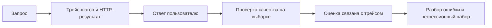

# Вопросы на собеседовании: Наблюдаемость ИИ и LLM

**Наблюдаемость LLM-приложения** объединяет обычные сигналы сервиса с данными о работе модели: вызовами модели и инструментов, извлечённым контекстом, расходом токенов и оценками качества ответа. Успешный HTTP-ответ подтверждает выполнение запроса на уровне протокола, но сам по себе не доказывает полезность ответа. Эти данные можно собирать средствами существующего APM и OpenTelemetry или через специализированную платформу; выбор продукта зависит от задачи и правил обработки чувствительных данных.

**Дата актуализации:** 2026-05-23

## Полезные ссылки

### Frameworks и платформы

- [LangSmith (LangChain)](https://docs.smith.langchain.com/) — observability + evals от LangChain
- [Langfuse](https://langfuse.com/) — open-source LLM observability (self-host + cloud)
- [Arize Phoenix](https://docs.arize.com/phoenix) — OpenTelemetry-native LLM observability
- [Helicone](https://www.helicone.ai/) — proxy-based observability, no SDK changes
- [W&B Prompts](https://wandb.ai/site/prompts/) — Weights & Biases для LLM
- [OpenLLMetry](https://www.traceloop.com/openllmetry) — OTel-based vendor-neutral SDK
- [TruLens](https://www.trulens.org/) — eval-first observability
- [Datadog LLM Observability](https://www.datadoghq.com/product/llm-observability/) — enterprise APM + LLM

### OpenTelemetry GenAI

- [OTel GenAI Semantic Conventions](https://opentelemetry.io/docs/specs/semconv/gen-ai/) — официальная спека
- [OTel GenAI events](https://opentelemetry.io/docs/specs/semconv/gen-ai/gen-ai-events/) — span events для prompts/completions
- [OpenInference](https://github.com/Arize-ai/openinference) — реализация конвенций (Arize)

### Production patterns

- [Continuous eval (Google paper)](https://arxiv.org/abs/2308.05374)
- [LLM Monitoring Best Practices (Anthropic)](https://www.anthropic.com/news/safety-bulletin)
- [PII redaction (Microsoft Presidio)](https://microsoft.github.io/presidio/)

## Содержание

1. **Зачем LLM observability отдельно** — Q1, Q2
2. **Tracing и spans** — Q3, Q4, Q5
3. **OpenTelemetry GenAI** — Q6, Q7
4. **Frameworks** — Q8, Q9, Q10, Q11, Q12
5. **Метрики и alerting** — Q13, Q14, Q15, Q16
6. **PII / Privacy** — Q17, Q18
7. **Continuous eval** — Q19, Q20, Q21, Q22
8. **Agent / RAG tracing** — Q23, Q24, Q25
9. **A/B testing и cost optimization** — Q26, Q27
10. **Анти-паттерны** — Q28

---

## Q1. Почему одних технических метрик недостаточно для наблюдаемости LLM-приложения? (!)

Успешный HTTP-статус, задержка и частота ошибок показывают работу сервиса, но не доказывают, что ответ модели решает задачу пользователя. Это верно и для других приложений: бизнес-корректность нельзя вывести только из кода ответа. Для LLM особенно важны оценки фактической точности, полезности, безопасности и качества ответа в контексте задачи.

Трейс с инструментированными вызовами может показать шаги агента: обращение к модели, поиск данных и выполнение инструмента. Метрики токенов и времени помогают оценивать ресурсы; оценка ответа по заданному критерию и обратная связь пользователей помогают обнаруживать качественные сбои. Содержание промптов и ответов собирают только при необходимости и с учётом приватности.

Для этого не обязательно покупать отдельный продукт: существующие APM и OpenTelemetry можно расширить нужными спанами, метриками и оценками. Специализированные платформы объединяют эти возможности, но набор сигналов определяется вопросом, который нужно диагностировать. Основание: [OpenTelemetry, Signals](https://opentelemetry.io/docs/concepts/signals/), [LangSmith, Evaluation types](https://docs.langchain.com/langsmith/evaluation-types), [Datadog, Trace-level evaluations](https://docs.datadoghq.com/llm_observability/evaluations/custom_llm_as_a_judge_evaluations/trace_level_evaluations/).

---

## Q2. Как соотносятся трейсы, метрики, логи и оценки качества в LLM-приложении? (!)

Трейсы показывают путь запроса и связи операций; метрики — агрегаты вроде задержки, числа токенов и ошибок; логи — события и детали диагностики. Это разные сигналы OpenTelemetry, и LLM-приложение не отменяет ни один из них. Логи можно связать с трейсами через идентификаторы trace и span.

**Оценки качества (evals)** проверяют ответ или весь ход работы по заданному критерию: например, точность ответа, выполнение задачи или корректность вызова инструмента. Результат оценки можно прикрепить к трейсу и агрегировать как метрику. Оценка не возникает автоматически из HTTP-статуса, числа токенов или задержки.

Промпты, ответы и сообщения могут храниться как данные спана, события или записи журнала в зависимости от инструментирования. Полный текст часто содержит чувствительные данные; его запись, фильтрацию и срок хранения выбирают отдельно. Утверждение, что «логи растворились в трейсе», неверно: корреляция сигналов не уничтожает логи. Основание: [OpenTelemetry, Signals](https://opentelemetry.io/docs/concepts/signals/), [OpenTelemetry, Log correlation](https://opentelemetry.io/docs/specs/otel/logs/), [LangSmith, Evaluation types](https://docs.langchain.com/langsmith/evaluation-types/).

---

## Q3. Как соотносятся trace и span при трассировке одного запроса к LLM-приложению? (!)

**Трейс** представляет путь одной операции через приложение. Для одного пользовательского запроса к LLM-сервису обычно создают трейс, в который входят действия приложения и внешние вызовы. **Спан** описывает отдельную операцию внутри трейса: у него есть начало, конец, атрибуты и, кроме корневого спана, родитель.

Пример возможной структуры:

```text
chat_request (корневой спан)
├── retrieve_context
├── call_model
└── check_answer
```

Спаны образуют дерево причинно связанных операций; инструментированный вызов поиска или модели можно развернуть на дочерние спаны. Данные о модели, токенах и результате записывают по выбранной схеме инструментирования. Полный текст сообщений не является обязательным атрибутом и может содержать персональные данные. Идентификатор сессии может связывать несколько трейсов, но сам по себе не задаёт границу каждого трейса. Основание: [OpenTelemetry, Tracing API](https://opentelemetry.io/docs/specs/otel/trace/api/), [OpenTelemetry, Context propagation](https://opentelemetry.io/docs/concepts/context-propagation/).

---

## Q4. Как устроена parent-child иерархия в trace для агента?

Корневой спан может описывать один запуск агента. Под ним создают спаны наблюдаемых шагов — вызовов модели, поиска и инструментов. Если инструмент делает HTTP-запрос, его спан может быть дочерним к спану вызова инструмента. Название `agent_invoke` в примере — локальное имя операции, а не обязательное имя из стандарта.

```text
agent_invoke (корень)
├── call_model
├── execute_tool
│   └── http_request
└── call_model
```

Иерархия помогает найти медленный шаг, повторные вызовы и связанные ошибки. Стоимость вызовов модели можно агрегировать по трейсу, но она не появляется у корневого спана автоматически и требует данных о потреблении и тарифе; нельзя без разбора суммировать уже агрегированные значения. Длительность корня также не равна сумме длительностей детей при параллельном выполнении.

Асинхронная очередь сама по себе не требует разрывать трейс. При передаче контекста потребитель может создать дочерний спан; для пакетной обработки или связи нескольких причинных контекстов применяют span links. Выбор зависит от семантики операции и инструментирования. Основание: [OpenTelemetry, Tracing API](https://opentelemetry.io/docs/specs/otel/trace/api/), [Context propagation](https://opentelemetry.io/docs/concepts/context-propagation/), [Messaging spans](https://opentelemetry.io/docs/specs/semconv/messaging/messaging-spans/).

---

## Q5. Какие атрибуты обязательны для span вызова модели по OTel GenAI?

Для **inference span** спецификация OTel GenAI помечает как `Required` два атрибута: `gen_ai.operation.name` (например, `chat`) и `gen_ai.provider.name` (например, `openai`). `gen_ai.request.model` требуется **при доступности** имени модели. Для ошибки, идентификатора диалога и некоторых параметров запроса действуют собственные условия; остальные поля могут иметь уровень `Recommended` или `Opt-In`. Поэтому «полезно для анализа» не означает «обязательно для каждого вызова».

| Атрибут | Уровень для inference span | Что описывает |
| --- | --- | --- |
| `gen_ai.operation.name` | Required | Операцию, например `chat` |
| `gen_ai.provider.name` | Required | Провайдера, известного инструментации |
| `gen_ai.request.model` | Conditionally Required, если доступна | Запрошенную модель |
| `gen_ai.response.model` | Recommended | Модель, фактически давшую ответ |
| `gen_ai.usage.input_tokens`, `gen_ai.usage.output_tokens` | Recommended | Потребление токенов, если оно известно |
| `gen_ai.request.temperature`, `gen_ai.response.finish_reasons` | Recommended | Параметр генерации и причину завершения |

Содержимое инструкций, входных и выходных сообщений (`gen_ai.system_instructions`, `gen_ai.input.messages`, `gen_ai.output.messages`) имеет уровень **Opt-In**: оно бывает объёмным и чувствительным. По умолчанию инструментация не должна его захватывать. При явном включении содержимое можно записать в атрибуты span, в события/логи или вынести во внешнее хранилище со ссылкой — с учётом возможностей SDK и правил доступа к данным.

Основание: [OpenTelemetry GenAI inference spans и уровни обязательности](https://github.com/open-telemetry/semantic-conventions-genai/blob/main/docs/gen-ai/gen-ai-spans.md#inference), [правила захвата содержимого](https://github.com/open-telemetry/semantic-conventions-genai/blob/main/docs/gen-ai/gen-ai-spans.md#capturing-instructions-inputs-and-outputs).

---

## Q6. Что задают OTel GenAI Semantic Conventions и гарантируют ли они поддержку полей в любом хранилище?

**OpenTelemetry GenAI Semantic Conventions** описывают имена, смысл и уровни обязательности телеметрии генеративного ИИ: например, `gen_ai.operation.name`, `gen_ai.provider.name`, `gen_ai.request.model`, `gen_ai.usage.input_tokens`. Общие названия помогают инструментировать операции согласованно. На момент проверки спецификация GenAI spans имеет статус **Development**, поэтому при обновлении инструментации нужно сверять её версию и выбранный режим семантических конвенций.

Конвенции **не собирают и не отправляют** данные сами. Для этого нужны инструментация, SDK и экспорт. Они также не гарантируют, что любое хранилище распознает поля как специальные, построит одинаковые запросы или поддержит все типы значений. При смене хранилища проверяют приём, индексацию и запросы на реальных трейсах. OTLP решает задачу передачи телеметрии, а не задаёт смысл каждого `gen_ai.*` поля.

Захват текста сообщений зависит от настроек конкретной инструментации. В действующих конвенциях он относится к Opt-In; универсального флага для всех языков, SDK и версий нет.

Основание: [спецификация OTel GenAI spans](https://github.com/open-telemetry/semantic-conventions-genai/blob/main/docs/gen-ai/gen-ai-spans.md), [документация инструментации OpenAI для Python и её режимов](https://opentelemetry-python-contrib.readthedocs.io/en/latest/instrumentation-genai/openai.html).

---

## Q7. Что делает `OpenAIInstrumentor().instrument()` в Python-примере?

На практике есть два пути. **Автоинструментация** подключается к поддерживаемому SDK провайдера и создаёт span для его вызовов. **Ручная инструментация** нужна для неподдерживаемого клиента или операций приложения, которые инструментор не видит. В обоих случаях экспорт настраивают отдельно.

Пример для [инструментации OpenAI из OpenTelemetry Python Contrib](https://opentelemetry-python-contrib.readthedocs.io/en/latest/instrumentation-genai/openai.html):

```python
from opentelemetry import trace
from opentelemetry.sdk.trace import TracerProvider
from opentelemetry.sdk.trace.export import BatchSpanProcessor
from opentelemetry.exporter.otlp.proto.grpc.trace_exporter import OTLPSpanExporter
from opentelemetry.instrumentation.openai_v2 import OpenAIInstrumentor
from openai import OpenAI

# 1. Настроить OTel pipeline
provider = TracerProvider()
provider.add_span_processor(
    BatchSpanProcessor(OTLPSpanExporter(endpoint="http://otel-collector:4317"))
)
trace.set_tracer_provider(provider)

# 2. Подключить инструментор к OpenAI SDK
OpenAIInstrumentor().instrument()

# 3. Вызов клиента остаётся обычным
client = OpenAI()
response = client.chat.completions.create(
    model="gpt-4o-mini",
    messages=[{"role": "user", "content": "Привет"}],
)
```

Инструментация создаст span вызова; конкретные атрибуты зависят от версии и полученного ответа. Эта реализация по умолчанию использует конвенции версии 1.30.0 и не захватывает текст сообщений. Для более новых экспериментальных полей предусмотрен режим `OTEL_SEMCONV_STABILITY_OPT_IN=gen_ai_latest_experimental`; для содержимого — отдельная настройка этой инструментации. Перед использованием в продакшене проверяют версию, настройки и фактический экспорт.

Альтернативный ручной пример для отдельного запуска без подключённого инструментора:

```python
tracer = trace.get_tracer(__name__)

with tracer.start_as_current_span("chat gpt-4o-mini", kind=trace.SpanKind.CLIENT) as span:
    span.set_attribute("gen_ai.operation.name", "chat")
    span.set_attribute("gen_ai.provider.name", "openai")
    span.set_attribute("gen_ai.request.model", "gpt-4o-mini")
    response = client.chat.completions.create(
        model="gpt-4o-mini",
        messages=[{"role": "user", "content": "Привет"}],
    )
    if response.usage is not None:
        span.set_attribute("gen_ai.usage.input_tokens", response.usage.prompt_tokens)
        span.set_attribute("gen_ai.usage.output_tokens", response.usage.completion_tokens)
```

Пакет OpenInference тоже использует OpenTelemetry для трейсов, но следует [собственным семантическим конвенциям](https://github.com/Arize-ai/openinference/blob/main/spec/semantic_conventions.md), например `openinference.span.kind` и `llm.*`. Его инструментор нельзя без проверки выдавать за источник атрибутов OTel GenAI `gen_ai.*`.

---

## Q8. При включённой отправке трейсов какая связка нужна для трассировки Python-функции вне LangChain и оценок в LangSmith?

**LangSmith** — платформа для трейсинга и оценки AI-приложений от команды LangChain. Интеграция с LangChain и LangGraph — один из простых путей подключения, но платформа работает и с приложениями на другом стеке через SDK, обёртки клиентов и `@traceable`.

**Сильные стороны:**

- **Интеграция с LangChain/LangGraph** — трейсинг можно включить переменной окружения после настройки аккаунта и ключа.
- **Datasets и experiments** — встроенное версионируемое хранилище тестовых кейсов.
- **Оценки как код** — готовые evaluator'ы (correctness, conciseness) плюс свой LLM-judge.
- **Prompts hub** — версии промптов с diff и откатом.
- **Annotation queue** — UI для разметки человеком.
- **A/B-тестирование** — сравнение цепочек на одном датасете.

Для сравнения запусков на датасете или оценки production-трейсов задают критерий и запускают соответствующую оценку; наличие платформы само по себе не оценивает каждый ответ.

**Декоратор `@traceable`** работает и вне LangChain. Для отправки трейсов настраивают `LANGSMITH_API_KEY` и включают `LANGSMITH_TRACING=true`; ключ OpenAI нужен отдельно для вызова модели. После этого декоратор записывает вызов функции в трейс LangSmith. Оценки результатов настраивают отдельно в LangSmith:

```python
from langsmith import traceable
from openai import OpenAI

client = OpenAI()

@traceable(run_type="llm", name="answer_question")
def answer(question: str) -> str:
    response = client.chat.completions.create(
        model="gpt-4o-mini",
        messages=[{"role": "user", "content": question}]
    )
    return response.choices[0].message.content or ""
```

**Минусы:**

- **Зависимость от платформы** — данные, оценки и доступ управляются через LangSmith; условия размещения и выгрузки нужно проверять при выборе.
- **Размещение и стоимость** — Developer и Plus используют облако; варианты self-hosted и hybrid предлагаются в Enterprise. Тарифы и квоты меняются, поэтому их сверяют перед внедрением.

**Когда выбирать:** нужен общий рабочий процесс для трейсов, наборов примеров и оценок, а условия размещения и стоимость подходят команде. Уже используемый LangChain/LangGraph упрощает подключение, но не является обязательным условием.

Основание: [LangSmith tracing quickstart](https://docs.langchain.com/langsmith/observability-quickstart), [тарифы и варианты размещения](https://www.langchain.com/pricing).

---

## Q9. Что такое Langfuse? Чем отличается от LangSmith? (!)

**Langfuse** — платформа для трассировки LLM-приложений, оценок, наборов данных и управления промптами. Основная часть исходного кода открыта под MIT; каталог `ee` содержит функции с отдельной лицензией. Сервер можно развернуть у себя или использовать облако. Python SDK v4 основан на OpenTelemetry и работает с разными фреймворками.

В отличие от LangSmith, для собственного развёртывания Langfuse есть открытая версия. Это не значит, что LangSmith работает только с LangChain: его `@traceable` применим и к обычным Python-функциям. Оба продукта поддерживают оценки и управление промптами; сравнивать их по якобы отсутствующей функции или неизменной цене тарифа нельзя.

**Пример для Python SDK v4:**

```python
from langfuse import get_client, observe

# LANGFUSE_PUBLIC_KEY, LANGFUSE_SECRET_KEY и LANGFUSE_BASE_URL заданы в окружении.
langfuse = get_client()

@observe(as_type="generation")
def call_llm(question: str) -> str:
    answer = model_client.generate(question)
    langfuse.update_current_generation(
        model="example-model", input=question, output=answer
    )
    return answer
```

Здесь `model_client` — клиент модели приложения, а не часть Langfuse. Для self-host адрес задают через `LANGFUSE_BASE_URL`; пример не отправляет запрос к модели сам по себе.

**Когда выбирать:** если нужен контролируемый собственный сервер и инструментирование без привязки к одному LLM-фреймворку. Перед внедрением проверяют версию SDK, лицензию нужной функции и политику хранения содержимого трейсов.

---

## Q10. Что такое Arize Phoenix и как он помогает оценивать LLM-приложение?

**Arize Phoenix** — открытая платформа для трассировки, поиска ошибок, оценок и экспериментов с LLM-приложениями. Phoenix принимает трейсы по OTLP; инструменты OpenInference помогают создавать спаны с данными об LLM, retrieval и инструментах. OpenInference и OTel GenAI — разные наборы семантических соглашений, хотя оба используют OpenTelemetry.

В Phoenix можно изучать отдельные шаги трейса, добавлять оценки, собирать наборы примеров из наблюдений и сравнивать варианты приложения в экспериментах. Есть клиентские и серверные оценки, включая детерминированные правила и LLM-as-a-judge. Результат оценки связан с данными, на которых она запущена; полезность метрики зависит от выбранного критерия и качества набора данных.

**Локальный старт:** `uvx arize-phoenix serve` запускает сервер Phoenix. Инструментированное приложение отправляет ему трейсы по OTLP; пакет `arize-phoenix-otel` предоставляет `register(project_name="my-llm-app")` для настройки OpenTelemetry. Пакеты клиента и оценок устанавливают отдельно, когда они нужны.

**Когда выбирать:** если команде нужны локальные или собственные трассы вместе с воспроизводимыми оценками и экспериментами. Кластеризация эмбеддингов может быть отдельным способом анализа данных, но не является обязательным свойством каждого трейса или уникальным механизмом Phoenix.

---

## Q11. Как Helicone AI Gateway подключается к OpenAI-совместимому клиенту?

**Helicone** предоставляет AI Gateway с OpenAI-совместимым API и наблюдением за проходящими через него запросами. Для совместимого клиента можно изменить адрес API и ключ; запросы начнут идти через шлюз, а не напрямую к провайдеру. Это изменение конфигурации клиента, а не автоматическое наблюдение за всеми вызовами приложения.

```python
import os
from openai import OpenAI

client = OpenAI(
    base_url="https://ai-gateway.helicone.ai",
    api_key=os.environ["HELICONE_API_KEY"],
)
response = client.chat.completions.create(
    model="gpt-4o-mini",
    messages=[{"role": "user", "content": "Привет"}],
)
```

Это схема из текущего quickstart AI Gateway. При использовании собственного ключа провайдера или прежнего провайдерского прокси настройка отличается; её следует брать из документации выбранного режима. Шлюз добавляет компонент в путь вызова модели, поэтому при выборе проверяют требования к доступности, задержке и передаче данных. Численное значение задержки зависит от сети и маршрута.

**Когда выбирать:** если приложение может направлять совместимые вызовы через шлюз и команде нужны централизованные запросы и наблюдение за ними. Для глубокого трассирования внутренних шагов агента одного прокси недостаточно: требуются дополнительные спаны или интеграция.

---

## Q12. Как выбрать инструмент для OTLP-трейсов, собственного размещения и экспериментов? (!)

Сравнивать инструменты полезно по нескольким независимым осям: размещение и лицензия, способ подключения, уровень детализации трейсов, процесс оценок и операционные требования. Наличие открытого кода само по себе не определяет глубину оценок или способ подключения.

| Инструмент | Подключение | Размещение и характер работы |
| --- | --- | --- |
| **LangSmith** | SDK, `@traceable`, интеграции | Облачный сервис и варианты собственного размещения по условиям продукта; трассировка и оценки. |
| **Langfuse** | Python SDK на OpenTelemetry, интеграции | Облако или собственный сервер; открытая основная часть, трейсы, промпты и оценки. |
| **Phoenix** | OTLP и инструменты OpenInference | Локально, собственный сервер или облако; трейсы, наборы данных и эксперименты. |
| **Helicone** | OpenAI-совместимый AI Gateway | Шлюз стоит на пути запросов к модели и собирает сведения об этих вызовах. |
| **OpenLLMetry** | Инструментация OpenTelemetry | Библиотека для экспорта телеметрии; визуализацию и хранение обеспечивает выбранный приёмник. |

**Пример требования:** приложение уже создаёт спаны и отправляет их по OTLP; данные нужно хранить на своём сервере, а версии приложения сравнивать на одном наборе примеров. Значит, выбранный инструмент должен поддерживать все три условия: собственное размещение, приём этих трейсов и эксперименты на наборе. Один только прокси вызовов модели не принимает существующие спаны приложения; облачный регион не заменяет свой сервер; ручной просмотр отдельных ответов не заменяет воспроизводимый эксперимент.

**Правило выбора:** сначала определить, нужны ли внутренние шаги агента или достаточно вызовов модели, где могут храниться данные и как будут проводиться оценки. Затем проверить интеграцию с текущим стеком, доступность, стоимость эксплуатации и условия конкретного развёртывания. Шлюз, SDK и OTLP решают разные задачи подключения; наличие одного не исключает другие.

---

## Q13. Какие группы метрик нужны для LLM-системы? (!)

Для LLM-сервиса сохраняют обычные сигналы **доступности, ошибок и задержки**, а к ним добавляют расход модели и проверку качества ответов. HTTP 200 не доказывает, что ответ полезен; низкая задержка не показывает стоимость вызова. Конкретный набор зависит от пользовательской задачи и SLO.

- **Использование и расходы:** число входных и выходных токенов по модели и операции, оценочная стоимость по действующему тарифу. Кэшированные токены и другие категории тарифа учитывают отдельно, если их выделяет провайдер. Агрегаты по конкретному пользователю не стоит бездумно делать метками метрик: высокая кардинальность и приватность требуют отдельного решения.
- **Время и надёжность:** длительность вызова и процентили распределения, таймауты, ошибки, rate limit, повторы и переключения на резервную модель. Для потоковой выдачи полезно время до первого токена (TTFT). Среднее время само по себе скрывает медленный хвост.
- **Качество:** результаты оценки по определённому критерию задачи, обратная связь пользователей и доля проблемных ответов среди *оценённых* примеров. Эти показатели зависят от выборки и качества evaluator; они не возникают автоматически из трейса и не обязаны считаться синхронно для каждого запроса.
- **Продуктовый результат:** доля завершённых задач или эскалаций, если такое событие определено продуктом.

Отдельные метрики эффективности, например попадание в кэш и число вызовов инструментов на запрос, добавляют при наличии соответствующих механизмов. Не следует выдавать произвольные имена метрик или единые пороги за обязательный стандарт всех LLM-приложений.

---

## Q14. Как считать стоимость с кэшированными токенами и часовой расход?

Для простого текстового тарифа оценка стоимости вызова равна сумме стоимости входных и выходных токенов:

```text
estimated_cost = input_tokens / 1_000_000 × input_price_per_million
               + output_tokens / 1_000_000 × output_price_per_million
```

Если отчёт показывает 1000 входных токенов, **включая** 200 кэшированных, обычный вход равен 800. При 100 выходных токенах и ставках `in`, `cache`, `out` за миллион оценка равна `(800 × in + 200 × cache + 100 × out) / 1_000_000` (в вариантах записи `1e6` — миллион). Кэшированную часть нельзя добавить поверх всех 1000 ещё раз. Для часового прироста монотонного счётчика оценочных расходов подходит `increase(cost_total[1h])`.

Цену выбирают по **модели, провайдеру и действующему тарифу**. Это приближение: кэшированный вход, reasoning tokens, мультимодальность, batch-скидки и другие категории могут оплачиваться иначе. Нужные категории берут из ответа провайдера и его актуального прайс-листа. Для сверки финансового итога используют биллинг провайдера, а локальная оценка помогает реагировать до его окончательного расчёта.

Для сигнала о всплеске приложение может накапливать **монотонный счётчик оценочных затрат**. Тогда `increase(llm_estimated_cost_usd_total[1h])` показывает прирост за час; его сравнивают с бюджетным лимитом и исторической базой с учётом обычного объёма трафика. Если хранится расход за отдельный запрос, сначала определяют способ его агрегации: `rate()` применяется к счётчикам, а не к произвольному gauge. Порог и окно выбирают по бюджету и рабочему ритму сервиса, проверяя ложные срабатывания на малой базе.

Причины всплеска разбирают по модели, операции и характеру трафика: рост запросов, изменение промпта, длинная выдача, повторные вызовы или цикл агента. Само число запросов не заменяет подсчёт токенов: одинаковое число вызовов может стоить по-разному.

---

## Q15. Как считать долю низких оценок для алерта при выборочном eval? (!)

Алерты строят из **цели сервиса и риска**. Технические ошибки и задержка важны, но HTTP 200 может содержать плохой ответ, а работающий сервис может быстро превысить бюджет. Поэтому отдельно рассматривают доступность, оценочный расход, качество и признаки неэффективного цикла.

- **Доступность и задержка:** доля сбоев, таймаутов и rate limit, перцентили длительности и, для потоковой выдачи, время до первого токена. Порог привязывают к SLO и объёму запросов.
- **Расход:** резкий рост оценочной стоимости относительно бюджета или нормальной нагрузки. Сигнал проверяют по модели и операции, чтобы отличить перерасход от ожидаемого увеличения трафика.
- **Качество:** снижение выбранной оценки, рост отказов или отрицательной обратной связи на репрезентативной выборке. Если evaluator проверяет только часть ответов, долю низких оценок считают как число низких оценок / число **оценённых** ответов. Условие минимального объёма применяют к тому же знаменателю; число всех HTTP-запросов не делает малую оценочную выборку надёжной. Оценки могут приходить позже и ошибаться; у алерта нужны достаточный объём данных и проверяемый критерий.
- **Операционные симптомы:** частые fallback, повторы, падение попадания в кэш и необычно много вызовов инструментов, если эти механизмы есть в приложении.

Срочность зависит от влияния на пользователя и бюджета ошибки. Не всякое ухудшение оценки должно будить дежурного, а условные числа вроде «p99 > 30 секунд» или «минус 10%» не являются универсальными правилами.

---

## Q16. Чем отличаются head-based и tail-based sampling трейсов?

**Семплирование** выбирает, какие трейсы сохранить, чтобы управлять объёмом и стоимостью телеметрии. В head-based sampling решение принимают при начале трейса, до того как известен его итог. Это проще и может уменьшить передачу данных, но редкая ошибка может попасть в отброшенный трейс.

В tail-based sampling решение принимают **после накопления спанов в течение заданного окна**. Политика может опираться на статус ошибки, длительность или атрибут, который уже присутствует в полученных спанах. Для этого процессор буферизирует спаны и должен получить связанные спаны одного trace ID в один экземпляр коллектора. Если upstream уже отбросил спаны head sampling, tail-процессор не восстановит их.

Tail sampling не гарантирует сохранение *всех* ошибок и полных трейсов: поздние спаны, длинные операции, переполненный буфер, неверная маршрутизация и конфликты политик могут менять результат. Значение стоимости можно использовать как критерий только если оно известно и записано до момента решения. Конкретный процент обычного трафика, окно ожидания и политику выбирают по нагрузке и проверяют на реальных трассах.

Если метрики строятся из спанов, их желательно считать до отбрасывания трейсов или учитывать долю семплирования, иначе показатели вызовов и ошибок будут смещены.

---

## Q17. Как защитить PII при трейсинге prompts/completions? (!)

**Риск:** промпт, ответ и метаданные могут содержать персональные данные. Если записать их в трейс, доступ к платформе наблюдаемости открывает доступ и к этим данным. Самый надёжный исходный режим — не собирать содержимое, если для диагностики хватает метаданных. В [конвенциях OpenTelemetry GenAI](https://github.com/open-telemetry/semantic-conventions-genai/blob/main/docs/gen-ai/gen-ai-spans.md) атрибуты содержимого, например `gen_ai.input.messages` и `gen_ai.output.messages`, относятся к opt-in: инструментирование не должно включать их по умолчанию. Конкретный переключатель зависит от используемой библиотеки.

Когда текст необходим, **удаляйте или маскируйте чувствительные значения до экспорта** в платформу. Например, для диагностики шаблона можно отправить `Заказ для [ИМЯ], почта [EMAIL]` вместо исходного текста. Проверяйте весь путь: вход, выход, атрибуты спана, события, логи, вложения и ошибки. Редактор должен покрывать нужные языки и типы данных; регулярные выражения для известных форматов полезны, но не находят все ПД. Пример поддерживаемого механизма — [хуки маскирования Langfuse](https://langfuse.com/docs/observability/features/masking), которые меняют атрибуты перед экспортом этим клиентом. Нельзя рассчитывать на изменение уже завершённого спана в обычном `BatchSpanProcessor.on_end`.

После минимизации данных задают права доступа, сроки хранения и процедуру поиска и удаления связанных записей с учётом применимых требований. Эти меры дополняют редактирование, но не устраняют уже отправленный сырой текст. Простой `sha256(prompt)` тоже не гарантирует анонимность: предсказуемые или повторяющиеся значения можно сопоставить по словарю, а весь промпт может содержать иные идентификаторы. Проверки сохранённых трейсов на случайные утечки нужны, но не заменяют защиту до записи.

---

## Q18. Как masked prompts снижают риск раскрытия ПД в трейсах?

**Masked prompts** — промпты, в которых чувствительные значения заменены плейсхолдерами, а полезная для анализа структура сохранена:

```text
Original:  "Find restaurants near 123 Main St for John Doe (john@example.com)"
Masked:    "Find restaurants near {ADDRESS} for {NAME} ({EMAIL})"
```

Так можно сравнивать частоту шаблонов и версии промпта, не сохраняя подставленные значения в этом поле. Маскирование нужно выполнять до отправки трейса; оно не защищает копии исходного текста в других атрибутах, логах или хранилищах. Даже оставшийся шаблон и метаданные иногда позволяют узнать человека, поэтому результат проверяют на реальных примерах.

**GDPR не задаёт универсального «режима» Langfuse или LangSmith.** Регион хранения, сроки, права доступа, договоры и обработка запросов субъекта данных определяются конкретной конфигурацией и обязанностями организации. Маскирование снижает риск раскрытия, но само по себе не доказывает соблюдение закона. По [разъяснению EDPB](https://www.edpb.europa.eu/news/edpb-adopts-pseudonymisation-guidelines-and-paves-the-way-to-improve-cooperation-with_en) псевдонимизированные сведения могут оставаться персональными данными, если человека можно установить с помощью дополнительной информации. Удаление таблицы соответствий для хешированного `user_id` само по себе не означает удаление всех связанных трейсов: в них могут оставаться текст, метаданные и иные способы связи с человеком. Для запроса на удаление оценивают и обрабатывают все относящиеся к нему данные и копии по применимым правилам.

---

## Q19. Что такое continuous eval в production? (!)

**Continuous eval** — регулярная оценка качества ответов на текущем производственном трафике. Проверка перед релизом на фиксированном наборе остаётся полезной, но не показывает новые типы запросов и изменения поведения уже работающей системы. [LangSmith различает offline и online eval](https://docs.langchain.com/langsmith/evaluation-types): первая помогает сравнивать версии до выпуска, вторая — следить за качеством на реальных запросах.

Один возможный конвейер: получить трейс → выбрать подходящие запросы → оценить ответ по заранее заданному критерию → связать результат с исходным запросом → агрегировать показатели по времени и сегментам → разобрать отклонения. Оценку вызовом модели обычно выносят из пути ответа пользователю. Долю выборки, фильтры и частоту определяют стоимость, нагрузка и риск; универсальных 1–5% нет. [LangSmith позволяет настраивать фильтры и долю выборки](https://docs.langchain.com/langsmith/online-evaluations-llm-as-judge).

Критерии выбирают по задаче: например, соответствие извлечённому контексту для RAG и соблюдение политики для поддержки. Судью проверяют на человеческой разметке и трудных случаях; выбор другой модели сам по себе не устраняет ошибки оценки. Порог тревоги и действие после него задают отдельно. Автоматический откат возможен лишь после надёжной проверки сигнала и явной настройки, а не является частью определения continuous eval.

---

## Q20. Как связать отзыв о конкретном ответе с его трейсом для последующего разбора?

Если пользователь оценивает конкретный ответ, сохраните оценку и комментарий с идентификатором соответствующего трейса или запуска. Тогда жалобу можно открыть вместе с контекстом запроса. Для оценки разговора целиком может подходить идентификатор сессии, но он не заменяет связь с отдельным ответом. Идентификатор, возвращаемый клиенту, проверяйте на сервере: нельзя разрешать пользователю записывать отзыв к произвольному чужому трейсу.

**Явный сигнал** — лайк, дизлайк, рейтинг, текст жалобы. **Неявный сигнал** — повтор вопроса, копирование, закрытие чата; его смысл неоднозначен и требует проверки. Отложенный бизнес-результат тоже полезен, если можно корректно связать его с ответом. Долю негативных оценок сравнивают с числом полученных оценок и учитывают смещение: откликнувшиеся пользователи могут отличаться от остальных.

Например, сервер, получив проверенный `trace_id` и дизлайк, записывает score через актуальный [Python API Langfuse](https://langfuse.com/docs/observability/features/user-feedback):

```python
from langfuse import get_client

langfuse = get_client()
langfuse.create_score(
    trace_id=trace_id,
    name="user_feedback",
    value=0,
    data_type="BOOLEAN",
    comment=comment,
)
```

Ручной разбор низких оценок помогает пополнить набор регрессионных случаев. Несогласие оценки судьи с отзывом — повод изучить конкретные примеры, критерии и смещение выборки; один дизлайк не доказывает плохую калибровку судьи.

---

## Q21. Как из production-трейсов собрать golden dataset для регрессионного тестирования?

**Golden dataset** — проверенный набор случаев для воспроизводимой оценки изменений. У элемента есть вход; ожидаемый ответ или критерий проверки зависит от задачи и может отсутствовать у оценки без эталона. Производственные трейсы дают реальные случаи, но сырые ответы модели нельзя автоматически объявлять эталоном.

Сначала отбирают разные классы запросов: обычные, неудачные по подтверждённым отзывам, редкие и критичные. Затем человек проверяет причину сбоя, очищает вход от чувствительных данных, при необходимости пишет ожидаемый результат или критерии и сохраняет связь с исходным трейсом. Дизлайк — повод для разбора, а не доказательство неверного ответа; синтетические примеры могут дополнить реальные после такой же проверки.

В актуальном [Langfuse Dataset API](https://langfuse.com/docs/evaluation/experiments/datasets) элемент можно связать с исходным трейсом:

```python
from langfuse import get_client

langfuse = get_client()
langfuse.create_dataset_item(
    dataset_name="support-regression",
    input={"question": reviewed_question},
    expected_output={"answer": expert_answer},
    source_trace_id=source_trace_id,
)
```

Здесь `reviewed_question` и `expert_answer` — уже проверенные значения, а набор создан заранее. Для сравнения двух версий используют одну версию набора и одинаковые критерии оценки, разбирая как общие показатели, так и отдельные случаи с ухудшением. [Langfuse рекомендует фиксировать версии набора и оценщика](https://langfuse.com/docs/evaluation/experiments/compare-experiments).

---

## Q22. Как регрессионный пайплайн встроен в CI/CD для промптов?

Изменение промпта или модели проверяют до продвижения: на PR либо другом событии CI запускает текущую версию приложения на **фиксированной версии набора** и оценивает ответы по тем же критериям, что и согласованный baseline. Сравнивают общий результат и новые провалы в критичных случаях. Порог и правило принятия выбирают заранее для задачи; универсального «минус 5%» нет. При нарушении правила job завершается ошибкой и блокирует соответствующий gate, а отчёт показывает примеры ухудшения.

В [Langfuse Experiments in CI/CD](https://langfuse.com/docs/evaluation/experiments/experiments-ci-cd) для этого есть `langfuse/experiment-action`: он загружает набор, запускает эксперимент и может завершить job ошибкой при `RegressionError`. Версии датасета и оценщика фиксируют для воспроизводимого сравнения. Отдельно после CI можно развернуть кандидата на часть трафика и следить за качеством; canary и автоматический откат требуют собственных правил и не возникают от одного запуска эвала. Сводный score нельзя слепо отправить в Prometheus: метрику нужно явно экспортировать, определить её охват и учитывать объём выборки.

---

## Q23. Как трейсить агент и находить infinite loops? (!)

Трейс агентского запроса связывает вызовы модели, инструментов и управляющие шаги одной задачи. [OpenAI Agents SDK](https://openai.github.io/openai-agents-python/tracing/) показывает такие шаги отдельными span-ами; при собственном инструментировании важно сохранять причинную связь между ними. Для поиска петли смотрят не только на общее время HTTP-запроса, но и на **повторение одного действия без прогресса**: те же вызовы инструмента с эквивалентными аргументами, растущее число шагов, расход токенов и время до завершения.

Глубина вложенности сама по себе не равна числу итераций: последовательные шаги могут быть соседними span-ами. Порог по числу шагов, времени и расходу задают по задаче и бюджету, а не универсальными значениями. Лимит итераций и тайм-аут принудительно останавливают зациклившийся запрос; завершение по лимиту отмечают отдельным исходом, чтобы его можно было разобрать и посчитать. Обычные метрики сервиса могут показать долгий запрос, но без шагов трейса не объясняют причину.

Для диагностики обычно достаточно имени инструмента, безопасных категорий аргументов, статуса, длительности и расхода. Не следует автоматически писать сырой текст мыслей модели, входы инструмента и ответы: они могут содержать чувствительные данные. Настройки захвата содержимого зависят от SDK; например, [OpenAI Agents SDK позволяет отключить чувствительные данные в трейсе](https://openai.github.io/openai-agents-python/config/).

---

## Q24. Как трейсить RAG-pipeline? Какие метрики ловить? (!)

В RAG качество зависит и от найденного контекста, и от того, как модель использовала его в ответе. Один span на весь запрос скрывает место ошибки. Стройте связанный трейс по фактическим шагам: эмбеддинг запроса, поиск, необязательное ранжирование, генерация и проверка ответа. У шага поиска полезны идентификаторы возвращённых документов, порядок, оценка релевантности и длительность; у генерации — версия модели, расход токенов, длительность и результат оценки. Содержимое документов и запросов записывают только по правилам защиты данных. [Phoenix описывает отдельные span-ы для retriever, reranker и LLM](https://arize.com/docs/phoenix/learn/tracing).

**Для поиска** оценивают релевантность возвращённых документов и, при наличии разметки, precision@k или MRR. Recall можно вычислить только при известном наборе релевантных документов для запроса; в обычном живом трафике он часто неизвестен. **Для ответа** отдельно проверяют соответствие вопросу и опору на предоставленный контекст (faithfulness). Релевантный поиск ещё не гарантирует правильный ответ — [Phoenix явно разделяет retrieval eval и оценку итогового ответа](https://arize.com/docs/phoenix/learn/retrieval-and-infrences/benchmarking-retrieval). Цитирование документа не доказывает, что модель использовала его корректно: при необходимости проверяют поддержку конкретных утверждений. Дополнительно следят за задержкой и расходом по шагам, чтобы отличить проблему качества от стоимости или скорости.

---

## Q25. Какой показатель помогает исследовать использование контекста в RAG?

Сначала задайте определение метрики: название *context utilization* само по себе не задаёт единой формулы. Например, [Ragas 0.1.21](https://docs.ragas.io/en/v0.1.21/concepts/metrics/context_utilization.html) употреблял его для оценки ранжирования релевантных ответу чанков. Не следует выдавать долю цитат за эту библиотечную метрику или за точное измерение того, что модель «прочитала».

Если ответ содержит проверяемые ссылки на идентификаторы чанков, можно считать **долю процитированных чанков**: число уникальных переданных чанков, упомянутых в ссылках, делённое на число переданных чанков. Это наблюдаемый *косвенный показатель*. Ссылка может не подтверждать утверждение, а ответ без ссылки всё же может опираться на контекст. При пустом наборе чанков значение доли не определено; такой случай учитывают отдельно.

Для решения об изменении `top_k` дополнительно оценивают релевантность найденных документов и опору утверждений ответа на контекст. [Phoenix разделяет оценку извлечения и итогового ответа](https://arize.com/docs/phoenix/learn/retrieval-and-infrences/benchmarking-retrieval). Сравнивайте качество, задержку и расход токенов до и после изменения на репрезентативных запросах. Низкая доля цитат лишь повод исследовать поиск и генерацию: автоматически сокращать `top_k` или объявлять ответ галлюцинацией по ней нельзя.

---

## Q26. Как проводить A/B-тест промптов, если ответы одному пользователю влияют на его дальнейший опыт?

Зафиксируйте контрольный и новый промпты, основную метрику результата, защитные метрики качества, задержки и стоимости, единицу рандомизации и правило остановки до начала эксперимента. Если один пользователь обращается повторно и его опыт может влиять на следующие ответы, закрепляйте вариант за пользователем на весь эксперимент. Платформа экспериментов или стабильное бакетирование по идентификатору эксперимента и пользователя даст воспроизводимое назначение: [Statsig описывает выбор единицы рандомизации и закрепление варианта](https://docs.statsig.com/experiments/overview). Встроенный Python `hash()` для строковых и байтовых идентификаторов по умолчанию не подходит: [его значение может различаться между запусками процесса](https://docs.python.org/3/reference/datamodel.html#object.__hash__). Для независимых запросов допустима другая единица рандомизации, если она соответствует проверяемой гипотезе.

В трейсе фиксируйте версию промпта и эксперимент, а результаты сравнивайте по заранее выбранным метрикам и сопоставимым сегментам. Оценка моделью-судьёй может быть одним сигналом; при необходимости сверяйте её с ручной разметкой или обратной связью. Размер выборки рассчитывают из базового уровня и разброса метрики, минимально значимого эффекта и допустимых ошибок. Решение по одному лишь большему среднему, фиксированному числу запросов или календарному сроку ненадёжно. Если смотрите на результат до плановой остановки, используйте предусмотренный для этого метод анализа: [Statsig описывает риск повторного просмотра обычного теста](https://docs.statsig.com/experiments/advanced-setup/sequential-testing).

Офлайн-набор помогает отсеять явные регрессии до запуска, но не заменяет сравнение на живом трафике. Выкатывайте победивший вариант только после проверки основной и защитных метрик; при неопределённом результате продолжайте эксперимент либо завершайте его без победителя согласно заранее заданному правилу.

---

## Q27. Как по трейсам адресно снижать стоимость LLM-вызовов?

Свяжите каждый вызов с маршрутом или задачей, версией модели, числом входных и выходных токенов и стоимостью по действующему тарифу. Если провайдер учитывает кэшированные токены отдельно, сохраните и эту категорию. [OpenTelemetry задаёт атрибуты расхода токенов для GenAI-вызова](https://github.com/open-telemetry/semantic-conventions-genai/blob/main/docs/gen-ai/gen-ai-spans.md). Итоговый счёт полезен для сверки, но не показывает, какой путь и шаг цепочки создаёт расход.

1. Найдите маршруты с наибольшими **суммарными** затратами и стоимостью одной успешно выполненной задачи. Разделите изменение цены одного запроса и рост числа запросов.
2. Откройте характерные дорогие трейсы: определите вклад входа, выхода, повторных вызовов, инструментов и выбранной модели. Одиночный максимум может быть выбросом; сравнивайте распределение и сегменты.
3. Выберите адресное изменение: убрать лишний контекст, проверить кэширование повторяющихся безопасных запросов, скорректировать маршрут модели либо ограничить ненужный вывод. Возможность и выгоду каждого приёма проверяйте в конкретном сервисе.
4. Сравните стоимость за успешную задачу, качество и задержку до и после изменения. Экономия, ухудшившая полезность ответа или нарушившая ограничения на данные, не является успехом.

Общий средний чек может подсказать тренд, но скрывает дорогой маршрут. Латентность сама по себе не равна стоимости. Универсальных процентов экономии и обязательного выбора модели для всех задач нет.

---

## Q28. Какой анти-паттерн скрывает некачественные ответы при HTTP 200?

Успешный HTTP-ответ говорит, что сервис обработал запрос по протоколу. Он не подтверждает, что ответ модели верен, полезен или опирается на найденные документы. Поэтому **считать 200 OK доказательством качества и не измерять результат** — анти-паттерн LLM-наблюдаемости. [Phoenix связывает трейсы с оценками результата](https://arize.com/docs/phoenix/quickstart); для RAG отдельно оценивают поиск и готовый ответ.

Практическая проверка включает метрику результата для конкретной задачи, репрезентативную разметку или проверенные оценки, пользовательскую обратную связь там, где она доступна, и разрезы по версии промпта, модели и маршруту. Автоматическая оценка нуждается в проверке на размеченных примерах. Сохраняйте связь оценки с трейсом, чтобы разобрать причины плохого ответа; содержимое запросов и документов записывайте только по правилам защиты данных. Одновременно наблюдайте обычные сигналы сервиса: ошибки, задержку и расход.

Другие анти-паттерны относятся к отдельным рискам: бесконтрольный захват чувствительного содержимого, хранение больших сырых данных без задачи, потеря связи шагов цепочки и оценок с запросом, решение об экономии только по общему счёту. Объём трассировки и способ выборки выбирают по нагрузке и задаче; полный сбор не является ошибкой сам по себе. Ни одна платформа автоматически не решает вопросы качества, приватности и корректности оценщика.



---

## See also

- [MLOps](mlops-interview.md) — общие practices ML lifecycle, model registry, drift
- [LLM Evaluation](llm-evaluation-interview.md) — RAGAS, LLM-as-judge, golden datasets, benchmarks
- [AI Agents](ai-agents-interview.md) — ReAct, tool calling, agent loops для tracing
- [Multi-agent Orchestration](multi-agent-orchestration-interview.md) — distributed tracing для multi-agent
- [RAG](rag-interview.md) — retrieval pipeline, context utilization
- [Model Serving](model-serving-interview.md) — deployment, A/B, canary
- [Observability](../monitoring/observability-interview.md) — общие принципы 3 pillars и SLO
- [OpenTelemetry](../monitoring/opentelemetry-interview.md) — OTel API/SDK/collector
- [Distributed Systems](../architecture/distributed-systems-interview.md) — distributed tracing, correlation
- [Prometheus & Grafana](../monitoring/prometheus-grafana-interview.md) — метрики и дашборды
- [Jaeger / Zipkin](../monitoring/jaeger-zipkin-interview.md) — backend для OTel-traces
