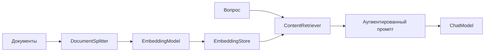

# Вопросы на собеседовании: `LangChain4j`

`LangChain4j` — это Java-библиотека для построения приложений на больших языковых моделях (`LLM`). Она даёт единый API поверх разных провайдеров (`OpenAI`, `Ollama`, `Anthropic`, `Azure`, `Google` и др.), декларативные `AI Services`, память диалога, вызов инструментов и готовый `RAG`-пайплайн.

`LangChain4j` работает с Java-фреймворками и без них. В Spring Boot можно использовать как его стартеры, так и Spring AI; выбор зависит от нужных интеграций и устройства приложения.

Дата последнего обновления: 2026-11-09

## Полезные ссылки

### Официальная документация

- [LangChain4j Documentation](https://docs.langchain4j.dev/) — официальная документация
- [LangChain4j GitHub](https://github.com/langchain4j/langchain4j) — исходники и примеры
- [Introduction to LangChain (Baeldung)](https://www.baeldung.com/java-langchain-basics) — вводный гайд
- [AI Chatbot with LangChain4j and MongoDB Atlas (Baeldung)](https://www.baeldung.com/java-langchain-mongodb) — RAG-чатбот
- [Quarkus LangChain4j](https://docs.quarkiverse.io/quarkus-langchain4j/dev/) — интеграция с Quarkus

## Содержание

- [Полезные ссылки](#полезные-ссылки)
- [See also](#see-also)

**Обзор**
- [Q1. (!) Что такое LangChain4j и какие задачи он решает?](#q1--что-такое-langchain4j-и-какие-задачи-он-решает)
- [Q2. (!) Чем LangChain4j отличается от Spring AI? Когда выбирать каждый?](#q2--чем-langchain4j-отличается-от-spring-ai-когда-выбирать-каждый)

**Низкоуровневый API: модели**
- [Q3. (!) Что такое ChatModel и StreamingChatModel?](#q3--что-такое-chatmodel-и-streamingchatmodel)
- [Q4. Как LangChain4j абстрагирует разных провайдеров?](#q4-как-langchain4j-абстрагирует-разных-провайдеров)

**Высокоуровневый API: AI Services**
- [Q5. (!) Что такое AI Services и аннотации @SystemMessage/@UserMessage?](#q5--что-такое-ai-services-и-аннотации-systemmessageusermessage)
- [Q6. Как работают prompt-шаблоны и переменные @V?](#q6-как-работают-prompt-шаблоны-и-переменные-v)
- [Q7. (!) Как получить структурированный вывод (POJO) из LLM?](#q7--как-получить-структурированный-вывод-pojo-из-llm)

**Память диалога**
- [Q8. (!) Как устроена ChatMemory и чем отличаются её реализации?](#q8--как-устроена-chatmemory-и-чем-отличаются-её-реализации)
- [Q9. Как изолировать память между пользователями?](#q9-как-изолировать-память-между-пользователями)

**Инструменты и function calling**
- [Q10. (!) Как работает вызов инструментов через @Tool?](#q10--как-работает-вызов-инструментов-через-tool)

**RAG**
- [Q11. (!) Из каких компонентов состоит RAG-пайплайн в LangChain4j?](#q11--из-каких-компонентов-состоит-rag-пайплайн-в-langchain4j)
- [Q12. Как загружать и разбивать документы?](#q12-как-загружать-и-разбивать-документы)
- [Q13. Что такое EmbeddingStore и EmbeddingStoreIngestor?](#q13-что-такое-embeddingstore-и-embeddingstoreingestor)
- [Q14. (!) Что такое ContentRetriever и продвинутый RAG?](#q14--что-такое-contentretriever-и-продвинутый-rag)

**Интеграция и продакшн**
- [Q15. Как LangChain4j интегрируется со Spring Boot и Quarkus?](#q15-как-langchain4j-интегрируется-со-spring-boot-и-quarkus)
- [Q16. Как реализовать стриминг ответов?](#q16-как-реализовать-стриминг-ответов)
- [Q17. (!) Как тестировать и наблюдать за LangChain4j-приложениями?](#q17--как-тестировать-и-наблюдать-за-langchain4j-приложениями)
- [Q18. Что такое guardrails и как их применять?](#q18-что-такое-guardrails-и-как-их-применять)

## Q1. (!) Что такое LangChain4j и какие задачи он решает?

`LangChain4j` — Java-библиотека для разработки приложений поверх `LLM`. Она заимствует идеи LangChain, но имеет собственные Java-интерфейсы и API.

Библиотека закрывает типовые задачи AI-приложения:

- **Унифицированный доступ к моделям** — один интерфейс для `OpenAI`, `Ollama`, `Anthropic`, `Azure OpenAI`, `Google Vertex`, `Hugging Face` и десятков других провайдеров.
- **Декларативные AI Services** — интерфейс на Java, который под капотом превращается в вызовы `LLM` (аналог `Feign`/`Spring Data` для моделей).
- **Память диалога** — хранение истории сообщений между запросами.
- **Инструменты (tools / function calling)** — модель может вызывать ваши Java-методы.
- **RAG** — готовые компоненты для загрузки документов, эмбеддингов, векторного поиска и аугментации промпта.
- **Structured output** — извлечение типизированных Java-объектов из ответа модели.

```java
// Низкоуровневый вызов модели
ChatModel model = OpenAiChatModel.builder()
    .apiKey(System.getenv("OPENAI_API_KEY"))
    .modelName("gpt-4o-mini")
    .build();

String answer = model.chat("Объясни, что такое идемпотентность за одно предложение");
```

**Итог:** `LangChain4j` — это «батарейки в комплекте» для AI на Java: от одного вызова модели до полноценного RAG-чатбота с памятью и инструментами.

## Q2. (!) Чем LangChain4j отличается от Spring AI? Когда выбирать каждый?

Обе библиотеки подключают модели к Java-приложению и предлагают инструменты, память и RAG. **Spring AI** строится вокруг Spring Boot, `ChatClient` и advisors. **LangChain4j** даёт `ChatModel`, декларативные AI Services и отдельные интеграции со Spring Boot и Quarkus; его можно использовать и без этих фреймворков.

На Spring Boot возможны оба варианта. Сравните поддержку нужной модели, API для tools и structured output, способы настройки и наблюдаемости на своих версиях. Spring AI естественен, когда приложение уже использует его `ChatClient` и advisors. LangChain4j может быть удобнее, если нужный сценарий выражается через AI Services или требуется его конкретная интеграция. Для Quarkus доступно расширение LangChain4j; Spring AI не становится нейтральной библиотекой только из-за сходства задач.

**Итог:** выбирайте по стеку, совместимости версий и нужным функциям, а качество ответа проверяйте на выбранной модели и своих данных.

## Q3. (!) Что такое ChatModel и StreamingChatModel?

Это два базовых низкоуровневых интерфейса для общения с моделью.

- **`ChatModel`** — синхронный вызов: отправили сообщения, дождались полного ответа.
- **`StreamingChatModel`** — потоковый вызов: токены приходят по мере генерации через callback.

В текущей документации основной API использует `ChatModel` и `StreamingChatModel`. Старые имена и пути миграции проверяйте для конкретной версии зависимостей.

```java
ChatModel model = OpenAiChatModel.builder()
    .apiKey(key)
    .modelName("gpt-4o-mini")
    .temperature(0.7)
    .build();

// Полноценный запрос с системным и пользовательским сообщением
ChatResponse response = model.chat(ChatRequest.builder()
    .messages(
        SystemMessage.from("Ты — лаконичный технический ассистент."),
        UserMessage.from("Что такое CAP-теорема?"))
    .build());

System.out.println(response.aiMessage().text());
System.out.println(response.tokenUsage()); // расход токенов
```

Стриминг (см. Q16) полезен для UX чатов — пользователь видит ответ по мере печати.

**Итог:** `ChatModel` — фундамент. Высокоуровневый `AI Services` (Q5) строится поверх него, но в простых случаях можно работать с моделью напрямую.

## Q4. Как LangChain4j абстрагирует разных провайдеров?

Каждый провайдер — это отдельный модуль (`langchain4j-open-ai`, `langchain4j-ollama`, `langchain4j-anthropic` и т.д.), реализующий общий интерфейс `ChatModel`. Код приложения зависит только от интерфейса, а конкретная модель подставляется через builder.

```java
// OpenAI
ChatModel openai = OpenAiChatModel.builder()
    .apiKey(key).modelName("gpt-4o-mini").build();

// Локальная Ollama — тот же интерфейс
ChatModel ollama = OllamaChatModel.builder()
    .baseUrl("http://localhost:11434").modelName("llama3.1").build();
```

Общий интерфейс позволяет заменить реализацию в месте конфигурации. Возможности моделей, формат tools и structured output, ограничения и качество различаются; смену провайдера проверяют интеграционными тестами и оценкой ответов.

**Итог:** прикладной код может зависеть от `ChatModel`, но провайдерские возможности и требования к данным остаются архитектурным выбором.

## Q5. (!) Что такое AI Services и аннотации @SystemMessage/@UserMessage?

`AI Services` — высокоуровневый, декларативный API: вы описываете Java-интерфейс, а `LangChain4j` генерирует реализацию, которая собирает промпт, зовёт модель и парсит ответ. Идея та же, что у `Spring Data` или `Feign`: интерфейс вместо ручного кода.

```java
interface Assistant {
    @SystemMessage("Ты — вежливый ассистент службы поддержки.")
    String chat(String userMessage);
}

Assistant assistant = AiServices.create(Assistant.class, model);
String reply = assistant.chat("Где мой заказ?");
```

- **`@SystemMessage`** — системная инструкция (роль, тон, ограничения).
- **`@UserMessage`** — шаблон пользовательского сообщения (если нужно обернуть аргументы).

`AI Services` используют память, инструменты и RAG после явной настройки компонентов в builder:

```java
Assistant assistant = AiServices.builder(Assistant.class)
    .chatModel(model)
    .chatMemory(MessageWindowChatMemory.withMaxMessages(10))
    .tools(new OrderTools())
    .contentRetriever(retriever)
    .build();
```

**Итог:** `AI Services` убирают ручную сборку сообщений и преобразование результата. Для тонкого контроля запроса и ответа можно работать с `ChatModel` напрямую.

## Q6. Как работают prompt-шаблоны и переменные @V?

Переменные шаблона записывают как `{{имя}}`. Аннотация `@V("имя")` явно связывает параметр метода с переменной; при компиляции с `-parameters` имена параметров могут использоваться без неё. В интеграциях Spring Boot и Quarkus `@V` обычно не требуется.

```java
interface Translator {
    @SystemMessage("Ты — профессиональный переводчик.")
    @UserMessage("Переведи на {{language}}: {{text}}")
    String translate(@V("text") String text, @V("language") String language);
}
```

Для отдельного использования есть класс `PromptTemplate`:

```java
PromptTemplate template = PromptTemplate.from("Расскажи факт про {{topic}}");
Prompt prompt = template.apply(Map.of("topic", "Kafka"));
String fact = model.chat(prompt.text());
```

**Итог:** шаблон делает подстановку явной, но сам по себе не защищает от prompt injection. Недоверенные значения проверяют по правилам приложения.

## Q7. (!) Как получить структурированный вывод (POJO) из LLM?

`AI Services` умеют возвращать не строку, а типизированный Java-объект, `enum`, `List` или булево. По умолчанию AI Service формирует инструкцию о формате и парсит ответ. Для поддерживаемых моделей можно отдельно включить JSON Schema/structured output. Возвращаемый Java-тип не гарантирует корректность значения без проверки.

```java
record Sentiment(String label, double confidence, List<String> keywords) {}

interface Analyzer {
    @UserMessage("Проанализируй тональность отзыва: {{it}}")
    Sentiment analyze(String review);
}

Analyzer analyzer = AiServices.create(Analyzer.class, model);
Sentiment s = analyzer.analyze("Доставка быстрая, но упаковка помятая");
// Sentiment[label=mixed, confidence=0.7, keywords=[доставка, упаковка]]
```

Для классификации удобно возвращать `enum`:

```java
enum Priority { LOW, MEDIUM, HIGH, CRITICAL }

interface Triage {
    @UserMessage("Оцени критичность тикета: {{it}}")
    Priority assess(String ticket);
}
```

**Итог:** AI Service убирает ручной разбор ответа, но обязательные поля, диапазоны и бизнес-инварианты проверяют после преобразования.

## Q8. (!) Как устроена ChatMemory и чем отличаются её реализации?

`LLM` без состояния — каждый вызов независим. Чтобы модель «помнила» диалог, историю сообщений хранят и подкладывают в каждый запрос. За это отвечает `ChatMemory`.

Две основные реализации:

| Реализация | Стратегия вытеснения | Когда |
|------------|----------------------|-------|
| `MessageWindowChatMemory` | хранит последние N сообщений | просто и предсказуемо |
| `TokenWindowChatMemory` | хранит сообщения в пределах N оценённых токенов | контроль размера передаваемой истории |

```java
// По количеству сообщений
ChatMemory memory = MessageWindowChatMemory.withMaxMessages(10);

// По оценке количества токенов (нужен TokenCountEstimator)
ChatMemory memory = TokenWindowChatMemory.withMaxTokens(2000, tokenCountEstimator);
```

Память специально обрабатывает системное сообщение и связанные сообщения tool calls. `TokenWindowChatMemory` удаляет сообщения целиком и требует `TokenCountEstimator`: это ограничение на сохранённую историю, а не гарантия точного счёта провайдера или полной истории UI. Хранилище по умолчанию находится в процессе; для сохранения между перезапусками подключают `ChatMemoryStore`.

**Итог:** окно по сообщениям проще, окно по токенам лучше контролирует объём истории. Для полного журнала диалога нужна отдельная история.

## Q9. Как изолировать память между пользователями?

Один экземпляр `AI Service` обслуживает многих пользователей, поэтому одна общая `ChatMemory` приведёт к утечке чужих диалогов. Решение — `@MemoryId` + `ChatMemoryProvider`: для каждого идентификатора создаётся своя память.

```java
interface Assistant {
    String chat(@MemoryId String userId, @UserMessage String message);
}

Assistant assistant = AiServices.builder(Assistant.class)
    .chatModel(model)
    .chatMemoryProvider(userId ->
        MessageWindowChatMemory.withMaxMessages(20))
    .build();

assistant.chat("alice", "Привет, меня зовут Алиса");
assistant.chat("bob", "Как меня зовут?"); // не знает про Алису — память изолирована
```

**Итог:** для совместно используемого AI Service передавайте доверенный `@MemoryId` и выдавайте отдельную память для каждой беседы. Память завершённых бесед удаляйте; одновременные вызовы с одним ID сериализуйте на уровне приложения.

## Q10. (!) Как работает вызов инструментов через @Tool?

Инструменты (function calling) позволяют модели вызывать ваши Java-методы — например, получить данные из БД или дернуть внешний API. Метод помечается `@Tool`, а `LangChain4j` передаёт его описание модели и оркестрирует вызов.

```java
class OrderTools {
    @Tool("Возвращает статус заказа по его номеру")
    String orderStatus(@P("номер заказа") String orderId) {
        return orderRepository.findStatus(orderId);
    }
}

Assistant assistant = AiServices.builder(Assistant.class)
    .chatModel(model)
    .tools(new OrderTools())
    .build();

assistant.chat("Где мой заказ 12345?");
// Модель решает вызвать orderStatus("12345"), получает результат и формулирует ответ
```

Цикл: модель возвращает запрос на вызов инструмента → `LangChain4j` исполняет Java-метод → результат уходит обратно в модель → та формирует финальный ответ. Это происходит внутри одного вызова `AI Service`, если провайдер поддерживает tools и инструмент настроен. Перед выполнением действия Java-код всё равно проверяет права и аргументы.

**Итог:** `@Tool` описывает доступную модели операцию, а приложение отвечает за её авторизацию, идемпотентность и обработку ошибок.

## Q11. (!) Из каких компонентов состоит RAG-пайплайн в LangChain4j?

`RAG` (Retrieval-Augmented Generation) добавляет в промпт релевантные фрагменты ваших данных, чтобы модель отвечала по фактам, а не по «памяти». В `LangChain4j` пайплайн собирается из чётких компонентов.



Два этапа:

1. **Индексация (offline):** документы → разбиение на фрагменты → эмбеддинги → запись в `EmbeddingStore`.
2. **Запрос (online):** вопрос → эмбеддинг → поиск похожих фрагментов (`ContentRetriever`) → подстановка в промпт → ответ модели.

**Итог:** RAG в `LangChain4j` — это не «магия», а явная цепочка компонентов, каждый из которых можно заменить и настроить.

## Q12. Как загружать и разбивать документы?

Документы читают через `DocumentLoader` (есть для файлов, URL, S3, Azure Blob и др.) и парсеры (`apache-tika`, `pdf`). Затем `DocumentSplitter` режет их на фрагменты нужного размера с перекрытием.

```java
Document doc = FileSystemDocumentLoader.loadDocument(path, new ApachePdfBoxDocumentParser());

DocumentSplitter splitter = DocumentSplitters.recursive(
    300,   // максимум токенов во фрагменте
    30);   // перекрытие между соседними фрагментами
List<TextSegment> segments = splitter.split(doc);
```

Перекрытие (`overlap`) может сохранить контекст на границе фрагментов, но увеличивает число эмбеддингов и повторов в выдаче. Размер фрагмента и overlap подбирают по корпусу и проверяют на поисковых запросах.

**Итог:** загрузчик читает документ, парсер извлекает текст, splitter делает сегменты. Размер и перекрытие выбирают по качеству retrieval, а не по универсальному числу.

## Q13. Что такое EmbeddingStore и EmbeddingStoreIngestor?

- **`EmbeddingStore`** — векторное хранилище. Реализаций десятки: `pgvector`, `Chroma`, `Milvus`, `Pinecone`, `Elasticsearch`, `Redis`, а также `InMemoryEmbeddingStore` для тестов.
- **`EmbeddingStoreIngestor`** — высокоуровневый помощник, который связывает разбиение, эмбеддинг и запись в одну операцию.

```java
EmbeddingModel embeddingModel = OpenAiEmbeddingModel.builder().apiKey(key).build();
EmbeddingStore<TextSegment> store = new InMemoryEmbeddingStore<>();

EmbeddingStoreIngestor ingestor = EmbeddingStoreIngestor.builder()
    .documentSplitter(DocumentSplitters.recursive(300, 30))
    .embeddingModel(embeddingModel)
    .embeddingStore(store)
    .build();

ingestor.ingest(doc); // разбил, посчитал эмбеддинги, записал
```

**Итог:** `EmbeddingStoreIngestor` объединяет этапы индексации. Хранилище выбирают по требованиям к объёму, фильтрации, обновлению, доступности и размещению данных; `InMemoryEmbeddingStore` полезен для локальных проверок.

## Q14. (!) Что такое ContentRetriever и продвинутый RAG?

- **`ContentRetriever`** — абстракция «по вопросу верни релевантные фрагменты». Базовая реализация `EmbeddingStoreContentRetriever` ищет по векторной близости.
- **`RetrievalAugmentor`** — более мощный механизм для продвинутого RAG: переформулировка запроса (`query transformation`), маршрутизация по нескольким источникам (`query routing`), переранжирование и агрегация (`content aggregation`).

```java
ContentRetriever retriever = EmbeddingStoreContentRetriever.builder()
    .embeddingStore(store)
    .embeddingModel(embeddingModel)
    .maxResults(3)
    .minScore(0.6)   // отсечь нерелевантное
    .build();

Assistant assistant = AiServices.builder(Assistant.class)
    .chatModel(model)
    .contentRetriever(retriever)
    .build();
```

`minScore` может отсекать слабые совпадения, но подходящий порог зависит от модели эмбеддингов и распределения score. Один порог не гарантирует релевантность и фактическую точность ответа.

**Итог:** простой retriever подходит для базового поиска. Дополнительные шаги `RetrievalAugmentor` подключают, когда измерения показывают пользу для своего корпуса.

## Q15. Как LangChain4j интегрируется со Spring Boot и Quarkus?

Помимо ручной сборки builder'ами, есть стартеры с авто-конфигурацией.

**Spring Boot**: для поддерживаемых версий Boot 3.5+ используют `langchain4j-spring-boot-starter`, для Boot 4 — `langchain4j-spring-boot4-starter`; отдельно подключают стартер нужной модели. Модели и `AI Services` конфигурируются через `application.yml` и поднимаются как бины. Интерфейс с `@AiService` становится обычным `@Autowired`-бином.

```yaml
langchain4j:
  open-ai:
    chat-model:
      api-key: ${OPENAI_API_KEY}
      model-name: gpt-4o-mini
```

**Quarkus** (`quarkus-langchain4j`): глубокая интеграция со сборкой Quarkus — `@RegisterAiService`, dev-режим, observability, build-time оптимизации и нативная компиляция через GraalVM.

**Итог:** стартеры упрощают DI, но совместимость версии и набор автонастроек проверяют по выбранной интеграции. Без фреймворка компоненты собирают builder-методами.

## Q16. Как реализовать стриминг ответов?

Стриминг отдаёт токены по мере генерации — для чатов это сильно улучшает воспринимаемую скорость. В `AI Services` метод объявляют с типом `TokenStream` (или возвращают reactive-тип `Flux` в reactive-стеке).

```java
interface Assistant {
    TokenStream chat(String message);
}

TokenStream stream = assistant.chat("Объясни event sourcing");
stream.onPartialResponse(token -> System.out.print(token))
      .onCompleteResponse(response -> log.info("Готово: {}", response.tokenUsage()))
      .onError(Throwable::printStackTrace)
      .start();
```

Для низкоуровневого API используется `StreamingChatModel` с `StreamingChatResponseHandler`. При обрыве до завершения итоговый usage может быть недоступен. Если требуется проверить полный ответ до публикации, потоковые фрагменты удерживают до результата output guardrail; текущие guardrails AI Services делают это для `TokenStream`.

**Итог:** стриминг уменьшает время до первого фрагмента, но требует обработки отмены, ошибок и неполного usage. Итоговый usage, если он предоставлен, читают в `onCompleteResponse`.

## Q17. (!) Как тестировать и наблюдать за LangChain4j-приложениями?

**Тестирование.** Детерминированный `ChatModel` или mock позволяет проверить маршрутизацию, права и разбор ответа без платного API. Отдельные интеграционные тесты проверяют реальную модель, tools и retrieval. `InMemoryEmbeddingStore` помогает проверить локальный RAG, но не поведение выбранной внешней БД.

```java
ChatModel model = mock(ChatModel.class);
when(model.chat(anyString())).thenReturn("замоканный ответ");
```

**Наблюдаемость.** Поддерживаемые реализации моделей принимают `ChatModelListener` для событий запроса, ответа и ошибки. В библиотеке есть интеграция с Micrometer Observation; проверьте готовые метрики до добавления своих счётчиков. Listener не раскрывает автоматически всю цепочку AI Service и может содержать чувствительные сообщения, поэтому поля и кардинальность метрик ограничивают.

```java
ChatModelListener listener = new ChatModelListener() {
    public void onResponse(ChatModelResponseContext ctx) {
        TokenUsage usage = ctx.chatResponse().tokenUsage();
        if (usage != null) {
            meterRegistry.counter("llm.tokens", "model", modelName)
                .increment(usage.totalTokenCount());
        }
    }
};
```

**Итог:** unit-тесты проверяют код без модели, интеграционные — совместимость компонентов. В проде измеряют ошибки, задержку и usage без записи полного содержимого сообщений в метрики.

## Q18. Что такое guardrails и как их применять?

Guardrails в текущем ядре LangChain4j — экспериментальные проверки для **AI Services**. Они первоначально появились в расширении Quarkus и затем были перенесены в ядро. На низкоуровневые `ChatModel` и `StreamingChatModel` этот механизм напрямую не навешивается.

- Input guardrail проверяет пользовательское сообщение до вызова модели и может отклонить или преобразовать его.
- Output guardrail проверяет итоговый ответ. Он может принять, отклонить, переписать ответ или запросить ограниченный retry/reprompt. Это не дообучение модели и не гарантия защиты от всех prompt injection и галлюцинаций.

```java
interface Assistant {
    @OutputGuardrails(JsonOutputGuardrail.class)
    String chat(String message);
}

class JsonOutputGuardrail implements OutputGuardrail {
    @Override
    public OutputGuardrailResult validate(AiMessage response) {
        return isValidJson(response.text())
            ? success()
            : reprompt("Ответ не является JSON", "Верни корректный JSON");
    }
}
```

При потоковом ответе output guardrail получает полный ответ после завершения генерации. Частичные фрагменты буферизуются и выдаются только после успешной проверки, что влияет на время до первого фрагмента. Повтор ограничивают и учитывают возможные побочные действия tools до output-проверки. Права на инструменты и доступ к данным проверяют отдельно.

**Итог:** guardrails помогают применять правила продукта вокруг AI Service. Выбирайте отказ, преобразование или ограниченный повтор по смыслу проверки; не считайте их универсальной гарантией безопасности.

---

## See also

- [Spring AI](../frameworks/spring/spring-ai-interview.md) — AI-фреймворк для экосистемы Spring (главная альтернатива)
- [RAG](rag-interview.md) — Retrieval-Augmented Generation: концепции и паттерны
- [Function Calling](function-calling-interview.md) — вызов инструментов моделью
- [Embeddings](embeddings-interview.md) — векторные представления текста
- [Vector Databases](vector-databases-interview.md) — векторные хранилища для RAG
- [MCP](mcp-interview.md) — Model Context Protocol для подключения инструментов
- [LLM Integration Patterns](llm-integration-patterns-interview.md) — паттерны интеграции LLM
- [Prompt Engineering](prompt-engineering-interview.md) — проектирование промптов
- [AI Application Architecture](ai-application-architecture-interview.md) — архитектура AI-приложений
