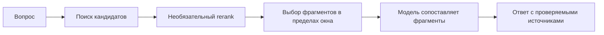
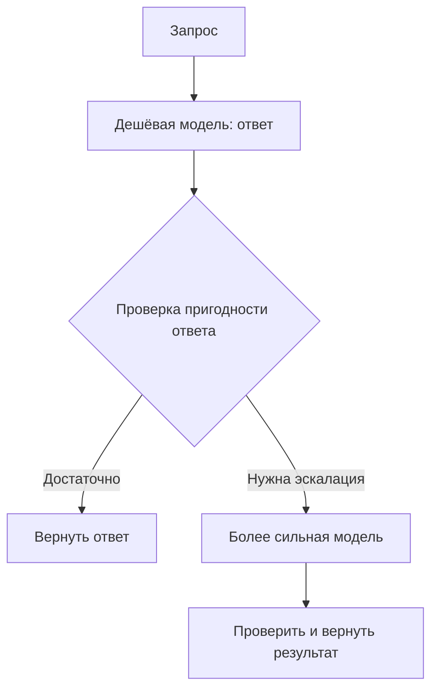
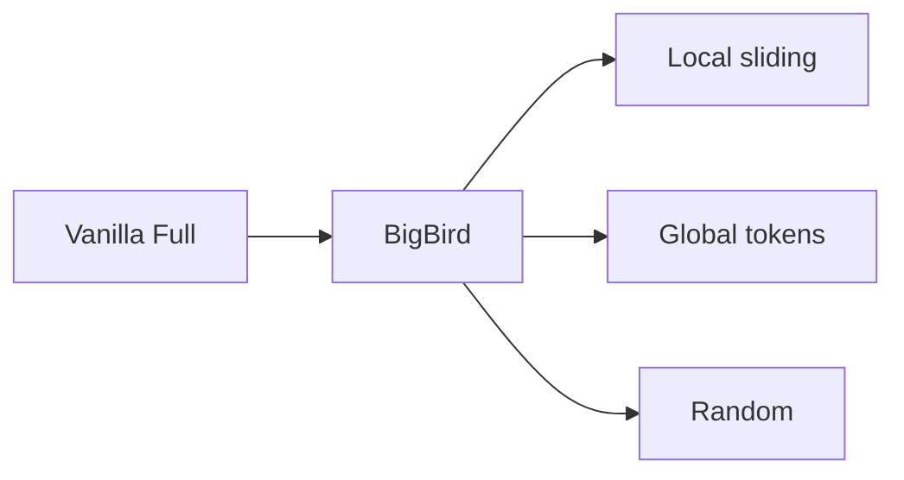
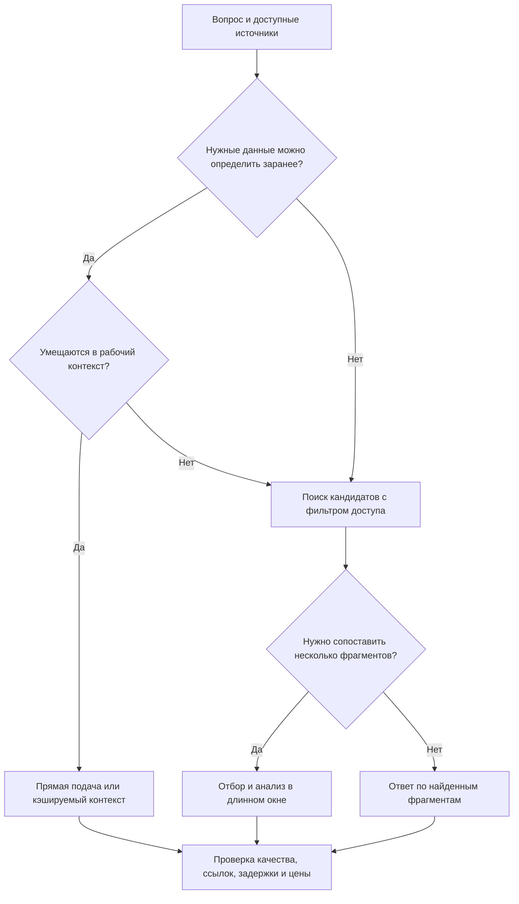

# Вопросы на собеседовании: Длинный контекст против RAG

Модели с длинным контекстным окном могут получать большие документы, фрагменты кодовой базы и мультимодальные данные в одном запросе. Это меняет выбор между подачей всего входа и поиском релевантных фрагментов (RAG). Шпаргалка разбирает качество на длинном входе, стоимость, задержку и гибридные подходы. Заявленный размер окна сам по себе не гарантирует качество ответа на всём его протяжении.

## Полезные ссылки

### Архитектурные работы (context extension)

- [Longformer: The Long-Document Transformer (Beltagy et al., 2020)](https://arxiv.org/abs/2004.05150)
- [Big Bird: Transformers for Longer Sequences (Zaheer et al., 2020)](https://arxiv.org/abs/2007.14062)
- [YaRN: Efficient Context Window Extension (Peng et al., 2023)](https://arxiv.org/abs/2309.00071)
- [Ring Attention (Liu et al., 2023)](https://arxiv.org/abs/2310.01889)
- [StreamingLLM: Attention Sinks (Xiao et al., 2023)](https://arxiv.org/abs/2309.17453)
- [ALiBi: Position Encoding (Press et al., 2021)](https://arxiv.org/abs/2108.12409)

### Проблемы и benchmarks

- [Lost in the Middle (Liu et al., 2023)](https://arxiv.org/abs/2307.03172)
- [RULER: What's the Real Context Size? (Hsieh et al., 2024)](https://arxiv.org/abs/2404.06654)
- [LongBench](https://github.com/THUDM/LongBench)
- [Needle in a Haystack (gkamradt)](https://github.com/gkamradt/LLMTest_NeedleInAHaystack)

### Caching и compression

- [Anthropic Prompt Caching](https://docs.anthropic.com/en/docs/build-with-claude/prompt-caching)
- [OpenAI Prompt Caching](https://platform.openai.com/docs/guides/prompt-caching)
- [GPTCache (semantic cache)](https://github.com/zilliztech/GPTCache)
- [LLMLingua: Prompt Compression](https://arxiv.org/abs/2310.05736)
- [CAG: Cache-Augmented Generation (Chan et al., 2024)](https://arxiv.org/abs/2412.15605)

### Provider docs

- [Gemini 1.5 Pro (2M context)](https://ai.google.dev/gemini-api/docs/changelog)
- [Claude 3 (200K context)](https://www.anthropic.com/news/claude-3-family)

## Содержание

- [Полезные ссылки](#полезные-ссылки)
- [See also](#see-also)

**Эволюция context windows**
- [Q1. (!) Что означает рост контекстного окна модели?](#q1--что-означает-рост-контекстного-окна-модели)
- [Q2. (!) Зачем потребовался long context?](#q2--зачем-потребовался-long-context)
- [Q3. Какие приёмы решают разные ограничения длинного контекста?](#q3-какие-приёмы-решают-разные-ограничения-длинного-контекста)
- [Q4. Как расширяют окно через YaRN / RoPE scaling / position interpolation?](#q4-как-расширяют-окно-через-yarn--rope-scaling--position-interpolation)

**Lost in the Middle и benchmarks**
- [Q5. (!) Что такое Lost in the Middle?](#q5--что-такое-lost-in-the-middle)
- [Q6. Needle-in-a-Haystack — как тестируют long context?](#q6-needle-in-a-haystack--как-тестируют-long-context)
- [Q7. (!) Effective context vs claimed context — в чём разница?](#q7--effective-context-vs-claimed-context--в-чём-разница)
- [Q8. RULER и LongBench — что меряют?](#q8-ruler-и-longbench--что-меряют)

**Long Context vs RAG — выбор**
- [Q9. (!) Когда выбрать long context, а когда RAG?](#q9--когда-выбрать-long-context-а-когда-rag)
- [Q10. (!) RAG умер с приходом 2M-context Gemini?](#q10--rag-умер-с-приходом-2m-context-gemini)
- [Q11. В каком подходе надёжнее цитирование и атрибуция?](#q11-citation--attribution--какой-подход-даёт-лучше)
- [Q12. ACL filtering (row-level security) в RAG vs long context?](#q12-acl-filtering-row-level-security-в-rag-vs-long-context)

**Cost и latency**
- [Q13. Как сравнить стоимость длинного входа и RAG на одной модели?](#q13-как-сравнить-стоимость-длинного-входа-и-rag-на-одной-модели)
- [Q14. (!) Задержка: prefill растёт линейно — что это значит?](#q14--задержка-prefill-растёт-линейно--что-это-значит)
- [Q15. TTFT (time-to-first-token) для long context?](#q15-ttft-time-to-first-token-для-long-context)

**Caching**
- [Q16. (!) Prompt Caching — как это спасает long context?](#q16--prompt-caching--как-это-спасает-long-context)
- [Q17. Anthropic vs OpenAI prompt caching: отличия?](#q17-anthropic-vs-openai-prompt-caching-отличия)
- [Q18. (!) Semantic Caching — что это и когда применять?](#q18--semantic-caching--что-это-и-когда-применять)
- [Q19. Подбор порога (threshold) для semantic cache?](#q19-подбор-порога-threshold-для-semantic-cache)
- [Q20. Что такое CAG (Cache-Augmented Generation)?](#q20-что-такое-cag-cache-augmented-generation)

**Hybrid patterns**
- [Q21. (!) Гибрид: RAG → анализ через long context?](#q21--гибрид-rag--анализ-через-long-context)
- [Q22. Как работает каскад (cascading): от малой модели к большой?](#q22-как-работает-каскад-cascading-от-малой-модели-к-большой)
- [Q23. Code agents (Cursor/Cody): как отобрать код для правки метода и его вызовов в разных каталогах при ограниченном окне?](#q23-code-agents-cursorcody-как-комбинируют)

**Architecture deep-dive**
- [Q24. Как устроен sparse attention (BigBird/Longformer)?](#q24-как-устроен-sparse-attention-bigbirdlongformer)
- [Q25. Ring Attention — как работает?](#q25-ring-attention--как-работает)
- [Q26. Как работают sliding window и StreamingLLM (attention sinks)?](#q26-как-работают-sliding-window-и-streamingllm-attention-sinks)

**Compression и multimodal**
- [Q27. LLMLingua и prompt compression?](#q27-llmlingua-и-prompt-compression)
- [Q28. Multimodal long context: видео и аудио в Gemini?](#q28-multimodal-long-context-видео-и-аудио-в-gemini)
- [Q29. (!) Дерево решений: как выбирать архитектуру?](#q29--дерево-решений-как-выбирать-архитектуру)
- [Q30. Примеры из практики (Cursor, Notion AI, Copilot Workspace)?](#q30-примеры-из-практики-cursor-notion-ai-copilot-workspace)

---

## Q1. (!) Что означает рост контекстного окна модели?

Размер окна показывает, сколько токенов модель или конкретный API позволяет включить в один запрос с учётом ограничений на вход и выход. Он менялся от тысяч до сотен тысяч и миллионов токенов, но **не является универсальной мерой качества**. Например, OpenAI объявляла GPT-4 API с окном 8K; Meta заявила 128K для Llama 3.1 и 10M для **Llama 4 Scout**. Последнее число относится именно к Scout, а Meta описывает обучение и дообучение этой модели на последовательностях длиной 256K и отдельную проверку обобщения на более длинных входах. Эти цифры описывают разные модели и условия доступа, поэтому сравнивать их как единую шкалу качества нельзя ([OpenAI](https://openai.com/index/gpt-4-api-general-availability/), [Meta: Llama 3.1](https://ai.meta.com/blog/meta-llama-3-1/), [Meta: Llama 4](https://ai.meta.com/blog/llama-4-multimodal-intelligence/)).

Поддержка длинного входа требует учитывать вычисления и память attention, позиционное представление, данные обучения и способ обслуживания модели. В разных системах используются разные приёмы; по одному размеру окна нельзя установить внутреннюю архитектуру модели. Для практического выбора проверяют ограничения конкретной версии API и качество **на своей задаче и нужной длине**. Работы [RULER](https://arxiv.org/abs/2404.06654) и [Lost in the Middle](https://arxiv.org/abs/2307.03172) показывают, почему формальная вместимость и успешное использование информации внутри окна — разные вещи.

## Q2. (!) Зачем потребовался long context?

Длинное окно полезно, когда для ответа нужно одновременно предоставить модели большой объём взаимосвязанных данных: несколько разделов договора, сопоставляемые документы, достаточно большой фрагмент кода с зависимостями или историю разговора. Оно уменьшает необходимость заранее выбирать узкий набор фрагментов. Но весь корпус может не поместиться даже в большое окно, а присутствие факта в промпте не гарантирует, что модель его использует ([Lost in the Middle](https://arxiv.org/abs/2307.03172)).

RAG извлекает релевантные фрагменты из внешнего корпуса и передаёт их модели ([Lewis et al.](https://arxiv.org/abs/2005.11401)). Ошибка поиска или нарезки может исключить нужную связь между частями документа. При этом поиск можно расширять, повторять и сочетать с длинным окном; RAG не обречён терять связи, а длинное окно не обязано содержать весь репозиторий. Выбор зависит от объёма данных, характера связей, качества поиска, цены, задержки и тестов на своих вопросах (см. Q9).

## Q3. Какие приёмы решают разные ограничения длинного контекста?

При полном self-attention на входе длиной `n` число пар токенов растёт как `O(n²)`. Наивная реализация хранит квадратичную матрицу внимания; [FlashAttention](https://arxiv.org/abs/2205.14135) вычисляет **точный** attention блоками и сокращает обращения к памяти, не превращая число пар в линейное. При поэтапной генерации с KV-кэшем картина другая: очередной токен обращается к уже накопленному контексту, а размер кэша растёт с длиной истории. Поэтому сложность префилла, рабочую память и стоимость декодирования нельзя сводить к одному `O(n²)`.

Приёмы решают **разные ограничения**:

1. **Ограничить связи внимания.** [Longformer](https://arxiv.org/abs/2004.05150) сочетает локальное окно с выбранными глобальными токенами; при фиксированном размере окна это уменьшает работу с ростом длины последовательности.
2. **Эффективнее вычислять или распределять полный attention.** FlashAttention уменьшает движение данных между уровнями памяти; [Ring Attention](https://arxiv.org/abs/2310.01889) распределяет блоки последовательности между устройствами и перекрывает обмен с вычислениями. Эти методы сами по себе не устраняют все попарные взаимодействия.
3. **Расширить диапазон позиций.** Position Interpolation и YaRN адаптируют RoPE-позиции предобученной модели (см. Q4), но сами не снижают стоимость полного внимания.
4. **Управлять памятью при генерации.** Сжатие или выгрузка KV-кэша снижает давление на память ускорителя ценой собственного качества, обмена данными или задержки; это отдельная задача от вычисления attention на входе.

Эти подходы можно сочетать после проверки совместимости. Приписывать конкретный приём закрытой модели без опубликованного технического подтверждения нельзя.

## Q4. Как расширяют окно через YaRN / RoPE scaling / position interpolation?

Это семейство приёмов, которые **растягивают предобученное окно модели на бóльшую длину без обучения с нуля** — за счёт перенастройки позиционных кодов RoPE.

**Проблема:** RoPE-коды определяют, как модель представляет относительные позиции. За пределами длины, встречавшейся при обучении, качество может ухудшаться; степень ухудшения зависит от модели и задачи. Масштабирование позиций меняет представление длинного входа, но не расширяет физическую память и не устраняет стоимость полного attention.

- **Position Interpolation** линейно сжимает индексы новых позиций в обученный диапазон. Например, при расширении 4K до 32K коэффициент равен 8. Авторы показали расширение LLaMA с небольшим дообучением, без смены архитектуры ([Chen et al., 2023](https://arxiv.org/abs/2306.15595)).
- **Варианты масштабирования частот RoPE** меняют частотное представление позиций; конкретная пригодность режима без дообучения зависит от реализации и модели. Нельзя считать zero-shot общим свойством всех вариантов.
- **YaRN** сочетает интерполяцию RoPE с разным масштабом для разных частот и масштабирование внимания перед softmax. В работе авторы сравнивают затраты на дообучение с прежними методами и показывают их уменьшение в своих экспериментах ([Peng et al., 2023, v3](https://arxiv.org/abs/2309.00071)). Это не универсальная гарантия лучшего качества или фиксированного объёма данных.

Сравнивайте методы на нужной длине, включая исходное короткое окно: улучшение на длинных последовательностях может менять качество на коротких. Приёмы можно применять к подходящей предобученной модели, но при необходимости её дообучают; обучение с нуля из определения не следует.

## Q5. (!) Что такое Lost in the Middle?

В работе [Lost in the Middle](https://arxiv.org/abs/2307.03172) авторы меняли положение нужной информации в длинном входе и проверяли ответы на вопросы по нескольким документам и извлечение пары «ключ — значение». Для изученных моделей качество **часто** было выше, когда нужная информация находилась в начале или конце, и ниже, когда она находилась в середине. Это наблюдение зависит от модели, задачи и построения запроса; оно не задаёт универсальную кривую точности.

Практический вывод: факт может помещаться в окно, но модель не обязана одинаково успешно использовать его в любой позиции. Для своей задачи проверяйте вопросы с релевантным фрагментом в начале, середине и конце. Порядок фрагментов, повторение вопроса или раздельная обработка частей могут менять результат, но их пользу нужно измерять. Из исследования не следует, что причиной эффекта обязательно служат RoPE, causal mask или конкретный тип обучающих данных. Для RAG и подачи полного документа влияние порядка тоже проверяют отдельно; превосходство одного подхода из этого эксперимента не следует.

## Q6. Needle-in-a-Haystack — как тестируют long context?

В классическом **Needle-in-a-Haystack (NIAH)** в длинный текст вставляют короткий проверяемый факт — «иголку». Затем задают вопрос по этому факту и меняют длину текста и положение вставки. Результат показывает, удалось ли извлечь факт в заданных условиях. Например, [реализация gkamradt](https://github.com/gkamradt/needle-in-a-haystack) проводит серии по длине входа и глубине расположения иголки; в ней есть и более сложные варианты с несколькими фактами.

Точность одной иголки нельзя переносить на задачи, где нужно объединять сведения из нескольких частей документа. [RULER](https://arxiv.org/abs/2404.06654) расширяет синтетическую проверку несколькими иголками, трассировкой зависимостей и агрегацией. Поэтому при сравнении моделей указывают версию модели, длину и состав входа, вопрос, метрику и конкретный вариант теста; проценты из разных прогонов нельзя складывать в одну таблицу без общей методики.

## Q7. (!) Effective context vs claimed context — в чём разница?

**Заявленное контекстное окно** — предел входа, который поддерживает конкретная модель или интерфейс. Он также может зависеть от выделенного места под выход. **Эффективную длину** определяют операционно: выбирают задачу, метрику и допустимый порог качества, затем измеряют, до какой длины модель выдерживает этот порог. Поэтому у одной модели может быть разная эффективная длина для поиска одной «иголки», сопоставления нескольких фактов и суммаризации.

[RULER](https://arxiv.org/abs/2404.06654) показывает, что успех в простой проверке извлечения не гарантирует такого же качества на более сложных задачах и большей длине. Но из одного бенчмарка нельзя вывести универсальное число «полезных токенов» для каждой модели. Для своего применения тестируют длины, расположение сведений, тип вопросов и требуемый уровень качества. Единое правило «использовать половину заявленного окна» не заменяет такой проверки.

## Q8. RULER и LongBench — что меряют?

[RULER](https://arxiv.org/abs/2404.06654) — настраиваемый синтетический бенчмарк для длинного контекста. Авторы оценивали модели на 13 задачах, среди которых поиск одной и нескольких «иголок», трассировка зависимостей и агрегация. Длину и сложность входа можно варьировать, поэтому результаты показывают, как меняется качество в конкретной конфигурации.

[LongBench](https://arxiv.org/abs/2308.14508) объединяет 21 набор данных в шести категориях: вопросы по одному и нескольким документам, суммаризация, few-shot learning, синтетические задачи и дополнение кода. Он включает прикладные данные, но **не состоит только из них**. Эти бенчмарки проверяют разные срезы работы с длинным текстом; их метрики и пороги нельзя подменять одним общим баллом или универсальной границей «рабочего окна».

## Q9. (!) Когда выбрать long context, а когда RAG?

Выбор зависит от размера доступного **пользователю** материала, характера вопроса и проверенного качества на своей задаче. Если нужный ограниченный набор документов помещается в рабочую длину модели и вопрос требует связать сведения по всему набору, разумно проверить прямую подачу длинного контекста. Если корпус намного больше окна, документы часто меняются или для каждого запроса нужен небольшой релевантный срез, разумно проверить retrieval и RAG. Эти подходы можно сочетать: retrieval выбирает допустимые документы, модель анализирует их вместе.

Сравнивайте качество ответа, полноту найденных фактов, стоимость входа и retrieval, задержку и частоту обновления корпуса на одних и тех же вопросах. Кэширование способно изменить стоимость повторной подачи длинного текста. Наличие цитат и ACL само по себе не определяет выбор: источники нужно привязать к ответу в обоих подходах, а права применить **до** передачи данных модели. В [сравнении Li et al.](https://arxiv.org/abs/2407.16833v2) длинный контекст при достаточных ресурсах в среднем дал более высокое качество на выбранных наборах, а RAG стоил меньше; переносить этот результат на любую модель и нагрузку нельзя. Другое [сравнение Li et al.](https://arxiv.org/abs/2501.01880v1) показывает зависимость результата от способа retrieval и типа вопросов.

## Q10. (!) RAG умер с приходом 2M-context Gemini?

**Нет.** Большое окно позволяет подавать целый документ или другой ограниченный набор данных без предварительного поиска. Но оно не делает retrieval лишним для корпусов, которые не помещаются в окно, и для задач, где достаточно небольшой части данных. Число «2M» в заголовке относится к Gemini 1.5 Pro: [журнал Gemini API](https://ai.google.dev/gemini-api/docs/changelog) отмечает общедоступный выпуск окна в два миллиона токенов 27 июня 2024 года. При выборе системы проверяют актуальный лимит нужной модели и качество на требуемой длине, а не переносят размер окна одной модели на все остальные.

У RAG есть затраты на индексирование и поиск, у прямой подачи — на обработку входных токенов. Соотношение цены и задержки зависит от модели, объёма выбранного текста, кэширования, нагрузки и качества retrieval; отношение числа токенов не равно отношению полной стоимости. [Исследование Li et al.](https://arxiv.org/abs/2407.16833v2) обнаружило преимущество RAG по стоимости в своей конфигурации, а [документация Google Cloud](https://docs.cloud.google.com/gemini-enterprise-agent-platform/models/long-context) описывает кэширование повторяемого контекста как способ изменить этот баланс. Retrieval и длинный контекст можно применять вместе, выбирая объём данных по конкретному запросу. Нет обоснования для фиксированных «200× дешевле», «30–60 секунд» или универсального размера такого гибрида.

Retrieval не требуется только ради ссылок на страницы: если документ подан целиком с разметкой страниц или разделов, приложение может привязать ответ к этим местам. В обоих подходах нужно проверить, что указанный фрагмент действительно подтверждает тезис ответа (см. Q11).

## Q11. В каком подходе надёжнее цитирование и атрибуция?

<a id="q11-citation--attribution--какой-подход-даёт-лучше"></a>

Ни RAG, ни прямой длинный контекст не гарантируют, что ссылка **подтверждает утверждение**. Здесь важно различать два свойства: указатель ведёт к реальному фрагменту источника, и этот фрагмент действительно обосновывает конкретный тезис ответа.

В RAG извлечённым документам или чанкам можно сопоставить идентификаторы и показать их рядом с ответом. Но наличие `doc_id` не доказывает, что модель опиралась именно на этот фрагмент и правильно его пересказала. Проверяйте соответствие каждой ссылки её утверждению, а также случаи, когда retrieval не нашёл нужный источник.

При прямой подаче документов можно использовать разметку секций или штатное цитирование провайдера. Например, [Anthropic Citations](https://platform.claude.com/docs/en/build-with-claude/citations) возвращает проверяемые указатели на предоставленный текст: диапазоны символов для plain text, страницы для PDF и индексы блоков для custom content. Такой указатель подтверждает местоположение цитаты, но не делает интерпретацию модели автоматически верной. Сравнивайте оба подхода на одном наборе вопросов по корректности ответа, полноте источников и доле ссылок, которые действительно поддерживают тезис. Универсального превосходства одного подхода по точности citation из этих механизмов не следует.

## Q12. ACL filtering (row-level security) в RAG vs long context?

**Правило для обоих подходов:** приложение проверяет права до того, как содержимое попадает в запрос модели. Если запрещённый фрагмент уже передан модели, инструкция «не упоминай его» и фильтрация готового ответа не заменяют авторизацию. [OWASP](https://genai.owasp.org/llmrisk/llm072025-system-prompt-leakage/) отдельно предостерегает от переноса проверок доступа в системный промпт.

В RAG авторизация может ограничивать поиск по разрешённым документам или проверять результаты retrieval перед добавлением их в контекст. Метаданные и фильтры базы помогают реализовать это, но сами по себе не знают действующие права пользователя: приложение должно связать их с надёжным источником прав и проверить сценарии изменения доступа. [Пример Pinecone](https://www.pinecone.io/learn/rag-access-control/) разбирает интеграцию отдельного слоя авторизации с retrieval.

При прямой подаче длинного контекста приложение также может собрать только разрешённые документы или части документа. Это предварительная авторизация, а не обязательный переход на RAG. Если права различаются внутри документа, нужно отделить разрешённые фрагменты до сборки запроса. Кэш и журналы не должны повторно раскрывать данные пользователю с другими правами; состав кэшируемого контекста сверяют с актуальной моделью доступа.

## Q13. Как сравнить стоимость длинного входа и RAG на одной модели?

<a id="q13--арифметика-стоимости-посчитать-gpt-4o-128k-vs-rag"></a>

Сравнивайте **одну модель и одну нагрузку**: число запросов, объём входа и ожидаемый объём ответа. Для каждого варианта отдельно сложите стоимость обычных входных токенов, фактически кэшированных входных токенов и выходных токенов. Для RAG добавьте стоимость поиска, индексирования, эмбеддингов и хранения. Если в прямой подаче есть подготовка документов или другие платные операции, учтите и их. Отношение длин промптов само по себе не даёт отношения полной стоимости.

Формула токенной части за период: `N × (I_обычн × P_вход + I_кэш × P_кэш + O × P_выход) / 1 000 000`, где `N` — число запросов, а цены указаны за миллион токенов. К результату прибавляют расходы вне вызова модели. Объёмы `I_обычн` и `I_кэш` определяют по фактическому использованию, а не по предположению, что повтор документа всегда даёт кэш-хит. [Документация OpenAI по prompt caching](https://developers.openai.com/api/docs/guides/prompt-caching) описывает повторяемый префикс и отдельный учёт кэшированных токенов.

**Пример для расчёта, а не универсальный тариф.** На [странице GPT-4o](https://developers.openai.com/api/docs/models/gpt-4o), проверенной 02.11.2026, указаны окно 128 000 токенов и ставки за миллион текстовых токенов: $2.50 за обычный вход, $1.25 за кэшированный вход и $10 за выход. Модель помечена как устаревающая, поэтому для реального выбора сначала проверьте доступность модели и текущие цены.

Пусть за день приходит 1000 запросов. Прямая подача использует 120 000 входных токенов вместе с документом и 500 выходных; RAG использует 5000 входных токенов вместе с найденными фрагментами и те же 500 выходных. При отсутствии кэш-хитов токенная часть прямой подачи равна `1000 × (120 000 × $2.50 + 500 × $10) / 1 000 000 = $305` в день. Для RAG она равна `1000 × (5000 × $2.50 + 500 × $10) / 1 000 000 = $17.50` в день **до** расходов на retrieval и индекс. Число 120 000 укладывается в окно только при условии, что оставшегося места хватает для всех остальных входных и выходных токенов.

Если один и тот же префикс из 120 000 токенов действительно попал в кэш в 999 следующих запросах, токенная часть прямой подачи в этой упрощённой модели составит `$0.30 + 999 × $0.15 + $5 = $155.15` в день. Это условный сценарий с полной повторяемостью префикса, а не обещанный результат: частичные попадания, срок жизни кэша, изменения документа и организация промпта меняют сумму. Итоговое решение принимайте по измеренным кэш-хитам, расходам всей системы, задержке и качеству ответов на своей задаче.

## Q14. (!) Задержка: prefill растёт линейно — что это значит?

Фраза «prefill растёт линейно» — слишком сильное обобщение. При prefill модель обрабатывает вход и строит состояния KV-cache до выдачи первого токена. Больший вход обычно увеличивает эту работу и время до первого токена, но **строгую линейную зависимость** для любой модели и нагрузки из этого не вывести. Время зависит от реализации attention, оборудования, кэш-хитов, пакетирования и очереди. [Обзор метрик NVIDIA](https://developer.nvidia.com/blog/llm-benchmarking-fundamental-concepts/) включает в TTFT ожидание в очереди, prefill и сетевую задержку; [документация vLLM](https://docs.vllm.ai/projects/spyre/en/v2.4.0/user_guide/performance.html) показывает влияние планировщика и разбиения prefill на части.

После prefill начинается decode: модель выдаёт токены последовательно, обращаясь к накопленному контексту. Длина ответа влияет на полное время генерации, а размер KV-cache может влиять и на работу при каждом следующем токене. Поэтому нельзя объявлять decode независимым от длины входа или заменять измерение TTFT одной оценкой `O(n)`.

Для сравнения прямой подачи и RAG измеряйте TTFT и полную задержку на **одной модели и одинаковых вопросах** при нескольких длинах входа, с отдельно учтённым retrieval и кэшем. Не переносите таблицу миллисекунд одной конфигурации на другую. Streaming начинает показывать ответ после получения первого токена и не убирает ожидание перед ним.

## Q15. TTFT (time-to-first-token) для long context?

**TTFT** — время от отправки запроса до получения первого токена ответа. Оно включает сетевую передачу, ожидание в очереди, обработку входа и выдачу первого токена; точный состав зависит от точки измерения. Длинный вход может увеличить prefill, но реальный TTFT определяется и нагрузкой сервера. [NVIDIA описывает TTFT](https://developer.nvidia.com/blog/llm-benchmarking-fundamental-concepts/) отдельно от времени между токенами и полной задержки ответа.

На стороне приложения можно сократить передаваемый текст, выбрать модель и режим под требуемую задержку, обеспечить повторяемый префикс для кэширования и измерить долю попаданий. Retrieval тоже занимает время, поэтому выигрыш от более короткого входа нужно проверять вместе с поиском. На стороне сервера влияют очередь, пакетирование и расписание prefill; [vLLM](https://docs.vllm.ai/projects/spyre/en/v2.4.0/user_guide/performance.html) показывает, что отложенный фрагмент prefill увеличивает TTFT.

Streaming улучшает восприятие **после** первого токена, но не сокращает начальную паузу сам по себе. Поэтому для интерактивного сценария смотрите на TTFT, время между токенами и полную задержку по распределению запросов, а не на одно среднее число. Спекулятивное декодирование ускоряет прежде всего выдачу последующих токенов; его нельзя записывать как универсальное сокращение prefill.

## Q16. (!) Prompt Caching — как это спасает long context?

Кэширование промпта позволяет повторно использовать уже обработанный **префикс** входа. Если большой документ и инструкции идут до переменного вопроса, повторные запросы могут попасть в кэш и сократить повторную обработку этой части. Это может уменьшить стоимость и TTFT, но только при фактическом cache hit; новый или изменённый префикс, истечение срока хранения и маршрутизация запроса могут убрать выигрыш. Число токенов в контекстном окне при этом не становится меньше.

Механизм и тариф зависят от провайдера и модели. [OpenAI](https://developers.openai.com/api/docs/guides/prompt-caching) описывает совпадение начального префикса, учёт `cached_tokens` и условия хранения. [Anthropic](https://platform.claude.com/docs/en/build-with-claude/prompt-caching) поддерживает управление кэшем через `cache_control`, разные сроки жизни и отдельную цену записи и чтения. [Gemini](https://ai.google.dev/gemini-api/docs/generate-content/caching.md) описывает автоматическое и явное кэширование для поддерживаемых моделей; у явного режима есть плата за хранение. Конкретные скидки, минимальная длина и TTL меняются, поэтому их берут из документации выбранной версии, а не из постоянной таблицы для всех моделей.

Для проверки эффективности расположите стабильные данные в начале запроса, а переменные — после них. Затем сравните фактические `cached_tokens`, цену, TTFT и долю попаданий с вариантом без кэша на своей нагрузке. Первый запрос может записывать кэш по отдельному тарифу; повторный запрос не гарантирует попадания. Содержимое кэша также должно сохранять границы доступа пользователей.

## Q17. Anthropic vs OpenAI prompt caching: отличия?

Оба провайдера могут повторно использовать **совпадающий префикс** промпта. Различаются доступные способы управления кэшем, сроки хранения, учёт токенов и тарифы конкретной модели. Нельзя противопоставлять Anthropic как исключительно «явный», а OpenAI как исключительно «автоматический»: [Anthropic](https://platform.claude.com/docs/en/build-with-claude/prompt-caching) поддерживает `cache_control` на уровне запроса или блока и автоматическую либо явную расстановку точек кэша; [OpenAI](https://developers.openai.com/api/docs/guides/prompt-caching) описывает автоматическое совпадение префикса и дополнительные явные настройки для поддерживаемых моделей.

У Anthropic есть варианты срока жизни кэша, для которых запись и чтение учитываются отдельно. У OpenAI ставки и доступные режимы тоже зависят от модели и настроек. Проверяйте в документации выбранной версии минимальную длину, TTL, цену обычного входа, записи и чтения, а затем измеряйте фактические `cached_tokens` и попадания на своей нагрузке. Универсальные «90% против 50%», «бесплатная запись» и точка окупаемости после заданного числа обращений не работают для всех моделей и режимов.

Для сравнения возьмите одинаковый повторяемый префикс, частоту обращений, долю попаданий и объём переменной части. Считайте цену записи, успешных чтений, обычных входных и выходных токенов отдельно. Длительность кэша, изменение промпта и маршрутизация запроса могут изменить результат; один факт поддержки кэша ещё не определяет, какой провайдер дешевле.

## Q18. (!) Semantic Caching — что это и когда применять?

**Semantic cache** хранит готовые ответы на предыдущие запросы и ищет кандидата по смысловой близости нового вопроса к сохранённому. Обычно вопросы представляют эмбеддингами и сравнивают вектора; попадание требует заданного порога и проверки, что сохранённый ответ по-прежнему подходит. При подтверждённом попадании приложение возвращает ответ из кэша **без нового вызова LLM**. [Пример Redis](https://redis.io/docs/latest/develop/use-cases/semantic-cache/rust/) использует векторный поиск с фильтрами по метаданным и порогом расстояния.

Это не кэш префикса промпта: при prompt caching модель всё равно вызывается с новым запросом, а повторно используется обработанная часть входа. Смысловой кэш экономит целый вызов только при безопасном повторном использовании ответа. Похожесть вопросов сама по себе не доказывает взаимозаменяемость ответов.

Кандидатов ограничивают контекстом применения: арендатором и правами пользователя, версией документов, настройками ответа, языком и сроком актуальности. Для общих стабильных FAQ с повторяющимися вопросами это может дать экономию. Персональные, зависимые от текущих данных и диалоговые ответы требуют строгого разделения, инвалидации или обхода кэша. При промахе либо сомнительном кандидате приложение вызывает модель и при необходимости сохраняет новый ответ. Выгоду оценивают по доле **корректных** попаданий, цене поиска/эмбеддингов и стоимости пропущенных вызовов, а не по универсальному проценту hit rate.

## Q19. Подбор порога (threshold) для semantic cache?

Сначала определите метрику. Для **сходства** типа cosine similarity более высокий порог обычно даёт меньше попаданий и снижает риск выдать неподходящий сохранённый ответ; более низкий увеличивает число попаданий и этот риск. Для **расстояния** направление неравенства обратное: кандидата принимают при расстоянии ниже порога. Значение нельзя переносить между разными эмбеддингами, нормализацией и наборами вопросов.

Разметьте пары «новый вопрос + контекст» и «сохранённый ответ»: подходит ли **тот же ответ**, а не просто похож ли интент. На отложенной выборке считайте долю пригодных ответов среди попаданий, долю выдач неподходящего сохранённого ответа и долю запросов, дошедших до модели, при нескольких порогах. Кривую precision–recall используют для компромисса между точностью и охватом; ROC показывает TPR против FPR, а не precision против recall. Порог выбирают с учётом цены выдачи неподходящего ответа и проверяют отдельно для чувствительных доменов и сегментов доступа.

Дополнительная проверка кандидата может снизить число выдач неподходящего ответа из кэша, но её стоимость и собственные ошибки включают в оценку. После запуска отслеживайте качество ответа, изменения документов и прав, инвалидацию, задержку и затраты. Фиксированные значения вроде 0.95 для конкретной модели эмбеддингов не являются универсальным началом или доказательством пригодности кэша.

## Q20. Что такое CAG (Cache-Augmented Generation)?

В [работе Chan et al. о CAG](https://arxiv.org/abs/2412.15605v2) ограниченный набор релевантных знаний заранее помещают в длинный контекст и сохраняют обработанные состояния KV-cache. На следующих вопросах модель использует этот контекст **без поиска фрагментов на каждый запрос**. Это отличается от RAG, где перед ответом выбирают данные из внешнего корпуса. Подход применим, когда нужная база помещается в рабочий контекст модели и повторно используется.

Кэш нужно обновлять при изменении базы знаний, промпта или модели; срок хранения и способ переиспользования зависят от реализации. Кэширование у API-провайдера может помочь, но не гарантирует сохранения состояний навсегда и не тождественно произвольной дозаписи в KV-cache. Даже без ошибок retrieval модель может пропускать факты внутри длинного входа, а чтение кэшированного контекста может тарифицироваться.

Сравнивайте CAG и RAG на одинаковых вопросах по качеству, задержке, актуальности данных, правам доступа и полной стоимости. Выводы исследования относятся к выбранным авторами базам и конфигурациям; из них не следует фиксированное ускорение или превосходство CAG для любого корпуса. Если база не помещается в рабочую длину, часто меняется или различается по правам пользователей, прямое предварительное кэширование всей базы становится труднее и может потребоваться отбор данных.

## Q21. (!) Гибрид: RAG → анализ через long context?

Когда корпус слишком велик для окна модели, поиск сначала отбирает кандидатов, а модель с длинным контекстом затем сопоставляет несколько найденных фрагментов. Между поиском и генерацией можно добавить rerank. В окно передают текст отобранных фрагментов, а не одни их эмбеддинги: векторы помогают найти кандидатов, но не заменяют содержание источников для ответа. Число фрагментов выбирают под бюджет токенов и проверяют на своих вопросах; фиксированное `top-k` само по себе не гарантирует ни качество, ни экономию. [Anthropic описывает](https://www.anthropic.com/research/contextual-retrieval) такой конвейер поиска, rerank и передачи отобранных фрагментов модели.



В контекст передают только доступные пользователю и актуальные фрагменты, сохраняя идентификаторы источников. Если поиск пропустил нужный документ, длинное окно не восстановит этот факт. Слишком много нерелевантных фрагментов также может мешать анализу. Поэтому сравнивайте варианты на одинаковых вопросах по пригодности ответа, полноте найденных данных, проверяемости ссылок, задержке и полной стоимости поиска, rerank и входных токенов. Длинное окно позволяет совместно читать больше материала, чем короткое, но не гарантирует улучшение качества на каждой задаче.

[Contextual Retrieval от Anthropic](https://www.anthropic.com/research/contextual-retrieval) — отдельное улучшение этапа индексации: перед созданием эмбеддинга и BM25-представления чанк дополняют кратким контекстом исходного документа. Его можно сочетать с этим конвейером; это не название этапа анализа длинным окном. Опубликованное Anthropic снижение доли неудачных поисков относится к их наборам данных и конфигурации, а не к любому RAG-приложению. Prompt caching может снизить цену повторяющегося префикса, но не отменяет ограничения окна, необходимость обновлять данные или новый вызов модели.

## Q22. Как работает каскад (cascading): от малой модели к большой?

**Каскад моделей** сначала получает ответ от более дешёвой ступени. Проверка качества либо принимает его, либо передаёт тот же запрос более сильной модели. Следующая ступень вызывается только для эскалированных запросов; при нескольких ступенях решение повторяется. [FrugalGPT](https://arxiv.org/abs/2305.05176) исследует такие каскады как способ выбирать сочетание моделей под стоимость и качество. Это отличается от **маршрутизации до ответа**: роутер выбирает модель по признакам запроса, не запуская предварительно дешёвую модель для ответа. Такой подход отдельно изучает [RouteLLM](https://arxiv.org/abs/2406.18665).



Критерий эскалации настраивают по размеченным примерам: доле ошибочно принятых ответов, доле эскалаций, задержке и полной стоимости. Им может быть отдельный оценщик, проверяемые признаки ответа или другие сигналы; заявленную моделью уверенность нельзя считать надёжной без калибровки. Сильная модель тоже может ошибиться, поэтому сам факт эскалации не заменяет оценку итогового качества. Большое контекстное окно нужно только там, где этого требует задача, а не каждой последней ступени.

Эскалация добавляет стоимость уже выполненного дешёвого вызова к стоимости следующего. Для двух ступеней ожидаемая цена приблизительно равна цене первой попытки плюс доля эскалаций, умноженная на цену второй, плюс стоимость проверки. Реальный выигрыш зависит от тарифов выбранных моделей, длины входа и выхода, доли эскалаций и качества принятых ответов. Сравнивайте каскад с прямым вызовом сильной модели на одной нагрузке; фиксированные доли запросов и универсальная экономия здесь неприменимы.

<a id="q23-code-agents-cursorcody-как-комбинируют"></a>
## Q23. Code agents (Cursor/Cody): как отобрать код для правки метода и его вызовов в разных каталогах при ограниченном окне?

<a id="q23-code-agents-cursorcody-как-комбинируют"></a>

Code-ассистенту нужен код, относящийся к запросу. Он ищет подходящие файлы или фрагменты, читает найденное и передаёт выбранный контекст модели вместе с задачей. При правке нескольких связанных файлов основой контекста становится текст нужных участков исходного кода. Карта символов, embeddings или список путей могут помочь найти их, но не заменяют сам текст для правки. Открытый файл может быть отправной точкой, но не ограничивает поиск. Вместимость контекстного окна влияет на объём передаваемого кода; сама по себе она не заменяет поиск и не означает загрузку всего репозитория.

Способ поиска зависит от продукта и его версии. В [документации Cursor Agent](https://cursor.com/docs/agent/tools/search) описаны локальный Instant Grep и чтение найденных файлов; для этого поиска Cursor не хранит embeddings репозитория. [Cody](https://sourcegraph.com/docs/cody/core-concepts/context) использует поиск по ключевым словам, Sourcegraph Search и связи элементов кода. Согласно [FAQ Sourcegraph](https://sourcegraph.com/docs/cody/faq), в Cody Enterprise embeddings заменены поиском Sourcegraph. Поэтому нельзя считать векторный индекс или AST обязательным этапом каждого code-ассистента.

Практический порядок: уточнить задачу и известные файлы, найти определения и использования нужного кода доступными средствами, прочитать достаточно соседнего контекста, затем передать модели выбранные фрагменты. Если результат зависит от других файлов, поиск расширяют; выбор контекста проверяют по фактическим ссылкам и тестам после правки.

Например, если изменение метода затрагивает вызовы в других каталогах, одного определения, похожих реализаций или соседних по пути файлов недостаточно для первого предложения правки. Эти способы помогают искать кандидатов. Граф кода может включать точные ссылки на метод: тогда подтверждением служат именно ссылки, а не одна связь классов. В ограниченное окно отбирают текст самого метода и фактических вызовов с необходимым окружением. Когда все связанные участки не помещаются одновременно, работу разбивают на шаги и повторно проверяют зависимости.

## Q24. Как устроен sparse attention (BigBird/Longformer)?

**Sparse attention** ограничивает пары токенов, между которыми вычисляется внимание. Это снижает стоимость матрицы внимания, когда число связей на токен ограничено. Остальная работа модели и фактическая скорость зависят от реализации и оборудования. [Longformer](https://arxiv.org/abs/2004.05150) использует локальное окно и назначаемое задаче глобальное внимание; [BigBird](https://arxiv.org/abs/2007.14062) добавляет случайные связи.

**Обычный (dense) attention:** каждый токен смотрит на все `n` токенов → O(n²).

В этих архитектурах используют разные сочетания связей:

1. **Local (sliding window)** — токен смотрит только на `w` соседей. O(n·w).
2. **Global tokens** — несколько специальных токенов смотрят на все остальные (и наоборот). O(n·g) для глобальных.
3. **Random** — дополнительные случайные связи в BigBird. Теоретические свойства BigBird доказаны для его конструкции и условий, а не для любой разреженной маски.

**Longformer (Beltagy et al., 2020):** local + global. Глобальные позиции выбираются под задачу.

**BigBird (Zaheer et al., 2020):** local + global + random. Авторы доказывают универсальную аппроксимацию и другие свойства этой архитектуры; это не означает побитового равенства ответов dense attention.



Sparse attention и эффективная реализация dense attention решают разные задачи: первая меняет граф связей, вторая может уменьшать перенос данных и память без удаления пар. Из размера окна или названия продукта нельзя надёжно вывести внутренний паттерн внимания без документации разработчика.

## Q25. Ring Attention — как работает?

**Ring Attention** ([Liu et al., 2023](https://arxiv.org/abs/2310.01889)) распределяет длинную последовательность по нескольким устройствам и вычисляет блоки внимания без замены полной матрицы разреженной маской. Работа описывает метод обучения и инференса; из неё нельзя выводить внутреннюю реализацию конкретной закрытой модели.

**Идея:** разделить последовательность на блоки по устройствам. Каждое устройство обрабатывает свои запросы с блоками ключей и значений, которые передаются по кольцу. Передачу очередного блока перекрывают с вычислением текущего; фактический выигрыш зависит от соотношения скорости вычислений и связи.

Частичные результаты нельзя просто складывать как отдельно нормализованные `softmax`: для точного результата нужна согласованная блочная нормализация. Метод распределяет работу и память между устройствами, но не обнуляет общий квадратичный объём попарных вычислений. Передача данных также остаётся реальной затратой, даже когда её удаётся скрыть за вычислением.

## Q26. Как работают sliding window и StreamingLLM (attention sinks)?

Связка приёмов для **бесконечных потоков** (стримов), где контекст не помещается в окно и старые токены приходится вытеснять. Sliding window держит фиксированное окно, а StreamingLLM решает, какие именно старые токены нельзя выбрасывать.

**Sliding Window Attention (SWA)** ограничивает прямые связи токена локальным окном. Между удалёнными позициями информация может проходить через несколько слоёв, но это не гарантирует точное воспроизведение старого факта. Ширина окна, предел входа и доступный при декодировании KV-cache — разные параметры.

**Проблема при потоковом декодировании:** простое вытеснение всех старых KV-состояний может ухудшить качество у моделей, обученных с обычным вниманием.

**StreamingLLM** ([Xiao et al., 2023](https://arxiv.org/abs/2309.17453)) описывает **attention sinks**: начальные токены могут получать много внимания, даже если их смысл не важен для текущего ответа. Число сохраняемых начальных токенов — параметр реализации, а не неизменное правило «первые четыре» для любой модели.

**Решение:** при ограниченном бюджете KV-cache сохранять выбранные начальные состояния и недавние состояния. Это помогает продолжать потоковую генерацию без переобучения в условиях исследования; вытесненные факты из старой части диалога не становятся доступными для точного ответа.

```python
def streaming_kv_cache(kv, max_size=4096, sinks=4):
    if not 0 < sinks < max_size:
        raise ValueError("sinks must be between 0 and max_size")
    if len(kv) > max_size:
        # Сохраняем первые `sinks` + последние `max_size - sinks`
        keep_first = kv[:sinks]
        keep_last = kv[-(max_size - sinks):]
        kv = concat(keep_first, keep_last)
    return kv
```

**Применение:** длительная потоковая генерация, когда важно удержать стабильность модели при ограниченном KV-cache. Для вопросов по давно вытесненным данным нужен отдельный механизм памяти или retrieval.

## Q27. LLMLingua и prompt compression?

**LLMLingua** ([Jiang et al., 2023](https://arxiv.org/abs/2310.05736)) сжимает текст промпта перед вызовом целевой модели. В исследовании применяются вспомогательная языковая модель, управление бюджетом и итеративный отбор токенов. Достижимое сжатие и потери качества зависят от задачи и выбранного бюджета.

**Алгоритм** (двухуровневое прореживание):

1. **Грубый этап (coarse-grained):** budget controller делит промпт на части (инструкция, примеры, вопрос) и распределяет бюджет токенов по их важности.
2. **Тонкий этап (fine-grained):** вспомогательная модель оценивает условную предсказуемость токенов и итеративно отбирает их под бюджет. Низкая предсказуемость может указывать на важную деталь, но сама по себе не доказывает её полезность для конкретного ответа.
3. Проверяем, что после сжатия остались инструкции, имена, числа и сведения, без которых ответ меняется.

**Результаты:**

- Меньший вход может сократить токенные расходы и prefill целевой модели.
- Время самой компрессии входит в полную задержку; экономию проверяют на своём потоке запросов.
- Потеря короткой, но существенной детали способна сделать ответ неверным даже при высокой средней точности.

**LongLLMLingua** ([Jiang et al.](https://arxiv.org/abs/2310.06839)) учитывает вопрос при отборе информации в длинном контексте. Его результаты не следует переносить на любой документ и модель без измерения.

LLMLingua, LongLLMLingua и LLMLingua-2 используют разные методы и настройки. При выборе реализации сверяйте её API и метрики с конкретной версией библиотеки, а не подставляйте модель LLMLingua-2 в пример исходного метода без проверки.

**Альтернативы:**

- **Суммаризация** (на уровне предложений или всего документа).
- **Selective context** (на основе релевантности запросу).
- **AutoCompressors** — модели, обученные сжимать контекст в soft prompts.

## Q28. Multimodal long context: видео и аудио в Gemini?

Gemini может принимать видео и аудио вместе с текстовым вопросом. Видео обрабатывается как последовательность визуальных кадров и аудиодорожки; количество занятых токенов зависит от модели, разрешения, частоты выборки кадров, длительности и способа подачи. [Документация Gemini по видео](https://ai.google.dev/gemini-api/docs/video-understanding) описывает эти настройки, а [документация по аудио](https://ai.google.dev/gemini-api/docs/audio) — отдельные сценарии обработки звука. Поэтому нельзя считать, что час любого видео всегда занимает одну и ту же долю окна.

Для Video QA можно спросить о событии на указанном интервале и запросить таймкоды. Для длинной встречи можно получить конспект аудио. Для PDF с диаграммами нужно проверить, что модель получила и текст, и изображения нужных страниц. В каждом случае ограничения входа и способ подсчёта токенов берут из документации выбранной версии модели.

На практике сначала оценивают токены реального файла средствами API, затем оставляют место для вопроса и ответа. При большом файле выбирают нужные интервалы или используют поиск по транскрипту и метаданным. Качество проверяют на вопросах по началу, середине и концу записи, особенно если ответ зависит от короткого эпизода. Стоимость и задержку измеряют для конкретной модели и тарифа: из одного лишь числа часов нельзя вывести фиксированную цену или TTFT.

## Q29. (!) Дерево решений: как выбирать архитектуру?

Выбор начинается с проверки **рабочего объёма данных для одного вопроса**, прав доступа и требуемой свежести. Размер всего корпуса полезен, но сам по себе не задаёт архитектуру: большой архив может требовать одного документа, а небольшой набор может содержать запрещённые для данного пользователя данные. Затем сравнивают качество, задержку и полную стоимость на одинаковых вопросах.



Если документы часто меняются, проверяют обновление индекса и инвалидацию кэша. Если нужны ссылки, сохраняют идентификаторы страниц или фрагментов и проверяют, подтверждают ли они ответ; прямая подача размеченного документа тоже может дать проверяемые ссылки. При высоком QPS отдельно считают попадания в кэш, расходы на поиск и стоимость генерации. Нет универсальных порогов вроде «до 32K всегда in-prompt» или «больше 1M обязательно классический RAG»: рабочее окно, данные и требования различаются.

## Q30. Примеры из практики (Cursor, Notion AI, Copilot Workspace)?

Публичные описания продуктов показывают, **как пользователь получает контекст для задачи**, но не дают полного чертежа внутренней системы. Поэтому каждое утверждение ниже ограничено конкретным продуктом, режимом и опубликованным источником.

**Cursor Agent Search.** [Документация Cursor](https://cursor.com/docs/agent/tools/search) описывает локальный Instant Grep и чтение найденных файлов. Для этого инструмента Cursor прямо сообщает, что не хранит embeddings кодовой базы. Это не доказывает отсутствия иных способов подбора контекста во всех режимах Cursor.

**Notion AI.** [Описание обработки данных Notion AI](https://www.notion.com/help/notion-ai-security-practices) говорит, что при поиске по рабочему пространству запрос сопоставляют с индексом страниц, подходящие страницы ранжируют и передают модели вместе с запросом. Notion указывает на embeddings и проверку прав пользователя. [Enterprise Search](https://www.notion.com/help/enterprise-search) также ищет по подключённым источникам и показывает ссылки на использованные документы. Из этого не следует отдельный индекс для каждого пользователя или фиксированная модель для всех запросов.

**GitHub Copilot Workspace.** [Описание GitHub Next](https://githubnext.com/projects/copilot-workspace/) относится к техническому preview: задача из issue или естественного запроса превращалась в спецификацию, план и предлагаемые изменения кода. GitHub Next сообщает о завершении preview; это исторический пример рабочего процесса, а не утверждение о текущем способе работы всего GitHub Copilot. Публичное описание не подтверждает загрузку репозитория целиком в одно окно модели.

Общий практический вывод: для конкретной функции можно назвать опубликованный механизм и его ограничения. Размер корпуса, права, свежесть и тип задачи помогают выбрать архитектуру собственной системы; внутреннюю реализацию чужого продукта следует описывать только в пределах проверенного источника.
