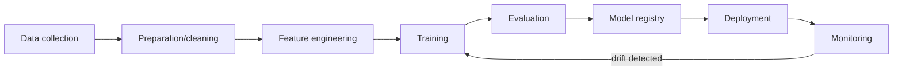
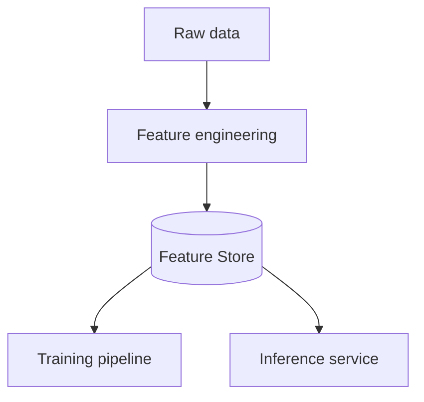

# Вопросы на собеседовании: `MLOps`

**MLOps** — DevOps для ML: experiment tracking, model versioning, deployment, monitoring, retraining. Критично для production ML/AI. С 2024 — **LLMOps** как подвид (специфично для LLM apps). Стек: MLflow, Weights & Biases, Feast, Kubeflow, Seldon, BentoML.

## Полезные ссылки

### Официальная документация и авторитетные источники

- [MLflow Documentation](https://mlflow.org/docs/latest/index.html)
- [Weights & Biases Documentation](https://docs.wandb.ai/)
- [Feast Documentation](https://docs.feast.dev/)
- [Tecton Documentation](https://docs.tecton.ai/)
- [Kubeflow Documentation](https://www.kubeflow.org/docs/)
- [BentoML Documentation](https://docs.bentoml.com/)
- [MLOps Community](https://mlops.community/)
- [Made With ML](https://madewithml.com/)

## Содержание

- [Полезные ссылки](#полезные-ссылки)
- [See also](#see-also)

**Базовые понятия**
- [Q1. (!) Обучение запустили дважды на одном снимке данных, одной ревизии кода и с закреплённым зерном генератора, а качество на контроле разошлось на несколько процентов — почему?](#q1--обучение-запустили-дважды-на-одном-снимке-данных-одной-ревизии-кода-и-с-закреплённым-зерном-генератора-а-качество-на-контроле-разошлось-на-несколько-процентов--почему)
- [Q2. (!) Модель показала отличное качество на отложенной выборке, но в первую же неделю работы с живым потоком просела почти вдвое — почему?](#q2--модель-показала-отличное-качество-на-отложенной-выборке-но-в-первую-же-неделю-работы-с-живым-потоком-просела-почти-вдвое--почему)
- [Q3. (!) Сервис откатили на прежнюю ревизию кода, поведение интерфейса вернулось, а предсказания остались испорченными — почему?](#q3--сервис-откатили-на-прежнюю-ревизию-кода-поведение-интерфейса-вернулось-а-предсказания-остались-испорченными--почему)

**Experiment tracking**
- [Q4. (!) Удачный эксперимент полугодовой давности повторили по записанным в трекере гиперпараметрам, а результат не воспроизвёлся — почему?](#q4--удачный-эксперимент-полугодовой-давности-повторили-по-записанным-в-трекере-гиперпараметрам-а-результат-не-воспроизвёлся--почему)
- [Q5. (!) Новую версию модели пометили в реестре как продуктовую, выкладку не делали, а сервис инференса продолжил отвечать прежней — почему?](#q5--новую-версию-модели-пометили-в-реестре-как-продуктовую-выкладку-не-делали-а-сервис-инференса-продолжил-отвечать-прежней--почему)
- [Q6. Хранилище трекинга экспериментов за квартал выросло до нескольких терабайтов, хотя самих прогонов за это время немного — почему?](#q6-хранилище-трекинга-экспериментов-за-квартал-выросло-до-нескольких-терабайтов-хотя-самих-прогонов-за-это-время-немного--почему)

**Data и features**
- [Q7. (!) Признак, посчитанный по исторической витрине, дал модели заметный прирост качества, а в работе с живым потоком не дал ничего — почему?](#q7--признак-посчитанный-по-исторической-витрине-дал-модели-заметный-прирост-качества-а-в-работе-с-живым-потоком-не-дал-ничего--почему)
- [Q8. (!) Признак «сумма покупок за тридцать дней» считают в обучении и в работе одной формулой, а в живом потоке его значения систематически ниже — почему?](#q8--признак-сумма-покупок-за-тридцать-дней-считают-в-обучении-и-в-работе-одной-формулой-а-в-живом-потоке-его-значения-систематически-ниже--почему)
- [Q9. Модель должна реагировать на событие в течение минут, но в рабочем контуре она видит значение признака вчерашним — почему?](#q9-модель-должна-реагировать-на-событие-в-течение-минут-но-в-рабочем-контуре-она-видит-значение-признака-вчерашним--почему)
- [Q10. Признак в обучении считают запросом к хранилищу, а в сервисе инференса — отдельным кодом, и однажды предсказания разъехались с офлайнными — почему?](#q10-признак-в-обучении-считают-запросом-к-хранилищу-а-в-сервисе-инференса--отдельным-кодом-и-однажды-предсказания-разъехались-с-офлайнными--почему)

**Model registry**
- [Q11. (!) На жалобы пользователей за прошлый месяц нужно посмотреть глазами той модели, что тогда отвечала, но какая именно это была версия — установить не удаётся, почему?](#q11--на-жалобы-пользователей-за-прошлый-месяц-нужно-посмотреть-глазами-той-модели-что-тогда-отвечала-но-какая-именно-это-была-версия--установить-не-удаётся-почему)
- [Q12. Под одной и той же версией модели в хранилище через неделю оказались другие веса, хотя никто её намеренно не заменял — почему?](#q12-под-одной-и-той-же-версией-модели-в-хранилище-через-неделю-оказались-другие-веса-хотя-никто-её-намеренно-не-заменял--почему)

**Deployment**
- [Q13. (!) Сервис считает предсказание на каждый входящий запрос, входные данные обновляются раз в сутки, и на пиках задержка ответа улетает — почему так вышло?](#q13--сервис-считает-предсказание-на-каждый-входящий-запрос-входные-данные-обновляются-раз-в-сутки-и-на-пиках-задержка-ответа-улетает--почему-так-вышло)
- [Q14. (!) Новую модель раскатили в A/B-тесте, остановили его на третий день по первому же значимому перевесу, а на полном трафике прироста не оказалось — почему?](#q14--новую-модель-раскатили-в-ab-тесте-остановили-его-на-третий-день-по-первому-же-значимому-перевесу-а-на-полном-трафике-прироста-не-оказалось--почему)
- [Q15. Теневой прогон две недели показывал, что новая модель отвечает не хуже прежней, а после переключения трафика деловой показатель просел — почему?](#q15-теневой-прогон-две-недели-показывал-что-новая-модель-отвечает-не-хуже-прежней-а-после-переключения-трафика-деловой-показатель-просел--почему)
- [Q16. Новую модель неделю держали на пяти процентах трафика без единого замечания, а после перевода на полный поток посыпались ошибки на редком типе запросов — почему?](#q16-новую-модель-неделю-держали-на-пяти-процентах-трафика-без-единого-замечания-а-после-перевода-на-полный-поток-посыпались-ошибки-на-редком-типе-запросов--почему)

**Monitoring**
- [Q17. (!) Качество ответов модели проседало почти месяц, а заметили это лишь тогда, когда пошёл вал возвратов товара — почему?](#q17--качество-ответов-модели-проседало-почти-месяц-а-заметили-это-лишь-тогда-когда-пошёл-вал-возвратов-товара--почему)
- [Q18. (!) Распределения входных признаков за квартал не сдвинулись ни на одном срезе, а качество ответов модели за это же время заметно упало — почему?](#q18--распределения-входных-признаков-за-квартал-не-сдвинулись-ни-на-одном-срезе-а-качество-ответов-модели-за-это-же-время-заметно-упало--почему)
- [Q19. (!) Проседание качества у пользователей одного региона длилось три недели, а ежедневная проверка сдвига данных за это время ни разу не сработала — почему?](#q19--проседание-качества-у-пользователей-одного-региона-длилось-три-недели-а-ежедневная-проверка-сдвига-данных-за-это-время-ни-разу-не-сработала--почему)
- [Q20. Оповещение о сдвиге данных срабатывает почти каждый день и всегда по одному и тому же признаку, а качество ответов модели держится ровно — почему?](#q20-оповещение-о-сдвиге-данных-срабатывает-почти-каждый-день-и-всегда-по-одному-и-тому-же-признаку-а-качество-ответов-модели-держится-ровно--почему)

**CI/CD для ML**
- [Q21. (!) Сборка конвейера прошла все проверки и выкатилась автоматически, а на рабочем контуре модель начала отвечать мусором с первого же часа — почему?](#q21--сборка-конвейера-прошла-все-проверки-и-выкатилась-автоматически-а-на-рабочем-контуре-модель-начала-отвечать-мусором-с-первого-же-часа--почему)
- [Q22. Рекомендательную модель переобучают каждую неделю на свежих откликах пользователей, и за квартал её выдача сузилась до узкого круга товаров — почему?](#q22-рекомендательную-модель-переобучают-каждую-неделю-на-свежих-откликах-пользователей-и-за-квартал-её-выдача-сузилась-до-узкого-круга-товаров--почему)

**LLMOps**
- [Q23. (!) Набор регрессионных проверок ответов языковой модели то краснеет, то зеленеет на одном и том же неизменном коде — почему?](#q23--набор-регрессионных-проверок-ответов-языковой-модели-то-краснеет-то-зеленеет-на-одном-и-том-же-неизменном-коде--почему)
- [Q24. Число обращений к языковой модели за месяц не выросло, а счёт за них поднялся почти втрое — почему?](#q24-число-обращений-к-языковой-модели-за-месяц-не-выросло-а-счёт-за-них-поднялся-почти-втрое--почему)
- [Q25. (!) Правку в подсказке модели откатили к прошлой версии в тот же час, а прежнее поведение ответов так и не вернулось — почему?](#q25--правку-в-подсказке-модели-откатили-к-прошлой-версии-в-тот-же-час-а-прежнее-поведение-ответов-так-и-не-вернулось--почему)
- [Q26. Модель-судья почти всегда выбирает более длинный из двух предложенных ответов, хотя короткий отвечает по делу — почему?](#q26-модель-судья-почти-всегда-выбирает-более-длинный-из-двух-предложенных-ответов-хотя-короткий-отвечает-по-делу--почему)

**Production maturity**
- [Q27. (!) Поиск по документам перестал находить очевидно подходящие тексты сразу после пересборки индекса, хотя сами документы не менялись — почему?](#q27--поиск-по-документам-перестал-находить-очевидно-подходящие-тексты-сразу-после-пересборки-индекса-хотя-сами-документы-не-менялись--почему)
- [Q28. Правка одной строки в подсказке модели занимает минуты, а до пользователей она доезжает не раньше чем через две недели — почему?](#q28-правка-одной-строки-в-подсказке-модели-занимает-минуты-а-до-пользователей-она-доезжает-не-раньше-чем-через-две-недели--почему)

## Q1. (!) Обучение запустили дважды на одном снимке данных, одной ревизии кода и с закреплённым зерном генератора, а качество на контроле разошлось на несколько процентов — почему?

**MLOps (Machine Learning Operations)** — набор практик, которые превращают ML-модель из одноразового артефакта в надёжную production-систему. По сути это DevOps, расширенный на специфику ML: помимо кода нужно версионировать данные и модели, а сама модель со временем деградирует и требует переобучения.

**Что входит в MLOps:**
- **Версионирование** — данные, код и модели вместе, чтобы любой результат можно было воспроизвести
- **Трекинг экспериментов** (experiment tracking) — что обучали, с какими параметрами, какой результат
- **Воспроизводимость** — повторить эксперимент и получить тот же результат
- **Автоматизация деплоя** — выкат модели без ручных шагов
- **Мониторинг** — отслеживание дрейфа (drift) и деградации качества
- **Переобучение** (retraining) — обновление модели на свежих данных
- **Governance** — соответствие требованиям (compliance), аудит

**Зачем это нужно.** Около 80% ML-моделей либо вообще не доходят до production, либо быстро теряют качество после выката. MLOps появился именно как ответ на эту проблему: цель — относиться к ML-системе как к надёжному ПО с полным жизненным циклом, а не как к разовому скрипту в ноутбуке.

Отсюда важный нюанс воспроизводимости: закрепления данных, кода и `seed` мало — третье измерение это **окружение** (версии библиотек, CUDA/cuDNN, тип GPU, число воркеров `DataLoader`). Без его фиксации два прогона расходятся из-за недетерминированного порядка параллельных float-редукций на GPU и автовыбора алгоритмов свёртки, поэтому метрика гуляет на проценты при формально одинаковых входах.


## Q2. (!) Модель показала отличное качество на отложенной выборке, но в первую же неделю работы с живым потоком просела почти вдвое — почему?



ML lifecycle — это **цикл** (а не линейный конвейер): мониторинг ловит дрейф и запускает переобучение, замыкая процесс на этап обучения.

**Этапы:**
1. **Data collection** — сбор данных из источников, ETL
2. **Data preparation** — очистка и валидация данных
3. **Feature engineering** — преобразование и кодирование признаков
4. **Training** — обучение модели
5. **Evaluation** — замер метрик на отложенном test set
6. **Model registry** — регистрация и версионирование готовой модели
7. **Deployment** — выкат в production
8. **Monitoring** — отслеживание дрейфа и производительности
9. **Retraining** — переобучение на свежих данных при деградации

Задача MLOps — автоматизировать и связать эти этапы в воспроизводимый pipeline, а не выполнять каждый вручную.

Именно поэтому высокая метрика на этапе **Evaluation** ничего не гарантирует в проде: отложенный test set — срез того же исторического распределения, что и обучающая выборка, тогда как живой поток приходит из распределения, которое уже ушло (**drift**). Офлайн-замер фиксирует прошлое, и без **monitoring** с **retraining** качество проседает в первые же дни после выката.


## Q3. (!) Сервис откатили на прежнюю ревизию кода, поведение интерфейса вернулось, а предсказания остались испорченными — почему?

| Критерий | DevOps | MLOps |
|----------|--------|-------|
| Артефакт | Код | Код + данные + модель |
| Версионирование | Git | Git + DVC + Model Registry |
| Тестирование | Unit, integration | Валидация данных, метрики модели |
| Воспроизводимость | Зависимости + код | + снапшот данных + random seed |
| Мониторинг | Здоровье приложения, ошибки | + drift, деградация accuracy |
| Деплой | Один артефакт | Модель + features + препроцессинг |
| Переобучение | — | Периодическое / по триггеру |
| Жизненный цикл | Линейный | Циклический (retrain) |

**Ключевая разница.** Обычное приложение работает стабильно, пока кто-то не внесёт баг — код детерминирован. ML-модель деградирует сама по себе: мир меняется, распределение данных уходит от того, на котором она училась, и точность падает без единой правки кода. Поэтому в MLOps добавляются два измерения, которых нет в DevOps: версионирование данных и непрерывное переобучение.

Из той же тройственности артефакта следует и практическое: `git revert` откатывает лишь одно измерение из трёх — веса живут в **Model Registry**, а данные и препроцессинг в **DVC**/feature store, и обе эти версии откат кода не трогает. Поэтому после отката интерфейс возвращается к прежнему поведению, а предсказания остаются испорченными, пока версию модели не переключат в реестре явно.


## Q4. (!) Удачный эксперимент полугодовой давности повторили по записанным в трекере гиперпараметрам, а результат не воспроизвёлся — почему?

**Experiment tracking** — это систематическое сохранение всех параметров и результатов каждого прогона обучения, чтобы потом можно было сравнить эксперименты и воспроизвести нужный. Обучение ML — это перебор: десятки прогонов с разными гиперпараметрами, данными и архитектурами. Без трекинга через неделю невозможно вспомнить, какая комбинация дала лучший результат.

Отсюда же — почему одних записанных гиперпараметров для повтора недостаточно: прогон однозначно задаётся четвёркой «параметры + версия кода + **версия данных** + окружение». Если в трекере зафиксированы только параметры, датасет по тому же пути за полгода успевает дописаться и перечиститься, а версии зависимостей — обновиться, и повтор идёт уже на других входах.

**Что сохраняется на каждый прогон:**
- **Параметры** — learning rate, batch size и прочие гиперпараметры
- **Метрики** — accuracy, F1, кривые loss по эпохам
- **Артефакты** — веса модели, графики
- **Версию кода** — git commit
- **Версию данных** — DVC или hash датасета
- **Окружение** — Python-зависимости, тип GPU

**Зачем это нужно:**
- **Воспроизводимость** — в любой момент повторить эксперимент с теми же входными данными
- **Сравнение** — наглядно увидеть, какой прогон лучший
- **Совместная работа** — поделиться результатами с командой через общий UI
- **Аудит** — точно знать, на каких данных и коде обучена модель, ушедшая в production


## Q5. (!) Новую версию модели пометили в реестре как продуктовую, выкладку не делали, а сервис инференса продолжил отвечать прежней — почему?

**MLflow** (open-source, от Databricks) — самый распространённый инструмент для experiment tracking и model registry. По сути это де-факто стандарт в enterprise: бесплатный, vendor-neutral, легко поднимается self-hosted.

```python
import mlflow

with mlflow.start_run():
    mlflow.log_param("lr", 0.01)
    mlflow.log_metric("accuracy", 0.95)
    mlflow.log_artifact("model.pkl")
    mlflow.sklearn.log_model(model, "model")

# UI на http://localhost:5000
```

**Четыре компонента:**
- **Tracking** — логирование экспериментов, прогонов и метрик (как в примере выше)
- **Model Registry** — версионированные модели со стадиями (Staging / Production)
- **Projects** — упаковка ML-кода в воспроизводимый формат
- **Models** — единый формат модели для деплоя в разные среды (Spark, SageMaker и др.)

**Развёртывание:** self-hosted (свой tracking-сервер) или managed в составе Databricks.

Важно, что **Model Registry** хранит только метаданные и стадию версии: перевод модели в `Production` — это смена метки в каталоге, а не выкат. Сервис инференса продолжает отдавать веса, загруженные при старте, пока отдельный CD-шаг или webhook реестра не перезапустит его на новый `models:/<name>/Production`.


## Q6. Хранилище трекинга экспериментов за квартал выросло до нескольких терабайтов, хотя самих прогонов за это время немного — почему?

**Weights & Biases** — проприетарный SaaS, заточенный прежде всего под **experiment tracking** с упором на удобный UI и визуализации.

```python
import wandb

wandb.init(project="my-project", config={"lr": 0.01})
for epoch in range(10):
    loss = train_step()
    wandb.log({"loss": loss, "epoch": epoch})
```

**Плюсы относительно MLflow:**
- Отличный UI «из коробки», без настройки
- Богатые интерактивные визуализации
- **Sweeps** — встроенный подбор гиперпараметров
- **Reports** — совместная работа, расшаривание результатов
- **Artifacts** с lineage (откуда что взялось)

**Минусы:**
- Не open-source (есть бесплатный tier, но дальше платно)
- Vendor lock-in — данные живут в облаке W&B

**Где что используют.** В research и академии доминирует W&B — там ценят скорость и визуализации. В enterprise чаще берут MLflow: open-source, нет lock-in, интеграция с Databricks. Выбор по сути сводится к «удобство и поддержка vs контроль и бесплатность».

Отдельно стоит помнить про стоимость хранения: размер трекинг-стораджа задаётся не количеством прогонов, а **артефактами** — каждый `log_artifact` (чекпойнт весов на эпоху, снимок датасета, картинки) кладётся целиком как новая версия, без дельты относительно предыдущей. Поэтому пара десятков прогонов крупной модели с почекпойнтным логированием раздувает хранилище до терабайтов, тогда как сами метрики занимают килобайты.


## Q7. (!) Признак, посчитанный по исторической витрине, дал модели заметный прирост качества, а в работе с живым потоком не дал ничего — почему?

**Feature store** — централизованное хранилище признаков (features) для ML, единый источник истины и для обучения, и для inference. Главная его ценность в том, что один и тот же признак считается ровно одним кодом для обоих случаев, что устраняет training-serving skew (см. Q10).

Вторая ключевая функция — **point-in-time correctness**: обучающая выборка собирается time-travel-join'ом по значению признака ровно на момент каждого события. Без этого агрегат по всей исторической витрине захватывает данные из будущего относительно предсказания — это **утечка**, дающая фиктивный офлайн-прирост, которого в живом потоке нет, потому что там будущих значений ещё просто не существует.



**Какие проблемы решает:**
- **Training-serving skew** — единое определение признака для обучения и inference, а не два разных SQL
- **Переиспользование** — несколько моделей берут одни и те же признаки, не дублируя логику
- **Обнаруживаемость** — каталог признаков, где видно, что уже посчитано
- **Мониторинг** — централизованное обнаружение feature drift

**Инструменты:** Feast (open-source), Tecton (managed), Hopsworks, Vertex AI Feature Store, SageMaker Feature Store.


## Q8. (!) Признак «сумма покупок за тридцать дней» считают в обучении и в работе одной формулой, а в живом потоке его значения систематически ниже — почему?

Это два режима хранения одних и тех же признаков, оптимизированных под разные задачи: offline — под объём для обучения, online — под скорость для inference.

**Offline features** — для обучения:
- Большой объём, считаются батчами
- Сложные агрегации (например, сумма покупок за 30 дней)
- Хранилище: S3, BigQuery, Hive
- Задержка чтения некритична — секунды

**Online features** — для realtime inference:
- Задержка чтения < 100ms (иначе не уложиться в SLA на запрос)
- Хранилище: key-value с быстрым lookup — Redis, DynamoDB, Cassandra
- Значения предрассчитываются offline и загружаются в online-хранилище

**Роль feature store.** Он синхронизирует offline ↔ online (обычно запланированными jobs): признак определён один раз, посчитан в offline и материализован в online. За счёт этого модель при обучении и при предсказании видит одно и то же значение признака.

Но одинаковая формула ещё не даёт одинакового значения: online-копия обновляется **материализацией по расписанию**, поэтому окно агрегата фактически обрывается на момент последнего job'а, и покупки, совершённые после него, в сумму не попадают — живой поток систематически недосчитывает. Лечится частой материализацией или **push/streaming-ingestion**, дописывающим свежие события прямо в online store.


## Q9. Модель должна реагировать на событие в течение минут, но в рабочем контуре она видит значение признака вчерашним — почему?

| Критерий | Feast | Tecton |
|-----------|-------|--------|
| Лицензия | Open-source | Проприетарная |
| Хостинг | Self-host | Managed SaaS |
| Online store | Redis, DynamoDB | Встроенный |
| Streaming features | Ограниченно | Да (Spark, Flink) |
| Стоимость | Бесплатно + инфра | $$$ |
| Зрелость | Растёт | Production-grade |

**Когда что выбирать:**
- **Feast** — стартапы и небольшие команды: бесплатно, но online store и инфраструктуру держишь сам.
- **Tecton** — enterprise: managed, production-grade, поддержка streaming-признаков. Основана командой, создавшей Michelangelo в Uber. Платишь за зрелость и снятие операционной нагрузки.

Отсюда и типичный симптом «модель видит вчерашнее значение»: при **batch-only ingestion** online store перезаписывается запланированным job'ом, поэтому свежесть признака равна интервалу расписания, сколько бы раз в минуту сервис его ни запрашивал. Реакция за минуты достигается **streaming-ingestion** (`Flink`, `Spark Structured Streaming` или push-API в online store), а не учащением чтения из хранилища.


## Q10. Признак в обучении считают запросом к хранилищу, а в сервисе инференса — отдельным кодом, и однажды предсказания разъехались с офлайнными — почему?

**Training-serving skew** — расхождение в том, как признаки считаются при обучении и при production-inference. Один и тот же по названию признак на деле принимает разные значения, и модель получает на вход не то, на чём училась.

**Пример.** Признак `avg_purchase_30d`:
- При обучении посчитан одним SQL по историческим данным.
- При inference считается другим запросом — иное временное окно, более свежие данные, другая логика округления.

**Чем опасно.** Это коварный баг: на test модель показывает отличные метрики, а в production работает плохо — и причина не в самой модели, а в кривых входных данных. Найти такое сложно, потому что код модели корректен.

**Как лечить:**
- **Feature store** — одно определение признака для обучения и inference (самый надёжный способ)
- **Извлекать обучающие данные ровно тем же кодом**, что и при inference
- **Мониторинг** — сравнивать распределения признаков на обучении и в проде


## Q11. (!) На жалобы пользователей за прошлый месяц нужно посмотреть глазами той модели, что тогда отвечала, но какая именно это была версия — установить не удаётся, почему?

**Model registry** — централизованный каталог моделей с версионированием, алиасами (aliases), тегами и метаданными. Это «git для моделей»: единое место, откуда inference-сервис берёт текущую production-версию, и куда новые версии попадают через контролируемый промоушен.

Важная оговорка: алиас вроде `champion` — **изменяемый указатель**, он хранит только текущую цель и не хранит историю переназначений, поэтому после переключения по нему нельзя восстановить, какая версия отвечала пользователям месяц назад. Разбор прошлых инцидентов возможен только если рядом с каждым предсказанием залогирован **разрешённый номер версии** (`model_version`), а не имя алиаса.

```python
mlflow.register_model("runs:/abc123/model", "fraud_detector")
# Алиас указывает на конкретную версию — inference тянет модель по нему
client.set_registered_model_alias(
    name="fraud_detector",
    alias="champion",
    version=3
)
```

**Алиасы и теги** — как помечают версии (в старом MLflow для этого были стадии None/Staging/Production/Archived, но `transition_model_version_stage` и стадии задепрекейчены в MLflow 2.9 и убраны в 3.x — теперь используют alias/tag):
- **Alias** (`champion`, `challenger`) — изменяемый указатель на версию; inference берёт модель по алиасу, переключение = переназначение алиаса
- **Tag** (`validation_status=passed`) — произвольные key-value метки на версии, например для отметки прохождения тестов
- Жизненный цикл (кандидат → проверка → прод → архив) выражают комбинацией алиасов и тегов, а не фиксированным набором стадий

**Что это даёт:**
- **Lineage** — прослеживается, из каких данных и кода получена модель
- **Promotion** — переход staging → production только через approval, без случайного выката
- **Rollback** — быстрый откат к предыдущей версии при проблеме
- **Несколько версий в production одновременно** — основа для A/B-тестирования

**Инструменты:** MLflow Registry, W&B Artifacts, SageMaker Model Registry, Vertex AI Models.


## Q12. Под одной и той же версией модели в хранилище через неделю оказались другие веса, хотя никто её намеренно не заменял — почему?

Версия модели должна однозначно отвечать на вопрос «какой именно артефакт сейчас в проде». Есть несколько подходов, и на практике их комбинируют.

1. **Семантическое версионирование** (`1.2.3`) — major / minor / patch; удобно для контроля совместимости
2. **Git commit hash** — версия модели жёстко привязана к версии кода, который её обучил
3. **По дате** (`2025-04-19`) — для часто обновляемых моделей, сразу видно свежесть
4. **Авто-инкремент** (`v1`, `v2`, …) — дефолт в MLflow, просто и без коллизий

**Рекомендация.** Комбинировать, чтобы из имени читались и порядок, и происхождение: `model_v3_abc123_20250419` сразу даёт номер версии, git-хэш и дату.

Главное требование к любой схеме — **неизменяемость версии**: если тег не уникален (дата, `latest`, вручную проставленный semver), очередной прогон обучения зарегистрирует новый артефакт под тем же именем и молча перезапишет веса — снаружи это выглядит как «версия та же, а модель другая». Защищает привязка версии к содержимому (git-хэш обучившего коммита плюс контент-хэш артефакта) и запрет перезаписи уже зарегистрированной версии в registry.


## Q13. (!) Сервис считает предсказание на каждый входящий запрос, входные данные обновляются раз в сутки, и на пиках задержка ответа улетает — почему так вышло?

Это два способа получать предсказания: считать их заранее пачкой по расписанию или генерировать на каждый входящий запрос. Выбор определяется требованием к свежести предсказания.

| Критерий | Batch | Online |
|----------|-------|--------|
| Триггер | По расписанию (раз в день/час) | На каждый запрос |
| Задержка | Минуты-часы | < 100ms |
| Пропускная способность | Очень высокая | Зависит от нагрузки |
| Сценарий | Предрасчёт рекомендаций, churn scoring | Fraud detection, поиск, чатбот |
| Инфраструктура | Spark, Airflow | API-сервис (FastAPI, Triton) |
| Стоимость | Низкая на одно предсказание | Выше (постоянно работает) |

**Гибрид.** Распространённый компромисс: предсказания считаются заранее батчем, кэшируются, и online-сервис просто отдаёт готовое значение по lookup — так совмещаются дешевизна batch и низкая задержка online. Работает, когда вход не меняется между запросами (например, рекомендации для пользователя).

Именно поэтому online-режим при суточном обновлении входов — ошибка выбора: сервис **заново пересчитывает одно и то же предсказание** на каждый запрос, а пропускная способность инференс-воркеров конечна, так что на пиках запросы встают в очередь и хвостовая задержка растёт нелинейно, хотя сама модель не замедлилась. Признак «вход между запросами не меняется» — прямой сигнал переносить расчёт в batch и оставлять на запрос только `lookup` по кэшу.


## Q14. (!) Новую модель раскатили в A/B-тесте, остановили его на третий день по первому же значимому перевесу, а на полном трафике прироста не оказалось — почему?

**Суть.** Часть трафика направляется на модель A, часть — на модель B, и сравниваются реальные бизнес-метрики. Это единственный способ узнать, какая модель лучше **на живых пользователях**, а не на отложенной выборке.

```python
def predict(user_id, features):
    model_choice = "B" if hash(user_id) % 100 < 10 else "A"  # 10% B
    if model_choice == "B":
        prediction = model_b.predict(features)
    else:
        prediction = model_a.predict(features)
    log_prediction(user_id, model_choice, prediction)
    return prediction
```

Разбивка по `hash(user_id)` важна: один пользователь всегда попадает в одну и ту же группу, иначе результаты зашумятся.

**Что сравнивают:**
- **Онлайн-метрики бизнеса** — CTR, conversion rate, выручка (главное, ради чего всё затевается)
- **Latency и error rate** — новая модель может быть точнее, но медленнее
- **Удовлетворённость пользователей**

**Где подвох.** A/B сложнее, чем «налить трафик и сравнить средние»: нужно дождаться статистической значимости (иначе можно принять шум за победу), учесть novelty-эффект (новизна временно повышает метрики) и держать holdout-группу для честного базлайна.

Отдельная ловушка — **подглядывание (peeking)**: если проверять p-value каждый день и останавливать тест на первом значимом перевесе, доля ложных срабатываний растёт с числом проверок, поэтому «победа» на третьи сутки — это шум, дополнительно подкрашенный novelty-эффектом. Корректно фиксировать горизонт теста заранее рассчитанным размером выборки под целевой MDE либо использовать последовательные критерии (`sequential testing`, alpha spending), допускающие промежуточные взгляды.


## Q15. Теневой прогон две недели показывал, что новая модель отвечает не хуже прежней, а после переключения трафика деловой показатель просел — почему?

**Shadow deployment** — новая модель получает реальный production-трафик и делает предсказания, но они **никуда не отдаются**: пользователь по-прежнему видит ответ старой модели. Предсказания обеих сравниваются offline. Это способ проверить кандидата на боевых данных с нулевым риском — он физически не может навредить, потому что его вывод не используется.

```python
def predict(features):
    prediction = production_model.predict(features)
    # Shadow — predict but don't use
    shadow_prediction = new_model.predict(features)
    log_comparison(prediction, shadow_prediction)
    return prediction  # production prediction
```

**Сценарий применения.** Обычно это шаг перед A/B-тестом: убедиться, что модель не падает на реальном трафике и её предсказания вменяемы, и только потом давать ей часть пользователей. Минус — не покажет влияние на бизнес-метрики (вывод-то не используется), для этого уже нужен A/B.


## Q16. Новую модель неделю держали на пяти процентах трафика без единого замечания, а после перевода на полный поток посыпались ошибки на редком типе запросов — почему?

**Canary deployment** — постепенный выкат: новая модель сначала получает крошечную долю трафика, и при отсутствии проблем эта доля растёт. Идея в том, чтобы ограничить ущерб от плохой модели небольшим процентом пользователей и успеть откатиться до того, как пострадают все.

```
Day 1: 1% to new model
Day 2: 5%
Day 3: 25%
Day 4: 50%
Day 5: 100%
```

При срабатывании триггеров (рост error rate, drift, падение метрик) — немедленный откат (rollback) на 0%.

Это прямой аналог canary-деплоя из DevOps, но решение о продвижении принимается не только по техническим показателям, а и по ML-метрикам (drift, качество предсказаний).

Обратная сторона малой доли: на 5% трафика редкий тип запросов даёт единицы наблюдений или не попадает в выборку вовсе, поэтому **статистической мощности** canary не хватает, чтобы его дефект проявился, а агрегированный `error rate` по всему потоку размывает провал узкого среза ниже порога алерта. Отсюда правило: пороги продвижения считают **по срезам** (per-segment), а долю держат достаточной, чтобы редкий класс набрал значимое число примеров.


## Q17. (!) Качество ответов модели проседало почти месяц, а заметили это лишь тогда, когда пошёл вал возвратов товара — почему?

Мониторинг ML-системы — это два слоя: обычный operational (как у любого сервиса) плюс ML-специфичный, который ловит «тихую» деградацию качества, не видную в логах и метриках инфраструктуры.

**Operational** (как у любого сервиса):
- Latency (p50, p99)
- Throughput, RPS
- Error rate
- Утилизация CPU / memory / GPU

**ML-специфичное** (главное отличие от обычного мониторинга):
- **Распределение предсказаний** — не уехало ли оно (признак drift)
- **Распределение входных features** — не уехало ли оно (признак data drift)
- **Accuracy модели** — если доступен ground truth
- **Feature importance** — не изменилась ли значимость признаков
- **Распределение уверенности предсказаний** (prediction confidence)
- **Бизнес-метрики** — конверсия, влияние на выручку (конечная цель)

**Почему это важно.** Модель не «падает» при деградации — она продолжает молча отдавать всё более неточные ответы. Поэтому одних operational-метрик мало: нужны алерты и на ML-слой.

При этом accuracy и бизнес-метрики — **запаздывающие** индикаторы: они замыкаются только когда придёт ground truth (возврат товара, отказ от заказа), то есть спустя недели после плохих предсказаний. Опережающими детекторами служат drift входных признаков и сдвиг распределения предсказаний — они видны сразу и меток не требуют, поэтому именно на них вешают ранние алерты.

**Примеры алертов:**
- Latency > 200ms
- Error rate > 1%
- Drift score > порога
- Падение accuracy > 5%


## Q18. (!) Распределения входных признаков за квартал не сдвинулись ни на одном срезе, а качество ответов модели за это же время заметно упало — почему?

**Data drift** — распределение входных признаков со временем уходит от того, на котором обучалась модель. Сама связь «вход → ответ» при этом может оставаться прежней, но модель видит данные из «незнакомой» области и ошибается чаще.

Отсюда важное следствие: если распределения признаков не сдвинулись, а качество всё равно падает, data drift ни при чём — изменилась сама зависимость P(Y\|X) (**concept drift**). Перечисленные ниже тесты (`PSI`, `KS`, `chi-square`, `KL divergence`) сравнивают только входные распределения и такой сдвиг физически не детектируют.

```
Training time: avg user_age = 35
Production:    avg user_age = 28 (younger users)
```

**Виды сдвига** (важно различать, потому что лечатся по-разному):
- **Covariate shift** — меняется распределение X, а зависимость P(Y\|X) та же
- **Label shift** — меняется распределение меток P(Y)
- **Concept drift** — меняется сама зависимость P(Y\|X) (см. Q19) — самый опасный случай

**Как обнаруживают** (сравнивают распределение training vs production):
- **KL divergence** между распределениями
- **PSI** (Population Stability Index) — популярная отраслевая метрика
- **KS-тест** — для числовых признаков
- **Chi-square** — для категориальных признаков

**Инструменты:** Evidently AI, NannyML, Arize, WhyLabs.


## Q19. (!) Проседание качества у пользователей одного региона длилось три недели, а ежедневная проверка сдвига данных за это время ни разу не сработала — почему?

**Concept drift** — меняется сама зависимость между входом и ответом, P(Y\|X). Те же признаки на входе теперь соответствуют другому правильному ответу. В отличие от data drift (Q18), где «уезжает» вход, здесь устаревает само правило, выученное моделью.

**Пример.** Антиспам: входные письма выглядят как раньше, но спамеры меняют тактику, и то, что было спамом, теперь обходит фильтр (и наоборот). Модель устаревает, не меняя входных данных.

**Виды по характеру изменения:**
- **Sudden** — резкий скачок (грянул COVID, резко изменились цены)
- **Gradual** — плавный сдвиг (медленно меняются предпочтения потребителей)
- **Recurring** — сезонный, циклический (зима ↔ лето)

**Как обнаружить.** Прямого сигнала во входных данных нет, поэтому ловят по падению accuracy — а для этого нужны ground-truth-метки (реальные исходы). Это и есть сложность: метки часто приходят с задержкой.

**Как лечить.** Непрерывное переобучение (continuous retraining) на свежих данных — модель регулярно «догоняет» изменившееся правило.


## Q20. Оповещение о сдвиге данных срабатывает почти каждый день и всегда по одному и тому же признаку, а качество ответов модели держится ровно — почему?

Все три закрывают мониторинг качества ML, но отличаются моделью поставки и охватом — от open-source библиотеки до полноценной observability-платформы.

**Evidently AI** (open-source):
- Обнаружение data drift и target drift
- Готовые отчёты и дашборды
- Простая интеграция — хорош для старта и self-hosted

**Arize AI** (SaaS):
- Полноценная ML observability-платформа
- Drift, производительность, fairness в одном месте
- Есть инструменты LLM observability

**WhyLabs** (SaaS):
- В основе — open-source библиотека whylogs
- Статистическое профилирование данных
- Обнаружение аномалий

**Своё решение.** Для простых случаев достаточно собирать drift-метрики в Prometheus и строить дашборды в Grafana — не всегда нужна отдельная платформа.

Главная ловушка любой такой настройки — алертить по **статистической значимости вместо величины эффекта**: `KS`-тест и `chi-square` на больших production-выборках дают p-value < 0.05 от микроскопического отклонения, а если у сдвинувшегося признака низкая **feature importance**, модель на него почти не опирается и сдвиг X просто не переносится в ошибку. Поэтому порог ставят по размеру эффекта (**PSI** > 0.1 / 0.25), взвешивают drift по важности признаков и подтверждают алерт метрикой качества.


## Q21. (!) Сборка конвейера прошла все проверки и выкатилась автоматически, а на рабочем контуре модель начала отвечать мусором с первого же часа — почему?

CI/CD для ML — это классический CI/CD, расширенный на данные и модели. Главное отличие: тестируется не только код, но и данные (валидация) и сама модель (метрики), а к привычным CI/CD добавляются ещё два «C» — обучение и мониторинг.

Важно, что все эти гейты прогоняются **офлайн, на том же снапшоте данных**, что и обучение: если в проде признаки считает другой код или другой источник, чем при тренировке (**training-serving skew**), либо артефакт препроцессора рассинхронизирован с моделью, зелёный pipeline ничего не заметит, а модель получит на вход не то распределение, на котором училась, — и начнёт выдавать мусор с первого же запроса. Поэтому онлайн-признаки сверяют с офлайновыми, а последним гейтом ставят canary с авто-откатом.

**CI (Continuous Integration):**
- Тесты на каждый PR
- **Валидация данных** — схема, диапазоны, пропуски (специфично для ML)
- **Unit-тесты модели** — нет NaN, предсказания в допустимом диапазоне
- Интеграционные тесты

**CD (Continuous Deployment):**
- Авто-деплой после merge
- Canary deployment (Q16)
- Авто-откат при регрессиях метрик

**Два дополнительных «C», уникальных для ML:**
- **CT (Continuous Training)** — авто-переобучение на свежих данных (Q22)
- **CM (Continuous Monitoring)** — постоянное наблюдение за качеством и drift

```yaml
# Пример CI/CD для ML pipeline
stages:
  - data_validation
  - feature_engineering
  - train
  - eval
  - register_model
  - deploy_canary
  - monitor
```


## Q22. Рекомендательную модель переобучают каждую неделю на свежих откликах пользователей, и за квартал её выдача сузилась до узкого круга товаров — почему?

**CT (Continuous Training)** — автоматический pipeline переобучения, который сам поддерживает модель в актуальном состоянии без ручного запуска. Это прямой ответ на деградацию: модель устаревает со временем, CT её регулярно «освежает».

**Что запускает переобучение:**
- **Расписание** — например, раз в неделю
- **Триггер обнаружения drift** — мониторинг засёк сдвиг данных
- **Деградация метрик** — упала accuracy
- **Появление новых данных** — накопился свежий обучающий набор

```python
# Airflow DAG
@dag(schedule_interval="@weekly")
def retrain_pipeline():
    new_data = extract_new_data()
    trained_model = train(new_data)
    metrics = evaluate(trained_model, holdout)
    if metrics["accuracy"] > production_metrics["accuracy"]:
        register_and_deploy(trained_model)
    else:
        notify_team("Model didn't improve")
```

**Подводный камень.** Переобучение само по себе не гарантирует улучшения — новые данные могут быть грязными или содержать label drift, и свежая модель окажется хуже текущей. Поэтому в pipeline всегда стоит gate: новая версия деплоится **только если её метрики лучше production** (как в DAG выше), иначе — уведомление команде, а прод остаётся на старой версии.

Отдельный риск CT именно на пользовательских откликах — **feedback loop**: обучающие данные собираются из кликов по тому, что модель сама и показала, поэтому непоказанные товары не получают экспозиции, выпадают из следующей выборки и выдача с каждым циклом сужается до узкого круга. Обычный accuracy-gate этого не видит (метрика считается на том же смещённом распределении), лечится принудительным **exploration** — долей случайных показов — и отдельными гейтами по coverage/diversity каталога.


## Q23. (!) Набор регрессионных проверок ответов языковой модели то краснеет, то зеленеет на одном и том же неизменном коде — почему?

**LLMOps** — это MLOps, адаптированный под приложения на больших языковых моделях. Подкласс со своей спецификой: центр тяжести смещается с обучения модели на управление промптами, а главными головными болями становятся стоимость токенов и оценка качества без чёткого ground truth.

Отсюда и флакующие регрессии: выход **недетерминирован** (сэмплинг при `temperature` > 0, без фиксированного seed), а модель за API провайдер может обновить под тем же алиасом, поэтому один и тот же неизменный код даёт то зелёный, то красный прогон. Стабильность даёт `temperature=0` с пиннингом датированного снапшота модели плюс проверка не точного совпадения строк, а оценки по rubric с порогом.

**Чем отличается от классического MLOps:**
- **Модель обычно не обучаем** — используем сторонний API или готовую fine-tuned модель
- **Главный артефакт — промпты**, и их версионируют как код
- **Оценка сложнее** — нет однозначно правильного ответа, метрики субъективны
- **Критичен мониторинг стоимости** — платим за токены, а не за GPU-время
- Важны latency и поддержка streaming
- Нужно ловить **галлюцинации**

**Стек LLMOps** (по задачам):
- **Управление промптами** — LangSmith, Langfuse, PromptLayer
- **Трассировка** запросов — OpenTelemetry, LangSmith
- **Учёт затрат** на токены — Helicone, Portkey
- **Оценка** качества — Ragas, TruLens, своё решение
- **Безопасность** — Moderation API, кастомные guard-rails


## Q24. Число обращений к языковой модели за месяц не выросло, а счёт за них поднялся почти втрое — почему?

Если коротко: в классическом MLOps дорого и сложно **обучение**, а в LLMOps его часто нет вовсе — зато появляются новые статьи расходов (токены) и новые риски (галлюцинации, prompt injection).

Отсюда типичный сюрприз в биллинге: платят за **токены**, а не за вызовы, поэтому при неизменном числе запросов счёт вырастает кратно, если раздулся контекст — длинная история диалога, больше retrieved-фрагментов в RAG или более многословные ответы. Контролируется это лимитом `max_tokens`, обрезкой истории и **prompt caching**, а мониторить нужно среднее число токенов на запрос, а не только RPS. Сводная таблица:

| Аспект | Классический MLOps | LLMOps |
|--------|----------------|--------|
| Главный артефакт | Обученная модель | Промпты + LLM API |
| Обучение | Часы-дни | Часто отсутствует (используем API) |
| Версионирование | Веса модели | Промпты + версия модели |
| Оценка | Accuracy, F1 | Faithfulness, helpfulness (субъективно) |
| Дрейф | Data drift | Регрессии промптов, обновления модели |
| Деплой | Сервер модели | Обновление шаблона промпта |
| Стоимость | Вычисления (GPU) | API, оплата за токены |
| Мониторинг | Предсказания, latency | + расход токенов, стоимость, галлюцинации |
| Безопасность | Приватность данных | + Prompt injection |


## Q25. (!) Правку в подсказке модели откатили к прошлой версии в тот же час, а прежнее поведение ответов так и не вернулось — почему?

В LLM-приложении промпт — это и есть главная «логика» модели, поэтому к нему относятся как к коду: версионируют, тестируют, откатывают. Изменение одной строки в промпте может заметно сдвинуть поведение, и без версионирования невозможно понять, что и когда сломалось.

```python
# Prompt registry (LangSmith, Langfuse, custom DB)
prompt_v3 = """
You are a customer support agent...
Answer in Russian only.
Be polite.

Question: {question}
"""

# Use specific version
prompt = registry.get("customer_support", version="v3")
response = llm(prompt.format(question=question))
```

**Что это даёт:**
- **Отслеживание изменений** — какая версия промпта и когда работала в проде
- **A/B-тестирование** — честно сравнить v3 и v4 на трафике
- **Rollback** — мгновенно вернуть старую версию, если новая ухудшила ответы
- **Аудит** — требования compliance, воспроизводимость поведения

**Итог.** Промпты — это код. Хранить их либо в Git, либо в специализированных prompt-registry (LangSmith, Langfuse), но не хардкодить россыпью по приложению.

Важная оговорка: версии одного промпта для отката недостаточно — поведение задаёт вся связка **промпт + снапшот модели + параметры сэмплинга + содержимое RAG-индекса**, поэтому возврат промпта к прошлой версии не вернёт прежние ответы, если провайдер тем временем подменил модель под плавающим алиасом. Воспроизводимость даёт только пиннинг датированного снапшота модели вместе с версией промпта в одной записи registry.


## Q26. Модель-судья почти всегда выбирает более длинный из двух предложенных ответов, хотя короткий отвечает по делу — почему?

Главная сложность — у LLM-ответа нет единственно правильного эталона, поэтому одной метрикой не обойтись. На практике комбинируют сигналы от пользователей, автоматические оценки и метрики безопасности и стоимости.

У самой популярной автоматической оценки — **LLM-as-judge** — есть системный перекос: судья принимает многословность за качество (**length/verbosity bias**, наследие обучения на человеческих предпочтениях) и почти всегда выбирает более длинный из двух ответов, даже когда короткий отвечает по делу. Смягчается rubric'ом с явным критерием краткости, перестановкой ответов местами (против **position bias**) и калибровкой судьи на размеченном наборе.

**Метрики:**

1. **Обратная связь пользователей** — thumbs up/down (самый прямой сигнал)
2. **Завершение задачи** — пользователь действительно решил проблему?
3. **LLM-as-judge** — другая LLM оценивает ответ по заданному rubric
4. **Faithfulness (для RAG)** — все ли факты в ответе подкреплены retrieved-документами (защита от галлюцинаций)
5. **Latency и стоимость** на запрос
6. **Refusal rate** — как часто модель необоснованно отказывает
7. **Безопасность** — есть ли токсичные ответы

**Как организовать непрерывную оценку:**
- Сэмплировать ~1% production-запросов в **golden dataset**
- Еженедельно прогонять оценку против бенчмарков
- Алертить при регрессиях качества

**Инструменты:** Phoenix Arize, Langfuse, Helicone, своё решение.


## Q27. (!) Поиск по документам перестал находить очевидно подходящие тексты сразу после пересборки индекса, хотя сами документы не менялись — почему?

Это шкала зрелости от Google: от полностью ручного процесса до полной автоматизации. Каждый следующий уровень автоматизирует то, что на предыдущем делалось руками, — сначала pipeline обучения, потом весь путь до деплоя и мониторинга.

**Level 0 — ручной процесс:**
- Обучение и деплой вручную
- Разовые модели, скрипты в ноутбуках
- Нет трекинга экспериментов

**Level 1 — автоматизация ML-пайплайна:**
- Автоматизированный pipeline обучения
- Непрерывное обучение по триггерам (CT)
- Появляется model registry

**Level 2 — полная автоматизация (CI/CD):**
- Автоматизированный CI/CD для всего пайплайна
- Непрерывный мониторинг
- Автоматическое переобучение и деплой
- Feature store
- Обнаружение drift

**Где кто находится.** Большинство компаний застревают на Level 0–1; полный Level 2 — удел крупных tech-компаний (Uber, Netflix, FAANG), у которых ML — ядро бизнеса. Типичный стартап в 2025-м держит Level 1 для критичного ML и Level 0 для экспериментов — и это нормально, повышать уровень стоит лишь там, где это окупается.

Цена низкого уровня нагляднее всего видна на RAG-индексе: если пересборка не пиннит **версию модели эмбеддингов**, новые векторы документов попадают в другое векторное пространство, чем вектор запроса, и поиск перестаёт находить очевидно подходящие тексты, хотя сами документы не менялись. Поэтому эмбеддер, схема чанкинга и метрика similarity версионируются вместе с индексом как единый артефакт, а смена любого из них требует полного переиндекса.


## Q28. Правка одной строки в подсказке модели занимает минуты, а до пользователей она доезжает не раньше чем через две недели — почему?

Большинство болевых точек сводятся к двум корням: нет воспроизводимости (не знаем, как получили модель) и нет наблюдаемости (не знаем, что с ней в проде).

Самый заметный симптом связки «ручной деплой + технический долг» — **lead time**: если промпт или порог модели зашиты в код приложения, однострочная правка наследует весь релизный цикл кода (сборка образа, ревью, регресс, окно релиза) и доезжает до пользователей неделями, хотя само изменение заняло минуты. Разрывается это выносом промптов и порогов в **prompt registry** или feature flag, который деплоится независимо от кода.

1. **Воспроизводимость** — нельзя повторить эксперимент: не зафиксированы данные, код или окружение
2. **Training-serving skew** — признаки считаются по-разному при обучении и inference (Q10)
3. **Незамеченный data drift** — модель деградирует тихо, без алертов
4. **Ручной деплой** — медленно и чревато ошибками
5. **Нет model lineage** — непонятно, откуда взялась модель в production
6. **Сложный rollback** — трудно быстро откатиться на рабочую версию
7. **Расходы вне контроля** — запущено много моделей, за затратами никто не следит
8. **Устаревшие данные** — признаки посчитаны месяцы назад
9. **Технический долг** — Jupyter-ноутбуки прямо в production
10. **Изоляция ML-команды** — нет связки с product engineering

**Вывод.** Зрелость MLOps — это путь, а не финишная точка: процессы выстраиваются постепенно, по мере того как болят конкретные из этих проблем.


---

## See also

- [LLM Basics](llm-basics-interview.md) — основа для LLMOps
- [LLM Integration Patterns](llm-integration-patterns-interview.md) — production patterns
- [Model Serving](model-serving-interview.md) — deployment
- [RAG](rag-interview.md) — operationalization RAG
- [AI Agents](ai-agents-interview.md) — operations
- [Airflow](../data-engineering/apache-airflow-interview.md) — orchestration ML pipelines
- [Spark](../data-engineering/apache-spark-interview.md) — для feature engineering
- [Data Warehousing](../data-engineering/data-warehousing-interview.md) — feature storage
- [Observability](../monitoring/observability-interview.md) — monitoring
- [Pipeline Design](../cicd/pipeline-design-interview.md) — CI/CD
- [Микросервисы](../architecture/microservices-interview.md) — где models live
- [Git](../devops/git-interview.md) — version control
