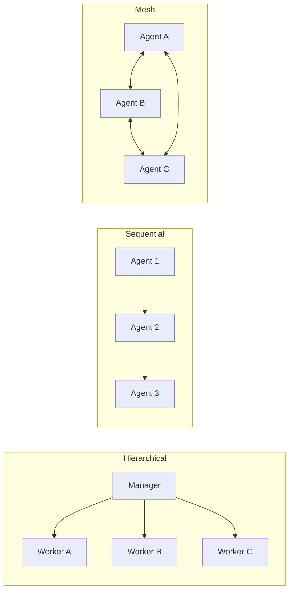
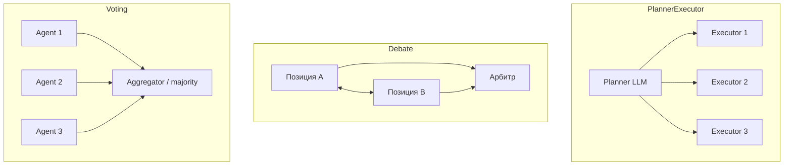
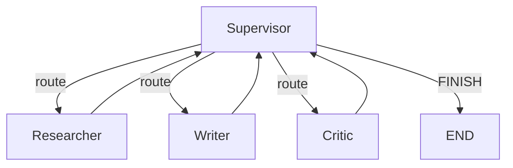

# Вопросы на собеседовании: Оркестрация мультиагентных систем

> Проверено: 2026-11-09. Multi-agent системы координируют несколько LLM-агентов — фреймворки, шаблоны коммуникации, state management, anti-patterns и эксплуатация.

## Полезные ссылки

- [CrewAI Documentation](https://docs.crewai.com/) — role-based multi-agent фреймворк.
- [AutoGen AgentChat](https://microsoft.github.io/autogen/stable/user-guide/agentchat-user-guide/index.html) — API ветки 0.4; прежние примеры 0.2 несовместимы.
- [LangGraph](https://docs.langchain.com/oss/python/langgraph/overview) — графы состояния, циклы и паузы выполнения.
- [OpenAI Swarm](https://github.com/openai/swarm) — экспериментальный handoff-фреймворк.
- [Anthropic — Building Effective Agents](https://www.anthropic.com/research/building-effective-agents) — манифест «simple первый, frameworks позже».
- [Microsoft Magentic-One](https://www.microsoft.com/en-us/research/articles/magentic-one-a-generalist-multi-agent-system-for-solving-complex-tasks/) — generalist multi-agent от Microsoft Research.
- [OpenAI Agents SDK: orchestration](https://openai.github.io/openai-agents-python/multi_agent/) — различие между agents-as-tools и handoffs.

## Содержание

- Основы и архитектуры (Q1–Q6)
- Frameworks: CrewAI / AutoGen / LangGraph / Swarm (Q7–Q14)
- Communication и State (Q15–Q18)
- Coordination patterns (Q19–Q22)
- Observability и cost (Q23–Q25)
- Production и anti-patterns (Q26–Q30)

---

## Q1. Что такое multi-agent система на базе LLM и чем она отличается от single-agent?

**Multi-agent система** координирует несколько агентов для одной задачи. У них могут различаться роли, инструкции, доступы и контексты; общение и маршрутизация зависят от архитектуры. В **single-agent** один агент может иметь много инструментов и делать несколько вызовов модели.

Главная разница — не в количестве моделей, а в декомпозиции: multi-agent дробит задачу на роли, single-agent держит всё в одной голове.

**Что даёт разбиение на агентов:**

- **Специализация** — узкая роль позволяет подобрать инструкции и доступы под этап задачи; прирост качества проверяют на eval-наборе.
- **Изоляция контекста** — у каждого свой scratchpad, поэтому контекст не забивается чужими промежуточными данными.
- **Параллелизм** — независимые подзадачи идут одновременно, сокращая время «по часам».

**Чем платим:** больше LLM-вызовов → выше latency, дороже, тяжелее отлаживать.

При нескольких исполнителях приходится проектировать координацию, обработку отказов и наблюдаемость. Идемпотентность особенно важна для повторяемых действий с внешними эффектами.

## Q2. Когда single-agent достаточно, а когда реально нужен multi-agent? (!)

**Правило по умолчанию:** начинай с single-agent и добавляй агентов, только когда конкретная метрика (качество, latency, изоляция) этого требует. Это прямая эвристика Anthropic из «Building Effective Agents»: сложность вводят последней, а не первой.

**Single-agent достаточно, если:**

- Задача укладывается в **один чёткий промпт** и один набор tools.
- Контекст помещается в window и не мешает рассуждению.
- Нет естественного разбиения на параллельные подзадачи.
- Latency и cost критичны: сравните реальные трассы обоих вариантов на одинаковых задачах.

**Multi-agent оправдан, если** есть хотя бы одна из причин:

- **Разнородные этапы** с разной экспертизой (research + write + critique + code) — каждому нужен свой заточенный промпт.
- **Разные права и tools** у «работников» (python-sandbox у одного, запись файлов — у другого), и смешивать их в одном агенте опасно.
- **Параллельные ветки** — например, 10 источников исследуются одновременно.
- **Adversarial/debate-паттерн** — writer против critic, генератор против reviewer, где сама идея в противопоставлении ролей.
- Контекст одного агента **переполняется**, и подзадачи хочется развести по изолированным context windows.

**Практическое правило:** начните с простого решения и добавляйте агентов, когда измеренная польза покрывает стоимость координации.

## Q3. Какие основные архитектуры multi-agent систем существуют? (!)



Архитектуры различаются тем, **кто кому может слать сообщения** — то есть топологией графа взаимодействий. Пять основных:

- **Hierarchical / Manager-Worker** — manager дробит задачу, делегирует исполнителям и собирает результаты. В CrewAI для этого явно выбирают `Process.hierarchical` и задают `manager_llm` либо `manager_agent`.
- **Sequential / Pipeline** — выход одного агента подаётся на вход следующему, как конвейер. Просто и предсказуемо. CrewAI `Process.sequential`.
- **Hub-and-Spoke / Star** — центральный координатор общается с каждым «лучом», но лучи друг о друге не знают. Удобно для роутинга по специализациям.
- **Network / Mesh / Peer-to-peer** — агенты общаются напрямую, все со всеми (group chat в AutoGen). Максимально гибко, но непредсказуемо.
- **Multi-level hierarchical** — manager → team leads → workers. Для крупных задач, разбитых на подкоманды.

**Как выбирать:** чем выше нужна предсказуемость, тем строже топология — hierarchical или sequential. Mesh оставляют для исследовательских и творческих задач, где как раз ценен непредсказуемый обмен идеями.

## Q4. Что такое «agentic workflow» vs «agent» по терминологии Anthropic? (!)

Разница в **том, кто управляет потоком выполнения** — код или сама модель. Это любимый вопрос на интервью.

- **Workflow** — поток жёстко прописан разработчиком, а LLM встроен как один из компонентов. Control flow детерминированный (prompt chaining, routing, parallelization, orchestrator-workers, evaluator-optimizer); модель принимает только локальные решения, но не выбирает маршрут.
- **Agent** — поток выбирает сама модель: какой tool позвать, когда остановиться, когда повторить. Control flow определяется в runtime и заранее неизвестен.

**Компромисс:**

- Workflow обычно проще ограничивать и тестировать; стоимость и качество зависят от конкретной реализации.
- Agent — гибкий, тянет open-ended запросы, но непредсказуем, дороже и тяжелее в observability.

**Рекомендация Anthropic:** agents — только там, где гибкость и решения «от модели» реально нужны. Во всех остальных случаях — workflow.

## Q5. Перечислите типовые «building blocks» из Anthropic-патернов orchestration.

Anthropic выделяет 5 базовых паттернов оркестрации, от простого к сложному. Важно: всё это **workflows** (детерминированный код), а не autonomous agents.

- **Prompt chaining** — цепочка LLM-вызовов, где выход одного идёт на вход следующего. Для задач с чёткими последовательными шагами.
- **Routing** — классификатор определяет тип запроса и направляет его в один из специализированных промптов.
- **Parallelization** — два варианта: *sectioning* (разбить задачу на независимые куски и считать параллельно) или *voting* (N независимых вызовов → ансамблевое решение).
- **Orchestrator-Workers** — центральный LLM динамически дробит задачу, делегирует worker-LLM и затем синтезирует результат. По сути — то же hierarchical multi-agent.
- **Evaluator-Optimizer** — один LLM генерирует, другой оценивает, и так по кругу до выполнения критерия. Аналог reflexion / actor-critic.

**Ключевая мысль:** начинайте с подходящего простого паттерна; библиотека нужна, когда её возможности окупают дополнительную сложность.

## Q6. Что выбрать: hierarchical, sequential или mesh для типовых задач? (!)

Архитектуру диктует **структура задачи**: насколько чётко она раскладывается на шаги и насколько предсказуемым должен быть результат. Грубая шпаргалка по типам задач:

| Тип задачи | Архитектура |
|------------|-------------|
| Конвейер (analyse → summarise → translate) | **Sequential** |
| Декомпозиция большого reasearch-запроса | **Hierarchical** (manager + N workers) |
| Роутинг по специализациям (юрист/финансы/тех) | **Hub-and-spoke** / routing |
| Дебаты, brainstorming, peer-review | **Mesh / group chat** |
| Software development simulation (PM → dev → QA → ops) | **Multi-level hierarchical** |
| Voting/ensemble (N independent → majority) | **Parallel + aggregator** |

**Главное правило:** измеряйте стоимость координации. В групповом диалоге число участников само по себе не задаёт границу применимости, но увеличивает риск лишних ходов.

## Q7. CrewAI — основные концепции и когда подходит. (!)

CrewAI — это Python-фреймворк, построенный вокруг **role-playing**: ты описываешь агентам роли почти как актёрам, и модель «отыгрывает» их. Базовые сущности:

- **`Agent`** — `role`, `goal`, `backstory`, `tools`, `llm`. Описание роли помогает задать поведение; его влияние на качество проверяют отдельно.
- **`Task`** — описание задачи + `expected_output` + `agent` (или агент назначается manager-ом).
- **`Crew`** — оркестратор: список agents + tasks + `process` (`sequential` или `hierarchical`).
- **`Process.hierarchical`** — режим с manager-агентом; при настройке нужен `manager_llm` или `manager_agent`.

```python
from crewai import Agent, Task, Crew, Process

researcher = Agent(
    role="Senior Research Analyst",
    goal="Найти актуальную информацию по теме {topic}",
    backstory="Эксперт по AI/ML с 10 годами стажа, любит факты и ссылки.",
    tools=[search_tool],
    llm=llm,
)

writer = Agent(
    role="Tech Content Writer",
    goal="Написать читаемую статью на основе данных от researcher",
    backstory="Пишет о технологиях для разработчиков, не любит buzzwords.",
    llm=llm,
)

research_task = Task(
    description="Собрать ключевые источники по {topic}",
    expected_output="Bullet-list из 5 фактов с ссылками",
    agent=researcher,
)
write_task = Task(
    description="Написать статью на 800 слов",
    expected_output="Markdown-статья",
    agent=writer,
    context=[research_task],
)

crew = Crew(
    agents=[researcher, writer],
    tasks=[research_task, write_task],
    process=Process.sequential,
)
result = crew.kickoff(inputs={"topic": "Multi-agent orchestration"})
```

**Сценарий применения:** задачи с понятными ролями, ожидаемыми результатами и последовательным или управляемым manager процессом. Для сложного графа переходов сравните возможности CrewAI и LangGraph на нужном сценарии.

## Q8. AutoGen (Microsoft) — что это и какие сценарии? (!)

AutoGen AgentChat 0.4 позволяет собирать диалоговые команды агентов. В этой ветке используются `autogen_agentchat` и команды `RoundRobinGroupChat` или `SelectorGroupChat`. Примеры с `import autogen`, `GroupChatManager` и `UserProxyAgent` из ветки 0.2 нельзя переносить без миграции.

- **`AssistantAgent`** — участник с моделью и доступными инструментами.
- **`RoundRobinGroupChat`** — фиксированный порядок ходов; **`SelectorGroupChat`** выбирает следующего участника по контексту.
- Исполнение кода настраивается отдельным исполнителем и требует изоляции и ограничения прав; оно не следует автоматически из создания команды.

AutoGen подходит, когда задача выигрывает от обмена сообщениями между участниками, например при совместном написании и проверке кода. Для coding или review-сценария задайте роли, условия завершения и предел числа ходов. Статус AutoGen для новых проектов проверяйте отдельно: репозиторий Microsoft сейчас находится в режиме поддержки и рекомендует Microsoft Agent Framework для новых разработок.

## Q9. LangGraph — чем отличается от CrewAI/AutoGen и зачем StateGraph? (!)

LangGraph — библиотека экосистемы LangChain, которая моделирует агента как **направленный граф с состоянием и циклами**. В отличие от процессов CrewAI, ориентированных на роли и задачи, и командного диалога AutoGen, здесь разработчик явно задаёт граф переходов и обновления состояния. Это полезно, когда нужны условные ветки, циклы или возобновление выполнения.

Ключевые концепции:

- **State** — типизированный словарь (обычно `TypedDict`), общий контейнер, который пробрасывается между узлами и накапливает данные шага за шагом.
- **Node** — функция (LLM-вызов, tool-вызов или своя логика): принимает state и возвращает его обновление.
- **Edge** — направленный переход. **Conditional edges** дают ветвление по содержимому state — это и есть «решения» графа.
- **Cycles** — в отличие от DAG-фреймворков, циклы разрешены, что и нужно для ReAct-loop, retry и reflection.
- **Checkpointer** — сохраняет state в БД (SQLite/Postgres), за счёт чего возможны pause/resume и human-in-the-loop.

```python
from langgraph.graph import StateGraph, END
from typing import TypedDict, Annotated
import operator

class State(TypedDict):
    messages: Annotated[list, operator.add]
    next_agent: str

def supervisor(state: State):
    decision = llm_route(state["messages"])  # вернёт "researcher" | "writer" | "FINISH"
    return {"next_agent": decision}

def researcher(state: State):
    out = llm_research(state["messages"])
    return {"messages": [out]}

def writer(state: State):
    out = llm_write(state["messages"])
    return {"messages": [out]}

graph = StateGraph(State)
graph.add_node("supervisor", supervisor)
graph.add_node("researcher", researcher)
graph.add_node("writer", writer)
graph.set_entry_point("supervisor")
graph.add_conditional_edges(
    "supervisor",
    lambda s: s["next_agent"],
    {"researcher": "researcher", "writer": "writer", "FINISH": END},
)
graph.add_edge("researcher", "supervisor")
graph.add_edge("writer", "supervisor")

app = graph.compile()  # для сохранения состояния настройте checkpointer отдельно
```

**Когда выбирать LangGraph:**

- Нужен **полный контроль над state machine** и циклами, а не «магия» фреймворка.
- Требуется **human-in-the-loop** с pause/resume через checkpointer.
- Строишь **supervisor pattern** с динамическим роутингом между worker-ами.
- Важна интеграция с экосистемой LangChain (LangSmith tracing, retrievers).

## Q10. OpenAI Swarm — что это, для чего, насколько production-ready?

Swarm — экспериментальный учебный фреймворк от OpenAI (2024), который существует ради одной идеи — **handoff**: агент передаёт управление другому, просто вернув из function call объект `Agent`. Это самый наглядный способ понять, как работают передачи контроля.

```python
from swarm import Swarm, Agent

client = Swarm()

def transfer_to_billing():
    return billing_agent

triage = Agent(
    name="Triage",
    instructions="Если вопрос про оплату — передай billing-агенту.",
    functions=[transfer_to_billing],
)
billing_agent = Agent(
    name="Billing",
    instructions="Ты отвечаешь на вопросы по биллингу.",
)

response = client.run(agent=triage, messages=[{"role": "user", "content": "Где мой счёт?"}])
```

**Особенности:**

- Минималистичный учебный пример handoff.
- Stateless: состояние между вызовами не хранится, persistence — забота разработчика.
- Явно **не production-ready** — OpenAI прямо предупреждает: educational only.
- Production-преемник — **OpenAI Agents SDK** (выпущен в 2025).

**Что сказать на интервью:** Swarm иллюстрирует handoff. Для рабочей системы оцените поддерживаемые инструменты под требования задачи; OpenAI указывает на Agents SDK как преемника Swarm.

## Q11. Как связаны подход Anthropic к простой оркестрации и agents-as-tools? (!)

Anthropic советует начинать с простых, составных паттернов и добавлять сложность по мере необходимости. Отдельный паттерн **agents-as-tools** описан в документации OpenAI Agents SDK: управляющий агент вызывает специалиста как инструмент, получает результат и продолжает работу.

Паттерн «**orchestrator-workers**» в чистом виде, без библиотеки:

```python
def run_orchestrator(query: str):
    plan = llm.call(orchestrator_prompt, query)  # JSON со списком subtasks
    results = []
    for subtask in plan["subtasks"]:
        worker_result = llm.call(worker_prompt, subtask)
        results.append(worker_result)
    final = llm.call(synthesizer_prompt, query, results)
    return final
```

Код показывает orchestrator-workers: модель динамически выбирает подзадачи, а приложение запускает исполнителей и собирает результат. Сам по себе очередной вызов модели с другим промптом не обязан быть отдельным агентом.

**Плюсы подхода:**

- Прозрачный control flow — это обычный Python, который видно глазами.
- Нет vendor lock-in на абстракции фреймворка.
- Retry, circuit-breaker, observability добавляются стандартными библиотеками, а не «магией» крейта.
- Проще code review, отладка и тестирование.

**Когда фреймворк всё-таки оправдан:** долгоживущие stateful-беседы (LangGraph checkpointer), сложные group chats (AutoGen), role-heavy production (CrewAI). Если процесс прост, достаточно обычного кода.

## Q12. Сравните CrewAI, AutoGen, LangGraph, Swarm.

Коротко: **CrewAI** — про роли, **AutoGen** — про диалог, **LangGraph** — про граф состояний, **Swarm** — про handoff и обучение. Развёрнутое сравнение:

| Критерий | CrewAI | AutoGen AgentChat 0.4 | LangGraph | Swarm |
|----------|--------|-----------------------|-----------|-------|
| Основная схема | Роли и задачи | Командный диалог | Граф состояния | Учебный handoff |
| Переходы | Sequential / hierarchical | RoundRobin / Selector и другие команды | Явные узлы и рёбра | Возврат следующего Agent |
| Состояние | Контекст и результаты задач; сохранение настраивается | История и состояние команды; сохранение настраивается | StateGraph, checkpointer по настройке | Между вызовами ведёт приложение |
| Исполнение кода | Настраиваемые инструменты | Отдельно настроенный executor | Настраиваемые инструменты | Настраиваемые функции |
| Статус | Сверять с текущей документацией | Режим поддержки; для новых проектов Microsoft рекомендует Agent Framework | Сверять с текущей документацией | Учебный проект |


**Выбор:** сравнивайте нужные возможности, текущую версию и поддержку. Swarm авторы оставили учебным проектом; AutoGen переведён в режим поддержки, поэтому для нового проекта оцените также Microsoft Agent Framework.

## Q13. Что такое OpenAI Agents SDK и где он в этой картине?

OpenAI Agents SDK (2025) — официальный production-преемник Swarm: та же идея handoff, но обвешанная всем, чего не хватало Swarm для прода.

**Что добавили к идее Swarm:**

- Встроенный **tracing** и observability из коробки.
- **Guardrails** для входа первого агента, финального ответа и отдельных function tools. Tool guardrails не охватывают handoff-вызовы.
- **Handoffs** остались ключевой идеей, но стали структурированнее.
- **Structured output** через Pydantic.
- Управление выполнением и ошибками; политику повторов и внешних эффектов проектируют под конкретные инструменты.

По сути это «Swarm, выросший до прода» и прямой конкурент LangGraph в нише «оркестрация LLM-агентов с tools». На интервью стоит различать `Agent.as_tool()` и handoff: у них разный владелец управления.

## Q14. Microsoft Magentic-One — что это и зачем?

Magentic-One — опубликованный Microsoft Research пример generalist multi-agent системы для задач, которые сочетают веб, файлы и выполнение кода. Его используют как пример динамической координации фиксированного набора специалистов, а не как доказательство, что любая задача требует такой команды. Архитектура:

- **Orchestrator** — центральный агент; ведёт *Task Ledger* (план) и *Progress Ledger* (статус), то есть отдельно держит «что делать» и «что уже сделано».
- **WebSurfer** — управляет браузером.
- **FileSurfer** — работает с файлами и документами.
- **Coder** — пишет код.
- **ComputerTerminal** — исполняет код в sandbox.

**Чему учит:** набор специалистов фиксирован, но оркестратор динамически решает, кого и когда звать. Это образцовый «hierarchical с manager-ом, который ведёт plan/progress state» — и этот приём легко переиспользовать в собственных системах.

## Q15. Какие коммуникационные паттерны между агентами существуют и в чём их компромиссы? (!)

Паттерны коммуникации различаются тем, **насколько жёстко связаны агенты** и кто видит чьи сообщения. Основные:

- **Вызов агента как инструмента** — вызывающий ждёт ответ и продолжает управление. **Handoff** — получатель принимает управление дальнейшим ходом. OpenAI Agents SDK поддерживает оба варианта.
- **Message passing** — передача сообщений между участниками. AutoGen AgentChat реализует групповой диалог; отдельная внешняя очередь не обязательна.
- **Shared state / blackboard** — общее состояние графа. Доступ каждого узла к его полям и передача в промпт задаются приложением.
- **Broadcast** — сообщение сразу видно всем агентам (group chat).
- **Pub-sub / topic-based** — агент подписан на тип событий. В LLM-системах редко, чаще в backend-микросервисах.
- **Request-response** — координатор отправляет задачу и получает результат. Task Ledger в Magentic-One хранит план, но сам по себе не является очередью сообщений.

**Как выбирать:** вызов агента как инструмента возвращает результат вызывающему, поэтому удобен для короткой консультации. При handoff получатель ведёт следующий ход; нужны правила маршрутизации и передачи контекста. Групповой обмен даёт участникам возможность обсуждать решения, но увеличивает число сообщений и требует условия завершения. Общий state позволяет координировать работу через данные; доступ к полям и параллельные обновления нужно задавать явно. Broadcast и pub-sub доставляют одно событие нескольким получателям, поэтому важны число адресатов и обработка повторов.

## Q16. Как организовать state в multi-agent системе?

Ключевой вопрос при проектировании state — **что агенты видят вместе, а что держат при себе**. Три уровня организации:

- **Shared state** — данные, доступные нужным узлам или агентам. Параллельные обновления требуют определённых правил объединения; само наличие shared state не означает, что весь он попадёт в каждый промпт.
- **Per-agent state** — у каждого свой scratchpad/history. Плюс — изоляция и чистый контекст; минус — нужен явный механизм синхронизации между агентами.
- **Conversation history** — может быть общей (group chat) или раздельной (каждый видит только свою ветку диалога).

**Как это делается на практике:**

- LangGraph: `Annotated[list, operator.add]` для накапливаемых полей (messages), обычные поля перезаписываются.
- CrewAI: `context=[previous_task]` пробрасывает output предыдущей задачи дальше.
- Persistence: checkpointer LangGraph → SQLite/Postgres, либо свой механизм через MCP, БД или Redis.

**Главное:** заранее явно решить, что shared, а что private, и не давать агентам видеть лишнего — это вопрос и приватности, и контекст-гигиены (меньше шума → точнее ответы).

## Q17. Типы памяти для multi-agent систем.

Память делят по сроку жизни и характеру данных — как у человека есть «оперативная» и «долгая» память:

- **Short-term (working memory)** — текущий диалог/scratchpad, живёт в state.
- **Long-term episodic** — прошлые задачи и решения. Их можно хранить в журнале, БД или векторном индексе; способ поиска выбирают по запросам.
- **Long-term semantic** — устойчивые факты. Их можно хранить в структурированной БД, графе знаний или другом подходящем хранилище.
- **Procedural** — инструкции и способы действия, например проверенные процедуры или шаблоны; это не обязательно изменение весов модели.
- **Shared org memory** — общий «корпоративный мозг» нескольких crew; доступ через MCP-сервер или общий retriever.

**Подводный камень:** запихнуть всю history в системный промпт — тупик: упираешься в context window и в стоимость. Вместо этого комбинируют **summarisation** (сжать старое) + **vector recall** (подтянуть только релевантное).

## Q18. Как организовать handoff между агентами безопасно?

Handoff — это момент, когда один агент передаёт управление другому. Опасен он тремя вещами: потерей контекста при передаче, бесконечным циклом передач (A→B→A→…) и попаданием к неподходящему получателю. Безопасный handoff закрывает каждую из этих дыр.

**Рекомендации:**

- **Явная схема handoff** — агент возвращает `{"handoff_to": "billing", "context": {...}}`, и это валидируется JSON-schema (никаких free-form передач).
- **Разрешённые переходы** — белый список, кому конкретный агент вправе передать управление (по сути state machine).
- **Ограниченная глубина** — счётчик передач с лимитом N; превысил — fail или escalate. Это и есть защита от бесконечного цикла.
- **Сжатие контекста при передаче** — пересылать не всю history, а summary + ключевые факты.
- **Идемпотентные действия с побочными эффектами** — ключ повтора нужен там, где повторная запись или отправка создаст дубль.
- **Audit log** — каждый handoff пишется с trace_id, source, target и reason.

В OpenAI Agents SDK и Swarm handoff выражен явно; в других системах передачу управления можно моделировать переходами графа или логикой координатора.

## Q19. Когда применять planner-executor, debate и voting и каковы их ограничения? (!)



Паттерны координации различаются тем, **как агенты приходят к итоговому ответу** — через декомпозицию, спор или голосование. Когда какой:

- **Planner-Executor** — планировщик строит шаги, исполнители решают подзадачи. Подходит для декомпозируемой работы, но план и результаты шагов приходится проверять и согласовывать.
- **Debate** — два или более агента предлагают и оспаривают решения, затем арбитр выбирает итог. Полезен, если независимые аргументы помогают обнаружить ошибки; несколько раундов увеличивают стоимость и не гарантируют верный ответ.
- **Voting / Ensemble** — несколько независимых попыток агрегируются по заранее заданному правилу. Подходит, когда результат можно сопоставить и проверить; большинство не гарантирует истину при коррелированных ошибках.
- **Critique / Evaluator-Optimizer** — отдельный паттерн: критик проверяет результат по критериям, исполнитель дорабатывает его. Это не то же самое, что debate между несколькими позициями.
- **Specialist consultation** — generalist роутит запрос к специалистам (юрист / финансы / медицина). Топология hub-and-spoke.
- **Collaborative refinement** — каждый агент дополняет общий артефакт (blackboard), результат собирается итеративно.

## Q20. Multi-agent + reasoning models — как комбинировать? (!)

Модель с более глубоким рассуждением можно использовать для планирования, проверки сложного результата или эскалации. Более быструю модель — для шагов, на которых она проходит проверку качества. Сравнивайте стоимость, задержку и долю успешно завершённых задач на своей выборке: различия нельзя выразить универсальным множителем.

- **Planner:** сложная модель составляет план, исполнители решают ограниченные подзадачи.
- **Critic:** проверяющая модель оценивает результат по явным критериям.
- **Escalation:** запрос передают более сильной модели по проверяемому сигналу, например неудаче валидации, а не только по самооценке модели.

Лимиты шагов и бюджета нужны при любой комбинации.

## Q21. Error handling и failure isolation в multi-agent. (!)

Для каждого внешнего вызова задайте таймаут и понятный результат ошибки. Общий дедлайн и лимит шагов не дают задаче зависнуть. Сбой независимой ветки можно изолировать или обработать запасным сценарием; при обязательном результате ветки задачу нужно завершить ошибкой.

Повторяйте только безопасные операции при временных сбоях, например rate limit или доступности API. Ошибку формата ответа сначала классифицируйте: повтор с тем же вводом не всегда исправит её. Для записи, платежа или отправки сообщения нужен ключ идемпотентности либо проверка уже выполненного действия. Логи и трассы должны показывать источник ошибки; после исчерпания попыток передайте задачу человеку или в очередь разбора, если это предусмотрено процессом.

## Q22. Что такое orchestrator-workers паттерн и как его сделать самому?

По описанию Anthropic orchestrator динамически выбирает подзадачи, worker-агенты выполняют их, затем orchestrator синтезирует результат. Это можно реализовать без специального фреймворка. В рабочей версии нужны ограничения числа подзадач, параллелизма, времени и стоимости, проверка результатов и политика частичных отказов.

```python
async def orchestrator_workers(query):
    plan = await create_bounded_plan(query)
    results = await run_workers_with_limits(plan)
    return await synthesize_and_validate(query, results)
```

Псевдокод показывает границы ответственности; конкретные реализации функций зависят от приложения.

## Q23. Observability в multi-agent — что трассировать? (!)

Без observability multi-agent — непрозрачный чёрный ящик: когда что-то ломается, ты даже не знаешь, какой из агентов виноват. Минимальный набор того, что нужно трассировать:

- **Distributed tracing** — span на каждый LLM-вызов и tool-вызов с trace_id и parent_span_id. Совместимо с OpenTelemetry, чтобы восстановить полное дерево вызовов.
- **Per-agent metrics** — input/output tokens, latency, error rate, cost по каждому агенту.
- **Cross-agent message log** — кто кому что отправил и в каком state это произошло.
- **Дерево вызовов** — по связям между span можно восстановить handoff и зависимости; конкретный вид визуализации зависит от инструмента.
- **Tool call audit** — какой агент позвал какой tool, с какими аргументами и что вернулось.
- **Task completion metrics** — success rate end-to-end и по каждому этапу.
- **Cost aggregation** — суммарный $ за конкретную user-task с разбивкой по моделям.

Для реализации используют совместимый с приложением инструмент трассировки, например OpenTelemetry или интеграцию выбранного фреймворка. Перед записью аргументов инструментов проверьте защиту чувствительных данных.

## Q24. Cost и latency multi-agent vs single-agent.

Дополнительные вызовы модели и передача контекста обычно увеличивают расход. Параллельное выполнение независимых веток может уменьшить время ожидания, но само по себе не уменьшает сумму выставленных счетов. Сравните два варианта на одинаковых задачах: стоимость успешной задачи, задержку по перцентилям, число вызовов и качество ответа.

Ограничивайте число ходов и параллельных задач, прекращайте работу при достаточном результате, подбирайте модель для каждого шага по eval-набору. Кэширование промптов или результатов инструментов полезно, когда поддерживается провайдером и есть повторяемые входные данные; экономию считайте по фактическим тарифам и попаданиям в кэш. Для каждой задачи задайте бюджет и действие при его исчерпании.

## Q25. Как evaluate multi-agent систему?

Оценивайте итог задачи и отдельные этапы на репрезентативном наборе случаев. Для проверяемых ответов используйте эталонные результаты; для открытых задач задайте критерии и ручную оценку. Отдельно проверяйте выбор инструментов, передачи управления, ошибки и внешние действия.

Сохраняйте трассы неуспешных задач, долю успешных завершений, стоимость успешной задачи и распределение задержек. Регрессионный набор запускайте при изменении модели, промптов или графа. Долю ручной выборки выбирайте по риску и объёму трафика, а не по универсальному проценту.

## Q26. Production-ready чек-лист для multi-agent системы. (!)

Перед запуском проверьте:

- Лимиты ходов, передач управления, параллелизма, времени и расходов.
- Права инструментов, изоляцию исполнения кода и подтверждение критичных действий.
- Безопасность повторов и идемпотентность действий с побочными эффектами.
- Трассировку шагов, метрики результата и защиту персональных данных и секретов в логах.
- Регрессионные оценки и способ ограниченного запуска изменений.
- Порядок обработки частичных отказов и передачи задачи человеку.

Конкретные технологии и пороги зависят от риска задачи и окружения.

## Q27. Топ anti-patterns в multi-agent. (!)

Частые ошибки: добавлять роли без измеримой пользы; назначать им расплывчатые цели; оставлять циклы handoff без лимита; передавать каждому всю историю и все инструменты; менять общий state без правил объединения; не сохранять трассы. Централизованный manager может стать узким местом, если через него проходит каждый мелкий шаг. Структурированный вывод нужен там, где другой компонент разбирает ответ программно. Число агентов или отсутствие JSON-схемы сами по себе не доказывают ошибку архитектуры.

## Q28. Что такое supervisor pattern в LangGraph?

Supervisor — это специальный узел-диспетчер, через который проходит всё управление: workers не общаются между собой, а каждый раз возвращаются к нему за следующим решением. Цикл работы:

1. Получает текущий state.
2. Решает (через LLM или обычный код), какому worker передать управление, либо вернуть `END`.
3. После завершения worker управление снова возвращается в supervisor.



**Плюсы:**

- Централизованный control flow — всё в одном месте, легко отлаживать.
- Supervisor можно сделать rule-based (дёшево), он не обязан быть LLM.
- Workers вызываются повторно — например, Critic несколько раз подряд.
- У каждого worker свой узкий tool-set, что снижает путаницу.

По сути это LangGraph-аналог CrewAI `Process.hierarchical` и Magentic-One Orchestrator.

## Q29. Real-world примеры multi-agent систем — что почитать. (!)

- **Magentic-One** — опубликованная Microsoft Research архитектура с orchestrator, Task Ledger, Progress Ledger и специализированными исполнителями.
- **AutoGen AgentChat** — официальные примеры команд с разными правилами выбора следующего участника.
- **OpenAI Swarm и Agents SDK** — наглядное сравнение учебного handoff и поддерживаемого SDK; в SDK есть также вызов агента как инструмента.
- **Anthropic Building Effective Agents** — несколько простых схем, включая orchestrator-workers; помогает оценить, нужен ли отдельный фреймворк.

При чтении проектов отделяйте заявленную архитектуру от внутренней реализации продукта. У закрытых систем нельзя уверенно утверждать число и роли внутренних агентов без опубликованного описания.

## Q30. Что такое «agents-as-tools» паттерн и когда он лучше handoff?

**Agents-as-tools** — это когда вспомогательные агенты подключены к primary-агенту как обычные tools. Primary зовёт `search_specialist(query)` так же, как любой инструмент: под капотом отрабатывает другой LLM-агент, но **primary не отдаёт управление** — получил результат и продолжает работу. Это ключевое отличие от handoff, где control физически переходит к другому агенту.

**Сравнение с handoff:**

| | Handoff | Agents-as-tools |
|--|---------|-----------------|
| Кто owns control | Receiver | Original (caller) |
| Возврат control | Только если receiver сам передаст | Автоматически после tool return |
| Сложность | Выше (state machine) | Простая (обычный function call) |
| Контекст | Передаётся receiver-у | Только через args/return |
| Лучше для | Длинные «переключения роли» | Узкие consultative задачи |

**Выбор:** `Agent.as_tool()` в OpenAI Agents SDK подходит, когда управляющий агент должен получить результат специалиста и продолжить работу. Handoff подходит, когда специалисту нужно передать управление дальнейшим диалогом. В обоих случаях ограничивайте права и число шагов.

```python
def search_specialist(query: str) -> str:
    """Глубокий research по узкой теме."""
    return llm.call(prompt=SPECIALIST_PROMPT, user=query)

tools = [search_specialist]
primary_agent_loop(query, tools)  # primary видит specialist как обычный tool
```

Этот паттерн можно реализовать средствами SDK или обычным вызовом функции, если дополнительные возможности фреймворка не нужны.

---

## See also

- [AI Agents](./ai-agents-interview.md)
- [Model Context Protocol (MCP)](./mcp-interview.md)
- [Function Calling](./function-calling-interview.md)
- [LLM Integration Patterns](./llm-integration-patterns-interview.md)
- [Reasoning Models](./reasoning-models-interview.md)
- [Prompt Engineering](./prompt-engineering-interview.md)
- [System Design Interview](../system-design/system-design-interview.md)
- [Distributed Systems](../architecture/distributed-systems-interview.md)
