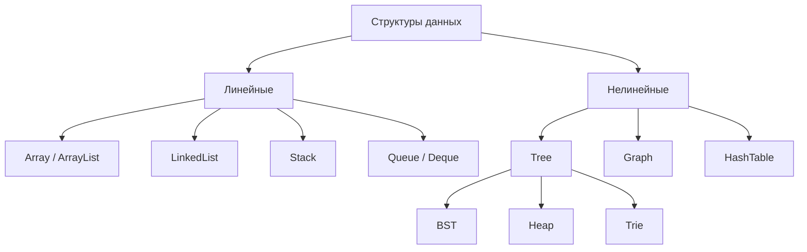
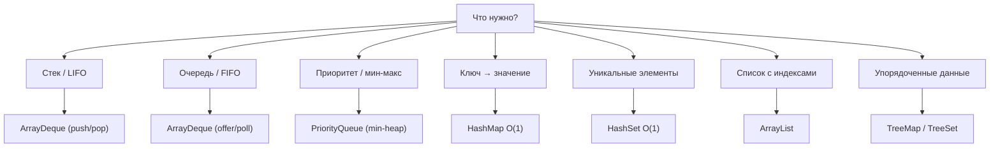

# Вопросы на собеседовании: `Алгоритмы (обзор)`

Этот файл — **обзорная карта** раздела `algorithms/`. Содержит общие принципы, шаблоны ответов на алгоритмические вопросы и **навигацию** к специализированным шпаргалкам по конкретным темам.

## Полезные ссылки

### Официальная документация и авторитетные источники

- [Java Collections Framework (Oracle)](https://docs.oracle.com/en/java/javase/17/docs/api/java.base/java/util/package-summary.html)
- [Introduction to Algorithms (Cormen, CLRS)](https://mitpress.mit.edu/9780262046305/introduction-to-algorithms/)
- [Time Complexity of Java Collections — Baeldung](https://www.baeldung.com/java-collections-complexity)
- [LeetCode](https://leetcode.com/) — практика
- [Visualgo](https://visualgo.net/) — визуализация
- [Big O Cheat Sheet](https://www.bigocheatsheet.com/)

## Содержание

- [Полезные ссылки](#полезные-ссылки)
- [See also](#see-also)

**Базовые принципы**
- [Q1. (!) Как отвечать на алгоритмические вопросы (шаблон)?](#q1)
- [Q2. (!) С чего начать, услышав задачу?](#q2)
- [Q3. (!) Какие парадигмы решения существуют?](#q3)
- [Q4. (!) Какие структуры данных используют чаще всего?](#q4)

**Сложности на одном экране**
- [Q5. (!) Сложности базовых операций структур данных?](#q5)
- [Q6. (!) Какова шпаргалка выбора Java Collection под задачу?](#q6)
- [Q7. Какие классы сложности встречаются чаще всего?](#q7)

**Карта раздела**
- [Q8. (!) Структура раздела `algorithms/`?](#q8)
- [Q9. С чего начать изучать тему алгоритмов?](#q9)

**Навигация по шпаргалкам**
- [Q10. (!) Какие темы есть в подразделе `complexity/`?](#q10)
- [Q11. (!) Какие структуры данных в `data-structures/`?](#q11)
- [Q12. (!) Какие алгоритмы в `sorting-searching/`?](#q12)
- [Q13. (!) Какие парадигмы в `algorithmic-paradigms/`?](#q13)

**Метатемы**
- [Q14. (!) Чем отличаются Greedy, DP, D&C, Backtracking?](#q14)
- [Q15. Как выбрать алгоритм для конкретной задачи?](#q15)
- [Q16. (!) Как готовиться к алгоритмическому интервью?](#q16)

<a id="q1"></a>
## Q1. (!) Как отвечать на алгоритмические вопросы (шаблон)?

Интервьюер оценивает не только итоговый код, но и **ход мысли**: умеешь ли ты уточнить требования, выбрать подход и обосновать его. Поэтому отвечают по одному и тому же каркасу — он показывает структурное мышление и не даёт упустить шаги.

1. **Уточни задачу** — границы входа, типы данных, граничные случаи (пустой вход, дубликаты, переполнение). Это страховка от решения «не той» задачи.
2. **Обоснуй подход** — оттолкнись от структуры входа и ограничений: отсортирован ли массив, какой размер `n`, что важнее — время или память.
3. **Предложи brute force** — даже наивное, но рабочее решение лучше молчания: оно фиксирует базовую сложность, от которой ты будешь отталкиваться при оптимизации.
4. **Оптимизируй** — переходи к лучшему решению через известные паттерны (Two Pointers, Sliding Window, DP и др.), а не изобретай с нуля.
5. **Оцени сложность** — время и память в худшем и среднем случае; покажи, что понимаешь цену решения.
6. **Реализуй** — пиши чистый код с осмысленными именами; интервьюер читает его как продакшен.
7. **Прогони тесты** — пройди по граничным случаям (пустой вход, один элемент, очень большой `n`), не дожидаясь подсказки.

**Рекомендация:** проговаривай каждый шаг вслух — на интервью ценится прозрачность рассуждения, а не молчаливый прыжок к ответу.

<a id="q2"></a>
## Q2. (!) С чего начать, услышав задачу?

С уточняющих вопросов — **не бросайся писать код**. Условие почти всегда недосказано, и пара точных вопросов сразу сужает пространство решений: размер входа задаёт допустимую сложность, признак «отсортирован» открывает целый класс алгоритмов, а тип данных предупреждает о переполнении.

**Чек-лист первых 30 секунд:**

| Вопрос | Зачем |
|--------|-------|
| Каков размер входа? | Задаёт допустимую сложность: при малом `n` перебор может быть достаточным, при большом нужны более эффективные подходы; порог зависит от лимита времени |
| Может ли вход быть пустым? | Граничный случай, который чаще всего роняет наивное решение |
| Дубликаты возможны? | Меняет логику (Set vs список, уникальность ответа) |
| Можно ли модифицировать вход? | Выбор между in-place (экономит память) и out-of-place |
| Отсортирован ли? | Может позволить Binary Search или Two Pointers, если условие задачи подходит |
| Тип данных? | `int`, `long`, `float`, объекты с кастомным `equals` — риск переполнения и неверного сравнения |
| Один ответ или все? | Первое совпадение vs полный перебор всех перестановок — разная сложность |
| Худший или средний случай важен? | Меняет выбор алгоритма: Quick Sort быстр в среднем, но Heap Sort стабилен в худшем |

<a id="q3"></a>
## Q3. (!) Какие парадигмы решения существуют?

Здесь вместе собраны парадигмы и практические техники. Отсортированный вход может подсказать Binary Search, перекрывающиеся подзадачи — DP, а top-K — кучу. Это кандидаты для проверки, а не автоматическая гарантия применимости.

| Подход или техника | Когда применять | См. |
|-----------|-----------------|------|
| **Brute force** | Старт для понимания | — |
| **Two Pointers / Sliding Window** | Подмассивы, пары | [Two Pointers](algorithmic-paradigms/two-pointers-sliding-window-interview.md) |
| **Binary Search** | Отсортированное или монотонное | [Searching](sorting-searching/searching-algorithms-interview.md) |
| **DFS / BFS** | Графы, деревья | [Графы](data-structures/graphs-interview.md), [Деревья](data-structures/trees-interview.md) |
| **Recursion / Backtracking** | Перебор вариантов | [Рекурсия](algorithmic-paradigms/recursion-interview.md), [Backtracking](algorithmic-paradigms/backtracking-interview.md) |
| **Divide and Conquer** | Разбиение на подзадачи | [D&C](algorithmic-paradigms/divide-and-conquer-interview.md) |
| **Dynamic Programming** | Перекрывающиеся подзадачи + оптимум | [DP](algorithmic-paradigms/dynamic-programming-interview.md) |
| **Greedy** | Локально оптимальный выбор | [Greedy](algorithmic-paradigms/greedy-algorithms-interview.md) |
| **Hashing** | Быстрый lookup | [Хеш-таблицы](data-structures/hash-tables-interview.md) |
| **Heap / PriorityQueue** | Top-K, scheduling | [Кучи](data-structures/heaps-interview.md) |

<a id="q4"></a>
## Q4. (!) Какие структуры данных используют чаще всего?



Структуры делятся на **линейные** (элементы в последовательности — массивы, списки, стеки, очереди) и **нелинейные** (иерархия или связи — деревья, графы, хеш-таблицы). Выбор зависит от того, какая операция должна быть быстрой: индексный доступ → массив, вставка/удаление с краёв → дек, поиск по ключу → хеш-таблица, упорядоченный обход → дерево.

В Java эти структуры уже реализованы в стандартной библиотеке: `ArrayList`, `LinkedList`, `ArrayDeque`, `HashMap`, `TreeMap`, `PriorityQueue` — отдельные реализации почти никогда не нужны. Подробнее — в [Java Collections](../programming-languages/java/java-collections-interview.md).

<a id="q5"></a>
## Q5. (!) Сложности базовых операций структур данных?

Эту таблицу важно держать в голове целиком — выбор структуры на интервью почти всегда сводится к тому, **какая операция у неё дешёвая**. Прочерк (—) означает, что операция для структуры неестественна (например, индексный доступ к `HashMap`). Обрати внимание на ключевые компромиссы: массив даёт `O(1)` доступ, но `O(n)` вставку; хеш-таблица — наоборот, `O(1)` поиск, но без порядка; `TreeMap` платит `O(log n)` за каждую операцию, зато хранит ключи отсортированными.

| Структура | Доступ | Поиск | Вставка | Удаление | Память |
|-----------|--------|-------|---------|----------|--------|
| `Array` | `O(1)` | `O(n)` | `O(n)` | `O(n)` | `O(n)` |
| `ArrayList` | `O(1)` | `O(n)` | `O(1)` амортиз. в конец | `O(n)` | `O(n)` |
| `LinkedList` | `O(n)` | `O(n)` | `O(1)` при известной позиции итератора | `O(1)` при известной позиции итератора | `O(n)` |
| `ArrayDeque` | — | — | `O(1)` амортиз. | `O(1)` | `O(n)` |
| `HashMap` | — | `O(1)` в среднем | `O(1)` в среднем | `O(1)` в среднем | `O(n)` |
| `TreeMap` | — | `O(log n)` | `O(log n)` | `O(log n)` | `O(n)` |
| `PriorityQueue` | — | `O(n)` для произвольного элемента; `peek` — `O(1)` | `O(log n)` | `poll` — `O(log n)` | `O(n)` |
| `Trie` | — | `O(L)` | `O(L)` | `O(L)` | `O(N · L)` |
| `Union-Find` (DSU) | — | `O(α(n))` | — | — | `O(n)` |

Для `HashMap` оценки предполагают хорошее распределение хешей; коллизии и дорогой `hashCode` меняют стоимость операции. У `LinkedList` поиск позиции занимает `O(n)`, даже если удаление через уже стоящий на ней итератор дёшево.

Подробнее — в [Анализ сложности](complexity/complexity-analysis-interview.md).

<a id="q6"></a>
## Q6. (!) Какова шпаргалка выбора Java Collection под задачу?

Алгоритм на интервью почти всегда требует одной из коллекций как «рабочей лошадки», и правильный выбор экономит и время написания, и сложность. Логика выбора простая: определи нужную операцию (LIFO, FIFO, доступ по ключу, минимум/максимум, упорядоченность) — и она однозначно указывает на коллекцию. Диаграмма ниже сводит это в дерево решений, таблица — в готовые рецепты под типовые задачи.



| Задача | Коллекция | Причина |
|--------|-----------|---------|
| BFS | `ArrayDeque` как Queue | `O(1)` offer/poll |
| DFS итеративный | `ArrayDeque` как Stack | `O(1)` push/pop |
| Dijkstra, Top-K | `PriorityQueue` | min-heap |
| Подсчёт частот | `HashMap<T, Integer>` | `O(1)` |
| Уникальные элементы | `HashSet` | `O(1)` |
| Sliding window max | `ArrayDeque` как Monotonic Deque | `O(1)` оба конца |
| LRU Cache | `LinkedHashMap(cap, .75f, true)` | accessOrder |
| Range queries (floor, ceiling) | `TreeMap` | `O(log n)` |

**Подводные камни:**
- `Stack` — старый класс на основе `Vector`; для обычного однопоточного стека `ArrayDeque` обычно удобнее и по документации, вероятно, быстрее. Для стека бери `ArrayDeque`.
- `LinkedList` подходит как `Queue`, но для обычной очереди документация Java рекомендует более быстрый в типичных случаях `ArrayDeque`.
- `HashMap` не гарантирует порядок обхода. Если нужен стабильный порядок (вставки или доступа) — используй `LinkedHashMap`.

<a id="q7"></a>
## Q7. Какие классы сложности встречаются чаще всего?

Класс сложности показывает, **как растёт время с ростом входа** — и именно это определяет, уложится ли решение в лимит. Колонка `n=1000` наглядно показывает пропасть между классами: переход от `O(n)` к `O(n²)` — это рост с 1000 до миллиона операций, а `O(2ⁿ)` и `O(n!)` на таком входе уже физически непросчитываемы. Поэтому, оценив размер входа, ты сразу понимаешь, какую сложность можешь себе позволить.

| Сложность | Название | Пример | n=1000 операций |
|-----------|----------|--------|------------------|
| `O(1)` | Константная | `arr[i]`; `HashMap.get()` в среднем | условная единица |
| `O(log n)` | Логарифмическая | `Binary Search`, `TreeMap.get()` | 10 |
| `O(n)` | Линейная | Один проход | 1000 |
| `O(n log n)` | Линейно-логарифмическая | `Merge Sort`; `Quick Sort` в среднем | около 10 000 |
| `O(n²)` | Квадратичная | Вложенные циклы | 1 000 000 |
| `O(2ⁿ)` | Экспоненциальная | Naive Fibonacci, subsets | 10³⁰¹ |
| `O(n!)` | Факториальная | Permutations, TSP | непригодно |

**Практическая оценка:** асимптотика показывает рост работы, но не время в секундах. При `n=10⁵` квадратичный алгоритм выполняет порядка `10¹⁰` шагов в простой модели; пройдёт ли он лимит, зависит от языка, констант, оборудования и ограничений задачи.

Подробнее — в [Анализ сложности](complexity/complexity-analysis-interview.md).

<a id="q8"></a>
## Q8. (!) Структура раздела `algorithms/`?

Раздел организован по четырём осям: **сложность** (фундамент анализа), **структуры данных** (где хранить), **сортировка и поиск** (базовые алгоритмы) и **парадигмы** (как мыслить о решении). Этот файл — обзорная карта; за каждым подкаталогом стоит отдельная глубокая шпаргалка.

```
algorithms/
├── algorithms-interview.md          ← этот файл (обзор)
├── complexity/
│   └── complexity-analysis-interview.md
├── data-structures/
│   ├── arrays-strings-interview.md
│   ├── linked-lists-interview.md
│   ├── stacks-queues-interview.md
│   ├── trees-interview.md
│   ├── heaps-interview.md
│   ├── hash-tables-interview.md
│   ├── graphs-interview.md
│   └── tries-interview.md
├── sorting-searching/
│   ├── sorting-algorithms-interview.md
│   └── searching-algorithms-interview.md
└── algorithmic-paradigms/
    ├── recursion-interview.md
    ├── divide-and-conquer-interview.md
    ├── dynamic-programming-interview.md
    ├── greedy-algorithms-interview.md
    ├── backtracking-interview.md
    └── two-pointers-sliding-window-interview.md
```

Каждый файл раскрывает отдельную тему; подробность и число вопросов различаются.

<a id="q9"></a>
## Q9. С чего начать изучать тему алгоритмов?

Порядок изучения выстроен так, чтобы каждая следующая тема опиралась на предыдущую: сначала язык оценки (Big O), потом базовые структуры, на которых строится всё остальное, и лишь затем парадигмы-оптимизации. Не перепрыгивай — без рекурсии не понять DFS и DP, без хеш-таблиц буксует половина задач.

**Рекомендуемый порядок:**

1. **[Анализ сложности](complexity/complexity-analysis-interview.md)** — без понимания Big O всё остальное бесполезно
2. **[Массивы и строки](data-structures/arrays-strings-interview.md)** — основа большинства задач
3. **[Хеш-таблицы](data-structures/hash-tables-interview.md)** — самый используемый трюк
4. **[Two Pointers и Sliding Window](algorithmic-paradigms/two-pointers-sliding-window-interview.md)** — иногда снижают `O(n²)` до `O(n)`, если выполняются условия применения
5. **[Поиск](sorting-searching/searching-algorithms-interview.md)** + **[Сортировка](sorting-searching/sorting-algorithms-interview.md)** — Binary Search
6. **[Рекурсия](algorithmic-paradigms/recursion-interview.md)** — фундамент DFS, DP, Backtracking
7. **[Деревья](data-structures/trees-interview.md)** + **[Графы](data-structures/graphs-interview.md)** — обходы
8. **[Стеки и очереди](data-structures/stacks-queues-interview.md)** + **[Кучи](data-structures/heaps-interview.md)** — поддерживают обходы
9. **[Divide and Conquer](algorithmic-paradigms/divide-and-conquer-interview.md)** + **[DP](algorithmic-paradigms/dynamic-programming-interview.md)** — оптимизация
10. **[Greedy](algorithmic-paradigms/greedy-algorithms-interview.md)** + **[Backtracking](algorithmic-paradigms/backtracking-interview.md)** — выбор стратегии
11. **[Trie и Union-Find](data-structures/tries-interview.md)** — специальные структуры

<a id="q10"></a>
## Q10. (!) Какие темы есть в подразделе `complexity/`?

Это фундамент всего раздела — один файл, но самый важный: он учит **измерять** алгоритмы, без чего невозможно их сравнивать и выбирать.

- **[Анализ сложности алгоритмов](complexity/complexity-analysis-interview.md)** — Big O, Omega, Theta, амортизированная и пространственная сложность, master theorem, дерево рекурсии, сложности Java Collections, деревовидные бакеты `HashMap` при достаточном числе коллизий (детали зависят от реализации JDK), атаки на сложность (HashDoS).

<a id="q11"></a>
## Q11. (!) Какие структуры данных в `data-structures/`?

Восемь файлов покрывают структуры от самых ходовых (массивы, хеш-таблицы) до специальных (Trie, Union-Find). Каждая строка — отдельная глубокая шпаргалка; колонка «Темы» помогает быстро найти, где разбирается нужный приём.

| Файл | Темы |
|------|------|
| **[Массивы и строки](data-structures/arrays-strings-interview.md)** | Реверс, сдвиг, Kadane, Two Sum, Three Sum, prefix sum, матрица rotate, Dutch National Flag, Move Zeroes, Next Permutation, KMP, Rabin-Karp, palindrome, anagram, immutable String |
| **[Связные списки](data-structures/linked-lists-interview.md)** | Singly/doubly, dummy node, реверс (итер./рек.), Floyd cycle detection, middle node, K-group, merge K sorted, LRU Cache, Skip List, ConcurrentLinkedQueue |
| **[Стеки и очереди](data-structures/stacks-queues-interview.md)** | Stack/Queue/Deque, циклический массив, очередь через 2 стека, MinStack, MaxQueue, monotonic stack/queue, parentheses, RPN, BlockingQueue, ConcurrentLinkedQueue |
| **[Деревья](data-structures/trees-interview.md)** | Binary tree, BST, AVL, Red-Black, B-Tree/B+Tree, обходы (preorder/inorder/postorder/level-order), Morris traversal, LCA, diameter, validate BST, serialize, segment tree, Fenwick |
| **[Кучи](data-structures/heaps-interview.md)** | Min/max-heap, siftUp/siftDown, buildHeap O(n), PriorityQueue, top-K, median in stream, merge K lists, heap sort, Fibonacci heap |
| **[Хеш-таблицы](data-structures/hash-tables-interview.md)** | HashMap внутри, hashCode/equals, load factor, rehashing, treeify, chaining vs open addressing, ConcurrentHashMap, LinkedHashMap, WeakHashMap, consistent hashing, Bloom filter, HashDoS |
| **[Графы](data-structures/graphs-interview.md)** | Adjacency matrix/list, BFS, DFS, Dijkstra, Bellman-Ford, Floyd-Warshall, Kruskal, Prim, topological sort, SCC, bipartite, Number of Islands, PageRank |
| **[Префиксные деревья и Union-Find](data-structures/tries-interview.md)** | Trie, Compressed trie (Radix tree), Suffix tree/array, Aho-Corasick, autocomplete, Word Search II, Union-Find (DSU), path compression, union by rank, Number of Islands через UF |

<a id="q12"></a>
## Q12. (!) Какие алгоритмы в `sorting-searching/`?

Сортировка и поиск — это база, на которой держится множество других алгоритмов (Two Pointers, Binary Search на ответе, дедупликация). Два файла: один разбирает все классические сортировки и их реализацию в JDK, другой — варианты поиска, включая нетривиальный Binary Search на ответе.

| Файл | Темы |
|------|------|
| **[Алгоритмы сортировки](sorting-searching/sorting-algorithms-interview.md)** | Bubble, Insertion, Selection, Merge, Quick, Heap, Tim, Counting, Radix, Bucket, Dual-Pivot Quicksort, Introsort, stability, in-place, Java Arrays.sort внутри, parallel sort, external sort |
| **[Алгоритмы поиска](sorting-searching/searching-algorithms-interview.md)** | Linear, Binary, Exponential, Interpolation, Jump, Ternary, поиск в отсортированном/повёрнутом массиве, Median of Two Sorted Arrays, Binary Search на ответе (Koko, Capacity), BFS/DFS как поиск, подводные камни overflow |

<a id="q13"></a>
## Q13. (!) Какие парадигмы в `algorithmic-paradigms/`?

Парадигмы — это «способы мышления», переносимые между задачами: освоив их, ты решаешь не одну задачу, а целый класс похожих. Шесть файлов идут по нарастанию сложности — от рекурсии (фундамент) к DP и Backtracking (вершина перебора с памятью и отсечением).

| Файл | Темы |
|------|------|
| **[Рекурсия](algorithmic-paradigms/recursion-interview.md)** | Base case + recursive step, call stack, tail recursion, отсутствие TCO в JVM, factorial, Fibonacci, Hanoi, fast power, обходы деревьев |
| **[Divide and Conquer](algorithmic-paradigms/divide-and-conquer-interview.md)** | Three-step pattern, master theorem, recursion tree, Merge Sort, Quick Sort, Binary Search, Strassen, Karatsuba, Closest Pair, Inversion count |
| **[DP](algorithmic-paradigms/dynamic-programming-interview.md)** | Optimal substructure, overlapping subproblems, memoization vs tabulation, 0/1 Knapsack, LCS, LIS, Edit Distance, Coin Change, Stock series, bitmask DP, state compression |
| **[Greedy](algorithmic-paradigms/greedy-algorithms-interview.md)** | Greedy choice property, exchange argument, Activity Selection, Fractional Knapsack, Huffman, Dijkstra, Kruskal, Job Sequencing, intervals, Jump Game, Gas Station |
| **[Backtracking](algorithmic-paradigms/backtracking-interview.md)** | DFS с откатом, шаблон, subsets, permutations, combinations, N-Queens, Sudoku, Word Search, Generate Parentheses, Palindrome Partitioning, pruning, Branch and Bound |
| **[Two Pointers и Sliding Window](algorithmic-paradigms/two-pointers-sliding-window-interview.md)** | Встречные/fast-slow/на двух массивах, Container with Most Water, Trapping Rain Water, Floyd cycle, Longest Substring Without Repeating, Minimum Window Substring, monotonic deque |

<a id="q14"></a>
## Q14. (!) Чем отличаются Greedy, DP, D&C, Backtracking?

Эти подходы по-разному строят решение. Greedy делает локальный выбор, который требует доказательства корректности. DP использует состояния и переходы, divide and conquer делит и объединяет подзадачи, а backtracking перебирает варианты с возвратом и отсечением.

| Парадигма | Подзадачи перекрываются | Memoization | Возвращает | Сложность |
|-----------|-------------------------|-------------|------------|-----------|
| **Greedy** | Не обязаны перекрываться | Обычно нет | Локальный выбор при доказанной корректности | Зависит от алгоритма |
| **DP** | Обычно да | Мемоизация или табуляция | Решение через состояния и переходы | Зависит от числа состояний |
| **D&C** | Обычно независимы | Обычно нет | Разбиение и объединение подрешений | Зависит от рекурсии |
| **Backtracking** | Возможны | Не обязательно | Поиск с возвратом и отсечением | В худшем случае часто экспоненциальная |

**Когда какую выбирать:**
- Перебираем все варианты с возвратом → **Backtracking**
- Оптимум + перекрытия → **DP**
- Оптимум без перекрытий + локальный выбор работает → **Greedy**
- Делим на меньшие задачи без перекрытий → **D&C**

<a id="q15"></a>
## Q15. Как выбрать алгоритм для конкретной задачи?

Выбор алгоритма — это **сопоставление с паттерном**: формулировка задачи даёт подсказки для выбора кандидатов, которые нужно проверить на ограничениях входа. Для поиска в отсортированном массиве подходит Binary Search; для подмассива Sliding Window работает, если окно можно двигать с нужной монотонностью. Кратчайший путь требует учёта весов рёбер. Таблица ниже сводит типовые сигналы к алгоритмам — выучи её, чтобы не перебирать варианты с нуля.

**По типу задачи:**

| Задача | Алгоритм |
|--------|----------|
| Поиск в отсортированном | Binary Search |
| Подмассив с монотонным условием при движении границ | Sliding Window |
| Пара/тройка с условием | Two Pointers (sorted) или HashMap |
| Подсчёт пар, инверсий | Merge Sort modified |
| Top K | Heap |
| Кратчайший путь невзвешенный | BFS |
| Кратчайший путь взвешенный | Dijkstra при неотрицательных весах; Bellman-Ford допускает отрицательные рёбра при проверке циклов |
| Все пары | Floyd-Warshall |
| MST | Kruskal или Prim |
| Топологический порядок | Kahn (BFS) или DFS |
| Все перестановки/подмножества | Backtracking |
| Оптимум + перекрытия | DP |
| Поиск с префиксом | Trie |

<a id="q16"></a>
## Q16. (!) Как готовиться к алгоритмическому интервью?

Главный принцип подготовки — **учить паттерны, а не зубрить задачи**: задач бесконечно много, а паттернов решения десятки, и именно они переносятся на незнакомую формулировку. Объём решённых задач нужен лишь для того, чтобы эти паттерны довести до автоматизма.

**Стратегия:**

1. **Изучи [Анализ сложности](complexity/complexity-analysis-interview.md)** — без него Big O становится магией, и ты не сможешь обосновать выбор решения
2. **Решай задачи по ключевым паттернам** — количество подбирай по прогрессу: важно уметь объяснить решение новой задачи, а не набрать фиксированную цифру
3. **Сосредоточься на паттернах**, а не на конкретных задачах:
   - Two Pointers, Sliding Window, Binary Search
   - DFS, BFS, Dijkstra
   - DP по 1D, 2D, на строках, на интервалах
   - Backtracking subsets/permutations/combinations
4. **Решай вслух** (mock interviews) — главное на интервью
5. **Учи [Java Collections](../programming-languages/java/java-collections-interview.md)** — какую структуру когда брать
6. **Тренируйся в доступном формате** — если интервью будет без IDE, заранее потренируйся писать и проверять код в простом редакторе
7. **Тестируй edge cases** — пустой вход, 1 элемент, дубликаты, переполнение

Подробнее — в [Подготовка к собеседованию](../preparation/interview-preparation.md).

---

## See also

**Подразделы (детальные шпаргалки):**

- [Анализ сложности](complexity/complexity-analysis-interview.md) — Big O, master theorem, амортизация
- [Массивы и строки](data-structures/arrays-strings-interview.md) — Two Sum, Kadane, KMP
- [Связные списки](data-structures/linked-lists-interview.md) — Floyd, LRU, K-group
- [Стеки и очереди](data-structures/stacks-queues-interview.md) — monotonic, BlockingQueue
- [Деревья](data-structures/trees-interview.md) — BST, AVL, RB, B-Tree, обходы
- [Кучи](data-structures/heaps-interview.md) — PriorityQueue, top-K, median stream
- [Хеш-таблицы](data-structures/hash-tables-interview.md) — HashMap внутри, ConcurrentHashMap
- [Графы](data-structures/graphs-interview.md) — BFS, DFS, Dijkstra, MST, topological
- [Trie и Union-Find](data-structures/tries-interview.md) — autocomplete, Number of Islands
- [Алгоритмы сортировки](sorting-searching/sorting-algorithms-interview.md) — TimSort, Dual-Pivot
- [Алгоритмы поиска](sorting-searching/searching-algorithms-interview.md) — Binary Search, Search Rotated
- [Рекурсия](algorithmic-paradigms/recursion-interview.md) — call stack, tail recursion, TCO
- [Divide and Conquer](algorithmic-paradigms/divide-and-conquer-interview.md) — master theorem, Strassen
- [DP](algorithmic-paradigms/dynamic-programming-interview.md) — Knapsack, LCS, LIS, Edit Distance
- [Greedy](algorithmic-paradigms/greedy-algorithms-interview.md) — Activity Selection, Huffman, Dijkstra
- [Backtracking](algorithmic-paradigms/backtracking-interview.md) — N-Queens, Sudoku, Word Search
- [Two Pointers / Sliding Window](algorithmic-paradigms/two-pointers-sliding-window-interview.md) — все паттерны окон

**Связанные разделы:**

- [Java Collections](../programming-languages/java/java-collections-interview.md) — структуры данных в Java
- [Java Stream API](../programming-languages/java/java-stream-interview.md) — функциональные операции
- [Java Concurrency](../programming-languages/java/java-concurrency-interview.md) — concurrent collections
- [JVM](../jvm/jvm-interview.md) — стек, GC, JIT
- [Паттерны проектирования](../design-patterns/design-patterns-interview.md) — связь с алгоритмами
- [System Design](../system-design/system-design-interview.md) — алгоритмы в проектировании
- [Подготовка к собеседованию](../preparation/interview-preparation.md) — стратегия
- [PostgreSQL](../databases/postgresql-interview.md) — B-Tree индексы
- [Redis](../databases/redis-interview.md) — hash table, skip list
- [Application Security](../security/application-security-interview.md) — HashDoS, ReDoS

- [AI Agents](../ai-ml/ai-agents-interview.md)
- [Embeddings](../ai-ml/embeddings-interview.md)
- [LLM Basics](../ai-ml/llm-basics-interview.md)
- [LLM Integration Patterns](../ai-ml/llm-integration-patterns-interview.md)
- [MLOps](../ai-ml/mlops-interview.md)
- [Model Serving](../ai-ml/model-serving-interview.md)
- [Шпаргалка: Хеширование и хеш-функции (Hashing and H](../../algorithms/problems/algorithms.md) — теория
