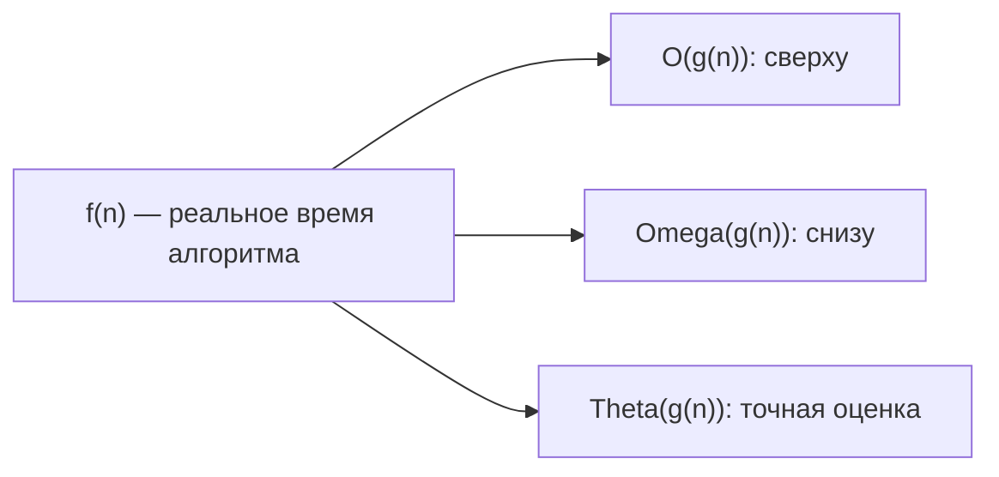
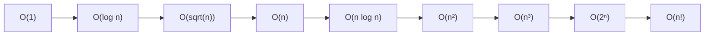

# Вопросы на собеседовании: `Анализ сложности алгоритмов`

Анализ сложности — фундамент алгоритмических интервью. От тебя ждут не просто названия `O(n log n)`, а способности **обосновать** оценку, отличить **худший/средний/амортизированный** случай и понимать, как `HashMap` ведёт себя при массовых коллизиях.

## Полезные ссылки

### Официальная документация и авторитетные источники

- [Practical Java Examples of the Big O Notation — Baeldung](https://www.baeldung.com/java-algorithm-complexity)
- [Time Complexity of Java Collections — Baeldung](https://www.baeldung.com/java-collections-complexity)
- [Big O Cheat Sheet](https://www.bigocheatsheet.com/)
- [Introduction to Algorithms (CLRS), глава 3 — Growth of Functions](https://mitpress.mit.edu/9780262046305/introduction-to-algorithms/)
- [Master Theorem — Wikipedia](https://en.wikipedia.org/wiki/Master_theorem_(analysis_of_algorithms))

## Содержание

- [Полезные ссылки](#полезные-ссылки)
- [See also](#see-also)

**Базовая асимптотика**
- [Q1. (!) Как сравнить эффективность двух алгоритмов?](#q1--как-сравнить-эффективность-двух-алгоритмов)
- [Q2. (!) Что такое лучший, худший и средний сценарий?](#q2--что-такое-лучший-худший-и-средний-сценарий)
- [Q3. (!) Что такое асимптотические обозначения O, Omega, Theta?](#q3--что-такое-асимптотические-обозначения-o-omega-theta)
- [Q4. Какие правила упрощения Big O существуют?](#q4-какие-правила-упрощения-big-o-существуют)
- [Q5. (!) Какие классы сложности встречаются чаще всего?](#q5--какие-классы-сложности-встречаются-чаще-всего)

**Память и амортизация**
- [Q6. (!) Что такое пространственная сложность?](#q6--что-такое-пространственная-сложность)
- [Q7. (!) Что такое амортизированная сложность?](#q7--что-такое-амортизированная-сложность)
- [Q8. Чем in-place отличается от out-of-place алгоритма?](#q8-чем-in-place-отличается-от-out-of-place-алгоритма)
- [Q9. Что такое recursive call stack space?](#q9-что-такое-recursive-call-stack-space)

**Анализ рекурсии**
- [Q10. (!) Что такое master theorem и как им пользоваться?](#q10--что-такое-master-theorem-и-как-им-пользоваться)
- [Q11. Как анализировать сложность через дерево рекурсии?](#q11-как-анализировать-сложность-через-дерево-рекурсии)
- [Q12. Как доказать сложность через подстановку?](#q12-как-доказать-сложность-через-подстановку)

**Сложности на практике**
- [Q13. (!) Какова сложность операций в Java Collections?](#q13--какова-сложность-операций-в-java-collections)
- [Q14. (!) Как `HashMap` ограничивает деградацию при коллизиях?](#q14--как-hashmap-ограничивает-деградацию-при-коллизиях)
- [Q15. Почему ArrayList.add() — это амортизированный O(1)?](#q15-почему-arraylistadd--это-амортизированный-o1)
- [Q16. (!) Чем отличается O(log n) и O(log² n)?](#q16--чем-отличается-olog-n-и-olog²-n)
- [Q17. Что такое pseudo-polynomial complexity?](#q17-что-такое-pseudo-polynomial-complexity)

**Big-O в реальной жизни**
- [Q18. (!) Когда O(n²) лучше O(n log n)?](#q18--когда-on²-лучше-on-log-n)
- [Q19. Почему cache locality важна больше, чем Big O для малых n?](#q19-почему-cache-locality-важна-больше-чем-big-o-для-малых-n)
- [Q20. Что такое NP-hard и NP-complete простым языком?](#q20-что-такое-np-hard-и-np-complete-простым-языком)
- [Q21. Как оценить сложность нескольких вложенных циклов с разными границами?](#q21-как-оценить-сложность-нескольких-вложенных-циклов-с-разными-границами)
- [Q22. Что значит «алгоритм линеен по выходу»?](#q22-что-значит-алгоритм-линеен-по-выходу)

**Сложности конкретных алгоритмов**
- [Q23. (!) Почему сортировка сравнениями требует Ω(n log n) сравнений в худшем случае?](#q23--почему-сортировка-сравнениями-требует-ωn-log-n-сравнений-в-худшем-случае)
- [Q24. (!) Почему Quick Sort в среднем O(n log n), а в худшем O(n²)?](#q24--почему-quick-sort-в-среднем-on-log-n-а-в-худшем-on²)
- [Q25. Какая сложность у BFS и DFS?](#q25-какая-сложность-у-bfs-и-dfs)
- [Q26. Какова сложность Dijkstra с разными приоритетными очередями?](#q26-какова-сложность-dijkstra-с-разными-приоритетными-очередями)
- [Q27. Какова сложность алгоритма Беллмана-Форда?](#q27-какова-сложность-алгоритма-беллмана-форда)

**Подводные камни**
- [Q28. (!) Может ли O(1) быть медленнее O(n)?](#q28--может-ли-o1-быть-медленнее-on)
- [Q29. Что такое скрытые константы и почему они важны?](#q29-что-такое-скрытые-константы-и-почему-они-важны)
- [Q30. Как профилировать реальный алгоритм, а не оценивать через Big O?](#q30-как-профилировать-реальный-алгоритм-а-не-оценивать-через-big-o)
- [Q31. (!) Что такое complexity attack?](#q31--что-такое-complexity-attack)

## Q1. (!) Как сравнить эффективность двух алгоритмов?

Сначала сравнивают, **как растут** время и расход памяти с увеличением размера входа `n`; затем измеряют реальные затраты на характерных данных и оборудовании. Это и есть асимптотическая сложность — `O(n)`, `O(n log n)` и т.д. Чем медленнее растёт сложность, тем эффективнее алгоритм на больших данных.

Сравнивать нужно по двум осям и в трёх режимах:

- **Время и память** — оптимизация одного часто ухудшает другое (классический компромисс).
- **Лучший, худший, средний случай** — один и тот же алгоритм может быть быстрым на «удачных» данных и катастрофически медленным на «неудачных».

| Сложность | Название | Пример |
|-----------|----------|--------|
| `O(1)` | Константная | Доступ к `arr[i]`, `HashMap.get()` в среднем |
| `O(log n)` | Логарифмическая | Бинарный поиск, операции `TreeMap` |
| `O(n)` | Линейная | Один проход по массиву |
| `O(n log n)` | Линейно-логарифмическая | `Merge Sort`, `Quick Sort` (среднее) |
| `O(n²)` | Квадратичная | Вложенные циклы, `Bubble Sort` |
| `O(n³)` | Кубическая | Floyd-Warshall, наивное матричное умножение |
| `O(2ⁿ)` | Экспоненциальная | Наивная рекурсия Фибоначчи, перебор подмножеств |
| `O(n!)` | Факториальная | Полный перебор перестановок, наивный TSP |

**Главное на собеседовании:** «одного лучшего алгоритма» не существует — выбор зависит от ограничений по памяти, частоты вызова и характера данных. И называть `O(...)` мало: нужно **обосновать** оценку, посчитав число операций на каждом шаге.


## Q2. (!) Что такое лучший, худший и средний сценарий?

Это три оценки сложности для одного алгоритма — их сравнивают при **фиксированном размере** входа, но на разных входах этого размера. Один алгоритм может быть линейным на «удачном» входе и квадратичным на «неудачном».

- **Лучший случай (best case)** — данные, на которых алгоритм работает быстрее всего. Для `Insertion Sort` это уже отсортированный массив — каждый элемент сразу на месте, `O(n)`.
- **Худший случай (worst case)** — вход, при котором время или память максимальны. Для `Quick Sort` с фиксированным pivot это отсортированный массив — разбиение всегда вырождается, `O(n²)`.
- **Средний случай (average case)** — математическое ожидание затрат по явно заданному распределению входов. Равномерное распределение — лишь одна из возможных моделей.

| Алгоритм | Лучший | Средний | Худший |
|----------|--------|---------|--------|
| `Binary Search` | `O(1)` | `O(log n)` | `O(log n)` |
| `Quick Sort` | `O(n log n)` | `O(n log n)` | `O(n²)` |
| `Merge Sort` | `O(n log n)` | `O(n log n)` | `O(n log n)` |
| `Insertion Sort` | `O(n)` | `O(n²)` | `O(n²)` |
| `HashMap.get()` | `O(1)` | `O(1)` | при дереве коллизий `O(log n)` для корректно упорядочиваемых ключей; общую гарантию см. в Q14 |

**Что брать за основу.** При сравнении алгоритмов обычно опираются на **худший** случай: он даёт жёсткую гарантию «не медленнее, чем», тогда как средний случай можно нарушить злонамеренным входом (см. complexity attack в Q31).


## Q3. (!) Что такое асимптотические обозначения O, Omega, Theta?

Это три способа ограничить рост функции `f(n)` (время или память) сверху, снизу или с обеих сторон. Все три отбрасывают константы и младшие члены — важна только скорость роста.

- **O (Big O, О-большое)** — **верхняя граница**, «не хуже чем». `f(n) = O(g(n))`, если найдутся константа `c > 0` и порог `n₀`, такие что `f(n) ≤ c·g(n)` для всех `n ≥ n₀`. Гарантия сверху.
- **Ω (Omega)** — **нижняя граница**, «не лучше чем». `f(n) = Ω(g(n))`, если `f(n) ≥ c·g(n)` (начиная с некоторого `n₀`). Так доказывают, например, что сортировка сравнениями не быстрее `Ω(n log n)`.
- **Θ (Theta)** — **точная** оценка: тот же порядок и сверху, и снизу. `f(n) = Θ(g(n))` тогда и только тогда, когда `f(n) = O(g(n))` И `f(n) = Ω(g(n))`.



**Что важно знать на собеседовании.** В разговорной речи почти всегда говорят «O», даже подразумевая Theta (точную оценку). Формально это разные понятия, и грамотный кандидат это понимает: O даёт только потолок. Сказать «линейный поиск — это `O(n²)`» формально не ошибка (верхняя граница верна, хоть и завышена), а вот `Θ(n²)` для него уже неверно.


## Q4. Какие правила упрощения Big O существуют?

Идея одна: при `n → ∞` асимптотику определяет самый быстрорастущий член, а константные множители не важны (они зависят от железа). Из этого следуют пять рабочих правил:

1. **Отбрасываем константы**: `O(2n)` = `O(n)`, `O(100)` = `O(1)`. Множитель не меняет порядок роста.
2. **Оставляем доминирующий член**: `O(n² + n + log n)` = `O(n²)`. На больших `n` остальное пренебрежимо мало.
3. **Вложенные циклы перемножаются**: два вложенных цикла по `n` дают `O(n²)` — внутренний выполняется `n` раз на каждую из `n` итераций внешнего.
4. **Последовательные блоки складываются** и сводятся к максимуму: `O(n) + O(n log n)` = `O(n log n)`. Доминирует более тяжёлый этап.
5. **Разные переменные не сливаем**: `O(n + m)` ≠ `O(n)`, если `n` и `m` независимы. Заменив `m` на `n`, можно сильно ошибиться — например, когда один вход в тысячи раз больше другого.

```java
// O(n + m) — обходим два независимых массива
void process(int[] a, int[] b) {
    for (int x : a) doSomething(x);  // O(n)
    for (int y : b) doSomething(y);  // O(m)
}

// O(n * m) — для каждого элемента a обходим весь b
void cross(int[] a, int[] b) {
    for (int x : a)
        for (int y : b)
            doSomething(x, y);
}
```


## Q5. (!) Какие классы сложности встречаются чаще всего?

Классы выстраиваются в порядке роста — от самого «дешёвого» к самому «дорогому», и каждый следующий растёт быстрее предыдущего:

`O(1)` → `O(log n)` → `O(sqrt(n))` → `O(n)` → `O(n log n)` → `O(n²)` → `O(n³)` → `O(2ⁿ)` → `O(n!)`



Разница между классами не «немного больше», а пропастями. При `n = 1000`:

| Сложность | Операций |
|-----------|----------|
| `O(1)` | 1 |
| `O(log n)` | ~10 |
| `O(n)` | 1 000 |
| `O(n log n)` | ~10 000 |
| `O(n²)` | 1 000 000 |
| `O(n³)` | 1 000 000 000 |
| `O(2ⁿ)` | 10³⁰¹ — невычислимо |

**Практическая оценка:** по ограничению на `n` можно прикинуть допустимый порядок роста, но время операции, язык, память и платформа меняют порог. Число «операций за секунду» нельзя считать универсальной гарантией: проверяй его измерением.


## Q6. (!) Что такое пространственная сложность?

**Пространственная сложность (space complexity)** оценивает память как функцию от размера входа. Нужно оговорить соглашение: **полная** оценка включает хранение входа, а **дополнительная память (auxiliary space)** считает только память сверх входа. В примерах ниже указана дополнительная память, включая стек и буферы результата.

```java
// O(1) дополнительной памяти — несколько переменных
int sum(int[] arr) {
    int s = 0;
    for (int x : arr) s += x;
    return s;
}

// O(n) — создаём новый массив
int[] copy(int[] arr) {
    int[] result = new int[arr.length];
    System.arraycopy(arr, 0, result, 0, arr.length);
    return result;
}

// O(n) на стек вызовов из-за рекурсии
int sumRecursive(int[] arr, int i) {
    if (i == arr.length) return 0;
    return arr[i] + sumRecursive(arr, i + 1);
}
```

В дополнительную память входят: локальные переменные, новые структуры данных и — что часто забывают — **стек вызовов** при рекурсии (каждый незавершённый вызов занимает память, даже если не создаёт ни одной структуры). Поэтому `Merge Sort` — `O(n)`, `Quick Sort` — `O(log n)` стека в среднем и `O(n)` в худшем случае для обычной рекурсивной реализации, а `Heap Sort` — `O(1)`.


## Q7. (!) Что такое амортизированная сложность?

**Амортизированная сложность** — это средняя стоимость одной операции, усреднённая по **худшей** последовательности из `n` операций. Ключевое отличие от «среднего случая»: здесь нет вероятностей и предположений о данных — гарантия даётся для любой последовательности, потому что дорогие операции случаются редко и их стоимость «размазывается» по дешёвым.

Это нужно, когда отдельная операция изредка дорогая, но такие операции не могут идти подряд. Тогда говорить «худший случай `O(n)` на операцию» нечестно: подряд `n` раз `O(n)` не получится.

**Классический пример: `ArrayList.add()`**

```java
// Внутри ArrayList:
// При заполнении массива — реаллокация:
// 1. Создаём массив большей ёмкости; коэффициент роста не задан API
// 2. Копируем старые элементы — O(n)
// 3. Добавляем новый элемент — O(1)
//
// Большинство add() — O(1).
// Редкие реаллокации компенсируются дешёвыми вставками.
// Амортизированный O(1) на add().
```

**Доказательство (метод суммирования, aggregate analysis):** общая работа на `n` вставок (включая все реаллокации) — `O(n)`, потому что суммарный объём копирований образует геометрическую прогрессию. Делим на `n` операций → `O(1)` на вставку в среднем. Подробный разбор прогрессии — в Q15.

**Где ещё встречается амортизация:**
- `HashMap.put()` — амортизированный `O(1)`; редкие rehashing при росте таблицы размазываются по обычным вставкам.
- `Union-Find` с path compression и union by rank — `O(α(n))` ≈ `O(1)`, где `α` — обратная функция Аккермана (для любого реального `n` это ≤ 4).
- Stack/Queue на двух стеках — `O(1)` амортизированно: дорогое «переливание» одного стека в другой случается редко.


## Q8. Чем in-place отличается от out-of-place алгоритма?

Разница в том, нужна ли алгоритму память, пропорциональная размеру входа.

- **In-place** — преобразует данные в исходной структуре и использует малый объём вспомогательной памяти. Обычно это `O(1)`; иногда к in-place относят рекурсивный алгоритм с `O(log n)` стека, если это оговорено.
- **Out-of-place** — использует дополнительную структуру, размер которой растёт с входом. При этом исходный массив тоже может быть перезаписан результатом.

| Алгоритм | In-place / Out-of-place | Дополнительная память |
|----------|-------------------------|----------------------|
| `Bubble Sort` | In-place | `O(1)` |
| `Quick Sort` | In-place при обычном соглашении | `O(log n)` в среднем, `O(n)` в худшем случае (стек) |
| `Heap Sort` | In-place | `O(1)` |
| `Merge Sort` | Out-of-place | `O(n)` |
| `Counting Sort` | Out-of-place | `O(n + k)` |

**Подводный камень.** Уточняй, учитывается ли стек рекурсии: у обычного рекурсивного `Quick Sort` он занимает `O(log n)` в среднем и `O(n)` в худшем случае. Определение in-place в литературе различается: при требовании строго `O(1)` рекурсивный `Quick Sort` не подходит. Если учитывать логарифмический стек, обязательно назови вариант реализации и его худшую глубину.


## Q9. Что такое recursive call stack space?

Это память, которую рекурсия занимает на стеке вызовов независимо от того, создаёт ли она структуры данных. Каждый ещё не завершённый вызов держит свой фрейм: локальные переменные, параметры, адрес возврата. Фреймы освобождаются только при возврате — поэтому пик потребления равен **максимальной глубине** рекурсии `h`, и стек растёт как `O(h)`.

Отсюда практический вывод: важна именно глубина, а не общее число вызовов. Дерево из миллиона вызовов глубиной `log n` стоит всего `O(log n)` стека.

```java
// Глубина = n, стек O(n)
int factorial(int n) {
    if (n <= 1) return 1;
    return n * factorial(n - 1);
}

// Глубина = log n, стек O(log n)
int binarySearch(int[] arr, int target, int lo, int hi) {
    if (lo > hi) return -1;
    int mid = lo + (hi - lo) / 2;
    if (arr[mid] == target) return mid;
    if (arr[mid] < target) return binarySearch(arr, target, mid + 1, hi);
    return binarySearch(arr, target, lo, mid - 1);
}
```

**Практика на JVM.** Стек потока ограничен (зависит от JVM и платформы), поэтому слишком глубокая рекурсия ловит `StackOverflowError`; лимит регулируется флагом `-Xss`. Важная ловушка: JVM **не делает** оптимизацию хвостовых вызовов (TCO), так что даже tail-recursive метод всё равно тратит `O(h)` стека — переписать в цикл это не помогает само собой.


## Q10. (!) Что такое master theorem и как им пользоваться?

**Master theorem (основная теорема о рекуррентах)** — готовая формула, позволяющая получить асимптотику алгоритмов «разделяй и властвуй» без раскрытия рекурсии. Применяется к соотношениям вида:

```
T(n) = a·T(n/b) + f(n)
```

где `a ≥ 1` — число подзадач, `b > 1` — во сколько раз уменьшается размер каждой, `f(n)` — стоимость работы вне рекурсивных вызовов (разбиение + слияние).

Суть метода — выяснить, что доминирует: общая работа листьев дерева рекурсии (`n^(log_b a)`) или работа `f(n)` на верхних уровнях. Сравниваем эти две величины:

1. **Доминируют листья** — если `f(n) = O(n^(log_b a − ε))` → `T(n) = Θ(n^(log_b a))`.
2. **Баланс** — если `f(n) = Θ(n^(log_b a))` → `T(n) = Θ(n^(log_b a) · log n)`; добавляется множитель `log n` за число уровней.
3. **Доминирует корень** — если `f(n) = Ω(n^(log_b a + ε))` (и выполнено regularity condition) → `T(n) = Θ(f(n))`.

**Примеры:**

| Рекуррентность | Алгоритм | a | b | log_b a | f(n) | Случай | T(n) |
|----------------|----------|---|---|---------|------|--------|------|
| `T(n) = 2T(n/2) + Θ(n)` | Merge Sort | 2 | 2 | 1 | `n` | 2 | `Θ(n log n)` |
| `T(n) = 2T(n/2) + Θ(1)` | — | 2 | 2 | 1 | `1` | 1 | `Θ(n)` |
| `T(n) = T(n/2) + Θ(1)` | Binary Search | 1 | 2 | 0 | `1` | 2 | `Θ(log n)` |
| `T(n) = 2T(n/2) + Θ(n²)` | — | 2 | 2 | 1 | `n²` | 3 | `Θ(n²)` |
| `T(n) = 8T(n/2) + Θ(n²)` | Обычное разбиение на 8 подзадач | 8 | 2 | 3 | `n²` | 1 | `Θ(n³)` |


## Q11. Как анализировать сложность через дерево рекурсии?

Метод дерева рекурсии — наглядная альтернатива master theorem: вместо подстановки в формулу мы буквально рисуем дерево вызовов и складываем работу. Удобен, когда теорема не применима (неравные подзадачи) или нужно понять, *почему* получается именно такая оценка. Три шага:

1. Нарисовать дерево вызовов: корень — исходная задача, потомки — подзадачи.
2. Посчитать суммарную работу на каждом уровне (число узлов × работа в узле).
3. Сложить по всем уровням — итог даёт `T(n)`.

**Пример: `T(n) = 2T(n/2) + n` (Merge Sort)**

```
Уровень 0: 1 узел   × n         = n
Уровень 1: 2 узла   × n/2       = n
Уровень 2: 4 узла   × n/4       = n
...
Уровень k: 2^k     × n/2^k     = n

Глубина = log n; вместе с листьями получается log n + 1 уровней.
Сумма = n × log n = O(n log n).
```

**Пример: `T(n) = T(n/2) + T(n/2) + 1`**

```
Уровень 0: 1 × 1 = 1
Уровень 1: 2 × 1 = 2
Уровень k: 2^k × 1 = 2^k

Сумма геометрическая: 1 + 2 + 4 + ... + n ≈ 2n = O(n).
```


## Q12. Как доказать сложность через подстановку?

**Метод подстановки (substitution method)** — самый строгий способ: мы **угадываем** ответ, а затем доказываем его математической индукцией по `n`. В отличие от дерева рекурсии (которое даёт интуицию) и master theorem (которая работает не для всех рекуррент), подстановка позволяет формально проверить подходящую гипотезу — ценой того, что её надо сначала верно угадать.

Для `T(n) = 2T(n/2) + n` угадываем `T(n) ≤ c·n·log n` и проверяем, что предположение для `n/2` влечёт его для `n`:

```
Предположение: T(n/2) ≤ c·(n/2)·log(n/2)
T(n) = 2T(n/2) + n
     ≤ 2 · c · (n/2) · log(n/2) + n
     = c·n·(log n − 1) + n
     = c·n·log n − c·n + n
     = c·n·log n − (c − 1)·n
     ≤ c·n·log n  (если c ≥ 1)
```

Неравенство сошлось — значит гипотеза `T(n) = O(n log n)` верна. Минус метода — нужно заранее угадать правильную оценку: при заниженной догадке индукция не сойдётся. Поэтому на собеседовании оценку обычно сначала получают через master theorem или дерево рекурсии, а подстановку держат как способ её строго подтвердить.


## Q13. (!) Какова сложность операций в Java Collections?

Знать эту таблицу наизусть — must-have: выбор коллекции напрямую определяет сложность всего кода. Ключевая логика проста: `ArrayList` даёт `O(1)` доступ по индексу, а `ArrayDeque` — операции с концами; поиск в обеих структурах линейный; хеш-структуры (`HashMap`, `HashSet`) — ожидаемо `O(1)` для поиска по ключу при хорошем распределении хешей, но без порядка; деревья (`TreeMap`, `TreeSet`) — `O(log n)` на всё, зато хранят элементы отсортированными.

| Коллекция | Доступ по индексу | Поиск | Вставка | Удаление | Память |
|-----------|-------------------|-------|---------|----------|--------|
| `ArrayList` | `O(1)` | `O(n)` | `O(1)` амортиз. в конец, `O(n)` в середину | `O(n)` | `O(n)` |
| `LinkedList` | `O(n)` | `O(n)` | `O(1)` (с ссылкой), `O(n)` по индексу | `O(1)` (с ссылкой) | `O(n)` |
| `ArrayDeque` | — | `O(n)` | `O(1)` амортиз. | `O(1)` | `O(n)` |
| `HashMap` | — | ожидаемо `O(1)`; коллизии требуют оговорок | амортиз. `O(1)` при обычном распределении | ожидаемо `O(1)` | `O(n)` |
| `LinkedHashMap` | — | ожидаемо `O(1)` | амортиз. `O(1)` | ожидаемо `O(1)` | `O(n)` |
| `TreeMap` | — | `O(log n)` | `O(log n)` | `O(log n)` | `O(n)` |
| `HashSet` | — | ожидаемо `O(1)` | амортиз. `O(1)` | ожидаемо `O(1)` | `O(n)` |
| `TreeSet` | — | `O(log n)` | `O(log n)` | `O(log n)` | `O(n)` |
| `PriorityQueue` | — | `O(n)` (contains) | `O(log n)` (offer) | `O(log n)` (poll min) | `O(n)` |

Подробнее — в [Java Collections](../../programming-languages/java/java-collections-interview.md).


## Q14. (!) Как `HashMap` ограничивает деградацию при коллизиях?

Начиная с Java 8, длинная корзина `HashMap` может стать сбалансированным деревом. Это улучшает поиск при массовых коллизиях, особенно для взаимно сравнимых ключей, но не даёт безусловной гарантии `O(log n)` для любого `get()`: стоимость `hashCode()` и `equals()` тоже зависит от ключа.

До Java 8 коллизии разрешались через **связный список**. Если хеш-функция плоха (или вход подобран злоумышленником), все ключи попадают в одну корзину, список вырождается в длинную цепочку, и `get()` деградирует до `O(n)` — линейного перебора.

В **Java 8+** длинные цепочки **превращаются в красно-чёрное дерево**:

```java
// При длине цепочки >= TREEIFY_THRESHOLD (8)
// и размере таблицы >= MIN_TREEIFY_CAPACITY (64)
// связный список превращается в TreeNode (красно-чёрное дерево)

// Comparable не требуется для самого превращения корзины в дерево.
// Для несравнимых ключей поиск может проверять обе ветви.
```

При корректно сравнимых ключах поиск по дереву обычно даёт `O(log n)` вместо линейной цепочки. Для произвольных ключей без такого порядка нельзя обещать эту границу. Это частичная защита от **HashDoS** — атаки, при которой злоумышленник подбирает ключи с одинаковыми хешами, чтобы загнать таблицу в линейный режим (см. Q31).

Когда цепочка снова уменьшается до `UNTREEIFY_THRESHOLD = 6`, дерево обратно сворачивается в список — деревья дороже по памяти, держать их на коротких цепочках невыгодно.


## Q15. Почему ArrayList.add() — это амортизированный O(1)?

Потому что дорогие реаллокации происходят всё реже по мере роста, и их суммарная стоимость размазывается по множеству дешёвых вставок.

`ArrayList` хранит элементы в массиве фиксированной ёмкости. Пока есть место, `add()` в конец — это `O(1)`. Когда массив заполнен:

1. Создаётся массив большей ёмкости; конкретный коэффициент роста не закреплён контрактом `ArrayList`.
2. Копируются все старые элементы — `O(n)`.
3. Добавляется новый элемент — `O(1)`.

Реаллокация дорогая, но геометрический рост ёмкости в реализации делает следующие расширения реже. Это и даёт амортизацию.

**Доказательство амортизированного O(1):**

При `n` вставках общая работа на копирование:
- При иллюстративном удвоении ёмкости сначала копируем 1 элемент
- При размере 2 копируем 2: 2 операции
- При размере 4 копируем 4: 4 операции
- ...
- При размере n/2 копируем n/2: n/2 операций

Сумма геометрической прогрессии: `1 + 2 + 4 + ... + n/2 ≈ n`. То есть на все `n` вставок суммарно тратится `O(n)` работы на копирование — делим на `n` и получаем **константу** на одну вставку. Геометрический рост ёмкости здесь критичен: если бы массив рос на фиксированную величину, сумма была бы `O(n²)` и амортизация развалилась.

**Рекомендация.** Если итоговый размер известен заранее — задавай его сразу через `new ArrayList<>(initialCapacity)`, чтобы вообще исключить реаллокации.


## Q16. (!) Чем отличается O(log n) и O(log² n)?

`O(log² n)` — это `O((log n)²)`, то есть `log n × log n`, а не `log(log n)` (частая путаница на собеседовании). Возникает, когда внутри `log n`-уровней делается ещё по `O(log n)` работы — два логарифма перемножаются.

| n | log n | log² n |
|---|-------|--------|
| 16 | 4 | 16 |
| 1024 | 10 | 100 |
| 10⁶ | 20 | 400 |
| 10⁹ | 30 | 900 |

Из таблицы видно: `log² n` растёт заметно быстрее, чем `log n`, но всё равно **несравнимо медленнее**, чем `n` (при `n = 10⁹` это 900 против миллиарда). Поэтому `O(log² n)` — по-прежнему отличная сложность, её не стоит бояться.

**Сценарий применения.** Появляется там, где внешний `O(log n)` оборачивает внутренний `O(log n)`. Классика — подсчёт узлов в полном бинарном дереве: на каждом из `O(log n)` уровней рекурсии оцениваем высоту поддерева за `O(log n)`.


## Q17. Что такое pseudo-polynomial complexity?

**Псевдополиномиальный (pseudo-polynomial)** — алгоритм, время которого полиномиально от числового **значения** входа, но не от **размера его представления** (числа битов). Разница принципиальна: длина входа измеряется в битах, а число `W` записывается всего `log₂ W` битами — поэтому полином от `W` это экспонента от длины входа.

Пример — задача о рюкзаке (Knapsack) через DP: `O(n · W)`, где `W` — вместимость.

Пусть `W = 10⁹`. Тогда `n · W ≈ 10¹⁰` операций. Но само `W` кодируется лишь `log₂ W ≈ 30` битами — то есть по **размеру входа** алгоритм экспоненциальный. Парадокс: он быстр, пока числа в условии маленькие, и взрывается, как только в задачу подставляют большие значения.

Это различие важно для слабо NP-трудных задач принятия решения, например Knapsack и Subset Sum: для них есть псевдополиномиальное DP. Для сильно NP-трудной задачи псевдополиномиальный алгоритм означал бы `P = NP`; поэтому без этой оговорки утверждать абсолютное отсутствие такого алгоритма нельзя.


## Q18. (!) Когда O(n²) лучше O(n log n)?

Когда `n` мало. Big O описывает поведение **при n → ∞** и сознательно прячет константы — а на малых `n` именно константы решают, кто быстрее. Алгоритм с худшей асимптотикой, но простыми операциями легко обгоняет «теоретически лучший» с тяжёлыми.

Конкретные причины:

1. **Малые `n`.** `Insertion Sort` (`O(n²)`) часто быстрее `Merge Sort` (`O(n log n)`) из-за крошечных констант и отсутствия накладных расходов на рекурсию. Именно поэтому `TimSort` (стандартная сортировка в Java) переключается на `Insertion Sort` для коротких фрагментов.
2. **Cache locality.** Алгоритм с последовательным доступом к памяти бывает в разы быстрее «асимптотически лучшего» с произвольными прыжками по памяти (подробнее в Q19).
3. **Стоимость одной операции.** Дешёвые операции в `O(n²)` могут суммарно стоить меньше, чем дорогие в `O(n log n)`.
4. **Предсказание ветвлений.** Простой плоский цикл процессор предсказывает лучше, чем рекурсию с непредсказуемыми переходами.

**Практическое правило.** На малых входах оценивай асимптотику и измеряй реальное время: универсального порога `n` нет.


## Q19. Почему cache locality важна больше, чем Big O для малых n?

Потому что Big O считает все операции одинаковыми, а в реальности обращения к кешу и основной памяти имеют разную задержку. Точное отношение зависит от процессора, расположения данных и нагрузки. Алгоритм, который ходит по памяти последовательно, держит данные в кеше и почти не платит за обращения — это перевешивает разницу в количестве операций.

Что конкретно ускоряет последовательный доступ:

- **Cache lines** (обычно 64 байта) — одна загрузка приносит соседние элементы, поэтому последовательный обход обычно уменьшает число промахов; последующие чтения всё равно требуют работы.
- **Prefetcher** — CPU замечает регулярный паттерн и подтягивает данные заранее, до того как они понадобятся.
- **Branch prediction** — простые предсказуемые циклы не сбивают конвейер процессора.

```java
// Линейный обход — отличная локальность, идёт со скоростью памяти
for (int i = 0; i < arr.length; i++) sum += arr[i];

// Случайный обход — каждое чтение может быть cache miss
for (int idx : randomIndices) sum += arr[idx];
```

Поэтому `ArrayList` (массив, последовательный) на практике почти всегда быстрее `LinkedList` (узлы разбросаны в куче), даже если по Big O они равны.


## Q20. Что такое NP-hard и NP-complete простым языком?

Это классы сложности задач. Ключевой водораздел — найти решение трудно, а проверить готовое легко:

- **P** — задачи, которые можно **решить** за полиномиальное время (по длине представления входа).
- **NP** — задачи, в которых готовое решение можно **проверить** за полиномиальное время (но найти, возможно, трудно). Все P входят в NP.
- **NP-hard** — задачи «не легче любой NP-задачи»: к ним любая NP-задача сводится за полином. Сами могут даже не лежать в NP (например, бывают неразрешимыми).
- **NP-complete** — класс задач принятия решения, являющихся пересечением: задачи NP-hard, которые при этом сами лежат в NP. Это «самые трудные внутри NP».

**Почему это важно.** Если для хотя бы одной NP-complete задачи найдут полиномиальный алгоритм — полиномиально решатся **все** NP-задачи, то есть P = NP (открытая проблема, $1 млн от Clay Institute). Для произвольных больших входов полиномиальный алгоритм неизвестен; конкретные экземпляры нередко решают точно с помощью специальных методов.

Классические NP-complete: SAT, TSP (в decision-формулировке), Subset Sum, Graph Coloring, Hamiltonian Cycle, Knapsack (decision).

**Что делать с такими задачами на практике** (когда точное решение не укладывается в доступное время):
- Приближённые алгоритмы с гарантией качества.
- Эвристики (генетические алгоритмы, simulated annealing).
- Branch and Bound — умный перебор с отсечениями.
- DP с псевдополиномиальной сложностью — когда числовые параметры малы (см. Q17).


## Q21. Как оценить сложность нескольких вложенных циклов с разными границами?

Главное правило: нельзя слепо умножать `n` на `n`, если внутренний цикл бегает не от 0 до `n`. Нужно посчитать **суммарное** число итераций внутреннего цикла по всем проходам внешнего — то есть просуммировать его длины.

```java
// Пример 1: внутренний цикл от i, не от 0
for (int i = 0; i < n; i++)
    for (int j = i; j < n; j++)
        // n + (n-1) + (n-2) + ... + 1 = n(n+1)/2 = O(n²)

// Пример 2: внутренний цикл логарифмический
for (int i = 0; i < n; i++)
    for (int j = 1; j < n; j *= 2)
        // n × log n = O(n log n)

// Пример 3: внутренний цикл зависит от i
for (int i = 1; i < n; i++)
    for (int j = 1; j < i; j *= 2)
        // O(log i) шагов; суммарно O(n log n)
```

**Полезный факт — гармонический ряд:** `1/1 + 1/2 + 1/3 + ... + 1/n ≈ ln n`. Он всплывает регулярно: если на `i`-й итерации внешнего цикла внутренний делает `n/i` шагов, то сумма `n·(1 + 1/2 + ... + 1/n) ≈ n·ln n`, то есть общая сложность `O(n log n)` (а не `O(n²)`, как кажется на первый взгляд).


## Q22. Что значит «алгоритм линеен по выходу»?

Это значит, что его сложность зависит не только от размера входа `n`, но и от размера **результата** `k`. Такую сложность называют **output-sensitive**. «Линеен по выходу» точнее означает линейную зависимость от `k`, например `O(n + k)`; не всякий output-sensitive алгоритм линеен по `k`. Идея в том, что нечестно мерить алгоритм только по входу, если он обязан выписать большой результат: чем больше нужно вывести, тем дольше он работает — даже на одном и том же входе.

Примеры:
- Поиск всех вхождений шаблона длины `m` в тексте длины `n` с помощью подходящего алгоритма — `O(n + m + k)`, где `k` — число найденных совпадений.
- Выпуклая оболочка (Convex Hull): Graham scan — всегда `O(n log n)`; output-sensitive алгоритм Чана — `O(n log h)` при `h ≥ 2`, где `h` — число вершин **в самой оболочке** (на «почти выпуклых» точках это намного быстрее).
- BFS: построение дерева кратчайших путей — `O(V + E)`, а извлечение одного конкретного пути длины `L` — `O(L)`.

**Зачем различать.** Алгоритм с `O(n + m + k)` выгоднее `O(n²)`, пока выход небольшой (`k ≪ n²`) — а на практике он часто таков.


## Q23. (!) Почему сортировка сравнениями требует Ω(n log n) сравнений в худшем случае?

Это не свойство конкретного алгоритма, а **нижняя граница для целого класса** — её доказывают через дерево решений.

**Аргумент дерева решений (decision tree).** Любой алгоритм, использующий только сравнения, можно изобразить бинарным деревом: каждый узел — одно сравнение `a < b?`, две ветви — два исхода. Чтобы отличить все возможные расстановки элементов, у дерева должно быть не меньше листьев, чем перестановок входа — а их `n!`.

Минимальное число сравнений в худшем случае — это высота такого дерева, а бинарное дерево с `n!` листьями имеет высоту не меньше `log₂(n!)`. По формуле Стирлинга:

```
log(n!) ≈ n log n − n log e + O(log n) = Θ(n log n)
```

Значит, любой сортировке сравнениями в худшем случае нужно хотя бы `Ω(n log n)` сравнений для произвольных различных элементов. На ограниченных входах возможны более быстрые частные случаи.

**Как же бывает быстрее.** Сортировки **без сравнений** (Counting Sort, Radix Sort, Bucket Sort) достигают `O(n + k)` или `O(nk)` именно потому, что не сравнивают элементы попарно — они используют сами значения как индексы. Цена — ограничения на данные: целые числа из небольшого диапазона.


## Q24. (!) Почему Quick Sort в среднем O(n log n), а в худшем O(n²)?

Всё решает выбор pivot — насколько ровно он делит массив. На каждом уровне рекурсии partition делает `O(n)` работы; итог зависит только от того, сколько этих уровней.

**Средний случай — `O(n log n)`.** Если pivot в среднем близок к медиане, массив делится примерно пополам, глубина рекурсии — `O(log n)`. Умножаем на `O(n)` работы на уровень → `O(n log n)`.

**Худший случай — `O(n²)`.** Если pivot стабильно оказывается минимумом или максимумом, разбиение вырождается: одна часть пустая, другая размером `n−1`. Классический пример — фиксированный pivot (последний элемент) на **уже отсортированном** массиве. Глубина рекурсии вырастает до `n`, и `n` уровней × `O(n)` работы дают `O(n²)`.

**Как защититься от худшего случая:**
1. **Random pivot** — случайный выбор; отсортированный вход перестаёт быть «плохим».
2. **Median-of-three** — pivot как медиана первого, среднего и последнего элементов.
3. **Introsort** — отслеживает глубину и переключается на `Heap Sort` при превышении `2 log n`, жёстко гарантируя `O(n log n)` (так устроен `std::sort` в C++).

**На практике в Java.** Документация JDK 25 описывает `Arrays.sort()` для ряда примитивных массивов как Dual-Pivot Quicksort. Это деталь реализации, и сравнительную скорость нужно измерять на своих данных.


## Q25. Какая сложность у BFS и DFS?

Оба обхода — `O(V + E)` по времени и `O(V)` по памяти, где `V` — число вершин, `E` — число рёбер.

**Почему именно `V + E`, а не `V × E`.** Алгоритм отмечает посещённые вершины (`visited`), поэтому каждую вершину обрабатывает ровно раз — это `O(V)`. А каждое ребро рассматривается константное число раз: дважды в неориентированном графе (с обоих концов) и единожды в ориентированном — это `O(E)`. Слагаемые независимы и не сливаются (см. правило про разные переменные в Q4), потому что граф бывает как разреженным, так и плотным.

По памяти `O(V)` тратится на `visited` плюс на структуру обхода — очередь у BFS, стек или рекурсия у DFS.

**Частный случай — дерево.** Здесь `E = V − 1`, поэтому `O(V + E)` сворачивается в `O(V)`, то есть `O(n)`.


## Q26. Какова сложность Dijkstra с разными приоритетными очередями?

Сложность Dijkstra определяется не самим алгоритмом, а структурой для извлечения ближайшей вершины: алгоритм `V` раз достаёт минимум и `E` раз обновляет приоритеты, так что цена этих операций и задаёт итог.

| Реализация PQ | Сложность |
|---------------|-----------|
| Массив (линейный поиск минимума) | `O(V²)` |
| Бинарная куча с decrease-key | `O((V + E) log V)` |
| Куча Фибоначчи | `O(V log V + E)` |

**Какую выбрать.** В Java можно использовать `PriorityQueue` с повторной вставкой улучшенных расстояний и пропуском устаревших записей. У неё нет операции decrease-key; размер очереди может достигать `O(E)`, поэтому безопасная оценка этой реализации — `O((V + E) log (V + E))` и `O(V + E)` памяти. Для простого графа это записывают как `O((V + E) log V)`. Но «лучшая» структура зависит от плотности графа:
- **Разреженный граф** (`E ≈ V`) → бинарная куча даёт `O(V log V)`; это удобная стандартная оценка, но слово «оптимально» требует модели вычислений и класса графов.
- **Плотный граф** (`E ≈ V²`) → куча превращается в `O(V² log V)`, и наивная реализация на массиве (`O(V²)`) **обгоняет** её за счёт отсутствия логарифма.

Куча Фибоначчи теоретически лучшая (`O(V log V + E)`), но из-за больших констант на практике почти не используется.


## Q27. Какова сложность алгоритма Беллмана-Форда?

`O(V · E)` по времени, `O(V)` по памяти. Беллман-Форд медленнее Dijkstra, но умеет то, что Dijkstra не может: работать с **отрицательными весами** рёбер и **обнаруживать отрицательные циклы**.

**Откуда `O(V · E)`.** Алгоритм делает `V − 1` проход, и в каждом релаксирует все `E` рёбер: `(V − 1) · E = O(V · E)`. Память — `O(V)` под массив расстояний.

**Цена универсальности.** За способность работать с отрицательными весами платим скоростью по сравнению с Dijkstra (`O((V+E) log V)`):
- **Разреженный граф:** `O(V²)` против `O(V log V)`.
- **Плотный граф:** `O(V³)` против `O(V² log V)`.

**Альтернатива** — **SPFA** (очередь активных вершин) иногда выполняет меньше релаксаций, но не улучшает худшую оценку и может быть медленным на специально подобранных графах.


## Q28. (!) Может ли O(1) быть медленнее O(n)?

**Да** — на конкретных, не бесконечных размерах. Big O намеренно скрывает константы, поэтому `O(1)` с огромной константой легко проигрывает `O(n)` с крошечной. Запись `O(1)` означает «не зависит от `n`», а вовсе не «быстро».

```java
// O(1), но с большой константой
long compute() {
    long result = 0;
    for (int i = 0; i < 1_000_000; i++)
        result += someExpensiveComputation();
    return result;
}

// O(n), но с маленькой константой
long sum(int[] arr) {
    long s = 0;
    for (int x : arr) s += x; // одна операция
    return s;
}
```

При `arr.length = 100` первый метод делает миллион итераций, а второй — сто, поэтому `O(n)` тут быстрее на порядки. Big O описывает асимптотическую верхнюю границу, а не конкретное время на выбранном `n` — отсюда вывод: на маленьких данных верь замеру, а не асимптотике.


## Q29. Что такое скрытые константы и почему они важны?

Скрытая константа — это множитель `c`, который прячется за записью `O(...)`: `O(n)` означает верхнюю границу вида `c·n` для достаточно больших `n`, а не точное время `c·n`. Big O отбрасывает `c`, потому что он зависит от железа, — но на практике у двух алгоритмов с одинаковой асимптотикой константы могут отличаться в десятки раз, и именно это решает, кто быстрее.

Где скрытые константы переворачивают картину:

- `Merge Sort` и `Quick Sort` имеют одинаковую среднюю асимптотику, но реальное соотношение их скоростей зависит от реализации, входа и оборудования.
- `HashMap` (`O(1)`) с плохой хеш-функцией бывает медленнее `TreeMap` (`O(log n)`) из-за частых коллизий и rehashing — большая константа съедает асимптотическое преимущество.
- `ArrayList` часто быстрее `LinkedList` при последовательном обходе, хотя по Big O они равны (см. Q19 про cache locality).

**Рекомендация: замеряй, а не прикидывай.** На JVM для микробенчмарков используют `JMH` — подробнее в [Application Profiling](../../performance/application-profiling-interview.md).


## Q30. Как профилировать реальный алгоритм, а не оценивать через Big O?

Big O предсказывает рост, но не реальное время — на него влияют кеш, JIT, GC и константы. Поэтому реальную производительность измеряют инструментами, и для разных задач нужны разные:

1. **JMH** (Java Microbenchmark Harness) — стандарт для микробенчей на JVM; корректно прогревает JIT и борется с обманчивыми измерениями.
2. **Async-profiler** — sampling-профайлер с флеймграфами по CPU и памяти; находит «горячие» участки на работающем приложении.
3. **JFR** (Java Flight Recorder) — встроен в JDK, низкие накладные расходы, годится для продакшена.
4. **VisualVM** — для базовой диагностики и быстрого взгляда.

```java
// Пример JMH-теста
@Benchmark
public int linearSearch() {
    for (int i = 0; i < arr.length; i++)
        if (arr[i] == target) return i;
    return -1;
}
```

Подробнее — в [Application Profiling](../../performance/application-profiling-interview.md) и [Performance Testing](../../performance/performance-testing-interview.md).


## Q31. (!) Что такое complexity attack?

**Algorithmic complexity attack** — это DoS-атака через сложность: злоумышленник подаёт специально подобранный вход, который загоняет алгоритм на сервере в его **худший случай**. Сервер «честно» выполняет тяжёлую работу и захлёбывается — без эксплойта, только за счёт разрыва между средним и худшим случаем.

Типичные мишени:
- **HashDoS** — множество ключей с одинаковыми хешами замедляет операции хеш-таблицы и может исчерпать ресурсы сервера. Защита Java 8+: длинные цепочки могут стать красно-чёрным деревом; `O(log n)` требует оговорок о ключах (см. Q14).
- **ReDoS** (Regular Expression DoS) — строка, на которой движок regex уходит в экспоненту (catastrophic backtracking); один запрос может занять процессор на минуты.
- **Quick Sort** с фиксированным pivot — отсортированный вход выдаёт `O(n²)` вместо `O(n log n)` (см. Q24).
- **Zip bomb** — отдельный пример истощения ресурсов: маленький архив раскрывается в большой объём данных. В отличие от ReDoS здесь ключевым параметром служит размер распакованного результата.

**Как защищаться** (общий принцип — лишить атакующего предсказуемого худшего случая):
- Рандомизация: random pivot, непредсказуемый хеш там, где он поддерживается; предсказуемость атаки снижается.
- Лимиты на длину и объём обработки; для недоверенных регулярных выражений — анализ шаблона или движок с контролируемой стоимостью.
- Алгоритмы с **гарантированным** худшим случаем `O(n log n)` (Heap Sort, Merge Sort) вместо тех, у кого он деградирует.

Подробнее об атаках — в [Application Security](../../security/application-security-interview.md) и [OWASP Top 10](../../security/owasp-top10-interview.md).


---

## See also

- [Алгоритмы (обзор)](../algorithms-interview.md) — карта алгоритмических тем
- [Массивы и строки](../data-structures/arrays-strings-interview.md) — операции с линейными структурами
- [Алгоритмы сортировки](../sorting-searching/sorting-algorithms-interview.md) — анализ сложности сортировок
- [Алгоритмы поиска](../sorting-searching/searching-algorithms-interview.md) — линейный, бинарный, индексные структуры
- [Динамическое программирование](../algorithmic-paradigms/dynamic-programming-interview.md) — pseudo-polynomial и optimal substructure
- [Разделяй и властвуй](../algorithmic-paradigms/divide-and-conquer-interview.md) — где master theorem применим напрямую
- [Графы](../data-structures/graphs-interview.md) — `O(V+E)` и сложность Dijkstra
- [Хеш-таблицы](../data-structures/hash-tables-interview.md) — амортизированный анализ и HashDoS
- [Java Collections](../../programming-languages/java/java-collections-interview.md) — реальные сложности коллекций
- [Application Profiling](../../performance/application-profiling-interview.md) — JMH, профилировщики, реальные замеры
- [JVM](../../jvm/jvm-interview.md) — как стек, GC и JIT влияют на сложность
- [Backtracking](../algorithmic-paradigms/backtracking-interview.md)
- [Divide and Conquer](../algorithmic-paradigms/divide-and-conquer-interview.md)
- [Динамическое программирование](../algorithmic-paradigms/dynamic-programming-interview.md)
- [Жадные алгоритмы (Greedy)](../algorithmic-paradigms/greedy-algorithms-interview.md)
- [Рекурсия](../algorithmic-paradigms/recursion-interview.md)
- [Two Pointers и Sliding Window](../algorithmic-paradigms/two-pointers-sliding-window-interview.md)
