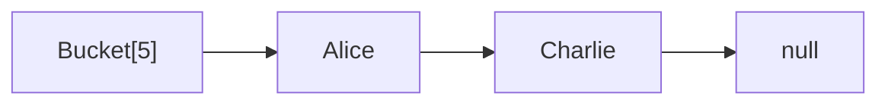
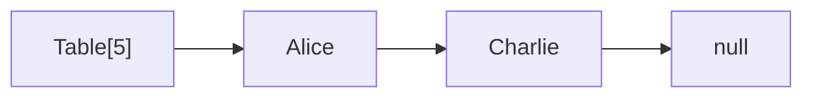
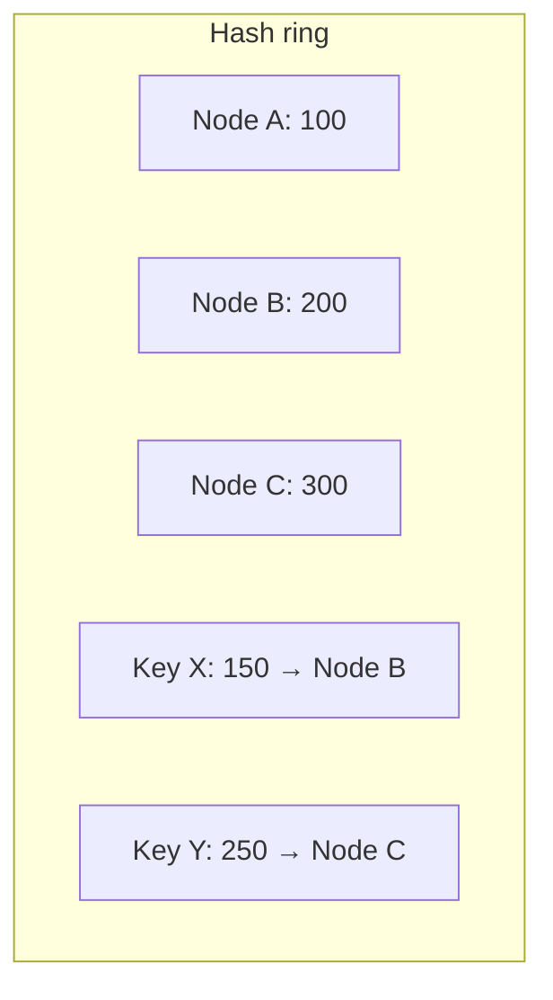

# Вопросы на собеседовании: `Хеш-таблицы`

Хеш-таблица — самая используемая структура в продакшене: `HashMap`, `HashSet`, кэши, индексы. На собеседовании любят спрашивать про коллизии, treeify в Java 8+, отличия `HashMap` и `ConcurrentHashMap`, consistent hashing для распределённых систем.

## Полезные ссылки

### Официальная документация и авторитетные источники

- [Java HashMap — Baeldung](https://www.baeldung.com/java-hashmap)
- [Inside Java HashMap (Java 8) — Baeldung](https://www.baeldung.com/java-hashmap-load-factor)
- [ConcurrentHashMap — Baeldung](https://www.baeldung.com/java-concurrent-map)
- [hashCode() and equals() — Baeldung](https://www.baeldung.com/java-equals-hashcode-contracts)
- [Consistent Hashing — Baeldung](https://www.baeldung.com/cs/consistent-hashing)
- [HashMap (Java) — Oracle Docs](https://docs.oracle.com/en/java/javase/17/docs/api/java.base/java/util/HashMap.html)

## Содержание

- [Полезные ссылки](#полезные-ссылки)
- [See also](#see-also)

**Базовые понятия**
- [Q1. (!) Что такое хеш-таблица?](#q1--что-такое-хеш-таблица)
- [Q2. (!) Что такое хеш-функция и какие требования к ней?](#q2--что-такое-хеш-функция-и-какие-требования-к-ней)
- [Q3. (!) Что такое коллизии и как их разрешают?](#q3--что-такое-коллизии-и-как-их-разрешают)

**Methods и contract**
- [Q4. (!) Контракт hashCode() и equals()?](#q4--контракт-hashcode-и-equals)
- [Q5. (!) Что будет, если переопределить equals, но не hashCode?](#q5--что-будет-если-переопределить-equals-но-не-hashcode)
- [Q6. Как переопределять hashCode по правилам?](#q6-как-переопределять-hashcode-по-правилам)
- [Q7. Что такое immutable key и почему важен?](#q7-что-такое-immutable-key-и-почему-важен)

**Реализация HashMap в Java**
- [Q8. (!) Как устроен HashMap внутри?](#q8--как-устроен-hashmap-внутри)
- [Q9. (!) Что такое load factor и initial capacity?](#q9--что-такое-load-factor-и-initial-capacity)
- [Q10. (!) Что такое rehashing?](#q10--что-такое-rehashing)
- [Q11. (!) Что такое treeify и как работает с Java 8+?](#q11--что-такое-treeify-и-как-работает-с-java-8)
- [Q12. (!) Сложности операций HashMap?](#q12--сложности-операций-hashmap)
- [Q13. Почему capacity HashMap всегда степень двойки?](#q13-почему-capacity-hashmap-всегда-степень-двойки)
- [Q14. Что такое perturbation в hashCode?](#q14-что-такое-perturbation-в-hashcode)

**Виды разрешения коллизий**
- [Q15. (!) Chaining (separate chaining) — как работает?](#q15--chaining-separate-chaining--как-работает)
- [Q16. (!) Open addressing — линейное и квадратичное пробирование?](#q16--open-addressing--линейное-и-квадратичное-пробирование)
- [Q17. Что такое double hashing и чем он лучше квадратичного пробирования?](#q17-что-такое-double-hashing-и-чем-он-лучше-квадратичного-пробирования)
- [Q18. Когда выбирают chaining, а когда open addressing?](#q18-когда-выбирают-chaining-а-когда-open-addressing)

**HashMap и thread-safety**
- [Q19. (!) Почему HashMap небезопасна в многопотоке?](#q19--почему-hashmap-небезопасна-в-многопотоке)
- [Q20. (!) Как устроена ConcurrentHashMap?](#q20--как-устроена-concurrenthashmap)
- [Q21. Чем ConcurrentHashMap отличается от Hashtable и Collections.synchronizedMap?](#q21-чем-concurrenthashmap-отличается-от-hashtable-и-collectionssynchronizedmap)
- [Q22. (!) Атомарные методы ConcurrentHashMap?](#q22--атомарные-методы-concurrenthashmap)

**Особые виды Map**
- [Q23. (!) LinkedHashMap — как устроен и зачем?](#q23--linkedhashmap--как-устроен-и-зачем)
- [Q24. Что такое WeakHashMap и зачем он нужен?](#q24-что-такое-weakhashmap-и-зачем-он-нужен)
- [Q25. Чем отличается IdentityHashMap от обычной HashMap?](#q25-чем-отличается-identityhashmap-от-обычной-hashmap)
- [Q26. Что такое EnumMap и почему он эффективнее HashMap?](#q26-что-такое-enummap-и-почему-он-эффективнее-hashmap)

**Распределённое хеширование**
- [Q27. (!) Что такое consistent hashing?](#q27--что-такое-consistent-hashing)
- [Q28. Как работает rendezvous hashing?](#q28-как-работает-rendezvous-hashing)
- [Q29. (!) Что такое Bloom filter и где он применяется?](#q29--что-такое-bloom-filter-и-где-он-применяется)
- [Q30. Как работает cuckoo hashing?](#q30-как-работает-cuckoo-hashing)

**Подводные камни**
- [Q31. (!) Что такое HashDoS-атака?](#q31--что-такое-hashdos-атака)
- [Q32. Когда HashMap деградирует до O(n)?](#q32-когда-hashmap-деградирует-до-on)
- [Q33. Можно ли использовать null как ключ или значение?](#q33-можно-ли-использовать-null-как-ключ-или-значение)
- [Q34. (!) Чем HashSet отличается от HashMap?](#q34--чем-hashset-отличается-от-hashmap)

## Q1. (!) Что такое хеш-таблица?

**Hash table** — структура «ключ → значение», которая даёт доступ к данным за константное время в среднем. Вместо того чтобы перебирать элементы, она хеш-функцией превращает ключ в индекс массива и сразу попадает в нужную ячейку (bucket).

Ключевая идея: ключ → `hash(key)` → индекс. Это сокращает область поиска до одной корзины, но внутри неё при коллизиях всё ещё нужны сравнения ключей.

```mermaid
graph LR
    K["Key: Alice"] -->|hash() % size| I["Index: 5"]
    I --> B["Bucket[5]: value"]
```

**Сложности:**
- Среднее: `O(1)` на `get/put/remove` — пока ключи распределены равномерно.
- Худшее: `O(n)` при большом числе коллизий; деревизация корзин в современных реализациях Java смягчает часть таких случаев, но API не обещает логарифмическую границу для любых ключей.

**Где применяется:** кеши (Redis, Memcached), индексы in-memory БД, словари и множества, дедупликация, подсчёт частот, шардирование в распределённых системах. Это самая ходовая структура в продакшене — именно поэтому её устройство так любят на собеседованиях.


## Q2. (!) Что такое хеш-функция и какие требования к ней?

**Хеш-функция** — это `hash(key) → int`, отображающая ключ в число, которое потом сводится к индексу bucket. От её качества напрямую зависит, будет ли таблица работать за `O(1)` или деградирует до `O(n)`.

Для ключей хеш-таблицы важны следующие свойства:

1. **Детерминированность:** один и тот же ключ всегда даёт один и тот же хеш — иначе элемент потеряется.
2. **Равномерность:** хеши распределены по всему диапазону без перекосов — это минимизирует коллизии.
3. **Скорость:** стоимость вычисления хеша входит в стоимость `get/put`; для составного ключа она может зависеть от его размера.
4. **Хорошее перемешивание:** похожие ключи не должны систематически попадать в одни корзины. Лавинный эффект полезен, но не является обязательным пунктом контракта Java `hashCode()`.

```java
// Пример хеш-функции для строки (использует Java)
int hash = 0;
for (char c : str.toCharArray()) {
    hash = 31 * hash + c; // 31 — простое число с хорошими свойствами
}
```

**Криптографические против некриптографических.** `HashMap` вызывает `hashCode()` ключа и перемешивает его биты; она не вычисляет SHA-256 при каждом доступе. При работе с недоверенным входом качество хеша, ограничения входа и способ разрешения коллизий рассматривают вместе (Q31).


## Q3. (!) Что такое коллизии и как их разрешают?

**Коллизия** — когда два разных ключа попадают в один bucket (одинаковый хеш или один и тот же индекс после взятия по модулю). Коллизии неизбежны: возможных ключей бесконечно много, а ячеек конечное число — по принципу Дирихле (pigeonhole) хоть какие-то ключи обязательно совпадут. Поэтому вопрос не «как избежать», а «как обработать».

**Два семейства стратегий:**

1. **Chaining (раздельное связывание)** — каждый bucket хранит список (или дерево) всех попавших в него элементов. Коллизия просто дописывает элемент в цепочку:


2. **Open addressing (открытая адресация)** — все элементы лежат прямо в массиве; при коллизии ищем следующую свободную ячейку по правилу:
   - Linear probing: `(hash + i) % size`, где `i = 0, 1, 2, ...`
   - Quadratic probing: `(hash + i²) % size`
   - Double hashing: `(hash + i · h₂(key)) % size`

`HashMap` в Java использует **chaining** и при достаточной ёмкости может превратить длинную цепочку в красно-чёрное дерево. Это улучшает поиск во многих случаях коллизий, но не даёт безусловной гарантии `O(log n)` для каждого допустимого класса ключей. Подробнее — Q11 и Q15–Q18.


## Q4. (!) Контракт hashCode() и equals()?

```
1. equals() reflexive: x.equals(x) == true
2. equals() symmetric: x.equals(y) == y.equals(x)
3. equals() transitive: x.equals(y) && y.equals(z) → x.equals(z)
4. equals() consistent: пока объекты не меняются, equals возвращает то же
5. equals() with null: x.equals(null) == false

6. hashCode() consistent: пока объекты не меняются, hashCode возвращает то же
7. equals → hashCode: x.equals(y) → x.hashCode() == y.hashCode()
8. !equals → hashCode: x.equals(y) == false НЕ требует разных hashCode
```

**Что важно понять, а не зубрить.** Контракт состоит из двух частей. `equals()` обязан задавать корректное отношение эквивалентности (рефлексивность, симметричность, транзитивность, согласованность). А связка с `hashCode()` держится на одном направлении:

- **Равные объекты → одинаковый hashCode** — это закон, нарушение ломает hash-коллекции (см. Q5).
- **Одинаковый hashCode → НЕ обязательно равные** — это лишь коллизия, она допустима и обрабатывается цепочкой/деревом.

**Эмпирическое правило:** хорошее распределение хешей снижает число сравнений в корзинах, но разные объекты не обязаны иметь разные хеши.


## Q5. (!) Что будет, если переопределить equals, но не hashCode?

Объект «потеряется» в hash-коллекции: вы кладёте его, а `contains`/`get` его не находит. Почему — разберём на коде.

```java
class User {
    String name;
    User(String name) { this.name = name; }

    @Override
    public boolean equals(Object o) {
        if (!(o instanceof User u)) return false;
        return name.equals(u.name);
    }
    // hashCode НЕ переопределён — используется Object.hashCode() (по identity)
}

Set<User> users = new HashSet<>();
users.add(new User("Alice"));
users.contains(new User("Alice")); // может быть false: контракт нарушен
```

**Механика сбоя.** `HashSet`/`HashMap` сначала используют хеш для выбора корзины и только затем сравнивают ключи через `equals`. Два «Alice» логически равны, но унаследованный `Object.hashCode()` не обязан возвращать для них одинаковый хеш. Поиск может не найти запись, а коллекция может сохранить логические дубликаты. Это нарушение контракта даже если отдельный запуск случайно сработал.

**Правило:** переопределяя `equals`, одновременно обеспечьте согласованный `hashCode`. Обычно оба метода строят из одних значимых полей; хеш может учитывать и их подмножество ценой коллизий. Используйте генератор IDE, Lombok `@EqualsAndHashCode` или `record`, если это подходит типу.


## Q6. Как переопределять hashCode по правилам?

Базовый рецепт — взять те же поля, что и в `equals`, и скомбинировать их так, чтобы разные объекты с большой вероятностью давали разный хеш. От самого читаемого к самому быстрому:

```java
// Java 7+ — Objects.hash()
@Override
public int hashCode() {
    return Objects.hash(field1, field2, field3);
}

// Ручная реализация (немного быстрее, без autoboxing)
@Override
public int hashCode() {
    int result = 17;
    result = 31 * result + (field1 != null ? field1.hashCode() : 0);
    result = 31 * result + Integer.hashCode(field2);
    result = 31 * result + Long.hashCode(field3);
    return result;
}

// Лучшая практика — Lombok или record
@EqualsAndHashCode
class User { ... }

record User(String name, int age) { } // hashCode/equals/toString автоматически
```

**Почему часто используют 31.** Это распространённый множитель для сочетания полей; он не обязателен по контракту. Равенство `31 * x = (x << 5) - x` верно для `int`, но конкретную машинную инструкцию выбирает компилятор. Важнее включать те же значимые поля, что и в `equals`.

**Рекомендация:** в обычном коде используйте `Objects.hash(...)`, генератор IDE, Lombok или `record`, если они подходят проекту. Ручную реализацию выбирают при измеренной необходимости и проверяют вместе с `equals`.


## Q7. Что такое immutable key и почему важен?

**Immutable key (неизменяемый ключ)** — ключ, состояние которого нельзя поменять после создания. Это важно, потому что `HashMap` сохраняет вычисленный хеш при вставке и не переставляет запись при изменении полей ключа.

Если изменить поле, входящее в `hashCode`, уже **после** добавления:
- хеш ключа меняется → `get()` идёт искать в новый bucket;
- но сам элемент остался лежать в старом bucket → его не находят.

Элемент фактически «застревает»: он есть в таблице, но недостижим по этому ключу.

```java
class MutableKey {
    int value;
    MutableKey(int v) { this.value = v; }
    @Override public int hashCode() { return value; }
    @Override public boolean equals(Object o) { ... }
}

MutableKey key = new MutableKey(1);
Map<MutableKey, String> map = new HashMap<>();
map.put(key, "value");
key.value = 2; // ИЗМЕНИЛИ КЛЮЧ!
map.get(key); // null! теперь хеш другой
```

**Правило:** в качестве ключей `HashMap` выбирайте типы с неизменным равенством и хешем (`String`, `Integer`, `LocalDate`). `record` фиксирует ссылки на компоненты, но вложенный изменяемый объект всё ещё может изменить его `equals`/`hashCode`. Не меняйте такие данные, пока ключ находится в карте.


## Q8. (!) Как устроен HashMap внутри?

Внутри `HashMap` (Java 8+) — это массив корзин, где каждая корзина при коллизиях разрастается в список или дерево. Четыре опоры реализации:

- **Массив `Node<K, V>[] table`** — корзины; у конструктора без аргументов при первой вставке обычно выделяется 16 штук.
- **Каждый bucket** — связный список, а при длинной цепочке — красно-чёрное дерево.
- **Хеш-функция:** `hash = (h = key.hashCode()) ^ (h >>> 16)` — perturbation подмешивает старшие биты в младшие (зачем — см. Q14).
- **Индекс:** `(table.length - 1) & hash` — быстрое взятие по модулю через `&`, работает потому что `length` всегда степень двойки (см. Q13).

```java
// Упрощённо
public class HashMap<K, V> {
    Node<K, V>[] table;
    int size, threshold;
    final float loadFactor;

    static class Node<K, V> {
        final int hash;
        final K key;
        V value;
        Node<K, V> next;
    }
}
```

**Жизненный цикл bucket.** При коллизии элементы связываются в корзине. При достижении порога и ёмкости не меньше 64 корзина может быть деревизована. Это снижает стоимость поиска при многих коллизиях, особенно для сравнимых ключей; безусловный худший случай API не фиксирует — подробнее в Q11.


## Q9. (!) Что такое load factor и initial capacity?

Это два параметра, которые управляют балансом «память против скорости»:

- **Initial capacity** — запрошенная начальная ёмкость таблицы; реализация округляет её до поддерживаемого размера. У конструктора без аргументов первая выделенная таблица имеет 16 корзин.
- **Load factor** — порог отношения числа записей к ёмкости, после которого таблица расширяется (по умолчанию **0.75**). Это не доля занятых корзин.
- **Threshold** = `capacity × loadFactor` — порог в штуках элементов, по умолчанию `16 × 0.75 = 12`.

Логика проста: как только `size > threshold`, запускается **rehashing** (расширение таблицы вдвое, см. Q10). Load factor 0.75 — компромисс по умолчанию: уже достаточно плотно, чтобы не транжирить память, но ещё редко, чтобы коллизии не накапливались.

```java
// Указываем initial capacity, чтобы избежать rehashing
Map<String, Integer> map = new HashMap<>(64); // capacity рассчитывается до ближайшей степени двойки

// С expected size N: capacity = N / 0.75
int expected = 1000;
Map<String, Integer> sized = new HashMap<>((int)(expected / 0.75f) + 1);

// Java 19+ — newHashMap
Map<String, Integer> v19 = HashMap.newHashMap(1000);
```

**Компромисс:** низкий load factor → обычно меньше коллизий, но больше расход памяти. Высокий → меньше таблица, но выше стоимость поиска; число расширений зависит и от начальной ёмкости.

**Рекомендация:** если заранее знаешь размер коллекции — задавай capacity при создании. Так ты избегаешь нескольких дорогих rehashing-ов по мере роста. Формула — `capacity = ожидаемое_число / 0.75`, а в Java 19+ за тебя это делает `HashMap.newHashMap(N)`.


## Q10. (!) Что такое rehashing?

**Rehashing** — расширение таблицы, когда она переполнилась (`size > threshold`). Зачем: при заполнении растёт средняя длина цепочек, и без расширения `O(1)` постепенно превратился бы в `O(n)`. Шаги:

1. Создаётся новый массив **вдвое больше** старого.
2. Все элементы переносятся в новый массив с пересчётом индексов.
3. Разовая стоимость — `O(n)`.

**Хитрость Java 8+: индексы не пересчитываются с нуля.** Поскольку capacity всегда удваивается (степень двойки), новый индекс элемента отличается от старого ровно на один бит хеша. Цепочку делят на две группы:
- `(hash & oldCapacity) == 0` → элемент остаётся на той же позиции;
- иначе → переезжает на `oldPosition + oldCapacity`.

Полный `hashCode` заново не вычисляется — проверяется один бит, поэтому перенос дешевле.

**Почему `put` всё равно амортизированно `O(1)`.** Дорогой rehashing случается редко (раз на удвоение), а его стоимость «размазывается» по всем дешёвым вставкам между расширениями — тот же приём, что у `ArrayList.add`.


## Q11. (!) Что такое treeify и как работает с Java 8+?

**Treeify** — превращение длинной цепочки корзины в красно-чёрное дерево. При подходящем порядке ключей дерево снижает цену поиска до логарифмической относительно размера корзины; для произвольных ключей это не универсальная гарантия. Три порога управляют преобразованием:

- **TREEIFY_THRESHOLD = 8** — порог для попытки деревизации при вставке в уже длинную цепочку; точный момент зависит от реализации.
- **MIN_TREEIFY_CAPACITY = 64** — но только если capacity ≥64; при меньшей сначала делается resize (на маленькой таблице длинные цепочки чаще лечатся расширением, чем деревом).
- **UNTREEIFY_THRESHOLD = 6** — порог обратного преобразования при разделении корзины во время resize; удаление тоже может преобразовать небольшое дерево обратно в список.

```java
// Если коллизий много:
// До Java 8: O(n) на get/put в худшем случае
// С Java 8+: деревизация помогает части случаев коллизий;
// универсальная граница O(log n) контрактом не обещана
```

**Зачем это вообще ввели:** деревизация снижает цену длинных цепочек, в том числе при специально подобранных коллизиях. Лимиты на недоверенный вход всё равно нужны (Q31).

**Нюанс с упорядочиванием.** При одинаковых хешах сравнимые ключи могут помогать дереву упорядочить поиск. Для несравнимых ключей реализация применяет дополнительные правила размещения, но `equals` при поиске может потребовать обхода нескольких ветвей. Поэтому обещать `O(log n)` для любого класса ключей нельзя.


## Q12. (!) Сложности операций HashMap?

Для корректных неизменяемых ключей с дешёвым `hashCode` и хорошим распределением операции по ключу ожидаемо постоянны. Худший случай зависит от коллизий, стоимости `hashCode`/`equals` и расширения таблицы. Деревизация смягчает часть столкновений, но не задаёт общего контракта `O(log n)`.

| Операция | Ожидаемое при хорошем хеше | Возможный худший случай |
|----------|---------|------------------|
| `get(k)` | `O(1)` | `O(n)` при патологических коллизиях |
| `put(k, v)` | `O(1)` амортиз. | `O(n)` при resize или патологических коллизиях |
| `remove(k)` | `O(1)` | `O(n)` при патологических коллизиях |
| `containsKey(k)` | `O(1)` | `O(n)` при патологических коллизиях |
| `containsValue(v)` | зависит от места совпадения | `O(n + capacity)` |
| Iteration | `O(n + capacity)` | `O(n + capacity)` |

**Почему так:**
- `containsValue` может завершиться раньше, но в худшем случае проверяет все корзины и записи: `O(n + capacity)`.
- Итерация — `O(n + capacity)`: проходят все элементы плюс пустые buckets, поэтому раздутая capacity замедляет обход.
- Деревизация помогает при длинных цепочках, но поиск с произвольными реализациями `hashCode`/`equals` не получает безусловной логарифмической границы. `put` также может вызвать перенос всех записей при расширении.


## Q13. Почему capacity HashMap всегда степень двойки?

Степень двойки позволяет вычислять индекс маской `hash & (capacity - 1)` и при удвоении разделять корзину по одному биту. Это свойство реализации `HashMap`; реальную разницу в скорости с `%` нельзя утверждать без измерения на конкретной платформе.

```java
// При capacity = 16 (= 2^4):
int index = hash & (16 - 1); // = hash & 0b1111 — берём 4 младших бита
// Для неотрицательного hash эквивалентно hash % 16
```

Трюк работает только для степеней двойки: тогда `capacity - 1` — это маска из единиц (`0b1111`), и `&` просто берёт младшие биты хеша. Если бы capacity не была степенью двойки, маска получилась бы «дырявой» и распределение по корзинам стало бы неравномерным. Поэтому при `new HashMap(N)` значение N округляется вверх до ближайшей степени двойки.


## Q14. Что такое perturbation в hashCode?

`HashMap` не берёт `key.hashCode()` напрямую — он сначала «перемешивает» его специальной функцией (perturbation), чтобы старшие биты тоже влияли на выбор bucket:

```java
static final int hash(Object key) {
    int h;
    return (key == null) ? 0 : (h = key.hashCode()) ^ (h >>> 16);
}
```

**Как это работает:** `h >>> 16` сдвигает старшие 16 бит хеша вниз, а `^` (XOR) подмешивает их к младшим. В итоге выбор bucket зависит от всех битов, а не только от младших.

**Зачем это нужно** (логика по шагам):
- индекс bucket = `(table.length - 1) & hash`, то есть учитываются только младшие биты хеша;
- если у `hashCode()` хорошие старшие биты, но «плохие» (мало меняющиеся) младшие — без perturbation многие ключи попали бы в одни и те же корзины;
- perturbation за один XOR «втягивает» информацию из старших битов в младшие, и распределение становится равномернее почти бесплатно.


## Q15. (!) Chaining (separate chaining) — как работает?

Каждый bucket держит контейнер (связный список, а с Java 8+ — дерево) из всех элементов, попавших в этот индекс. Коллизия не «борется за ячейку», а просто добавляет узел в цепочку:



**Плюсы:**
- Простая реализация — добавил узел в список, и всё.
- Работает при любом load factor (даже >1): корзина просто удлиняется, переполнения массива не бывает.
- Удаление тривиально — выкинул узел из списка.
- Нет primary clustering: занятость одной корзины не влияет на соседние.

**Минусы:**
- Накладные расходы памяти на сами узлы (ссылки `next`).
- Плохая cache locality — каждый переход по `next` — это потенциальный cache miss (узлы разбросаны по куче).
- При плохом хеше цепочка может давать линейный поиск; деревизация Java смягчает часть таких случаев без универсальной гарантии `O(log n)`.

В Java корзины `HashMap` и `ConcurrentHashMap` содержат узлы; `LinkedHashMap` дополнительно связывает записи между корзинами для порядка обхода.


## Q16. (!) Open addressing — линейное и квадратичное пробирование?

В отличие от chaining, здесь нет отдельных списков — все элементы лежат **прямо в массиве**. При коллизии не создаём узел, а по детерминированному правилу пробуем следующую ячейку, пока не найдём свободную. Это правило (probe sequence) и отличает варианты:

**Linear probing (линейное):** `(hash + i) % size` — идём по соседним ячейкам.
- Проблема: **primary clustering** — занятые ячейки слипаются в длинные блоки, и поиск свободного места в таком блоке замедляется.

**Quadratic probing (квадратичное):** `(hash + i²) % size` — шаги растут квадратично, «перепрыгивая» кластеры.
- Снимает primary clustering.
- Но остаётся **secondary clustering**: ключи с одинаковым стартовым хешем идут по одной и той же последовательности проб.

```java
class OpenAddressingMap<K, V> {
    private K[] keys;
    private V[] values;

    int probeIndex(K key, int attempt) {
        return (key.hashCode() + attempt) % keys.length; // linear
    }
}
```

Это семейство структур используют там, где плотное размещение в памяти важно для скорости. Конкретный способ пробирования и удаления зависит от реализации; переносить детали одной библиотеки на другую нельзя.


## Q17. Что такое double hashing и чем он лучше квадратичного пробирования?

**Double hashing** — вариант open addressing, где шаг пробирования сам зависит от ключа. Вторая хеш-функция задаёт размер шага:

```
index = (h1(key) + i × h2(key)) % size
```

**Чем лучше квадратичного.** При quadratic probing все ключи с одинаковым стартовым хешем идут по одной и той же последовательности проб (secondary clustering). Здесь же шаг `h2(key)` у разных ключей разный, поэтому даже при совпадении `h1` их пути расходятся — кластеризация почти исчезает.

**Условие корректности:** `h2(key)` и `size` должны быть взаимно простыми — иначе пробирование зациклится, не обойдя все ячейки. Поэтому часто берут `size = простое число`.


## Q18. Когда выбирают chaining, а когда open addressing?

Коротко: **open addressing** выбирают ради скорости (плотные данные, cache locality), **chaining** — ради простоты и устойчивости к плохим хешам. Сравнение по ключевым осям:

| Критерий | Chaining | Open addressing |
|----------|----------|-----------------|
| Память | Больше (узлы) | Меньше (только массив) |
| Cache locality | Плохая | Отличная |
| Удаление | Простое | Сложное (tombstones) |
| Load factor | Может превышать 1 | Должен оставлять свободные ячейки; рабочий порог зависит от схемы |
| Патологические коллизии | Деревизация Java смягчает часть случаев | Поиск может стать линейным |
| Простота | Проще | Сложнее (tombstones, rehash) |

**Итог.** Open addressing часто выигрывает за счёт локальности памяти при хорошем хеше и подходящем коэффициенте заполнения. Удаление должно сохранять путь поиска: для этого применяют tombstones или специальное смещение элементов. Chaining допускает заполнение выше числа корзин и проще при удалении; при плохом хеше цепочки тоже замедляются.


## Q19. (!) Почему HashMap небезопасна в многопотоке?

`HashMap` не делает никакой синхронизации, поэтому при конкурентной записи её внутреннее состояние рушится. Три классические проблемы:

1. **Потеря обновлений (lost updates)** — два потока одновременно пишут в одну корзину; одна вставка перетирает другую, элемент исчезает.
2. **Нарушение структуры при конкурентном resize** — детали известных сбоев зависят от версии реализации; `HashMap` не обещает корректность чтения одновременно со структурной записью.
3. **Несогласованное состояние** — один поток ещё не закончил resize, другой уже читает наполовину перестроенную таблицу и получает мусор или `null`.

```java
HashMap<String, Integer> map = new HashMap<>();
// Опасно при concurrent put
ExecutorService es = Executors.newFixedThreadPool(8);
for (int i = 0; i < 10000; i++) {
    int finalI = i;
    es.submit(() -> map.put("key" + finalI, finalI)); // race condition
}
```

**Решения:**
- `ConcurrentHashMap` — штатный потокобезопасный вариант, без глобального лока (Q20).
- `Collections.synchronizedMap(new HashMap<>())` — обёртка с одним общим монитором для операций карты; полезна, когда нужен именно такой контракт синхронизации.
- `Hashtable` — legacy, синхронизирован полностью; в новом коде не использовать.


## Q20. (!) Как устроена ConcurrentHashMap?

Главная идея — блокировать не всю таблицу, а отдельную корзину, и по возможности обходиться вообще без блокировок. С Java 8+ это достигается так:

- **CAS (compare-and-swap)** для вставки первого узла в пустой bucket — атомарно и без лока.
- **synchronized на уровне отдельного bucket** (не всей таблицы) — для записи в непустую корзину; потоки, работающие с разными корзинами, не мешают друг другу.
- **TreeBins** — потокобезопасные деревья при treeify длинных цепочек.
- **Параллельный resize** через `transferIndex` — несколько потоков делят между собой работу по переносу элементов.

До Java 8 применялась сегментированная организация; детали числа сегментов зависели от настройки. В нынешней реализации для обновлений используются более мелкие области синхронизации.

```java
ConcurrentHashMap<String, Integer> map = new ConcurrentHashMap<>();
map.put("a", 1); // потокобезопасно
map.computeIfAbsent("b", k -> 2); // атомарно
```

**Что из этого следует:**
- Чтения по контракту не требуют блокировки; документация говорит, что они обычно не блокируются и могут пересекаться с обновлениями.
- При записи блокируется только конкретная корзина, а не вся карта.
- За счёт этого — высокий throughput на многоядерных системах.
- `null` запрещён и для ключей, и для значений (почему — см. Q33).


## Q21. Чем ConcurrentHashMap отличается от Hashtable и Collections.synchronizedMap?

Все три потокобезопасны для отдельных операций. `Hashtable` и synchronized-обёртка используют общий монитор, а `ConcurrentHashMap` допускает параллельные чтения и высокую ожидаемую конкуренцию обновлений. Поведение составных действий и итерации различается:

| Структура | Стратегия | Чтение | Производительность |
|-----------|-----------|--------|--------------------|
| `Hashtable` | Глобальный `synchronized` | Блокирует | Низкая (legacy) |
| `Collections.synchronizedMap` | Обёртка с глобальным локом | Блокирует | Низкая |
| `ConcurrentHashMap` | Bucket-level lock + CAS | **Не блокирует** | Высокая |

```java
// Synchronized wrapper — блокирует ВСЁ при любой операции
Map<String, Integer> sync = Collections.synchronizedMap(new HashMap<>());

// ConcurrentHashMap — параллельные читатели + локальный writer lock
ConcurrentHashMap<String, Integer> conc = new ConcurrentHashMap<>();
```

**Важный нюанс synchronizedMap:** обёртка делает атомарной каждую отдельную операцию, но не их связки. Итерацию по такой карте нужно вручную оборачивать в `synchronized (map) { ... }`, иначе словите `ConcurrentModificationException`. У `ConcurrentHashMap` итератор слабо-согласованный (weakly consistent) и этого не требует.

**Рекомендация:** в современном Java `Hashtable` не используют (legacy); для потокобезопасной карты по умолчанию берут `ConcurrentHashMap`.


## Q22. (!) Атомарные методы ConcurrentHashMap?

Это методы, которые выполняют связку «прочитать → решить → записать» как одну неделимую операцию. Они нужны, потому что наивный `if (!map.containsKey(k)) map.put(k, v)` в многопотоке — это гонка: между проверкой и вставкой может вклиниться другой поток.

```java
ConcurrentHashMap<String, Integer> map = new ConcurrentHashMap<>();

// putIfAbsent — атомарно
map.putIfAbsent("counter", 0);

// computeIfAbsent — вычислить и поместить, если отсутствует
map.computeIfAbsent("expensive", k -> heavyComputation());

// computeIfPresent — обновить, если присутствует
map.computeIfPresent("counter", (k, v) -> v + 1);

// compute — атомарно прочитать-обновить
map.compute("counter", (k, v) -> v == null ? 1 : v + 1);

// merge — для счётчиков идеально
map.merge("counter", 1, Integer::sum);
```

Операции обновления одного ключа атомарны в смысле контракта метода. Механизм может сочетать CAS и локальную синхронизацию; обещать блокировку корзины на каждый вызов неверно. Функции для `compute` и `merge` должны быть короткими и не пытаться рекурсивно обновлять ту же карту.

**Сценарий применения:** `merge(key, 1, Integer::sum)` — атомарное обновление счётчика для одного ключа. Для часто обновляемых счётчиков документация `ConcurrentHashMap` также рекомендует `LongAdder` через `computeIfAbsent`. Функция `computeIfAbsent` выполняется атомарно для ключа, но дорогая работа внутри неё может задерживать другие обновления.


## Q23. (!) LinkedHashMap — как устроен и зачем?

`LinkedHashMap` наследует `HashMap`, но дополнительно связывает все записи в **двусвязный список**. Обычный `HashMap` не гарантирует порядка итерации; `LinkedHashMap` обходит элементы предсказуемо — в порядке вставки либо в порядке доступа. Эта дополнительная нить и делает возможным LRU-кеш.

```java
// Insertion order
LinkedHashMap<String, Integer> map = new LinkedHashMap<>();
map.put("a", 1); map.put("b", 2); map.put("c", 3);
// Iteration order: a, b, c

// Access order — для LRU
LinkedHashMap<String, Integer> lru = new LinkedHashMap<>(16, 0.75f, true);
```

**Где применяется:**
- **Предсказуемый порядок** итерации — удобно для детерминированных тестов и стабильного вывода.
- **LRU-кеш в несколько строк.** В access-order режиме (`accessOrder = true`) каждый `get` перемещает запись в конец списка, поэтому в голове всегда самый давно не использованный элемент. Переопределив `removeEldestEntry`, мы автоматически выселяем его при переполнении:

```java
class LRUCache<K, V> extends LinkedHashMap<K, V> {
    private final int capacity;
    LRUCache(int cap) {
        super(cap, 0.75f, true); // accessOrder = true
        this.capacity = cap;
    }
    @Override
    protected boolean removeEldestEntry(Map.Entry<K, V> eldest) {
        return size() > capacity;
    }
}
```


## Q24. Что такое WeakHashMap и зачем он нужен?

`WeakHashMap` хранит ключи через **WeakReference**, поэтому сама карта не удерживает ключ «в живых». Когда на ключ не остаётся сильных ссылок, GC вправе его собрать, после чего запись может исчезнуть при обработке карты. Момент этого события не гарантируется.

```java
WeakHashMap<Object, String> cache = new WeakHashMap<>();
Object key = new Object();
cache.put(key, "value");
key = null; // больше нет strong ссылки
System.gc(); // может удалить запись
```

**Где применяется:** кеши и реестры метаданных, где карта не должна продлевать жизнь объекта-ключа. После исчезновения сильных ссылок ключ может быть собран, а запись удалена позже; точный момент не гарантируется. Если значение прямо или косвенно сильно ссылается на ключ, запись может сохраниться.

**Подводный камень:** `WeakHashMap` работает и со строками, но поведение может удивить: заново созданная равная строка найдёт запись лишь пока прежний объект-ключ ещё достижим. Интернированные литералы часто сохраняются дольше обычных временных строк. `System.gc()` не гарантирует немедленного удаления записи.


## Q25. Чем отличается IdentityHashMap от обычной HashMap?

`IdentityHashMap` сравнивает ключи по ссылке (`==`), а не через `equals()`, и использует `System.identityHashCode()` вместо `hashCode()`. То есть для него два «равных» по содержимому объекта — это разные ключи, если это разные объекты в памяти.

```java
IdentityHashMap<String, Integer> map = new IdentityHashMap<>();
String a = new String("hello");
String b = new String("hello");
map.put(a, 1);
map.get(b); // null! — разные ссылки
map.get(a); // 1
```

**Где применяется:** обход графов объектов, где важна именно идентичность узла, а не его содержимое — топологическая сортировка, сериализация и глубокое копирование (нужно отметить уже посещённые объекты, чтобы не зациклиться на циклических ссылках). Здесь сравнение по `equals` сломало бы логику: два разных узла с одинаковыми полями считались бы одним.


## Q26. Что такое EnumMap и почему он эффективнее HashMap?

`EnumMap` — специализированная Map, ключами которой могут быть только значения одного enum. Это позволяет ей отказаться от хеширования вообще.

```java
enum Day { MONDAY, TUESDAY, WEDNESDAY }

EnumMap<Day, Integer> hours = new EnumMap<>(Day.class);
hours.put(Day.MONDAY, 8);
hours.put(Day.TUESDAY, 10);
```

**Почему это быстро.** У каждой константы enum есть `ordinal()` — её порядковый номер. `EnumMap` использует компактное представление на основе массива и не хеширует ключи. Операции выполняются за константное время; конкретную разницу в скорости и памяти с `HashMap` измеряют на своей нагрузке. Для небольшого enum с множеством заполненных значений это обычно удобный выбор.


## Q27. (!) Что такое consistent hashing?

**Consistent hashing** — способ распределить ключи по узлам кластера с небольшим ожидаемым числом перемещений при изменении состава. При равномерном распределении и `N` сопоставимых узлах добавление одного узла переносит примерно `1/(N+1)` ключей. Наивное `hash(key) % N` обычно переназначает гораздо больше.

**Идея «кольца».** И узлы, и ключи хешируются на общее кольцо значений (`0 .. 2³² - 1`). Ключ принадлежит первому узлу, который встретится при движении по часовой стрелке. Тогда при выпадении узла «осиротевшие» ключи переезжают только к его соседу справа — остальные не трогаются.



**Virtual nodes (виртуальные узлы):** один физический узел представляют сотнями точек на кольце. Без этого при малом числе узлов промежутки между ними получаются неравными — и нагрузка ложится неравномерно. Размазав узел по многим точкам, мы выравниваем распределение и сглаживаем переезд ключей при отказе.

**Где применяется:**
- Распределённые кеши и системы шардирования, которые действительно используют кольцо или его вариант.
- CDN: выбор edge-сервера, который отдаст кешированный объект.
- Балансировщики нагрузки с привязкой запроса к узлу.


## Q28. Как работает rendezvous hashing?

**Rendezvous hashing (HRW — Highest Random Weight)** — альтернатива consistent hashing для той же задачи «ключ → узел». Для ключа считаем `hash(key, node)` по каждому узлу и отдаём ключ узлу с **максимальным** хешем. Свойство минимального переезда сохраняется: если выпадает выбранный узел, ключ просто уходит к узлу со вторым по величине хешем — остальные ключи не затрагиваются.

```java
String pickNode(String key, List<String> nodes) {
    return nodes.stream()
                .max(Comparator.comparingLong(n -> hash(key + n)))
                .orElseThrow();
}
```

**Особенности по сравнению с кольцом:**
- Не нужно хранить и поддерживать структуру кольца — узлы можно держать просто списком.
- При независимом равномерном хеше выбор узла распределяется равномерно в ожидании; конкретный баланс зависит от ключей и весов узлов.
- Реализация проще: один проход по узлам с выбором максимума.

**Плата за это:** прямой lookup стоит `O(N)` вычислений хеша по числу узлов. Кольцо с отсортированными позициями обычно ищет узел за `O(log N)` после построения структуры. HRW особенно прост при небольшом списке узлов.


## Q29. (!) Что такое Bloom filter и где он применяется?

**Bloom filter** — компактная вероятностная структура для проверки принадлежности множеству. Классический фильтр с добавлением без удаления отвечает «**точно нет**» или «**возможно, есть**». При согласованных хешах ложноотрицательных ответов нет, а ложноположительные возможны. Экономия памяти зависит от допустимой частоты ложных срабатываний.

**Как устроена.** Это битовый массив плюс `k` хеш-функций. При `add` элемент прогоняется через все `k` функций, и соответствующие биты выставляются в 1. При проверке смотрим те же `k` бит: если хоть один равен 0 — элемента точно нет; если все равны 1 — он, скорее всего, есть (но биты могли совпасть из-за других элементов — отсюда false positive).

```java
class BloomFilter {
    private final BitSet bits;
    private final int size;
    private final List<Function<String, Integer>> hashFns;

    public void add(String item) {
        for (var fn : hashFns) bits.set(Math.floorMod(fn.apply(item), size));
    }

    public boolean mightContain(String item) {
        for (var fn : hashFns) {
            if (!bits.get(Math.floorMod(fn.apply(item), size))) return false;
        }
        return true; // вероятно
    }
}
```

**Где применяется.** Везде, где дешёвая проверка «точно нет» позволяет избежать дорогой операции:
- **Cassandra, RocksDB, LevelDB:** «есть ли ключ в SSTable?» — отсекает лишние чтения с диска.
- **Кеши:** «может ли значение вообще быть в кеше?» перед обращением к нему.
- **Веб-краулеры:** «посещали ли уже этот URL?», не храня все URL целиком.
- **Проверка орфографии:** быстрое «есть ли слово в словаре».

**Контроль точности.** При независимых равномерных хешах приближённая вероятность false positive — `(1 − e^(−kn/m))^k`, где `k` — число хеш-функций, `n` — число добавленных элементов, `m` — размер битового массива. Классический фильтр не поддерживает удаление простым сбросом битов, поскольку ими могут пользоваться другие элементы.


## Q30. Как работает cuckoo hashing?

**Cuckoo hashing** — open addressing с **двумя** хеш-функциями, дающими каждому ключу ровно две возможные позиции. Название — от кукушки: при вставке, если обе позиции заняты, мы «выталкиваем» одного из жильцов и переселяем его на его альтернативную позицию (а тот, в свою очередь, может вытолкнуть следующего — пока цепочка переселений не завершится).

**Преимущества:**
- `O(1)` в худшем случае на чтение — ключ лежит максимум в двух местах, проверяем не более двух ячеек.
- Чтение проверяет ограниченное число позиций; допустимая плотность зависит от варианта и политики перестроения.

**Недостатки:**
- Сложнее в реализации (логика переселений).
- Вставка может войти в цикл выселений; реализация ограничивает число попыток и затем перестраивает таблицу или меняет хеш-функции.

**Сценарий применения:** структуры, где важна малая и предсказуемая стоимость поиска, а вставки могут быть сложнее. Cuckoo filter использует родственный принцип размещения отпечатков, но это отдельная вероятностная структура.


## Q31. (!) Что такое HashDoS-атака?

**HashDoS — атака на алгоритмическую сложность.** Злоумышленник подбирает входные данные (POST-параметры, ключи JSON), которые дают **одинаковый хеш** в `HashMap`. Расчёт на то, что сервер сам сложит эти данные в карту (например, при парсинге запроса). Дальше срабатывает каскад:

- все подобранные ключи валятся в один bucket;
- из-за этого стоимость `get/put` возрастает; в некоторых реализациях и для некоторых ключей она может стать линейной;
- на обработку даже небольшого запроса уходит непропорционально много CPU → отказ в обслуживании.

Так злоумышленник пытается получить непропорционально большую стоимость обработки запроса. Конкретный эффект зависит от реализации таблицы, типа ключей и лимитов входа.

**Защита в Java 8+:**
- Деревизация длинных цепочек в `HashMap` смягчает часть случаев, но не заменяет ограничения входа.

**Защита на уровне приложения:**
- Лимиты на число параметров
- Проверять объём и форму недоверенных данных до построения больших карт; при необходимости выбирать структуру или хеширование с подходящей моделью угроз.

Подробнее — в [Application Security](../../security/application-security-interview.md).


## Q32. Когда HashMap деградирует до O(n)?

Различайте деградацию одной операции и стоимость обработки набора из `n` элементов:

1. **Плохая хеш-функция** — много ключей попадает в одну корзину. Деревизация помогает, но для произвольных несравнимых ключей нельзя обещать логарифмическую границу.
2. **Преднамеренный HashDoS** — то же скучивание, но устроенное специально (Q31).
3. **Resize при `put`** — перенос существующих записей занимает `O(n)` в одном вызове, несмотря на амортизированное ожидаемое `O(1)` для серии вставок.
4. **`containsValue()`** — в худшем случае обходит `O(n + capacity)` корзин и записей; значение не индексируется.

Изменение полей ключа после вставки — отдельная ошибка корректности: элемент может перестать находиться (Q7), но это само по себе не доказательство линейного времени поиска.


## Q33. Можно ли использовать null как ключ или значение?

Зависит от реализации. `HashMap` допускает `null` как ключ и значение; у сортированных карт правило зависит от компаратора.

| Структура | null ключ | null значение |
|-----------|-----------|---------------|
| `HashMap` | **Да** (один) | Да |
| `LinkedHashMap` | Да | Да |
| `TreeMap` | При естественном порядке нет; с компаратором, допускающим `null`, да | Да |
| `Hashtable` | Нет (NPE) | Нет (NPE) |
| `ConcurrentHashMap` | **Нет** (NPE) | **Нет** (NPE) |

**Почему так:**
- `HashMap` для `null`-ключа просто использует bucket 0 (хеш `null` считается равным 0) — отсюда ровно один такой ключ.
- `TreeMap` с естественным порядком не сравнит `null`, но пользовательский `Comparator` может разрешить такой ключ. `Hashtable` запрещает `null` ключи и значения.
- `ConcurrentHashMap` запрещает `null` намеренно. В однопоточном коде неоднозначность «`get` вернул `null`» снимается вызовом `containsKey`. Но в конкурентной среде нет атомарной связки `containsKey + get`, поэтому отличить «ключа нет» от «значение равно `null`» надёжно невозможно — `null` запретили, чтобы убрать саму неоднозначность.


## Q34. (!) Чем HashSet отличается от HashMap?

`HashSet<T>` — это тонкая обёртка над `HashMap<T, Object>`: множество хранит элементы как ключи карты, а значением для всех ставит один общий объект-заглушку `PRESENT`. То есть собственной структуры у `HashSet` нет — он переиспользует `HashMap`.

```java
public class HashSet<E> {
    private transient HashMap<E, Object> map;
    private static final Object PRESENT = new Object();

    public boolean add(E e) {
        return map.put(e, PRESENT) == null;
    }

    public boolean contains(Object o) {
        return map.containsKey(o);
    }
}
```

Из этого следует прямо: все сложности операций и весь контракт `hashCode/equals` у `HashSet` ровно те же, что у `HashMap` (Q4–Q5). Применяется, когда нужна только проверка уникальности/наличия, а сами значения не нужны.


---

## See also

- [Алгоритмы (обзор)](../algorithms-interview.md) — карта алгоритмических тем
- [Массивы и строки](arrays-strings-interview.md) — Two Sum, group anagrams через HashMap
- [Связные списки](linked-lists-interview.md) — chaining в HashMap
- [Деревья](trees-interview.md) — RB-tree в HashMap (treeify)
- [Кучи](heaps-interview.md) — top-K через HashMap + heap
- [Анализ сложности](../complexity/complexity-analysis-interview.md) — амортизированный O(1) и HashDoS
- [Java Collections](../../programming-languages/java/java-collections-interview.md) — все Map в Java
- [Java Concurrency](../../programming-languages/java/java-concurrency-interview.md) — ConcurrentHashMap
- [Java Core](../../programming-languages/java/java-core-interview.md) — hashCode/equals contract
- [Стратегии кэширования](../../architecture/caching-strategies-interview.md) — consistent hashing для distributed caches
- [Распределённые системы](../../architecture/distributed-systems-interview.md) — sharding и hashing
- [Application Security](../../security/application-security-interview.md) — HashDoS защита
- [Redis](../../databases/redis-interview.md) — hash table в основе
