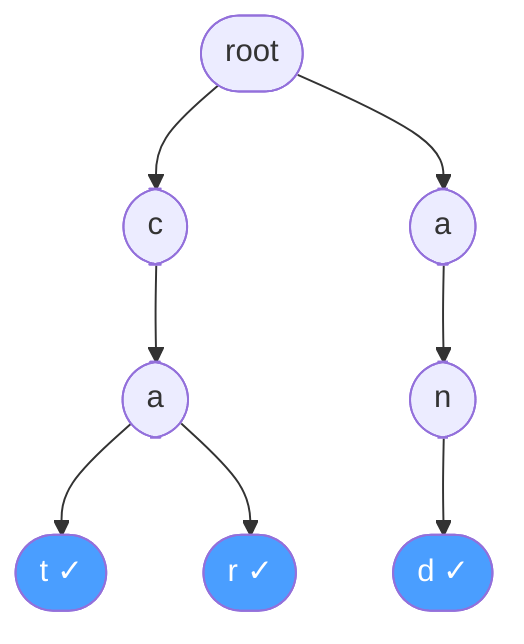

# Вопросы на собеседовании: `Trie и специальные структуры`

Trie (префиксное дерево) — основа автодополнения, spell-checkers, IP-routing. Вместе с Trie часто спрашивают **Union-Find** (DSU) — структуру для непересекающихся множеств, применяемую в Kruskal MST, обнаружении циклов и задачах вроде Number of Islands.

## Полезные ссылки

### Материалы для изучения

- [Trie Data Structure in Java — Baeldung](https://www.baeldung.com/trie-java)
- [Disjoint Set Union (Union-Find) — Baeldung](https://www.baeldung.com/cs/disjoint-set-union)
- [Suffix Tree — Baeldung](https://www.baeldung.com/cs/suffix-tree)
- [Aho-Corasick Algorithm — Baeldung](https://www.baeldung.com/cs/aho-corasick-algorithm)
- [Trie — GeeksforGeeks](https://www.geeksforgeeks.org/trie-insert-and-search/)

## Содержание

- [Полезные ссылки](#полезные-ссылки)
- [See also](#see-also)

**Trie**
- [Q1. Что такое Trie?](#q1)
- [Q2. Как реализовать Trie на HashMap?](#q2)
- [Q3. Как реализовать Trie на массиве для букв a–z?](#q3)
- [Q4. Каковы сложности операций Trie?](#q4)
- [Q5. Зачем Trie вместо HashMap?](#q5)

**Расширения Trie**
- [Q6. Что такое compressed trie (Radix tree)?](#q6)
- [Q7. Что такое Suffix tree и зачем он нужен?](#q7)
- [Q8. Чем suffix array отличается от suffix tree?](#q8)
- [Q9. Как Aho-Corasick ищет множество образцов сразу?](#q9)

**Классические задачи**
- [Q10. Как реализовать автодополнение (autocomplete) на Trie?](#q10)
- [Q11. Как найти слова в grid одним DFS с отсечением префиксов через Trie?](#q11)
- [Q12. Как найти Longest Common Prefix?](#q12)
- [Q13. Replace Words — как заменить слова корнями?](#q13)
- [Q14. Как найти максимальный XOR двух неотрицательных чисел в массиве?](#q14)

**Union-Find (DSU)**
- [Q15. Что такое Union-Find?](#q15)
- [Q16. Как реализовать Union-Find?](#q16)
- [Q17. Что такое path compression?](#q17)
- [Q18. Что такое union by rank/size?](#q18)
- [Q19. Какова амортизированная сложность с обеими оптимизациями?](#q19)

**Применения Union-Find**
- [Q20. Как посчитать острова через Union-Find, если созданы группы для всех клеток?](#q20)
- [Q21. Как обнаружить цикл в простом неориентированном графе через Union-Find?](#q21)
- [Q22. Как получить число компонент через Union-Find и сохранённый счётчик?](#q22)
- [Q23. Как объединить аккаунты через Union-Find по индексам аккаунтов?](#q23)
- [Q24. Как найти лишнее ребро (Redundant Connection)?](#q24)

**Real-world применения**
- [Q25. Где Trie используется в production?](#q25)
- [Q26. Где Union-Find используется в production?](#q26)
- [Q27. Как устроен бинарный Patricia trie?](#q27)
- [Q28. Как использовать актуальный Bloom filter перед Trie?](#q28)

<a id="q1"></a>

## Q1. Что такое Trie?

**Trie (prefix tree, префиксное дерево)** — дерево, в котором путь от корня к узлу складывается из символов строки, а сами символы записаны на рёбрах, а не в узлах. Ключевая идея: слова с общим началом разделяют общий путь, поэтому префикс хранится один раз.

Каждый узел хранит:
- Ссылки на детей — по одной на каждый возможный следующий символ;
- Флаг `isEndOfWord` — помечает узел, в котором заканчивается какое-то слово (иначе нельзя отличить хранимое слово `car` от просто префикса `ca`).



Дерево для слов: `cat`, `car`, `and`. Узлы с ✓ — конец слова. Видно, что `cat` и `car` делят общий путь `ca`.

**Где применяют:**
- Autocomplete в поисковой строке
- Spell-checker (проверка орфографии)
- IP-routing таблицы — longest prefix match
- Поиск всех слов с заданным префиксом
- Словарь для задач типа Word Search

**Главное отличие от хеш-таблицы:** Trie ищет не по целому ключу, а посимвольно, поэтому даёт быстрый ответ на вопрос «какие слова начинаются на этот префикс?» — то, что хеш-таблица сделать дёшево не может.


<a id="q2"></a>

## Q2. Как реализовать Trie на HashMap?

Каждый узел держит детей в `Map<Character, TrieNode>`. Вставка идёт по символам: для каждого создаём узел, если его ещё нет, и спускаемся ниже; на последнем символе ставим `isEndOfWord`. Поиск и `startsWith` — это один и тот же спуск по символам через вспомогательный `findNode`; разница лишь в том, что `search` дополнительно проверяет флаг конца слова, а `startsWith` довольствуется тем, что путь существует.

```java
class TrieNode {
    Map<Character, TrieNode> children = new HashMap<>();
    boolean isEndOfWord = false;
}

class Trie {
    private final TrieNode root = new TrieNode();

    public void insert(String word) {
        TrieNode curr = root;
        for (char c : word.toCharArray()) {
            curr.children.putIfAbsent(c, new TrieNode());
            curr = curr.children.get(c);
        }
        curr.isEndOfWord = true;
    }

    public boolean search(String word) {
        TrieNode node = findNode(word);
        return node != null && node.isEndOfWord;
    }

    public boolean startsWith(String prefix) {
        return findNode(prefix) != null;
    }

    private TrieNode findNode(String s) {
        TrieNode curr = root;
        for (char c : s.toCharArray()) {
            if (!curr.children.containsKey(c)) return null;
            curr = curr.children.get(c);
        }
        return curr;
    }
}
```

**Плюсы:** работает с любым unicode-символом и хранит ссылки только на реально встретившиеся символы — никакой памяти на пустые слоты.
**Минусы:** накладные расходы HashMap на каждый узел — boxing `char`→`Character` и вычисление хеша; по памяти и по константе медленнее, чем массив (см. Q3).


<a id="q3"></a>

## Q3. Как реализовать Trie на массиве для букв a–z?

Когда алфавит фиксирован и мал (здесь только `'a'`–`'z'`), детей можно хранить в массиве фиксированной длины. Индекс ребёнка вычисляется арифметически: `c - 'a'` даёт число 0–25. Такой код требует заранее проверить или обеспечить допустимый алфавит; для всех ASCII-символов массив из 26 ссылок не подходит.

```java
class TrieNode {
    TrieNode[] children = new TrieNode[26]; // только 'a'-'z'
    boolean isEndOfWord = false;
}

class Trie {
    private final TrieNode root = new TrieNode();

    public void insert(String word) {
        TrieNode curr = root;
        for (char c : word.toCharArray()) {
            int idx = c - 'a';
            if (curr.children[idx] == null) curr.children[idx] = new TrieNode();
            curr = curr.children[idx];
        }
        curr.isEndOfWord = true;
    }

    public boolean search(String word) {
        TrieNode curr = root;
        for (char c : word.toCharArray()) {
            int idx = c - 'a';
            if (curr.children[idx] == null) return false;
            curr = curr.children[idx];
        }
        return curr.isEndOfWord;
    }
}
```

**Плюсы:** быстрее (нет хеширования), лучше дружит с кэшем — массив лежит в памяти подряд.
**Минусы:** алфавит зашит в код, и каждый узел резервирует 26 ссылок, даже если занят один слот. Для unicode (десятки тысяч символов) такой массив на узел нерационален — там нужен HashMap из Q2.


<a id="q4"></a>

## Q4. Каковы сложности операций Trie?

Поиск, вставка и проверка префикса проходят по символам ключа длины `L`, если переход к ребёнку стоит `O(1)`. Перечисление слов под префиксом дополнительно обходит найденное поддерево и записывает ответы; его цена зависит от числа посещённых узлов и длины результата.

| Операция | Сложность | Память |
|----------|-----------|--------|
| `insert(word)` | `O(L)`, L = длина | `O(L · ALPHABET)` |
| `search(word)` | `O(L)` | — |
| `startsWith(prefix)` | `O(L)` | — |
| `delete(word)` | `O(L)` | — |
| `autocomplete(prefix)` | `O(L + T + S)`, где T — посещённые узлы поддерева, S — символы в ответах | — |

**Память:** в худшем случае `O(N · L · ALPHABET)`, где N — число слов: если слова не делят префиксов, каждый порождает свою цепочку узлов, а узел на массиве резервирует `ALPHABET` ссылок. На практике общие префиксы сильно сокращают это, а compressed trie (Q6) убирает и одиночные цепочки.


<a id="q5"></a>

## Q5. Зачем Trie вместо HashMap?

Для точного поиска целого слова часто достаточно `HashMap` или `HashSet`; сравнение времени и памяти зависит от строк, реализации и нагрузки. Trie выбирают, когда нужны операции над префиксами и перечисление подходящих слов.

**Trie выигрывает, когда нужны:**
1. **Префиксный поиск** — `startsWith` за `O(L)` и autocomplete с обходом подходящего поддерева; без дополнительного индекса хеш-таблица перебирает ключи.
2. **Экономия памяти на общих префиксах** — у `cat`, `car`, `card` общий путь `ca` хранится один раз, а не трижды.
3. **Лексикографический порядок** — обход дерева даёт сортированный результат, если детей перебирают в порядке символов; `HashMap` такого порядка не гарантирует.
4. **Удаление по префиксу** — выкинуть разом все слова с заданным началом.
5. **Spell-check и fuzzy-поиск** — Trie позволяет отсекать неподходящие префиксы во время обхода. По хеш-таблице такой поиск тоже возможен перебором ключей, но без отдельного индекса он не использует общий префикс.


<a id="q6"></a>

## Q6. Что такое compressed trie (Radix tree)?

**Compressed trie (он же Radix tree)** — это Trie, в котором схлопнуты одиночные цепочки: если у узла ровно один ребёнок и сам он не конец слова, его сливают с ребёнком, и на ребре оказывается уже не один символ, а целая подстрока. Так из длинной нитки узлов получается одно ребро — меньше узлов, меньше разыменований при спуске.

```
Обычный Trie:           Compressed:
  c                       c
  └ a                     └ a
    └ r ✓                   └ r ✓
    └ t ✓                   └ t ✓
```

**Где применяют:**
- IP-routing таблицы (Patricia trie)
- Пути в файловых системах
- Индексы баз данных (Btrfs, Ethereum tries)

**Плюсы:** компактнее по памяти и быстрее на больших словарях — меньше промежуточных узлов.
**Минусы:** сложнее в реализации; особенно удаление, при котором сжатое ребро иногда приходится разбивать обратно на части.


<a id="q7"></a>

## Q7. Что такое Suffix tree и зачем он нужен?

**Suffix tree** — это (сжатый) Trie, в который вставлены **все суффиксы** строки. Зачем это нужно: если в дерево добавлены все суффиксы, то любая подстрока строки — это префикс какого-то суффикса, а значит, она находится обычным спуском от корня за `O(m)`, где `m` — длина искомой подстроки (от длины самой строки это не зависит).

Для строки `"banana$"` (символ `$` — терминатор, чтобы ни один суффикс не был префиксом другого):
```
Суффиксы: banana$, anana$, nana$, ana$, na$, a$, $
```

**Где применяют:**
- Биоинформатика — поиск в ДНК-последовательностях
- Поиск плагиата
- Поиск повторов внутри строки
- Наибольшая общая подстрока двух строк
- Сжатие строк

**Построение:** алгоритм Ukkonen строит дерево за `O(n)`.

**Память:** `O(n²)` при наивном хранении (каждое ребро — отдельная копия подстроки), но `O(n)` в сжатом виде, где на ребре хранятся не сами символы, а пара индексов `[начало, конец]` в исходной строке.


<a id="q8"></a>

## Q8. Чем suffix array отличается от suffix tree?

**Suffix array** — это тот же набор суффиксов, но представленный плоско: массив индексов начала суффиксов, отсортированный по самим суффиксам лексикографически. Никаких узлов и указателей — только один целочисленный массив.

Для `"banana"`:
```
Индекс  Суффикс
5       a
3       ana
1       anana
0       banana
4       na
2       nana
```

Suffix array: `[5, 3, 1, 0, 4, 2]`.

**Плюсы перед suffix tree:**
- Меньше памяти — 4–8 байт на суффикс против узла с указателями.
- Проще реализация — это обычный массив, а не дерево с балансировкой ребёр.
- Лучше локальность кэша — данные лежат подряд, а не «прыгают» по указателям.

**Построение:** `O(n log² n)` простым способом или `O(n)` через алгоритмы DC3 / SA-IS.

**Поиск подстроки:** `O(m log n)` — бинарный поиск по отсортированному массиву (`log n` шагов), на каждом шаге сравнение подстрок до `O(m)`. Это чуть медленнее `O(m)` у suffix tree — плата за компактность.


<a id="q9"></a>

## Q9. Как Aho-Corasick ищет множество образцов сразу?

**Aho-Corasick** ищет в тексте сразу **много образцов за один проход** — за `O(n + m + z)`, где `n` — длина текста, `m` — суммарная длина образцов, `z` — число найденных вхождений. Главная идея: построить из всех образцов один Trie и добавить **failure links** — ссылки, по которым автомат переходит при несовпадении, не откатывая текст назад. Это обобщение KMP с одной строки на дерево образцов.

Как работает failure link: из узла он ведёт на узел, соответствующий самому длинному суффиксу текущего совпадения, который сам является префиксом какого-то образца. Благодаря этому при «обрыве» совпадения не нужно начинать с нуля — продолжаем с уже частично совпавшего суффикса.

```java
// Псевдокод
class AhoCorasick {
    TrieNode root;

    void buildFailureLinks() {
        // BFS, для каждого узла находим suffix link на самый длинный суффикс,
        // который тоже является префиксом какого-то слова
    }

    List<int[]> search(String text) {
        // Проходим по тексту, при каждой неуспешной попытке —
        // переходим по failure link
    }
}
```

**Где применяют:**
- Антивирусы — поиск сигнатур вредоносного кода
- Спам-фильтры — проверка текста сразу по множеству стоп-слов
- Анализ ДНК-последовательностей
- Snort IDS — обнаружение вторжений по набору правил

В Java есть готовая библиотека **ahocorasick** (`org.ahocorasick:ahocorasick`).


<a id="q10"></a>

## Q10. Как реализовать автодополнение (autocomplete) на Trie?

Алгоритм в два шага. Сначала спускаемся по символам префикса до соответствующего узла; если на каком-то символе пути нет — слов с таким префиксом нет, возвращаем пустой список. Затем от этого узла обходим всё поддерево в глубину (DFS), собирая в `StringBuilder` каждый путь до узла с `isEndOfWord`. По сути префикс находит «точку входа», а DFS перечисляет все его продолжения.

```java
class Trie {
    TrieNode root = new TrieNode();

    public void insert(String word) {
        TrieNode curr = root;
        for (char c : word.toCharArray()) {
            curr.children.putIfAbsent(c, new TrieNode());
            curr = curr.children.get(c);
        }
        curr.isEndOfWord = true;
    }

    public List<String> autocomplete(String prefix) {
        List<String> result = new ArrayList<>();
        TrieNode curr = root;
        for (char c : prefix.toCharArray()) {
            if (!curr.children.containsKey(c)) return result;
            curr = curr.children.get(c);
        }
        dfs(curr, new StringBuilder(prefix), result);
        return result;
    }

    private void dfs(TrieNode node, StringBuilder sb, List<String> result) {
        if (node.isEndOfWord) result.add(sb.toString());
        for (Map.Entry<Character, TrieNode> e : node.children.entrySet()) {
            sb.append(e.getKey());
            dfs(e.getValue(), sb, result);
            sb.deleteCharAt(sb.length() - 1);
        }
    }
}
```

**Сложность:** `O(L + K · M)`, где `L` — длина префикса (спуск), `K` — число найденных слов, `M` — средняя длина слова (сборка строк при DFS).

**Нюанс для production:** обычно нужны не все продолжения, а **top-K самых популярных**. Для этого в каждом узле хранят частоту/счётчик, а при обходе отбирают лучшие через кучу (heap) — иначе на популярном коротком префиксе DFS вернёт тысячи вариантов.


<a id="q11"></a>

## Q11. Как найти слова в grid одним DFS с отсечением префиксов через Trie?

Дан 2D-grid из букв и список слов. Нужно найти все слова, которые можно прочитать, переходя по соседним клеткам (вверх/вниз/влево/вправо) без повторного захода в клетку.

**Идея с Trie:** наивно для каждого слова отдельно запускать DFS по доске дорого. Вместо этого складываем все слова в один Trie и запускаем DFS, который спускается одновременно и по доске, и по Trie. Если у текущего узла Trie нет ребёнка с буквой клетки — путь заведомо тупиковый, обрываем сразу. Так все слова проверяются за один обход, а Trie работает отсечкой ветвей.

```java
List<String> findWords(char[][] board, String[] words) {
    Trie trie = new Trie();
    for (String w : words) trie.insert(w);

    Set<String> result = new HashSet<>();
    int rows = board.length, cols = board[0].length;
    for (int r = 0; r < rows; r++)
        for (int c = 0; c < cols; c++)
            dfs(board, r, c, trie.root, new StringBuilder(), result);
    return new ArrayList<>(result);
}

void dfs(char[][] board, int r, int c, TrieNode node,
         StringBuilder path, Set<String> result) {
    if (r < 0 || r >= board.length || c < 0 || c >= board[0].length
        || board[r][c] == '#') return;

    char ch = board[r][c];
    TrieNode next = node.children.get(ch);
    if (next == null) return;

    path.append(ch);
    if (next.isEndOfWord) result.add(path.toString());

    board[r][c] = '#'; // mark visited
    dfs(board, r + 1, c, next, path, result);
    dfs(board, r - 1, c, next, path, result);
    dfs(board, r, c + 1, next, path, result);
    dfs(board, r, c - 1, next, path, result);
    board[r][c] = ch; // restore

    path.deleteCharAt(path.length() - 1);
}
```

**Выигрыш:** без Trie — `O(W · R · C · 4^L)` (отдельный DFS на каждое из `W` слов). С Trie все слова обходятся за один проход — `O(R · C · 4^L)`, множитель `W` пропадает.


<a id="q12"></a>

## Q12. Как найти Longest Common Prefix?

Задача: найти самый длинный общий префикс массива строк (если строк нет общего начала — пустая строка).

**Подход 1 — Trie.** Вставляем все строки в Trie и спускаемся от корня, пока у узла ровно один ребёнок и он не конец слова. Развилка (два ребёнка) или конец какого-то слова означают, что строки разошлись — здесь общий префикс заканчивается.

```java
String longestCommonPrefix(String[] strs) {
    if (strs.length == 0) return "";
    Trie trie = new Trie();
    for (String s : strs) trie.insert(s);

    StringBuilder sb = new StringBuilder();
    TrieNode curr = trie.root;
    while (curr.children.size() == 1 && !curr.isEndOfWord) {
        char c = curr.children.keySet().iterator().next();
        sb.append(c);
        curr = curr.children.get(c);
    }
    return sb.toString();
}
```

**Подход 2 — вертикальное сканирование (без Trie, проще).** Идём по позициям символов: на каждой позиции `i` сравниваем символ первой строки со всеми остальными. Как только нашли расхождение или дошли до конца какой-то строки — возвращаем уже накопленный префикс.

```java
String longestCommonPrefix(String[] strs) {
    if (strs.length == 0) return "";
    for (int i = 0; i < strs[0].length(); i++) {
        char c = strs[0].charAt(i);
        for (int j = 1; j < strs.length; j++) {
            if (i >= strs[j].length() || strs[j].charAt(i) != c)
                return strs[0].substring(0, i);
        }
    }
    return strs[0];
}
```

**Что выбрать на собеседовании:** вертикальный скан — `O(S)` по суммарной длине строк, не требует лишней памяти и в этой задаче предпочтительнее. Trie стоит упоминать, когда префиксные запросы повторяются многократно и дерево можно переиспользовать.


<a id="q13"></a>

## Q13. Replace Words — как заменить слова корнями?

Дан словарь корней и предложение. Каждое слово нужно заменить на **кратчайший корень из словаря**, который является его префиксом (если такого корня нет — слово остаётся как есть).

**Идея:** складываем корни в Trie. Для каждого слова спускаемся по его буквам и останавливаемся, как только дошли до узла с `isEndOfWord` — это и есть найденный корень. Trie гарантирует, что мы найдём именно самый короткий подходящий корень, потому что спуск останавливается на первом же конце слова.

```java
String replaceWords(List<String> dict, String sentence) {
    Trie trie = new Trie();
    for (String root : dict) trie.insert(root);

    StringBuilder sb = new StringBuilder();
    String[] words = sentence.split(" ");
    for (int i = 0; i < words.length; i++) {
        if (i > 0) sb.append(" ");
        sb.append(findRoot(trie, words[i]));
    }
    return sb.toString();
}

String findRoot(Trie trie, String word) {
    TrieNode curr = trie.root;
    StringBuilder root = new StringBuilder();
    for (char c : word.toCharArray()) {
        if (!curr.children.containsKey(c) || curr.isEndOfWord) break;
        root.append(c);
        curr = curr.children.get(c);
    }
    return curr.isEndOfWord ? root.toString() : word;
}
```

**Сложность:** `O(N + M)`, где N — суммарная длина корней словаря (построение Trie), M — длина предложения (один спуск на каждое слово).


<a id="q14"></a>

## Q14. Как найти максимальный XOR двух неотрицательных чисел в массиве?

Задача: найти пару чисел в массиве с максимальным XOR.

**Приём — Trie на битах.** Каждое число кладём в Trie как последовательность из 32 бит, от старшего к младшему. Затем для каждого числа спускаемся по дереву, на каждом бите стараясь свернуть в **противоположный** бит: XOR двух разных бит даёт 1, и чем выше бит, в котором мы получили 1, тем больше итоговое значение. Жадность по старшим битам корректна, потому что один старший бит весит больше всех младших вместе взятых.

```java
class BitTrie {
    BitTrie[] children = new BitTrie[2];
}

int findMaximumXOR(int[] nums) {
    BitTrie root = new BitTrie();
    for (int num : nums) {
        BitTrie curr = root;
        for (int i = 31; i >= 0; i--) {
            int bit = (num >> i) & 1;
            if (curr.children[bit] == null) curr.children[bit] = new BitTrie();
            curr = curr.children[bit];
        }
    }

    int max = 0;
    for (int num : nums) {
        BitTrie curr = root;
        int xor = 0;
        for (int i = 31; i >= 0; i--) {
            int bit = (num >> i) & 1;
            int wanted = 1 - bit; // ищем противоположный для max XOR
            if (curr.children[wanted] != null) {
                xor |= (1 << i);
                curr = curr.children[wanted];
            } else {
                curr = curr.children[bit];
            }
        }
        max = Math.max(max, xor);
    }
    return max;
}
```

**Сложность:** `O(N · 32) = O(N)` — каждое число проходит дерево фиксированной глубины 32. Наивный перебор всех пар дал бы `O(N²)`.


<a id="q15"></a>

## Q15. Что такое Union-Find?

**Union-Find (Disjoint Set Union, DSU)** — структура, которая держит разбиение элементов на **непересекающиеся группы** и быстро отвечает на вопрос «лежат ли два элемента в одной группе?». Каждая группа представлена деревом, а её «имя» — это корень дерева. Поддерживает две операции:
- `find(x)` — найти представителя (корень) группы элемента `x`;
- `union(x, y)` — слить группы элементов `x` и `y` в одну.

Проверка связности — это просто сравнение корней: `find(x) == find(y)`.

С двумя оптимизациями — **path compression** (Q17) и **union by rank/size** (Q18) — обе операции работают за **амортизированный `O(α(n)) ≈ O(1)`**, где `α` — обратная функция Аккермана, растущая настолько медленно, что на практике это константа.


<a id="q16"></a>

## Q16. Как реализовать Union-Find?

Минимальная реализация хранит два массива: `parent[i]` — родитель элемента `i` (корень указывает сам на себя) и `rank[i]` — оценку высоты дерева для union by rank. В конструкторе каждый элемент — свой собственный корень и отдельная группа. `find` поднимается до корня, попутно сжимая путь; `union` находит корни обеих групп и подвешивает меньшее дерево под большее, поддерживая счётчик `components`.

```java
class UnionFind {
    private final int[] parent;
    private final int[] rank;
    private int components;

    public UnionFind(int n) {
        parent = new int[n];
        rank = new int[n];
        for (int i = 0; i < n; i++) parent[i] = i; // каждый сам себе корень
        components = n;
    }

    public int find(int x) {
        if (parent[x] != x) parent[x] = find(parent[x]); // path compression
        return parent[x];
    }

    public boolean union(int x, int y) {
        int px = find(x), py = find(y);
        if (px == py) return false; // уже в одной группе

        // union by rank: меньший подвешиваем под больший
        if (rank[px] < rank[py]) { int tmp = px; px = py; py = tmp; }
        parent[py] = px;
        if (rank[px] == rank[py]) rank[px]++;
        components--;
        return true;
    }

    public boolean connected(int x, int y) {
        return find(x) == find(y);
    }

    public int getComponents() { return components; }
}
```


<a id="q17"></a>

## Q17. Что такое path compression?

**Path compression** — оптимизация `find`: пока мы поднимаемся к корню, мы заодно перевешиваем все встреченные узлы напрямую на корень. Дерево «уплощается», и следующие вызовы `find` для тех же элементов отрабатывают почти мгновенно. Идея: первый дорогой проход окупает все будущие.

```java
int find(int x) {
    if (parent[x] != x) parent[x] = find(parent[x]); // recursive compression
    return parent[x];
}
```

**До:** `0 → 1 → 2 → 3 → root`
**После:** `0, 1, 2, 3 → root` — все указывают прямо на корень.

Без сжатия `find` стоит `O(h)` по высоте дерева; со сжатием — амортизированно почти `O(1)`.

**Итеративная альтернатива** (если опасаетесь глубокой рекурсии на больших `n`): сначала находим корень, затем вторым проходом перевешиваем путь на него.

```java
int find(int x) {
    int root = x;
    while (parent[root] != root) root = parent[root];
    // Идём ещё раз, перенаправляя
    while (parent[x] != root) {
        int next = parent[x];
        parent[x] = root;
        x = next;
    }
    return root;
}
```


<a id="q18"></a>

## Q18. Что такое union by rank/size?

**Union by rank** — при объединении всегда подвешиваем дерево с меньшим **rank** (оценкой высоты) под дерево с большим. Если rank-и равны — выбираем любое за корень и увеличиваем его rank на 1. Смысл: подвешивая меньшее под большее, мы не даём дереву вытянуться в линию, и высота остаётся `O(log n)`.

```java
boolean union(int x, int y) {
    int px = find(x), py = find(y);
    if (px == py) return false;
    if (rank[px] < rank[py]) parent[px] = py;
    else if (rank[px] > rank[py]) parent[py] = px;
    else { parent[py] = px; rank[px]++; }
    return true;
}
```

**Union by size** — то же самое, но критерий «больше/меньше» по числу элементов в дереве, а не по rank. Обе версии дают одинаковую гарантию по высоте; size удобен, когда размер группы нужен сам по себе.

**Зачем это:** без балансировки серия `union` может выстроить элементы в цепочку высотой `O(n)`, и `find` деградирует до линейного. С union by rank/size высота гарантированно `O(log n)`, а вместе с path compression — почти константа.


<a id="q19"></a>

## Q19. Какова амортизированная сложность с обеими оптимизациями?

С **path compression + union by rank** последовательность из `m` операций над `n` элементами выполняется за **`O(m · α(n))`** — то есть в среднем `O(α(n))` на операцию, где `α(n)` — обратная функция Аккермана.

Почему это считается константой: `α(n) < 5` для всех мыслимых на практике `n` (вплоть до `2^65536`). Поэтому амортизированную стоимость одной операции спокойно называют `O(1)`.

**Важно:** обе оптимизации работают только в паре. Без них последовательность тех же операций деградирует до `O(m · n)` в худшем случае.


<a id="q20"></a>

## Q20. Как посчитать острова через Union-Find, если созданы группы для всех клеток?

Задача: подсчитать число связных регионов из `1` (островов) в матрице `0/1`, где соседство — по горизонтали и вертикали.

**Идея:** каждую клетку нумеруем числом `r * cols + c` и кладём в Union-Find. Идём по матрице и для каждой суши объединяем её с соседом справа и снизу, если тот тоже суша (только эти два направления — чтобы не сливать одну пару дважды). Изначально групп `rows * cols`, каждый `union` уменьшает их счётчик. В конце число островов — это число групп минус число клеток-воды (вода даёт собственные одиночные группы, их вычитаем).

```java
int numIslands(char[][] grid) {
    int rows = grid.length, cols = grid[0].length;
    UnionFind uf = new UnionFind(rows * cols);
    int waterCount = 0;

    for (int r = 0; r < rows; r++) {
        for (int c = 0; c < cols; c++) {
            if (grid[r][c] == '0') { waterCount++; continue; }
            if (r + 1 < rows && grid[r+1][c] == '1')
                uf.union(r * cols + c, (r+1) * cols + c);
            if (c + 1 < cols && grid[r][c+1] == '1')
                uf.union(r * cols + c, r * cols + (c+1));
        }
    }
    return uf.getComponents() - waterCount;
}
```

**Когда что выбирать:** для разовой статической матрицы DFS/BFS обычно проще и читабельнее. Union-Find выигрывает, когда земля добавляется **динамически** и нужно пересчитывать число островов после каждого добавления — классический случай LeetCode 305 «Number of Islands II».


<a id="q21"></a>

## Q21. Как обнаружить цикл в простом неориентированном графе через Union-Find?

**Идея:** идём по рёбрам и каждое пытаемся «склеить» через `union`. Если концы ребра **уже** в одной группе, значит между ними и так есть путь — добавление этого ребра замкнёт цикл. Наш `union` как раз возвращает `false`, когда элементы уже связаны, поэтому проверка сводится к одной строке.

```java
boolean hasCycle(int n, int[][] edges) {
    UnionFind uf = new UnionFind(n);
    for (int[] e : edges) {
        if (!uf.union(e[0], e[1])) return true; // уже соединены — цикл
    }
    return false;
}
```

**Сложность:** `O(E · α(V))` — по одному почти-константному `union` на ребро. Альтернатива — DFS с проверкой родителя; Union-Find удобнее, когда рёбра поступают потоком, а граф заранее не построен.


<a id="q22"></a>

## Q22. Как получить число компонент через Union-Find и сохранённый счётчик?

**Идея:** объединяем концы каждого ребра через `union`. Когда все рёбра обработаны, число оставшихся групп и есть число связных компонент — счётчик `components` поддерживается автоматически и уменьшается на каждом успешном слиянии.

```java
int countComponents(int n, int[][] edges) {
    UnionFind uf = new UnionFind(n);
    for (int[] e : edges) uf.union(e[0], e[1]);
    return uf.getComponents();
}
```

**Сложность:** `O((V + E) · α(V))`. На таких задачах Union-Find часто берут именно за простоту — ответ получается без обхода графа и хранения списков смежности.


<a id="q23"></a>

## Q23. Как объединить аккаунты через Union-Find по индексам аккаунтов?

Каждый аккаунт — это имя и список email'ов. Если два аккаунта делят хотя бы один общий email, они принадлежат одному человеку и должны быть слиты. Нужно вернуть объединённые аккаунты с отсортированными email'ами.

**Идея в три шага:**
1. Для каждого email запоминаем индекс первого аккаунта, где он встретился. Если этот email уже встречался — `union` текущего аккаунта с тем, за которым email закреплён. Так группируются индексы аккаунтов, связанные общими email'ами.
2. Группируем все email'ы по корню их аккаунта (`find`); `TreeSet` сразу даёт сортировку и убирает дубликаты.
3. Собираем результат: имя берём из любого аккаунта группы, к нему добавляем отсортированные email'ы.

```java
List<List<String>> accountsMerge(List<List<String>> accounts) {
    UnionFind uf = new UnionFind(accounts.size());
    Map<String, Integer> emailToIdx = new HashMap<>();

    for (int i = 0; i < accounts.size(); i++) {
        for (int j = 1; j < accounts.get(i).size(); j++) {
            String email = accounts.get(i).get(j);
            if (emailToIdx.containsKey(email)) {
                uf.union(i, emailToIdx.get(email));
            } else {
                emailToIdx.put(email, i);
            }
        }
    }

    Map<Integer, TreeSet<String>> groups = new HashMap<>();
    for (var e : emailToIdx.entrySet()) {
        int root = uf.find(e.getValue());
        groups.computeIfAbsent(root, k -> new TreeSet<>()).add(e.getKey());
    }

    List<List<String>> result = new ArrayList<>();
    for (var e : groups.entrySet()) {
        List<String> merged = new ArrayList<>();
        merged.add(accounts.get(e.getKey()).get(0));
        merged.addAll(e.getValue());
        result.add(merged);
    }
    return result;
}
```


<a id="q24"></a>

## Q24. Как найти лишнее ребро (Redundant Connection)?

Дано дерево, в которое добавили одно лишнее ребро (получился граф с ровно одним циклом). Нужно найти это ребро — то, после удаления которого граф снова станет деревом. Если кандидатов несколько, по условию задачи возвращаем последнее в списке.

**Идея:** идём по рёбрам по порядку и сливаем концы через `union`. Первое ребро, концы которого уже связаны, — то самое лишнее: оно замыкает цикл. Поскольку рёбра обрабатываются в порядке ввода, первое замыкающее цикл и будет ответом.

```java
int[] findRedundantConnection(int[][] edges) {
    UnionFind uf = new UnionFind(edges.length + 1);
    for (int[] e : edges) {
        if (!uf.union(e[0], e[1])) return e; // создаст цикл
    }
    return new int[]{};
}
```

**Сложность:** `O(E · α(V))` — один почти-константный `union` на ребро.


<a id="q25"></a>

## Q25. Где Trie используется в production?

Общий знаменатель всех этих кейсов — нужен быстрый **префиксный** поиск или longest-prefix-match, где хеш-таблица бессильна.

1. **Поисковые системы** — autocomplete в Google/Yandex
2. **Проверка орфографии** — Microsoft Word, веб-браузеры
3. **IP-routing таблицы** — longest prefix match (подсети `/24`, `/16`)
4. **Автодополнение кода** — IntelliJ IDEA, VS Code
5. **Телефонная книга** — ввод T9 на старых телефонах
6. **Предиктивный ввод** — мобильные клавиатуры (SwiftKey, GBoard)
7. **DNS-резолвинг** — иерархия доменов
8. **Компиляторы** — таблица идентификаторов


<a id="q26"></a>

## Q26. Где Union-Find используется в production?

Общая черта: нужно быстро отвечать на вопрос «связаны ли A и B?» при постепенном добавлении связей.

1. **Kruskal MST** — построение минимального остовного дерева (сетевые топологии)
2. **Сегментация изображений** — связные компоненты пикселей
3. **Связность сети** — кто с кем соединён
4. **Слияние аккаунтов** — Facebook, единая личность на разных устройствах
5. **Вывод типов в компиляторах** — unification по Хиндли — Милнеру
6. **Перколяция** — модели случайных систем (просачивание)
7. **Распределённые системы** — выбор лидера в gossip-протоколах
8. **Геймдев** — связные территории (Risk, Civilization)


<a id="q27"></a>

## Q27. Как устроен бинарный Patricia trie?

Вариант **бинарного Patricia trie** сжимает участки без ветвления и хранит номер бита, по которому расходятся ключи. Переход выбирает ветку по этому биту, не проверяя повторно весь общий префикс. Название Patricia используют для нескольких близких представлений сжатого префиксного дерева; здесь речь о бинарном варианте.

```
Patricia Trie для 0010, 0011, 1011:
        bit 0
       /     \
      0       1
   bit 3      └ 1011
   /    \
0010   0011
```

**Где применяют:** бинарные префиксные структуры используют, например, при поиске по битовым префиксам адресов. Для строковых и шестнадцатеричных ключей существуют другие варианты Patricia-представления; их детали нельзя автоматически переносить на эту бинарную схему.

**Память:** `O(n · key_length)`, **поиск:** `O(key_length)` — зависит только от длины ключа, не от числа ключей.


<a id="q28"></a>

## Q28. Как использовать актуальный Bloom filter перед Trie?

**Bloom filter** — компактная вероятностная структура для проверки членства. У корректно обновляемого фильтра возможны **false positives** (скажет «есть», когда нет), но нет **false negatives** для добавленных ключей. Если Trie обновили без фильтра или применили удаление без подходящей схемы, эту гарантию теряют.

**Связь с Trie:** их часто ставят в связку как дешёвый фильтр перед дорогим поиском:
- Bloom filter быстро отвечает на вопрос «может ли элемент быть в Trie?» за `O(1)` и без обращения к памяти дерева.
- Ответ «нет» — окончательный, в Trie вообще не идём (экономим дорогой спуск).
- Ответ «да» — проверяем Trie по-настоящему, потому что это могло быть ложное срабатывание.

Это классический паттерн **LSM-деревьев (LevelDB, RocksDB, Cassandra)**: Bloom filter перед каждым SSTable отсекает заведомо отсутствующие ключи и спасает от лишних обращений к диску.

Подробнее о Bloom filter — в [Hash Tables](hash-tables-interview.md).


---

## See also

- [Алгоритмы (обзор)](../algorithms-interview.md) — карта алгоритмических тем
- [Деревья](trees-interview.md) — Trie как специализированное дерево
- [Хеш-таблицы](hash-tables-interview.md) — Bloom filter, alternative для membership
- [Графы](graphs-interview.md) — Kruskal использует Union-Find, cycle detection
- [Массивы и строки](arrays-strings-interview.md) — KMP и Rabin-Karp как альтернативы
- [Рекурсия](../algorithmic-paradigms/recursion-interview.md) — DFS обход Trie
- [Backtracking](../algorithmic-paradigms/backtracking-interview.md) — Word Search через Trie
- [Анализ сложности](../complexity/complexity-analysis-interview.md) — амортизированный O(α(n))
- [Java Collections](../../programming-languages/java/java-collections-interview.md) — нет встроенного Trie, но есть TreeMap
- [Redis](../../databases/redis-interview.md) — radix tree для streams
- [PostgreSQL](../../databases/postgresql-interview.md) — GIN/SP-GiST индексы используют tree-like structures
- [Кучи (Heaps)](heaps-interview.md)
- [Связные списки](linked-lists-interview.md)
- [Стеки и очереди](stacks-queues-interview.md)
