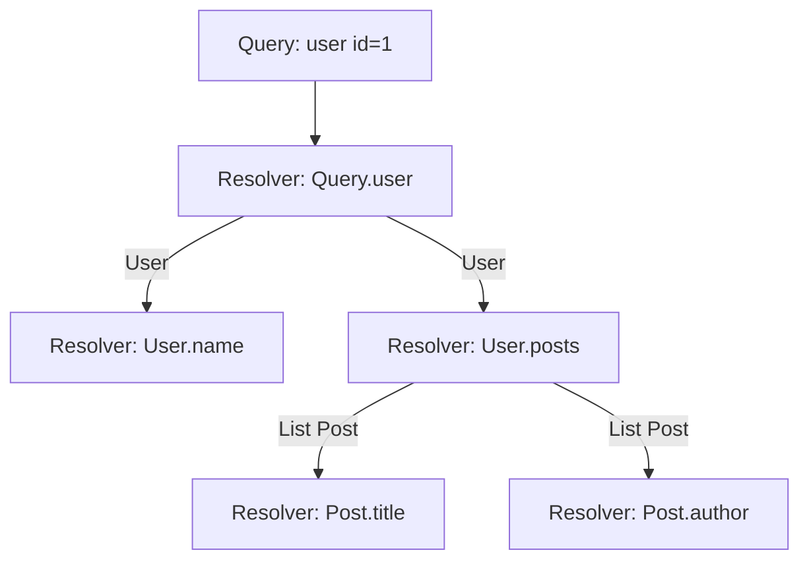
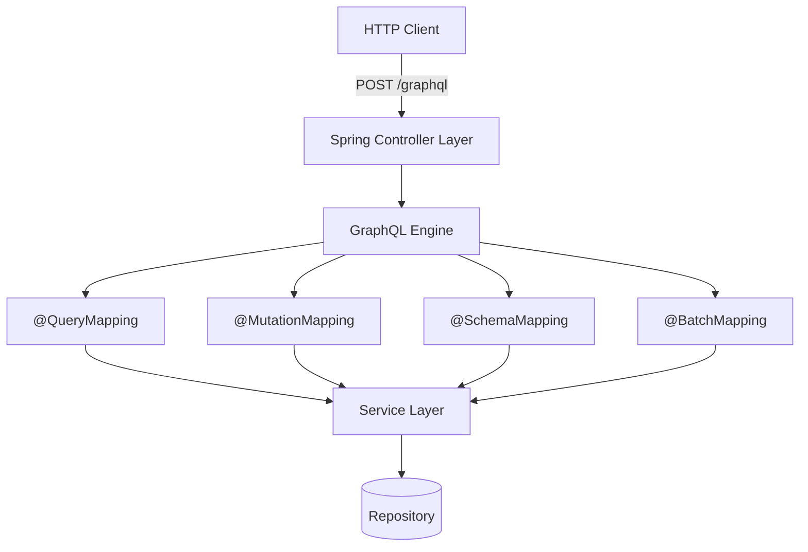
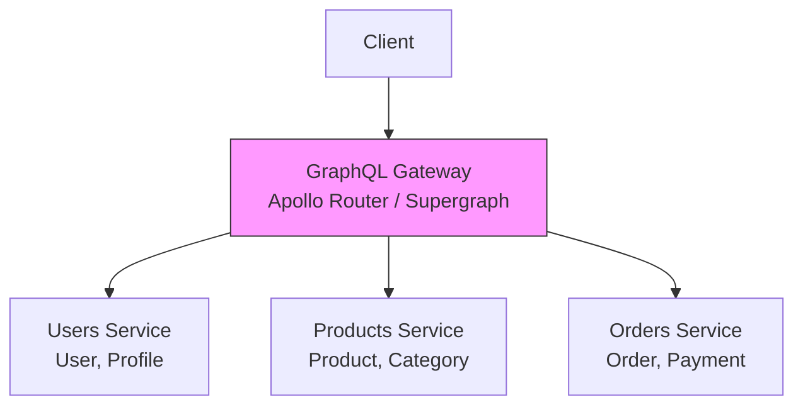
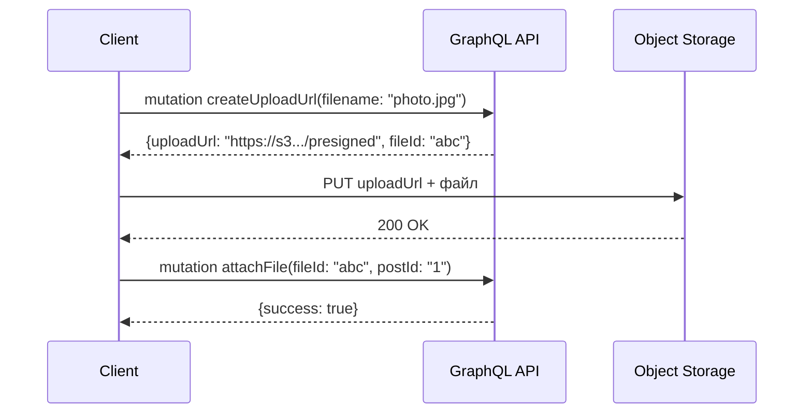

# Вопросы на собеседовании: `GraphQL`

Практичные вопросы и ответы по `GraphQL`: от базовых концепций схемы и типов до продвинутых тем -- `DataLoader`, пагинация, федерация, безопасность и интеграция с `Spring Boot`.

## Полезные ссылки

### Официальная документация

- [GraphQL — Official Docs](https://graphql.org/learn/) — основная документация по спецификации
- [GraphQL Specification](https://spec.graphql.org/draft/) — актуальная спецификация
- [Spring for GraphQL Reference](https://docs.spring.io/spring-graphql/reference/) — Spring-интеграция
- [Getting Started with GraphQL and Spring Boot — Baeldung](https://www.baeldung.com/spring-graphql) — пошаговое руководство
- [Introduction to GraphQL — Baeldung](https://www.baeldung.com/graphql) — обзорная статья
- [GraphQL vs REST — Baeldung](https://www.baeldung.com/graphql-vs-rest) — сравнение подходов
- [Error Handling in GraphQL — Baeldung](https://www.baeldung.com/spring-graphql-error-handling) — обработка ошибок
- [Pagination in Spring Boot GraphQL — Baeldung](https://www.baeldung.com/spring-boot-graphql-pagination) — пагинация

## Содержание

- [Полезные ссылки](#полезные-ссылки)
- [See also](#see-also)

**Основы GraphQL**
- [Q1. Что такое GraphQL и чем он отличается от REST?](#q1)
- [Q2. Что такое Schema Definition Language (SDL)?](#q2)
- [Q3. Какие типы данных существуют в GraphQL?](#q3)
- [Q4. Что такое Input-типы и зачем они нужны?](#q4)

**Запросы, мутации и подписки**
- [Q5. Как устроены Query, Mutation и Subscription?](#q5)
- [Q6. Что такое переменные и директивы в GraphQL?](#q6)
- [Q7. Что такое фрагменты и зачем они нужны?](#q7)
- [Q8. Как работают Inline Fragments и Union-типы?](#q8)

**Резолверы и выполнение запросов**
- [Q9. Что такое резолверы и как они работают?](#q9)
- [Q10. Как GraphQL выполняет запрос (execution model)?](#q10)
- [Q11. Что такое проблема N+1 в GraphQL и как её решить?](#q11)
- [Q12. Как работает DataLoader?](#q12)

**Пагинация**
- [Q13. Какие подходы к пагинации существуют в GraphQL?](#q13)
- [Q14. Что такое Relay-спецификация для пагинации (Connections)?](#q14)

**Обработка ошибок и интроспекция**
- [Q15. Как устроена обработка ошибок в GraphQL?](#q15)
- [Q16. Что такое интроспекция и зачем она нужна?](#q16)

**GraphQL vs REST**
- [Q17. Когда выбирать GraphQL, а когда REST?](#q17)
- [Q18. Какие основные проблемы REST решает GraphQL?](#q18)

**Spring for GraphQL**
- [Q19. Как работает Spring for GraphQL?](#q19)
- [Q20. Как определить контроллер в Spring for GraphQL?](#q20)
- [Q21. Как подключить DataLoader в Spring for GraphQL?](#q21)

**Безопасность**
- [Q22. Какие угрозы безопасности специфичны для GraphQL?](#q22)
- [Q23. Как ограничить глубину и сложность запросов?](#q23)

**Кэширование и производительность**
- [Q24. Почему кэширование в GraphQL сложнее, чем в REST?](#q24)
- [Q25. Что такое Persisted Queries?](#q25)

**Масштабирование и архитектура**
- [Q26. Что такое GraphQL Federation?](#q26)
- [Q27. Чем Federation отличается от Schema Stitching?](#q27)
- [Q28. Schema-first vs Code-first: в чём разница?](#q28)

**Продвинутые темы**
- [Q29. Как реализовать загрузку файлов в GraphQL?](#q29)
- [Q30. Как организовать батчинг запросов?](#q30)

**Продвинутые темы**
- [Q31. Как работают GraphQL Subscriptions и как их реализовать в Spring?](#q31)
- [Q32. Что такое @defer и @stream директивы в GraphQL?](#q32)
- [Q33. Как решить проблему N+1 с помощью DataLoader в Spring for GraphQL?](#q33)

**Дополнительные темы**
- [Q34. Что такое Persisted Queries и зачем они нужны?](#q34)
- [Q35. Как масштабировать GraphQL Subscriptions через WebSocket?](#q35)
- [Q36. Чем Schema Stitching отличается от Federation и почему Federation предпочтительнее?](#q36)
- [Q37. Как реализовать rate limiting в GraphQL через ограничение сложности запроса?](#q37)
- [Q38. Как устроена обработка ошибок в GraphQL: partial responses и поле errors?](#q38)
- [Q39. Как работает Apollo Federation 2 и что такое subgraph schemas?](#q39)
- [Q40. GraphQL vs REST vs gRPC: когда что выбирать?](#q40)

---

<a id="q1"></a>

## Q1. Что такое GraphQL и чем он отличается от REST?

GraphQL — язык запросов к API и среда их выполнения. Клиент выбирает поля из типизированной схемы, а сервер определяет, какие поля доступны и как получать данные. Часто все операции одного GraphQL API обслуживает один HTTP endpoint, но язык не запрещает несколько API и схем.

GraphQL удобен, когда клиентам нужны разные представления связанных данных. REST часто даёт отдельные ресурсные адреса и использует обычную семантику HTTP. Выбор зависит от модели данных, нагрузки, кэширования и инструментов команды.

---

<a id="q2"></a>

## Q2. Что такое Schema Definition Language (SDL)?

**`SDL`** (Schema Definition Language) -- декларативный язык, которым описывают схему `GraphQL`: какие есть типы, поля, операции и связи между ними. Сама схема -- это контракт между клиентом и сервером: клиент знает, что можно запросить и какой формы будет ответ, а сервер обязан этому соответствовать.

SDL не зависит от языка реализации (Java, Node, Go) -- это нейтральное текстовое описание, поэтому одну и ту же схему понимают и бэкенд, и фронтенд, и инструменты (codegen, GraphiQL).

```graphql
type Author {
    id: ID!
    name: String!
    books: [Book!]!
}

type Book {
    id: ID!
    title: String!
    publishedYear: Int
    author: Author!
}

type Query {
    book(id: ID!): Book
    books(limit: Int = 10): [Book!]!
    author(id: ID!): Author
}

type Mutation {
    createBook(input: CreateBookInput!): Book!
    deleteBook(id: ID!): Boolean!
}

input CreateBookInput {
    title: String!
    publishedYear: Int
    authorId: ID!
}
```

**Основные элементы SDL:**
- **Скалярные типы:** `Int`, `Float`, `String`, `Boolean`, `ID` (+ пользовательские: `DateTime`, `BigDecimal`)
- **`!`** -- non-null модификатор (поле обязательно)
- **`[Type]`** -- список, `[Type!]!` -- обязательный список обязательных элементов
- **`input`** -- специальный тип для входных данных мутаций
- **`enum`** -- перечисления
- **`interface`** и **`union`** -- полиморфизм

---

<a id="q3"></a>

## Q3. Какие типы данных существуют в GraphQL?

В GraphQL **шесть видов именованных типов**: Scalar, Object, Interface, Union, Enum и Input Object. `List` и `Non-Null` — обёртки вокруг них. Интроспекция показывает восемь `__TypeKind`, считая эти две обёртки.

```graphql
scalar DateTime
type User { id: ID!, name: String!, roles: [Role!]! }
interface Node { id: ID! }
union SearchResult = User | Article
enum Role { ADMIN USER }
input UserFilter { role: Role }
```

Object описывает выдаваемые поля. Interface и Union дают разные формы полиморфизма. Input Object используют для структурированных аргументов. Порядок обёрток важен: `[User!]` допускает `null` вместо списка, а `[User]!` допускает `null` среди его элементов.

---

<a id="q4"></a>

## Q4. Что такое Input-типы и зачем они нужны?

Input Object задаёт структурированные значения аргументов и полей ввода. Обычный Object нельзя использовать типом аргумента: он может содержать поля с аргументами и ссылки на выходные типы, для которых нет входного значения.

```graphql
input CreateUserInput { name: String!, role: Role }
type Mutation { createUser(input: CreateUserInput!): User! }
```

Поля Input Object содержат допустимые входные типы и сами не принимают аргументы. Для создания и обновления удобно задавать разные входные типы, если у операций различаются обязательные поля; универсального требования делать это всегда нет.

---

<a id="q5"></a>

## Q5. Как устроены Query, Mutation и Subscription?

`Query` описывает чтение, `Mutation` — изменения, `Subscription` — поток результатов по событиям. Корневые поля mutation выполняются **последовательно в порядке запроса**. Для полей query такой порядок не требуется.

```graphql
mutation {
  first: updateUser(id: "1", name: "Анна") { id }
  second: updateUser(id: "2", name: "Ирина") { id }
}
```

Последовательность касается корневых полей mutation. Она не даёт автоматической транзакции и не распространяет гарантию порядка на все вложенные резолверы. Побочные эффекты в полях query нарушают ожидаемую семантику чтения.

---

<a id="q6"></a>

## Q6. Что такое переменные и директивы в GraphQL?

### Переменные

Переменные параметризуют запрос, отделяя его структуру от конкретных значений. Текст запроса остаётся неизменным (его можно закэшировать, переиспользовать, занести в персистированные запросы), а данные приходят отдельно. Это безопаснее ручной конкатенации строк -- нет места для injection.

```graphql
query GetUser($userId: ID!, $withPosts: Boolean!) {
    user(id: $userId) {
        name
        email
        posts @include(if: $withPosts) {
            title
        }
    }
}
```

Переменные передаются отдельно как JSON:
```json
{
    "userId": "42",
    "withPosts": true
}
```

### Директивы

Директива -- это аннотация (помечается `@`), которая меняет поведение выполнения или валидации, не меняя сами данные. Одни директивы работают в тексте запроса (управляют тем, включать поле или нет), другие -- в схеме (помечают поля, навешивают авторизацию).

**Встроенные директивы** (применяются в запросе или схеме):
- **`@include(if: Boolean)`** -- включить поле, если условие `true`
- **`@skip(if: Boolean)`** -- пропустить поле, если условие `true`
- **`@deprecated(reason: String)`** -- пометить поле как устаревшее (на стороне схемы)

```graphql
type User {
    id: ID!
    name: String!
    username: String @deprecated(reason: "Используйте поле name")
}
```

**Пользовательские директивы** (на уровне схемы):
```graphql
directive @auth(role: Role!) on FIELD_DEFINITION

type Query {
    users: [User!]! @auth(role: ADMIN)
    publicPosts: [Post!]!
}
```

---

<a id="q7"></a>

## Q7. Что такое фрагменты и зачем они нужны?

**Фрагмент** -- именованный, переиспользуемый набор полей конкретного типа. Объявляешь его один раз и подставляешь в разные запросы через `...ИмяФрагмента`, вместо того чтобы вручную повторять один и тот же список полей. Это устраняет дублирование и держит «форму» данных в одном месте.

```graphql
fragment UserBasicInfo on User {
    id
    name
    email
    avatarUrl
}

query {
    currentUser {
        ...UserBasicInfo
        role
    }
    teamMembers {
        ...UserBasicInfo
        joinedAt
    }
}
```

**Когда использовать фрагменты:**
- Одинаковые наборы полей в нескольких запросах
- Компонентный подход на фронтенде: каждый UI-компонент объявляет свой фрагмент с нужными данными
- Сокращение размера запросов

**Важно:** фрагмент всегда привязан к конкретному типу (`on User`), что даёт проверку типов на этапе валидации запроса.

---

<a id="q8"></a>

## Q8. Как работают Inline Fragments и Union-типы?

**Коротко:** union-тип -- это «или то, или другое»: поле возвращает один тип из заранее перечисленного набора (например, результат поиска -- `User`, `Post` или `Comment`). А inline fragment (`... on Type`) -- синтаксис, которым в запросе указывают, какие поля брать для каждого конкретного типа.

**Union-типы** позволяют полю возвращать один из нескольких типов:

```graphql
union SearchResult = User | Post | Comment

type Query {
    search(term: String!): [SearchResult!]!
}
```

Для полей конкретного типа в union/interface используют inline fragment или именованный фрагмент с type condition:

```graphql
query {
    search(term: "java") {
        ... on User {
            name
            email
        }
        ... on Post {
            title
            content
        }
        ... on Comment {
            text
            author {
                name
            }
        }
        __typename   # мета-поле: возвращает имя типа
    }
}
```

**`__typename`** -- мета-поле, доступное для любого Object-типа, которое возвращает имя конкретного типа. Клиентские библиотеки (Apollo, Relay) используют его для нормализации кэша.

---

<a id="q9"></a>

## Q9. Что такое резолверы и как они работают?

**Резолвер** -- функция, которая знает, как получить значение для одного конкретного поля схемы. Схема описывает *что* можно запросить, а резолверы реализуют *как* эти данные добываются (из БД, другого сервиса, кэша). У каждого поля есть свой резолвер; движок вызывает их по дереву запроса сверху вниз, и результат родительского резолвера становится входом (`parent`) для дочерних.



**Аргументы резолвера** (четыре стандартных):

1. **`parent`** (root) -- результат родительского резолвера
2. **`args`** -- аргументы, переданные полю
3. **`context`** -- общий контекст запроса (аутентификация, DataLoader, соединения с БД)
4. **`info`** -- метаданные о запросе (дерево полей, фрагменты)

**Пример на Java (Spring for GraphQL):**

```java
@Controller
public class BookController {

    @QueryMapping
    public Book book(@Argument Long id) {
        return bookRepository.findById(id).orElse(null);
    }

    @SchemaMapping(typeName = "Book", field = "author")
    public Author author(Book book) {
        return authorRepository.findById(book.getAuthorId());
    }
}
```

**Тривиальные резолверы (default):** если для поля не написан явный резолвер, движок применяет тривиальный -- он просто берёт одноимённое свойство из parent-объекта (как геттер в Java). Поэтому в Spring явно описывают только нетривиальные поля (`Book.author` -- нужен отдельный запрос), а скаляры вроде `Book.title` мапятся автоматически из полей объекта.

---

<a id="q10"></a>

## Q10. Как GraphQL выполняет запрос (execution model)?

Сервер разбирает документ, проверяет операцию по схеме, выполняет выбранные поля через резолверы и собирает результат. Резолвер дочернего поля получает родительское значение и контекст выполнения.

Форма `data` следует выбранным полям и alias. Ошибка отдельного поля может дать частичный ответ с `errors`; правило Non-Null способно распространить `null` выше по дереву. Это описание общей модели, а не требование к числу внутренних стадий реализации.

---

<a id="q11"></a>

## Q11. Что такое проблема N+1 в GraphQL и как её решить?

**Проблема N+1** -- классическая просадка производительности: чтобы отдать список из N элементов со связанными данными, выполняется 1 запрос на сам список плюс ещё по одному запросу на каждый элемент (итого N+1).

В `GraphQL` она проявляется особенно легко из-за модели резолверов: резолвер поля `author` вызывается отдельно для каждой книги из списка, и каждый вызов наивно бьёт в БД. Движок не знает, что эти вызовы можно объединить -- их нужно собрать самому.

**Пример:**
```graphql
query {
    books {          # 1 запрос: SELECT * FROM books
        title
        author {     # N запросов: SELECT * FROM authors WHERE id = ?
            name     #   для каждой книги отдельный запрос
        }
    }
}
```

Если в базе 100 книг, будет выполнено 1 + 100 = 101 SQL-запрос.

**Решения:**

| Подход | Описание | Когда использовать |
|--------|----------|--------------------|
| `DataLoader` | Батчинг + кэширование запросов | Стандартный подход |
| `JOIN FETCH` | Загрузка в одном SQL-запросе | Простые случаи, один уровень |
| `@BatchMapping` | Spring for GraphQL батч-маппинг | Spring-проекты |
| Look-ahead | Анализ запроса до выполнения | Продвинутая оптимизация |

**В простом случае DataLoader сокращает N+1 до 1+1:**
```
Без DataLoader:
SELECT * FROM books                    -- 1 запрос
SELECT * FROM authors WHERE id = 1     -- N запросов
SELECT * FROM authors WHERE id = 2
SELECT * FROM authors WHERE id = 3
...

С DataLoader:
SELECT * FROM books                    -- 1 запрос
SELECT * FROM authors WHERE id IN (1, 2, 3, ...)  -- 1 запрос
```

---

<a id="q12"></a>

## Q12. Как работает DataLoader?

`DataLoader` собирает вызовы `load(key)` и передаёт накопленные ключи batch-функции. За счёт этого связанные объекты можно получить одним запросом по набору ID вместо одного запроса на каждый родительский объект.

Кэш повторных ключей должен жить в рамках одного GraphQL-запроса, иначе данные и права разных пользователей могут смешаться. Один batch не гарантирован: количество вызовов зависит от этапов выполнения, ограничений batch-функции и источника данных.

В Spring for GraphQL простой случай оформляют через `@BatchMapping` (см. Q21). Для большего контроля регистрируют загрузчик в предоставленном Spring `BatchLoaderRegistry`; создавать собственный bean этого реестра ради одной загрузки не требуется.

---

<a id="q13"></a>

## Q13. Какие подходы к пагинации существуют в GraphQL?

Сама спецификация `GraphQL` пагинацию не навязывает -- это просто соглашение о форме аргументов и ответа. На практике используют два подхода: **offset-based** (страница + размер, как `LIMIT/OFFSET` в SQL) и **cursor-based** (курсор «после какого элемента продолжить»). Выбор -- это компромисс между удобством перехода на произвольную страницу и стабильностью при изменении данных.

### 1. Offset-based (страничная)

```graphql
type Query {
    books(page: Int = 0, size: Int = 10): BookPage!
}

type BookPage {
    content: [Book!]!
    totalElements: Int!
    totalPages: Int!
    hasNext: Boolean!
}
```

**Плюсы:** простота, возможность перехода на произвольную страницу.
**Минусы:** граница может сдвигаться при вставке или удалении; большой OFFSET в SQL может быть дорогим.

### 2. Cursor-based (курсорная, Relay-стиль)

```graphql
type Query {
    books(first: Int, after: String, last: Int, before: String): BookConnection!
}

type BookConnection {
    edges: [BookEdge!]!
    pageInfo: PageInfo!
}

type BookEdge {
    node: Book!
    cursor: String!   # opaque cursor (обычно base64 от ID)
}

type PageInfo {
    hasNextPage: Boolean!
    hasPreviousPage: Boolean!
    startCursor: String
    endCursor: String
}
```

**Плюсы:** стабильна при мутациях данных, эффективна для бесконечной прокрутки, хорошо масштабируется.
**Минусы:** нельзя "прыгнуть" на произвольную страницу, сложнее в реализации.

**Рекомендация:** для публичных API и мобильных приложений предпочтительна cursor-based пагинация. Для админ-панелей с таблицами -- offset-based может быть удобнее.

---

<a id="q14"></a>

## Q14. Что такое Relay-спецификация для пагинации (Connections)?

Relay Cursor Connections — соглашение о форме курсорной пагинации. Connection содержит `edges` и обязательное `pageInfo`; каждое ребро содержит `node` и `cursor`.

```graphql
query { users(first: 10, after: "cursor") {
  edges { cursor node { id name } }
  pageInfo { hasNextPage endCursor }
} }
```

Аргументы `first`/`after` и `last`/`before` поддерживают движение в обе стороны. Глобальный `Node` с уникальным ID описан отдельным соглашением Relay; он не является обязательным полем Connection.

---

<a id="q15"></a>

## Q15. Как устроена обработка ошибок в GraphQL?

Ошибки GraphQL находятся в массиве `errors`; результат выполнения может одновременно содержать частичные `data`. Путь ошибки помогает найти поле, а `extensions` может нести прикладной код.

HTTP-статус зависит от того, дошёл ли запрос до выполнения, от вида ошибки и от используемого GraphQL over HTTP медиатипа. Ошибку валидации нельзя автоматически приравнивать к ошибке резолвера. Транспортная ошибка тоже не обязана выглядеть как успешный ответ GraphQL.

---

<a id="q16"></a>

## Q16. Что такое интроспекция и зачем она нужна?

Интроспекция позволяет запросить сведения о схеме через `__schema` и `__type`. Её используют IDE, генераторы клиентов и документация.

```graphql
{ __type(name: "User") { name fields { name } } }
```

В production доступ к интроспекции решают по модели угроз и потребностям клиентов. Отключение само по себе не защищает поля данных: нужны авторизация, ограничения стоимости запросов и контроль раскрываемых ошибок. Для публичного API интроспекция может быть полезной частью контракта.

---

<a id="q17"></a>

## Q17. Когда выбирать GraphQL, а когда REST?

**Эмпирическое правило:** `GraphQL` выигрывает там, где данные связаны в граф и клиентов много с разными потребностями; `REST` -- там, где операции простые, важно HTTP-кэширование и/или передаются файлы. Это не «лучше/хуже», а выбор под профиль нагрузки и команды.

**Выбирайте `GraphQL`, когда:**
- Разнородные клиенты (мобильное приложение, SPA, IoT) с разными потребностями в данных
- Сложные связанные данные (графовая модель)
- Частые изменения требований к API на стороне фронтенда
- Нужна строгая типизация и самодокументирующийся API
- Проблемы over-fetching/under-fetching критичны (ограниченный трафик на мобильных)

**Выбирайте `REST`, когда:**
- Простой CRUD без сложных связей
- Критично HTTP-кэширование (CDN, прокси)
- Загрузка/скачивание файлов как основной сценарий
- Команда не имеет опыта с `GraphQL`
- Микросервисная коммуникация (здесь лучше подходит [gRPC](grpc-interview.md))
- Публичный API с широкой аудиторией (REST более распространён)

**Гибридный подход** на практике распространён: `REST` для простых CRUD-операций и загрузки файлов, `GraphQL` для сложных запросов к данным, [gRPC](grpc-interview.md) для inter-service коммуникации.

---

<a id="q18"></a>

## Q18. Какие основные проблемы REST решает GraphQL?

GraphQL позволяет клиенту выбирать только нужные поля и за один запрос получать связанные данные. Это уменьшает избыточную выдачу и число сетевых запросов в подходящих сценариях, но не гарантирует меньшую нагрузку на сервер: вложенные резолверы могут породить N+1.

Схему обычно развивают совместимыми добавлениями и пометками `@deprecated`. Несовместимые изменения всё ещё требуют миграции клиентов или отдельной версии. Дополнительные задачи — оценка стоимости запросов, наблюдаемость и кэширование.

---

<a id="q19"></a>

## Q19. Как работает Spring for GraphQL?

**`Spring for GraphQL`** -- официальный проект Spring, интегрирующий `GraphQL` в Spring-приложения; пришёл на замену сторонним библиотекам (GraphQL Java Tools, GraphQL SPQR). Под капотом он использует движок `graphql-java`, а сверху даёт привычную Spring-модель: schema-first схему в `resources/graphql/` и резолверы как методы `@Controller`, размеченные аннотациями вроде `@QueryMapping`.

**Подключение:**
```groovy
// build.gradle
dependencies {
    implementation 'org.springframework.boot:spring-boot-starter-graphql'
    implementation 'org.springframework.boot:spring-boot-starter-web'
    // Для WebSocket subscriptions:
    // implementation 'org.springframework.boot:spring-boot-starter-websocket'
}
```

**Структура проекта:**
```
src/main/resources/
  graphql/
    schema.graphqls      # основная схема
    book.graphqls        # дополнительные файлы схемы (автоматически объединяются)
```

**Конфигурация:**
```yaml
spring:
  graphql:
    graphiql:
      enabled: true         # GraphiQL UI по /graphiql
    schema:
      locations: classpath:graphql/
      printer:
        enabled: true       # endpoint для получения SDL
    websocket:
      path: /graphql        # путь для WebSocket subscriptions
```



**Ключевые аннотации:**
- `@QueryMapping` -- резолвер для Query-полей
- `@MutationMapping` -- резолвер для Mutation-полей
- `@SubscriptionMapping` -- резолвер для Subscription-полей
- `@SchemaMapping` -- резолвер для поля произвольного типа
- `@BatchMapping` -- батч-резолвер (решает N+1)
- `@Argument` -- привязка аргументов GraphQL к параметрам метода

---

<a id="q20"></a>

## Q20. Как определить контроллер в Spring for GraphQL?

Контроллер в `Spring for GraphQL` -- обычный `@Controller`, в котором методы помечены аннотациями, привязывающими их к полям схемы. Spring сам сопоставляет имя метода или указанный `field` с полем схемы и подставляет аргументы через `@Argument`.

**Аннотированный контроллер (основной подход):**

```java
@Controller
public class BookController {

    private final BookService bookService;

    // Query: books(page: Int, size: Int): BookPage!
    @QueryMapping
    public List<Book> books(@Argument int page, @Argument int size) {
        return bookService.findAll(PageRequest.of(page, size));
    }

    // Query: book(id: ID!): Book
    @QueryMapping
    public Book book(@Argument Long id) {
        return bookService.findById(id);
    }

    // Mutation: createBook(input: CreateBookInput!): Book!
    @MutationMapping
    public Book createBook(@Argument CreateBookInput input) {
        return bookService.create(input);
    }

    // Поле Book.author (вместо отдельного резолвера)
    @SchemaMapping(typeName = "Book")
    public Author author(Book book) {
        return authorService.findById(book.getAuthorId());
    }

    // Batch-вариант для решения N+1
    @BatchMapping(typeName = "Book")
    public Map<Book, Author> author(List<Book> books) {
        List<Long> authorIds = books.stream()
            .map(Book::getAuthorId)
            .distinct()
            .toList();
        Map<Long, Author> authors = authorService.findAllById(authorIds)
            .stream()
            .collect(Collectors.toMap(Author::getId, a -> a));
        return books.stream()
            .collect(Collectors.toMap(b -> b, b -> authors.get(b.getAuthorId())));
    }
}
```

**Subscription (с WebSocket):**

```java
@Controller
public class MessageController {

    @SubscriptionMapping
    public Flux<Message> messageAdded(@Argument Long chatId) {
        return messageService.subscribe(chatId);
    }
}
```

**Контекст безопасности** -- Spring Security интегрируется прозрачно:

```java
@QueryMapping
public User currentUser(@AuthenticationPrincipal UserDetails user) {
    return userService.findByUsername(user.getUsername());
}
```

---

<a id="q21"></a>

## Q21. Как подключить DataLoader в Spring for GraphQL?

`Spring for GraphQL` даёт два способа подключить `DataLoader` -- от самого простого к более гибкому:

### 1. @BatchMapping (рекомендуемый)

Самый простой способ -- Spring автоматически создаёт `DataLoader`:

```java
@Controller
public class BookController {

    @BatchMapping(typeName = "Book", field = "author")
    public Mono<Map<Book, Author>> author(List<Book> books) {
        Set<Long> ids = books.stream()
            .map(Book::getAuthorId)
            .collect(Collectors.toSet());
        return authorRepository.findAllById(ids)
            .collectMap(Author::getId)
            .map(authorsById -> books.stream()
                .collect(Collectors.toMap(
                    b -> b,
                    b -> authorsById.get(b.getAuthorId())
                )));
    }
}
```

### 2. Ручная регистрация через BatchLoaderRegistry

Для большего контроля:

```java
@Configuration
public class DataLoaderConfig {

    @Bean
    public RuntimeWiringConfigurer runtimeWiringConfigurer(
            BatchLoaderRegistry registry) {
        registry.forTypePair(Long.class, Author.class)
            .registerMappedBatchLoader((authorIds, env) ->
                Flux.fromIterable(authorRepository.findAllById(authorIds))
                    .collectMap(Author::getId));
        return wiringBuilder -> {};
    }
}
```

Использование в контроллере:

```java
@SchemaMapping(typeName = "Book")
public CompletableFuture<Author> author(
        Book book,
        DataLoader<Long, Author> authorDataLoader) {
    return authorDataLoader.load(book.getAuthorId());
}
```

**`@BatchMapping` предпочтительнее**, так как Spring сам управляет жизненным циклом `DataLoader` и не требует ручной конфигурации.

---

<a id="q22"></a>

## Q22. Какие угрозы безопасности специфичны для GraphQL?

Корень специфичных для `GraphQL` угроз -- та самая гибкость: клиент сам конструирует запрос произвольной формы и сложности. Один эндпоинт + один дешёвый по виду запрос может заставить сервер выполнить тысячи операций. Поэтому защита строится не вокруг URL, а вокруг ограничения формы и стоимости самого запроса.

**1. Глубоко вложенные запросы (Depth Attack):**
```graphql
# Злоумышленник может создать запрос, который рекурсивно обходит связи
query {
    user(id: 1) {
        friends {
            friends {
                friends {
                    friends { ... }  # бесконечная вложенность
                }
            }
        }
    }
}
```

**2. Широкие запросы (Breadth Attack):**
```graphql
query {
    a1: users(first: 1000) { name }
    a2: users(first: 1000) { name }
    # ... тысячи алиасов
    a100: users(first: 1000) { name }
}
```

**3. Интроспекция** -- раскрытие всей схемы API злоумышленнику.

**4. Injection** -- если аргументы не валидируются, возможны SQL/NoSQL injection.

**5. Batching attack** -- множество мутаций (например, попыток входа) в одном запросе.

**Меры защиты:**

| Мера | Описание |
|------|----------|
| Depth limiting | Ограничение максимальной глубины запроса |
| Query complexity | Оценка стоимости запроса по весам полей |
| Rate limiting | Ограничение частоты запросов |
| Persisted queries | Белый список разрешённых запросов |
| Timeout | Ограничение времени выполнения |
| Отключение интроспекции | В production |
| Валидация входных данных | Для всех аргументов |
| Аутентификация/авторизация | На уровне резолверов |

---

<a id="q23"></a>

## Q23. Как ограничить глубину и сложность запросов?

Защита от дорогих запросов строится на двух дополняющих лимитах. **Глубина** ограничивает вложенность (чтобы нельзя было бесконечно идти по связям `friends → friends → ...`), а **сложность** оценивает суммарную «стоимость» запроса по весам полей -- это ловит широкие запросы, которые формально неглубокие, но тянут огромные списки. Оба реализуются как `Instrumentation` движка `graphql-java`, выполняясь до запуска резолверов.

### Ограничение глубины (Max Depth)

```java
@Configuration
public class GraphQLConfig {

    @Bean
    public RuntimeWiringConfigurer configurer() {
        return builder -> {};
    }

    @Bean
    public GraphQlSourceBuilderCustomizer sourceBuilderCustomizer() {
        return builder -> builder.configureGraphQl(graphQlBuilder ->
            graphQlBuilder.executionIdProvider(ExecutionIdProvider.DEFAULT)
        );
    }
}
```

С использованием `graphql-java` instrumentation:

```java
@Bean
public Instrumentation maxQueryDepthInstrumentation() {
    return new MaxQueryDepthInstrumentation(10); // макс. глубина = 10
}

@Bean
public Instrumentation maxQueryComplexityInstrumentation() {
    return new MaxQueryComplexityInstrumentation(200); // макс. сложность = 200
}
```

### Анализ сложности (Query Complexity)

Каждому полю назначается "вес". Суммарная сложность запроса не должна превышать лимит:

```graphql
# Пример весов:
# скалярное поле = 1
# объектное поле = 2
# список = 5 * кол-во элементов

query {
    users(first: 100) {  # 5 * 100 = 500
        name             # 1
        posts {          # 2
            title        # 1
        }
    }
}
# Итого: 500 + 100*(1 + 2 + 1) = 900
```

**Директивы `@cost` и `@listSize`** (демандконтроль Apollo Router, а не базовая спецификация языка):
```graphql
type Query {
    users(first: Int): [User!]! @listSize(assumedSize: 50)
}

type User {
    name: String!
    profile: Profile! @cost(weight: 3)  # дорогая операция
}
```

---

<a id="q24"></a>

## Q24. Почему кэширование в GraphQL сложнее, чем в REST?

Многие клиенты отправляют разные операции как `POST /graphql`. Обычный HTTP-кэш по методу и URI не видит различий в теле POST, поэтому кэшировать такие ответы на CDN сложнее, чем ресурсные GET.

GraphQL query можно передавать методом GET, если сервер его поддерживает. Сохранённые документы дают короткий идентификатор для адресуемого запроса. При корректных заголовках и ключах это позволяет использовать HTTP-кэш. Также применяют нормализованный клиентский кэш и серверный кэш данных резолверов.

---

<a id="q25"></a>

## Q25. Что такое Persisted Queries?

Persisted document хранит текст операции под идентификатором, обычно хешем. Клиент отправляет короткий ID, сервер находит сохранённый документ и выполняет его.

**Automatic Persisted Queries (APQ)** могут разрешать клиенту дослать полный текст при неизвестном хеше и зарегистрировать его. Это сокращает трафик, но **не является allowlist**. В строгом режиме trusted documents сервер принимает только заранее одобренные операции; именно он ограничивает произвольные запросы. Для HTTP-кэширования используют GET и корректную политику кэша.

---

<a id="q26"></a>

## Q26. Что такое GraphQL Federation?

**`GraphQL Federation`** -- архитектурный подход, который собирает единый `GraphQL` API из нескольких микросервисов, где каждый владеет своей частью общей схемы. Клиент видит один graph, а под капотом шлюз (Router) раскладывает запрос по нужным сервисам (subgraph) и сшивает их ответы. Это даёт распределённую разработку без монолитного «графа на всех».



**Ключевые концепции:**

**1. Subgraph** -- отдельный `GraphQL`-сервис со своей частью схемы:
```graphql
# Users Subgraph
type User @key(fields: "id") {
    id: ID!
    name: String!
    email: String!
}
```

**2. Entity** -- тип, который может быть расширен другими subgraph'ами. Директива `@key` определяет уникальный идентификатор:
```graphql
# Orders Subgraph — расширяет User
type User @key(fields: "id") {
    id: ID!
    orders: [Order!]!  # добавляет поле orders к User
}
```

**3. Gateway (Router)** -- точка входа, которая объединяет subgraph'ы в единую схему (supergraph), маршрутизирует запросы и собирает ответы.

**Преимущества:**
- Каждая команда владеет своим subgraph (team ownership)
- Независимый деплой сервисов
- Единый API для клиентов
- Инкрементальная миграция с монолита

---

<a id="q27"></a>

## Q27. Чем Federation отличается от Schema Stitching?

Schema Stitching и Federation объединяют несколько схем в один граф. В типичном stitching шлюз содержит больше логики объединения и делегирования. Federation переносит часть деклараций о владении полями и связях в схемы подграфов; router составляет план обращения к ним.

Это различие в распределении ответственности, а не автоматическая гарантия независимого деплоя. Обоим подходам нужны совместимость схем, наблюдаемость и управление изменениями. Federation удобна, когда команды владеют разными частями общего графа; stitching остаётся возможным для интеграции существующих схем.

---

<a id="q28"></a>

## Q28. Schema-first vs Code-first: в чём разница?

Вопрос сводится к тому, что считать источником правды -- SDL-схему или код. **Schema-first**: сначала пишут схему, потом подгоняют под неё резолверы. **Code-first**: пишут аннотированный код, а схема генерируется из него. `Spring for GraphQL` -- schema-first.

### Schema-first (SDL-first)

Сначала пишется SDL-схема, затем реализуются резолверы:

```graphql
# schema.graphqls -- пишется первым
type Query {
    book(id: ID!): Book
}

type Book {
    id: ID!
    title: String!
    author: Author!
}
```

```java
// Контроллер привязывается к схеме
@Controller
public class BookController {
    @QueryMapping
    public Book book(@Argument Long id) { ... }
}
```

**Плюсы:** схема как контракт, удобно для командной работы, фронтенд может начать работу до реализации бэкенда.
**Минусы:** дублирование (схема + Java-классы), ошибки рассинхронизации.

### Code-first

Схема генерируется из аннотированного Java-кода:

```java
// Схема генерируется автоматически из аннотаций
@GraphQLApi
public class BookApi {
    @Query
    public Book book(@Argument Long id) { ... }
}

@Type
public class Book {
    private Long id;
    private String title;
    private Author author;
}
```

**Плюсы:** единственный источник правды -- код, нет рассинхронизации, IDE-поддержка.
**Минусы:** схема менее читаема для не-Java разработчиков, сложнее использовать как контракт.

| Критерий | Schema-first | Code-first |
|----------|-------------|------------|
| Spring for GraphQL | Да (основной подход) | Нет (нужна SPQR или DGS) |
| Netflix DGS | Да | Да |
| GraphQL SPQR | Нет | Да (основной подход) |
| Команда | Кросс-функциональная | Java-only |

**Spring for GraphQL** использует **schema-first** подход, что считается рекомендуемой практикой.

---

<a id="q29"></a>

## Q29. Как реализовать загрузку файлов в GraphQL?

Спецификация `GraphQL` намеренно не описывает загрузку файлов -- это язык для структурированных данных, а не для бинарных потоков. Поэтому используют один из двух обходных путей: протолкнуть файл прямо через GraphQL-запрос (multipart) или вынести бинарную передачу за пределы GraphQL (signed URL). Второй вариант на практике предпочтительнее.

### 1. Multipart Request (graphql-multipart-request-spec)

```graphql
scalar Upload

type Mutation {
    uploadFile(file: Upload!): FileInfo!
}
```

```java
// Spring for GraphQL не поддерживает Upload из коробки
// Используется с DGS или кастомным скаляром
@MutationMapping
public FileInfo uploadFile(@Argument MultipartFile file) {
    String path = storageService.store(file);
    return new FileInfo(path, file.getOriginalFilename(), file.getSize());
}
```

### 2. Signed URL (рекомендуемый подход)

```graphql
type Mutation {
    createUploadUrl(filename: String!, contentType: String!): UploadUrl!
}

type UploadUrl {
    uploadUrl: String!     # pre-signed URL для PUT
    fileId: String!
}
```



**Рекомендация:** используйте signed URL для файлов. `GraphQL` оптимизирован для структурированных данных, а не для бинарных потоков. Подробнее о работе с REST-эндпоинтами для загрузки файлов -- в [вопросах по HTTP & REST](http-rest-interview.md).

---

<a id="q30"></a>

## Q30. Как организовать батчинг запросов?

Здесь речь о **батчинге на уровне транспорта** -- клиент кладёт несколько независимых `GraphQL`-операций в один HTTP-запрос (массив операций), а сервер возвращает массив ответов в том же порядке. Это не то же, что `DataLoader`: тот батчит запросы к данным *внутри* выполнения одной операции, а здесь объединяются сами операции, чтобы сэкономить на HTTP round-trips.

```json
[
    {
        "query": "query { user(id: 1) { name } }",
        "operationName": "GetUser"
    },
    {
        "query": "query { books { title } }",
        "operationName": "GetBooks"
    }
]
```

Сервер возвращает массив ответов в том же порядке:
```json
[
    { "data": { "user": { "name": "Alice" } } },
    { "data": { "books": [{ "title": "GraphQL in Action" }] } }
]
```

**Преимущества:**
- Уменьшение количества HTTP round-trips
- Снижение overhead на установку соединений
- Особенно полезно для мобильных клиентов с высоким latency

**Риски и ограничения:**
- **Безопасность:** злоумышленник может отправить сотни операций в одном запросе (batching attack)
- **Тайм-аут:** одна медленная операция задерживает весь batch -- ответ уходит, только когда готовы все операции
- **Сложность мониторинга:** сложнее отслеживать производительность отдельных операций

**Защита:**
```java
// Ограничение количества операций в batch
@Bean
public WebGraphQlInterceptor batchLimitInterceptor() {
    return (request, chain) -> {
        // Проверка размера batch (для кастомного batch endpoint)
        return chain.next(request);
    };
}
```

**Отдельный способ улучшить время появления первых данных:** `@defer` и `@stream` директивы (экспериментальные), которые позволяют серверу отправлять части ответа по мере готовности, не дожидаясь завершения всех резолверов. Подробнее об оптимизации API-запросов -- в [вопросах по микросервисам](../architecture/microservices-interview.md).

---

<a id="q31"></a>

## Q31. Как работают GraphQL Subscriptions и как их реализовать в Spring?

**GraphQL Subscriptions** — третий корневой тип, дающий данные в реальном времени. В отличие от `Query` (один запрос — один ответ), подписка — это долгоживущий поток: клиент один раз подписывается, а сервер шлёт новое сообщение при каждом наступлении события. Резолвер подписки возвращает не значение, а поток (в Spring — реактивный `Flux`).

**Транспорт:** для WebSocket библиотека `graphql-ws` использует подпротокол `graphql-transport-ws`. Устаревшая библиотека `subscriptions-transport-ws` использовала другой подпротокол — `graphql-ws`; эти протоколы несовместимы. Spring for GraphQL поддерживает современный вариант, а также передачу подписок через SSE. Подписка описывает поток результатов и не требует именно двустороннего транспорта. [Spring transports](https://docs.spring.io/spring-graphql/reference/transports.html), [GraphQL over WebSocket Protocol](https://github.com/enisdenjo/graphql-ws/blob/master/PROTOCOL.md).

**Схема:**

```graphql
type Subscription {
    orderStatusChanged(orderId: ID!): OrderStatusEvent!
    newOrderPlaced: Order!
}

type OrderStatusEvent {
    orderId: ID!
    oldStatus: OrderStatus!
    newStatus: OrderStatus!
    timestamp: String!
}
```

**Реализация в Spring for GraphQL:**

```java
@Controller
public class OrderSubscriptionController {

    private final Sinks.Many<OrderStatusEvent> orderEventSink =
        Sinks.many().multicast().onBackpressureBuffer();

    // Resolver для подписки
    @SubscriptionMapping
    public Flux<OrderStatusEvent> orderStatusChanged(@Argument String orderId) {
        return orderEventSink.asFlux()
            .filter(event -> event.orderId().equals(orderId))
            .timeout(Duration.ofMinutes(30));  // ошибка после 30 мин без следующего события
    }

    // Публикация события при изменении статуса заказа
    @EventListener
    public void onOrderStatusChanged(OrderStatusChangedEvent event) {
        orderEventSink.tryEmitNext(new OrderStatusEvent(
            event.orderId(), event.oldStatus(), event.newStatus(),
            Instant.now().toString()
        ));
    }
}
```

**Конфигурация WebSocket в Spring:**

```yaml
spring:
  graphql:
    websocket:
      path: /graphql-ws
      connection-init-timeout: 60s
```

`timeout(Duration)` ограничивает ожидание первого и каждого следующего события, а не общий срок подписки. При регулярных событиях поток может работать дольше 30 минут. В примере результат `tryEmitNext` опущен; в рабочем приложении нужно обработать отказ публикации. [Reactor Flux.timeout](https://projectreactor.io/docs/core/release/api/reactor/core/publisher/Flux.html#timeout-java.time.Duration-).

**Клиентский запрос (библиотека `graphql-ws`, подпротокол `graphql-transport-ws`):**

```javascript
import { createClient } from 'graphql-ws';

const client = createClient({ url: 'ws://localhost:8080/graphql-ws' });

client.subscribe(
  {
    query: `subscription OnOrderStatus($orderId: ID!) {
      orderStatusChanged(orderId: $orderId) {
        oldStatus newStatus timestamp
      }
    }`,
    variables: { orderId: '123' }
  },
  {
    next: (data) => console.log('Status update:', data),
    error: (err) => console.error('Subscription error:', err),
    complete: () => console.log('Subscription complete')
  }
);
```

**Subscription vs SSE vs WebSocket:**

| Критерий | GraphQL Subscription | SSE | WebSocket |
|----------|---------------------|-----|-----------|
| Направление | Поток результатов от сервера; зависит от транспорта | Сервер → клиент | Двунаправленное |
| Типизация | Схема GraphQL | Сам транспорт не задаёт схему | Сам транспорт не задаёт схему |
| Сложность | Средняя | Низкая | Средняя |
| Применение | Real-time UI обновления | Уведомления, feeds | Чат, игры |

---

<a id="q32"></a>

## Q32. Что такое @defer и @stream директивы в GraphQL?

**`@defer`** и **`@stream`** — экспериментальные директивы для **инкрементальной доставки**: сервер отдаёт уже готовые части ответа, не дожидаясь завершения медленных резолверов. Идея — улучшить воспринимаемую скорость: быстрые поля приходят сразу, медленные «дотекают» позже отдельными чанками (`@defer` откладывает фрагмент, `@stream` — поэлементно отдаёт длинный список).

**`@defer` — отложить фрагмент:**

```graphql
query GetOrder {
  order(id: "123") {
    id
    status           # ← возвращается сразу

    ... @defer {
      customer {     # ← возвращается позже (медленный сервис)
        name
        email
      }
    }

    ... @defer(label: "analytics") {
      analytics {   # ← возвращается ещё позже
        viewCount
        lastViewed
      }
    }
  }
}
```

**Ответ сервера (multipart/mixed):**

```
--graphql
Content-Type: application/json

{"data": {"order": {"id": "123", "status": "SHIPPED"}}, "hasNext": true}

--graphql
Content-Type: application/json

{"incremental": [{"path": ["order"], "data": {"customer": {"name": "Alice"}}}], "hasNext": true}

--graphql
Content-Type: application/json

{"incremental": [{"path": ["order"], "label": "analytics", "data": {"analytics": {...}}}], "hasNext": false}
--graphql--
```

**`@stream` — потоковые списки:**

```graphql
query GetOrders {
  orders @stream {  # каждый элемент отправляется по мере готовности
    id
    status
  }
}
```

**Статус поддержки:**
- Директивы в статусе **RFC** в GraphQL spec (не финализированы)
- Spring for GraphQL 1.2+ имеет экспериментальную поддержку
- Требует HTTP/2 или chunked transfer encoding

**Когда полезно:**
- Страница со множеством независимых виджетов (dashboard)
- Длинные списки данных
- Когда часть данных доступна быстро, часть — медленно

---

<a id="q33"></a>

## Q33. Как решить проблему N+1 с помощью DataLoader в Spring for GraphQL?

N+1 возникает, если после одного запроса за списком резолвер связанного поля делает отдельный запрос для каждого элемента. В Spring for GraphQL простой случай удобно решить через `@BatchMapping`:

```java
@Controller
class OrderController {
    @BatchMapping(typeName = "Order", field = "customer")
    Map<Order, Customer> customer(List<Order> orders) {
        return customerService.findByOrders(orders);
    }
}
```

Метод получает пакет родительских объектов и возвращает соответствующие значения. `DataLoader` группирует ключи и кэширует повторные загрузки в пределах запроса. Вместо `1 + N` обращений может получиться два, если все связи загрузились одним пакетом; число зависит от батчей и источника данных. При сложной логике можно зарегистрировать DataLoader через `BatchLoaderRegistry`.

---

<a id="q34"></a>

## Q34. Что такое Persisted Queries и зачем они нужны?

В APQ клиент сначала отправляет хеш операции. Если сервер не знает его и поддерживает регистрацию по запросу, клиент досылает полный текст, после чего повторные вызовы используют короткий ID.

Это экономит трафик и при GET может помочь HTTP-кэшу. APQ не запрещает новые операции: полный текст при промахе разрешён. Для allowlist нужны заранее зарегистрированные trusted documents и отказ на неизвестный ID. Spring for GraphQL позволяет подключить `PreparsedDocumentProvider` и реализацию persisted query support через `GraphQlSource.Builder`.

---

<a id="q35"></a>

## Q35. Как масштабировать GraphQL Subscriptions через WebSocket?

**Корень сложности:** обычные запросы stateless — любой запрос идёт на любую ноду. А подписки живут поверх `WebSocket` — это stateful, долгоживущее соединение, привязанное к конкретной ноде. Когда нод несколько, событие, сгенерированное на одной ноде, должно дойти до клиентов, чьи WebSocket-соединения висят на других. Поэтому масштабирование подписок — это в первую очередь задача доставки событий между нодами.

**Проблема горизонтального масштабирования:**

```
Client --WS--> Node1   \
                        > Разные ноды не знают о подписках друг друга
Client --WS--> Node2   /
```

**Решения:**

1. **Sticky sessions** — все WebSocket-соединения клиента попадают на одну ноду (nginx `ip_hash`). Простое решение, но неравномерная нагрузка.

2. **Pub/Sub через Redis** — каждый сервер публикует события в Redis-канал, все серверы подписаны и рассылают нужным клиентам:

```java
// Spring WebSocket + Redis pub/sub
@Service
public class SubscriptionService {
    private final RedisTemplate<String, Object> redisTemplate;

    public Flux<OrderStatus> orderUpdates(String orderId) {
        return Flux.create(sink -> {
            MessageListenerAdapter adapter = new MessageListenerAdapter(
                (MessageListener) (message, pattern) -> {
                    OrderStatus status = deserialize(message.getBody());
                    sink.next(status);
                });
            redisTemplate.execute(connection -> {
                connection.subscribe(adapter, ("order:" + orderId).getBytes());
                return null;
            }, true);
        });
    }
}
```

3. **Dedicated WebSocket Gateway** — специализированный сервис для Subscriptions (например, Hasura, Ably); основной сервис публикует события через Kafka/Redis.

**Рекомендации:**
- Ограничивать количество активных подписок на пользователя
- Реализовать heartbeat (`keep-alive`) для детектирования разорванных соединений
- Мониторить активные WebSocket-соединения и память
- Рассмотреть SSE как более простую альтернативу для односторонних обновлений

---

<a id="q36"></a>

## Q36. Чем Schema Stitching отличается от Federation и почему Federation предпочтительнее?

Schema Stitching обычно централизует правила объединения в шлюзе. В Federation подграфы публикуют сведения о сущностях и полях, а router использует собранную supergraph-схему и планирует выполнение запросов.

В обоих подходах изменения схем нужно согласовывать и проверять. Публикация подграфа не гарантирует автоматической регистрации и независимого деплоя: это зависит от платформы и процесса доставки. Federation может уменьшить ручную логику шлюза, если команды владеют своими подграфами.

---

<a id="q37"></a>

## Q37. Как реализовать rate limiting в GraphQL через ограничение сложности запроса?

Один GraphQL-запрос может быть дешевле или намного дороже другого. Поэтому частотный лимит на endpoint дополняют оценкой стоимости операции до выполнения: учитывают глубину, ширину, веса полей и аргументы размера списков.

Для списка `first: 1000` стоимость обычно выше, чем для `first: 10`. Отдельно ограничивают размер страниц, время выполнения и число запросов на пользователя или ключ. Оценка приблизительна, поэтому её сверяют с реальной нагрузкой.

---

<a id="q38"></a>

## Q38. Как устроена обработка ошибок в GraphQL: partial responses и поле errors?

**Ключевое отличие от REST:** при выполнении запроса `GraphQL` обычно возвращает `HTTP 200` даже при ошибках. Прикладные ошибки описываются внутри тела: данные -- в поле `data`, ошибки -- в массиве `errors`. Самое важное следствие -- ответ может быть **частичным**: часть полей пришла, часть упала.

**Структура ответа с ошибкой:**

```json
{
  "data": {
    "user": {
      "id": "1",
      "name": "Alice",
      "orders": null
    }
  },
  "errors": [
    {
      "message": "Failed to load orders",
      "locations": [{"line": 4, "column": 5}],
      "path": ["user", "orders"],
      "extensions": {
        "code": "SERVICE_UNAVAILABLE",
        "classification": "DataFetchingException"
      }
    }
  ]
}
```

**Partial response:** если один резолвер упал, остальные поля возвращаются успешно. `data.user.orders = null`, но `data.user.name` есть — это частичный ответ. Клиент должен проверять и `data`, и `errors`.

**Типы ошибок в GraphQL:**

| Тип | Когда | Поведение |
|-----|-------|-----------|
| Syntax error | Невалидный запрос | `data: null`, errors |
| Validation error | Запрос не соответствует схеме | `data: null`, errors |
| Resolver error | Ошибка при выполнении | Частичный `data`, errors |
| Network error | Недоступен сервер | HTTP 5xx |

**Обработка в Spring for GraphQL:**

```java
@Component
public class CustomExceptionResolver implements DataFetcherExceptionResolver {

    @Override
    public Mono<List<GraphQLError>> resolveException(Throwable ex,
            DataFetchingEnvironment env) {
        if (ex instanceof NotFoundException e) {
            GraphQLError error = GraphqlErrorBuilder.newError(env)
                .message(e.getMessage())
                .errorType(ErrorType.NOT_FOUND)
                .extensions(Map.of("code", "NOT_FOUND"))
                .build();
            return Mono.just(List.of(error));
        }
        // Для неизвестных исключений — скрыть детали от клиента
        GraphQLError error = GraphqlErrorBuilder.newError(env)
            .message("Internal error")
            .errorType(ErrorType.INTERNAL_ERROR)
            .build();
        return Mono.just(List.of(error));
    }
}
```

**Рекомендации:**
- Никогда не пробрасывать стектрейс в поле `message` в проде -- это утечка внутренностей; наружу отдавать обобщённое сообщение
- Использовать `extensions.code` для машиночитаемых кодов ошибок: клиент должен реагировать на код, а не парсить текст `message`
- Не злоупотреблять частичными ответами -- если поле критично для экрана, надёжнее пробросить ошибку выше, чем оставить клиента с тихим `null`

---

<a id="q39"></a>

## Q39. Как работает Apollo Federation 2 и что такое subgraph schemas?

Apollo Federation 2 собирает supergraph из схем подграфов. Директивы, включая `@key`, `@shareable` и `@external`, помогают выразить сущности, общие поля и зависимости. Композиция проверяет совместимость схем.

Router строит план для конкретной операции: зависимые обращения выполняются последовательно, независимые могут идти параллельно. Нельзя обещать параллельность для любого запроса или считать, что само наличие registry гарантирует успешную совместимую выкатку.

---

<a id="q40"></a>

## Q40. GraphQL vs REST vs gRPC: когда что выбирать?

Коротко: эти три подхода занимают разные ниши. REST-подход удобен для ресурсных HTTP API, `GraphQL` -- для выборок с разными формами данных, `gRPC` -- для типизированных вызовов и потоков между сервисами. Их часто не противопоставляют, а комбинируют: внешний слой на `GraphQL`/`REST`, внутри -- `gRPC`.

**Сравнительная таблица:**

| Критерий | REST | GraphQL | gRPC |
|----------|------|---------|------|
| Клиент | Браузер, мобильный, сторонний | Браузер, мобильный (множество клиентов) | Backend-to-backend |
| Формат | JSON/XML | JSON | Protobuf (бинарный) |
| Контракт | OpenAPI (опционально) | Schema (SDL) | `.proto` (обязательный) |
| Streaming | Ограниченный (SSE) | Subscriptions (WebSocket) | Нативный (4 типа) |
| Кэширование | Простое (HTTP-кэш) | Сложное (APQ, CDN) | Нет нативного |
| Типизация | Нет стандарта | Строгая | Строгая |
| Производительность | Средняя | Средняя | Высокая |
| Браузерная поддержка | Отличная | Отличная | gRPC-Web (через proxy) |
| Learning curve | Низкий | Средний | Средний |

**Когда выбирать REST:**
- Публичный API для сторонних разработчиков
- Простые CRUD-операции
- Необходимо HTTP-кэширование из коробки
- Нет строгих требований к производительности

**Когда выбирать GraphQL:**
- Разнородные клиенты с разными потребностями в данных (мобильный vs веб)
- Сложный граф данных с множеством связей
- BFF (Backend for Frontend) — один API для нескольких клиентов
- Нужна гибкость: клиент сам решает, какие поля запрашивать

**Когда выбирать gRPC:**
- Высоконагруженное межсервисное взаимодействие внутри кластера
- Streaming данных (телеметрия, события)
- Строгий контракт и генерация кода обязательны
- Latency критична (protobuf на 5-10x компактнее JSON)

**Гибридный подход (рекомендуемый):**

```
Mobile/Web Client → GraphQL API → (внутри) gRPC → Microservices
External Partners → REST API  → (внутри) gRPC → Microservices
```

GraphQL или REST — на внешнем слое (developer experience), gRPC — внутри инфраструктуры (производительность).

---

## See also

- [HTTP и REST](http-rest-interview.md) — сравнение REST и GraphQL: когда использовать каждый подход, over-fetching vs under-fetching, версионирование
- [gRPC](grpc-interview.md) — альтернатива GraphQL для высокопроизводительного межсервисного взаимодействия с типизированными контрактами
- [Микросервисная архитектура](../architecture/microservices-interview.md) — GraphQL Federation как способ объединить несколько GraphQL-сервисов за одним endpoint
- [API Gateway](../architecture/api-gateway-interview.md) — GraphQL-слой часто размещается за Gateway: аутентификация, rate limiting, маршрутизация
- [Spring Boot](../frameworks/spring/spring-boot-interview.md) — интеграция Spring for GraphQL: аннотации `@QueryMapping`, `@MutationMapping`, контроллеры и DataLoader
- [API Design Best Practices](api-design-best-practices-interview.md)
- [API Versioning](api-versioning-interview.md)
- [OpenAPI / Swagger](openapi-swagger-interview.md)
- [Richardson Maturity Model (REST)](rest-maturity-interview.md)
- [Шпаргалка: GraphQL для Java](../../development/api/graphql/graphql.md) — теория
