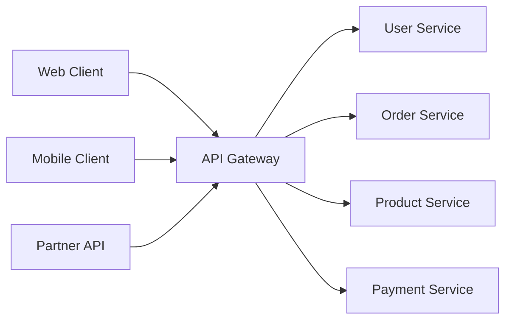
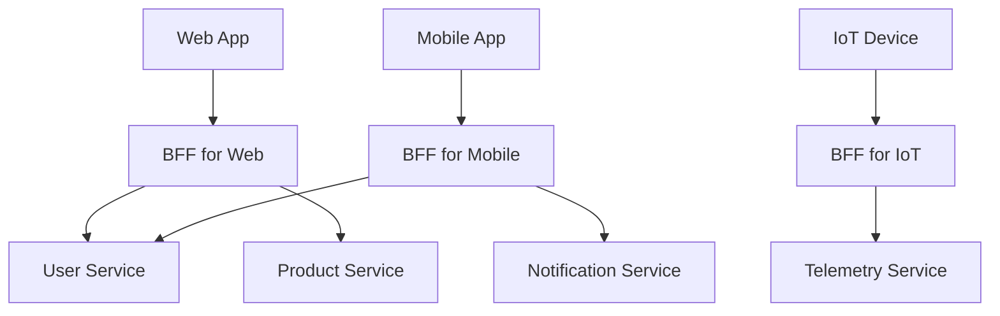
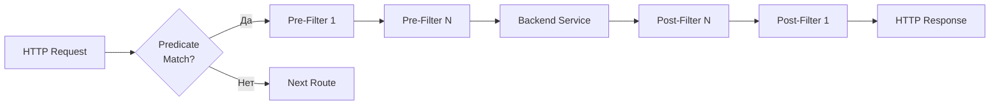
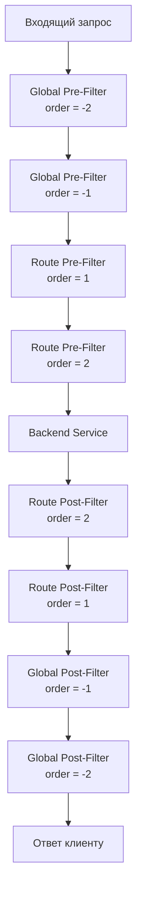
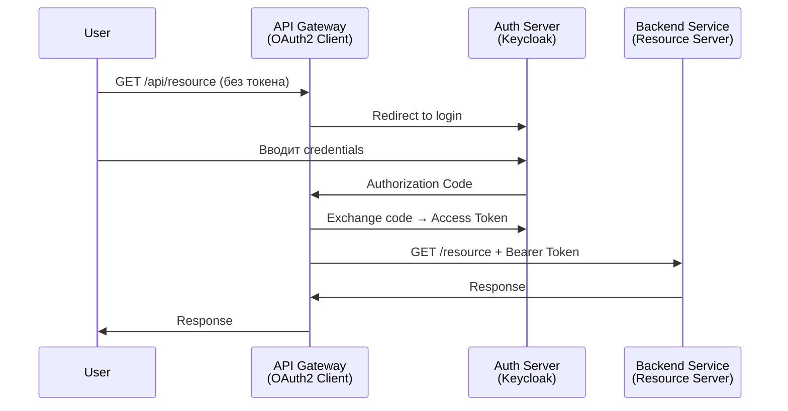
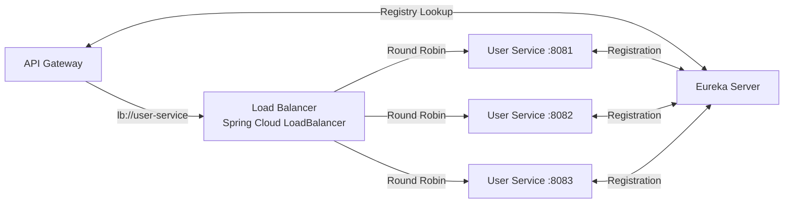
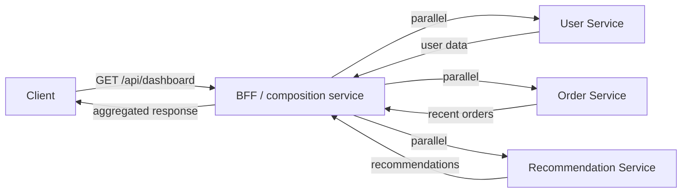
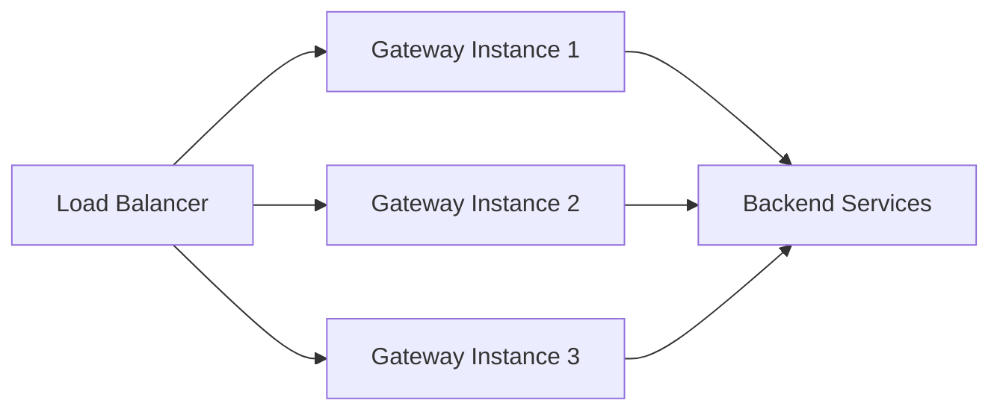

# Вопросы на собеседовании: `API Gateway`

Полное покрытие паттерна `API Gateway`: маршрутизация, аутентификация, `rate limiting`, трансформация запросов, агрегация, `Spring Cloud Gateway`, фильтры, предикаты, `BFF`, безопасность, `CORS`, версионирование API.

**API Gateway** -- один из ключевых паттернов микросервисной архитектуры. На собеседованиях ожидают глубокое понимание его роли, ответственностей, различий с `reverse proxy`, а также практический опыт с `Spring Cloud Gateway` или аналогами (`Kong`, `Nginx`, `AWS API Gateway`). Этот файл охватывает теорию паттерна, архитектуру `Spring Cloud Gateway`, фильтры, предикаты, безопасность и продвинутые сценарии.

## Полезные ссылки

### Официальная документация

- [Spring Cloud Gateway Reference](https://docs.spring.io/spring-cloud-gateway/reference/html/) -- официальная документация
- [Exploring the New Spring Cloud Gateway (Baeldung)](https://www.baeldung.com/spring-cloud-gateway) -- маршрутизация, фильтры, предикаты
- [Spring Cloud Series - The Gateway Pattern (Baeldung)](https://www.baeldung.com/spring-cloud-gateway-pattern) -- паттерн Gateway в Spring Cloud
- [Writing Custom Spring Cloud Gateway Filters (Baeldung)](https://www.baeldung.com/spring-cloud-custom-gateway-filters) -- кастомные фильтры
- [Spring Cloud Gateway WebFilter Factories (Baeldung)](https://www.baeldung.com/spring-cloud-gateway-webfilter-factories) -- встроенные WebFilter фабрики
- [API Gateway vs Reverse Proxy (Baeldung)](https://www.baeldung.com/cs/api-gateway-vs-reverse-proxy) -- сравнение API Gateway и Reverse Proxy
- [Using Spring Cloud Gateway with OAuth 2.0 (Baeldung)](https://www.baeldung.com/spring-cloud-gateway-oauth2) -- OAuth 2.0 паттерны
- [OAuth2 BFF With Spring Cloud Gateway (Baeldung)](https://www.baeldung.com/spring-cloud-gateway-bff-oauth2) -- паттерн Backend for Frontend

## Содержание

- [Полезные ссылки](#полезные-ссылки)
- [See also](#see-also)

**Основы паттерна API Gateway**
- [Q1. (!) Что такое API Gateway и зачем он нужен?](#q1--что-такое-api-gateway-и-зачем-он-нужен)
- [Q2. (!) Какие основные обязанности API Gateway?](#q2--какие-основные-обязанности-api-gateway)
- [Q3. (!) Чем API Gateway отличается от Reverse Proxy?](#q3--чем-api-gateway-отличается-от-reverse-proxy)
- [Q4. Какие преимущества и недостатки у паттерна API Gateway?](#q4-какие-преимущества-и-недостатки-у-паттерна-api-gateway)
- [Q5. Что такое паттерн BFF (Backend for Frontend)?](#q5-что-такое-паттерн-bff-backend-for-frontend)

**Spring Cloud Gateway -- архитектура и конфигурация**
- [Q6. (!) Что такое Spring Cloud Gateway и на чём он основан?](#q6--что-такое-spring-cloud-gateway-и-на-чём-он-основан)
- [Q7. (!) Что такое Route, Predicate и Filter в Spring Cloud Gateway?](#q7--что-такое-route-predicate-и-filter-в-spring-cloud-gateway)
- [Q8. Как настроить маршрутизацию через YAML и Java DSL?](#q8-как-настроить-маршрутизацию-через-yaml-и-java-dsl)
- [Q9. Какие встроенные предикаты (Route Predicates) существуют?](#q9-какие-встроенные-предикаты-route-predicates-существуют)

**Фильтры Spring Cloud Gateway**
- [Q10. (!) Какие типы фильтров существуют в Spring Cloud Gateway?](#q10--какие-типы-фильтров-существуют-в-spring-cloud-gateway)
- [Q11. (!) Как написать кастомный GatewayFilter?](#q11--как-написать-кастомный-gatewayfilter)
- [Q12. Что такое GlobalFilter и чем он отличается от GatewayFilter?](#q12-что-такое-globalfilter-и-чем-он-отличается-от-gatewayfilter)
- [Q13. Как работает цепочка фильтров и порядок их выполнения?](#q13-как-работает-цепочка-фильтров-и-порядок-их-выполнения)
- [Q14. Какие встроенные фильтры для трансформации запросов и ответов существуют?](#q14-какие-встроенные-фильтры-для-трансформации-запросов-и-ответов-существуют)

**Безопасность и аутентификация**
- [Q15. (!) Как реализовать аутентификацию и авторизацию через API Gateway?](#q15--как-реализовать-аутентификацию-и-авторизацию-через-api-gateway)
- [Q16. Как настроить CORS в Spring Cloud Gateway?](#q16-как-настроить-cors-в-spring-cloud-gateway)
- [Q17. Как реализовать OAuth 2.0 Token Relay через Gateway?](#q17-как-реализовать-oauth-20-token-relay-через-gateway)

**Rate Limiting и отказоустойчивость**
- [Q18. (!) Как реализовать Rate Limiting в API Gateway?](#q18--как-реализовать-rate-limiting-в-api-gateway)
- [Q19. (!) Как интегрировать Circuit Breaker с API Gateway?](#q19--как-интегрировать-circuit-breaker-с-api-gateway)

**Интеграция с инфраструктурой**
- [Q20. (!) Как API Gateway интегрируется с Service Discovery?](#q20--как-api-gateway-интегрируется-с-service-discovery)
- [Q21. Как реализовать балансировку нагрузки через Gateway?](#q21-как-реализовать-балансировку-нагрузки-через-gateway)
- [Q22. Поддерживает ли Spring Cloud Gateway WebSocket?](#q22-поддерживает-ли-spring-cloud-gateway-websocket)

**Версионирование и агрегация API**
- [Q23. Как реализовать версионирование API через Gateway?](#q23-как-реализовать-версионирование-api-через-gateway)
- [Q24. Что такое API Composition/Aggregation и как реализовать через Gateway?](#q24-что-такое-api-compositionaggregation-и-как-реализовать-через-gateway)

**Сравнение решений и production-практики**
- [Q25. (!) Сравните Spring Cloud Gateway, Kong и Nginx как API Gateway](#q25--сравните-spring-cloud-gateway-kong-и-nginx-как-api-gateway)
- [Q26. Как организовать мониторинг и логирование API Gateway?](#q26-как-организовать-мониторинг-и-логирование-api-gateway)
- [Q27. Какие anti-паттерны связаны с API Gateway?](#q27-какие-anti-паттерны-связаны-с-api-gateway)

**Продвинутые темы**
- [Q28. (!) Как реализовать request/response трансформацию на уровне Gateway?](#q28--как-реализовать-requestresponse-трансформацию-на-уровне-gateway)
- [Q29. Как настроить Kong API Gateway для rate limiting и аутентификации?](#q29-как-настроить-kong-api-gateway-для-rate-limiting-и-аутентификации)
- [Q30. (!) Как организовать observability (метрики, трейсинг, логи) для API Gateway?](#q30--как-организовать-observability-метрики-трейсинг-логи-для-api-gateway)
- [Q31. (!) Алгоритмы Rate Limiting: Token Bucket, Leaky Bucket, Fixed Window, Sliding Window](#q31--алгоритмы-rate-limiting-token-bucket-leaky-bucket-fixed-window-sliding-window)
- [Q32. (!) API Gateway vs Service Mesh: когда что выбирать?](#q32--api-gateway-vs-service-mesh-когда-что-выбирать)
- [Q33. Как работает gRPC-Web через API Gateway?](#q33-как-работает-grpc-web-через-api-gateway)
- [Q34. WebSocket через API Gateway: sticky sessions и масштабирование](#q34-websocket-через-api-gateway-sticky-sessions-и-масштабирование)
- [Q35. API Gateway в serverless архитектуре (AWS API Gateway)](#q35-api-gateway-в-serverless-архитектуре-aws-api-gateway)
- [Q36. GraphQL через API Gateway: federation и schema stitching](#q36-graphql-через-api-gateway-federation-и-schema-stitching)
- [Q37. (!) Стратегии версионирования API через Gateway](#q37--стратегии-версионирования-api-через-gateway)
- [Q38. (!) Retry и Circuit Breaker на уровне API Gateway](#q38--retry-и-circuit-breaker-на-уровне-api-gateway)

---

## Q1. (!) Что такое API Gateway и зачем он нужен?

**API Gateway** -- серверный вход для выбранных клиентских API в микросервисной архитектуре. Он принимает запрос, маршрутизирует его к нужному backend-сервису и может применить общие политики. Для некоторых сценариев отдельный BFF или сервис композиции собирает ответы нескольких сервисов. Клиент видит согласованный API, а топология backend остаётся внутренней деталью.



**Какие проблемы он решает:**

- **Единая точка входа** -- клиенты обращаются к одному URL вместо десятков адресов сервисов.
- **Скрытие внутренней структуры** -- клиент не знает, сколько сервисов за Gateway и где они расположены; сервисы можно дробить и перемещать, не ломая клиента.
- **Инкапсуляция cross-cutting concerns** -- аутентификация, логирование, rate limiting пишутся один раз в Gateway, а не дублируются в каждом сервисе.
- **Упрощение клиентского кода** -- клиент не занимается обнаружением сервисов и агрегацией данных; вместо пяти вызовов делает один.
- **Протокольная трансляция** -- наружу можно отдавать REST, а внутри общаться по gRPC.

**Что было бы без Gateway:** каждый клиент знал бы адреса всех сервисов и сам обрабатывал бы ошибки, аутентификацию и ретраи. Эта логика расползлась бы по всем клиентам (web, mobile, партнёры), а любое изменение топологии сервисов ломало бы их. Gateway убирает это дублирование и тесную связанность.

---

## Q2. (!) Какие основные обязанности API Gateway?

API Gateway может выполнять общие задачи на границе API. Нужный набор зависит от архитектуры: часть политик остаётся на ingress, часть — в отдельных сервисах. Доменную авторизацию сервис-владелец проверяет сам.

| Обязанность | Описание |
|---|---|
| **Маршрутизация** | Направление запросов к нужному backend-сервису по URL, заголовкам, параметрам |
| **Аутентификация/Авторизация** | Проверка личности и доступа к маршруту до передачи запроса сервису; права на доменный объект проверяет сервис-владелец |
| **Rate Limiting** | Ограничение количества запросов от клиента за единицу времени |
| **Трансформация запросов** | Модификация заголовков, тела, query-параметров |
| **Агрегация** | Объединение ответов нескольких сервисов в один для клиента |
| **Кэширование** | Кэширование часто запрашиваемых ответов |
| **Балансировка нагрузки** | Распределение запросов между инстансами сервиса |
| **Circuit Breaker** | Защита от каскадных сбоев при недоступности backend |
| **Логирование и мониторинг** | Централизованный сбор метрик, трейсов, логов |
| **CORS** | Управление Cross-Origin Resource Sharing |
| **SSL Termination** | Завершение TLS на уровне Gateway |

**Что важно на собеседовании.** Таблица описывает возможные функции, а не обязательный набор одного Gateway. Расчёт цены, валидацию заказа и проверку прав на конкретный заказ сохраняют в доменных сервисах. Когда для маршрутизации требуется знать бизнес-смысл данных, границу ответственности стоит пересмотреть.

---

## Q3. (!) Чем API Gateway отличается от Reverse Proxy?

**Reverse proxy** принимает запросы и пересылает их внутренним узлам. **API Gateway** описывает роль границы клиентского API: маршруты и политики задают с учётом его потребителей. Reverse proxy тоже может выполнять TLS, аутентификацию, лимиты и преобразование запроса; различие нельзя сводить к отсутствию у него этих возможностей. Один продукт может выполнять обе роли.

| Аспект | Reverse Proxy | API Gateway |
|---|---|---|
| **Уровень работы** | L4/L7 (TCP/HTTP) | L7 (Application) |
| **Основная задача** | Проксирование и балансировка | Управление API lifecycle |
| **Маршрутизация** | По URL/IP, простая | Сложная: по заголовкам, query, телу запроса |
| **Аутентификация** | Зависит от продукта и конфигурации | Политика доступа для клиентов API |
| **Трансформация** | Минимальная (заголовки) | Полная: заголовки, тело, протоколы |
| **Rate Limiting** | Зависит от продукта и конфигурации | Лимит по выбранной идентичности клиента или маршруту |
| **Агрегация** | Возможна с расширениями | Возможна, когда этого требует контракт клиента |
| **API Management** | Зависит от продукта и конфигурации | Может включать версионирование, документацию и аналитику |
| **Примеры** | `Nginx`, `HAProxy`, `Envoy` | `Kong`, `Spring Cloud Gateway`, `AWS API Gateway` |

**Где граница размывается.** Различие не абсолютное, а по объёму функциональности: reverse proxy решает задачу транспорта, Gateway -- задачу управления API. Хорошая иллюстрация -- `Kong`: это `Nginx` (reverse proxy), на который навесили плагины аутентификации, rate limiting и аналитики, и так он стал полноценным API Gateway. То есть один продукт может играть обе роли в зависимости от конфигурации.

---

## Q4. Какие преимущества и недостатки у паттерна API Gateway?

Суть компромисса: Gateway убирает сложность из клиентов и сервисов, но сам становится критически важным звеном, через которое идёт весь трафик.

**Плюсы:**

- **Упрощение клиентского кода** -- один endpoint вместо десятков адресов.
- **Инкапсуляция** -- внутреннюю структуру можно менять, не затрагивая клиентов.
- **Централизация cross-cutting concerns** -- безопасность и логирование пишутся один раз (DRY), а не дублируются по сервисам.
- **Адаптация API под клиента** -- можно отдавать разным клиентам разные представления (паттерн BFF).
- **Протокольная изоляция** -- наружу REST, внутри gRPC/AMQP.

**Минусы:**

- **Единая точка отказа (SPOF)** -- если упадёт Gateway, недоступной станет вся система, поэтому он обязан быть высокодоступным.
- **Дополнительная задержка** -- каждый запрос проходит лишний сетевой hop.
- **Сложность эксплуатации** -- ещё один компонент, который надо деплоить, мониторить и масштабировать.
- **Риск «толстого» Gateway** -- соблазн положить в него бизнес-логику (anti-паттерн, см. Q27).
- **Bottleneck** -- весь трафик идёт через одну точку, и она легко становится узким местом.

**Как смягчить минусы.** Большинство рисков снимается тремя правилами: Gateway должен быть **stateless** (состояние -- во внешнем Redis), **горизонтально масштабируемым** (несколько инстансов за балансировщиком против SPOF) и содержать **только инфраструктурную логику** (против «толстого» Gateway).

---

## Q5. Что такое паттерн BFF (Backend for Frontend)?

**BFF (Backend for Frontend)** -- вариация паттерна `API Gateway`, при которой вместо одного общего Gateway создаётся **отдельный Gateway под каждый тип клиента**, заточенный под его потребности. Web-приложение, мобильный клиент и IoT-устройство получают свои персональные backend'ы вместо «универсального» API, который пытается угодить всем сразу.



**Зачем разделять Gateway по клиентам:**

- **Разные форматы данных** -- мобильному клиенту с медленной сетью нужны компактные ответы, веб-клиенту -- полные; общий API заставлял бы мобильник тащить лишнее.
- **Разные паттерны агрегации** -- одна страница мобильного приложения может собирать данные сразу из 5 сервисов, и эта склейка специфична именно для неё.
- **Разные требования к безопасности** -- `OAuth 2.0` для web, `API key` для IoT.
- **Независимые релизные циклы** -- команда мобильной разработки владеет своим BFF и катит его в своём темпе, не согласовывая изменения с web-командой.

**Компромисс:** BFF убирает «универсальный» API ценой дублирования -- появляется несколько Gateway, у каждого свой код и эксплуатация. Оправдан, когда требования клиентов реально расходятся; для пары похожих клиентов хватит одного Gateway.

**Подробнее** о реализации BFF с `Spring Cloud Gateway` и `OAuth 2.0` -- в [вопросах по Spring Cloud](../frameworks/spring/spring-cloud-interview.md).

---

## Q6. (!) Что такое Spring Cloud Gateway и на чём он основан?

`Spring Cloud Gateway` — проект Spring для маршрутизации запросов и сквозных задач на границе API. У **Server WebFlux** стек основан на Spring WebFlux и Project Reactor; при типовой конфигурации он использует Reactor Netty. Это неблокирующая обработка сетевого I/O, поэтому внутри такого Gateway нельзя бездумно выполнять блокирующие операции.

У проекта есть и отдельный вариант **Server Web MVC** на Servlet-стеке. Утверждение «Spring Cloud Gateway несовместим с Spring MVC» неверно для семейства в целом: конфигурация, фильтры и зависимости зависят от выбранного варианта и версии. Старый `spring-cloud-starter-gateway` относится к WebFlux-варианту, а в новых выпусках используются отдельные starter-артефакты. Не смешивайте документацию WebFlux и MVC при копировании примеров.

Источник: [Spring Cloud Gateway Reference](https://docs.spring.io/spring-cloud-gateway/reference/index.html).

---

## Q7. (!) Что такое Route, Predicate и Filter в Spring Cloud Gateway?

Это три кирпичика, из которых складывается вся конфигурация `Spring Cloud Gateway`. Их связь проще всего описать так: **Route** говорит «куда», **Predicate** -- «при каких условиях», **Filter** -- «что по дороге сделать».

**Route** (маршрут) -- основная единица конфигурации; описывает, куда направить запрос. Состоит из:
- `id` -- уникальный идентификатор маршрута;
- `uri` -- целевой адрес backend-сервиса;
- `predicates` -- условия, по которым выбирается этот маршрут;
- `filters` -- модификации запроса и ответа.

**Predicate** (предикат) -- условие, которому должен удовлетворять входящий запрос, чтобы сработал маршрут (по пути, методу, заголовку и т.д.). Технически это `java.util.function.Predicate<ServerWebExchange>`: либо подходит, либо нет. Запрос «примеряется» к маршрутам, и берётся первый подходящий.

**Filter** (фильтр) -- компонент, который что-то делает с запросом или ответом: pre-filter правит запрос до отправки в backend, post-filter -- ответ перед возвратом клиенту. Именно фильтры выполняют всю «работу» Gateway: аутентификацию, добавление заголовков, rate limiting, трансформацию.



---

## Q8. Как настроить маршрутизацию через YAML и Java DSL?

Маршруты задаются декларативно в YAML или программно через Java DSL. Логика одна и та же -- набор `Route` с предикатами и фильтрами. Пример YAML ниже использует путь свойств Spring Cloud Gateway 4.x; в Server WebFlux 5.x маршруты находятся под `spring.cloud.gateway.server.webflux.routes`. Перед копированием конфигурации сверяют версию и выбранный вариант Gateway.

**YAML-конфигурация** (декларативный подход):

```yaml
spring:
  cloud:
    gateway:
      routes:
        - id: user-service
          uri: http://localhost:8081
          predicates:
            - Path=/api/users/**
            - Method=GET,POST
          filters:
            - AddRequestHeader=X-Request-Source, gateway
            - RewritePath=/api/users/(?<segment>.*), /users/${segment}

        - id: order-service
          uri: lb://order-service  # через Service Discovery
          predicates:
            - Path=/api/orders/**
            - Header=X-Api-Version, v2
          filters:
            - CircuitBreaker=name=orderCB,fallbackUri=forward:/fallback/orders
```

**Java DSL** (программный подход):

```java
@Configuration
public class GatewayConfig {

    @Bean
    public RouteLocator customRoutes(RouteLocatorBuilder builder) {
        return builder.routes()
            .route("user-service", r -> r
                .path("/api/users/**")
                .and().method(HttpMethod.GET, HttpMethod.POST)
                .filters(f -> f
                    .addRequestHeader("X-Request-Source", "gateway")
                    .rewritePath("/api/users/(?<segment>.*)", "/users/${segment}"))
                .uri("http://localhost:8081"))
            .route("order-service", r -> r
                .path("/api/orders/**")
                .filters(f -> f
                    .circuitBreaker(c -> c
                        .setName("orderCB")
                        .setFallbackUri("forward:/fallback/orders")))
                .uri("lb://order-service"))
            .build();
    }
}
```

**Что выбрать.** YAML удобен для простых маршрутов и может храниться в Config Server. Обновление без перезапуска требует настроенного механизма refresh. Java DSL берут, когда маршрутизация опирается на код или бины кастомных фильтров; изменение кода требует новой сборки.

---

## Q9. Какие встроенные предикаты (Route Predicates) существуют?

Предикаты определяют, при каких условиях запрос попадёт на маршрут. `Spring Cloud Gateway` поставляет готовый набор `RoutePredicateFactory` -- их хватает для большинства задач, кастомный предикат нужен редко:

| Предикат | Описание | Пример |
|---|---|---|
| `Path` | Совпадение по пути | `Path=/api/users/**` |
| `Method` | HTTP-метод | `Method=GET,POST` |
| `Header` | Наличие/значение заголовка | `Header=X-Api-Key, \w+` |
| `Query` | Наличие/значение query-параметра | `Query=category, electronics` |
| `Host` | Хост запроса | `Host=**.example.com` |
| `Cookie` | Наличие/значение cookie | `Cookie=session, \w+` |
| `After` | Запрос после указанного времени | `After=2026-01-01T00:00:00+03:00` |
| `Before` | Запрос до указанного времени | `Before=2026-12-31T23:59:59+03:00` |
| `Between` | Запрос в интервале времени | `Between=..., ...` |
| `RemoteAddr` | IP-адрес клиента | `RemoteAddr=192.168.1.0/24` |
| `Weight` | Распределение трафика по весу | `Weight=group1, 80` |
| `CloudFoundryRouteService` | Cloud Foundry-специфичный | -- |

Несколько предикатов в одном маршруте комбинируются по логическому **И** -- запрос обязан удовлетворять всем сразу:

```yaml
predicates:
  - Path=/api/v2/**
  - Method=GET
  - Header=Accept, application/json
  # Запрос должен удовлетворять ВСЕМ условиям
```

---

## Q10. (!) Какие типы фильтров существуют в Spring Cloud Gateway?

Фильтры классифицируют по двум независимым осям: **по области применения** (один маршрут или все) и **по фазе выполнения** (до или после backend). Один и тот же фильтр одновременно характеризуется обеими осями.

**1. По области применения:**

| Тип | Описание | Пример |
|---|---|---|
| `GatewayFilter` | Применяется к конкретному маршруту | `AddRequestHeader`, `RewritePath` |
| `GlobalFilter` | Применяется ко всем маршрутам | Логирование, метрики, аутентификация |

**2. По фазе выполнения:**

| Фаза | Когда выполняется | Типичное использование |
|---|---|---|
| **Pre-filter** | До отправки запроса в backend | Аутентификация, добавление заголовков, rate limiting |
| **Post-filter** | После получения ответа от backend | Модификация ответа, добавление заголовков, логирование |

**3. Основные встроенные GatewayFilter фабрики:**

- **Заголовки**: `AddRequestHeader`, `AddResponseHeader`, `RemoveRequestHeader`, `RemoveResponseHeader`, `SetRequestHeader`, `SetResponseHeader`
- **Пути**: `RewritePath`, `StripPrefix`, `PrefixPath`, `SetPath`
- **Параметры**: `AddRequestParameter`, `RemoveRequestParameter`
- **Отказоустойчивость**: `CircuitBreaker`, `Retry`, `RequestRateLimiter`
- **Размер**: `RequestSize` -- ограничение размера тела запроса
- **Редиректы**: `RedirectTo` -- HTTP-редирект
- **Тело**: `ModifyRequestBody`, `ModifyResponseBody` -- трансформация тела

---

## Q11. (!) Как написать кастомный GatewayFilter?

Кастомный `GatewayFilter` для конкретного маршрута создаётся как наследник `AbstractGatewayFilterFactory`. Класс-фабрика принимает типобезопасный объект `Config` (его поля задаются в YAML через `args`) и возвращает сам фильтр из метода `apply`. Пример ниже замеряет время обработки запроса и логирует медленные:

```java
@Component
public class RequestTimingGatewayFilterFactory
        extends AbstractGatewayFilterFactory<RequestTimingGatewayFilterFactory.Config> {

    private static final Logger log = LoggerFactory.getLogger(RequestTimingGatewayFilterFactory.class);

    public RequestTimingGatewayFilterFactory() {
        super(Config.class);
    }

    @Override
    public GatewayFilter apply(Config config) {
        return (exchange, chain) -> {
            long startTime = System.currentTimeMillis();
            String path = exchange.getRequest().getURI().getPath();

            return chain.filter(exchange).then(Mono.fromRunnable(() -> {
                long duration = System.currentTimeMillis() - startTime;
                if (config.isLogEnabled()) {
                    log.info("Request to {} took {} ms", path, duration);
                }
                if (duration > config.getThresholdMs()) {
                    log.warn("Slow request to {}: {} ms (threshold: {} ms)",
                             path, duration, config.getThresholdMs());
                }
            }));
        };
    }

    @Data
    public static class Config {
        private boolean logEnabled = true;
        private long thresholdMs = 1000;
    }
}
```

Использование в YAML:

```yaml
filters:
  - name: RequestTiming
    args:
      logEnabled: true
      thresholdMs: 500
```

**Как тут устроены фазы.** Один фильтр совмещает pre- и post-логику благодаря реактивной природе: код **до** `chain.filter(exchange)` выполняется в pre-фазе (фиксируем `startTime`), а код в `then(...)` -- в post-фазе, когда ответ от backend уже получен (считаем `duration`). Имя фабрики `RequestTimingGatewayFilterFactory` даёт короткое имя фильтра в YAML -- `RequestTiming` (суффикс `GatewayFilterFactory` отбрасывается).

---

## Q12. Что такое GlobalFilter и чем он отличается от GatewayFilter?

**`GlobalFilter`** применяется ко **всем** маршрутам автоматически, как только бин зарегистрирован, -- его не надо прописывать в каждом маршруте. Этим он и отличается от `GatewayFilter`, который привязан к конкретному маршруту. Поэтому GlobalFilter -- естественное место для сквозных задач: логирования, аутентификации, трейсинга, которые нужны на каждом запросе. Пример ниже навешивает на любой запрос сквозной `X-Request-Id`:

```java
@Component
public class RequestLoggingGlobalFilter implements GlobalFilter, Ordered {

    private static final Logger log = LoggerFactory.getLogger(RequestLoggingGlobalFilter.class);

    @Override
    public Mono<Void> filter(ServerWebExchange exchange, GatewayFilterChain chain) {
        String requestId = UUID.randomUUID().toString();
        ServerHttpRequest mutatedRequest = exchange.getRequest().mutate()
            .header("X-Request-Id", requestId)
            .build();

        log.info("[{}] {} {} from {}",
            requestId,
            exchange.getRequest().getMethod(),
            exchange.getRequest().getURI().getPath(),
            exchange.getRequest().getRemoteAddress());

        return chain.filter(exchange.mutate().request(mutatedRequest).build());
    }

    @Override
    public int getOrder() {
        return -1; // чем ниже число, тем раньше выполняется
    }
}
```

| Аспект | `GatewayFilter` | `GlobalFilter` |
|---|---|---|
| Область | Конкретный маршрут | Все маршруты |
| Конфигурация | В YAML/DSL маршрута | Автоматически через `@Component` |
| Создание | `AbstractGatewayFilterFactory` | Реализация `GlobalFilter` |
| Типичное применение | Трансформация, retry | Логирование, аутентификация, трейсинг |

---

## Q13. Как работает цепочка фильтров и порядок их выполнения?

Все фильтры -- и глобальные, и привязанные к маршруту -- собираются в единую цепочку и сортируются по значению `order` (интерфейс `Ordered`). Порядок принципиален: аутентификация должна отработать раньше rate limiting, а логирование ответа -- позже всех. Ключевая особенность -- цепочка проходится **дважды**, «туда и обратно»:



**Правила порядка:**

1. **Pre-фаза** -- фильтры идут в порядке возрастания `order` (от меньшего к большему).
2. **Post-фаза** -- в обратном порядке (от большего к меньшему), как при разворачивании стека.
3. `GlobalFilter` и `GatewayFilter` сортируются **вместе** в одной цепочке -- глобальный фильтр с `order = 5` встанет между двумя маршрутными с `order = 4` и `order = 6`.
4. Для фильтров с одинаковым порядком не полагайтесь на порядок объявления: задайте явный `order`, если последовательность важна.

**Практический вывод:** чем меньше `order`, тем «снаружи» фильтр -- он первым видит запрос и последним трогает ответ. Поэтому аутентификации дают сильно отрицательный `order` (например, `-100`), чтобы она отсекала неавторизованные запросы до всей остальной обработки.

---

## Q14. Какие встроенные фильтры для трансформации запросов и ответов существуют?

Трансформация заголовков и пути запроса покрывается встроенными фильтрами -- кастомный код не нужен. Для тела запроса/ответа есть `ModifyRequestBody`/`ModifyResponseBody`. Ниже -- типовой набор для запроса (правка заголовков, пути, параметров, размера):

**Трансформация запросов:**

```yaml
spring:
  cloud:
    gateway:
      routes:
        - id: transform-example
          uri: http://backend:8080
          predicates:
            - Path=/api/**
          filters:
            # Добавление заголовка
            - AddRequestHeader=X-Tenant-Id, default
            # Удаление заголовка
            - RemoveRequestHeader=Cookie
            # Перезапись пути
            - RewritePath=/api/(?<segment>.*), /internal/${segment}
            # Удаление префикса (1 сегмент)
            - StripPrefix=1
            # Добавление query-параметра
            - AddRequestParameter=source, gateway
            # Ограничение размера запроса
            - RequestSize=5000000  # 5 MB
```

Для тела ответа удобен `modifyResponseBody` в Java DSL -- например, чтобы обернуть ответ backend в общий envelope-формат, не трогая сам сервис:

**Трансформация ответов (программно):**

```java
@Bean
public RouteLocator routes(RouteLocatorBuilder builder) {
    return builder.routes()
        .route("modify-response", r -> r
            .path("/api/data/**")
            .filters(f -> f.modifyResponseBody(String.class, String.class,
                (exchange, body) -> {
                    // Оборачиваем ответ в envelope
                    return Mono.just("{\"status\":\"ok\",\"data\":" + body + "}");
                }))
            .uri("http://data-service:8080"))
        .build();
}
```

---

## Q15. (!) Как реализовать аутентификацию и авторизацию через API Gateway?

Для WebFlux Gateway обычный путь — Spring Security: `SecurityWebFilterChain` задаёт доступ к маршрутам, а OAuth2 Resource Server валидирует Bearer JWT по настроенному issuer/JWK. Если Gateway действует как OAuth2 client, `TokenRelay` может передать токен downstream. Права на конкретный заказ или другой доменный объект остаются обязанностью сервиса, который владеет этим объектом.

Проверять JWT вручную в `GlobalFilter` без необходимости опасно: легко ошибиться в проверке подписи, issuer, audience, сроков и ротации ключей. Передача личности через `X-User-*` допустима только при защищённой границе доверия: клиентские одноимённые заголовки удаляют, а сервисы не должны быть доступны в обход Gateway. Для cookie-сессий отдельно оценивают CSRF; отключение CSRF не является правилом для всех Gateway.

```java
@Bean
SecurityWebFilterChain security(ServerHttpSecurity http) {
    return http.authorizeExchange(ex -> ex
            .pathMatchers("/public/**").permitAll()
            .anyExchange().authenticated())
        .oauth2ResourceServer(oauth2 -> oauth2.jwt(Customizer.withDefaults()))
        .build();
}
```

Источники: [Spring Cloud Gateway Security](https://docs.spring.io/spring-cloud-gateway/reference/spring-cloud-gateway-server-webflux/spring-security.html), [Spring Security Reactive Resource Server](https://docs.spring.io/spring-security/reference/reactive/oauth2/resource-server/jwt.html).

---

## Q16. Как настроить CORS в Spring Cloud Gateway?

CORS (Cross-Origin Resource Sharing) логично настраивать именно на Gateway: он -- единая точка входа для браузерных запросов, и правила кросс-доменного доступа достаточно описать один раз здесь, а не в каждом сервисе. Браузер сначала шлёт preflight-запрос `OPTIONS`, и Gateway отвечает на него заголовками `Access-Control-Allow-*`.

**Глобальная CORS-конфигурация через YAML:**

```yaml
spring:
  cloud:
    gateway:
      globalcors:
        cors-configurations:
          '[/**]':
            allowedOrigins:
              - "https://frontend.example.com"
              - "https://admin.example.com"
            allowedMethods:
              - GET
              - POST
              - PUT
              - DELETE
              - OPTIONS
            allowedHeaders: "*"
            exposedHeaders:
              - "X-Request-Id"
              - "X-Total-Count"
            allowCredentials: true
            maxAge: 3600
```

**Программная конфигурация:**

```java
@Bean
public CorsWebFilter corsWebFilter() {
    CorsConfiguration config = new CorsConfiguration();
    config.addAllowedOrigin("https://frontend.example.com");
    config.addAllowedMethod("*");
    config.addAllowedHeader("*");
    config.setAllowCredentials(true);
    config.setMaxAge(3600L);

    UrlBasedCorsConfigurationSource source = new UrlBasedCorsConfigurationSource();
    source.registerCorsConfiguration("/**", config);
    return new CorsWebFilter(source);
}
```

**Частый баг -- дублирование заголовков.** Если CORS настроен и на Gateway, и на backend-сервисе, в ответе окажется два значения `Access-Control-Allow-Origin`. Браузер по спецификации воспринимает это как ошибку и блокирует ответ. Решение -- либо настраивать CORS только в одном месте (на Gateway), либо склеивать дубли фильтром `DedupeResponseHeader`:

```yaml
filters:
  - DedupeResponseHeader=Access-Control-Allow-Origin Access-Control-Allow-Credentials, RETAIN_UNIQUE
```

---

## Q17. Как реализовать OAuth 2.0 Token Relay через Gateway?

**Token Relay** -- паттерн, при котором `API Gateway` сам выступает `OAuth 2.0 Client`: проводит пользователя через логин на Authorization Server, получает access token и затем «передаёт» (relay) его downstream-сервисам в заголовке `Authorization`. Ключевая выгода -- браузеру не отдаётся access token: он остаётся в защищённой сессии на Gateway, а наружу клиент работает по обычной cookie-сессии. Это основа BFF-паттерна безопасности для SPA.



**Конфигурация:**

```yaml
spring:
  security:
    oauth2:
      client:
        provider:
          keycloak:
            issuer-uri: https://auth.example.com/realms/my-realm
        registration:
          keycloak:
            client-id: gateway-client
            client-secret: ${KEYCLOAK_SECRET}
            scope: openid,profile
  cloud:
    gateway:
      routes:
        - id: protected-service
          uri: lb://protected-service
          predicates:
            - Path=/api/protected/**
          filters:
            - TokenRelay=  # передаёт токен downstream
```

Вся магия -- в одной строке `TokenRelay=`: этот фильтр достаёт access token из текущей OAuth2-сессии и автоматически подставляет `Authorization: Bearer <token>` в каждый запрос к backend. Самому писать код извлечения и проброса токена не нужно.

---

## Q18. (!) Как реализовать Rate Limiting в API Gateway?

Из коробки есть фильтр `RequestRateLimiter` -- он считает лимиты в `Redis` по алгоритму `Token Bucket`. Почему именно Redis: Gateway масштабируется горизонтально, и счётчики обязаны быть общими для всех инстансов, иначе клиент с лимитом «10 rps» при трёх инстансах получит фактические 30. Внешнее хранилище делает лимит точным независимо от числа инстансов Gateway.

```yaml
spring:
  cloud:
    gateway:
      routes:
        - id: rate-limited-service
          uri: lb://api-service
          predicates:
            - Path=/api/**
          filters:
            - name: RequestRateLimiter
              args:
                redis-rate-limiter.replenishRate: 10   # запросов в секунду
                redis-rate-limiter.burstCapacity: 20   # максимальный всплеск
                redis-rate-limiter.requestedTokens: 1  # токенов за запрос
                key-resolver: "#{@userKeyResolver}"
  data:
    redis:
      host: localhost
      port: 6379
```

**Key Resolver** -- ответ на вопрос «лимит на кого?». Он вычисляет ключ, по которому ведётся счётчик: на пользователя, на IP или на API key. Это важное архитектурное решение: лимит по IP легко обходится сменой адреса и бьёт по пользователям за общим NAT, тогда как лимит по пользователю (из JWT) точнее и привязан к конкретному клиенту.

```java
@Configuration
public class RateLimiterConfig {

    // По пользователю (из JWT)
    @Bean
    public KeyResolver userKeyResolver() {
        return exchange -> Mono.justOrEmpty(
            exchange.getRequest().getHeaders().getFirst("X-User-Id"))
            .defaultIfEmpty("anonymous");
    }

    // По IP-адресу
    @Bean
    public KeyResolver ipKeyResolver() {
        return exchange -> Mono.just(
            exchange.getRequest().getRemoteAddress().getAddress().getHostAddress());
    }

    // По API key
    @Bean
    public KeyResolver apiKeyResolver() {
        return exchange -> Mono.justOrEmpty(
            exchange.getRequest().getHeaders().getFirst("X-Api-Key"))
            .defaultIfEmpty("no-key");
    }
}
```

При превышении лимита Gateway возвращает `429 Too Many Requests` и кладёт в ответ заголовки, по которым клиент может понять своё состояние и притормозить:
- `X-RateLimit-Remaining` -- сколько запросов ещё осталось в текущем окне;
- `X-RateLimit-Replenish-Rate` -- скорость пополнения токенов;
- `X-RateLimit-Burst-Capacity` -- максимальный допустимый всплеск.

---

## Q19. (!) Как интегрировать Circuit Breaker с API Gateway?

Circuit Breaker на Gateway защищает от каскадных сбоев: если один backend «лёг» и перестал отвечать, Gateway перестаёт его дёргать, отдаёт быстрый fallback и не даёт зависающим запросам исчерпать свой пул соединений. Реализуется через интеграцию с `Resilience4j` -- фильтр `CircuitBreaker`. Часто его ставят в паре с `Retry`: сначала несколько повторов на временную ошибку, и только при устойчивых сбоях открывается «рубильник».

```yaml
spring:
  cloud:
    gateway:
      routes:
        - id: order-service
          uri: lb://order-service
          predicates:
            - Path=/api/orders/**
          filters:
            - name: CircuitBreaker
              args:
                name: orderServiceCB
                fallbackUri: forward:/fallback/orders
            - name: Retry
              args:
                retries: 3
                statuses: BAD_GATEWAY,SERVICE_UNAVAILABLE
                methods: GET
                backoff:
                  firstBackoff: 100ms
                  maxBackoff: 500ms
                  factor: 2

# Конфигурация Resilience4j
resilience4j:
  circuitbreaker:
    instances:
      orderServiceCB:
        slidingWindowSize: 10
        minimumNumberOfCalls: 10
        failureRateThreshold: 50
        waitDurationInOpenState: 10s
        permittedNumberOfCallsInHalfOpenState: 3
  timelimiter:
    instances:
      orderServiceCB:
        timeoutDuration: 3s
```

`minimumNumberOfCalls` нужен, чтобы порог отказов начал применяться после достаточного числа вызовов; одного размера окна для этого недостаточно. Порядок `Retry` и `CircuitBreaker` влияет на число вызовов, которые видит breaker, поэтому его проверяют при настройке конкретного маршрута. Источник: [Resilience4j CircuitBreaker](https://resilience4j.readme.io/docs/circuitbreaker).

**Fallback-контроллер** -- то, что Gateway вернёт клиенту, когда «рубильник» открыт. Параметр `fallbackUri: forward:/fallback/orders` внутренне перенаправляет запрос на этот эндпоинт. Главное -- отдать осмысленный деградированный ответ (заглушку, кэш, понятную ошибку), а не повисший таймаут:

```java
@RestController
@RequestMapping("/fallback")
public class FallbackController {

    @GetMapping("/orders")
    public Mono<Map<String, String>> ordersFallback() {
        return Mono.just(Map.of(
            "status", "SERVICE_UNAVAILABLE",
            "message", "Order service is temporarily unavailable. Please try again later."
        ));
    }
}
```

Подробнее о паттернах отказоустойчивости -- в [вопросах по Resilience-паттернам](resilience-patterns-interview.md).

---

## Q20. (!) Как API Gateway интегрируется с Service Discovery?

При динамическом наборе инстансов DiscoveryClient избавляет Gateway от ручного перечня адресов. При подключённом Spring Cloud LoadBalancer маршрут с `uri: lb://service-name` выбирает инстанс из доступных в реестре, например Eureka или Consul. Способ получения адресов Kubernetes зависит от подключённого discovery-адаптера или сетевой конфигурации.

```yaml
spring:
  cloud:
    gateway:
      discovery:
        locator:
          enabled: true            # автоматическая генерация маршрутов
          lower-case-service-id: true  # сервисы в lowercase
      routes:
        - id: user-service
          uri: lb://user-service   # lb:// = load-balanced через Service Discovery
          predicates:
            - Path=/api/users/**
  application:
    name: api-gateway

eureka:
  client:
    service-url:
      defaultZone: http://eureka:8761/eureka/
```



**Нюанс auto-locator.** При `discovery.locator.enabled=true` Gateway сам генерирует маршрут для каждого сервиса в реестре: `/SERVICE-NAME/**` -> `lb://SERVICE-NAME`. Это удобно на старте и в dev, но в production опасно: наружу автоматически экспонируются **все** сервисы, включая внутренние, которые не должны быть доступны клиентам. Поэтому в проде локатор обычно выключают и объявляют маршруты явно -- так контролируешь, что именно публикуется.

---

## Q21. Как реализовать балансировку нагрузки через Gateway?

Балансировку выполняет `Spring Cloud LoadBalancer` (пришёл на смену устаревшему `Ribbon`). Важно, что это **клиентская** балансировка: список инстансов берётся из Service Discovery, и сам Gateway выбирает, на какой инстанс отправить запрос -- без отдельного балансировщика-посредника. По умолчанию работает Round Robin, но стратегию можно переопределить для конкретного сервиса:

```java
@Configuration
public class LoadBalancerConfig {

    // Кастомная стратегия балансировки для конкретного сервиса
    @Bean
    @LoadBalancerClient(name = "heavy-service",
        configuration = HeavyServiceLBConfig.class)
    public ReactorLoadBalancer<ServiceInstance> weightedLoadBalancer(
            ServiceInstanceListSupplier supplier) {
        return new RandomLoadBalancer(supplier, "heavy-service");
    }
}
```

**Доступные стратегии:**

| Стратегия | Описание |
|---|---|
| `RoundRobinLoadBalancer` | Циклическое распределение (по умолчанию) |
| `RandomLoadBalancer` | Случайный выбор инстанса |
| Кастомная | Реализация `ReactorServiceInstanceLoadBalancer` |

Подробнее о стратегиях балансировки -- в [вопросах по балансировке нагрузки](load-balancing-interview.md).

---

## Q22. Поддерживает ли Spring Cloud Gateway WebSocket?

Да, и нативно -- благодаря реактивному стеку на Reactor Netty. Чтобы проксировать WebSocket, в `uri` маршрута указывают схему `ws://` (или `wss://` для TLS) вместо `http://`:

```yaml
spring:
  cloud:
    gateway:
      routes:
        - id: websocket-route
          uri: ws://localhost:8081
          predicates:
            - Path=/ws/**
```

Или через `Service Discovery`:

```yaml
routes:
  - id: websocket-service
    uri: lb:ws://notification-service
    predicates:
      - Path=/ws/notifications/**
```

**Особенности, о которых спрашивают:**

- Gateway выполняет `HTTP Upgrade` -- обычный HTTP-запрос «повышается» до постоянного WebSocket-соединения.
- Поддерживаются `ws://` и `wss://` (с TLS).
- **Главный нюанс:** pre/post-фильтры срабатывают только на начальном `Upgrade`-запросе, а не на каждом WebSocket-фрейме. Поэтому аутентификацию и rate limiting на отдельные сообщения внутри установленного соединения через обычные фильтры не сделать -- их проверяют один раз при рукопожатии.
- Таймауты для WebSocket настраиваются отдельно от HTTP (долгоживущее соединение не должно рваться по обычному HTTP-таймауту):

```yaml
spring:
  cloud:
    gateway:
      httpclient:
        websocket:
          max-frame-payload-length: 65536
```

---

## Q23. Как реализовать версионирование API через Gateway?

Gateway может направлять версии API на разные сервисы, если версии развёрнуты отдельно. Клиент при этом обращается к одному домену. Ниже два способа выбрать версию по запросу и отдельный приём для постепенного перевода трафика.

**1. Через URL-путь** -- самая явная: версия зашита в URL, маршрутизация тривиальна. `StripPrefix` или `RewritePath` применяют, только если backend ожидает другой путь.

```yaml
spring:
  cloud:
    gateway:
      routes:
        - id: user-service-v1
          uri: lb://user-service-v1
          predicates:
            - Path=/api/v1/users/**
          filters:
            - StripPrefix=2  # если backend ожидает /users/** вместо /api/v1/users/**

        - id: user-service-v2
          uri: lb://user-service-v2
          predicates:
            - Path=/api/v2/users/**
          filters:
            - StripPrefix=2
```

**2. Через заголовок** -- URL остаётся «чистым», версию выбирает заголовок-предикат (подробнее о плюсах/минусах -- в Q37):

```yaml
routes:
  - id: user-service-v1
    uri: lb://user-service-v1
    predicates:
      - Path=/api/users/**
      - Header=X-Api-Version, v1

  - id: user-service-v2
    uri: lb://user-service-v2
    predicates:
      - Path=/api/users/**
      - Header=X-Api-Version, v2
```

**3. Canary-деплой через Weight-предикат** -- не совсем версионирование клиентом, а постепенный перевод трафика: основная часть запросов идёт на стабильную версию, малая доля -- на новую, чтобы проверить её на реальном трафике:

```yaml
routes:
  - id: user-service-stable
    uri: lb://user-service-v1
    predicates:
      - Path=/api/users/**
      - Weight=user-group, 90  # 90% трафика

  - id: user-service-canary
    uri: lb://user-service-v2
    predicates:
      - Path=/api/users/**
      - Weight=user-group, 10  # 10% трафика
```

Предикат `Weight` распределяет запросы по указанным долям (90/10). Это подходит для canary-проверки совместимой реализации; он не выбирает версию контракта по запросу конкретного клиента. При версии в заголовке кэш должен учитывать этот заголовок.

---

## Q24. Что такое API Composition/Aggregation и как реализовать через Gateway?

**API Composition** -- паттерн, при котором на один запрос клиента BFF или другой слой композиции обращается к нескольким backend-сервисам, собирает их ответы и возвращает единый результат. Зачем: вместо 5 round-trip'ов от мобильного клиента по медленной сети делается 1, а параллельные внутренние вызовы происходят по быстрой сети дата-центра. Клиент получает готовую «склейку» для своего экрана.



**Где выполнять композицию.** Если ответ собирается под конкретный экран, обычно проще выделить BFF или composition service. Gateway продолжает маршрутизировать и применять общие политики. В WebFlux композицию можно выполнить неблокирующими вызовами `WebClient` и `Mono.zip`, когда ответы независимы. Для всех вызовов нужны таймауты; заранее решают, можно ли вернуть частичный результат.

Параллельные независимые вызовы дают время, близкое к самому медленному из них, а зависимые выполняются последовательно. Бизнес-правила и владение контрактом лучше сохранять в соответствующем сервисе. Пример архитектурного разделения см. в Q5 и Q27.

---

## Q25. (!) Сравните Spring Cloud Gateway, Kong и Nginx как API Gateway

Выбор зависит от стека команды, нужных политик и требований к эксплуатации. `Spring Cloud Gateway` хорошо встраивается в Spring-приложение, `Kong` предлагает модель плагинов и управления маршрутами, а `Nginx` может работать как reverse proxy или как основа API Gateway с дополнительной конфигурацией. Производительность сравнивают на своей нагрузке.

| Аспект | Spring Cloud Gateway | Kong | Nginx |
|---|---|---|---|
| **Язык/Стек** | Java, Spring WebFlux | Lua + OpenResty (Nginx) | C |
| **Модель** | Реактивная (Netty) | Event-driven | Event-driven |
| **Конфигурация** | YAML / Java DSL | Admin API / YAML / GUI | `nginx.conf` |
| **Расширение** | Java-фильтры | Lua-плагины | C-модули / Lua (OpenResty) |
| **Service Discovery** | Eureka, Consul, K8s | DNS, Consul, K8s | DNS, ручная |
| **Rate Limiting** | Redis Token Bucket | Встроенный (Redis/PostgreSQL) | `ngx_http_limit_req_module` |
| **Аутентификация** | Spring Security | Плагины (JWT, OAuth, LDAP) | Базовая / модули |
| **GUI** | Нет (только код) | Kong Manager / Konga | Nginx Plus Dashboard |
| **Производительность** | Зависит от конфигурации и нагрузки | Зависит от конфигурации и нагрузки | Зависит от конфигурации и нагрузки |
| **Экосистема Spring** | Нативная | Нет | Нет |
| **Лицензия** | Apache 2.0 | Apache 2.0 / Enterprise | BSD / Nginx Plus |

**Когда что выбрать:**

- **Spring Cloud Gateway** -- когда backend на Spring, нужна глубокая интеграция с Spring Security, Eureka, Resilience4j. Идеален для Java-команд
- **Kong** -- когда нужен language-agnostic Gateway с богатой экосистемой плагинов, GUI и enterprise-поддержкой
- **Nginx** -- когда нужны настроенные на нём проксирование, TLS и обработка статического контента; при необходимости его расширяют для политик API

На практике часто встречается комбинация: `Nginx/Envoy` (L4/L7 балансировка) -> `Kong/Spring Cloud Gateway` (API management).

---

## Q26. Как организовать мониторинг и логирование API Gateway?

Для Spring Cloud Gateway Server WebFlux подключают Actuator и Micrometer. Метрика `spring.cloud.gateway.requests` включает длительность и теги вроде route ID, статуса и метода; экспорт в Prometheus требует соответствующего registry. Кардинальность тегов контролируют: полный URL с произвольными ID нельзя без проверки добавлять как метку. Доступность `/actuator/prometheus` и других endpoint настраивают отдельно.

Трейсы на современных Spring Boot используют Micrometer Tracing с мостом к OpenTelemetry или Brave; Spring Cloud Sleuth не применяется в Boot 3+. Логи связывают с trace ID и не пишут секреты и тела запросов по умолчанию. Процент семплирования выбирают по нагрузке и цели диагностики, универсального значения для production нет.

Источники: [метрики Spring Cloud Gateway](https://docs.spring.io/spring-cloud-gateway/reference/spring-cloud-gateway-server-webflux/global-filters.html), [трейсинг Spring Boot](https://docs.spring.io/spring-boot/reference/actuator/tracing.html).

---

## Q27. Какие anti-паттерны связаны с API Gateway?

Большинство anti-паттернов сводятся к одному из двух нарушений: в Gateway тянут лишнюю ответственность (логику, состояние, агрегацию) либо забывают, что он -- критическая точка, и не страхуют его.

**1. «Толстый» Gateway (God Gateway)**

Самый частый. В Gateway переезжает бизнес-логика, он начинает «знать» предметную область и превращается в монолит-узкое-горло. Правило: в Gateway -- **только инфраструктура** (routing, auth, rate limiting), бизнес-правила -- в сервисах.

**2. Единая точка отказа без резервирования**

Gateway пропускает весь трафик, поэтому без нескольких инстансов за балансировщиком и health checks он становится SPOF -- падает он, падает вся система. Лечится горизонтальным масштабированием:



**3. Отсутствие timeouts и circuit breakers**

Без таймаутов медленный backend может "подвесить" весь Gateway, исчерпав пул соединений.

**4. Чрезмерная агрегация**

Сложная агрегация данных в Gateway увеличивает latency и coupling. Для сложных сценариев используйте отдельный BFF-сервис.

**5. Один слой без учёта потребностей клиентов**

Разные клиенты (web, mobile, IoT, партнёры) могут иметь разные требования к формату данных и безопасности. Если общий Gateway обрастает множеством клиентских веток, выделяют BFF. Один общий Gateway сам по себе не является anti-паттерном.

**6. Хранение состояния в Gateway**

Gateway должен быть **stateless** для горизонтального масштабирования. Сессии, кэши и лимиты -- во внешних хранилищах (`Redis`, `Memcached`).

**7. Игнорирование мониторинга**

Gateway -- первая точка контакта. Без метрик, трейсов и алертов проблемы в маршрутизации остаются незамеченными до жалоб пользователей.

**На собеседовании** умение назвать anti-паттерны демонстрирует реальный production-опыт и зрелость архитектурного мышления.

## Q28. (!) Как реализовать request/response трансформацию на уровне Gateway?

Для пути, заголовков и параметров Spring Cloud Gateway Server WebFlux предоставляет готовые фильтры: `RewritePath`, `StripPrefix`, `AddRequestHeader`, `RemoveResponseHeader` и другие. Тело запроса и ответа меняют через `ModifyRequestBody` и `ModifyResponseBody` в Java DSL. Эти фабрики уже учитывают реактивное чтение и запись тела; вручную писать декораторы `ServerHttpRequest` и `ServerHttpResponse` для обычной трансформации не требуется.

Менять тело на Gateway стоит только при ясной границе ответственности. Нужно учитывать кодировку, content type, пустые тела, размер буфера и ошибки преобразования. Если меняется бизнес-смысл объекта, эту логику лучше держать в BFF или сервисе, владеющем контрактом.

Источники: [ModifyRequestBody](https://docs.spring.io/spring-cloud-gateway/reference/spring-cloud-gateway-server-webflux/gatewayfilter-factories/modifyrequestbody-factory.html), [ModifyResponseBody](https://docs.spring.io/spring-cloud-gateway/reference/spring-cloud-gateway-server-webflux/gatewayfilter-factories/modifyresponsebody-factory.html).

---

## Q29. Как настроить Kong API Gateway для rate limiting и аутентификации?

**Kong** -- высокопроизводительный API Gateway на базе `Nginx` + `OpenResty`. Главное отличие от Spring Cloud Gateway: вся функциональность собирается из **плагинов**, которые декларативно навешиваются на сервис или маршрут (`jwt`, `rate-limiting`, `http-log` и т.д.), -- свой код почти не нужен. Конфигурация задаётся декларативно (`kong.yml`) или динамически через Admin API. Это делает Kong удобным для polyglot-архитектур, где backend написаны на разных языках.

**Декларативная конфигурация (kong.yml / decK).** Один сервис, на него навешаны три плагина -- JWT-аутентификация, rate limiting и логирование. Для работающей JWT-проверки также нужен Consumer с JWT credential; пример ниже показывает только конфигурацию маршрута и плагинов:

```yaml
# kong.yml
_format_version: "3.0"

services:
  - name: order-service
    url: http://order-service:8080
    routes:
      - name: order-route
        paths:
          - /api/orders
        methods:
          - GET
          - POST
    plugins:
      # JWT аутентификация
      - name: jwt
        config:
          secret_is_base64: false
          claims_to_verify:
            - exp
          key_claim_name: iss

      # Rate Limiting (фиксированные окна)
      - name: rate-limiting
        config:
          minute: 100       # 100 запросов в минуту
          hour: 5000
          policy: redis     # хранить счётчики в Redis (для кластера)
          redis_host: redis
          redis_port: 6379

      # Логирование
      - name: http-log
        config:
          http_endpoint: http://logstash:5044
          method: POST
          content_type: application/json
```

**Сравнение Kong vs Spring Cloud Gateway:**

| Критерий | Kong | Spring Cloud Gateway |
|----------|------|---------------------|
| **Производительность** | Выше (Nginx/C) | Хорошая (Reactor/Java) |
| **Экосистема** | 50+ готовых плагинов | Spring экосистема |
| **Polyglot** | Да (любой бэкенд) | Да |
| **Кастомизация** | Lua/Go плагины | Java фильтры |
| **Операционная сложность** | Выше (DB + Kong) | Ниже (часть Spring Boot) |
| **Динамический конфиг** | Admin API / KongMesh | Spring Cloud Config |

**Практический выбор:**
- **Kong** -- нужна высокая производительность, готовые плагины «из коробки» и polyglot-окружение, где Gateway не должен зависеть от языка backend.
- **Spring Cloud Gateway** -- команда Java-ориентирована и нужна тесная интеграция со Spring Cloud (Eureka, Config Server, Resilience4j); Gateway деплоится как обычное Spring Boot-приложение без отдельной БД.

## Q30. (!) Как организовать observability (метрики, трейсинг, логи) для API Gateway?

Наблюдаемость Gateway соединяет три вида данных. Метрики показывают нагрузку, ошибки и распределение задержек по маршрутам. Трейсы связывают входящий запрос с вызовом backend и помогают локализовать задержку. Структурированные логи дают детали события по trace ID без записи токенов и персональных данных. Для Spring Cloud Gateway подходит Actuator/Micrometer, Micrometer Tracing и выбранные экспортеры метрик и трейсов.

SLO задают под требования сервиса и измеряют отдельно доступность Gateway и успешность всей цепочки. Нельзя объявить универсальные 99.9% доступности, 50 мс p99 или 10% семплирования для всех систем. У метки маршрута должна быть контролируемая кардинальность; иначе мониторинг сам становится дорогим. Источники: [Spring Gateway metrics](https://docs.spring.io/spring-cloud-gateway/reference/spring-cloud-gateway-server-webflux/global-filters.html), [Spring Boot tracing](https://docs.spring.io/spring-boot/reference/actuator/tracing.html).

---

## Q31. (!) Алгоритмы Rate Limiting: Token Bucket, Leaky Bucket, Fixed Window, Sliding Window

Это классический вопрос на алгоритмы. Четыре подхода различаются по трём осям: разрешают ли всплеск (burst), насколько точны и сколько памяти едят. Главный водораздел -- как они ведут себя на границе временного окна: наивный Fixed Window пропускает двойной всплеск, остальные с этим борются по-разному.

### Token Bucket

Самый популярный (его и использует Spring Cloud Gateway). У клиента есть «ведро» на N токенов; каждый запрос забирает токен, токены пополняются с фиксированной скоростью. Пустое ведро -- запрос отклоняется. Накопленные токены и дают возможность всплеска: после паузы клиент может разом потратить полное ведро.

```
bucket capacity = 100 tokens
refill rate     = 10 tokens/sec

request arrived → token available? → consume token → allow
                                   → no token      → reject (429)
```

**Плюсы:** допускает burst до размера ведра; интуитивная модель.  
**Минусы:** требует хранить состояние (capacity + current\_tokens + last\_refill).  
**Реализация в Spring Cloud Gateway:**

```yaml
filters:
  - name: RequestRateLimiter
    args:
      redis-rate-limiter.replenishRate: 10    # токенов/сек
      redis-rate-limiter.burstCapacity: 100   # размер ведра
      redis-rate-limiter.requestedTokens: 1
      key-resolver: "#{@userKeyResolver}"
```

При Redis-реализации Gateway хранит состояние токенов и времени пополнения в Redis; точные ключи — внутренняя деталь версии.

### Leaky Bucket

Запросы поступают в «ведро» (очередь) и обрабатываются с постоянной скоростью («вытекают»). Если ведро переполнено — запросы отбрасываются.

```
incoming requests → [queue / bucket] → process at fixed rate → downstream
                 → bucket full      → drop request
```

**Плюсы:** гарантирует равномерный поток к backend, защищает от burst.  
**Минусы:** добавляет задержку (queuing); высокий burst → большое время ожидания.  
**Применение:** защита downstream-сервисов с низкой пропускной способностью.

### Fixed Window

Временная шкала делится на окна фиксированной длины (например, 1 мин). Считается число запросов в текущем окне.

```
window: [00:00 – 01:00]  count = 0
request at 00:30         count = 1
request at 00:59         count = 99
request at 00:59         count = 100 → reject
window reset at 01:00    count = 0
```

**Главный минус -- «граничный всплеск»:** 100 запросов в 00:59 и ещё 100 в 01:00 -- это 200 запросов за две секунды, хотя формально лимит «100/мин» не нарушен ни в одном окне. Именно эту дыру закрывают sliding-алгоритмы.  
**Плюсы:** проще некуда, O(1) памяти (один счётчик + TTL).  
**Реализация:** `INCR key + EXPIRE key` в Redis.

### Sliding Window (Log / Counter)

**Sliding Window Log:** хранит timestamp каждого запроса в множестве. Считает запросы в `[now - window, now]`.

```
# Redis ZSET: score = timestamp (ms)
ZADD key <timestamp> <uuid>
ZREMRANGEBYSCORE key 0 <now - window_ms>
ZCARD key  →  compare with limit
```

**Плюсы:** точное ограничение, нет граничного всплеска.  
**Минусы:** память O(requests\_per\_window), дороже для высоких лимитов.

**Sliding Window Counter (гибрид):** хранит счётчики двух соседних фиксированных окон и интерполирует:

```
rate = prev_window_count × (1 - elapsed/window) + curr_window_count
```

**Плюсы:** O(1) память; оценка приближённая, потому что события внутри соседних окон распределяются неравномерно.
**Применение:** когда нужен компромисс между расходом памяти и приближённой оценкой числа запросов.

### Сравнение алгоритмов

| Алгоритм | Burst | Точность | Память | Сложность |
|---|---|---|---|---|
| Token Bucket | разрешён | высокая | O(1) | средняя |
| Leaky Bucket | выравнивает | высокая | O(queue) | средняя |
| Fixed Window | граничный всплеск | низкая | O(1) | низкая |
| Sliding Log | нет | максимальная | O(N) | высокая |
| Sliding Counter | меньше, чем у Fixed Window | приближённая | O(1) | средняя |

---

## Q32. (!) API Gateway vs Service Mesh: когда что выбирать?

Короткий ответ: это **не конкуренты, а дополняющие инструменты для разных видов трафика**. API Gateway управляет входом снаружи (клиент → кластер), Service Mesh -- общением сервисов между собой внутри кластера. Их часто путают, потому что оба занимаются маршрутизацией, retry и rate limiting, но делают это на разных границах.

### API Gateway

Работает на **North-South** трафике (клиент → кластер). Основная задача -- управление внешним входом в систему.

```
Internet → [API Gateway] → Service A
                         → Service B
                         → Service C
```

**Функции:** аутентификация/авторизация, rate limiting, SSL termination, маршрутизация, трансформация запросов, API versioning, документация (Developer Portal).

**Примеры:** Kong, AWS API Gateway, Spring Cloud Gateway, Nginx, Traefik.

### Service Mesh

Работает на **East-West** трафике (сервис ↔ сервис внутри кластера). Может использовать sidecar-прокси рядом с pod или ambient-режим без sidecar у каждого pod.

```
Service A → [Envoy sidecar] → [Envoy sidecar] → Service B
```

**Функции:** mTLS между сервисами, observability (трейсинг, метрики), retry/circuit breaker, traffic splitting (канареечный деплой), load balancing.

**Примеры:** Istio, Linkerd, Consul Connect. В Istio ambient для трафика применяются инфраструктурные прокси без sidecar у каждого pod.

### Сравнение

| Критерий | API Gateway | Service Mesh |
|---|---|---|
| Трафик | North-South | East-West |
| Аутентификация | внешних клиентов | между сервисами (mTLS) |
| Rate Limiting | внешние лимиты | между сервисами |
| Операционная сложность | зависит от выбранного продукта | зависит от выбранного режима |
| Область применения | граница кластера | внутри кластера |

### Когда что выбирать

**Только API Gateway** — если достаточно политик внешнего входа, а сетевые вызовы между сервисами не требуют отдельного mesh-слоя.

**Только Service Mesh** — если требуется управлять вызовами между сервисами и нет отдельного клиентского API на этой границе.

**Оба вместе**, когда нужны обе группы политик:

```
Internet → API Gateway (аутентификация, rate limit, SSL)
         → Service Mesh (mTLS, retry, circuit breaker между сервисами)
         → Service A, B, C
```

При совместном использовании согласуют таймауты и повторы, чтобы политики не умножали число вызовов неожиданно. Источник: [Istio ambient](https://istio.io/latest/docs/ambient/overview/).

---

## Q33. Как работает gRPC-Web через API Gateway?

### Проблема

gRPC работает поверх HTTP/2 с двунаправленным стримингом и HTTP-trailers, но браузер до этого «не дотягивается»: `fetch` API не даёт контроля над HTTP/2-фреймами и не читает trailers. Поэтому появился **gRPC-Web** -- облегчённая обёртка поверх HTTP/1.1 или HTTP/2, понятная браузеру. Роль Gateway здесь -- транскодинг: принять gRPC-Web от браузера и превратить его в обычный gRPC для backend.

### Схема работы

```
Browser (gRPC-Web client)
    → HTTP/1.1 POST /ServiceName/MethodName
    → Content-Type: application/grpc-web+proto
    → [API Gateway: gRPC-Web → gRPC транскодинг]
    → HTTP/2 gRPC к backend-сервису
```

### Реализация в Nginx / Envoy

Envoy (и Istio) поддерживают gRPC-Web фильтр нативно:

```yaml
# Envoy filter
http_filters:
  - name: envoy.filters.http.grpc_web
  - name: envoy.filters.http.router
```

Kong поддерживает плагин `grpc-web`. Spring Cloud Gateway — через кастомный фильтр или использование Envoy перед Gateway.

### Особенности

- **Trailers:** gRPC-Web инкапсулирует trailers в тело ответа (не в HTTP trailers), т.к. браузеры не читают HTTP trailers.
- **Стриминг:** gRPC-Web поддерживает server streaming, но не client/bidi streaming (полная поддержка через WebSocket транспорт в gRPC-Web).
- **Content-Type:** `application/grpc-web+proto` (binary) или `application/grpc-web+json` (для отладки).
- **CORS:** нужно явно разрешить заголовки `grpc-status`, `grpc-message`, `content-type`.

### Альтернатива: gRPC транскодинг в JSON

Gateway может транслировать HTTP/JSON ↔ gRPC автоматически через аннотации `google.api.http` в `.proto`:

```protobuf
service UserService {
  rpc GetUser(GetUserRequest) returns (User) {
    option (google.api.http) = {
      get: "/v1/users/{user_id}"
    };
  }
}
```

Envoy/Kong выполняют транскодинг по `.proto`-дескрипторам.

---

## Q34. WebSocket через API Gateway: sticky sessions и масштабирование

После HTTP Upgrade WebSocket работает как длительное соединение. Load balancer и Gateway удерживают **существующее соединение** на выбранных инстансах без отдельной sticky-сессии: отдельные кадры не балансируются как новые HTTP-запросы. Sticky affinity может понадобиться при новом подключении клиента, если приложение хранит состояние только локально, но это следствие архитектуры состояния, а не требование протокола.

```text
Client A ── Load Balancer ── Gateway 1 ── Chat Service 1
Client B ── Load Balancer ── Gateway 2 ── Chat Service 2
```

Маршрут Spring Cloud Gateway Server WebFlux может проксировать WebSocket через `ws://` или `wss://` URI. Если backend выбирают через service discovery, используют схему `lb:ws://` и проверяют её поддержку в выбранной версии.

При масштабировании новые соединения направляют на новые инстансы, а старые остаются там, где открыты, до закрытия. Для доставки сообщений между инстансами используют внешний broker или общее хранилище состояния по требованиям приложения. Проверяют idle timeout, heartbeat, лимит соединений и graceful shutdown; переподключение клиента должно быть предусмотрено.

---

## Q35. API Gateway в serverless архитектуре (AWS API Gateway)

AWS API Gateway предлагает REST, HTTP и WebSocket API с разными возможностями. HTTP API поддерживает JWT authorizer и route/stage throttling; REST API нужен, например, для API keys, usage plans и request validation. WebSocket API управляет соединениями и предоставляет connection ID, но хранение прикладного состояния или адресов подписок в DynamoDB — выбор приложения, не встроенное обязательное поведение Gateway.

Lambda proxy integration передаёт событие в функцию и возвращает ответ по контракту выбранного типа API. REST Lambda authorizer и HTTP Lambda authorizer имеют разные форматы ответа, поэтому пример IAM policy нельзя без проверки переносить между ними. Usage plans относятся к REST API; HTTP API имеет другие механизмы throttling. Цена зависит от региона, объёма и типа API — фиксированный процент экономии не годится как правило.

Для синхронной интеграции есть отдельный таймаут API Gateway: у HTTP API максимум 30 секунд, а для регионального и private REST API некоторые лимиты можно повысить. Таймаут Lambda в 15 минут не продлевает ожидание клиента через Gateway. Долгие операции проектируют асинхронно. Источники: [сравнение типов AWS API](https://docs.aws.amazon.com/apigateway/latest/developerguide/http-api-vs-rest.html), [квоты HTTP API](https://docs.aws.amazon.com/apigateway/latest/developerguide/http-api-quotas.html), [квоты REST API](https://docs.aws.amazon.com/apigateway/latest/developerguide/api-gateway-execution-service-limits-table.html).

Например, REST Lambda proxy integration может вернуть ответ с `statusCode`, `headers` и строковым `body`. Для HTTP API формат события и ответа зависит от выбранной payload format version; его проверяют в контракте интеграции, а не копируют из REST-примера.

---

## Q36. GraphQL через API Gateway: federation и schema stitching

### Зачем GraphQL через Gateway

GraphQL часто доступен через один endpoint (обычно `POST /graphql`), но за ним данные могут жить в разных сервисах. Возникает вопрос: как из одного запроса собрать ответ, части которого владеют разные команды? Это может решать GraphQL router, а внешний Gateway добавляет маршрутизацию, аутентификацию и rate limiting (который для GraphQL нетривиален -- см. ниже). Есть два подхода к объединению схем.

### Schema Stitching

Gateway объединяет несколько GraphQL схем в одну, делегируя запросы к нужному сервису:

```
Client → Gateway (merged schema) → UserService (User schema)
                                 → ProductService (Product schema)
```

**Компромисс:** слой композиции знает удалённые схемы и правила делегирования. Их изменения требуют согласования, но stitching остаётся рабочим подходом.

### Apollo Federation

Каждый сервис владеет своей частью схемы. Специальная `@key` директива позволяет ссылаться на типы из других сервисов:

```graphql
# UserService
type User @key(fields: "id") {
  id: ID!
  name: String!
}

# OrderService
type Order {
  id: ID!
  user: User  # ссылка на тип из UserService
}
```

**Apollo Router** строит план выполнения запроса по supergraph:

```
Query { order { user { name } } }
  → OrderService: GET order.id, user.id
  → UserService:  GET user.name by user.id (representation)
  → merge results
```

### Rate Limiting для GraphQL

Одного лимита «N запросов в секунду» недостаточно: в GraphQL один-единственный запрос может быть сколь угодно тяжёлым -- глубоко вложенным и тянущим тысячи объектов. Помимо числа запросов оценивают их «вес»:

```graphql
{ users { orders { items { product { reviews { ... } } } } } }
```

**Query Complexity:** каждому полю назначается вес, запрос отклоняется при превышении лимита:

```java
// graphql-java
.instrumentation(new MaxQueryComplexityInstrumentation(100))
.instrumentation(new MaxQueryDepthInstrumentation(10))
```

**Persisted Queries:** клиент может передавать идентификатор заранее зарегистрированного запроса. Запрет произвольных операций требует отдельной allowlist-политики:

```
POST /graphql
{"id": "abc123hash"}  // вместо полного query body
```

Источники: [Apollo Federation](https://www.apollographql.com/docs/graphos/schema-design/federated-schemas/schema-types), [миграция со stitching](https://www.apollographql.com/docs/graphos/schema-design/guides/migrating-from-stitching).

---

## Q37. (!) Стратегии версионирования API через Gateway

Есть четыре способа передать версию API: в пути, отдельном заголовке, media type или query-параметре. Gateway может выбрать маршрут по этим данным. Выбор зависит от клиентов, кэша и способа описания контракта.

### 1. URI Versioning

```
GET /api/v1/users
GET /api/v2/users
```

**Реализация в Gateway:**

```yaml
routes:
  - id: users-v1
    uri: lb://users-service-v1
    predicates:
      - Path=/api/v1/users/**
  - id: users-v2
    uri: lb://users-service-v2
    predicates:
      - Path=/api/v2/users/**
```

**Плюсы:** явность, простота кэширования, легко тестировать.  
**Минусы:** версия становится частью URI, поэтому при её смене клиентам приходится обновлять ссылки и настройки.

### 2. Header Versioning

```
GET /api/users
Accept-Version: v2
# или
X-API-Version: 2
```

**Реализация через предикат на заголовок:**

```yaml
routes:
  - id: users-v2
    uri: lb://users-service
    predicates:
      - Path=/api/users/**
      - Header=Accept-Version, v2
  - id: users-v1
    uri: lb://users-service
    predicates:
      - Path=/api/users/**
```

### 3. Content Negotiation (Media Type Versioning)

```
GET /api/users
Accept: application/vnd.company.api+json;version=2
```

Связывает версию с представлением ресурса, но требует аккуратной настройки клиентов, кэша и тестов.

### 4. Query Parameter Versioning

```
GET /api/users?version=2
```

Простой для отладки, но параметр нужно учитывать в кэшировании и документации.

### Стратегии управления версиями на Gateway

**Canary по версиям:** новая версия API получает % трафика:

```yaml
filters:
  - name: RequestHeaderToRequestUri
  - name: SetPath
    args:
      template: /v2{path}
```

**Sunset заголовок:** информирование клиентов об устаревании:

```java
// GlobalFilter для устаревших версий
exchange.getResponse().getHeaders()
    .add("Sunset", "Sat, 31 Dec 2026 23:59:59 GMT");
exchange.getResponse().getHeaders()
    .add("Deprecation", "true");
```

Срок поддержки каждой версии определяют по обязательствам перед клиентами. Об устаревании сообщают заранее и указывают срок миграции; универсального ограничения в две версии нет.

---

## Q38. (!) Retry и Circuit Breaker на уровне API Gateway

`Retry` помогает пережить кратковременный сбой, а `CircuitBreaker` ограничивает новые вызовы к сервису, который устойчиво ошибается. Для Retry задают число попыток, условия, backoff и общий бюджет времени; для CircuitBreaker — окно, порог отказов, ожидание в OPEN и пробные вызовы в HALF_OPEN. `fallbackUri` возможен, но должен давать корректный ответ для конкретной операции.

Безопасность повторов зависит от **идемпотентности операции**, а не только HTTP-метода: GET обычно можно повторять; POST тоже можно при надёжном idempotency key и контракте backend. Повтор запроса с телом может требовать буферизации и увеличивать память Gateway. Таймауты обязательны, иначе одна попытка способна занять весь бюджет. Сочетание Retry и CircuitBreaker зависит от порядка фильтров: Gateway повторяет фильтры, стоящие после Retry; нельзя утверждать, что Resilience4j автоматически всегда блокирует повторы при открытой цепи.

```yaml
filters:
  - name: Retry
    args:
      retries: 3
      statuses: BAD_GATEWAY,SERVICE_UNAVAILABLE
      methods: GET,HEAD
      backoff:
        firstBackoff: 50ms
        maxBackoff: 500ms
        factor: 2
  - name: CircuitBreaker
    args:
      name: downstream-cb
      fallbackUri: forward:/fallback/downstream
```

Это пример для чтения параметров, а не универсальный порядок фильтров: вместе с ним проверяют таймауты, число фактических вызовов и результат fallback. Для POST добавляют повтор лишь после проверки идемпотентного контракта.

Источники: [Spring Gateway Retry](https://docs.spring.io/spring-cloud-gateway/reference/spring-cloud-gateway-server-webflux/gatewayfilter-factories/retry-factory.html), [Spring Gateway CircuitBreaker](https://docs.spring.io/spring-cloud-gateway/reference/spring-cloud-gateway-server-webflux/gatewayfilter-factories/circuitbreaker-filter-factory.html).

---

## See also

- [Микросервисы](microservices-interview.md) — паттерн API Gateway как точка входа в микросервисную систему
- [Spring Cloud](../frameworks/spring/spring-cloud-interview.md) — экосистема Spring Cloud: Service Discovery, Config Server, Circuit Breaker
- [Балансировка нагрузки](load-balancing-interview.md) — интеграция Gateway с Ribbon/Spring Cloud LoadBalancer для распределения трафика
- [Паттерны отказоустойчивости](resilience-patterns-interview.md) — Circuit Breaker, Retry и Bulkhead на уровне Gateway
- [Распределённые системы](distributed-systems-interview.md) — API Gateway как facade для распределённой системы
- [Сетевые протоколы](networking-interview.md) — HTTP/2, TLS termination и WebSocket proxying на уровне Gateway
- [HTTP & REST](../api/http-rest-interview.md) — версионирование API, CORS и трансформация запросов/ответов
- [Стратегии кэширования](caching-strategies-interview.md) — кэширование ответов на уровне Gateway для снижения нагрузки
- [Strangler Fig Pattern](strangler-fig-interview.md) — proxy, routing, Martin Fowler, incremental, rollback, feature flags, real…
