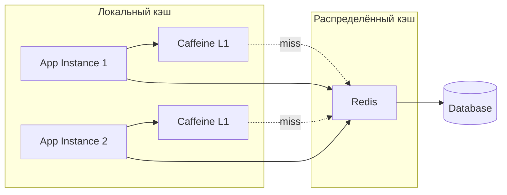
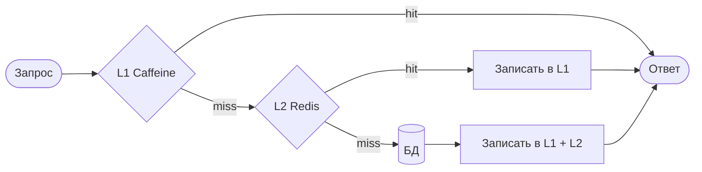
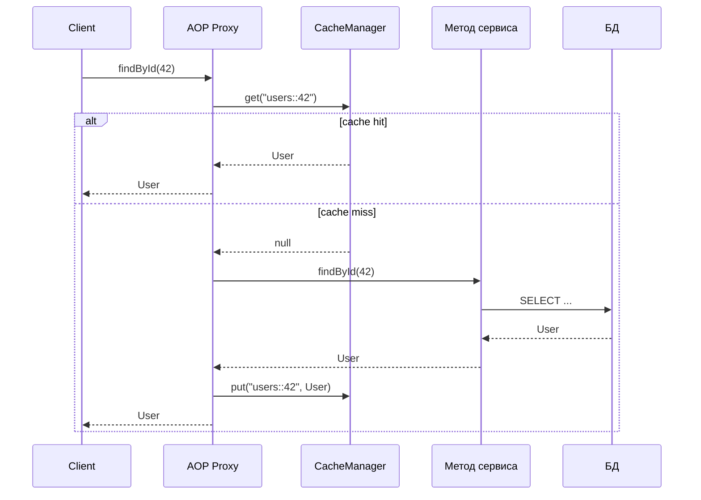
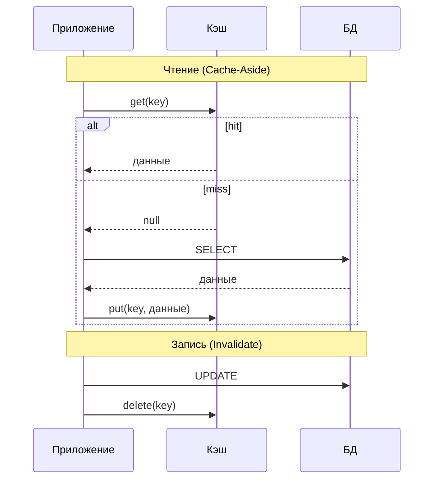
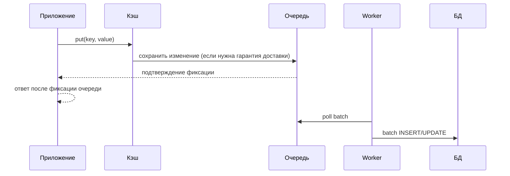
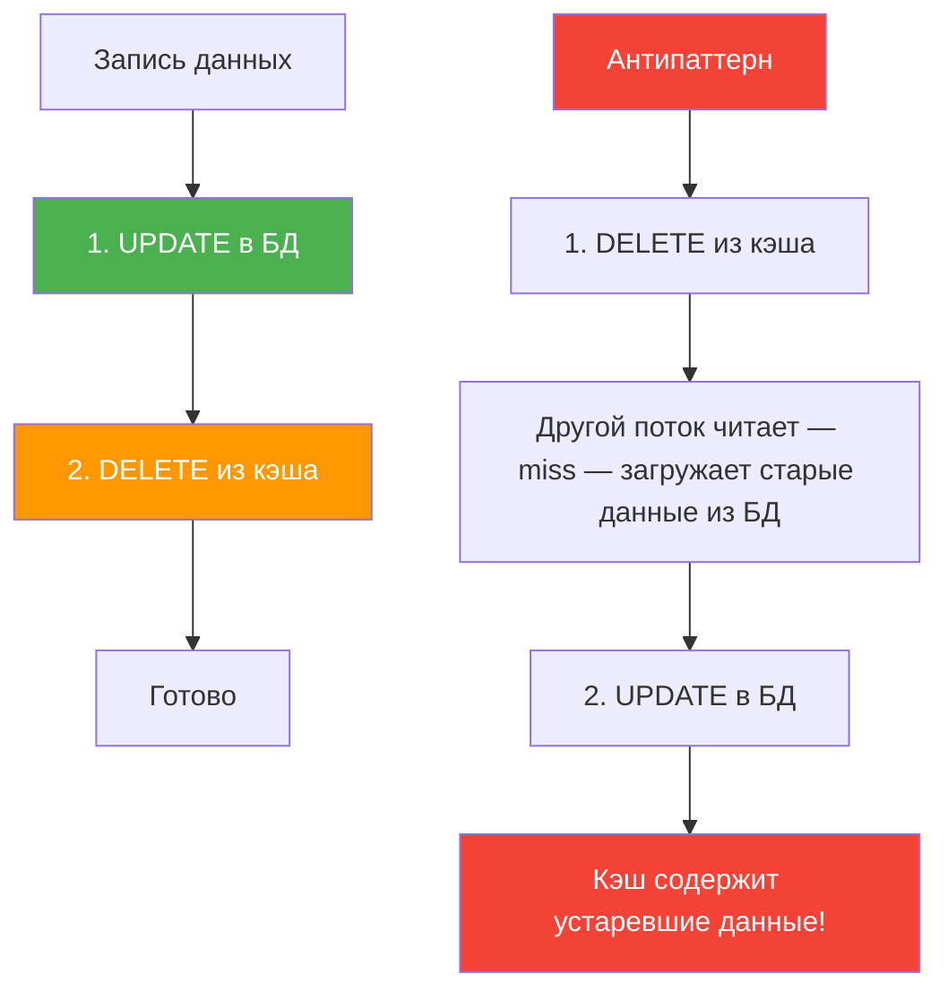
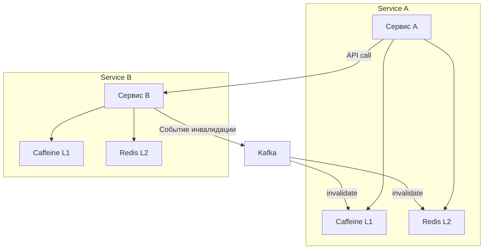
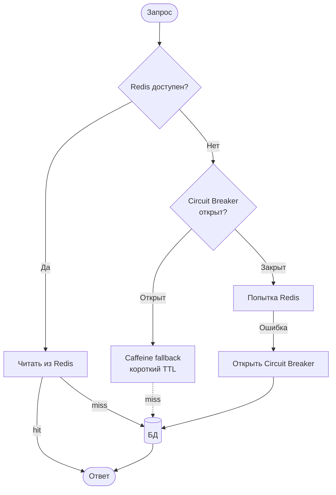

# Вопросы на собеседовании: Стратегии кэширования

Краткое введение: типичные вопросы по **стратегиям кэширования** — локальный и распределённый кэш, `Cache-Aside`, `Write-Through`, `Write-Behind`, `TTL`, инвалидация, `Spring Cache`, `Caffeine`, `Redis`, stampede, мониторинг. Стратегии кэширования критичны для производительности и консистентности; на собеседованиях часто спрашивают про выбор паттерна, конфигурацию в `Spring Boot` и поведение при сбоях.

## Полезные ссылки

### Источники

- [Spring Cache Abstraction](https://docs.spring.io/spring-framework/reference/integration/cache.html) — официальная документация Spring Cache
- [Spring Data Redis Cache](https://docs.spring.io/spring-data/redis/reference/redis/redis-cache.html) — конфигурация RedisCacheManager
- [Spring Boot Cache](https://docs.spring.io/spring-boot/reference/io/caching.html) — настройка провайдеров
- [CaffeineCacheManager API](https://docs.spring.io/spring-framework/docs/6.1.8/javadoc-api/org/springframework/cache/caffeine/CaffeineCacheManager.html) — per-cache конфигурация
- [Redis Keyspace Notifications](https://redis.io/docs/latest/manual/keyspace-notifications/) — события и ограничения доставки
- [Redis distributed locks](https://redis.io/docs/latest/develop/use/patterns/distributed-locks/) — безопасное снятие блокировки

## Содержание

- [Полезные ссылки](#полезные-ссылки)
- [See also](#see-also)

**Основы кэширования**
- [Q1. (!) Что такое локальный кэш и распределённый кэш?](#q1--что-такое-локальный-кэш-и-распределённый-кэш)
- [Q2. Что такое многоуровневый кэш (L1/L2)?](#q2-что-такое-многоуровневый-кэш-l1l2)
- [Q3. Что такое HTTP-кэш (браузерный и прокси)?](#q3-что-такое-http-кэш-браузерный-и-прокси)
- [Q4. Что такое hit ratio и miss ratio?](#q4-что-такое-hit-ratio-и-miss-ratio)
- [Q5. (!) Что такое eviction policy и какие бывают?](#q5--что-такое-eviction-policy-и-какие-бывают)

**Spring Cache и аннотации**
- [Q6. (!) Как работает Spring Cache Abstraction?](#q6--как-работает-spring-cache-abstraction)
- [Q7. (!) Как использовать @Cacheable, @CacheEvict и @CachePut?](#q7--как-использовать-cacheable-cacheevict-и-cacheput)
- [Q8. Как настроить Caffeine Cache в Spring Boot?](#q8-как-настроить-caffeine-cache-в-spring-boot)
- [Q9. (!) Как настроить Redis Cache в Spring Boot?](#q9--как-настроить-redis-cache-в-spring-boot)
- [Q10. Как использовать несколько CacheManager в одном приложении?](#q10-как-использовать-несколько-cachemanager-в-одном-приложении)

**Стратегии записи и чтения**
- [Q11. (!) Что такое Cache-Aside (Lazy Loading)?](#q11--что-такое-cache-aside-lazy-loading)
- [Q12. (!) Что такое Write-Through?](#q12--что-такое-write-through)
- [Q13. Что такое Write-Behind (Write-Back)?](#q13-что-такое-write-behind-write-back)
- [Q14. Что такое Read-Through Cache?](#q14-что-такое-read-through-cache)
- [Q15. Что такое Write-Around и когда его использовать?](#q15-что-такое-write-around-и-когда-его-использовать)
- [Q16. (!) Когда использовать TTL, а когда инвалидацию по событию?](#q16--когда-использовать-ttl-а-когда-инвалидацию-по-событию)

**Проблемы кэширования**
- [Q17. (!) Что такое cache stampede (thundering herd) и как его избежать?](#q17--что-такое-cache-stampede-thundering-herd-и-как-его-избежать)
- [Q18. Что такое cache penetration и cache avalanche?](#q18-что-такое-cache-penetration-и-cache-avalanche)
- [Q19. (!) Как обеспечить консистентность кэша и БД?](#q19--как-обеспечить-консистентность-кэша-и-бд)
- [Q20. Что такое stale-while-revalidate и когда применять?](#q20-что-такое-stale-while-revalidate-и-когда-применять)

**Ключи, сериализация и дизайн**
- [Q21. Что такое cache key design и какие ошибки избегать?](#q21-что-такое-cache-key-design-и-какие-ошибки-избегать)
- [Q22. Как кэшировать списки и пагинированные результаты?](#q22-как-кэшировать-списки-и-пагинированные-результаты)
- [Q23. (!) Что такое cache serialization и какие форматы предпочтительны?](#q23--что-такое-cache-serialization-и-какие-форматы-предпочтительны)
- [Q24. Что такое cache invalidation по тегу?](#q24-что-такое-cache-invalidation-по-тегу)

**Кэширование в микросервисах**
- [Q25. Как кэшировать в микросервисной архитектуре?](#q25-как-кэшировать-в-микросервисной-архитектуре)
- [Q26. Что такое Near Cache и когда его использовать?](#q26-что-такое-near-cache-и-когда-его-использовать)
- [Q27. Что такое cache warming и когда его применять?](#q27-что-такое-cache-warming-и-когда-его-применять)
- [Q28. (!) Что такое cache coherence в распределённом кэше?](#q28--что-такое-cache-coherence-в-распределённом-кэше)

**Выбор технологий и production**
- [Q29. Как выбрать TTL для кэша?](#q29-как-выбрать-ttl-для-кэша)
- [Q30. (!) Как выбирать между Caffeine, Redis и Hazelcast?](#q30--как-выбирать-между-caffeine-redis-и-hazelcast)
- [Q31. Как мониторить кэш в production?](#q31-как-мониторить-кэш-в-production)
- [Q32. (!) Как обрабатывать сбои кэша (Redis unavailable)?](#q32--как-обрабатывать-сбои-кэша-redis-unavailable)
- [Q33. Как обеспечить безопасность кэша (Redis)?](#q33-как-обеспечить-безопасность-кэша-redis)
- [Q34. Как тестировать кэширование (unit, integration)?](#q34-как-тестировать-кэширование-unit-integration)
- [Q35. Как кэш влияет на латентность и throughput приложения?](#q35-как-кэш-влияет-на-латентность-и-throughput-приложения)
- [Q36. Что такое cache partitioning и зачем оно нужно?](#q36-что-такое-cache-partitioning-и-зачем-оно-нужно)
- [Q37. Что такое cache coherence в мультидатацентровой среде?](#q37-что-такое-cache-coherence-в-мультидатацентровой-среде)
- [Q38. Как измерять и интерпретировать метрики кэша в production?](#q38-как-измерять-и-интерпретировать-метрики-кэша-в-production)

**Продвинутые темы**
- [Q39. (!) Как предотвратить cache stampede с помощью distributed lock?](#q39--как-предотвратить-cache-stampede-с-помощью-distributed-lock)
- [Q40. (!) Что такое probabilistic early expiration (PER) и как оно работает?](#q40--что-такое-probabilistic-early-expiration-per-и-как-оно-работает)
- [Q41. Как организовать cache warming при старте приложения?](#q41-как-организовать-cache-warming-при-старте-приложения)
- [Q42. (!) Как работает инвалидация кэша через pub/sub (Redis Keyspace Notifications)?](#q42--как-работает-инвалидация-кэша-через-pubsub-redis-keyspace-notifications)

---

## Q1. (!) Что такое локальный кэш и распределённый кэш?

Это два способа разместить кэш относительно приложения. **Локальный** живёт внутри процесса (быстро, но у каждого инстанса свой), **распределённый** — на отдельных серверах (медленнее, но общий для всех). Выбор между ними — это компромисс между латентностью и согласованностью.

**Локальный кэш** — кэш в памяти процесса приложения (`Caffeine`, `Guava Cache`, `Ehcache`).
- **Плюсы:** доступ без сетевого вызова; задержка зависит от ключа, размера данных и конкуренции потоков.
- **Минусы:** не разделяется между инстансами — при масштабировании у каждого инстанса свой кэш; инвалидация на других узлах сложнее.

**Распределённый кэш** — кэш на отдельных узлах (`Redis`, `Memcached`, `Hazelcast`).
- **Плюсы:** общий кэш для всех инстансов; централизованная инвалидация.
- **Минусы:** сетевая задержка, зависимость от доступности кэш-сервера, необходимость сериализации (см. [вопросы по Redis](../databases/redis-interview.md)).



**На собеседовании:** ожидают, что кандидат объяснит компромисс между латентностью и согласованностью, и предложит гибридный подход (L1 + L2): локальный кэш для скорости, распределённый — для общего состояния.

## Q2. Что такое многоуровневый кэш (L1/L2)?

**Многоуровневый кэш** объединяет два слоя, чтобы взять лучшее от каждого: скорость локального кэша и общий второй уровень; согласованность L1 требует отдельной инвалидации. **L1** — локальный (`Caffeine`), **L2** — распределённый (`Redis`).

Логика чтения — сверху вниз: запрос сначала проверяет `L1`; при промахе — `L2`; при промахе в `L2` — источник данных (БД). Результат записывается в оба уровня, чтобы следующий запрос попал уже в `L1`.



**Пример двухуровневого доступа:**

```java
@Service
@RequiredArgsConstructor
public class UserService {
    private final Cache<String, User> localCache;  // Caffeine L1
    private final RedisTemplate<String, User> redis; // L2
    private final UserRepository userRepository;

    public User getUser(Long id) {
        String key = "user:" + id;

        // L1 — локальный кэш
        User user = localCache.getIfPresent(key);
        if (user != null) return user;

        // L2 — Redis
        user = redis.opsForValue().get(key);
        if (user != null) {
            localCache.put(key, user);
            return user;
        }

        // БД
        user = userRepository.findById(id).orElseThrow();
        redis.opsForValue().set(key, user, Duration.ofMinutes(30));
        localCache.put(key, user);
        return user;
    }
}
```

**Нюанс с TTL.** `TTL` в `L1` часто выбирают короче, чем в `L2`, чтобы ограничить время устаревания при потере события. Конкретные сроки зависят от требований к свежести и нагрузки; TTL не гарантирует мгновенного обновления.

**Подводный камень.** При обновлении данных мало очистить `L2` — нужно сбросить `L1` во **всех** инстансах сразу, иначе они продолжат отдавать старое значение из локальной памяти. Для этого рассылают событие инвалидации через `Redis Pub/Sub`. Подробнее о реализации в [Spring Boot](../frameworks/spring/spring-boot-interview.md).

## Q3. Что такое HTTP-кэш (браузерный и прокси)?

**HTTP-кэш** — это кэширование ответов на стороне клиента и прокси по специальным заголовкам (`Cache-Control`, `ETag`, `Last-Modified`). Браузер и прокси (`CDN`, `Nginx`) хранят полученный ответ и при повторном запросе отдают его сами, не обращаясь к серверу.

**Как работает условный запрос (валидация).** Сервер вместе с ответом может отдать `ETag` — непрозрачный валидатор версии, не обязательно хеш тела. Когда срок свежести истёк, клиент не запрашивает данные заново, а шлёт `If-None-Match` с этим `ETag`. Если данные не изменились, сервер отвечает **304 Not Modified** без тела — клиент берёт версию из своего кэша, а по сети уходит лишь короткий заголовок. Так экономится трафик при сохранении актуальности. Для персональных данных кэширование на прокси отключают через `private` или `no-store`.

**Пример конфигурации в `Spring`:**

```java
@GetMapping("/products/{id}")
public ResponseEntity<Product> getProduct(@PathVariable Long id) {
    Product product = productService.findById(id);
    return ResponseEntity.ok()
        .cacheControl(CacheControl.maxAge(1, TimeUnit.HOURS).cachePublic())
        .eTag(String.valueOf(product.getVersion()))
        .body(product);
}
```

**Рекомендация по типам ресурсов:**
- **Статика** (`JS/CSS`) — `Cache-Control: public, max-age=31536000` (год) с версией в имени файла: новый билд = новое имя = гарантированно свежий ресурс.
- **API** — политику выбирают по типу ответа; публичным ответам может подойти `ETag`, а персональные не кладут в общий кэш.
- **Персональные данные** — `Cache-Control: private, no-store`: на общих прокси такое кэшировать нельзя.

## Q4. Что такое hit ratio и miss ratio?

**Hit ratio** — доля запросов, обслуженных из кэша: `hit_ratio = hits / (hits + misses)`. **Miss ratio** = 1 - hit_ratio. Это один из индикаторов полезности кэша. Его читают вместе с задержкой, стоимостью промаха, распределением ключей и нагрузкой на источник: высокий hit ratio сам по себе не гарантирует меньшую пользовательскую задержку.

**Цель** задают для каждого кэша по профилю чтений и допустимой нагрузке на источник. Для персональных данных hit ratio закономерно ниже: ключей много, каждый запрашивается редко, поэтому большинство запросов попадает в БД (высокая кардинальность ключей). Метрики снимают через `Redis INFO stats` (`keyspace_hits`, `keyspace_misses`) или `Micrometer CacheMetrics`.

**Рекомендация по мониторингу:**
- Алерт по отклонению от своей базовой линии с учётом влияния на источник.
- Дашборд с трендом по каждому кэшу отдельно.
- Падение сразу после деплоя — ожидаемо (кэш холодный); дайте время на прогрев, прежде чем считать это инцидентом.

Подробнее о метриках в [вопросах по наблюдаемости](../monitoring/observability-interview.md).

## Q5. (!) Что такое eviction policy и какие бывают?

**Eviction policy** — правило, по которому кэш выбирает, какую запись удалить, когда место закончилось. Память конечна, а данных потенциально больше, чем влезает, — поэтому при добавлении новой записи в полный кэш одну из старых нужно вытеснить. От выбора политики напрямую зависит hit ratio: хорошая политика выкидывает то, что вряд ли запросят снова.

Основные политики:

| Политика | Описание | Когда использовать |
|----------|----------|--------------------|
| **LRU** | Вытесняются наименее недавно использованные | Большинство сценариев |
| **LFU** | Наименее часто используемые | Когда важна частота обращений |
| **TTL** | Удаление по истечении времени | Данные с ограниченным сроком актуальности |
| **FIFO** | Первым пришёл — первым вытеснен | Простые сценарии |
| **Window TinyLFU** | Сочетает свежесть и оценку частоты | Подходящий для многих нагрузок алгоритм Caffeine |

`Caffeine` использует политику на основе Window TinyLFU: она учитывает недавние обращения и частоту. Выигрыш над LRU зависит от распределения запросов. В `Redis` поведение при достижении лимита памяти задают через `maxmemory-policy`: при `noeviction` новые записи получают ошибку, а политики вытеснения выбирают кандидатов на удаление.

```conf
maxmemory 256mb
maxmemory-policy allkeys-lru
```

Варианты в `Redis`: `allkeys-lru`, `volatile-lru`, `allkeys-lfu`, `volatile-ttl`, `noeviction`.

## Q6. (!) Как работает Spring Cache Abstraction?

`Spring Cache Abstraction` — единый API кэширования поверх разных провайдеров (`Caffeine`, `Redis`, `EhCache`): код помечается аннотациями, а конкретный кэш меняется в конфигурации без правок бизнес-логики. Включается через `@EnableCaching`, а работает за счёт AOP-прокси: Spring оборачивает бин в прокси, и при вызове метода с `@Cacheable` сначала отрабатывает прокси — проверяет кэш и обращается к самому методу только при промахе.

```java
@Configuration
@EnableCaching
public class CacheConfig {
    // Spring Boot автоматически подберёт CacheManager
    // на основе зависимостей в classpath
}
```



**Подводные камни (классические вопросы на собеседовании):**
- **Самовызов не кэшируется.** Внутренний вызов `this.method()` идёт напрямую, минуя прокси, — кэш не сработает. Перехват возможен только когда метод дёргают извне, через бин. Обычно выносят вызываемый метод в отдельный бин; режим AspectJ имеет другую семантику перехвата.
- Хранение `null` зависит от CacheManager: у Spring `CaffeineCacheManager` оно разрешено по умолчанию через адаптер, а настройки других провайдеров могут отличаться. Чтобы не кэшировать пустой результат, используйте `unless = "#result == null"`.
- **`@Cacheable` на `private`-методах не работает** — Spring AOP проксирует только публичные методы.

## Q7. (!) Как использовать @Cacheable, @CacheEvict и @CachePut?

Три аннотации покрывают полный жизненный цикл записи в кэше, и их легко перепутать:
- **`@Cacheable`** — для чтения: при промахе выполняет метод и кладёт результат в кэш, при попадании метод вообще не вызывается.
- **`@CachePut`** — для записи: **всегда** выполняет метод и обновляет кэш свежим значением (в отличие от `@Cacheable`, который при попадании пропускает метод).
- **`@CacheEvict`** — для удаления: выбрасывает запись из кэша (или весь кэш через `allEntries`).

Пример с разбором каждого случая:

```java
@Service
public class ProductService {

    // @Cacheable — кэширует результат; при повторном вызове
    // с тем же ключом метод не выполняется
    @Cacheable(value = "products", key = "#id",
               unless = "#result == null")
    public Product findById(Long id) {
        return productRepository.findById(id).orElse(null);
    }

    // @Cacheable с составным ключом
    @Cacheable(value = "productSearch",
               key = "#category + ':' + #page")
    public List<Product> search(String category, int page) {
        return productRepository.findByCategory(category,
            PageRequest.of(page, 20));
    }

    // @CachePut — всегда выполняет метод и обновляет кэш
    @CachePut(value = "products", key = "#product.id")
    @Transactional
    public Product update(Product product) {
        return productRepository.save(product);
    }

    // @CacheEvict — удаляет запись из кэша
    @CacheEvict(value = "products", key = "#id")
    @Transactional
    public void delete(Long id) {
        productRepository.deleteById(id);
    }

    // @CacheEvict — очистка всего кэша
    @CacheEvict(value = "products", allEntries = true)
    @Scheduled(fixedRate = 3600000) // каждый час
    public void evictAllProducts() {
        log.info("Products cache cleared");
    }

    // @Caching — комбинация аннотаций
    @Caching(
        put = @CachePut(value = "products", key = "#product.id"),
        evict = @CacheEvict(value = "productSearch",
                            allEntries = true)
    )
    @Transactional
    public Product save(Product product) {
        return productRepository.save(product);
    }
}
```

**Ключевые параметры:**
- `value` / `cacheNames` — имя кэша
- `key` — SpEL-выражение для ключа (по умолчанию — все аргументы метода)
- `condition` — условие кэширования (SpEL): `condition = "#id > 10"`
- `unless` — условие исключения результата: `unless = "#result.size() == 0"`
- `sync = true` — синхронизация вычисления одного ключа в рамках возможностей провайдера; между инстансами координация не гарантируется

## Q8. Как настроить Caffeine Cache в Spring Boot?

Для Spring Boot 3.3 с Caffeine 3.1 общий размер и TTL удобно задать через `spring.cache.caffeine.spec`. Если разные кэши требуют разных правил, используйте `CaffeineCacheManager.registerCustomCache`: этот API есть в Spring Framework 6.1. `SimpleCacheManager` для этого не обязателен.

```groovy
implementation 'org.springframework.boot:spring-boot-starter-cache'
implementation 'com.github.ben-manes.caffeine:caffeine'
```

Общая настройка:

```yaml
spring:
  cache:
    type: caffeine
    cache-names: products,users
    caffeine:
      spec: maximumSize=500,expireAfterWrite=10m
```

Для разных TTL создайте один менеджер и зарегистрируйте каждый нативный кэш с собственной политикой:

```java
@Bean
CacheManager cacheManager() {
    CaffeineCacheManager manager = new CaffeineCacheManager();
    manager.registerCustomCache("products", Caffeine.newBuilder()
        .maximumSize(500).expireAfterWrite(Duration.ofMinutes(30))
        .recordStats().build());
    manager.registerCustomCache("users", Caffeine.newBuilder()
        .maximumSize(200).expireAfterWrite(Duration.ofMinutes(5))
        .recordStats().build());
    return manager;
}
```

`recordStats()` нужен для статистики Caffeine. Автоматическую привязку метрик через Spring Boot Actuator проверяют отдельно: уже существующие при старте кэши подхватываются, созданные позднее регистрируют через `CacheMetricsRegistrar`. [API `registerCustomCache`](https://docs.spring.io/spring-framework/docs/6.1.8/javadoc-api/org/springframework/cache/caffeine/CaffeineCacheManager.html).

## Q9. (!) Как настроить Redis Cache в Spring Boot?

Понадобятся стартеры `data-redis` и `cache`, адрес Redis в `application.yml` и `RedisCacheManager`. Ключевое отличие от `Caffeine`: данные уходят по сети, поэтому их нужно **сериализовать**. Базовую настройку (host, общий `TTL`) можно задать в `application.yml`, но как только нужны разные `TTL` по кэшам и нормальная JSON-сериализация — переходят на программный `RedisCacheManager`.

**Зависимость:**
```groovy
implementation 'org.springframework.boot:spring-boot-starter-data-redis'
implementation 'org.springframework.boot:spring-boot-starter-cache'
```

**application.yml:**
```yaml
spring:
  data:
    redis:
      host: localhost
      port: 6379
      password: ${REDIS_PASSWORD}
      timeout: 2000ms
  cache:
    type: redis
    redis:
      time-to-live: 600000  # 10 минут в мс
      cache-null-values: false
```

**Программная конфигурация с JSON-сериализацией:**

```java
@Configuration
@EnableCaching
public class RedisCacheConfig {

    @Bean
    public RedisCacheManager cacheManager(
            RedisConnectionFactory connectionFactory) {

        // Конфигурация по умолчанию
        RedisCacheConfiguration defaultConfig =
            RedisCacheConfiguration.defaultCacheConfig()
                .entryTtl(Duration.ofMinutes(10))
                .disableCachingNullValues()
                .serializeKeysWith(
                    SerializationPair.fromSerializer(
                        new StringRedisSerializer()))
                .serializeValuesWith(
                    SerializationPair.fromSerializer(
                        new GenericJackson2JsonRedisSerializer()));

        // Разные TTL для разных кэшей
        Map<String, RedisCacheConfiguration> configs = Map.of(
            "users", defaultConfig.entryTtl(Duration.ofMinutes(5)),
            "products", defaultConfig.entryTtl(Duration.ofMinutes(30)),
            "config", defaultConfig.entryTtl(Duration.ofHours(1))
        );

        return RedisCacheManager.builder(connectionFactory)
            .cacheDefaults(defaultConfig)
            .withInitialCacheConfigurations(configs)
            .transactionAware()
            .build();
    }
}
```

**Важно:** стандартная конфигурация `GenericJackson2JsonRedisSerializer` использует сведения о типе (обычно `@class`); при переименовании класса старые записи могут не десериализоваться. Используйте версию в ключе или управляемую миграцию, если этот формат выбран. Подробнее о `Redis` в [вопросах по Redis](../databases/redis-interview.md).

## Q10. Как использовать несколько CacheManager в одном приложении?

Несколько `CacheManager` нужны, когда разным данным подходят разные хранилища. **Типичный сценарий:** `Caffeine` для горячих локальных данных (минимальная латентность) + `Redis` для общего кэша между инстансами. Один бин помечают `@Primary` — он используется по умолчанию; остальные выбирают явно через `cacheManager = "..."` в аннотации.

```java
@Configuration
@EnableCaching
public class MultiCacheConfig {

    @Bean
    @Primary
    public CacheManager caffeineCacheManager() {
        CaffeineCacheManager manager = new CaffeineCacheManager("hotData");
        manager.setCaffeine(Caffeine.newBuilder()
            .maximumSize(100)
            .expireAfterWrite(Duration.ofMinutes(1)));
        return manager;
    }

    @Bean("redisCacheManager")
    public CacheManager redisCacheManager(
            RedisConnectionFactory factory) {
        return RedisCacheManager.builder(factory)
            .cacheDefaults(RedisCacheConfiguration.defaultCacheConfig()
                .entryTtl(Duration.ofMinutes(30)))
            .build();
    }
}

@Service
public class ProductService {

    // Использует Primary (Caffeine)
    @Cacheable("hotData")
    public Product getHotProduct(Long id) { ... }

    // Явно указан Redis CacheManager
    @Cacheable(value = "allProducts",
               cacheManager = "redisCacheManager")
    public Product getProduct(Long id) { ... }
}
```

## Q11. (!) Что такое Cache-Aside (Lazy Loading)?

`Cache-Aside` (он же Lazy Loading) — стратегия, где **кэшем управляет само приложение**, а не кэш-библиотека. Логика простая: при чтении сначала смотрим в кэш; промах — грузим из БД и кладём в кэш. При записи обновляем БД и удаляем ключ из кэша (инвалидируем), чтобы следующее чтение подтянуло свежие данные. «Lazy» — потому что кэш наполняется лениво, только теми данными, которые реально запросили.



**Реализация в `Spring`:**

```java
@Cacheable(value = "users", key = "#id")
public User findById(Long id) {
    return userRepository.findById(id).orElseThrow();
}

@CacheEvict(value = "users", key = "#user.id")
@Transactional
public User update(User user) {
    return userRepository.save(user);
}
```

**Плюсы:** кэш хранит запрошенные данные и не является источником истины. При недоступности кэша нужна явная политика деградации: сам вызов кэша может завершиться ошибкой.

**Минусы:**
- При промахе — два обращения подряд (кэш + БД) и заполнение кэша.
- Возможна гонка чтения и записи: один поток читает старое значение из БД и кладёт его в кэш ровно в тот момент, когда другой уже обновил БД, — в кэш попадают устаревшие данные.

**Правило записи:** после успешного коммита БД инвалидировать ключ; при сбое инвалидации нужен повтор или TTL (см. Q19).

## Q12. (!) Что такое Write-Through?

**Write-Through** означает, что запись проходит через кэш-слой и синхронно сохраняется в системе-источнике. Ответ об успехе не должен опережать необходимую фиксацию данных. Конкретный порядок операций, атомарность и поведение при частичном сбое задаёт реализация, а не название паттерна.

При записи в БД и затем в кэш без общей транзакции возможен промежуток между шагами. Если БД сохранила значение, а обновление кэша не удалось, там может остаться старая копия; нужен сброс, повтор с контролем версии или короткий TTL. Если кэш обновился раньше коммита БД, читатель может увидеть неподтверждённые данные. Поэтому `@CachePut` рядом с `@Transactional` само по себе не даёт атомарности кэша и БД. Транзакционно осведомлённый CacheManager откладывает `put`/`evict` до успешного коммита, но сбой после коммита всё ещё требует стратегии восстановления.

Write-Through полезен, когда после записи ожидают частые чтения и синхронная стоимость обновления кэша приемлема. Для критичных данных опираются на БД как источник истины и проверяют сбои между шагами. [Spring transaction-aware cache](https://docs.spring.io/spring-framework/docs/6.1.x/javadoc-api/org/springframework/cache/transaction/TransactionAwareCacheDecorator.html).

## Q13. Что такое Write-Behind (Write-Back)?

**Write-Behind** (Write-Back) — запись принимается кэширующим слоем, а в БД попадает позже асинхронно. Подтверждать успех до надёжной фиксации очереди рискованно: сбой может потерять изменения. В отличие от `Write-Through`, источник здесь обновляется позже; задержка подтверждения зависит от того, фиксируется ли изменение в надёжной очереди до ответа. Батчинг ещё и разгружает БД — десятки изменений превращаются в один `batch UPDATE`.



**Плюсы:** запись может отвечать быстрее прямого сохранения в БД; батчинг снижает нагрузку на источник.

**Минусы:** главный риск — потеря данных, если кэш упадёт до сброса в БД (изменения ещё нигде не зафиксированы); плюс сложнее держать согласованность.

**Сценарий применения:** агрегируемые счётчики или другая нагрузка, где допустимая потеря и восстановление явно определены. Для платежей нужна надёжная фиксация в системе-источнике; название кэш-стратегии не заменяет транзакционный контракт. На практике требует надёжной очереди (подробнее в [вопросах по Kafka](../messaging/kafka-interview.md)) и идемпотентной записи в БД, чтобы повторная доставка батча не задвоила данные.

## Q14. Что такое Read-Through Cache?

**Read-Through** — кэш сам загружает данные из источника при промахе, прозрачно для приложения. Приложение всегда вызывает только `cache.get(key)` и не знает, откуда пришли данные: при попадании — из памяти, при промахе кэш сам дёрнет `CacheLoader`, сходит в БД, запишет результат и вернёт его. Логика «что делать при промахе» вынесена внутрь кэша, а не размазана по коду.

```java
// Caffeine Read-Through с CacheLoader
LoadingCache<Long, User> cache = Caffeine.newBuilder()
    .maximumSize(1000)
    .expireAfterWrite(Duration.ofMinutes(10))
    .build(id -> userRepository.findById(id).orElse(null));

// Использование — при промахе автоматически вызовет loader
User user = cache.get(42L);
```

**Отличие от `Cache-Aside`:** в `Cache-Aside` приложение управляет логикой загрузки; в `Read-Through` логика инкапсулирована в кэше. В `Spring @Cacheable` — это **cache-aside**, а не read-through; для настоящего read-through нужен `CacheLoader` (`Caffeine`) или `MapLoader` (`Hazelcast`).

## Q15. Что такое Write-Around и когда его использовать?

**Write-Around** — при записи данные идут в систему-источник, не прогревая кэш новым значением. Если там уже лежит старый ответ, его инвалидируют либо сознательно допускают устаревание до TTL. Кэш наполняется лениво — лишь когда данные кто-то прочитает: первое чтение нового или инвалидированного ключа уйдёт в БД и заодно положит свежее значение в кэш. Смысл — не засорять кэш данными, которые, скорее всего, никто не перечитает.

**Плюсы:** запись не нагружает кэш и не вытесняет из него полезные горячие записи.

**Минусы:** после новой записи первый запрос может промахнуться. Для обновления существующей записи без инвалидации возможен stale hit; короткий TTL лишь ограничивает окно устаревания.

**Сценарий применения:** запись частая, а повторные чтения тех же данных редки (логи, аудит), либо допустима задержка согласованности до истечения `TTL`.

## Q16. (!) Когда использовать TTL, а когда инвалидацию по событию?

Короткий ответ: **TTL** ограничивает время устаревания; событие может досрочно инвалидировать копию после изменения, если оно доставлено и обработано. TTL прост, но до истечения запись может оставаться старой. Инвалидация по событию требует публикации, доставки и обработки сообщения.

| Критерий | TTL | Инвалидация по событию |
|----------|-----|----------------------|
| Частота изменений | Редко | Часто |
| Требования к актуальности | Допустима задержка до TTL | Нужно сократить окно после изменения |
| Сложность реализации | Простая | Сложнее (события, подписчики) |
| Пример данных | Справочник с допустимой задержкой | Профиль, каталог после изменения |

**Комбинированный подход (рекомендуется):** `TTL` как страховка + инвалидация при обновлении:

```java
// TTL задан отдельно в конфигурации кэша.
// После успешного коммита публикуем событие изменения.
@Transactional
public User update(User user) {
    User saved = userRepository.save(user);
    applicationEventPublisher.publishEvent(new UserChanged(saved.getId()));
    return saved;
}

@TransactionalEventListener(phase = TransactionPhase.AFTER_COMMIT)
public void evict(UserChanged event) {
    cacheManager.getCache("users").evict(event.id());
}
```

Для справочников с допустимой задержкой подходит `TTL` с jitter. Для персональных данных окно устаревания согласуют с владельцем и при необходимости добавляют событие; если слушатель в другом процессе, потребуется надёжная доставка. Подробнее о событийной архитектуре в [вопросах по Event-Driven](event-driven-patterns-interview.md).

## Q17. (!) Что такое cache stampede (thundering herd) и как его избежать?

**Cache stampede** — залп одинаковых загрузок после промаха по горячему ключу. Истечение TTL — частый, но не единственный триггер: такой же эффект бывает после purge или холодного старта.

В одном процессе `LoadingCache` Caffeine или `@Cacheable(sync = true)` при поддержке провайдера объединяет вычисление одного ключа. `sync = true` не координирует разные инстансы приложения. Между инстансами применяют координацию через распределённую блокировку либо допускают ограниченное число вычислений; альтернативы — фоновый refresh, разрешённый stale и прогрев. Jitter разносит истечение **разных** ключей, но не предотвращает одновременный промах одного горячего ключа.

Если используется lock, после захвата повторно проверяют кэш, задают срок действия и освобождают блокировку только при совпадении токена владельца. При превышении срока блокировки возможно повторное вычисление, поэтому обещать ровно один запрос к БД нельзя. Подробности — в Q39. [Spring `sync`](https://docs.spring.io/spring-framework/reference/integration/cache/annotations.html), [Redis distributed lock](https://redis.io/docs/latest/develop/use/patterns/distributed-locks/).

## Q18. Что такое cache penetration и cache avalanche?

Это две разные патологии нагрузки на БД через кэш. **Penetration** — кэш бесполезен, потому что данных нет в принципе (запросы по несуществующим ключам). **Avalanche** — кэш разом «опустел», потому что множество ключей протухло одновременно. Обе кончаются всплеском запросов в БД, но лечатся по-разному.

**Cache penetration** — запросы по несуществующим ключам проходят сквозь кэш в БД каждый раз: данных нет и без отрицательного кэша каждый такой запрос становится промахом и походом в БД (частый вектор атаки — перебор несуществующих id). Решения:
- Кэшировать отрицательный результат с коротким `TTL`, если провайдер это поддерживает
- Bloom-фильтр для отсечения заведомо несуществующих ключей, учитывая его обновление и ложноположительные ответы
- Лимит запросов по одному ключу

**Cache avalanche** — массовое истечение `TTL` многих ключей одновременно; всплеск запросов к БД. Решения:
- Разброс `TTL` (базовый + случайное отклонение — jitter)
- Высокая доступность кэша (`Redis Cluster`, `Sentinel`)
- Постепенная загрузка при холодном старте (cache warming по приоритету)

```java
// Jitter для TTL — предотвращение avalanche
private Duration ttlWithJitter(Duration base) {
    long seconds = Math.max(1, base.toSeconds() / 10);
    long jitter = ThreadLocalRandom.current().nextLong(seconds + 1);
    return base.plusSeconds(jitter); // только положительное отклонение
}
```

## Q19. (!) Как обеспечить консистентность кэша и БД?

Для `Cache-Aside` обычно сначала фиксируют изменение в БД, затем удаляют ключ из кэша. При Spring-транзакции удаление привязывают к успешному коммиту. Этот порядок уменьшает риск, но не устраняет гонку между параллельным чтением и записью.

Почему не наоборот: если сначала удалить ключ, а потом писать в БД, между этими шагами другой поток может прочитать ключ, промахнуться, загрузить из БД **старое** значение (новое ещё не записано) и положить его обратно в кэш. Кэш «залипнет» на устаревших данных до следующей инвалидации.



**Подходы:**
- `Cache-Aside` с инвалидацией — при записи в БД удалять ключ в кэше
- `Write-Through` — запись в кэш и БД синхронно
- Короткий `TTL` — приемлемая задержка консистентности
- События — при изменении данных публиковать событие; потребители инвалидируют кэш

При распределённом кэше и нескольких писателях нужна единая стратегия, иначе один сервис может инвалидировать ключ, а другой — перезаписать устаревшим значением. Подробнее в [паттернах согласованности](consistency-patterns-interview.md).

## Q20. Что такое stale-while-revalidate и когда применять?

**Stale-while-revalidate (SWR)** разрешает временно отдать сохранённую устаревшую копию, пока кэш обновляет её. Это компромисс свежести и задержки. Если копии нет после первого запуска, удаления или вытеснения, отвечать stale нечем — запрос должен ждать загрузку либо получить другое явно выбранное поведение.

В HTTP это расширение `Cache-Control: stale-while-revalidate=<seconds>` по RFC 5861; оно **разрешает**, а не гарантирует такую выдачу. Для серверного кэша аналогичную политику реализуют отдельно: сохранённая запись должна оставаться доступной в stale-окне, а обновление по ключу нужно объединять или ограничивать, иначе каждый запрос запустит свой фоновый пересчёт.

SWR подходит публичным каталогам, лентам и другим данным, где краткая несвежесть допустима. Для баланса, цены в момент оплаты и авторизованного ответа нужна своя политика согласованности. [RFC 5861](https://www.rfc-editor.org/rfc/rfc5861.html).

## Q21. Что такое cache key design и какие ошибки избегать?

Дизайн ключа — это то, как вы формируете строку-идентификатор записи в кэше. От него напрямую зависят hit ratio и сопровождаемость: плохой ключ либо размывает попадания (слишком много уникальных ключей), либо ломает данные при изменении формата. Цель — ключи **стабильные, осмысленные и с ограниченной кардинальностью**.

**Рекомендации:**
- Осмысленный префикс: `product:v2:42`, `user:profile:123`
- Версия в ключе при смене формата сериализации
- Оценка кардинальности: ключи по id полезны для горячих сущностей, но редкие ключи не должны вытеснять рабочий набор
- Короткие стабильные ключи: длинные ключи тратят память и усложняют диагностику

**Ошибки:**
- Высокая кардинальность без контроля — миллионы ключей, низкий hit ratio
- Отсутствие версии — при переименовании полей старые записи ломают десериализацию
- Неоднозначные ключи — разные данные под одним ключом

```java
// Хорошо — осмысленный, версионированный ключ
@Cacheable(value = "products",
           key = "'v2:' + #id")
public Product findById(Long id) { ... }

// Плохо — все аргументы в ключе без контроля
@Cacheable("search")
public List<Product> search(String q, String cat,
    String sort, int page, int size) { ... }
// Огромная кардинальность → низкий hit ratio
```

## Q22. Как кэшировать списки и пагинированные результаты?

Списки кэшировать сложнее, чем отдельные сущности, по двум причинам. Во-первых, каждая комбинация фильтров, сортировки и страницы — это отдельный ключ, и кардинальность взрывается, а hit ratio падает. Во-вторых, любое изменение одной сущности делает устаревшими все списки, в которые она входит, — инвалидация становится неточной. Поэтому списки стараются не кэшировать «как есть».

**Подходы:**

1. **Кэшировать сущности по id** и собирать список из кэша
2. **Кэшировать только популярные комбинации** (первая страница, топ-фильтры)
3. **Короткий TTL** для списков
4. **Инвалидация по тегу** при изменении сущности

```java
// Кэш по id — entity:42, entity:99
@Cacheable(value = "products", key = "#id")
public Product findById(Long id) { ... }

// Кэш списка id с коротким TTL (настроен в CacheManager)
@Cacheable(value = "productIds",
           key = "'page:' + #page")
public List<Long> getProductIds(int page) { ... }

// При обновлении — инвалидация конкретной сущности
// и всего списка id
@Caching(evict = {
    @CacheEvict(value = "products", key = "#product.id"),
    @CacheEvict(value = "productIds", allEntries = true)
})
public Product update(Product product) { ... }
```

## Q23. (!) Что такое cache serialization и какие форматы предпочтительны?

Сериализация — превращение объекта в байты для хранения в распределённом кэше (`Redis`, `Memcached`) и обратная сборка при чтении. Локальному кэшу (`Caffeine`) она не нужна — объекты лежат в куче как есть; а вот всё, что уходит по сети, сериализовать обязательно. Выбор формата — это компромисс между читаемостью, размером, скоростью и совместимостью версий. JSON удобен для чтения и межъязыкового обмена, бинарный формат может быть компактнее; устойчивость к эволюции зависит от схемы и настроек сериализатора.

| Формат | Плюсы | Минусы |
|--------|-------|--------|
| **JSON** (Jackson) | Читаемость, межъязыковость | Больше места, медленнее |
| **MessagePack/Protobuf** | Компактность, скорость | Нечитаемый, схема |
| **Java Serialization** | Встроен в JDK | Медленно, небезопасно, не рекомендуется |
| **Kryo/FST** | Очень быстро, компактно | Только JVM, версионирование |

**Конфигурация JSON-сериализации в Redis:**

```java
@Bean
public RedisCacheConfiguration cacheConfiguration() {
    ObjectMapper mapper = new ObjectMapper()
        .registerModule(new JavaTimeModule())
        .activateDefaultTyping(
            mapper.getPolymorphicTypeValidator(),
            ObjectMapper.DefaultTyping.NON_FINAL);

    return RedisCacheConfiguration.defaultCacheConfig()
        .serializeValuesWith(
            SerializationPair.fromSerializer(
                new GenericJackson2JsonRedisSerializer(mapper)));
}
```

**Важно:** при смене схемы старые записи могут не десериализоваться; используйте версию ключа или управляемую миграцию. Не включайте полиморфную десериализацию недоверенных типов без строгого ограничения допустимых классов. Подробнее о сериализации в [вопросах по Java Serialization](../programming-languages/java/java-serialization-interview.md).

## Q24. Что такое cache invalidation по тегу?

Инвалидация по тегу связывает несколько кэш-записей с одним доменным объектом: например, `product:42` может быть связан с карточкой и несколькими списками. При изменении товара находят связанные ключи и удаляют их. Это полезно, когда заранее неизвестен полный набор выборок, в которые попала сущность.

В Redis связь «тег → ключи» можно хранить в Set, но простой порядок `SET` → `SADD` не атомарен. Если процесс упадёт между операциями, запись останется без тега. Если ключ протух, Set сохранит устаревшую ссылку. При инвалидации одновременно с новой записью возможна гонка. Для production нужно согласовать запись значения и индекса, TTL/очистку индекса и порядок удаления; альтернативой бывает версия в ключе или короткий TTL. Если CDN или кэш предоставляет готовую tag invalidation, сначала проверяют её семантику и ограничения.

Тег не заменяет правило свежести для персональных данных: неполный индекс приводит к сохранению старых ответов.

## Q25. Как кэшировать в микросервисной архитектуре?

Главная сложность — у каждого сервиса свой кэш, а данные принадлежат соседям. Кэш-ключ в сервисе A может истечь по TTL независимо от сервиса B, но досрочно узнать об изменении данных можно только через согласованный механизм уведомления или проверку источника. Поэтому ключевой принцип: **кэшировать чужие данные можно только при контракте на инвалидацию** (событие об изменении), иначе застрянете на устаревших значениях.

**Принципы:**
- Локальный кэш в каждом сервисе — быстрый, но инвалидация при изменении в другом сервисе сложна.
- Распределённый кэш (`Redis`) — общий для инстансов одного сервиса.
- Для чужих данных определить контракт свежести: событие владельца, ограниченный TTL или проверка источника.



Часто комбинируют `L1` (локальный, короткий `TTL`) и `L2` (`Redis`); при публикации события подписчики инвалидируют свой `L1` и соответствующие ключи в `L2`. Подробнее в [вопросах по микросервисам](microservices-interview.md).

## Q26. Что такое Near Cache и когда его использовать?

**Near Cache** — это маленький локальный кэш «перед» распределённым: клиент держит горячие ключи в своей памяти и обращается к удалённому `Redis`/`Hazelcast` только при промахе. По сути это частный случай L1/L2: востребованные значения отдаются без сетевого обращения из локальной памяти, а сеть не нагружается на каждый повторный запрос. Реализуется через `Hazelcast Near Cache` или `Caffeine` поверх клиента `Redis`.

**Подходит:** read-heavy с повторяющимся набором ключей (топ товаров, конфигурация).

**Не подходит:** высокая кардинальность ключей; частые обновления; данные, требующие строгой консистентности.

В `Hazelcast` — включить `Near Cache` для map с `invalidate-on-change: true`, задать `max-size` и `TTL`. В клиенте `Redis` (`Lettuce`, `Jedis`) можно держать локальный `Caffeine` поверх `Redis` для горячих ключей.

## Q27. Что такое cache warming и когда его применять?

**Cache warming** (прогрев) — заполнение кэша заранее, до прихода реальных запросов: при старте приложения или по расписанию популярные ключи загружают в кэш «впрок». Зачем: сразу после деплоя или перезапуска кэш пуст («холодный»), и первая волна запросов целиком уходит в БД — это и всплеск нагрузки, и просадка латентности. Прогрев убирает этот провал, делая кэш «тёплым» к моменту, когда на инстанс пойдёт трафик.

```java
@Component
@RequiredArgsConstructor
public class CacheWarmer implements ApplicationRunner {

    private final ProductService productService;

    @Override
    public void run(ApplicationArguments args) {
        // Загружаем топ-100 популярных товаров при старте
        List<Long> topIds = productService.getTopProductIds(100);
        topIds.forEach(productService::findById);
        log.info("Cache warmed with {} products", topIds.size());
    }
}
```

**Важно:** `ApplicationRunner` выполняется до завершения старта. Небольшой обязательный набор допустимо загрузить синхронно; большой прогрев ограничивают и выносят в фон.

## Q28. (!) Что такое cache coherence в распределённом кэше?

**Cache coherence** — это согласованность одних и тех же данных между разными узлами кэша: видят ли все читатели одинаковое (актуальное) значение. Проблема возникает из-за асинхронной репликации. В `Redis Cluster` каждый ключ закреплён за одним шардом по хешу слота, а его реплики получают копию асинхронно. Поэтому чтение с реплики сразу после записи в primary может вернуть старое значение; длительность отставания зависит от нагрузки и сети.

**Стратегии:**
- Инвалидация по событию (`Redis Pub/Sub`, `Kafka`)
- Короткий `TTL`
- Чтение только с primary для критичных данных
- `Near Cache` усложняет coherence — при обновлении нужно инвалидировать все клиенты

```java
// Инвалидация через Redis Pub/Sub
@Component
public class CacheInvalidationListener {

    @Autowired
    private Cache<String, Object> localCache;

    @Bean
    public RedisMessageListenerContainer container(
            RedisConnectionFactory factory) {
        var container = new RedisMessageListenerContainer();
        container.setConnectionFactory(factory);
        container.addMessageListener(
            (message, pattern) -> {
                String key = new String(message.getBody());
                localCache.invalidate(key);
                log.info("Invalidated local cache: {}", key);
            },
            new ChannelTopic("cache:invalidate"));
        return container;
    }
}
```

Подробнее о согласованности в [паттернах согласованности](consistency-patterns-interview.md).

## Q29. Как выбрать TTL для кэша?

`TTL` — это компромисс между свежестью и нагрузкой: чем он короче, тем актуальнее данные, но тем чаще промахи и обращения к БД; чем длиннее — тем выше hit ratio, но дольше живут устаревшие значения. Поэтому отталкиваются от того, как часто меняются данные и насколько критична их актуальность.

Ориентиры по типам данных:

| Тип данных | TTL | Подход |
|------------|-----|--------|
| Конфигурация | По требованиям свежести | TTL и инвалидация по необходимости |
| Справочники | По частоте изменений | TTL с jitter при массовом истечении |
| Пользовательские данные | По допустимому окну устаревания | Инвалидация и TTL как страховка |
| Сессии | Не дольше срока сессии | Учитывать обновление/продление |
| Часто обновляемые | Секунды | Инвалидация по событию |

**Разброс TTL** (jitter) для предотвращения avalanche:

```java
// Caffeine с фиксированным TTL
Caffeine.newBuilder()
    .expireAfterWrite(Duration.ofMinutes(10))
    .build();

// Redis с jitter
public void cacheWithJitter(String key, Object value,
                            Duration baseTtl) {
    long spread = Math.max(1, baseTtl.toSeconds() / 5);
    long jitter = ThreadLocalRandom.current().nextLong(spread + 1);
    redis.opsForValue().set(key, value,
        baseTtl.plusSeconds(jitter));
}
```

## Q30. (!) Как выбирать между Caffeine, Redis и Hazelcast?

`Caffeine`, `Redis` и `Hazelcast` выбирают по нескольким требованиям: нужен ли общий кэш между инстансами, сколько стоит сетевой доступ, как устроены инвалидация и отказ, какие нужны структуры данных и сколько команда готова эксплуатировать.

| Средство | Размещение | Особенность |
|---|---|---|
| `Caffeine` | память одного процесса | быстрый локальный доступ, но копии у инстансов расходятся |
| `Redis` | отдельный сервис/кластер | общий удалённый кэш с сетевой задержкой и собственной эксплуатацией |
| `Hazelcast` | распределённый кластер | карты и Near Cache, требуется согласовать топологию и поведение при сбоях |

Для горячего повторяющегося чтения возможен L1 на Caffeine перед Redis/Hazelcast, если продуманы TTL и инвалидация L1. Строгую свежесть такой гибрид сам по себе не обеспечивает. Сравнивайте измеренную задержку и режимы отказа на своей нагрузке; универсальных чисел и одного лучшего продукта нет.

## Q31. Как мониторить кэш в production?

Мониторинг кэша показывает его пользу и цену. Смотрят hit/miss по именам кэшей, задержку чтения и записи, ошибки, размер/eviction, запросы к БД и пользовательскую задержку. Одно низкое hit ratio сразу после релиза может быть нормальным прогревом; стабильное падение при росте обращений к БД требует разбора ключей, TTL и вытеснения.

Для Caffeine включают `recordStats()`. Spring Boot Actuator автоматически привязывает поддерживаемые кэши, существующие при запуске приложения; кэши, созданные позже, регистрируют через `CacheMetricsRegistrar`. Для экспорта в Prometheus нужны Actuator, реестр Prometheus и открытый endpoint по правилам приложения. В Redis дополнительно смотрят `INFO stats` и серверные показатели; агрегированные `keyspace_hits` не заменяют метрики отдельного прикладного кэша.

Пороги алертов устанавливают по нормальному профилю нагрузки и влиянию на БД, а не по универсальному проценту. [Spring Boot Cache Metrics](https://docs.spring.io/spring-boot/reference/actuator/metrics.html#actuator.metrics.supported.cache).

## Q32. (!) Как обрабатывать сбои кэша (Redis unavailable)?

Главное правило: недоступность кэша не должна ронять приложение — кэш это оптимизация, а не источник правды. При падении `Redis` запросы должны деградировать к БД, но **контролируемо**, иначе вся нагрузка, которую держал кэш, разом обрушится на БД и положит уже её.

**Антипаттерн:** при падении `Redis` без ограничений лить весь трафик в БД и параллельно засыпать упавший `Redis` агрессивными retry. Итог — каскадный сбой: перегруженная БД тянет за собой остальное. Поэтому ставят `Circuit Breaker` (быстро отсекать недоступный `Redis`) и локальный fallback-кэш с коротким `TTL` (снять часть нагрузки с БД, пока `Redis` восстанавливается).

**Стратегии:**



```java
@Service
public class ResilientCacheService {

    @Autowired
    private RedisTemplate<String, Object> redis;

    // Локальный fallback-кэш
    private final Cache<String, Object> fallback =
        Caffeine.newBuilder()
            .maximumSize(500)
            .expireAfterWrite(Duration.ofMinutes(1))
            .build();

    @CircuitBreaker(name = "redis", fallbackMethod = "fallbackGet")
    public Object get(String key) {
        return redis.opsForValue().get(key);
    }

    // Fallback при недоступности Redis
    private Object fallbackGet(String key, Exception ex) {
        log.warn("Redis unavailable, using fallback cache: {}",
                 ex.getMessage());
        return fallback.getIfPresent(key);
    }
}
```

При восстановлении `Redis` предпочтительнее ленивая загрузка (`Cache-Aside`), а не батчевое заполнение.

## Q33. Как обеспечить безопасность кэша (Redis)?

Безопасность Redis строят из изоляции сети, аутентификации, прав команд и ключей, TLS и контроля чувствительных данных. Redis с конфигурацией по умолчанию использует защищённый режим для удалённых подключений без пароля; это не замена сетевой изоляции и управления доступом. `requirepass` — старый общий пароль, а ACL позволяет выдать отдельным клиентам только нужные команды и ключи.

Для приложения задают отдельного пользователя ACL, разрешают требуемые команды и пространство ключей, ограничивают доступ к административным операциям и защищают канал TLS, если он проходит недоверенную сеть. Не передают Redis напрямую из браузера. Для PII оценивают необходимость хранения, срок жизни, шифрование и контроль дампов/бэкапов. Секреты берут из штатного хранилища, не помещают в конфигурационный пример.

[Redis security](https://redis.io/docs/latest/manual/security/), [Redis ACL](https://redis.io/docs/latest/operate/oss_and_stack/management/security/acl/).

## Q34. Как тестировать кэширование (unit, integration)?

Проверяют не сам кэш-провайдер, а что аннотации работают как задумано: при повторном вызове метод реально пропускается, а после `@CacheEvict`/`@CachePut` кэш сбрасывается. Базовый приём — замокать репозиторий и убедиться через `verify(..., times(N))`, что в источник данных сходили ровно столько раз, сколько ожидается. Это разделяет два уровня:
- **Unit-тесты** — логика кэширования на лёгком `CacheManager` (например, `Caffeine`/`SimpleCacheManager`): попадание, инвалидация, обновление.
- **Integration-тесты** — реальный `Redis` через `Testcontainers`: сериализация, `TTL`, поведение по сети.

**Unit-тесты:**

```java
@SpringBootTest
class ProductServiceCacheTest {

    @Autowired
    private ProductService productService;

    @MockBean
    private ProductRepository productRepository;

    @Autowired
    private CacheManager cacheManager;

    @Test
    void shouldReturnCachedValue() {
        when(productRepository.findById(1L))
            .thenReturn(Optional.of(new Product(1L, "Test")));

        // Первый вызов — идёт в repository
        productService.findById(1L);
        // Второй вызов — из кэша
        productService.findById(1L);

        verify(productRepository, times(1)).findById(1L);
    }

    @Test
    void shouldEvictOnUpdate() {
        Product p = new Product(1L, "Test");
        when(productRepository.findById(1L))
            .thenReturn(Optional.of(p));
        when(productRepository.save(any()))
            .thenReturn(p);

        productService.findById(1L);
        productService.update(p); // evict
        productService.findById(1L);

        verify(productRepository, times(2)).findById(1L);
    }

    @AfterEach
    void clearCache() {
        cacheManager.getCacheNames()
            .forEach(name -> cacheManager.getCache(name).clear());
    }
}
```

**Integration-тесты:** с реальным `Redis` через `Testcontainers`; проверить запись, чтение, `TTL`, инвалидацию. Подробнее в [вопросах по интеграционному тестированию](../testing/integration-testing-interview.md).

## Q35. Как кэш влияет на латентность и throughput приложения?

Кэш может снизить задержку и нагрузку на источник, если экономия на попаданиях превышает стоимость кэш-операций и промахов. Локальное попадание обычно дешевле сетевого; Redis добавляет сеть и сериализацию. Промах обычно требует дополнительного обращения к кэшу перед источником. Эффект зависит от нагрузки, стоимости исходного запроса и распределения ключей; один hit ratio не показывает пользовательскую задержку.

| Метрика | Без кэша | С кэшем (hit) | С кэшем (miss) |
|---------|----------|---------------|-----------------|
| Латентность (локальный) | зависит от источника | зависит от вычисления ключа | источник + накладные расходы |
| Латентность (Redis) | зависит от источника | зависит от сети и сериализации | источник + сетевой вызов |
| Throughput | Ограничен БД | Высокий (при высоком hit ratio) | Ниже (двойной вызов) |

Снижение средней латентности тем выше, чем выше hit ratio. **Риски:** при промахах добавляется обращение к кэшу (сеть, сериализация); неправильный размер или `TTL` может не дать выигрыша.

## Q36. Что такое cache partitioning и зачем оно нужно?

**Partitioning** (шардирование) — распределение ключей по нескольким узлам кэша по хешу ключа, так что каждый узел отвечает за свою часть данных. Нужно потому, что один узел ограничен по памяти и пропускной способности: когда данных или нагрузки больше, чем тянет одна машина, кэш масштабируют горизонтально — добавляют узлы и раскидывают ключи между ними. Партиционирование даёт:
- Горизонтального масштабирования объёма кэша
- Распределения нагрузки
- Увеличения пропускной способности

В `Redis Cluster` ключ хешируется в один из 16384 слотов; каждый узел владеет диапазоном слотов. Hash tags (`{user}:123`, `{user}:456`) позволяют направить связанные ключи в один слот для атомарных операций.

## Q37. Что такое cache coherence в мультидатацентровой среде?

Это та же проблема согласованности, что и в Q28, но в куда более жёстких условиях: между датацентрами высокая сетевая задержка, поэтому мгновенно синхронизировать кэши нельзя. Каждый `DC` держит свой кэш, и после записи в одном из них кэши остальных какое-то время отдают устаревшие данные. Задача — сделать это окно несогласованности приемлемо коротким либо вовсе отказаться от кэша для критичных данных.

**Подходы:**
- **Инвалидация по событию** — при записи в DC1 публикуется событие через `Kafka` (cross-DC репликация); подписчики в DC2 инвалидируют ключ
- **Короткий TTL** — уменьшает окно несогласованности
- **Централизованный кэш** — один `Redis Cluster` с репликами в DC (выше latency для удалённого DC)
- **Версионирование** — версия в ключе/значении, клиент сравнивает

Для строгой консистентности между DC часто используют отказ от кэша для критичных данных. Подробнее в [вопросах по распределённым системам](distributed-systems-interview.md).

## Q38. Как измерять и интерпретировать метрики кэша в production?

Метрики кэша интерпретируют вместе и с учётом событий: релиза, изменения ключа, трафика и состояния БД. Hit ratio имеет смысл по конкретному кэшу и временному окну; высокий показатель при медленном Redis не означает хороший пользовательский ответ.

| Сочетание | Что проверить |
|---|---|
| HIT падает, origin/БД нагружается | прогрев, TTL, кардинальность ключей, evictions |
| HIT высок, p99 запроса растёт | задержку кэша, сеть, сериализацию и другие зависимости |
| Evictions растут | размер, TTL, форму ключей и давление памяти |
| Ошибки/таймауты кэша | деградацию и ограничение нагрузки на источник |

Micrometer/Actuator, `Caffeine.stats()` и `Redis INFO stats` дают разные срезы: Redis считает операции на уровне сервера, Caffeine — своего экземпляра, пользовательскую задержку измеряют отдельно. Порог алерта берут из базовой линии и влияния на продукт, а не из универсального hit ratio.

## Q39. (!) Как предотвратить cache stampede с помощью distributed lock?

При stampede на нескольких инстансах распределённая блокировка может ограничить число одновременных вычислений одного ключа. После промаха один клиент пытается взять lock с TTL и уникальным токеном; победитель повторно читает кэш, вычисляет значение и публикует его. Остальные ждут ограниченное время, повторно читают кэш или используют допустимую stale-копию.

```text
value = cache.get(key)
if value exists: return value
token = randomUniqueToken()
if acquire(lock:key, token, ttl):
    try:
        value = cache.get(key)          # повторная проверка
        if value absent: value = loadAndCache(key)
        return value
    finally:
        releaseOnlyIfTokenMatches(lock:key, token)
else:
    waitWithBoundedBackoff(); retryReadOrFail()
```

TTL защищает от вечной блокировки, но если вычисление длится дольше TTL, другой инстанс может взять lock и тоже обратиться к БД. Поэтому это средство уменьшения stampede, а не гарантия ровно одного запроса. Простое `DEL lock:key` опасно: прежний владелец после истечения TTL может удалить блокировку нового. В Redis 8.4 доступен `DELEX ... IFEQ`; в более старых версиях используют атомарный Lua-скрипт сравнения токена и удаления. Размер TTL, продление, ограничение ожидания и поведение при сбое Redis выбирают по нагрузке. [Redis distributed locks](https://redis.io/docs/latest/develop/use/patterns/distributed-locks/).

## Q40. (!) Что такое probabilistic early expiration (PER) и как оно работает?

**Probabilistic Early Expiration (PER, XFetch)** запускает пересчёт до истечения срока кэша с вероятностью, которая растёт по мере приближения к нему. Для решения используют время предыдущего вычисления `delta`, коэффициент `beta` и случайное число `u` из интервала `(0,1)`. Один из вариантов условия: `now - delta * beta * ln(u) > expiry`.

Пока старая копия ещё свежа, один из запросов может обновить её раньше общего промаха. Метод снижает вероятность stampede без обязательной блокировки всех читателей, но **не гарантирует**, что обновление начнёт ровно один поток. Несколько запросов могут одновременно пройти вероятностную проверку; при высокой стоимости пересчёта PER сочетают с ограничением конкурентности или singleflight. При отсутствии записи загрузка остаётся обычным промахом.

`beta` и окно раннего обновления подбирают по частоте запросов и стоимости вычисления. Если данные нельзя отдавать устаревшими, отдельно проверяют требования к свежести.

## Q41. Как организовать cache warming при старте приложения?

Прогрев кэша перед трафиком полезен для небольшого известного набора горячих ключей. При старте можно загрузить справочник через `ApplicationRunner`, но он задерживает завершение запуска; большой каталог лучше прогревать ограниченными порциями в фоне или лениво по запросам. Несколько новых инстансов не должны одновременно перегрузить БД одинаковым прогревом.

`readinessProbe` должна ждать прогрева только тогда, когда без этих ключей приложение действительно не может выдержать трафик. Если кэш — лишь ускорение, готовность может наступить раньше полного прогрева, но объём входящего трафика ограничивают и наблюдают за БД. Логика прогрева должна быть идемпотентной и учитывать TTL, обновления данных и перезапуск.

Снимок Redis (`RDB`) сам по себе не является универсальным способом прогреть все локальные Caffeine-кэши новых инстансов: это другое хранилище и другой жизненный цикл.

## Q42. (!) Как работает инвалидация кэша через pub/sub (Redis Keyspace Notifications)?

**Redis Keyspace Notifications** публикуют события о командах и истечении ключей через Redis Pub/Sub. По умолчанию они выключены. Настройка `notify-keyspace-events` выбирает семейство событий и тип канала: например, события `set` и `del` можно слушать по `__keyevent@0__:set` и `__keyevent@0__:del`. У keyspace-канала имя ключа находится в канале, а тип события — в сообщении; у keyevent-канала наоборот.

Это может инвалидировать локальный L1 после изменения соответствующего ключа L2, но подписчик должен слушать **те события, которыми обновляет L2 владелец данных**, сопоставлять Redis-ключ с ключом L1 и учитывать собственные записи. Обработчик только `RedisKeyExpiredEvent` не поймает обычный `SET`. Событие `expire` означает установку срока, а `expired` — фактическое удаление позже; время последнего не является точным таймером.

Pub/Sub не сохраняет сообщения для отключённых подписчиков. Для критичной инвалидации нужен надёжный канал событий с повторной обработкой либо ограниченный TTL/версия как страховка. Redis Streams дают сохраняемые записи и consumer groups, но fan-out всем L1-инстансам нужно спроектировать отдельно: одна consumer group распределяет сообщения между участниками, а не доставляет каждому. Дополнительные уведомления расходуют ресурсы Redis; конкретный overhead измеряют на своей нагрузке. [Redis Keyspace Notifications](https://redis.io/docs/latest/manual/keyspace-notifications/).

## See also

- [Redis](../databases/redis-interview.md) — вопросы по Redis как распределённому кэшу и хранилищу данных
- [Микросервисная архитектура](microservices-interview.md) — кэширование в контексте микросервисов
- [Распределённые системы](distributed-systems-interview.md) — консистентность и репликация кэшированных данных
- [Spring Boot](../frameworks/spring/spring-boot-interview.md) — конфигурация и автоконфигурация кэша (`@Cacheable`, `@CacheEvict`)
- [Паттерны масштабируемости](scalability-patterns-interview.md) — кэш как инструмент масштабирования и снижения нагрузки на БД
- [Паттерны отказоустойчивости](resilience-patterns-interview.md) — кэш как fallback при недоступности upstream сервиса
- [Архитектура баз данных](../databases/database-architecture-interview.md) — read replica vs кэш, стратегии снижения нагрузки на БД
- [API Gateway](api-gateway-interview.md)
- [BFF Pattern](bff-pattern-interview.md)
- [CAP-теорема](cap-theorem-interview.md)
- [Clean Architecture](clean-architecture-interview.md)
- [Паттерны согласованности](consistency-patterns-interview.md)
- [CQRS и Event Sourcing](cqrs-event-sourcing-interview.md)
