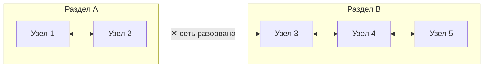

# Вопросы на собеседовании: `CAP`-теорема

Краткое введение: ответы по `CAP`-теореме для собеседований — ограничения распределённых систем, выбор между согласованностью и доступностью. **CAP-теорема** описывает предел одновременной гарантии линеаризуемости и доступности при сетевом разделении. На интервью часто спрашивают про этот компромисс, модели согласованности, алгоритмы консенсуса и примеры `CP`/`AP`-систем.

## Полезные ссылки

### Официальная документация

- [Gilbert и Lynch: формулировка CAP](https://pld.cs.luc.edu/database/gilbert_lynch_brewer_proof.pdf) — формальное доказательство
- [Brewer's CAP Theorem (оригинал)](https://www.infoq.com/articles/cap-twelve-years-later-how-the-rules-have-changed/) — статья Эрика Брюера "CAP Twelve Years Later"
- [Raft Consensus Algorithm](https://raft.github.io/) — визуализация и описание `Raft`
- [Cassandra Documentation — Consistency](https://cassandra.apache.org/doc/latest/cassandra/architecture/dynamo.html) — модель согласованности `Cassandra`
- [Jepsen — Distributed Systems Safety Research](https://jepsen.io/) — тестирование корректности распределённых систем

## Содержание

- [Полезные ссылки](#полезные-ссылки)
- [See also](#see-also)

**Основы CAP**
- [Q1. (!) Что такое CAP-теорема?](#q1--что-такое-cap-теорема)
- [Q2. Какие три свойства описывает CAP?](#q2-какие-три-свойства-описывает-cap)
- [Q3. Почему на практике выбирают между C и A?](#q3-почему-на-практике-выбирают-между-c-и-a)
- [Q4. (!) Что такое CP-системы, приведите примеры](#q4--что-такое-cp-системы-приведите-примеры)
- [Q5. (!) Что такое AP-системы, приведите примеры](#q5--что-такое-ap-системы-приведите-примеры)
- [Q6. Что такое CA-системы и почему они редки?](#q6-что-такое-ca-системы-и-почему-они-редки)

**Сетевое разделение и поведение систем**
- [Q7. Что такое сетевое разделение (partition)?](#q7-что-такое-сетевое-разделение-partition)
- [Q8. Почему CAP описывает поведение при partition, а не в норме?](#q8-почему-cap-описывает-поведение-при-partition-а-не-в-норме)
- [Q9. В чём ограниченность CAP-теоремы?](#q9-в-чём-ограниченность-cap-теоремы)

**Модели согласованности**
- [Q10. (!) Какие модели согласованности существуют и чем отличаются?](#q10--какие-модели-согласованности-существуют-и-чем-отличаются)
- [Q11. (!) Что такое linearizability и почему это самая строгая модель?](#q11--что-такое-linearizability-и-почему-это-самая-строгая-модель)
- [Q12. Что такое sequential consistency?](#q12-что-такое-sequential-consistency)
- [Q13. (!) Что такое causal consistency и когда она применяется?](#q13--что-такое-causal-consistency-и-когда-она-применяется)
- [Q14. Что такое eventual consistency и каковы её гарантии?](#q14-что-такое-eventual-consistency-и-каковы-её-гарантии)
- [Q15. Чем отличается strong eventual consistency от eventual consistency?](#q15-чем-отличается-strong-eventual-consistency-от-eventual-consistency)

**Кворумные системы**
- [Q16. (!) Что такое кворум и как он обеспечивает согласованность?](#q16--что-такое-кворум-и-как-он-обеспечивает-согласованность)
- [Q17. Что такое формула W + R > N и как она работает?](#q17-что-такое-формула-w--r--n-и-как-она-работает)
- [Q18. Как настроить кворум в Cassandra?](#q18-как-настроить-кворум-в-cassandra)

**Алгоритмы консенсуса**
- [Q19. (!) Что такое алгоритм консенсуса и зачем он нужен?](#q19--что-такое-алгоритм-консенсуса-и-зачем-он-нужен)
- [Q20. (!) Как работает алгоритм Raft?](#q20--как-работает-алгоритм-raft)
- [Q21. Как работает Paxos и чем отличается от Raft?](#q21-как-работает-paxos-и-чем-отличается-от-raft)
- [Q22. Что такое split-brain и как алгоритмы консенсуса его предотвращают?](#q22-что-такое-split-brain-и-как-алгоритмы-консенсуса-его-предотвращают)

**PACELC и расширения CAP**
- [Q23. (!) Что такое PACELC и как связано с CAP?](#q23--что-такое-pacelc-и-как-связано-с-cap)
- [Q24. Как классифицировать реальные системы по PACELC?](#q24-как-классифицировать-реальные-системы-по-pacelc)

**Реальные системы и CAP**
- [Q25. (!) Cassandra и CAP: как работает настраиваемая согласованность?](#q25--cassandra-и-cap-как-работает-настраиваемая-согласованность)
- [Q26. (!) DynamoDB и CAP: какой trade-off?](#q26--dynamodb-и-cap-какой-trade-off)
- [Q27. (!) Zookeeper и CAP: почему это CP-система?](#q27--zookeeper-и-cap-почему-это-cp-система)
- [Q28. Redis — CP или AP?](#q28-redis--cp-или-ap)
- [Q29. PostgreSQL с репликацией — CP или AP?](#q29-postgresql-с-репликацией--cp-или-ap)
- [Q30. Kafka и CAP: какой trade-off?](#q30-kafka-и-cap-какой-trade-off)
- [Q31. MongoDB и CAP: как настраивается поведение?](#q31-mongodb-и-cap-как-настраивается-поведение)
- [Q32. Можно ли систему переключать между CP и AP?](#q32-можно-ли-систему-переключать-между-cp-и-ap)

**Практика и проектирование**
- [Q33. Как выбирать CP vs AP для бизнес-системы?](#q33-как-выбирать-cp-vs-ap-для-бизнес-системы)
- [Q34. (!) Как тестировать partition tolerance?](#q34--как-тестировать-partition-tolerance)
- [Q35. Как проектировать систему с учётом CAP?](#q35-как-проектировать-систему-с-учётом-cap)

**PACELC, Spanner, BASE и микросервисы**
- [Q36. Что такое PACELC — расширение CAP для нормального состояния?](#q36-что-такое-pacelc--расширение-cap-для-нормального-состояния)
- [Q37. ZooKeeper и HBase как CP-системы: детали реализации](#q37-zookeeper-и-hbase-как-cp-системы-детали-реализации)
- [Q38. Cassandra и DynamoDB как AP-системы: детали](#q38-cassandra-и-dynamodb-как-ap-системы-детали)
- [Q39. Network partition на практике: частота и типичные сценарии](#q39-network-partition-на-практике-частота-и-типичные-сценарии)
- [Q40. CAP и микросервисная архитектура: как выбор БД влияет на дизайн?](#q40-cap-и-микросервисная-архитектура-как-выбор-бд-влияет-на-дизайн)
- [Q41. (!) Google Spanner и TrueTime: как Spanner обходит CAP?](#q41--google-spanner-и-truetime-как-spanner-обходит-cap)
- [Q42. (!) CAP vs BASE: детальное сравнение](#q42--cap-vs-base-детальное-сравнение)

## Q1. (!) Что такое CAP-теорема?

**CAP** задаёт предел для распределённого объекта при сетевом разделении: нельзя одновременно гарантировать линеаризуемость каждого чтения и записи (**C**) и успешный ответ на каждый запрос к неотказавшему узлу (**A**), если сообщения между частями сети могут не доходить (**P**). Формулировку Брюера формализовали Гилберт и Линч. Здесь C не означает ACID Consistency, а A не означает процент uptime за месяц.

При partition система может отказать части клиентов ради C или продолжить отвечать им, ослабив C. За пределами partition теорема не запрещает одновременно давать C и A. Выбор зависит от операции и области данных; ярлыки CP/AP для целого продукта — упрощение. [Gilbert и Lynch](https://pld.cs.luc.edu/database/gilbert_lynch_brewer_proof.pdf).

## Q2. Какие три свойства описывает CAP?

- **C, consistency:** операции над объектом выглядят как один последовательный порядок, соблюдающий реальное время (линеаризуемость).
- **A, availability:** каждый запрос к неотказавшему узлу завершается ответом; ошибка или бесконечное ожидание не выполняют эту гарантию.
- **P, partition tolerance:** модель допускает потерю или неограниченную задержку сообщений между узлами, а система сохраняет выбранные гарантии несмотря на разделение.

Это определения формальной модели. SLA, долговечность записи и ACID Consistency — другие свойства.

## Q3. Почему на практике выбирают между C и A?

В распределённой системе разделение связи возможно, поэтому проектировать поведение на этот случай необходимо. Если два сегмента не могут обменяться сообщениями, они не способны одновременно обещать каждому клиенту ответ и один линеаризуемый порядок конфликтующих операций.

При partition часть запросов можно отклонить или задержать, сохраняя C. Можно продолжить обслуживание в обеих частях, но тогда C для этих операций не гарантируется. Выбор применяют к конкретным операциям и данным; доступность у оставшегося кворума не равна доступности у каждого узла.

## Q4. (!) Что такое CP-системы, приведите примеры

**CP-поведение** означает, что при разделении операции, которым нужен согласованный порядок, отказывают там, где нет необходимой координации. Большинство в кворумном кластере может продолжить работу; меньшинство не подтверждает запись.

Примеры: `etcd` с Raft для подтверждённых записей и линеаризуемых чтений; `ZooKeeper` для упорядоченных записей, но обычные чтения с follower могут отставать. `MongoDB` с `w: "majority"` для записи и `readConcern: "linearizable"` на primary для соответствующих чтений. Название продукта без режима чтения и записи не доказывает CP для каждой операции.

## Q5. (!) Что такое AP-системы, приведите примеры

**AP-поведение** при partition стремится отвечать в изолированных частях, допуская временно разные версии. При восстановлении связи нужны правила разрешения конфликтов и сходимости. Это не обещание, что каждый сбой любого узла оставит систему доступной.

Примеры режимов: Cassandra с `ONE` при доступной подходящей реплике; многорегиональные таблицы DynamoDB в режиме **MREC** с асинхронной репликацией. Обычное eventual-чтение в одном регионе само по себе не доказывает AP-поведение всего DynamoDB при partition. Для важных операций проверяют конкретные ограничения записи, чтения и топологию.

## Q6. Что такое CA-системы и почему они редки?

«CA» обозначает C и A лишь в модели, где разделение между узлами исключено. Для распределённого сервиса с возможной потерей сообщений обещать обе гарантии во время partition нельзя. Одиночная БД не является контрпримером CAP: в ней нет двух сетевых частей, а отказ единственного узла всё равно делает её недоступной.

Поэтому схема «выбери две буквы из трёх» полезна только как вводное сокращение. Архитектурное решение задают на уровне операций и режима отказа.

## Q7. Что такое сетевое разделение (partition)?

**Partition** (сетевое разделение) — ситуация, когда группа узлов перестаёт получать сообщения от другой группы из-за сетевого сбоя, задержки или потери пакетов. Узлы в каждой группе могут общаться между собой, но не с узлами «по ту сторону» partition.



Типичные причины: разрыв кабеля, отказ маршрутизатора, изоляция дата-центра, проблемы у upstream-провайдера. Partition бывает разным:

- **Полным** — полная потеря связи между сегментами;
- **Частичным** (asymmetric) — узел A видит B, но B не видит A; такой случай особенно коварен, потому что узлы по-разному оценивают, кто «жив»;
- **Временным** (секунды) или **длительным** (минуты, часы).

Ключевое: CAP описывает поведение системы именно в момент partition — что она делает с запросами, пока связь разорвана.

## Q8. Почему CAP описывает поведение при partition, а не в норме?

CAP выявляет противоречие C и A именно тогда, когда узлы не могут обменяться сообщениями. При исправной сети реализации могут обеспечить обе гарантии, хотя координация всё равно увеличивает задержку и может снижать доступность по другим причинам.

CAP не обещает C и A автоматически в штатном режиме. Повседневный компромисс между задержкой и согласованностью дополнительно описывает PACELC.

## Q9. В чём ограниченность CAP-теоремы?

CAP рассматривает конкретные формальные гарантии при partition. Она не предсказывает задержку, долговечность, стоимость отказов и работу приложения при медленных дисках или сбоях процессов. Двоичный ярлык CP/AP скрывает различия между операциями, режимами чтения и топологией.

Для решения нужны явный контракт свежести, проверка поведения при разделении и оценка задержки в норме. PACELC добавляет вопрос о latency, но тоже остаётся упрощённой моделью.

## Q10. (!) Какие модели согласованности существуют и чем отличаются?

Модель согласованности описывает, какие результаты операций может увидеть клиент. **Linearizability** требует порядка с учётом реального времени для операций одного объекта. **Sequential consistency** сохраняет порядок каждого процесса в едином последовательном исполнении, но не требует межпроцессного real-time порядка. **Causal consistency** сохраняет причинные зависимости, разрешая разный порядок независимых событий. **Eventual consistency** обещает сходимость после прекращения изменений и восстановления обмена. **Read-your-writes** — отдельная сессионная гарантия клиенту.

Это не единая линейка «строже = всегда медленнее»: задержка зависит от реализации, топологии и нагрузки. Для выбора проверяют конкретный порядок, который нужен приложению.

## Q11. (!) Что такое linearizability и почему это самая строгая модель?

**Линеаризуемость** для объекта означает, что каждой операции можно назначить одну точку между вызовом и ответом, сохранив порядок операций, не перекрывающихся во времени. Если запись уже завершилась до начала чтения, чтение не должно вернуть более старую версию без новой конкурирующей записи. Перекрывающиеся операции допускают несколько допустимых порядков.

Это свойство наблюдаемой истории, а не требование физически одновременно обновить все копии. Для транзакций над несколькими объектами отдельно рассматривают serializability и external consistency. Raft может служить основой для линеаризуемого сервиса, если протокол чтения проверяет актуальность лидера.

## Q12. Что такое sequential consistency?

**Sequential consistency** допускает единый последовательный порядок всех операций, который сохраняет порядок каждого процесса. Он может не совпадать с порядком реального времени между разными процессами; это отличие от линеаризуемости.

В отличие от causal consistency, здесь требуется общий порядок и для независимых операций. Eventual consistency сама по себе не сохраняет порядок операций каждого процесса. Синхронизированные физические часы для определения последовательного порядка не нужны.

Например, процесс A выполняет `A1` затем `A2`, процесс B — `B1` затем `B2`. Порядок `A1, B1, A2, B2` допустим по этому условию, а `A2, A1, B1, B2` — нет. Это определение не доказывает, что конкретное чтение ZooKeeper линеаризуемо; обычный follower read может отставать.

## Q13. (!) Что такое causal consistency и когда она применяется?

**Causal consistency** (причинная согласованность) — модель, которая гарантирует порядок только для причинно-связанных операций. Если операция B зависит от результата A (например, B читает значение, записанное A), то все узлы увидят A перед B. А параллельные операции, между которыми причинной связи нет, могут наблюдаться на разных узлах в разном порядке — и это допустимо.

```
Пример (чат):
  Алиса: "Кто идёт на обед?"     (сообщение 1)
  Боб:   "Я!"                     (сообщение 2, ответ на 1 — причинная связь)

  Causal consistency гарантирует: все видят сообщение 1 перед 2.
  Но сообщение Кати "Привет всем" (не связано) может быть в любом месте.
```

Применяется в:
- **`MongoDB`** (causal consistency sessions) — клиент получает `clusterTime` и `operationTime`, гарантирующие причинный порядок
- **Социальные сети** — комментарии должны отображаться после поста, на который они отвечают
- **Коллаборативные редакторы** — `CRDT` с causal ordering

**Компромисс:** causal consistency — золотая середина. Она сильнее `eventual` (важные причинные связи не нарушатся), но не требует глобальной синхронизации, как `linearizability`, — координируются только связанные операции, а не все подряд. Отсюда умеренная задержка при разумных гарантиях.

## Q14. Что такое eventual consistency и каковы её гарантии?

**Eventual consistency** означает: если обновления прекратятся и доставка/обмен между репликами возобновятся, реплики в итоге сойдутся. Она не устанавливает фиксированный срок и не гарантирует, что клиент сразу увидит собственную запись.

Долговечность и отсутствие потери данных из этого определения не следуют: подтверждённая запись может быть потеряна при сбое реализации или выбранной политике репликации. Порядок наблюдения и конфликтующие записи нужно рассматривать отдельно.

## Q15. Чем отличается strong eventual consistency от eventual consistency?

**Strong eventual consistency** добавляет к eventual свойство сходимости без согласования порядка доставки: реплики, получившие одинаковый набор обновлений, приходят к одинаковому состоянию. CRDT строят операции и merge так, чтобы повторная доставка и разный порядок не создавали разных итогов.

Для G-Counter каждый участник хранит собственный монотонный счётчик; merge берёт максимум по участникам, а итог — сумму. SEC не обещает свежесть чтения в каждой реплике и не делает все записи линеаризуемыми.

## Q16. (!) Что такое кворум и как он обеспечивает согласованность?

**Кворум** — число подтверждений, необходимое для успеха операции. Если запись подтверждена `W` из `N` реплик, а чтение получает `R` ответов, то при `W + R > N` множества пересекаются хотя бы в одной реплике. Это помогает увидеть подтверждённую версию, если читающий алгоритм сравнивает версии корректно.

Одного пересечения недостаточно для линеаризуемости: конкурентные записи, конфликтующие версии, выбор реплик, неполные операции и failover требуют дополнительных правил. В Cassandra проверяют timestamp и consistency level, а не объявляют формулу универсальной гарантией CAP-C. [Cassandra Dynamo](https://cassandra.apache.org/doc/stable/cassandra/architecture/dynamo).

## Q17. Что такое формула W + R > N и как она работает?

`W + R > N` — условие пересечения кворумов записи и чтения в фиксированном наборе `N` реплик. Для `N=3` пары `(W=2,R=2)`, `(W=3,R=1)` и `(W=1,R=3)` пересекаются; `(1,1)` — нет.

Больший W повышает цену и требования доступности записи, больший R — чтения. Пересечение само по себе не упорядочивает конкурентные записи и не гарантирует линеаризуемость. При нескольких DC локальный кворум относится к своему набору реплик; при sloppy quorum предпосылки о пересечении тоже нужно проверить.

## Q18. Как настроить кворум в Cassandra?

В Cassandra `replication factor` задаёт число реплик, а `consistency level` задаётся для конкретного чтения или записи. При RF=3 уровни `ONE`, `QUORUM` и `ALL` требуют соответственно 1, 2 и 3 ответа. `LOCAL_QUORUM` считает большинство в локальном DC; `EACH_QUORUM` применяется к записи по DC; `ANY` допускается только для записи и может подтвердить hint вместо реплики.

Пара `QUORUM` для записи и чтения даёт пересечение кворумов и обычно видимость подтверждённой записи при корректном разрешении версий. Она не превращает Cassandra в линеаризуемую БД для всех операций. `ONE` может отвечать при меньшем числе доступных реплик, но не гарантирует видимость последней записи. [Документация Cassandra](https://cassandra.apache.org/doc/stable/cassandra/architecture/dynamo).

## Q19. (!) Что такое алгоритм консенсуса и зачем он нужен?

**Консенсус** позволяет группе узлов согласовать решение или порядок записей несмотря на отказ части участников. Raft и Paxos используют пересекающиеся кворумы для безопасности: два противоречащих решения не должны быть подтверждены как одно и то же решение.

Теорема FLP говорит, что в полностью асинхронной системе с возможным отказом узла нельзя одновременно гарантировать детерминированное завершение консенсуса во всех исполнениях. Практические алгоритмы используют тайм-ауты и предположения о периодах достаточной связи; безопасность решения и способность завершить его — разные свойства.

## Q20. (!) Как работает алгоритм Raft?

**Raft** строит реплицируемый журнал с лидером. Follower без heartbeat начинает выборы; кандидат с достаточным журналом может получить большинство голосов. Лидер отправляет записи через AppendEntries и фиксирует их по правилам кворума и текущего терма. После смены лидера подтверждённые записи должны оставаться в истории.

Raft не делает любое чтение у любого узла свежим автоматически. Для линеаризуемого чтения сервис проверяет актуальное лидерство и достаточность применённого журнала; чтение от follower без такой проверки может отставать. [Raft paper](https://raft.github.io/raft.pdf).

## Q21. Как работает Paxos и чем отличается от Raft?

В базовом **Paxos** proposer выбирает номер предложения, собирает promises от кворума acceptor в фазе prepare, затем предлагает значение в фазе accept. Если acceptor уже принимал предложение, proposer должен соблюдать правило выбора ранее принятого значения; простого «нового номера» недостаточно. Значение выбирается кворумом acceptor.

Raft оформляет репликацию журнала через явного лидера и правила выборов. Multi-Paxos тоже обычно использует устойчивого лидера ради эффективности; противопоставлять «Paxos без лидера» и «Raft с лидером» как обязательное свойство всех реализаций неверно. [Paxos Made Simple](https://lamport.azurewebsites.net/pubs/paxos-simple.pdf), [Raft paper](https://raft.github.io/raft.pdf).

## Q22. Что такое split-brain и как алгоритмы консенсуса его предотвращают?

**Split-brain** — состояние, при котором две части системы считают себя владельцами права выполнять несовместимые действия. В Raft пересекающиеся кворумы не позволяют двум лидерам зафиксировать конфликтующие записи в одном терме. Меньшинство не может подтвердить новую запись, хотя прежний лидер может ещё некоторое время считать себя лидером.

Внешний ресурс сам по себе не знает о термах Raft. Если старый владелец успевает выполнить запоздалое действие, нужны fencing token или иная проверка эпохи на стороне ресурса. Локальный `AtomicLong` на каждом процессе таким токеном не является.

## Q23. (!) Что такое PACELC и как связано с CAP?

**PACELC** предлагает обсуждать две ситуации: **P** — при partition приоритет доступности A или согласованности C; **E**lse — без partition приоритет меньшей задержки L или более сильной согласованности C. Это полезно, потому что синхронизация реплик добавляет цену и в обычном режиме.

PACELC — модель классификации, а не гарантия, что все запросы без partition всегда выбирают один и тот же режим. Систему описывают с указанием операции, режима чтения и записи, топологии и политики отказа. [Abadi, Consistency Tradeoffs in Modern Distributed Database System Design](https://www.cs.umd.edu/~abadi/papers/abadi-pacelc.pdf).

## Q24. Как классифицировать реальные системы по PACELC?

PACELC — учебная классификация поведения **конкретной конфигурации и операции**: при partition выбирают приоритет доступности либо согласованности, без partition — задержки либо согласованности. Она не присваивает неизменную метку всему продукту.

Cassandra с `ONE` обычно ставит локальный ответ выше свежести; `QUORUM` ждёт больше реплик. `etcd` для линеаризуемого чтения и записи выбирает координацию. Для DynamoDB надо различать обычную таблицу, глобальную таблицу MREC и MRSC; `ConsistentRead=true` у одной операции не меняет режим всей глобальной таблицы. Для PostgreSQL важны способ репликации и чтения.

## Q25. (!) Cassandra и CAP: как работает настраиваемая согласованность?

Cassandra задаёт `consistency level` на операцию. При RF=3 `ONE` ждёт одну реплику, `QUORUM` — две, `ALL` — три. Разные уровни меняют вероятность доступного ответа и видимость подтверждённой записи. `W+R>RF` гарантирует пересечение ответивших реплик при соответствующих предпосылках, но не полную линеаризуемость.

Записи отправляются репликам независимо от выбранного уровня подтверждения. Hinted handoff и repair помогают сходимости после сбоя, но не заменяют проверку конфликтов, timestamp и условий конкретного запроса. [Cassandra Dynamo](https://cassandra.apache.org/doc/stable/cassandra/architecture/dynamo).

## Q26. (!) DynamoDB и CAP: какой trade-off?

У DynamoDB надо разделять **согласованность чтения** и **поведение многорегиональной репликации**. В одной Region чтение по таблице или LSI может быть eventual либо strong (`ConsistentRead=true`); GSI и Streams дают eventual-чтение. Это не переключатель CP/AP для всей службы.

Global Tables поддерживают MREC (асинхронная репликация между регионами, режим по умолчанию) и MRSC (сильная согласованность между регионами для поддерживаемых операций). Режим выбирают при создании таблицы и не меняют per-request. У MRSC для успешной записи и strong-read нужен доступ к кворуму регионов; без него остаются eventual-чтения. Ограничения и доступность режимов зависят от текущей документации AWS. [AWS Global Tables](https://docs.aws.amazon.com/amazondynamodb/latest/developerguide/bp-global-table-design.html).

## Q27. (!) Zookeeper и CAP: почему это CP-система?

ZooKeeper упорядочивает записи через лидера и кворум ZAB. При разделении часть без кворума не может подтвердить новые записи. Однако обычные чтения с follower могут быть устаревшими; перед критичным чтением нужен `sync()` или иной протокол свежести. Поэтому ярлык CP относится к подтверждённым записям и соответствующему режиму чтения, а не к каждому ответу.

Сессии и ephemeral nodes зависят от тайм-аута: потеря соединения не удаляет ephemeral node мгновенно. Внешний ресурс дополнительно защищают от запоздалого старого владельца. [ZooKeeper Programmer's Guide](https://zookeeper.apache.org/doc/current/zookeeperProgrammers.html).

## Q28. Redis — CP или AP?

Redis Cluster сочетает асинхронную репликацию с ограничениями доступности: подтверждённые записи могут потеряться при failover, а раздел без большинства master-узлов со временем прекращает принимать записи. Он не является ни строго CP, ни полностью AP для всех клиентов и слотов.

`WAIT` ждёт подтверждения репликации от указанного числа реплик и уменьшает риск потери, но **не делает Redis Cluster strongly consistent**. При сложном failover возможна потеря даже после ожидания. Для выбора режима учитывают конкретный слот, состояние кластера и требования к долговечности. [Redis Cluster](https://redis.io/docs/latest/management/scaling/).

## Q29. PostgreSQL с репликацией — CP или AP?

У PostgreSQL `synchronous_commit=on` **без** `synchronous_standby_names` означает локальное ожидание WAL, а не подтверждение реплики. Чтобы коммит ждал standby, нужно настроить синхронный standby; `remote_apply` дополнительно ждёт применения изменений на нём. Асинхронная реплика может отставать, но primary остаётся единственным владельцем записи, а не независимым AP-писателем в каждом сегменте.

CAP-поведение зависит от правил failover, fencing старого primary и маршрутизации чтений. Ни синхронный, ни асинхронный режим в одиночку не дают универсальную метку CP/AP. [PostgreSQL streaming replication](https://www.postgresql.org/docs/current/warm-standby.html).

## Q30. Kafka и CAP: какой trade-off?

Для Kafka важно различать **подтверждение и сохранность записи** и линеаризуемость всех операций. `acks=all` ждёт подтверждения текущих ISR; `min.insync.replicas` задаёт минимальный размер ISR для успешной записи. При нехватке ISR запись отказывается, что снижает доступность ради сохранности. `unclean.leader.election.enable=true` допускает лидера без последних данных и риск потери.

`acks=all` не ждёт consumer-группы. Идемпотентный producer устраняет часть дублей при повторах, но сам по себе не означает exactly-once для всей цепочки. Параметры не превращают Kafka целиком в «CP» или «AP»: нужно оценивать конкретную partition, чтение, подтверждение и failover. [Apache Kafka producer](https://kafka.apache.org/44/configuration/topic-configs/).

## Q31. MongoDB и CAP: как настраивается поведение?

В MongoDB `writeConcern` определяет подтверждение записи, `readConcern` и `readPreference` — видимость и место чтения. `w:1` может быть откатан при failover, `w:"majority"` снижает этот риск. `readConcern:"majority"` показывает majority-committed данные, но сам по себе не обещает последнюю запись в реальном времени.

Для линеаризуемого чтения одного документа используют `readConcern:"linearizable"` на primary вместе с majority-acknowledged записями; causal sessions дают причинный порядок и read-your-writes при соблюдении условий сессии. При потере большинства новые majority-записи и linearizable-чтения могут отказать или ждать. [MongoDB read concern](https://www.mongodb.com/docs/manual/reference/read-concern/).

## Q32. Можно ли систему переключать между CP и AP?

Многие системы позволяют менять **конкретные гарантии операций**: например, уровень Cassandra, режим чтения DynamoDB в одном регионе, concerns MongoDB, подтверждения записи Kafka. Но это не всегда переключатель между полными формальными CP и AP.

Глобальная таблица DynamoDB выбирает MREC или MRSC при создании, а PostgreSQL `synchronous_commit` без standby не меняет режим репликации. Перед ярлыком CP/AP уточняют операцию, данные, топологию и поведение клиента при partition.

## Q33. Как выбирать CP vs AP для бизнес-системы?

Сначала формулируют бизнес-инвариант и допустимое окно устаревания. Если подтверждение платежа или резервирование остатка требует единого порядка, соответствующая операция должна получать нужную гарантию и может отказать при потере кворума. Для производной ленты или поиска задержка обновления часто допустима, если она оговорена.

Затем определяют поведение при partition: кто может отвечать, какие ответы будут stale, когда повторять и как разрешать конфликт. Само название БД, размер данных и отрасль не заменяют контракт операции.

## Q34. (!) Как тестировать partition tolerance?

Для проверки partition tolerance создают контролируемые сетевые сценарии: изолируют меньшинство, делают связь односторонней, добавляют задержки и потери. Во время теста записывают историю чтений и записей с временем вызова и ответа. После восстановления проверяют сохранность подтверждённых операций, сходимость и доступность каждой стороны.

Jepsen и похожие инструменты проверяют историю против заявленной модели. Нагрузочный тест без разрыва связи и одна проверка тайм-аута такой анализ не заменяют. Эксперименты проводят в изолированной среде либо с явным управлением риском, чтобы тест не нарушил реальные данные. [Jepsen](https://jepsen.io/).

## Q35. Как проектировать систему с учётом CAP?

Проектирование начинают с конкретной операции: кто владеет инвариантом, сколько может быть stale ответ, когда клиент получает подтверждение и как обрабатывается разделение сети. Один сервис может строго подтверждать запись, а другой читать производное представление с задержкой.

Outbox сохраняет событие в локальной транзакции с изменением данных, а потребитель обрабатывает повторы идемпотентно. Saga задаёт последовательность локальных шагов и компенсаций, но не превращает их в одну атомарную транзакцию. Для критичного чтения указывают источник и уровень свежести; при недоступности дают честный отказ или согласованный fallback.

## Q36. Что такое PACELC — расширение CAP для нормального состояния?

PACELC дополняет CAP вопросом о штатной работе: **P** — при partition приоритет A или C; **E**lse — без partition приоритет L (меньшая задержка) или C. Это модель выбора, а не новая теорема о том, что любой запрос обязательно платит строго фиксированной задержкой.

Классифицируют конкретную конфигурацию и операцию. Например, чтение Cassandra с `ONE` ждёт меньше ответов, чем `QUORUM`, но ни одна из этих настроек сама по себе не доказывает линеаризуемость всего сервиса. Частоту разделений и задержки измеряют в своей системе, не берут из универсальной таблицы.

## Q37. ZooKeeper и HBase как CP-системы: детали реализации

ZooKeeper использует лидера, журнал zxid и кворум для упорядоченных подтверждённых записей. Обычное чтение с follower может отставать; потеря соединения не удаляет ephemeral node до истечения сессии. Поэтому внешнюю блокировку защищают от запоздалого владельца.

HBase использует ZooKeeper для части координации и обеспечивает сильную согласованность операций над строкой через назначение region и журналирование. Это не значит, что HBase использует ZAB как протокол каждого чтения или записи строки. При сбое region-сервера назначение нового владельца и восстановление могут временно сделать регион недоступным. [HBase consistency](https://hbase.apache.org/docs/).

## Q38. Cassandra и DynamoDB как AP-системы: детали

Cassandra применяет репликацию без единого лидера для всего кластера и уровни `ONE`, `QUORUM`, `ALL` на операцию. Hints и repair помогают после сбоя; уровень `ONE` может вернуть устаревшее значение. `QUORUM` создаёт пересечение при нужной паре чтения и записи, но не даёт автоматически линеаризуемость.

DynamoDB нельзя целиком назвать AP или CP по одному флагу чтения. В одном регионе доступны eventual и strong read для поддерживаемых объектов; Global Tables MREC и MRSC различаются межрегиональной репликацией. Режим MRSC выбирают при создании таблицы. [Cassandra Dynamo](https://cassandra.apache.org/doc/stable/cassandra/architecture/dynamo), [AWS Global Tables](https://docs.aws.amazon.com/amazondynamodb/latest/developerguide/bp-global-table-design.html).

## Q39. Network partition на практике: частота и типичные сценарии

Network partition может выглядеть как полный разрыв связи, потери пакетов, асимметричная достижимость или задержки больше тайм-аута. GC-пауза похожа для наблюдателя на недоступный узел, хотя сама по себе не является сетевым разделением. Rolling restart — отказ узла, а не обязательно partition.

Частота зависит от топологии, провайдера и нагрузки; универсальные проценты и «тысячи в месяц» без определённого измерения вводят в заблуждение. Тестируют сценарии отдельно: одностороннюю потерю сообщений, изоляцию меньшинства, медленную сеть и восстановление. Проверяют историю операций и фактические гарантии, а не только факт ответа.

## Q40. CAP и микросервисная архитектура: как выбор БД влияет на дизайн?

В микросервисах выбор хранилища влияет на гарантии **локальных** операций, но не делает межсервисные вызовы автоматически согласованными. Для каждого бизнес-инварианта определяют владельца и допустимое окно устаревания. Критичную запись подтверждают там, где инвариант проверяется; производные представления могут обновляться позднее.

Outbox помогает надёжно публиковать событие вместе с локальной транзакцией; идемпотентный потребитель обрабатывает повторы. Saga задаёт компенсации при нескольких локальных транзакциях, но не равна строгой распределённой транзакции. Протокол чтения и деградации выбирают отдельно от ярлыка БД CP/AP.

## Q41. (!) Google Spanner и TrueTime: как Spanner обходит CAP?

Spanner **не обходит CAP**. Для записи ему нужны кворумы Paxos; сторона partition без кворума не может подтвердить запись. TrueTime не переносит сообщения через разрыв сети и не делает каждый сегмент доступным.

TrueTime возвращает интервал неопределённости времени. Commit wait позволяет назначать временные метки так, чтобы завершённые транзакции сохраняли наблюдаемый порядок; вместе с репликацией и транзакционным протоколом это даёт external consistency в поддерживаемом режиме. Размер неопределённости и фактическая доступность зависят от среды, поэтому фиксированные миллисекунды и «практически CA» не являются гарантией. [Spanner TrueTime](https://docs.cloud.google.com/spanner/docs/true-time-external-consistency).

## Q42. (!) CAP vs BASE: детальное сравнение

**ACID** описывает свойства транзакции: атомарность, сохранение инвариантов данных, изоляцию и долговечность. Его Consistency — соблюдение заданных ограничений, а не CAP-линеаризуемость. **BASE** — подход с базовой доступностью, мягким состоянием и eventual consistency для части распределённых сценариев.

ACID и BASE не являются строгими противоположными наборами и не эквивалентны CP/AP. Система может иметь ACID-транзакции внутри одной реплики и eventual-репликацию между регионами. Для конкретной операции отдельно проверяют транзакционные инварианты, видимость записи при partition, срок сходимости и правила конфликтов.
