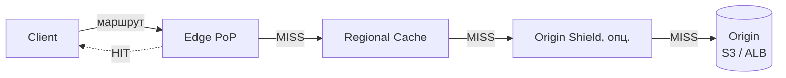
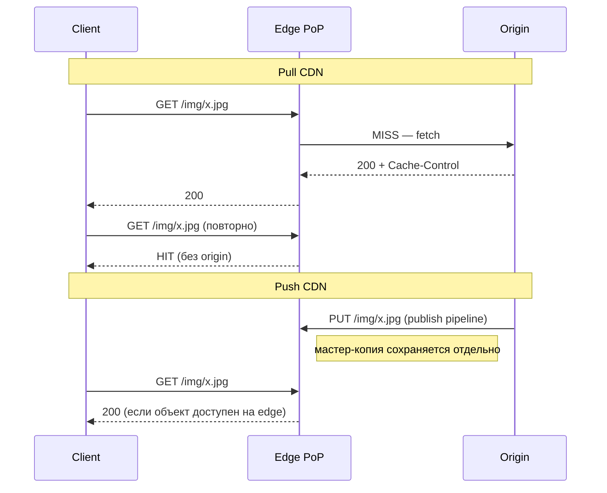

# Вопросы на собеседовании: `CDN (Content Delivery Network)`

`CDN` — распределённая сеть узлов (`edge`/`PoP`), которая может отдавать кэшируемый контент ближе к клиенту и применять сетевые политики до origin. Выигрыш по задержке, нагрузке и доступности зависит от маршрута, правил кэша и профиля трафика. В system design CDN рассматривают, когда аудитория распределена, а контент или сетевые политики выигрывают от обработки ближе к пользователю.

Дата последнего обновления: 2026-11-09

**Ключевые игроки рынка:** `Cloudflare`, `Akamai`, `AWS CloudFront`, `Fastly`, `Google Cloud CDN`, `Bunny.net`. Маршрутизация к точке присутствия, кэширование и edge-обработка различаются по продуктам и настройкам; anycast и edge compute не обязательны для каждого CDN.

## Полезные ссылки

### Основные источники

- [System Design Primer — Content Delivery Network](https://github.com/donnemartin/system-design-primer#content-delivery-network) — Push/Pull CDN, базовая теория
- [Cloudflare Learning — What is a CDN?](https://www.cloudflare.com/learning/cdn/what-is-a-cdn/) — концепции CDN от Cloudflare
- [AWS CloudFront — Developer Guide](https://docs.aws.amazon.com/AmazonCloudFront/latest/DeveloperGuide/) — поведение кэша, behaviors, invalidation
- [Fastly — Surrogate Keys](https://docs.fastly.com/en/guides/working-with-surrogate-keys) — purge by tag
- [Cloudflare Cache Tags](https://developers.cloudflare.com/cache/how-to/purge-cache/purge-by-tags/) — purge by tag
- [MDN — HTTP caching](https://developer.mozilla.org/en-US/docs/Web/HTTP/Caching) — Cache-Control, ETag, Vary
- [RFC 9111 — HTTP Caching](https://www.rfc-editor.org/rfc/rfc9111) — каноническая семантика
- [HLS spec (RFC 8216)](https://www.rfc-editor.org/rfc/rfc8216) — HTTP Live Streaming
- [Web Cache Deception — 2017/2020](https://www.akamai.com/blog/security/web-cache-deception-attack) — оригинальная атака на Akamai
- [Cloudflare 2019 BGP leak — post-mortem](https://blog.cloudflare.com/how-verizon-and-a-bgp-optimizer-knocked-large-parts-of-the-internet-offline-today/) — incident
- [Fastly 2021 global outage — post-mortem](https://www.fastly.com/blog/summary-of-june-8-outage) — ошибка после изменения конфигурации
- [Akamai 2021 service disruption](https://www.akamai.com/blog/news/akamai-summarizes-service-disruption-resolved) — сбой DNS-компонента Secure Edge CDN

## Содержание

- [Полезные ссылки](#полезные-ссылки)
- [See also](#see-also)

**Основы и архитектура**
- [Q1. (!) Что такое CDN и зачем он нужен?](#q1--что-такое-cdn-и-зачем-он-нужен)
- [Q2. (!) Архитектура CDN: PoP, edge, regional, origin shield, origin](#q2--архитектура-cdn-pop-edge-regional-origin-shield-origin)
- [Q3. Anycast routing — как CDN выбирает ближайший PoP?](#q3-anycast-routing--как-cdn-выбирает-ближайший-pop)
- [Q4. GeoDNS vs Anycast — что и когда?](#q4-geodns-vs-anycast--что-и-когда)
- [Q5. Иерархия кэша: edge → regional → origin shield](#q5-иерархия-кэша-edge--regional--origin-shield)

**Push vs Pull, кеширование**
- [Q6. (!) Push CDN vs Pull CDN — когда какой выбрать?](#q6--push-cdn-vs-pull-cdn--когда-какой-выбрать)
- [Q7. (!) Cache-Control, ETag, Last-Modified — как работают на CDN?](#q7--cache-control-etag-last-modified--как-работают-на-cdn)
- [Q8. Vary header и cache key — нормализация запроса](#q8-vary-header-и-cache-key--нормализация-запроса)
- [Q9. (!) Инвалидация кэша: purge by URL, purge by tag, версионирование](#q9--инвалидация-кэша-purge-by-url-purge-by-tag-версионирование)
- [Q10. stale-while-revalidate и stale-if-error](#q10-stale-while-revalidate-и-stale-if-error)
- [Q11. Surrogate-Control против Cache-Control — в чём разница?](#q11-surrogate-control-против-cache-control--в-чём-разница)
- [Q12. Range requests и кэширование больших файлов](#q12-range-requests-и-кэширование-больших-файлов)

**TLS / HTTP-протоколы**
- [Q13. (!) TLS termination на edge: что даёт и какие риски?](#q13--tls-termination-на-edge-что-даёт-и-какие-риски)
- [Q14. HTTP/2 и HTTP/3 (QUIC) на edge](#q14-http2-и-http3-quic-на-edge)
- [Q15. 0-RTT в TLS 1.3 — выигрыш и replay-риск](#q15-0-rtt-в-tls-13--выигрыш-и-replay-риск)

**Image / Video / Edge Compute**
- [Q16. (!) Оптимизация изображений: AVIF/WebP, srcset, ресайз на лету](#q16--оптимизация-изображений-avifwebp-srcset-ресайз-на-лету)
- [Q17. Видеостриминг: HLS, DASH, ABR, CMAF, LL-HLS](#q17-видеостриминг-hls-dash-abr-cmaf-ll-hls)
- [Q18. Dynamic Site Acceleration (DSA) — как кэшировать «динамику»](#q18-dynamic-site-acceleration-dsa--как-кэшировать-динамику)
- [Q19. (!) Edge compute — код на CDN: Cloudflare Workers, Lambda@Edge, Compute@Edge](#q19--edge-compute--код-на-cdn-cloudflare-workers-lambdaedge-computeedge)

**Безопасность (WAF, DDoS, cache poisoning)**
- [Q20. (!) Защита от DDoS: scrubbing, rate limiting, bot management](#q20--защита-от-ddos-scrubbing-rate-limiting-bot-management)
- [Q21. WAF на CDN: Cloudflare WAF, AWS WAF, Imperva](#q21-waf-на-cdn-cloudflare-waf-aws-waf-imperva)
- [Q22. (!) Cache poisoning и Web Cache Deception — как защищаться?](#q22--cache-poisoning-и-web-cache-deception--как-защищаться)
- [Q23. Cache-key smuggling и нормализация заголовков](#q23-cache-key-smuggling-и-нормализация-заголовков)

**Cost / Multi-CDN / Operations**
- [Q24. (!) Cost-модель CDN: egress, requests, edge CPU-ms](#q24--cost-модель-cdn-egress-requests-edge-cpu-ms)
- [Q25. Сравнение игроков: Cloudflare/Akamai/CloudFront/Fastly/Bunny](#q25-сравнение-игроков-cloudflareakamaicloudfrontfastlybunny)
- [Q26. (!) Multi-CDN — несколько CDN сразу: active-active, traffic steering, NS1/Cedexis](#q26--multi-cdn--несколько-cdn-сразу-active-active-traffic-steering-ns1cedexis)
- [Q27. Наблюдаемость CDN: логи, аналитика, RUM](#q27-наблюдаемость-cdn-логи-аналитика-rum)
- [Q28. Cold start cache MISS и pre-warming](#q28-cold-start-cache-miss-и-pre-warming)
- [Q29. Реальные инциденты: Fastly 2021, Akamai 2021, Cloudflare 2019](#q29-реальные-инциденты-fastly-2021-akamai-2021-cloudflare-2019)
- [Q30. Как настроить кэш CloudFront и Cloudflare для статики и личных страниц?](#q30-как-настроить-кэш-cloudfront-и-cloudflare-для-статики-и-личных-страниц)

## Q1. (!) Что такое CDN и зачем он нужен?

**CDN (Content Delivery Network)** — распределённая сеть узлов (`edge`, `PoP`), которая может отдавать разрешённый кэшируемый контент с подходящей точки и тем самым ставит слой кэша между клиентом и origin. Главная идея: повторно отвечать ближе к клиенту, если маршрут и политика кэша это позволяют.

**Зачем нужен** — возможные выгоды зависят от доли кэшируемого трафика, маршрута и настроек:
- **Задержка (latency)** — клиент может получить ответ с близкого edge, а TLS-соединение завершается до удалённого origin. Фактический выигрыш измеряют по регионам.
- **Разгрузка origin** — кэшируемые попадания не требуют обращения к origin. Выигрыш зависит от cache hit ratio, размера объектов и тарификации.
- **Доступность** — свежий кэш или разрешённая выдача stale могут сохранить часть ответов при сбое origin. Некэшируемые запросы всё равно зависят от него.
- **Защита от DDoS** — распределённая сеть и правила на edge могут отсеять часть вредоносного трафика до origin; прямой обход CDN нужно закрыть отдельно.
- **TLS на edge** — сокращает путь первого обмена с клиентом, если клиент попал на близкий PoP; до origin настраивают отдельное защищённое соединение.

**Чего CDN не делает** (частый уточняющий вопрос на интервью):
- Не кэширует запись по умолчанию — `POST`/`PUT` обычно обрабатывает origin или отдельный прикладной сервис.
- Не кэширует динамику «магически»: без правильных `Cache-Control`/`Vary` персонализированный ответ либо не кэшируется, либо кэшируется неверно.

**Архитектурно CDN это:**
```
Client ──routing──► Edge PoP ──MISS──► Regional cache ──► Origin shield (опц.) ──► Origin
```

**Итог:** CDN особенно полезен при распределённой аудитории, крупных статических объектах и потребности в защите или политике на edge.

## Q2. (!) Архитектура CDN: PoP, edge, regional, origin shield, origin

Многие CDN используют несколько уровней кэша, но их состав зависит от провайдера и конфигурации: запрос при промахе может перейти к regional cache, shield или сразу к origin. В такой иерархии запрос при промахе спускается на уровень глубже, и до origin доходит лишь то, что не нашлось нигде выше. Состав и размер слоёв зависят от провайдера.

**Уровни иерархии (от ближайшего к клиенту к origin):**

| Слой | Что это | Сколько узлов | RTT до клиента |
|------|---------|----------------|-----------------|
| **Edge PoP** | Точка присутствия ближе к клиенту | зависит от сети | зависит от маршрута |
| **Regional cache** | Второй уровень для части edge-промахов | зависит от провайдера | зависит от маршрута |
| **Origin shield** | Выбранный промежуточный уровень перед origin | настраивается отдельно | — |
| **Origin** | Исходный сервер или хранилище | зависит от архитектуры | зависит от региона |

**Зачем несколько уровней:** каждый дополнительный кэш может отфильтровать часть промахов предыдущего и уменьшить обращения к origin.
- **Edge PoP** — отдаёт hot-объекты. При cache MISS может обратиться к regional cache, если он настроен.
- **Regional cache** — собирает MISS-трафик десятков edge PoP в одном месте. То, что один edge не нашёл, другой уже мог сюда положить → второй шанс на cache HIT.
- **Origin shield** — направляет промахи через выбранный дополнительный уровень и может повысить долю попаданий и снизить нагрузку на origin. Объединение одновременных запросов и число обращений зависят от продукта, ключа кэша и настроек.

**Пример CloudFront:**
```
Client → Edge (CF PoP) → Regional Edge Cache → Origin Shield (опц.) → S3/ALB
```

**Дополнительный слой** включается отдельно (CloudFront — `OriginShield`, Cloudflare — `Tiered Cache`; это разные механизмы). Его польза выше, когда много PoP запрашивают одни объекты; для редких уникальных объектов дополнительный hop может не окупиться.



**Итог:** PoP принимает запрос, regional агрегирует MISS-ы, shield защищает origin от thundering herd.

## Q3. Anycast routing — как CDN выбирает ближайший PoP?

Anycast объявляет один IP-префикс из нескольких локаций; сеть выбирает BGP-маршрут по своим политикам. Он может вести к близкому по сети PoP, но географическую близость не гарантирует.

**Механизм.** BGP выбирает маршрут по сетевой политике, а не по географическим координатам. AS-path может влиять на выбор, но не является единственным критерием. При смене маршрута активное соединение может оборваться.

**Пример.** Один IP доступен из нескольких PoP; провайдер клиента выбирает маршрут к одному из анонсов.

**Когда применять.** Сетевое распределение трафика по множеству точек.

**Граница.** Маршрут может измениться при сбое или смене политики; активные соединения не обязаны сохраниться.

## Q4. GeoDNS vs Anycast — что и когда?

GeoDNS выбирает ответ DNS по доступным сигналам о регионе резолвера или клиента, а anycast распространяет один адрес из нескольких точек через BGP. Политики и фактическая близость зависят от сети.

**Механизм.** GeoDNS принимает решение при разрешении имени, используя адрес резолвера или EDNS Client Subnet, если он доступен. Кэш DNS может задержать смену адреса. Anycast маршрутизирует уже выбранный IP и не даёт точной привязки к стране.

**Пример.** DNS отдаёт региональный адрес, а сеть ведёт к одному из PoP, объявляющих этот адрес.

**Когда применять.** Географические политики доставки и распределение трафика.

**Граница.** Кэш DNS, резолвер и сетевой маршрут ограничивают точность и скорость переключения.

## Q5. Иерархия кэша: edge → regional → origin shield

Иерархия кэша — это каскад из нескольких уровней, где каждый может отсеять часть промахов предыдущего, так что к origin доходит меньше запросов (архитектура уровней — в Q2). Размер кэша и TTL задаются конкретным продуктом и политикой, а не положением слоя в схеме.

**Уровни и их роль:**
- **Edge cache** — хранит востребованные объекты близко к клиенту; размер и TTL задаются продуктом и политикой.
- **Regional cache** — может агрегировать промахи нескольких edge и давать второй шанс на попадание.
- **Origin shield** — дополнительный уровень перед origin; он может сократить число запросов, но не гарантирует один запрос на объект.

**Эффект измеряют**, сравнивая запросы к origin, hit ratio на каждом уровне и задержку при MISS. Универсальных процентов для всей иерархии нет: они зависят от популярности объектов, TTL и ключа кэша.

## Q6. (!) Push CDN vs Pull CDN — когда какой выбрать?

Разница в том, **кто и когда загружает контент в CDN**. В Pull CDN запрашивает объект у источника по мере потребности; в Push издатель загружает выбранные объекты заранее. Размещение по PoP, стоимость и свежесть зависят от сервиса и настроек.

**Pull CDN (Pull-through, ленивый):** контент попадает на edge по требованию.
- Origin содержит мастер-копию.
- На первый запрос CDN ловит cache MISS, тянет файл из origin и кладёт в кэш.
- Повторные запросы могут дать cache HIT, пока объект сохранён и свеж.
- Свежесть управляется TTL и заголовками (`Cache-Control`, инвалидация).

**Push CDN (Push-on-publish, упреждающий):** контент попадает на edge заранее.
- Контент **заливается в CDN до запросов** — например, шагом CI/CD после публикации.
- Мастер-копию и процедуру повторной публикации сохраняют вне edge-кэша: загруженный объект не гарантированно реплицирован во все PoP и может быть вытеснен.

**Сравнение:**

| Параметр | Pull CDN | Push CDN |
|----------|----------|----------|
| Настройка | origin и политика кэша | процесс публикации и доступности |
| Каталог | подходит для длинного хвоста | подходит для заранее известного набора |
| Свежесть | TTL/инвалидация | контролируется публикацией |
| Стоимость | зависит от origin fetch и тарифа | зависит от публикации, выдачи и тарифа |
| Холодный старт | Возможен MISS для холодного объекта | Зависит от размещения и прогрева PoP |
| Частый случай | большой каталог публичных объектов | заранее известный набор файлов |

**Когда Pull:**
- E-commerce (миллионы SKU) — большая часть товаров запрашивается редко.
- Публичные кэшируемые ответы API при явно заданной политике.
- Пользовательские файлы с длинным хвостом обращений, если доступ к ним корректно ограничен.

**Когда Push:**
- Маркетинговые лендинги — известный набор файлов, доступность которых можно проверить до запуска.
- Релизы ПО (`.exe`/`.dmg`) — известный набор объектов можно загрузить заранее и проверить доступность на выбранных точках.
- Игровые патчи — крупные известные объекты требуют отдельного плана публикации и прогрева, если важен первый запрос.
- Ассеты для live-событий — заранее разложить плеер и стили, затем проверить доступность на нужных точках.

**Гибрид:** Pull CDN можно дополнить прогревом известных горячих объектов перед релизом или кампанией, если провайдер позволяет проверить нужные точки.



**Итог:** Pull удобен для большого или меняющегося каталога; Push подходит для заранее известного набора при контролируемой публикации. В обоих случаях проверяют холодные PoP и источник мастер-копии.

## Q7. (!) Cache-Control, ETag, Last-Modified — как работают на CDN?

`Cache-Control` задаёт правила хранения и свежести: `s-maxage` относится к shared cache, `private` запрещает общее хранение, `no-cache` требует валидации, `no-store` запрещает хранение. `ETag` и `Last-Modified` помогают условным запросам.

**Механизм.** `max-age` применим и к общему кэшу, когда нет `s-maxage`; `s-maxage` переопределяет его для shared cache. `no-cache` разрешает хранение с проверкой, `no-store` запрещает хранение. `ETag` — непрозрачный валидатор, не обязательно хэш. `immutable` относится к поведению клиента в период свежести и не заменяет TTL.

**Пример.** Публичный объект с `max-age=60, s-maxage=600` может храниться у браузера и общего кэша разное время.

**Когда применять.** Раздельная свежесть и экономная повторная проверка.

**Граница.** Минимальный TTL CloudFront может переопределять origin `private`/`no-store`; конфигурацию нужно проверять.

**Источник.** [Первичная документация](https://www.rfc-editor.org/rfc/rfc9111.html).

## Q8. Vary header и cache key — нормализация запроса

Cache key определяется политикой CDN и обычно включает URL; значимые варианты ответа нужно безопасно разделить. `Vary` описывает зависимость от заголовков для HTTP-кэшей, но его поддержка на CDN может требовать отдельной настройки.

**Механизм.** Объект кэша различают по выбранному ключу. Учитывают схему, host, путь и согласованные параметры по политике провайдера. Если ответ зависит от языка или формата, согласуют `Vary` и настройки cache key; для Cloudflare поддержка произвольного `Vary` требует настройки Cache Rules. Лишние варианты уменьшают hit ratio.

**Пример.** Для двух языков можно нормализовать запрос до `ru`/`en` и включить выбранный язык в ключ.

**Когда применять.** Контент, зависящий от формата, языка или ограниченного набора вариантов.

**Граница.** Не предполагать, что конкретный CDN автоматически учитывает любой `Vary`; проверить cache policy.

**Источник.** [Первичная документация](https://developers.cloudflare.com/cache/concepts/vary/).

## Q9. (!) Инвалидация кэша: purge by URL, purge by tag, версионирование

Purge URL удаляет выбранные записи, purge по тегу группирует связанные объекты при поддержке CDN, а URL с версией публикует новый объект под новым ключом. Скорость, лимиты и стоимость зависят от провайдера.

**Механизм.** Purge удаляет записи существующего URL; версия в имени создаёт новый ключ, но старые страницы могут продолжать ссылаться на прежний адрес. Теги удобны для группы связанных объектов, если провайдер и тариф их поддерживают. Скорость распространения и стоимость смотрят в текущей документации.

**Пример.** Сборка публикует `app.abc.js` и меняет ссылку в HTML; для исправления ошибочного публичного ответа используют purge.

**Когда применять.** Статика с версионированным именем; точечное удаление или групповая инвалидация.

**Граница.** Гарантии распространения purge и цена должны быть проверены для конкретного плана.

**Источник.** [Первичная документация](https://docs.aws.amazon.com/AmazonCloudFront/latest/DeveloperGuide/Invalidation_Requests.html).

## Q10. stale-while-revalidate и stale-if-error

`stale-while-revalidate` разрешает в заданном окне отдать устаревший ответ и обновить его в фоне; `stale-if-error` допускает stale при ошибке. Это обмен свежести на доступность или задержку, с ограничениями политики кэша.

**Механизм.** RFC 5861 описывает эти директивы как разрешение, а не гарантию выдачи stale. Кэш должен иметь сохранённый ответ; после первого MISS или purge его нет. `stale-if-error` не подходит для данных, где старая версия опаснее ошибки.

**Пример.** После истечения TTL карточка может временно отдаваться из старой копии, пока кэш проверяет origin.

**Когда применять.** Публичный контент, где краткая несвежесть допустима.

**Граница.** Не использовать без анализа для котировок, баланса и персональных данных.

**Источник.** [Первичная документация](https://www.rfc-editor.org/rfc/rfc5861.html).

## Q11. Surrogate-Control против Cache-Control — в чём разница?

`s-maxage` позволяет задать свежесть shared cache в стандартном `Cache-Control`; `Surrogate-Control` — дополнительный заголовок, который понимают отдельные CDN. Реальную политику проверяют на выбранной платформе.

**Механизм.** `s-maxage` — часть стандартного `Cache-Control` для shared cache. `Surrogate-Control` — расширение для отдельных CDN, его поддержка и удаление из ответа клиенту зависят от сервиса. Перед переносом конфигурации проверяют реальное поведение.

**Пример.** Ответ с `max-age=60, s-maxage=600` задаёт разные интервалы браузеру и shared cache.

**Когда применять.** Разделение политики браузера и CDN.

**Граница.** Правила провайдера могут переопределять заголовки origin.

**Источник.** [Первичная документация](https://www.rfc-editor.org/rfc/rfc9111.html).

## Q12. Range requests и кэширование больших файлов

Range GET запрашивает часть представления, и поддерживающий сервер отвечает `206 Partial Content` с `Content-Range`. Кэширование целого объекта или диапазонов зависит от CDN, origin и политики кэша.

**Механизм.** Корректный Range GET может получить `206 Partial Content` и `Content-Range`; сервер также может проигнорировать диапазон и ответить `200`. CloudFront умеет кэшировать части объектов. HLS/DASH часто запрашивают сегменты обычным GET, но также возможны byte ranges.

**Пример.** Клиент запрашивает `Range: bytes=0-1023`; сервер может ответить `206` и передать только этот фрагмент.

**Когда применять.** Большие файлы, возобновляемые загрузки и отдельные медиапотоки.

**Граница.** Origin может проигнорировать Range и вернуть 200; нельзя обещать 206 при любом запросе.

**Источник.** [Первичная документация](https://docs.aws.amazon.com/AmazonCloudFront/latest/DeveloperGuide/RangeGETs.html).

## Q13. (!) TLS termination на edge: что даёт и какие риски?

Edge завершает TLS клиента, видит HTTP и может применять кэш/WAF; к origin обычно строится отдельное соединение. Ключи и сертификаты требуют защиты, а end-to-end шифрование следует оценивать по обеим сторонам соединения.

**Механизм.** На edge расшифрованный HTTP доступен провайдеру для кэша и WAF. Соединение edge–origin защищают отдельно, при необходимости с взаимной аутентификацией. Keyless SSL может удержать приватный ключ вне CDN, но не скрывает от edge расшифрованный HTTP.

**Пример.** Браузер устанавливает TLS с edge, а edge использует TLS к origin по отдельной политике.

**Когда применять.** Кэширование HTTPS, WAF и оптимизация подключения распределённой аудитории.

**Граница.** Требования к секретам, доверию провайдеру и шифрованию до origin остаются.

## Q14. HTTP/2 и HTTP/3 (QUIC) на edge

HTTP/2 мультиплексирует потоки поверх одного TCP-соединения, где потеря TCP-пакета может задержать их; HTTP/3 использует QUIC с независимыми потоками и поддержкой смены сетевого адреса. Выигрыш измеряют на реальных сетях.

**Механизм.** HTTP/2 мультиплексирует запросы поверх TCP; потеря TCP-пакета задерживает доставку данных других потоков. HTTP/3 использует QUIC поверх UDP и убирает эту межпотоковую блокировку на транспорте. Потерянные данные внутри того же потока всё равно восстанавливаются. Сеть может блокировать UDP, поэтому нужен fallback.

**Пример.** При потере пакета видеопотока QUIC может продолжать доставку данных другого HTTP-потока.

**Когда применять.** Сайты с множеством ресурсов и клиенты с мобильными сетями.

**Граница.** UDP может быть ограничен сетью; нужна поддержка и fallback.

## Q15. 0-RTT в TLS 1.3 — выигрыш и replay-риск

0-RTT доступен только при возобновлении соединения с подходящим PSK: клиент отправляет ранние данные до завершения handshake, сокращая ожидание, но такие данные могут быть воспроизведены. Приложение должно ограничивать операции с побочным эффектом.

**Механизм.** 0-RTT возможен только при возобновлении TLS с предварительно полученным PSK. Ранние данные не имеют обычной защиты от повтора: шифрование не мешает повторной отправке того же сообщения. Ограничивают запросы, оценивают побочные эффекты и применяют серверную защиту от повторов.

**Пример.** Повтор GET публичного ресурса обычно менее опасен, чем повтор команды оплаты.

**Когда применять.** Возобновление TLS для безопасных к повтору запросов.

**Граница.** Даже GET может иметь побочные эффекты; нужны серверные ограничения и анти-replay механизмы.

**Источник.** [Первичная документация](https://www.rfc-editor.org/rfc/rfc8446.html).

## Q16. (!) Оптимизация изображений: AVIF/WebP, srcset, ресайз на лету

Браузер с `srcset` выбирает подходящий по условиям вариант, а CDN может преобразовать и кэшировать размер и формат изображения по выбранной политике. Выигрыш зависит от исходника, качества и поддержки формата.

**Механизм.** `srcset`/`sizes` дают браузеру выбор подходящего разрешения. CDN или отдельный сервис может преобразовать исходник по ширине, качеству и поддерживаемому формату, сохранив производную версию в кэше. Ключ должен учитывать эти параметры, а для неподдерживаемого формата нужен fallback.

**Пример.** Для карточки товара браузер выбирает файл нужной ширины, CDN отдаёт закэшированный WebP или JPEG.

**Когда применять.** Каталоги изображений и страницы с разными viewport.

**Граница.** Поддержка AVIF/WebP, размер и выигрыш меняются; качество проверяют визуально.

## Q17. Видеостриминг: HLS, DASH, ABR, CMAF, LL-HLS

HLS и DASH передают сегменты и плейлисты; плеер ABR выбирает качество по состоянию сети. CMAF может помочь переиспользовать медиасегменты, если совместимы профили кодирования и упаковка.

**Механизм.** HLS использует плейлист `.m3u8`, DASH — `.mpd`; сегменты могут быть `.ts` или fragmented MP4. ABR переключает профиль между сегментами. CMAF помогает переиспользовать медиаданные при совместимых кодеках и упаковке. LL-HLS использует частичные сегменты и особые запросы к плейлисту, но итоговая задержка зависит от всей цепочки.

**Пример.** Плеер переключается на меньший битрейт при ухудшении сети, загружая следующие сегменты.

**Когда применять.** Видео с переменной сетью и большой аудиторией.

**Граница.** CMAF не гарантирует одну копию без совместимых кодеков и упаковки.

**Источник.** [Первичная документация](https://developer.apple.com/documentation/http-live-streaming/enabling-low-latency-http-live-streaming-hls).

## Q18. Dynamic Site Acceleration (DSA) — как кэшировать «динамику»

DSA может улучшать путь некэшируемого ответа через TLS на edge, соединения к origin и оптимизацию маршрута; короткий общий кэш допустим лишь для одинаковых публичных ответов. Персональные ответы требуют отдельной безопасной политики.

**Механизм.** Ускорение динамики не требует кэшировать приватный ответ: edge может завершать TLS и переиспользовать соединение к origin. Короткий общий кэш допустим для одинаковых публичных ответов. Персонализированные HTML/API требуют запрета общего кэша или доказанной изоляции.

**Пример.** Публичный курс справочника кратко кэшируют, а профиль проксируют через повторно используемое соединение.

**Когда применять.** Динамические сайты с высокой сетевой задержкой до origin.

**Граница.** Измерять фактическую задержку и не разделять персональные ответы только по URL.

## Q19. (!) Edge compute — код на CDN: Cloudflare Workers, Lambda@Edge, Compute@Edge

Edge compute позволяет исполнять ограниченный код рядом с клиентом; Workers, Lambda@Edge и Compute имеют разные события, среды, лимиты и стоимость. Подходящие задачи — маршрутизация, заголовки, простые преобразования с учётом доступных данных.

**Механизм.** Edge compute запускает код по событиям запросов/ответов. У Workers, Lambda@Edge и Fastly Compute различаются runtime, API, лимиты CPU/памяти и биллинг. Код близко к клиенту не делает удалённую БД локальной. Пример проверки авторизации обязан проверять токен и права, а не только наличие заголовка.

**Пример.** Edge-функция выбирает регион origin по заголовку и обновляет ответный заголовок.

**Когда применять.** Лёгкая логика на пути запроса с подходящими лимитами.

**Граница.** Авторизацию надо реально проверять, а не принимать само наличие заголовка.

**Источник.** [Первичная документация](https://developers.cloudflare.com/workers/platform/limits/).

## Q20. (!) Защита от DDoS: scrubbing, rate limiting, bot management

CDN может снижать DDoS-нагрузку сочетанием распределённой сети, фильтрации L3/L4, L7-правил, rate limiting и bot signals; конкретная защита зависит от типа атаки и настроек.

**Механизм.** Сетевой flood, исчерпание состояний протокола и HTTP flood требуют разных средств. Anycast распределяет маршруты, фильтрация отсекает сетевой трафик, WAF и rate limiting работают с HTTP, bot management использует несколько сигналов. Origin нужно закрыть от прямого обхода.

**Пример.** Публичный HTTP flood ограничивают на edge, а сетевой flood фильтруют до приложения.

**Когда применять.** Публичные сервисы с риском сетевых и HTTP-атак.

**Граница.** Нужна проверка false positives и защита origin от обхода CDN.

## Q21. WAF на CDN: Cloudflare WAF, AWS WAF, Imperva

WAF анализирует HTTP-запросы и применяет управляемые и собственные правила; новые правила проверяют на реальном трафике в Count/Monitor, затем включают Block после оценки ложных срабатываний.

**Механизм.** WAF анализирует HTTP на L7. Managed rules помогают против известных паттернов, но могут задеть легитимный трафик. Действие Count в AWS WAF не прерывает обработку; его используют для проверки совпадений перед Block. Авторизация и защита бизнес-операций остаются в приложении.

**Пример.** Правило для подозрительного параметра сначала считают, проверяют логи, затем блокируют.

**Когда применять.** Защита HTTP-приложений от известных и прикладных паттернов атак.

**Граница.** Count не блокирует; при тестировании нужно учитывать текущую угрозу и метрики.

**Источник.** [Первичная документация](https://docs.aws.amazon.com/waf/latest/developerguide/web-acl-rule-actions.html).

## Q22. (!) Cache poisoning и Web Cache Deception — как защищаться?

Poisoning предотвращают согласованием cache key с тем, что меняет ответ, и проверкой входных данных; от Web Cache Deception защищают запретом общего кэша для персональных ответов и согласованием путей и типов контента между edge и origin.

**Механизм.** Poisoning возникает, когда кэшируемый ответ меняется из-за входа, не учтённого в ключе: общий ключ получает вредоносную версию. Web Cache Deception возникает, когда личный ответ ошибочно попадает в общий кэш из-за разного понимания URL или типа ресурса. Личный контент исключают из общего кэша; URL-расширение само по себе не доказывает публичность.

**Пример.** Origin принимает `/account/x.css` как профиль, а CDN считает путь статикой: такой ответ нужно исключить из общего кэша.

**Когда применять.** Защита общего кэша при различиях URL, заголовков и происхождения ответа.

**Граница.** Не полагаться лишь на расширение URL или `Vary: Cookie` для приватных данных.

**Источник.** [Первичная документация](https://developers.cloudflare.com/cache/cache-security/cache-deception-armor/).

## Q23. Cache-key smuggling и нормализация заголовков

Несогласованность нормализации URL и заголовков между edge и origin позволяет одному cache key соответствовать разным ответам. Нужно согласовать парсинг, проверять неоднозначные запросы и учитывать в ключе входы, меняющие кэшируемый ответ.

**Механизм.** Опасный случай — коллизия cache key для запросов, на которые origin отвечает по-разному. Изменение порядка query или слеша может лишь фрагментировать кэш; это ещё не poisoning. Согласуют нормализацию на edge и origin, ограничивают неоднозначные заголовки и учитывают влияющие на ответ параметры.

**Пример.** Edge нормализует путь иначе, чем origin; два запроса попадают под один ключ, но origin возвращает разные данные.

**Когда применять.** Проектирование cache key и защита границы edge/origin.

**Граница.** Обычная разница порядка query может снижать hit ratio без уязвимости.

## Q24. (!) Cost-модель CDN: egress, requests, edge CPU-ms

Стоимость CDN считают по применимому тарифу: отдаваемые байты, запросы, трафик к origin, вычисления на edge, хранение и инвалидации могут тарифицироваться по-разному. Сравнивают счёт при своём профиле трафика.

**Механизм.** Счёт зависит от тарифа и собственного профиля: география и объём отдачи, число запросов, origin fetch, edge compute, хранение, инвалидации и поддержка. Сравнение одного прайса за гигабайт без этих данных может дать неверное решение.

**Пример.** Для трафика 10 ТБ/мес сравнивают стоимость по регионам и запросам, затем добавляют затраты на edge-функции.

**Когда применять.** Выбор тарифа и оптимизация горячего контента.

**Граница.** Цены и биллинговые единицы меняются, проверяются перед закупкой.

## Q25. Сравнение игроков: Cloudflare/Akamai/CloudFront/Fastly/Bunny

Провайдеров сравнивают по необходимым функциям и проверяемым условиям: покрытию нужных сетей, правилам кэша, защите, edge compute, интеграции с origin, наблюдаемости, поддержке и стоимости при своём трафике.

**Механизм.** CloudFront часто выбирают за интеграцию с AWS, Cloudflare — за сочетание CDN, правил и защитных сервисов, Fastly — за гибкую настройку кэша, Akamai — за широкий набор enterprise-сервисов, Bunny — за простой сценарий доставки. Это ориентиры для проверки, а не рейтинг производительности или цен.

**Пример.** Для аудитории в двух регионах проверяют RUM, hit ratio и счёт на одинаковом наборе объектов.

**Когда применять.** Выбор или смена CDN для конкретного продукта.

**Граница.** Число PoP и прайс сами по себе не доказывают качество маршрута и итоговую стоимость.

## Q26. (!) Multi-CDN — несколько CDN сразу: active-active, traffic steering, NS1/Cedexis

Multi-CDN распределяет запросы между разными CDN; active-active может выбирать провайдера по региону, состоянию и измеренной производительности. Кэши, конфигурации и инвалидации каждого провайдера нужно координировать отдельно.

**Механизм.** Active-active держит оба CDN в работе; active-passive переводит запросы на резервный при условии, что steering обнаружил сбой. DNS TTL и кэши резолверов ограничивают скорость перехода. Версии контента, настройки ключа и purge нужно поддерживать у каждого провайдера.

**Пример.** При деградации одного CDN steering переводит часть трафика другому, но проверяют прогрев и актуальность.

**Когда применять.** Доступность в нескольких сетях и контроль качества доставки.

**Граница.** Сложность конфигурации и стоимость могут превысить выигрыш.

## Q27. Наблюдаемость CDN: логи, аналитика, RUM

Для CDN сопоставляют edge-логи, статусы и задержки, cache HIT/MISS, обращения к origin и RUM из браузера. Метрики режут по контенту, региону и провайдеру, а цели устанавливают для конкретного продукта.

**Механизм.** Edge-логи дают контекст запроса и исход кэша, агрегаты показывают ошибки и задержку, RUM измеряет опыт реальных браузеров. Поля журналов зависят от провайдера и режима. Hit ratio делят по типам ресурсов: один общий процент может скрыть проблему в важном API.

**Пример.** Рост MISS после публикации проверяют вместе с origin QPS и реальной загрузкой страницы.

**Когда применять.** Эксплуатация и сравнение качества CDN.

**Граница.** Состав логов и доступность RUM зависят от настроек и приватности.

## Q28. Cold start cache MISS и pre-warming

После очистки или смены ключа кэш может не содержать объект; первые запросы создают MISS и нагрузку на нижние уровни. Прогрев целевых объектов, многоуровневый кэш и объединение запросов могут сгладить пик, если поддерживаются.

**Механизм.** Холодный кэш бывает после нового URL, изменения ключа, удаления или вытеснения объекта. Прогрев одного PoP не гарантирует прогрев всей сети. Regional cache, shield и объединение одновременных запросов могут снизить нагрузку, если их поведение подтверждено в выбранном CDN.

**Пример.** После смены URL новая версия изображения сначала отсутствует на edge и запрашивается у нижнего кэша.

**Когда применять.** Запуск релиза с горячими общими объектами.

**Граница.** Pre-warming по всем PoP часто недоступен; эффект проверяют по метрикам.

**Источник.** [Первичная документация](https://docs.aws.amazon.com/AmazonCloudFront/latest/DeveloperGuide/origin-shield.html).

## Q29. Реальные инциденты: Fastly 2021, Akamai 2021, Cloudflare 2019

Инциденты показали разные риски: Fastly в июне 2021 активировала скрытый баг валидной настройкой клиента; Akamai в июле 2021 исправляла ошибку после обновления конфигурации DNS-компонента; Cloudflare в 2019 пострадала от BGP route leak.

**Механизм.** Fastly описала активацию скрытого дефекта валидным изменением конфигурации клиента 8 июня 2021 года: 85% сети возвращало ошибки, 95% сети восстановили в течение 49 минут. Akamai связала сбой 22 июля 2021 года с ошибкой после обновления конфигурации DNS-компонента Secure Edge CDN. В случае Cloudflare 2019 существенным был BGP route leak через Verizon/DQE. Это разные классы отказа.

**Пример.** Для критичных ресурсов оценивают возможность переключения CDN и проверяют инструкции при сбое провайдера.

**Когда применять.** Разбор рисков CDN и планирование восстановления.

**Граница.** Продолжительность и масштабы каждого сбоя нужно брать из официального postmortem, не сводить к одному числу.

**Источники.** [Fastly](https://www.fastly.com/blog/summary-of-june-8-outage), [Akamai](https://www.akamai.com/blog/news/akamai-summarizes-service-disruption-resolved), [Cloudflare](https://blog.cloudflare.com/how-verizon-and-a-bgp-optimizer-knocked-large-parts-of-the-internet-offline-today/).

## Q30. Как настроить кэш CloudFront и Cloudflare для статики и личных страниц?

Для публичных файлов и личных страниц нужны разные правила кэширования. В CloudFront для путей настраивают cache behaviors и связанные cache policies. В Cloudflare используют Cache Rules; Page Rules — прежний механизм, который встречается в старых конфигурациях.

**Механизм.** В CloudFront `/static/*` связывают с политикой кэширования версионированных файлов, а `/account/*` — с политикой без кэша. Для личных маршрутов передают origin нужные заголовки и cookie по отдельной origin request policy. `Minimum TTL > 0` в cache policy может заставить CloudFront хранить ответ даже при `private` или `no-store` от origin. В Cloudflare для публичной статики задают `Eligible for cache`, для `/account/*` — `Bypass cache`. Порядок пересекающихся правил проверяют отдельно.

**Пример.** `/static/app.abc123.js` можно хранить долго по версии, а `GET /account` для двух пользователей должен проходить без общего кэша на обоих CDN.

**Когда применять.** Настройка сайта со статикой и авторизованными маршрутами. Проверяют два пользовательских сеанса, `HIT/MISS` и фактическое правило на каждом CDN.

**Граница.** Одни только расширение URL, короткий TTL или `Vary: Cookie` без согласованного cache key не защищают персональный ответ.

**Источники.** [CloudFront cache policies](https://docs.aws.amazon.com/AmazonCloudFront/latest/DeveloperGuide/cache-key-understand-cache-policy.html), [CloudFront CachingDisabled](https://docs.aws.amazon.com/AmazonCloudFront/latest/DeveloperGuide/using-managed-cache-policies.html), [Cloudflare Cache Rules](https://developers.cloudflare.com/cache/how-to/cache-rules/settings/), [переход с Page Rules](https://developers.cloudflare.com/cache/how-to/cache-rules/page-rules-migration/).

## See also

- [Стратегии кэширования](caching-strategies-interview.md) — общие паттерны кэширования: Cache-Aside, Write-Through, TTL, инвалидация, многоуровневый кэш
- [Edge Computing](edge-computing-interview.md) — детально про Cloudflare Workers, Lambda@Edge, Compute@Edge и V8 isolates
- [Load Balancing](load-balancing-interview.md) — балансировка трафика, anycast, GeoDNS, L4/L7
- [Distributed Systems](distributed-systems-interview.md) — общие принципы распределённых систем, eventual consistency
- [Scalability Patterns](scalability-patterns-interview.md) — горизонтальное масштабирование, partitioning, replication
- [DNS](dns-interview.md) — авторитативный DNS, GeoDNS, anycast — фундамент для CDN routing
- [Networking](networking-interview.md) — TCP/UDP, TLS, HTTP/2/3, BGP
- [Network Performance](../performance/network-performance-interview.md) — latency, throughput, TCP tuning, congestion control
- [HTTP / REST](../api/http-rest-interview.md) — заголовки, методы, статус-коды, semantics caching
- [System Design Interview](../system-design/system-design-interview.md) — общий процесс system design, capacity estimation
- [Resilience Patterns](resilience-patterns-interview.md) — circuit breaker, retry, timeout — что нужно вокруг CDN
- [Microservices](microservices-interview.md) — API gateway vs CDN, service mesh
