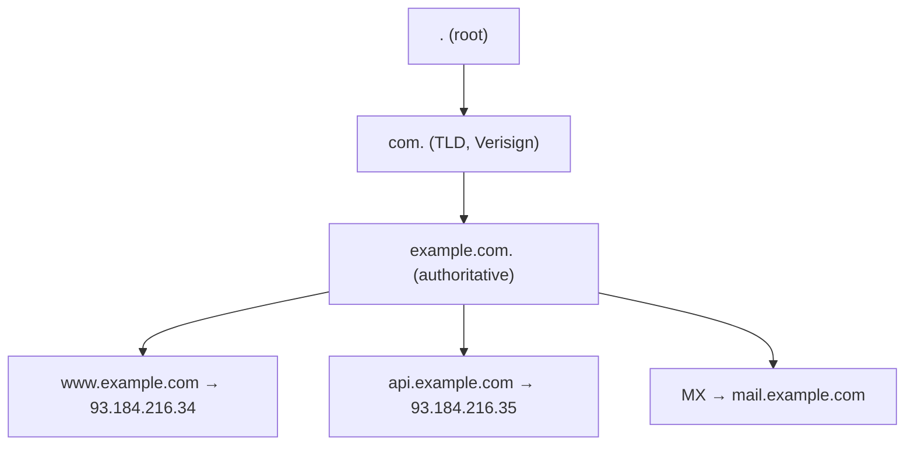
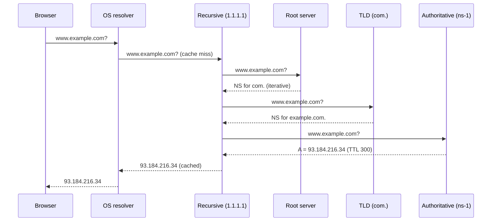
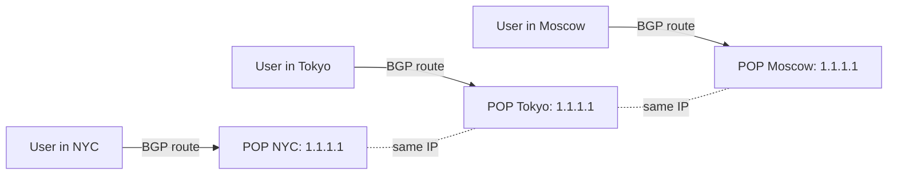

# Вопросы на собеседовании: `DNS`

`DNS` (Domain Name System) — иерархическая распределённая система имён. Она помогает клиенту найти адрес сервиса и поддерживает делегирование, кеширование и другие типы записей. Сбои Dyn в 2016 году и Meta в 2021 году показывают, что доступность конкретного сервиса может зависеть от его DNS и сети, через которую доступны authoritative-серверы.

## Полезные ссылки

- [Cloudflare Learning: What is DNS?](https://www.cloudflare.com/learning/dns/what-is-dns/)
- [RFC 1034 — DNS Concepts](https://datatracker.ietf.org/doc/html/rfc1034)
- [RFC 1035 — DNS Implementation](https://datatracker.ietf.org/doc/html/rfc1035)
- [RFC 4033 — DNSSEC Introduction](https://datatracker.ietf.org/doc/html/rfc4033)
- [RFC 8484 — DNS over HTTPS (DoH)](https://datatracker.ietf.org/doc/html/rfc8484)
- [RFC 2308 — отрицательное кеширование](https://www.rfc-editor.org/rfc/rfc2308.html)
- [RFC 7871 — EDNS Client Subnet](https://www.rfc-editor.org/rfc/rfc7871.html)
- [RFC 9250 — DNS over QUIC](https://www.rfc-editor.org/rfc/rfc9250.html)
- [AWS Route 53 — Routing policies](https://docs.aws.amazon.com/Route53/latest/DeveloperGuide/routing-policy.html)
- [AWS Route 53 — DNS failover](https://docs.aws.amazon.com/Route53/latest/DeveloperGuide/dns-failover-configuring.html)
- [Meta — разбор сбоя 4 октября 2021 года](https://engineering.fb.com/2021/10/05/networking-traffic/outage-details/)
- [Cloudflare — разбор сбоя 17 июля 2020 года](https://blog.cloudflare.com/cloudflare-outage-on-july-17-2020/)

## Содержание

- [Полезные ссылки](#полезные-ссылки)
- [See also](#see-also)

**Основы и иерархия**
- [Q1. (!) Что такое DNS и зачем он нужен?](#q1--что-такое-dns-и-зачем-он-нужен)
- [Q2. (!) Иерархия DNS: root → TLD → authoritative](#q2--иерархия-dns-root--tld--authoritative)
- [Q3. (!) Чем recursive resolver отличается от iterative](#q3--чем-recursive-resolver-отличается-от-iterative)
- [Q4. (!) Полный flow DNS-резолюции](#q4--полный-flow-dns-резолюции)
- [Q5. Что такое глобальные публичные resolver-ы (1.1.1.1, 8.8.8.8, 9.9.9.9)?](#q5-что-такое-глобальные-публичные-resolver-ы-1111-8888-9999)

**Record types и кеширование**
- [Q6. (!) A vs AAAA vs CNAME — основные record types](#q6--a-vs-aaaa-vs-cname--основные-record-types)
- [Q7. Записи MX, TXT (SPF/DKIM/DMARC), NS, SOA — за что отвечают](#q7-записи-mx-txt-spfdkimdmarc-ns-soa--за-что-отвечают)
- [Q8. Записи SRV, PTR, CAA, ALIAS/ANAME — зачем они](#q8-записи-srv-ptr-caa-aliasaname--зачем-они)
- [Q9. (!) TTL и кеширование](#q9--ttl-и-кеширование)
- [Q10. Negative caching и его подводные камни](#q10-negative-caching-и-его-подводные-камни)
- [Q11. (!) DNS propagation — что это и почему «48 часов»?](#q11--dns-propagation--что-это-и-почему-48-часов)
- [Q12. CNAME flattening и проблема apex/zone apex](#q12-cname-flattening-и-проблема-apexzone-apex)

**Load balancing / GeoDNS / Anycast**
- [Q13. (!) Балансировка нагрузки через DNS: round-robin, weighted, latency-based](#q13--балансировка-нагрузки-через-dns-round-robin-weighted-latency-based)
- [Q14. (!) Как работает GeoDNS / маршрутизация по геолокации](#q14--как-работает-geodns--маршрутизация-по-геолокации)
- [Q15. (!) Anycast против Unicast — зачем root и публичные resolver-ы используют anycast](#q15--anycast-против-unicast--зачем-root-и-публичные-resolver-ы-используют-anycast)
- [Q16. DNS-failover по health-check (на примере Route 53)](#q16-dns-failover-по-health-check-на-примере-route-53)
- [Q17. EDNS Client Subnet (ECS) — почему CDN зависит от resolver location](#q17-edns-client-subnet-ecs--почему-cdn-зависит-от-resolver-location)
- [Q18. Managed-провайдеры DNS: Route 53, Cloudflare, NS1, Akamai, Dyn](#q18-managed-провайдеры-dns-route-53-cloudflare-ns1-akamai-dyn)
- [Q19. Private DNS (Route 53 private zones) против service discovery](#q19-private-dns-route-53-private-zones-против-service-discovery)
- [Q20. SRV-records и service discovery (Consul, Kubernetes CoreDNS)](#q20-srv-records-и-service-discovery-consul-kubernetes-coredns)

**Безопасность (DNSSEC, DoH/DoT)**
- [Q21. (!) DNS spoofing, cache poisoning и атака Kaminsky](#q21--dns-spoofing-cache-poisoning-и-атака-kaminsky)
- [Q22. (!) DNSSEC изнутри: RRSIG, DS, KSK/ZSK](#q22--dnssec-изнутри-rrsig-ds-kskzsk)
- [Q23. (!) Шифрованный DNS: DoH, DoT и DNS-over-QUIC](#q23--шифрованный-dns-doh-dot-и-dns-over-quic)
- [Q24. DDoS via DNS amplification и защита](#q24-ddos-via-dns-amplification-и-защита)
- [Q25. Обратный DNS (PTR): репутация почты и логирование](#q25-обратный-dns-ptr-репутация-почты-и-логирование)

**Диагностика и практика**
- [Q26. (!) Практическая диагностика DNS: dig, nslookup, drill, kdig](#q26--практическая-диагностика-dns-dig-nslookup-drill-kdig)
- [Q27. Latency budget DNS-резолюции (cold vs warm)](#q27-latency-budget-dns-резолюции-cold-vs-warm)
- [Q28. DNS-кеши клиента: nscd, systemd-resolved, кеш браузера](#q28-dns-кеши-клиента-nscd-systemd-resolved-кеш-браузера)
- [Q29. Как ускорить «48-часовой» switchover (lowering TTL заранее)](#q29-как-ускорить-48-часовой-switchover-lowering-ttl-заранее)
- [Q30. DNS- и сетевые инциденты: Dyn 2016, Meta 2021, AWS 2021, Cloudflare 2020](#q30-dns--и-сетевые-инциденты-dyn-2016-meta-2021-aws-2021-cloudflare-2020)

## Q1. (!) Что такое DNS и зачем он нужен?

`DNS` — иерархическая распределённая система, которая переводит **понятные человеку имена** (`example.com`) в **IP-адреса** (`93.184.216.34` / `2606:2800:220:1::5`). Это телефонный справочник интернета: люди помнят имена, а сеть маршрутизирует по адресам.

**Зачем вообще нужен слой имён, если можно ходить по IP:**
- IP меняются (failover, ребалансировка), а имена остаются стабильными — клиентам не нужно ничего перенастраивать.
- Один домен можно отдать на много IP сразу — это основа load balancing и GeoDNS.
- Имена дают логическое разделение: `api.example.com`, `mail.example.com` — разные сервисы за одним доменом.
- Через CNAME / ALIAS домен маршрутизируется на managed-сервисы (CDN, ALB), которые сами меняют свои IP под капотом.

**Архитектурно:**
```
example.com → DNS resolver → 93.184.216.34
              ↑ кеш, иерархия, репликация
```

**Ключевая мысль:** DNS нужен, когда клиент разрешает имя и не использует уже известный адрес. Его отказ влияет на зависящие от этой резолюции сервисы; существующие соединения могут продолжать работать.

## Q2. (!) Иерархия DNS: root → TLD → authoritative

DNS устроен как **дерево**. При отсутствии кешированных делегирований рекурсивный резолвер идёт от корня к конкретной зоне. Каждый уровень знает не сам ответ, а лишь то, у кого спросить ниже.

**Уровни:**
1. **Root** (`.`) — 13 логических серверов (`a.root-servers.net`...`m.root-servers.net`), но физически их сотни, размноженных через Anycast. Знают только, где искать TLD.
2. **TLD** (Top-Level Domain) — `com.`, `org.`, `ru.`, `io.`. Управляются registry-операторами (например, Verisign для `.com`). Знают, какие authoritative-серверы отвечают за домен.
3. **Authoritative** — серверы конкретной зоны (`ns-1.example.com`). Хранят реальные записи и дают финальный ответ.

**Пример для `www.example.com`:**
```
www.example.com.
└── example.com.   (authoritative ns)
    └── com.       (TLD)
        └── .      (root)
```

Точка в конце (`example.com.`) делает имя fully qualified domain name (FQDN) — это явный маркер корня, чтобы resolver не дописывал к имени search-домены.

**Делегирование** работает через `NS`-записи: `com.` не хранит записи `example.com`, а лишь говорит «за эту зону отвечают `ns-1.example.com` и `ns-2.example.com` — иди к ним». Так ответственность спускается вниз по дереву.



## Q3. (!) Чем recursive resolver отличается от iterative

Это два режима резолюции, и **разницу между ними путают на собесе чаще всего**. Коротко: recursive делает всю работу за клиента, iterative лишь подсказывает следующий шаг.

**Recursive resolver** берёт запрос на себя целиком:
- Получив запрос от клиента, использует кеш или сам запрашивает недостающие уровни иерархии.
- Возвращает клиенту уже **финальный ответ** (готовый IP).
- Кеширует результат, чтобы в следующий раз ответить мгновенно.
- Примеры: `1.1.1.1` (Cloudflare), `8.8.8.8` (Google), DNS-серверы ISP, локальный `systemd-resolved`.

**Iterative resolver** работу на себя не берёт, а только направляет:
- На запрос отвечает в духе **«сам не знаю, но спроси вот этих»** — отдаёт NS-записи следующего уровня.
- Дальше клиент (точнее, recursive resolver) идёт сам.
- Именно так ведут себя **root** и **TLD** серверы: они никогда не делают рекурсию за тебя — иначе их завалило бы нагрузкой со всего интернета.

**Поток запросов:**
```
Client → Recursive resolver (1.1.1.1) → root (iterative: "go ask com.")
                                      → com.  (iterative: "go ask ns-1.example.com")
                                      → ns-1.example.com (authoritative: "93.184.216.34")
                                      ← cached, returned to Client
```

**Почему важно:** на собесе вопрос «кто делает работу обхода иерархии?» имеет один правильный ответ — recursive resolver. Какой именно (ISP, корпоративный, public DNS) — не меняет сути: всю рекурсию делает он, а root/TLD только отвечают итеративно.

## Q4. (!) Полный flow DNS-резолюции

Это DNS-часть разрешения `www.example.com` до соединения с сервером. Клиент может использовать локальные источники и кеши; точный порядок зависит от браузера, ОС и настроек.

**Шаги (для холодного кеша, когда нигде ничего не закешировано):**
1. Браузер проверяет собственный кеш, если он включён.
2. Системное разрешение может учитывать `hosts`, локальный кеш и настроенный DNS-резолвер; порядок зависит от платформы.
4. **Recursive resolver** (ISP / 1.1.1.1) — если у него в кеше нет:
   - **Root** (`.`): «спроси `com.`».
   - **TLD** (`com.`): «спроси `ns-1.example.com`».
   - **Authoritative** (`ns-1.example.com`): «`93.184.216.34`».
5. Resolver может кешировать ответ с учётом TTL и своей политики.
6. Возвращает IP клиенту.
7. После DNS браузер выбирает адрес и устанавливает соединение по выбранному транспортному протоколу.

**Задержка:** локальный кеш обычно избегает сетевого запроса. Промах у рекурсивного резолвера может добавить сетевые обращения к нескольким уровням. Универсальных миллисекундных границ нет.



**Команда для трассировки:**
```bash
dig +trace www.example.com
```

## Q5. Что такое глобальные публичные resolver-ы (1.1.1.1, 8.8.8.8, 9.9.9.9)?

Публичные recursive resolver-ы принимают запросы пользователей и получают ответ из кеша либо запрашивают authoritative-серверы. Примеры: Cloudflare `1.1.1.1`, Google Public DNS `8.8.8.8`, Quad9 `9.9.9.9`.

При выборе сравнивают доступность из своей сети, задержку, политику логирования, шифрованный транспорт, фильтрацию и совместимость с локальными именами. Quad9 предлагает блокировку вредоносных доменов; набор функций и политики остальных провайдеров проверяют в их актуальной документации. Публичный resolver не заменяет корпоративный, если клиенту нужны частные зоны.

Проверка ответа конкретного resolver-а: `dig @1.1.1.1 example.com`. Скорость измеряют из своей сети, а не выводят из размера anycast-сети.

## Q6. (!) A vs AAAA vs CNAME — основные record types

**`A` (Address)** — имя → IPv4.
```
example.com.  300  IN  A  93.184.216.34
```

**`AAAA` (Quad-A)** — имя → IPv6.
```
example.com.  300  IN  AAAA  2606:2800:220:1::5
```

**`CNAME` (Canonical Name)** — alias на другое имя.
```
www.example.com.  300  IN  CNAME  example.com.
```
- CNAME указывает на другое имя: для адреса требуется разрешить цель в A/AAAA. Нужные записи могут уже находиться в ответе или кеше, поэтому дополнительный сетевой запрос не обязателен.
- **Ограничения:** на zone apex (`example.com` без `www.`) CNAME конфликтует с обязательными SOA/NS по RFC 1034 — там обязаны жить SOA/NS, а CNAME не уживается с другими записями (выход — ALIAS/ANAME у провайдера, см. Q12).
- На одном имени может быть **только один CNAME** и **больше никаких** записей (исключение — DNSSEC). Это прямое следствие того, что CNAME означает «это имя — целиком псевдоним другого».

**Когда что использовать:**
- A/AAAA — когда ты сам владеешь конечным IP.
- CNAME — для алиасов на managed-сервисы (ALB, CloudFront, Heroku): провайдер меняет IP под капотом, а твоя зона остаётся нетронутой.

## Q7. Записи MX, TXT (SPF/DKIM/DMARC), NS, SOA — за что отвечают

**`MX` (Mail Exchanger)** — куда слать почту для домена.
```
example.com.  3600  IN  MX  10 mail1.example.com.
example.com.  3600  IN  MX  20 mail2.example.com.
```
- Цифра — приоритет (меньше = выше): отправитель сначала пробует MX с меньшим числом, при недоступности — следующий. Так задаётся резервный почтовый сервер.
- Справа **обязано** стоять имя, а не IP (это требование RFC).

**`TXT` (Text)** — произвольный текст. Сам по себе ничего не значит, но на нём держатся три критичных механизма антиспама:
- **SPF** (`v=spf1 include:_spf.google.com -all`) — список серверов, которым разрешено слать почту от имени твоего домена.
- **DKIM** (`v=DKIM1; k=rsa; p=MIGfMA0G...`) — публичный ключ, которым проверяется криптоподпись писем.
- **DMARC** (`v=DMARC1; p=reject; rua=mailto:...`) — что делать с письмами, не прошедшими SPF/DKIM (отклонять, в карантин, пропускать) и куда слать отчёты.

**`NS` (Name Server)** — какие серверы authoritative для этой зоны.
```
example.com.  86400  IN  NS  ns-1.example.com.
example.com.  86400  IN  NS  ns-2.example.com.
```

**`SOA` (Start of Authority)** — служебная запись с метаданными зоны: primary NS, email администратора, serial, таймеры refresh/retry/expire для secondary-серверов и поле MINIMUM. По RFC 2308 отрицательный TTL ограничен меньшим из MINIMUM и TTL самой SOA-записи.
```
example.com.  86400  IN  SOA  ns-1.example.com. hostmaster.example.com. 2024042701 7200 3600 1209600 300
```

## Q8. Записи SRV, PTR, CAA, ALIAS/ANAME — зачем они

**`SRV` (Service)** — запись для service discovery. Указывает host + port + priority + weight для **именованного сервиса** (в отличие от A, которая знает только IP).
```
_sip._tcp.example.com. 86400 IN SRV 10 5 5060 sipserver.example.com.
                                    ↑  ↑    ↑
                                  prio weight port
```
- Используется в SIP, XMPP, Kerberos, **Consul DNS interface**, **Kubernetes CoreDNS**.

**`PTR` (Pointer)** — reverse DNS: IP → имя. Живёт в зоне `in-addr.arpa.` (IPv4) или `ip6.arpa.` (IPv6).
```
34.216.184.93.in-addr.arpa. 3600 IN PTR example.com.
```

**`CAA` (Certification Authority Authorization)** — белый список центров сертификации, которым разрешено выпускать TLS-сертификаты для домена.
```
example.com. 3600 IN CAA 0 issue "letsencrypt.org"
```
- Без CAA сертификат может выпустить **любой** CA, если пройдёт валидацию владения доменом.
- С CAA выпуск чужими CA блокируется — это защита от ошибочной или вредоносной выдачи сертификата (misissuance).

**`ALIAS` / `ANAME`** — нестандартное расширение провайдеров (Route 53, Cloudflare, DNSimple), по сути **«CNAME для apex»**:
- На стороне провайдера запись резолвится в IP, а клиенту отдаётся обычная A-запись.
- Для клиента это неотличимо от честной A — никакого лишнего шага.
- Решает запрет «CNAME нельзя на apex» (см. Q12), сохраняя гибкость алиаса.

## Q9. (!) TTL и кеширование

`TTL` задаёт максимальное время жизни DNS RR в кеше. Рекурсивный резолвер уменьшает оставшийся TTL по мере хранения ответа. RFC 2181 допускает сократить срок хранения; политика резолвера может дополнительно ограничивать TTL. При недоступности authoritative отдельные резолверы могут отдавать устаревший ответ по RFC 8767.

Низкий TTL обычно уменьшает время, в течение которого новые запросы получают старую запись, но увеличивает число обращений к authoritative. Высокий TTL повышает долю ответов из кеша, но при изменении записи оставляет более длинный хвост старых ответов. Это не гарантия времени переключения: есть кеши приложений и ОС, stale-ответы и уже открытые соединения.

При планировании миграции учитывают TTL текущей записи и цепочки CNAME, а при смене делегирования — TTL соответствующих NS/DS. Отрицательные ответы имеют отдельный срок по SOA (см. Q10).

## Q10. Negative caching и его подводные камни

Negative caching по RFC 2308 сохраняет отрицательные ответы: `NXDOMAIN` означает отсутствие имени, `NODATA` — отсутствие запрошенного типа у существующего имени. Это сокращает повторные обращения к authoritative.

Срок такого ответа ограничен **меньшим из SOA.MINIMUM и TTL записи SOA**, переданной с отрицательным ответом. Резолвер может хранить его меньше. Если клиент запросил новое имя до создания записи и получил `NXDOMAIN`, он может продолжать видеть прежний отрицательный ответ до истечения кеша.

Для запуска нового имени сначала создают запись, затем публикуют ссылку на неё. При миграции заранее проверяют отрицательный TTL и фактическое поведение резолверов.

## Q11. (!) DNS propagation — что это и почему «48 часов»?

Под «DNS propagation» часто смешивают два процесса: обновление authoritative-серверов зоны и истечение уже закешированных ответов. При изменении записи нужно проверить, что все authoritative-серверы отдают новое значение; затем старые положительные или отрицательные ответы могут сохраняться в кешах до истечения их срока.

При смене NS добавляются обновление делегирования у регистратора/реестра, кеш делегирования и, если включён DNSSEC, запись DS. Поэтому «48 часов» — только пример длинного TTL, а не фиксированное правило DNS.

Для смены A/AAAA/CNAME заранее снижают TTL и ждут как минимум прежний TTL до переключения. Старую инфраструктуру оставляют доступной на переходный период. Для NS-миграции отдельно планируют делегирование и DNSSEC; низкий TTL конечной A-записи сам по себе её не ускорит.

## Q12. CNAME flattening и проблема apex/zone apex

**В чём проблема:** RFC 1034 не допускает совместного существования CNAME с другими данными того же имени. На apex обязательны SOA и NS, поэтому обычный CNAME там конфликтует с ними.

**Почему это бьёт по практике:**
- CDN (CloudFront, Cloudflare, Fastly) выдаёт тебе **имя**, а не IP (`d111abc.cloudfront.net`).
- Ты хочешь, чтобы голый `example.com` (без `www.`) указывал на этот CDN.
- А честный CNAME на apex поставить нельзя.

**Как это обходят:**

**1. `ALIAS` / `ANAME` (Route 53, DNSimple, Cloudflare):**
- Провайдер сам резолвит `d111abc.cloudfront.net` → IP на своей стороне.
- Клиенту в ответе уходит обычная `A`-запись.
- Для клиента это стандартная резолюция, а ты получаешь гибкость CNAME.

**2. CNAME flattening (Cloudflare):**
- То же самое под другим названием: на запрос apex Cloudflare разворачивает CNAME у себя и отдаёт A.

**3. Apex Alias в AWS:**
- Route 53 Alias — нативный механизм для AWS-сервисов (ALB, CloudFront, S3), бесплатный и без лишнего lookup.

**Компромисс:**
- ALIAS/ANAME — vendor-specific: в обычных bind/PowerDNS их нет, привязка к провайдеру.
- Если у CDN сменится endpoint, обновить разрешённый IP обязан сам провайдер — ты на это не влияешь.

## Q13. (!) Балансировка нагрузки через DNS: round-robin, weighted, latency-based

DNS может участвовать в распределении запросов: authoritative возвращает набор адресов либо выбирает ответ по политике. Фактический трафик зависит от кешей, поведения клиента и повторного использования соединений.

**Round-robin DNS:**
```
example.com. 60 IN A 1.1.1.1
example.com. 60 IN A 2.2.2.2
example.com. 60 IN A 3.3.3.3
```
- Authoritative тасует порядок A-записей **на каждый запрос**.
- Клиент сам выбирает адрес; он не обязан брать первый.
- Без отдельной проверки здоровья неисправный адрес может оставаться в ответе. DNS-провайдеры могут совмещать политики с health checks. Кеши мешают точному распределению трафика.

**Weighted DNS** (Route 53 weighted routing) — задаёшь доли:
- `A` 1.1.1.1, weight 70
- `A` 2.2.2.2, weight 30
- Веса влияют на выбор DNS-ответов; они не гарантируют такую же долю пользовательских запросов или соединений.
- Удобно для blue/green-деплоя и canary: гонишь сначала 5% трафика на новую версию.

**Latency-based DNS** (Route 53 latency routing):
- Провайдер выбирает регион по своей модели задержки между источником DNS-запроса и регионами. Это не измерение RTT каждого пользователя; поддержка ECS зависит от провайдера (см. Q17).

**Geolocation DNS** — см. Q14.

**Когда DNS-балансировка не годится:**
- Stateful-сессии: resolver закешировал IP, и клиент залипает на одном инстансе.
- Когда нужен быстрый и точный health-check: при TTL > 60с выпавший инстанс ещё долго будет получать трафик из кешей.

## Q14. (!) Как работает GeoDNS / маршрутизация по геолокации

**GeoDNS** — выбор DNS-ответа по определённому провайдером местоположению источника запроса: обычно resolver-а, иногда префикса клиента при поддержке ECS (см. Q17). Один и тот же домен возвращает разный адрес жителю Москвы и жителю Токио.

**Примеры реализаций:**
- Route 53 Geolocation policy
- NS1 Filter Chain
- Cloudflare Geo Steering
- GSLB (Global Server Load Balancing) — общее название

**Как работает:**
1. Authoritative DNS видит, кто спрашивает (IP resolver-а + ECS, если есть).
2. Определяет страну или регион по своей базе адресов и правилам маршрутизации.
3. Возвращает A-запись региона.

**Сценарии применения:**
- Региональная маршрутизация как часть архитектуры хранения данных. Один GeoDNS не гарантирует соблюдение требований к размещению данных.
- Снижение задержки: пользователи Азии → регион Tokyo.
- Локализация контента: разный сайт для разных стран.

**Подводные камни:**
- **Точность геолокации** низкая для крупных ISP и публичных DNS: `1.1.1.1` в EU «выглядит» просто как глобальный адрес.
- **EDNS Client Subnet:** без ECS authoritative видит resolver, а не реального пользователя, и может промахнуться регионом (см. Q17).
- **VPN** ломает всё: пользователь получит регион выходной ноды, а не свой.

**Геолокация против latency-routing:**
- Геолокация решает по карте (где формально находится IP).
- Latency-based использует модель задержки провайдера, а не обязательно измерение от каждого пользователя.

## Q15. (!) Anycast против Unicast — зачем root и публичные resolver-ы используют anycast

Разница в том, сколько серверов стоит за одним IP.

**Unicast:** адрес назначен одной точке назначения; сеть при этом может иметь несколько маршрутов к ней.

**Anycast:** один IP — **много серверов в разных локациях**. BGP анонсирует один и тот же префикс из десятков точек присутствия (POP), и маршрутизация выбирает путь по BGP-политикам. Физически ближайший POP не гарантирован. Клиент про это даже не знает — для него это всё тот же `1.1.1.1`.

**Зачем anycast в DNS:**
- **Задержка:** распределённые точки присутствия могут сократить маршрут, но не гарантируют минимум RTT.
- **Устойчивость:** сеть может распределить часть нагрузки между POP; крупная атака всё равно требует защиты.
- **Отказ узла:** отзыв маршрута может перевести трафик на другой POP после сходимости BGP; возможен перерыв.
- **Простота для клиента:** один IP, не нужны умные resolver-ы или клиентская логика выбора.

**Где это используется:**
- **Root DNS:** 13 логических NS, но физически сотни серверов через anycast.
- **Публичные resolver-ы:** `1.1.1.1` (300+ POP Cloudflare), `8.8.8.8` (Google).
- **CDN:** Cloudflare, Akamai, Fastly.



**Обратная сторона:** ошибка маршрутизации может затронуть много точек присутствия. В инциденте Cloudflare 17 июля 2020 года ошибка конфигурации backbone направила трафик через перегруженный узел Atlanta и затронула часть регионов; это не был отзыв внешних anycast-анонсов.

## Q16. DNS-failover по health-check (на примере Route 53)

Route 53 может проверять endpoint и учитывать состояние в DNS-политике. Для active-passive создают primary и secondary записи с failover routing; для других политик используют совместимые проверки здоровья. Параметры проверки, пороги и TTL настраиваются, поэтому фиксированного времени переключения нет.

Когда Route 53 перестаёт выбирать нездоровую запись, старый адрес ещё может оставаться в кешах клиентов и резолверов. Открытые соединения не переключаются от смены DNS-ответа. Если все записи группы нездоровы, Route 53 может продолжать возвращать записи согласно своей documented fail-open логике — это нужно учитывать отдельно.

Проверяют состояние health check, ответы authoritative и recursive resolver-ов, а также реальное поведение клиента. [Документация AWS](https://docs.aws.amazon.com/Route53/latest/DeveloperGuide/dns-failover-configuring.html) описывает настройку, а [разбор поведения при сбоях](https://docs.aws.amazon.com/Route53/latest/DeveloperGuide/dns-failover-problems.html) — случай всех нездоровых записей.

## Q17. EDNS Client Subnet (ECS) — почему CDN зависит от resolver location

Authoritative DNS обычно видит адрес рекурсивного резолвера, а не конечного клиента. Для CDN это может ухудшить выбор edge, если resolver находится далеко от пользователя.

EDNS Client Subnet (RFC 7871) позволяет resolver-у **по желанию** передать префикс адреса клиента. Authoritative может использовать его при выборе ответа и задаёт область кеширования. Это не полный IP и не гарантия ближайшего edge: провайдеры отличаются поддержкой ECS, а географическая база и маршрутизация остаются неточными.

Передача префикса раскрывает часть сетевой принадлежности клиента и увеличивает число вариантов кеша. Если ECS нет, CDN может использовать географию resolver-а или другие механизмы доставки. Для конкретного resolver-а и CDN поддержку проверяют по их актуальной документации и ответам, а не предполагают её по адресу сервиса.

## Q18. Managed-провайдеры DNS: Route 53, Cloudflare, NS1, Akamai, Dyn

Managed DNS-провайдер хостит authoritative-зону и предоставляет средства её изменения. Route 53 поддерживает alias к ряду ресурсов AWS, политики маршрутизации и private hosted zones. Cloudflare предлагает CNAME flattening и дополнительные сетевые продукты. NS1 и Akamai предлагают свои политики управления трафиком. Функции и условия конкретного тарифного плана надо проверять в актуальной документации.

Выбирая провайдера, сравнивают доступность authoritative DNS из нужных сетей, API для автоматизации, health checks, DNSSEC, стоимость, лимиты и поддержку нужных политик. Скорость и SLA не выводят из бренда. Два провайдера могут снизить зависимость от одного, если зоны и обновление записей согласованы, а делегирование действительно указывает на оба.

## Q19. Private DNS (Route 53 private zones) против service discovery

Private DNS — зона, доступная настроенным внутренним резолверам. Route 53 private hosted zone связывают с VPC; доступ из другой сети возможен через настроенный Resolver inbound endpoint и маршрутизацию. Само частное DNS-имя не делает сервис недоступным извне: доступность определяют сеть и правила доступа.

Service discovery — способ находить актуальные экземпляры сервиса. Он может использовать DNS, включая CoreDNS в Kubernetes и DNS-интерфейс Consul. Частная зона и service discovery решают разные задачи, но могут дополнять друг друга. Частота изменений, гранулярность и health checks зависят от реализации, поэтому нельзя считать «часы против секунд» свойством этих категорий.

Для стабильных внутренних имён достаточно private zone; для динамических экземпляров проверяют, какие записи формирует discovery, как он исключает неготовые endpoints и как клиент обновляет адреса.

## Q20. SRV-records и service discovery (Consul, Kubernetes CoreDNS)

`SRV` (RFC 2782) хранит `priority`, `weight`, `port` и имя цели для сервиса и транспорта:

```text
_service._proto.name. TTL IN SRV priority weight port target.
```

Consul может публиковать SRV для сервиса. Kubernetes DNS публикует SRV для **именованных портов** Service; точные цели зависят от типа Service. TTL задаёт реализация и конфигурация, он не обязан равняться нулю. Наличие SRV само по себе не проверяет здоровье: состав ответа зависит от discovery и состояния endpoints.

Клиент должен явно запрашивать и обрабатывать SRV. Обычный HTTP-клиент, который разрешает hostname в A/AAAA, не начнёт использовать порт и веса из SRV автоматически.

```bash
dig @127.0.0.1 -p 8600 _redis._tcp.service.consul SRV
```

## Q21. (!) DNS spoofing, cache poisoning и атака Kaminsky

DNS spoofing — подмена ответа. Cache poisoning — сохранение ложных данных в кеше резолвера. В атаке Kaminsky злоумышленник создавал много запросов к ранее не запрошенным именам и пытался подобрать параметры ответа, чтобы внедрить ложное делегирование.

При UDP-ответе недостаточно угадать только 16-битный transaction ID: важны также исходный порт и проверки соответствия ответа запросу. Рандомизация исходного порта усложняет подбор; проверки bailiwick ограничивают принятие посторонних данных. DNS Cookies могут помогать против некоторых подмен и отражения, но не заменяют DNSSEC.

Валидирующий resolver с DNSSEC проверяет подписи защищённой зоны и отвергает подменённые записи при корректной цепочке доверия. Для неподписанной зоны такой защиты нет; кроме того, DNSSEC не шифрует запросы.

## Q22. (!) DNSSEC изнутри: RRSIG, DS, KSK/ZSK

DNSSEC позволяет валидирующему resolver-у проверить подлинность и целостность DNS-данных подписанной зоны. `DNSKEY` содержит публичный ключ, `RRSIG` — подпись RRset, `DS` в родительской зоне связывает делегирование с ключом дочерней зоны. `NSEC`/`NSEC3` поддерживают проверяемое доказательство отсутствия записи.

Цепочка доверия идёт от доверенного ключа через подписанные делегирования к зоне. Разделение ключей на KSK и ZSK распространено: KSK обычно подписывает DNSKEY RRset, ZSK — остальные RRset. Это эксплуатационная практика, а не обязательные для протокола сроки ротации или требование ровно двух ключей.

DNSSEC не шифрует запрос и не гарантирует доступность. Ошибка в DS, DNSKEY или подписях может привести к `SERVFAIL` у валидирующих резолверов; при миграции ключей проверяют цепочку заранее.

## Q23. (!) Шифрованный DNS: DoH, DoT и DNS-over-QUIC

Классический DNS обычно передаёт запросы без шифрования через UDP или TCP/53. DoT (RFC 7858) переносит DNS в TLS, стандартный порт — TCP/853. DoH (RFC 8484) переносит DNS-сообщения в HTTPS, обычно через 443; он не привязан только к HTTP/2. DoQ (RFC 9250) использует QUIC, его порт по умолчанию — **UDP/853**.

Эти механизмы защищают участок между клиентом и выбранным DNS-сервером. Они не заменяют DNSSEC: шифрование канала к resolver-у и проверка подписей зоны решают разные задачи. Возможность наблюдать или блокировать запросы зависит от сети и конкретной реализации; DoH не становится автоматически неотличимым от любого HTTPS-трафика.

QUIC поддерживает возобновление соединений; свойства 0-RTT зависят от клиента и сервера. Реальную задержку сравнивают в своей сети, включая повторное использование соединений.

## Q24. DDoS via DNS amplification и защита

DNS amplification — отражённая атака: злоумышленник подменяет source IP в UDP-запросе адресом жертвы, а DNS-сервер посылает ответ жертве. Если ответ крупнее запроса, трафик усиливается. Размер и коэффициент зависят от вопроса, ответа и настроек сервера; фиксированного множителя нет.

Источником отражения могут стать открытые recursive resolver-ы и authoritative-серверы. Ограничение рекурсии своим клиентам, response rate limiting и ограничения размера ответа уменьшают возможности злоупотребления. Фильтрация подменённого source IP на исходящей сети (BCP 38) устраняет необходимое условие такой отражённой атаки. Anycast и очистка трафика помогают жертве выдержать нагрузку, но не предотвращают подмену адреса.

## Q25. Обратный DNS (PTR): репутация почты и логирование

PTR связывает адрес с именем в обратной зоне `in-addr.arpa.` для IPv4 или `ip6.arpa.` для IPv6. Обратная зона делегируется по адресному пространству; настройка PTR обычно зависит от владельца блока или облачного провайдера.

Почтовые системы могут учитывать наличие PTR и согласование PTR с прямой записью (FCrDNS) при оценке отправителя. Отсутствие PTR может ухудшить доставляемость, но не означает автоматического попадания каждого письма в спам. PTR также полезен при чтении логов, но имя из обратного DNS нельзя считать надёжным доказательством личности узла.

Для проверки: `dig -x 192.0.2.1`, затем прямой запрос имени из PTR.

## Q26. (!) Практическая диагностика DNS: dig, nslookup, drill, kdig

Четыре инструмента под разные задачи. Знать `dig` наизусть — обязательный минимум для собеса.

**`dig`** — стандарт де-факто для диагностики.

```bash
# Базовое: A-запись
dig example.com

# Конкретный resolver
dig @1.1.1.1 example.com

# Конкретный тип
dig example.com MX
dig example.com AAAA
dig example.com TXT

# Полный обход иерархии (iterative)
dig +trace example.com

# Короткий вывод (только ответ)
dig +short example.com

# Запросить DNSSEC-данные (сам по себе ключ не включает локальную валидацию)
dig +dnssec example.com

# Reverse lookup
dig -x 93.184.216.34

# С EDNS Client Subnet
dig @8.8.8.8 example.com +subnet=1.2.3.0/24

# Все типы (для diagnostics, но многие провайдеры режут)
dig example.com ANY
```

**`nslookup`** — старый и менее удобный, но есть везде, включая Windows: пригодится, когда `dig` недоступен.
```bash
nslookup example.com
nslookup example.com 1.1.1.1
```

**`drill`** — альтернатива из LDNS, удобна для трассировки цепочки DNSSEC.
```bash
drill -DT example.com
```

**`kdig`** — из Knot DNS, умеет шифрованный DNS (DoT/DoH).
```bash
kdig @1.1.1.1 +tls example.com
kdig @1.1.1.1 +https example.com
```

**На что смотреть в выводе `dig`:**
- `ANSWER SECTION` — собственно ответ.
- `Query time` — задержка запроса (полезно для диагностики «медленного DNS»).
- `SERVER` — какой resolver ответил (проверить, что спросил именно нужный).
- `flags: aa` — отвечающий сервер пометил ответ как authoritative для имени.
- `flags: ad` — отвечающий resolver сообщает о проверенных данных; этому флагу доверяют только при доверенном пути до валидирующего resolver-а.

## Q27. Latency budget DNS-резолюции (cold vs warm)

Локальный DNS-кеш позволяет ответить без сетевого обращения; при промахе рекурсивный резолвер может обратиться к нескольким authoritative-серверам. Время зависит от сети, числа переходов, наличия делегирований в кеше и скорости серверов. Универсальные интервалы в миллисекундах для «cold» и «warm» некорректны.

`dns-prefetch` может заранее разрешить имя. `preconnect` дополнительно готовит соединение, если браузер решит выполнить подсказку. Эти механизмы полезны, когда адрес понадобится позже; они не ускоряют сам DNS-протокол. HTTP/3 меняет установку транспортного соединения, а не DNS-резолюцию. При измерении разделяют время DNS, соединения и ответа сервера.

Слишком долгий кеш в приложении может удерживать старый адрес после изменения DNS; проверяют настройки конкретного рантайма и HTTP-клиента.

## Q28. DNS-кеши клиента: nscd, systemd-resolved, кеш браузера

Имя может разрешаться через кеш браузера, системный resolver, локальный DNS-сервис, recursive resolver и кеш самого приложения. Порядок и время хранения определяются конкретной платформой, версией и настройками; универсального TTL браузера или JVM нет.

На Linux встречаются `systemd-resolved`, `nscd` и `dnsmasq`, на macOS — `mDNSResponder`, на Windows — DNS Client. Приложение может самостоятельно хранить результат `getaddrinfo` или адрес соединения. `dig` часто обращается к DNS напрямую и поэтому не доказывает, какой адрес использовало приложение.

Диагностика: сравнивают ответ authoritative, настроенного recursive resolver-а и путь конкретного приложения. Кеш сбрасывают штатным способом той системы, где обнаружено устаревшее значение; после смены адреса также учитывают существующие соединения.

## Q29. Как ускорить «48-часовой» switchover (lowering TTL заранее)

Чтобы сменить адрес `api.example.com`, сначала выясняют текущий TTL записи и всех записей в цепочке CNAME. Затем уменьшают TTL и **ждут прежний срок жизни**: записи, полученные до уменьшения, сохраняют старое время истечения. После проверки ответов authoritative и нескольких recursive resolver-ов меняют адрес.

На переходный период оставляют старый endpoint доступным и наблюдают за фактическим трафиком. Низкий TTL уменьшает обычный хвост кеширования, но не задаёт точное время завершения: приложения могут хранить адрес дольше, resolver может отдавать stale-ответ, а открытые соединения продолжают использовать старый endpoint.

Если имя ещё не существовало, учитывают отрицательный TTL по SOA. При смене NS отдельно проверяют TTL делегирования, готовность обеих зон и DNSSEC DS. Фиксированные сроки вроде «48 часов» и «60–120 секунд для всех» из DNS не следуют.

## Q30. DNS- и сетевые инциденты: Dyn 2016, Meta 2021, AWS 2021, Cloudflare 2020

**Dyn, 2016.** DDoS против DNS-провайдера нарушил доступ к зависевшим от него сервисам. Архитектурный вывод: оценивать зависимость от одного authoritative-провайдера и проверять, действительно ли второй набор NS сможет отвечать актуальными данными.

**Meta, 4 октября 2021.** Ошибочная команда в управлении backbone разорвала связь дата-центров. DNS-узлы сняли BGP-анонсы, так как потеряли связь с дата-центрами; серверы DNS работали, но стали недоступны извне. Пострадали и внутренние инструменты восстановления. Вывод: проверять зависимость DNS и аварийного доступа от той же сети, которую они помогают восстанавливать. [Разбор Meta](https://engineering.fb.com/2021/10/05/networking-traffic/outage-details/).

**AWS US-EAST-1, 7 декабря 2021.** Региональный сетевой сбой затронул несколько сервисов AWS и их внутренние зависимости, включая внутренний DNS. Это **не доказательство отказа публичного authoritative Route 53**. Вывод: различать control plane, data plane и внутренние зависимости при анализе managed-сервиса. [Разбор AWS](https://aws.amazon.com/message/12721/).

**Cloudflare, 17 июля 2020.** Ошибка в конфигурации backbone направила трафик через Atlanta и перегрузила узел; были затронуты некоторые регионы, другие продолжили работу. Это не было глобальным отзывом anycast-префиксов. Вывод: сетевые изменения раскатывают с ограничением области воздействия и мониторингом маршрутов. [Разбор Cloudflare](https://blog.cloudflare.com/cloudflare-outage-on-july-17-2020/).

---

## See also

- [`networking-interview.md`](networking-interview.md) — общая сеть, TCP/IP, OSI, BGP, NAT.
- [`load-balancing-interview.md`](load-balancing-interview.md) — L4/L7 LB, health check, sticky session — DNS как первый hop.
- [`edge-computing-interview.md`](edge-computing-interview.md) — CDN edge, Cloudflare Workers, latency.
- [`distributed-systems-interview.md`](distributed-systems-interview.md) — service discovery, consensus.
- [`scalability-patterns-interview.md`](scalability-patterns-interview.md) — multi-region, GeoDNS, failover.
- [`../api/http-rest-interview.md`](../api/http-rest-interview.md) — HTTP над DNS-разрешённым именем.
- [`../security/tls-ssl-interview.md`](../security/tls-ssl-interview.md) — TLS handshake после DNS, CAA для сертификатов.
- [`../system-design/system-design-interview.md`](../system-design/system-design-interview.md) — DNS как часть end-to-end архитектуры.
