# Вопросы на собеседовании: Микросервисная архитектура

Полное покрытие микросервисной архитектуры: разбиение на сервисы, коммуникация, согласованность, `Saga`, `CQRS`, `API Gateway`, `Service Discovery`, `Circuit Breaker`, `Service Mesh`, мониторинг.

**Микросервисная архитектура** -- частый фокус собеседований на Senior: согласованность, `Saga`, `2PC`, `API Gateway`, `Service Discovery`, паттерны отказоустойчивости и операционная сложность. Этот файл охватывает как теоретические основы, так и практические паттерны с примерами на `Spring Boot` / `Spring Cloud`.

## Полезные ссылки

### Официальная документация

- [Microservices (Martin Fowler)](https://martinfowler.com/articles/microservices.html) -- канонический обзор
- [Building Microservices (Sam Newman)](https://samnewman.io/books/building_microservices_2nd_edition/) -- практическое руководство
- [Database per Service](https://microservices.io/patterns/data/database-per-service.html) -- владение данными и варианты изоляции
- [Saga](https://microservices.io/patterns/data/saga.html) и [Transactional Outbox](https://microservices.io/patterns/data/transactional-outbox.html) -- межсервисные операции и публикация событий
- [Spring Cloud Gateway](https://docs.spring.io/spring-cloud-gateway/reference/) -- маршрутизация и фильтры
- [Spring Boot Tracing](https://docs.spring.io/spring-boot/reference/actuator/tracing.html) -- трейсинг и передача контекста
- [Spring Cloud OpenFeign](https://docs.spring.io/spring-cloud-openfeign/reference/) -- состояние декларативного клиента
- [OpenTelemetry Traces](https://opentelemetry.io/docs/concepts/signals/traces/) -- модель трейса и спанов

## Содержание

- [Полезные ссылки](#полезные-ссылки)
- [See also](#see-also)

**Основы микросервисной архитектуры**
- [Q1. (!) Что такое микросервисная архитектура?](#q1--что-такое-микросервисная-архитектура)
- [Q2. (!) Монолит vs микросервисы -- когда что выбрать?](#q2--монолит-vs-микросервисы----когда-что-выбрать)
- [Q3. (!) Какие преимущества и недостатки имеет микросервисная архитектура?](#q3--какие-преимущества-и-недостатки-имеет-микросервисная-архитектура)
- [Q4. Как правильно определить границы микросервиса (Bounded Context)?](#q4-как-правильно-определить-границы-микросервиса-bounded-context)
- [Q5. Какие технологии используются для межсервисного взаимодействия?](#q5-какие-технологии-используются-для-межсервисного-взаимодействия)
- [Q6. Синхронное vs асинхронное взаимодействие -- когда что применять?](#q6-синхронное-vs-асинхронное-взаимодействие----когда-что-применять)

**Ключевые паттерны микросервисов**
- [Q7. (!) Какие основные паттерны микросервисной архитектуры?](#q7--какие-основные-паттерны-микросервисной-архитектуры)
- [Q8. (!) Что такое API Gateway и зачем он нужен?](#q8--что-такое-api-gateway-и-зачем-он-нужен)
- [Q9. (!) Что такое Service Discovery и как он работает?](#q9--что-такое-service-discovery-и-как-он-работает)
- [Q10. (!) Что такое Circuit Breaker и как он предотвращает каскадные сбои?](#q10--что-такое-circuit-breaker-и-как-он-предотвращает-каскадные-сбои)
- [Q11. Что такое Service Mesh и зачем он нужен?](#q11-что-такое-service-mesh-и-зачем-он-нужен)
- [Q12. (!) Что такое паттерн CQRS?](#q12--что-такое-паттерн-cqrs)
- [Q13. Что такое Event Sourcing?](#q13-что-такое-event-sourcing)
- [Q14. Что такое паттерн Strangler Fig для миграции с монолита?](#q14-что-такое-паттерн-strangler-fig-для-миграции-с-монолита)

**Транзакции и согласованность данных**
- [Q15. (!) Что такое ACID и BASE?](#q15--что-такое-acid-и-base)
- [Q16. (!) Что такое CAP-теорема?](#q16--что-такое-cap-теорема)
- [Q17. (!) Как обеспечивается атомарность операций в микросервисах?](#q17--как-обеспечивается-атомарность-операций-в-микросервисах)
- [Q18. (!) Что такое Saga и когда применять вместо 2PC?](#q18--что-такое-saga-и-когда-применять-вместо-2pc)
- [Q19. (!) Что такое двухфазная фиксация (2PC)?](#q19--что-такое-двухфазная-фиксация-2pc)
- [Q20. Что такое трёхфазная фиксация (3PC)?](#q20-что-такое-трёхфазная-фиксация-3pc)
- [Q21. (!) Что такое компенсирующие транзакции?](#q21--что-такое-компенсирующие-транзакции)
- [Q22. Как решить проблемы согласованности данных?](#q22-как-решить-проблемы-согласованности-данных)

**Отказоустойчивость и надёжность**
- [Q23. (!) Как обрабатываются сбои и отказы в микросервисах?](#q23--как-обрабатываются-сбои-и-отказы-в-микросервисах)
- [Q24. (!) Как реализовать механизмы повторной попытки (Retry)?](#q24--как-реализовать-механизмы-повторной-попытки-retry)
- [Q25. Как обеспечить идемпотентность операций?](#q25-как-обеспечить-идемпотентность-операций)
- [Q26. Что такое Bulkhead-паттерн?](#q26-что-такое-bulkhead-паттерн)

**Конфигурация, безопасность, версионирование**
- [Q27. (!) Как организовать конфигурацию микросервисов?](#q27--как-организовать-конфигурацию-микросервисов)
- [Q28. (!) Как обеспечить безопасность взаимодействия между микросервисами?](#q28--как-обеспечить-безопасность-взаимодействия-между-микросервисами)
- [Q29. Как управлять версионированием API без прерывания работы?](#q29-как-управлять-версионированием-api-без-прерывания-работы)

**Наблюдаемость и эксплуатация**
- [Q30. (!) Какие методы логирования и трейсинга используются?](#q30--какие-методы-логирования-и-трейсинга-используются)
- [Q31. (!) Какие инструменты мониторинга и отладки используются?](#q31--какие-инструменты-мониторинга-и-отладки-используются)
- [Q32. Как обеспечивается масштабируемость и производительность?](#q32-как-обеспечивается-масштабируемость-и-производительность)

**Проектирование и практика**
- [Q33. Какие аспекты транзакций необходимо учитывать при проектировании?](#q33-какие-аспекты-транзакций-необходимо-учитывать-при-проектировании)
- [Q34. Как обеспечивается изоляция данных в микросервисах (Database per Service)?](#q34-как-обеспечивается-изоляция-данных-в-микросервисах-database-per-service)
- [Q35. Что такое глобальная транзакция и как она отличается от локальной?](#q35-что-такое-глобальная-транзакция-и-как-она-отличается-от-локальной)
- [Q36. Как организовать тестирование микросервисов?](#q36-как-организовать-тестирование-микросервисов)
- [Q37. Как реализовать distributed tracing в микросервисах?](#q37-как-реализовать-distributed-tracing-в-микросервисах)
- [Q38. Как организовать деплой микросервисов (Blue-Green, Canary)?](#q38-как-организовать-деплой-микросервисов-blue-green-canary)

**Организационные паттерны и владение данными**
- [Q39. (!) Что такое закон Конвея (Conway's Law) и как он влияет на микросервисы?](#q39--что-такое-закон-конвея-conways-law-и-как-он-влияет-на-микросервисы)
- [Q40. (!) Что такое Data Ownership в микросервисах и какие антипаттерны нарушают его?](#q40--что-такое-data-ownership-в-микросервисах-и-какие-антипаттерны-нарушают-его)
- [Q41. (!) Как реализовать distributed tracing с OpenTelemetry и Jaeger?](#q41--как-реализовать-distributed-tracing-с-opentelemetry-и-jaeger)
- [Q42. Как организовать inter-service communication: Feign vs WebClient vs gRPC?](#q42-как-организовать-inter-service-communication-feign-vs-webclient-vs-grpc)

---

## Q1. (!) Что такое микросервисная архитектура?

**Микросервисная архитектура** -- подход, при котором приложение разбивается на небольшие независимые сервисы; каждый сервис отвечает за свою доменную область, развёртывается и масштабируется отдельно.

Суть в том, что граница сервиса -- это не только граница кода, но и граница деплоя, данных и владения. Цель -- выпускать изменения одного сервиса без обязательного совместного релиза остальных; изменение контракта всё же может потребовать координации.

**Ключевые характеристики:**
- **Владение данными** (Database per Service) -- данные закрыты от прямого доступа других сервисов; отдельный сервер БД не обязателен, изоляция возможна на уровне схемы или учётных записей
- **Общение через сеть** (`REST`, `gRPC`, очереди сообщений), а не через вызовы внутри процесса
- **Независимый деплой и масштабирование** -- узкое место масштабируют точечно, не разворачивая всё приложение
- **Ясный владелец сервиса** -- команда отвечает за код, данные и эксплуатацию; одна команда может владеть несколькими сервисами

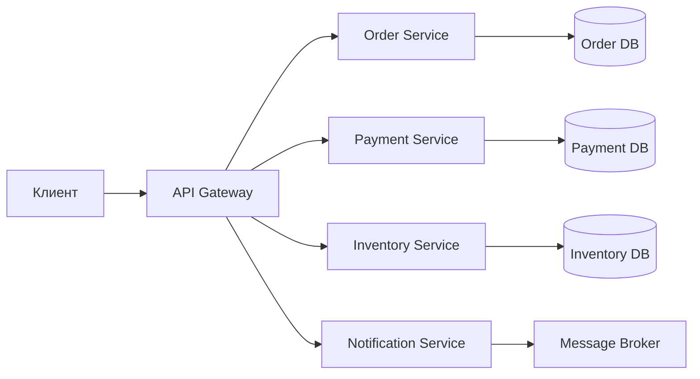

**Практический критерий:** к микросервисам переходят, когда появляется реальная потребность в независимом деплое и масштабировании частей системы, а не «по моде». Подробнее о согласованности данных -- в [вопросах по распределённым системам](distributed-systems-interview.md).

## Q2. (!) Монолит vs микросервисы -- когда что выбрать?

Короткий ответ: выбор определяют границы домена, потребность в независимых релизах и способность команды эксплуатировать распределённую систему. Размер команды сам по себе не задаёт порог перехода.

**Монолит** -- весь функционал в одной кодовой базе, собирается и развёртывается единым артефактом. Внутри простой: вызовы методов, `ACID`-транзакции, отладка одного процесса.

**Микросервисы** -- набор маленьких независимых сервисов, которые взаимодействуют по сети. Снаружи гибкие, внутри -- распределённая система со всеми её проблемами.

| Критерий | Монолит | Микросервисы |
|----------|---------|-------------|
| Организация команд | Проще начать и согласовывать изменения | Особенно полезны автономным командам с разными циклами релизов |
| Сложность деплоя | Простой (один артефакт) | Сложный (десятки сервисов) |
| Масштабирование | Возможно горизонтально, но обычно масштабируется весь артефакт | Можно масштабировать отдельные сервисы |
| Согласованность | Локальные `ACID`-транзакции проще применять | Межсервисные операции требуют отдельной модели согласованности |
| Старт нового проекта | Часто удобнее при неясных границах | Возможен при ясных границах и обоснованной потребности |
| Зрелость инфраструктуры | Не требуется | CI/CD, контейнеры, оркестрация |

**Совет Мартина Фаулера:** начинать с монолита (`Monolith First`) и разделять на микросервисы, только когда появится реальная потребность. Причина: на старте границы домена ещё плохо понятны, а неверно проведённые границы между сервисами стоят дорого -- переносить ответственность между сервисами куда сложнее, чем между модулями.

**Промежуточная точка -- `Modular Monolith`:** модули с чётко определёнными границами внутри одного деплоя. Даёт чистоту границ почти как у микросервисов, но без сетевой сложности; из него легко выделить сервис позже, когда граница устоялась.

## Q3. (!) Какие преимущества и недостатки имеет микросервисная архитектура?

Главная мысль для собеседования: **почти каждый плюс микросервисов имеет зеркальный минус**. Независимость деплоя оборачивается распределённой сложностью, изоляция данных -- потерей `ACID`. Сильный кандидат называет не списки, а эти связки.

**Преимущества:**

1. **Независимый деплой** -- обновление одного сервиса не требует пересборки всего приложения; команды выкатываются в своём ритме
2. **Масштабируемость** -- каждый сервис масштабируется горизонтально и независимо: ресурсы добавляют только узкому месту
3. **Технологическая гибкость** -- разные сервисы могут использовать разные языки/фреймворки/БД под свою задачу
4. **Изоляция сбоев** -- отказ одного сервиса можно локализовать, если межсервисные зависимости и деградация спроектированы для частичных отказов
5. **Автономность команд** -- каждая команда владеет своим сервисом целиком (full ownership), меньше согласований

**Недостатки (плата за то же самое):**

1. **Распределённая сложность** -- сеть ненадёжна: латентность, таймауты, частичные отказы, которых в монолите просто не существовало
2. **Согласованность данных** -- локальные `ACID`-транзакции не охватывают границы сервисов; межсервисные инварианты требуют отдельного решения
3. **Операционная сложность** -- без зрелых `CI/CD`, мониторинга, трейсинга и оркестрации система неуправляема
4. **Тестирование** -- интеграционные и end-to-end сценарии сложнее: нужно поднимать несколько сервисов и их зависимости
5. **Риск неверных границ** -- неудачное разбиение даёт `distributed monolith`: минусы микросервисов без их плюсов

## Q4. Как правильно определить границы микросервиса (Bounded Context)?

**Границы проводят по бизнес-возможностям и связности изменений, а не по техническим слоям.** `Bounded Context` из `Domain-Driven Design` помогает найти границы модели и языка домена. Это ориентир для выделения сервисов, а не обязательное соответствие «один контекст -- один сервис».

Почему именно по домену: внутри одного бизнес-контекста изменения тесно связаны и происходят вместе, а между контекстами связь редкая. Граница сервиса должна проходить там, где связь слабее всего -- тогда большинство изменений останутся внутри одного сервиса.

**Правила определения границ:**

1. **Бизнес-домен** -- сервис соответствует конкретной бизнес-области (заказы, платежи, склад)
2. **Связность ответственности** -- сервис объединяет изменения и инварианты одной бизнес-возможности; соответствие Bounded Context не обязано быть один к одному
3. **Владение данными** -- каждый сервис закрывает прямой доступ к своим данным; отдельный сервер БД не обязателен
4. **Слабая связанность** -- изменение одного сервиса не должно тянуть за собой изменение другого
5. **Владение и эксплуатация** -- у сервиса должен быть ответственный владелец; размер команды или число строк кода не задают размер сервиса

**Анти-паттерн -- Distributed Monolith:** формально микросервисы, но связаны так тесно, что требуют совместного деплоя, разделяют БД или модели. Признаки: одно изменение тянет правки в нескольких сервисах; нельзя выкатить сервис независимо. Это худший из миров -- сетевая сложность есть, а независимости нет.

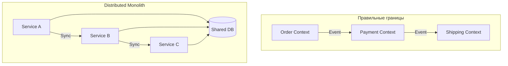

## Q5. Какие технологии используются для межсервисного взаимодействия?

Выбор сводится к одной развилке: **нужен немедленный ответ -- синхронный протокол (`REST`/`gRPC`); можно обработать позже -- асинхронный (брокер сообщений)**. Остальное -- нюансы производительности и контрактов.

| Технология | Тип | Когда применять |
|-----------|-----|----------------|
| `REST` / `HTTP` | Синхронный | CRUD, простые запросы |
| `gRPC` | RPC | Типизированные контракты и streaming; производительность проверяют под нагрузкой |
| `Apache Kafka` | Асинхронный | Потоки событий, высокая пропускная способность |
| `RabbitMQ` | Асинхронный | Задачи, очереди, routing |
| `GraphQL` | Синхронный | Гибкие клиентские запросы, BFF |
| `WebSocket` | Двусторонний | Реалтайм-уведомления |

Подробнее о событийном взаимодействии -- в [вопросах по Event-driven паттернам](event-driven-patterns-interview.md), о `Kafka` -- в [вопросах по Kafka](../messaging/kafka-interview.md).

## Q6. Синхронное vs асинхронное взаимодействие -- когда что применять?

**Синхронное** (`REST`, `gRPC`): вызывающая операция ждёт ответ, хотя поток при этом может не блокироваться. Подходит, когда результат нужен немедленно (получить данные для экрана, проверить баланс перед списанием). Расплата -- temporal coupling: доступность результата зависит от вызываемого сервиса. Длинные цепочки добавляют задержку и риск каскадного отказа.

**Асинхронное** (события, очереди): отправитель публикует сообщение и не ждёт ответа. Подходит для уведомлений, фоновой обработки, `Saga`.
- **Плюсы:** слабая связанность (получатель может быть временно недоступен -- сообщение подождёт в очереди), сглаживание пиковых нагрузок (буфер брокера).
- **Минусы:** сложнее отлаживать (нет единого стека вызова), и данные согласуются не сразу -- eventual consistency.

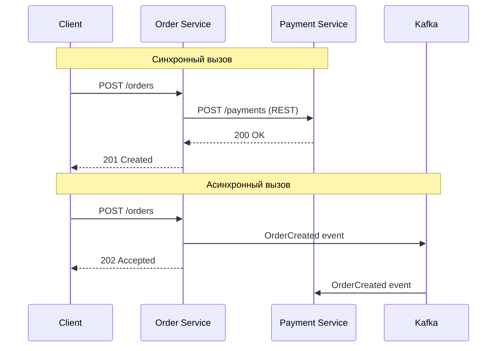

**Правило:** предпочитать асинхронное взаимодействие; синхронное -- только когда клиенту действительно нужен немедленный ответ.

## Q7. (!) Какие основные паттерны микросервисной архитектуры?

Паттерны удобно держать в голове по группам -- так их легче перечислить на собеседовании и видно, какую проблему каждый решает:
- **Инфраструктура трафика:** `API Gateway`, `Service Discovery`, `Service Mesh`, `Sidecar`, `BFF` -- как запросы попадают в систему и ходят между сервисами.
- **Отказоустойчивость:** `Circuit Breaker`, `Bulkhead`, `Retry` -- как пережить частичные сбои.
- **Данные и транзакции:** `Saga`, `CQRS`, `Event Sourcing`, `Database per Service` -- как жить без распределённых `ACID`-транзакций.
- **Миграция:** `Strangler Fig` -- как уйти с монолита постепенно.

| Паттерн | Назначение |
|---------|-----------|
| `API Gateway` | Единая точка входа, маршрутизация, аутентификация |
| `Service Discovery` | Динамическое обнаружение сервисов |
| `Circuit Breaker` | Защита от каскадных сбоев |
| `Saga` | Распределённые транзакции без 2PC |
| `CQRS` | Разделение чтения и записи |
| `Event Sourcing` | Хранение истории изменений как событий |
| `Service Mesh` | Инфраструктурный слой для межсервисного трафика |
| `Bulkhead` | Изоляция ресурсов между вызовами |
| `Strangler Fig` | Постепенная миграция с монолита |
| `Sidecar` | Вспомогательный контейнер рядом с основным |
| `BFF` (`Backend for Frontend`) | Отдельный API-слой для каждого типа клиента |
| `Database per Service` | Изоляция данных каждого сервиса |

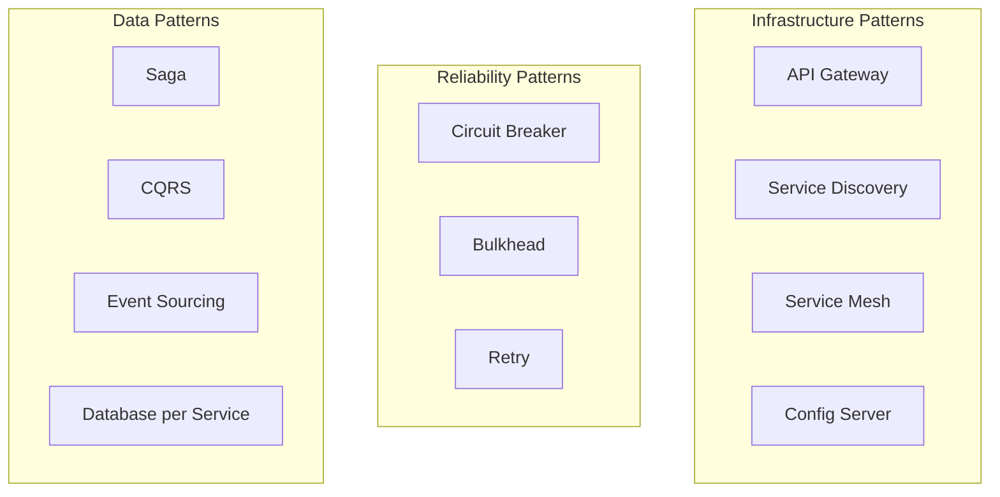

## Q8. (!) Что такое API Gateway и зачем он нужен?

**`API Gateway`** -- единая точка входа для всех клиентов, которая прячет внутреннее устройство системы. Клиент обращается к одному адресу, а Gateway маршрутизирует запросы к нужным микросервисам.

Зачем он нужен -- чтобы вынести сквозные задачи (cross-cutting concerns) из каждого сервиса в одно место: аутентификация/авторизация, rate limiting, агрегация ответов из нескольких сервисов, логирование. Без Gateway каждый сервис дублировал бы эту логику, а клиент должен был бы знать адреса всех сервисов.

Реализации: `Spring Cloud Gateway`, `Kong`, `AWS API Gateway`, `NGINX`.

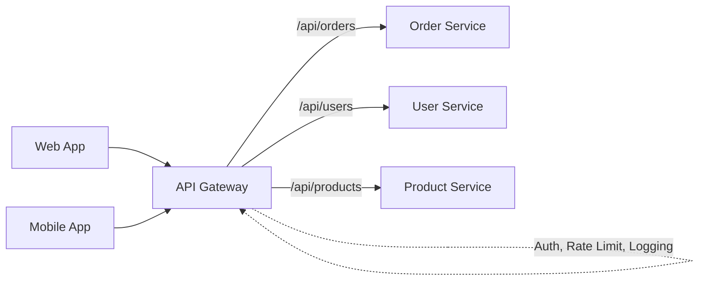

**Конфигурация `Spring Cloud Gateway`:**

```java
@Configuration
public class GatewayConfig {

    @Bean
    public RouteLocator customRouteLocator(RouteLocatorBuilder builder) {
        return builder.routes()
            .route("order-service", r -> r
                .path("/api/orders/**")
                .filters(f -> f
                    .stripPrefix(1)
                    .addRequestHeader("X-Gateway", "true")
                    .circuitBreaker(cb -> cb
                        .setName("orderCB")
                        .setFallbackUri("forward:/fallback/orders")))
                .uri("lb://order-service"))
            .route("user-service", r -> r
                .path("/api/users/**")
                .filters(f -> f.stripPrefix(1))
                .uri("lb://user-service"))
            .build();
    }
}
```

```yaml
# Декларативная конфигурация Spring Cloud Gateway
spring:
  cloud:
    gateway:
      routes:
        - id: order-service
          uri: lb://order-service
          predicates:
            - Path=/api/orders/**
          filters:
            - name: RequestRateLimiter
              args:
                redis-rate-limiter.replenishRate: 10
                redis-rate-limiter.burstCapacity: 20
            - StripPrefix=1
```

**BFF-подход:** отдельный `Gateway` для каждого типа клиента (web, mobile). Смысл -- у разных клиентов разные нужды: мобильному важно отдавать меньше данных и меньше round-trip'ов, веб-клиент готов к более «жирным» ответам. Каждый BFF агрегирует данные из нескольких сервисов под конкретный фронтенд, не превращая общий Gateway в свалку клиент-специфичной логики.

## Q9. (!) Что такое Service Discovery и как он работает?

**`Service Discovery`** -- механизм автоматического обнаружения сетевых адресов экземпляров сервисов. Проблема, которую он решает: в динамических средах (`Kubernetes`, облако) IP-адреса инстансов постоянно меняются при масштабировании, перезапусках и переездах подов -- захардкодить их нельзя. Сервисы регистрируются в реестре при старте, а вызывающий находит их там по логическому имени.

**Два подхода -- разница в том, кто выбирает инстанс:**
- **Client-side discovery** -- клиент сам запрашивает реестр, получает список инстансов и сам балансирует между ними (`Eureka` + `Spring Cloud LoadBalancer`). Гибко, но логика балансировки живёт в каждом клиенте.
- **Server-side discovery** -- запрос идёт через балансировщик, который сам знает реестр и прячет его от клиента (`Kubernetes Service`, `AWS ELB`). Клиент проще, но появляется ещё один сетевой хоп.

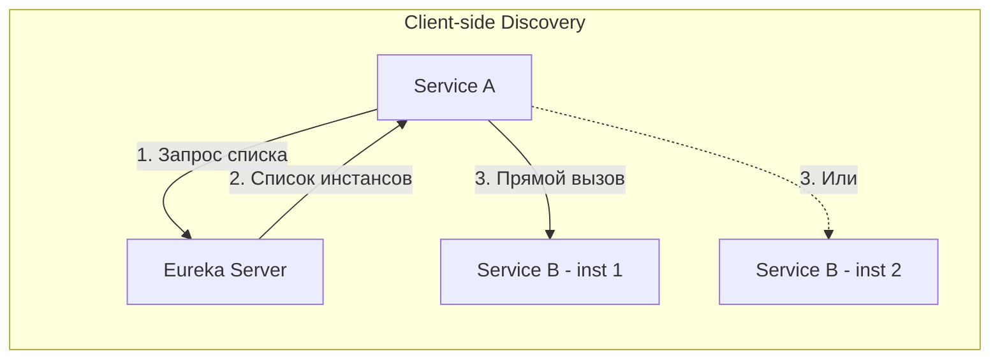

**Реализация с `Spring Cloud Eureka`:**

```java
// Eureka Server
@SpringBootApplication
@EnableEurekaServer
public class EurekaServerApp {
    public static void main(String[] args) {
        SpringApplication.run(EurekaServerApp.class, args);
    }
}

// Eureka Client (микросервис)
@SpringBootApplication
@EnableDiscoveryClient
public class OrderServiceApp {
    public static void main(String[] args) {
        SpringApplication.run(OrderServiceApp.class, args);
    }
}

// Использование DiscoveryClient
@Service
@RequiredArgsConstructor
public class PaymentClient {
    private final DiscoveryClient discoveryClient;

    public String getPaymentServiceUrl() {
        List<ServiceInstance> instances =
            discoveryClient.getInstances("payment-service");
        // Выбор инстанса (round-robin, random, etc.)
        ServiceInstance instance = instances.get(0);
        return instance.getUri().toString();
    }
}
```

В `Kubernetes` `Service Discovery` встроен через `DNS` -- каждый `Service` доступен по имени (`payment-service.default.svc.cluster.local`), и `kube-proxy` выполняет балансировку. Подробнее -- в [вопросах по Kubernetes](../devops/kubernetes-interview.md).

## Q10. (!) Что такое Circuit Breaker и как он предотвращает каскадные сбои?

**`Circuit Breaker`** (предохранитель) -- паттерн, который размыкает цепь при массовых сбоях: если вызываемый сервис стабильно не отвечает, прерыватель перестаёт его дёргать и сразу возвращает fallback-ответ.

Как именно он гасит каскад: без него каждый вызов к мёртвому сервису висит до таймаута, занимая поток и соединение вызывающего. Под нагрузкой пулы исчерпываются, и падает уже сам вызывающий -- сбой ползёт вверх по цепочке. `Circuit Breaker` обнаруживает высокий процент ошибок и начинает «отказывать быстро» (fail fast): вызывающий мгновенно получает fallback вместо зависания, его ресурсы свободны, а больной сервис не добивают запросами и дают ему восстановиться.

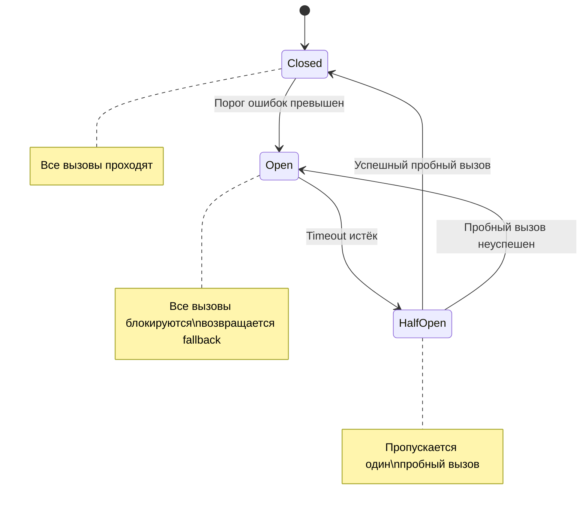

**Три состояния (как у электрического предохранителя):**
1. **Closed** -- цепь замкнута, вызовы проходят, прерыватель считает долю ошибок. Превысила порог -- переходим в Open
2. **Open** -- цепь разомкнута, вызовы блокируются, сразу отдаётся fallback. По истечении таймаута -- в Half-Open
3. **Half-Open** -- пропускается несколько пробных вызовов: успех -- возвращаемся в Closed, неудача -- снова Open

**Реализация с `Resilience4j`:**

```java
@Service
public class OrderService {

    @CircuitBreaker(name = "paymentService", fallbackMethod = "paymentFallback")
    @Retry(name = "paymentService", fallbackMethod = "paymentFallback")
    public PaymentResponse processPayment(PaymentRequest request) {
        return paymentClient.charge(request);
    }

    private PaymentResponse paymentFallback(PaymentRequest request,
                                            Throwable ex) {
        log.warn("Payment service unavailable, using fallback: {}",
                 ex.getMessage());
        return PaymentResponse.pending(request.getOrderId());
    }
}
```

```yaml
# application.yml — конфигурация Resilience4j
resilience4j:
  circuitbreaker:
    instances:
      paymentService:
        slidingWindowSize: 10
        failureRateThreshold: 50
        waitDurationInOpenState: 10s
        permittedNumberOfCallsInHalfOpenState: 3
        slowCallDurationThreshold: 2s
  retry:
    instances:
      paymentService:
        maxAttempts: 3
        waitDuration: 500ms
        exponentialBackoffMultiplier: 2
```

**Circuit Breaker vs Retry -- разные уровни проблемы.** Они дополняют друг друга: `Retry` лечит единичные сбои (повторяет отдельный неудачный вызов в расчёте на временную икоту сети), `Circuit Breaker` лечит системные (видит, что сбоят почти все вызовы, и вообще перестаёт ходить к сервису). Без прерывателя retry под массовым сбоем только усиливает нагрузку на упавший сервис.

## Q11. Что такое Service Mesh и зачем он нужен?

**`Service Mesh`** -- инфраструктурный слой управления трафиком между сервисами: маршрутизация, сетевые политики, `mTLS` и телеметрия. Отдельные функции отказоустойчивости зависят от реализации и конфигурации. Прокси может работать как sidecar или в другом режиме, например Istio ambient.

Реализации: `Istio`, `Linkerd`, `Consul Connect`.

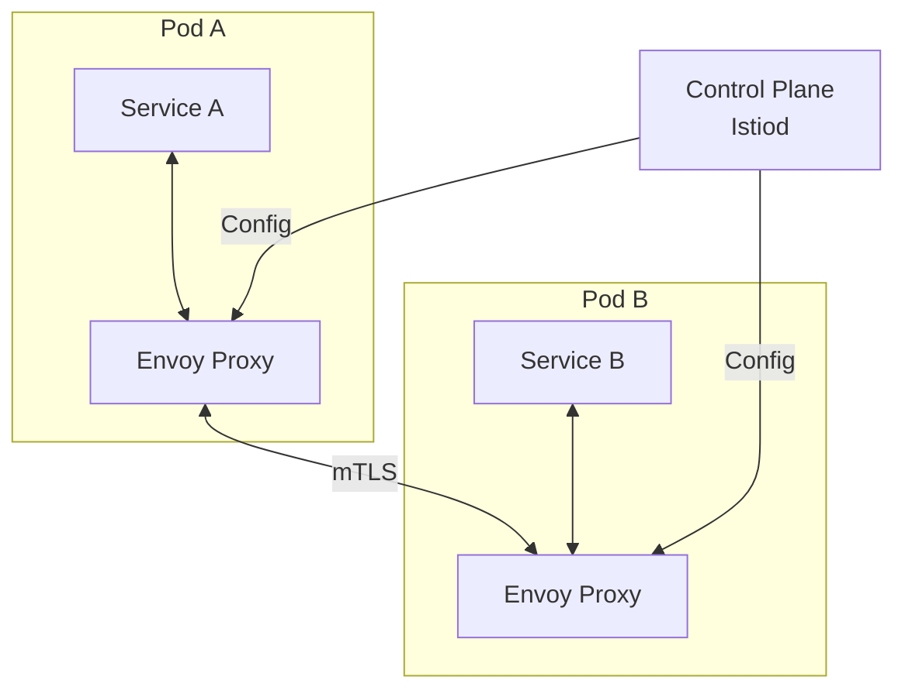

**Как работает в sidecar-режиме:** прокси (`Envoy`) обрабатывает сетевой трафик пода и применяет настроенные политики. В ambient-режиме Istio использует прокси на уровне узла и при необходимости waypoint. Бизнес-решения при частичных отказах остаются в приложении.

**Когда использовать:** нужны единые сетевые политики, mTLS и телеметрия для множества вызовов, а эксплуатационная команда готова поддерживать mesh. Решение зависит от требований и возможностей платформы, а не от фиксированного числа сервисов. Istio поддерживает sidecar и ambient-режимы.

## Q12. (!) Что такое паттерн CQRS?

**`CQRS`** (`Command Query Responsibility Segregation`) -- паттерн, разделяющий обработку команд и запросов. Команды меняют состояние и могут возвращать результат операции; запросы читают данные без изменения состояния.

Идея в том, что у чтения и записи противоположные требования. Запись хочет нормализованную модель с валидацией и инвариантами; чтение хочет данные, уже сложенные под конкретный экран, без дорогих JOIN'ов. В одной модели угодить обоим трудно -- CQRS разводит их, позволяя оптимизировать каждую сторону отдельно.

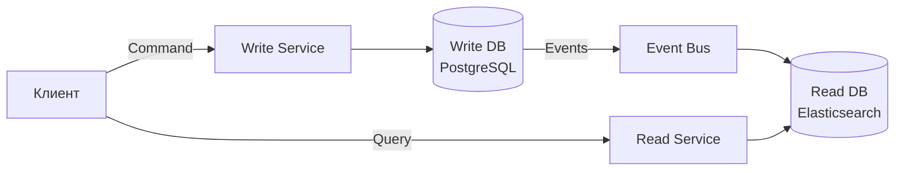

**Что это даёт:**
- Модель чтения оптимизирована под запросы (денормализация, кэш, отдельное хранилище вроде `Elasticsearch`)
- Модель записи оптимизирована под бизнес-логику (нормализация, валидация, инварианты)
- Чтение и запись масштабируются независимо -- read-реплик можно поднять много, не трогая запись

**Пример с `Spring Boot`:**

```java
// Command — изменение состояния
@RestController
@RequestMapping("/api/orders")
public class OrderCommandController {

    @PostMapping
    public ResponseEntity<UUID> createOrder(@RequestBody CreateOrderCommand cmd) {
        UUID orderId = orderCommandService.handle(cmd);
        return ResponseEntity.status(HttpStatus.CREATED).body(orderId);
    }
}

// Query — только чтение
@RestController
@RequestMapping("/api/orders")
public class OrderQueryController {

    @GetMapping("/{id}")
    public OrderView getOrder(@PathVariable UUID id) {
        return orderQueryService.findById(id);
    }

    @GetMapping
    public List<OrderSummaryView> search(OrderSearchCriteria criteria) {
        return orderQueryService.search(criteria);
    }
}
```

**Когда применять:** перекос нагрузки в сторону чтения (read-heavy системы), сложная бизнес-логика на записи, нужна денормализация под UI. Часто идёт в паре с `Event Sourcing`: события -- источник истины для записи, а read-модель строится их проигрыванием.

**Подводный камень:** при раздельных хранилищах read-модель обновляется асинхронно -- появляется eventual consistency, и сразу после записи запрос может вернуть старые данные. CQRS оправдан не везде; для простого CRUD он только добавляет сложности.

## Q13. Что такое Event Sourcing?

**`Event Sourcing`** -- паттерн, при котором источником истины служит журнал событий. Текущее состояние выводят из событий; для быстрого чтения могут хранить снимки и проекции.

Сдвиг мышления здесь такой: обычная БД хранит «что есть сейчас» и теряет историю при каждом UPDATE; Event Sourcing хранит «что произошло» и из этого выводит «что есть сейчас». Журнал событий -- append-only, события не редактируются и не удаляются.

**Пример:** вместо хранения `balance = 150` хранятся события:
1. `AccountCreated(balance=0)`
2. `MoneyDeposited(amount=200)`
3. `MoneyWithdrawn(amount=50)`

Текущий баланс 150 получается, если проиграть эти три события. Чтобы не проигрывать тысячи событий каждый раз, периодически сохраняют snapshot и доигрывают только то, что после него.

**Плюсы:** история событий и возможность восстановить прошлое состояние агрегата при сохранении всех нужных событий. **Минусы:** сложнее эволюция схем событий и построение текущего представления; асинхронные проекции могут отставать. CQRS часто сочетают с Event Sourcing, но он не обязателен.

Фреймворки для Java: `Axon Framework`, `Eventuate`. Подробнее о событийных паттернах -- в [Event-driven паттернах](event-driven-patterns-interview.md).

## Q14. Что такое паттерн Strangler Fig для миграции с монолита?

**`Strangler Fig`** (по Мартину Фаулеру) -- паттерн постепенной, безопасной замены монолита микросервисами без «большого переписывания». Название от фикуса-душителя: он обрастает дерево и постепенно замещает его, пока старое не отомрёт.

Зачем так: переписать большую систему целиком и разом («big bang») -- почти гарантированный провал: долго, рискованно, нечем подстраховаться. Strangler Fig режет миграцию на маленькие безопасные шаги, на каждом из которых система работает. `API Gateway` -- ключевой элемент: он маршрутизирует трафик, направляя уже перенесённые маршруты в новые сервисы, а остальное -- по-прежнему в монолит. Откатить шаг -- это просто вернуть маршрут на монолит.

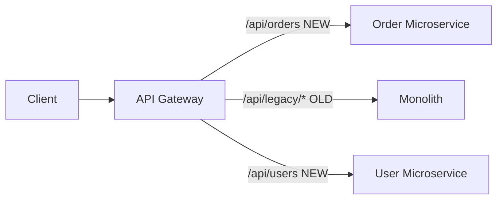

**Шаги:**
1. Поставить `API Gateway` перед монолитом
2. Выделить один Bounded Context в микросервис
3. Перенаправить трафик на микросервис через Gateway
4. Повторять для следующих контекстов
5. Отключить монолит, когда весь трафик идёт через микросервисы

## Q15. (!) Что такое ACID и BASE?

**`ACID`** (`Atomicity`, `Consistency`, `Isolation`, `Durability`) -- свойства транзакций в реляционных БД:

1. **Atomicity** -- транзакция выполняется целиком или не выполняется вовсе
2. **Consistency** -- БД переходит из одного согласованного состояния в другое
3. **Isolation** -- транзакции не видят промежуточные результаты друг друга
4. **Durability** -- после коммита данные сохраняются даже при сбое

**`BASE`** (`Basically Available`, `Soft-state`, `Eventual consistency`) -- альтернативный подход для распределённых систем:

1. **Basically Available** -- система доступна, допуская временную несогласованность
2. **Soft-state** -- состояние может меняться со временем (без записи)
3. **Eventual consistency** -- данные в итоге придут к согласованному состоянию

| | ACID | BASE |
|---|------|------|
| Гарантии | Строгая согласованность | Конечная согласованность |
| Область описания | Транзакция и её инварианты | Доступность и сходимость распределённого состояния |
| Цена | Зависит от реализации и уровня изоляции | Нужно учитывать задержку сходимости и конфликты |
| Применение | Возможно и внутри микросервиса | Возможно и без микросервисов |

**Связь с темой:** локальная БД сервиса может поддерживать `ACID`, а копии данных и межсервисные процессы часто сходятся асинхронно. `BASE` не означает обязательный отказ от транзакций. Строгая межсервисная атомарность возможна при поддержке распределённого протокола, но добавляет связанность и ограничения доступности. Подробнее -- в [паттернах согласованности](consistency-patterns-interview.md).

## Q16. (!) Что такое CAP-теорема?

**`CAP`-теорема** (теорема Брюэра) гласит: распределённая система не может одновременно гарантировать все три свойства -- при сбое придётся пожертвовать одним:

1. **Consistency** -- линейризуемость: успешное чтение видит результат последней завершённой записи
2. **Availability** -- каждый запрос к исправному узлу завершается ответом, без гарантии свежести данных
3. **Partition tolerance** -- система продолжает работать при разрыве сети между узлами

**Ключевой нюанс, который часто проваливают на собеседовании:** выбор не «любые два из трёх». Сетевые разделения (`P`) в распределённой системе неизбежны -- от них нельзя отказаться. Поэтому реальный выбор всегда между `C` и `A` в момент, когда разделение уже случилось:
- **CP** (`ZooKeeper`, `etcd`, `HBase`) -- при разделении отказываем в ответе (жертвуем доступностью), чтобы не отдать неактуальные данные. Подходит там, где цена ошибки высока (конфигурация, координация).
- **AP** -- при разделении отвечаем из доступной части системы, допуская устаревшие данные или конфликтующие записи. Подходит, когда это разрешено бизнес-инвариантами; поведение конкретного продукта зависит от настроек.

Подробнее -- в [вопросах по CAP-теореме](cap-theorem-interview.md).

## Q17. (!) Как обеспечивается атомарность операций в микросервисах?

Локальная транзакция не обеспечивает атомарность сразу нескольких независимых хранилищ. Если бизнес-операция охватывает сервисы, выбирают подход под нужный инвариант и доступные хранилища. `Saga` обеспечивает завершение или компенсацию шагов, но не даёт мгновенного глобального отката. `Outbox` атомарно сохраняет данные и намерение опубликовать событие в одной БД; доставку выполняют отдельно.

1. **Saga** -- последовательность локальных транзакций; при сбое шага запускаются компенсации, откатывающие предыдущие
2. **Transactional Outbox** -- решает «dual write problem» (нельзя атомарно записать в БД и отправить в брокер): событие пишется в таблицу `outbox` в той же транзакции, что и данные, а отдельный процесс (`Debezium`, polling) читает outbox и публикует в `Kafka`
3. **Event Sourcing** -- изменение агрегата сохраняется как событие; само по себе не делает операцию между сервисами атомарной
4. **Оркестрация / Хореография** -- два способа координировать шаги распределённой операции (центральный дирижёр vs цепочка событий)

```java
// Transactional Outbox — запись данных и события в одной транзакции
@Service
@RequiredArgsConstructor
public class OrderService {

    private final OrderRepository orderRepository;
    private final OutboxRepository outboxRepository;

    @Transactional
    public Order createOrder(CreateOrderRequest request) {
        Order order = Order.create(request);
        orderRepository.save(order);

        // Событие в outbox-таблицу — в той же транзакции
        outboxRepository.save(OutboxEvent.builder()
            .aggregateType("Order")
            .aggregateId(order.getId().toString())
            .type("OrderCreated")
            .payload(toJson(new OrderCreatedEvent(order)))
            .build());

        return order;
    }
}
```

## Q18. (!) Что такое Saga и когда применять вместо 2PC?

**`Saga`** -- способ провести бизнес-операцию через несколько сервисов как последовательность их локальных транзакций. Глобального отката нет: если шаг падает, уже сделанное откатывается компенсирующими транзакциями (отменить заказ, вернуть резерв), которые проигрываются в обратном порядке. То есть `Saga` заменяет «всё-или-ничего» 2PC на «делаем по шагам, при сбое аккуратно отыгрываем назад».

**Два способа координации -- кто решает, какой шаг следующий:**
- **Choreography** -- децентрализованно: каждый сервис, завершив свой шаг, публикует событие, на которое подписан следующий. Нет единой точки отказа, но логику саги тяжело окинуть взглядом -- она «размазана» по сервисам.
- **Orchestration** -- централизованно: оркестратор-дирижёр вызывает сервисы по очереди и сам решает, что делать при сбое. Логика в одном месте и проще для сложных саг, но оркестратор -- дополнительный компонент и потенциальное узкое место.

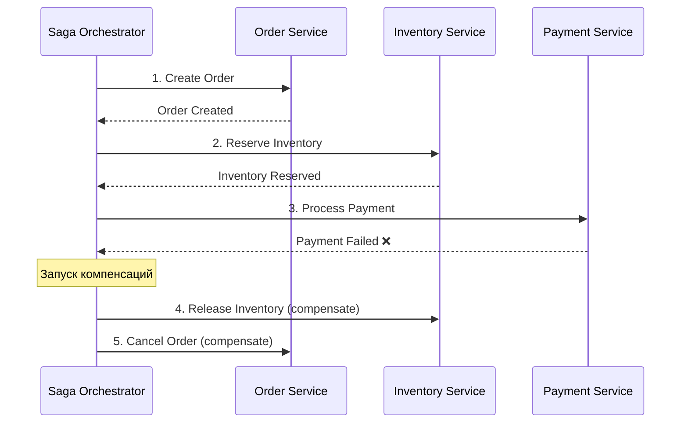

**Saga vs 2PC:**

| | Saga | 2PC |
|---|------|-----|
| Блокировки | Нет | Да (ресурсы заблокированы) |
| Производительность | Зависит от шагов и доставки | Зависит от участников и времени удержания ресурсов |
| Согласованность | Eventual | Strong |
| Сложность | Компенсации, повторы, наблюдение за состоянием | Координатор и поддержка протокола всеми участниками |
| Поддержка хранилищ | Локальные транзакции каждого шага | Требуется совместимый протокол участников |

**Применять Saga когда:** сервисы используют разные хранилища (особенно NoSQL без поддержки `XA`), 2PC неприемлем по производительности из-за блокировок, нужна слабая связанность. Цена -- eventual consistency и обязанность написать корректную компенсацию для каждого шага.

**Пример оркестратора:**

```java
@Component
@RequiredArgsConstructor
public class CreateOrderSaga {

    private final OrderService orderService;
    private final InventoryClient inventoryClient;
    private final PaymentClient paymentClient;

    public void execute(CreateOrderCommand command) {
        Order order = orderService.create(command);
        try {
            inventoryClient.reserve(order.getItems());
            try {
                paymentClient.charge(order.getTotalAmount());
                orderService.confirm(order.getId());
            } catch (PaymentException e) {
                inventoryClient.release(order.getItems()); // компенсация
                orderService.cancel(order.getId());        // компенсация
                throw e;
            }
        } catch (InventoryException e) {
            orderService.cancel(order.getId());            // компенсация
            throw e;
        }
    }
}
```

## Q19. (!) Что такое двухфазная фиксация (2PC)?

**`Two-Phase Commit` (2PC)** -- протокол, обеспечивающий атомарность распределённой транзакции через координатора. Идея -- сначала убедиться, что зафиксировать готовы все участники, и только потом фиксировать; иначе откатить всех. Отсюда две фазы.

**Фаза 1 (Prepare):** координатор спрашивает всех участников: «Готовы к фиксации?» Каждый выполняет локальные проверки, переводит ресурсы в готовое к коммиту состояние (с блокировками) и отвечает `YES` или `NO`. Ответив `YES`, участник обязуется зафиксировать по команде -- и держит блокировки до неё.

**Фаза 2 (Commit/Rollback):** если все ответили `YES`, координатор рассылает `COMMIT`; если хоть один `NO` -- `ROLLBACK`. Решение единое для всех, поэтому транзакция атомарна.

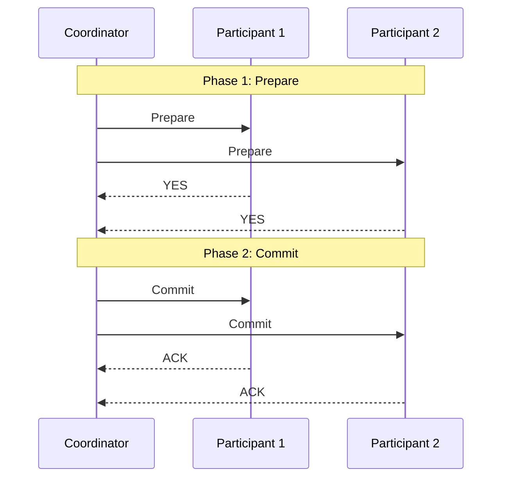

**Недостатки 2PC (все вытекают из блокировок и роли координатора):**
- **Блокирующий** -- ресурсы заблокированы на всё время протокола, включая сетевые задержки между фазами
- **Single point of failure** -- если координатор упал после `Prepare`, участники зависают с заблокированными ресурсами, не зная, коммитить или откатывать
- **Требует поддержки участников** -- не всякое хранилище или брокер поддерживает совместимый протокол распределённой транзакции
- **Плохая масштабируемость** -- удерживаемые блокировки режут пропускную способность под нагрузкой

Из-за этого в микросервисах 2PC почти не применяют и предпочитают `Saga`: она не держит блокировки между сервисами, ценой перехода на eventual consistency.

## Q20. Что такое трёхфазная фиксация (3PC)?

**`Three-Phase Commit` (3PC)** -- расширение 2PC с промежуточной фазой `Pre-Commit`. При определённых предположениях о сбоях и времени доставки она уменьшает вероятность блокировки после отказа координатора:

1. **CanCommit** -- координатор спрашивает «можешь зафиксировать?»
2. **PreCommit** -- координатор объявляет «все согласны, готовьтесь фиксировать» (но ещё не фиксируйте)
3. **DoCommit** -- координатор командует «фиксируй»

Добавленная фаза создаёт у участников общее знание о том, что коммит решён, ещё до самого коммита. **Преимущество:** при сбое координатора после `PreCommit` участники по таймауту могут сами принять согласованное решение (раз дошли до Pre-Commit -- коммитим), а не висеть вечно. **Недостатки:** не спасает при сетевых разделениях (разные части кластера могут решить по-разному), сложнее в реализации и добавляет лишний round-trip -- поэтому на практике применяется редко.

## Q21. (!) Что такое компенсирующие транзакции?

**Компенсирующие транзакции** -- операции, которые семантически отменяют эффект уже зафиксированных шагов. В `Saga` нет общего rollback, поэтому при сбое шага «откат» делается явно -- запуском компенсаций для всех успевших выполниться шагов.

**Примеры компенсаций:**
| Операция | Компенсация |
|----------|-------------|
| Создать заказ | Отменить заказ |
| Зарезервировать товар | Снять резерв |
| Списать средства | Вернуть средства |
| Отправить уведомление | Отправить уведомление об отмене |

**Семантический откат, а не «как будто ничего не было».** Компенсация редко возвращает мир в точности к исходному состоянию -- она создаёт новую операцию, гасящую эффект. Списание не «стирается», а компенсируется возвратом средств: в истории останутся обе записи. Это нормально и часто даже требуется для аудита.

**Два требования к компенсациям:**
- **Идемпотентность** -- повторный вызов (а он случится: ретраи, дубли сообщений) не должен ломаться или возвращать дважды
- **Ограничения компенсации** -- эффект не всегда можно отменить полностью. Необратимые действия планируют с учётом этого и обычно выполняют после обратимых шагов

## Q22. Как решить проблемы согласованности данных?

Главный сдвиг мышления: в микросервисах строгую согласованность между сервисами не «обеспечивают», а **сознательно меняют на eventual consistency и управляют ею**. Подходы выстраиваются от выбора модели до конкретных механизмов:

1. **Выбор модели согласованности** -- определить, какие инварианты нужны немедленно, а где допустима задержка сходимости
2. **Event Sourcing + CQRS** -- события как источник истины; read-модель обновляется асинхронно
3. **Saga** -- распределённые операции с компенсациями вместо распределённых транзакций
4. **Transactional Outbox** -- гарантирует «at-least-once» публикацию событий, закрывая dual write problem
5. **Оптимистическая блокировка** -- версионирование записи, чтобы поймать конфликт параллельных изменений вместо порчи данных
6. **Bounded Context** -- профилактика: меньше межсервисных зависимостей -- меньше мест, где вообще нужна распределённая согласованность

Подробнее -- в [паттернах согласованности](consistency-patterns-interview.md).

## Q23. (!) Как обрабатываются сбои и отказы в микросервисах?

Базовая установка: в распределённой системе **частичный отказ -- норма, а не исключение**. Любой сетевой вызов может зависнуть, отвалиться по таймауту или вернуть ошибку. Поэтому отказоустойчивость не «добавляют сверху», а закладывают в каждый межсервисный вызов. Эти стратегии работают слоями и дополняют друг друга:

1. **Timeout** -- фундамент: ограничивает ожидание ответа, чтобы вызывающий не висел вечно (без него остальное бессмысленно)
2. **Retry** с exponential backoff -- повторяет единичный неудачный вызов в расчёте на временный сбой
3. **Circuit Breaker** (`Resilience4j`) -- при массовых сбоях вообще перестаёт ходить к сервису, давая ему восстановиться
4. **Fallback** -- запасной ответ (кэш, заглушка), когда сервис недоступен
5. **Bulkhead** -- изоляция ресурсов: отдельные пулы потоков/соединений, чтобы один больной сервис не исчерпал ресурсы для всех
6. **Graceful degradation** -- система продолжает работать с урезанным функционалом вместо полного отказа
7. **Health checks** -- `readiness`/`liveness` probes в `Kubernetes`: больной инстанс выводят из ротации

```java
@Service
public class ProductService {

    @CircuitBreaker(name = "inventory", fallbackMethod = "fallback")
    @Retry(name = "inventory")
    @TimeLimiter(name = "inventory")
    public CompletableFuture<InventoryStatus> checkInventory(String productId) {
        return CompletableFuture.supplyAsync(
            () -> inventoryClient.getStatus(productId));
    }

    private CompletableFuture<InventoryStatus> fallback(String productId,
                                                         Throwable ex) {
        return CompletableFuture.completedFuture(
            InventoryStatus.unknown(productId));
    }
}
```

## Q24. (!) Как реализовать механизмы повторной попытки (Retry)?

**Retry** -- повторение неудачного вызова с задержкой, в расчёте на то, что сбой был временным. Главный вопрос -- какой выбрать интервал между попытками, и здесь стратегии расположены по нарастанию «вежливости» к перегруженному сервису:

1. **Фиксированная задержка** -- повтор через постоянные N секунд. Просто, но при общем сбое все клиенты бьют синхронно
2. **Exponential backoff** -- задержка удваивается с каждой попыткой (1с, 2с, 4с, 8с): чем дольше сервис лежит, тем реже его дёргают, давая ему передышку
3. **Exponential backoff + jitter** -- к задержке добавляется случайный разброс, чтобы клиенты не повторяли синхронно и не создавали `thundering herd` (волну одновременных ретраев)
4. **Retry-After заголовок** -- самый корректный случай: сервер сам сообщает, когда прийти снова

```java
// Spring Retry
@Service
public class ExternalApiService {

    @Retryable(
        retryFor = {RestClientException.class},
        maxAttempts = 3,
        backoff = @Backoff(delay = 1000, multiplier = 2, maxDelay = 10000)
    )
    public String readExternalApi(String resourceId) {
        return restTemplate.getForObject(apiUrl + "/{id}", String.class, resourceId);
    }

    @Recover
    public String recover(RestClientException ex, String resourceId) {
        log.warn("External read failed for resourceId={}", resourceId, ex);
        return "default-response";
    }
}
```

**Главный подвох:** retry безопасен только для **идемпотентных** операций. Для мутирующих вызовов без идемпотентности повтор после неясного исхода (ответ потерялся, но операция прошла) создаст дубль -- двойное списание, два заказа. Поэтому ретраить мутации можно лишь вместе с idempotency key (см. Q25).

## Q25. Как обеспечить идемпотентность операций?

**Идемпотентность:** повтор одной и той же операции не создаёт повторного эффекта. Сетевой таймаут оставляет результат вызова неизвестным клиенту, а повторная доставка сообщения зависит от гарантий брокера и обработки. Поэтому операции, которые могут повторяться, проектируют с учётом дублей.

**Подходы:**
- **Idempotency Key** -- клиент передаёт уникальный ключ операции; сервер запоминает результат по ключу и на повтор возвращает сохранённый ответ, не выполняя операцию заново
- **Версионирование** -- оптимистичная блокировка обнаруживает конфликт изменения записи, но сама по себе не заменяет ключ идемпотентности бизнес-операции
- **Дедупликация в консьюмере** -- получатель отслеживает обработанные ключи сообщений `Kafka`/`RabbitMQ` и пропускает повторы

При одновременных запросах простой порядок «сначала проверить ключ, затем выполнить платёж» даёт гонку. Запись ключа и бизнес-эффекта нужно согласовать транзакционно или иным механизмом, который допускает только одного исполнителя; повтор с тем же ключом должен получить сохранённый результат.

## Q26. Что такое Bulkhead-паттерн?

**`Bulkhead`** (переборка) -- паттерн изоляции ресурсов: вызовы к каждому внешнему сервису обслуживаются из отдельного пула потоков/соединений. Так сбой одного сервиса не исчерпывает ресурсы, нужные для вызовов к остальным.

**Проблема, которую он решает:** при общем пуле один тормозящий сервис захватывает все потоки -- его вызовы висят до таймаута, новых потоков нет, и встаёт работа со всеми сервисами сразу, даже здоровыми. Bulkhead режет пул на изолированные секции: медленный сервис исчерпает только свою, остальные продолжат работать.

Аналогия из названия: переборки на корабле -- пробоина затапливает один отсек, а не весь корпус, и судно остаётся на плаву.

```java
@Service
public class OrderService {

    @Bulkhead(name = "paymentService", type = Bulkhead.Type.THREADPOOL)
    public CompletableFuture<PaymentResponse> processPayment(String orderId) {
        return CompletableFuture.supplyAsync(
            () -> paymentClient.charge(orderId));
    }
}
```

```yaml
resilience4j:
  bulkhead:
    instances:
      paymentService:
        maxConcurrentCalls: 10
        maxWaitDuration: 500ms
  thread-pool-bulkhead:
    instances:
      paymentService:
        maxThreadPoolSize: 10
        coreThreadPoolSize: 5
        queueCapacity: 20
```

## Q27. (!) Как организовать конфигурацию микросервисов?

**Централизованно: конфиги лежат в одном месте, а сервисы тянут их при старте или по refresh.** Проблема, которую это решает: когда инстансов сервиса десятки, хранить настройки внутри каждого артефакта нельзя -- изменить параметр пришлось бы пересборкой и редеплоем всех. Централизованное хранилище позволяет менять конфиг отдельно от кода.

**Решения (важно разделять обычный конфиг и секреты):**
- **Spring Cloud Config** -- конфиг в Git, выдаётся по профилю; история изменений и ревью идут через сам Git
- **Kubernetes ConfigMap / Secrets** -- конфиг как ресурс кластера, монтируется в под
- **HashiCorp Vault** -- специально для секретов (пароли, ключи, сертификаты) с шифрованием и аудитом доступа
- **Consul KV** -- распределённое key-value хранилище

```yaml
# Spring Cloud Config Client
spring:
  application:
    name: order-service
  config:
    import: optional:configserver:http://config-server:8888
  profiles:
    active: prod
```

**Обновление без перезапуска:** `/actuator/refresh` перезагружает бины, помеченные `@RefreshScope`, без рестарта процесса. Чтобы не дёргать каждый инстанс вручную, `Spring Cloud Bus` (через `Kafka`/`RabbitMQ`) рассылает событие refresh сразу всем инстансам.

**Правило безопасности:** секреты хранят в предназначенном для этого хранилище с контролем доступа, а не в открытом коде и конфигурации. Vault и Kubernetes Secrets — примеры; их защита зависит от настроек платформы.

## Q28. (!) Как обеспечить безопасность взаимодействия между микросервисами?

Ключевая идея -- **отказ от модели «защищён периметр, внутри доверяем всем» в пользу zero trust**: внутренняя сеть тоже считается враждебной, каждый запрос аутентифицируется и шифруется. Защита строится слоями -- транспорт, приложение, сеть:

| Механизм | Уровень | Описание |
|----------|---------|----------|
| `mTLS` | Транспорт | Взаимная аутентификация по сертификатам |
| `JWT` / `OAuth2` | Приложение | Токен в заголовке, проверка подписи |
| `Service Mesh` | Инфраструктура | `mTLS` через поддерживаемый режим прокси |
| Network Policies | Сеть | Изоляция подов в `Kubernetes` |

**Паттерн с `API Gateway`:**

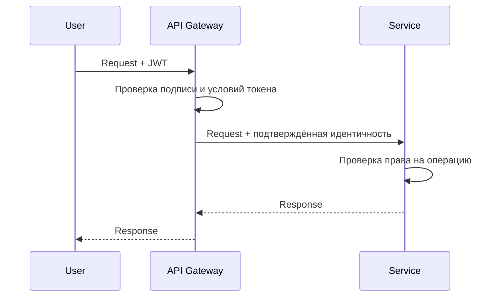

**Где здесь Gateway:** он проверяет запрос на входе и может передать идентичность пользователя дальше. Внутренний сервис должен доверять этому заголовку только при подтверждённом происхождении запроса от Gateway и всё равно проверять права на свою операцию.

**Где здесь Service Mesh:** транспортную безопасность берёт на себя инфраструктура. Внутри `Istio` включается `PeerAuthentication` со значением `STRICT` -- весь трафик между подами автоматически шифруется `mTLS`, без единой строчки в коде сервисов. Подробнее о безопасности -- в [паттернах аутентификации](../security/authentication-authorization-patterns-interview.md) и [Spring Security](../frameworks/spring/spring-security-interview.md).

## Q29. Как управлять версионированием API без прерывания работы?

Суть проблемы: в микросервисах **потребителей API нельзя обновить одновременно с провайдером** -- их деплоят независимо разные команды. Поэтому изменение API не должно ломать тех, кто ещё не перешёл на новую версию. Отсюда два набора инструментов.

**Как обозначить версию (когда ломающее изменение неизбежно):**

1. **URL versioning** -- `/api/v1/orders`, `/api/v2/orders`. Самый явный и простой в отладке
2. **Header versioning** -- `Accept: application/vnd.myapp.v2+json`. Чище URL, но версию не видно «на глаз»
3. **Query parameter** -- `/api/orders?version=2`

**Как пережить переход без простоя:**
- **Обратная совместимость** -- лучший вариант: новая версия принимает и старый формат запросов, так что менять версию вовсе не приходится
- **Deprecation period** -- старая версия работает параллельно с новой, пока все потребители не мигрируют
- **Consumer-driven contracts** (Pact) -- потребители заранее фиксируют ожидания от API, а CI провайдера проверяет, что изменение их не ломает

**Эмпирическое правило:** добавление необязательного поля -- не ломающее изменение (старые клиенты его игнорируют); удаление или переименование поля -- ломающее, требует новой версии.

## Q30. (!) Какие методы логирования и трейсинга используются?

Почему это вообще отдельная большая тема: в монолите запрос -- один стек вызова в одном процессе, упал -- видно в логе. В микросервисах один пользовательский запрос проходит через 5--10 сервисов, и без специальных средств невозможно ни собрать его историю, ни понять, где он затормозил. Отсюда **три столпа наблюдаемости (Observability)** -- они отвечают на разные вопросы:

1. **Логи** -- *что произошло* в конкретном сервисе (structured logging, JSON)
2. **Метрики** -- *насколько всё хорошо* в агрегате (latency, throughput, доля ошибок); дёшево хранить, удобно строить алерты
3. **Трейсы** -- *где именно* запрос прошёл и на каком шаге задержался (путь через цепочку сервисов с таймингами)

**Structured logging:**

```java
@Slf4j
@RestController
public class OrderController {

    @PostMapping("/api/orders")
    public ResponseEntity<Order> createOrder(@RequestBody CreateOrderRequest req) {
        log.info("Creating order for user={}, items={}",
                 req.getUserId(), req.getItems().size());
        // ...
    }
}
```

**Корреляция логов** помогает собрать события одного запроса из разных сервисов. В Spring Boot 3.x для трейсинга используют Micrometer Tracing; передача `traceId` зависит от инструментации исходящих вызовов и сообщений. Если логирование включает `traceId`, поиск по нему связывает записи с трейсом.

Подробнее -- в [вопросах по наблюдаемости](../monitoring/observability-interview.md) и [метрикам и трейсингу](../monitoring/metrics-tracing-interview.md).

## Q31. (!) Какие инструменты мониторинга и отладки используются?

| Категория | Инструменты |
|-----------|------------|
| Distributed tracing | `Jaeger`, `Zipkin`, `Tempo`, `AWS X-Ray` |
| Метрики | `Prometheus` + `Grafana`, `VictoriaMetrics` |
| Логи | `ELK Stack`, `Loki`, `Graylog` |
| APM | `DataDog`, `New Relic`, `Dynatrace` |
| Трейсинг SDK | `OpenTelemetry`, `Micrometer Tracing` |

**Возможный стек:** OpenTelemetry для инструментирования и передачи телеметрии, Prometheus для метрик, Jaeger или Tempo для трейсов, ELK или Loki для логов. Визуализацию и алерты подбирают под существующую инфраструктуру и объём данных.

**При Saga** трейс помогает увидеть путь вызовов и их задержки. Состояние бизнес-операции и компенсаций лучше также фиксировать отдельно: асинхронный процесс может выходить за границы одного трейса.

## Q32. Как обеспечивается масштабируемость и производительность?

Преимущество микросервисов здесь -- **возможность масштабировать отдельный сервис**. Монолит тоже может масштабироваться горизонтально, но обычно приходится размножать весь артефакт. Выбор метода начинается с измерения узкого места.

1. **Горизонтальное масштабирование** -- больше инстансов сервиса, если зависимости и состояние позволяют распределить нагрузку
2. **Кэширование** -- `Redis`, `Caffeine` снимают повторную нагрузку с БД, которая обычно и есть первое узкое место
3. **Асинхронная обработка** -- очереди (`Kafka`, `RabbitMQ`) принимают пик в буфер, а обработка идёт ровным темпом
4. **Шардирование БД** -- разделение данных по ключу, когда одна БД уже не тянет запись
5. **CQRS** -- read и write масштабируются независимо: read-реплик можно поднять много
6. **Auto-scaling** -- `Kubernetes HPA` сам добавляет/убирает инстансы по CPU/memory/custom-метрикам

Подробнее -- в [паттернах масштабируемости](scalability-patterns-interview.md) и [стратегиях кэширования](caching-strategies-interview.md).

## Q33. Какие аспекты транзакций необходимо учитывать при проектировании?

Отправная точка проектирования -- **определить минимальную границу атомарности**: какие операции обязаны выполниться «всё-или-ничего». Чем эта граница уже и чаще укладывается в одну БД, тем меньше распределённой боли. Дальше по убыванию связанности с этим решением:

1. **Границы транзакций** -- какие операции должны быть атомарными; стараться удержать их внутри одного сервиса
2. **Уровень изоляции** -- `Read Committed`, `Repeatable Read`, `Serializable` (актуально внутри одной БД)
3. **Модель согласованности** -- где допустима eventual consistency между сервисами, а где нужна strong
4. **Обработка ошибок** -- компенсации, retry, dead letter queue для сообщений, которые так и не удалось обработать
5. **Транзакционные журналы** -- `outbox`, `change data capture` для надёжной публикации событий
6. **Координация** -- `Saga`, если бизнес-операция допускает промежуточные состояния и компенсации; 2PC требует поддержки участников

## Q34. Как обеспечивается изоляция данных в микросервисах (Database per Service)?

**`Database per Service`** означает приватное владение данными: другой сервис не обращается прямо к таблицам владельца. Это можно обеспечить отдельной базой, схемой или правами в общей СУБД. Данные доступны через опубликованный API или события. Совместное владение таблицами связывает изменения схем и релизы.

**Что это даёт:**
- Независимый выбор типа БД под задачу (`PostgreSQL`, `MongoDB`, `Redis`)
- Возможность отдельно масштабировать хранилище, если БД физически разделены
- Изоляция части отказов, если хранилища действительно независимы
- Свобода менять схему, не согласовывая её ни с кем

**Чем приходится платить (и как закрывать):**
- **Нет JOIN между сервисами** → API Composition (собрать данные несколькими вызовами) или `CQRS` с денормализованной read-моделью
- **Локальная транзакция не охватывает несколько сервисов** → отдельное решение для межсервисного инварианта, например `Saga`, если подходит бизнес-семантика
- **Сложно строить отчёты по всем данным** → отдельная аналитическая БД, наполняемая через CDC (`Debezium`), а не запросами «во все БД сразу»

## Q35. Что такое глобальная транзакция и как она отличается от локальной?

**Локальная транзакция** -- выполняется в пределах одного транзакционного хранилища. Её гарантии и цена зависят от СУБД и выбранного уровня изоляции.

**Распределённая атомарная транзакция** охватывает несколько участников и требует согласованного решения commit/rollback, например через 2PC. `Saga` решает другую задачу: проводит бизнес-операцию через локальные транзакции с компенсациями, допуская промежуточные состояния. По возможности инвариант оставляют внутри локальной транзакции.

| | Локальная | Глобальная |
|---|-----------|------------|
| Область | Одна БД | Несколько БД/сервисов |
| Координация | СУБД | 2PC или другой поддерживаемый протокол |
| Цена | Зависит от уровня изоляции | Сеть, блокировки и доступность участников |
| Сложность | Обычно ниже | Выше: координатор и сбои участников |
| Гарантия | В пределах хранилища | Атомарное решение при выполнении условий протокола |

## Q36. Как организовать тестирование микросервисов?

**Пирамида тестирования микросервисов:**

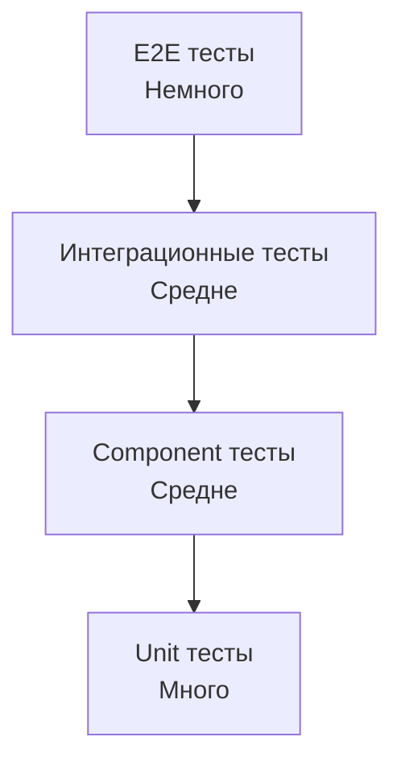

| Уровень | Описание | Инструменты |
|---------|----------|------------|
| Unit | Бизнес-логика без зависимостей | JUnit, Mockito |
| Component | Один сервис с моками зависимостей | Testcontainers, WireMock |
| Integration | Взаимодействие между сервисами | Testcontainers, Spring Cloud Contract |
| Contract | Проверка совместимости API | Pact, Spring Cloud Contract |
| E2E | Весь flow через все сервисы | Selenium, RestAssured |

**Главный сдвиг по сравнению с монолитом** -- упор на середину пирамиды. В монолите интеграцию проверяют сами вызовы методов; в микросервисах самый частый источник поломок -- рассинхрон контрактов между сервисами. Поэтому критичен слой **Consumer-Driven Contracts** (`Spring Cloud Contract`, `Pact`): потребитель фиксирует свои ожидания от API, а CI провайдера проверяет, что он эти ожидания выполняет. Так ломающее изменение ловится на сборке провайдера, а не в проде у потребителя. Полноценные E2E держат наверху и в малом числе -- они медленные и хрупкие. Подробнее -- в [интеграционном тестировании](../testing/integration-testing-interview.md).

## Q37. Как реализовать distributed tracing в микросервисах?

**Distributed tracing** показывает путь запроса через цепочку сервисов с таймингами шагов и помогает найти источник задержки.

**Из чего складывается трейс:** запрос -- это дерево вложенных операций, и три идентификатора задают его структуру:
- **TraceId** -- общий id всего запроса, одинаковый во всех сервисах; «склеивает» дерево воедино
- **SpanId** -- id одной операции (одного сервиса/шага) внутри запроса
- **Parent SpanId** -- ссылка на родительский span; именно она восстанавливает дерево «кто кого вызвал», а из таймингов span'ов видно, какой шаг съел время

**Реализация:** Spring Boot 3.x использует Micrometer Tracing вместо Spring Cloud Sleuth. Для OpenTelemetry с OTLP нужны соответствующие зависимости и настройки экспорта; конкретный пример приведён в Q41. Долю трейсов для production задают по нагрузке и стоимости хранения.

Контекст трейса можно передавать через HTTP-заголовок W3C `traceparent` и заголовки сообщений при подходящей инструментации клиента и брокера. Корреляция логов по `traceId` работает, если формат логирования включает его в запись.

**Про sampling:** долю сохранённых трейсов выбирают по нагрузке, стоимости хранения и диагностическим задачам. При малом трафике можно сохранять все трейсы; при большом используют выборку и при необходимости tail-based sampling.

## Q38. Как организовать деплой микросервисов (Blue-Green, Canary)?

Цель всех стратегий одна -- **выкатить новую версию без простоя и с возможностью быстрого отката**. Различаются они тем, как именно переключают трафик и насколько дёшев откат при проблеме:

| Стратегия | Описание | Риск |
|-----------|----------|------|
| **Rolling update** | Постепенная замена инстансов | Средний |
| **Blue-Green** | Два окружения; переключение трафика | Низкий |
| **Canary** | Часть трафика на новую версию | Низкий |
| **A/B testing** | Разные версии для разных пользователей | Низкий |

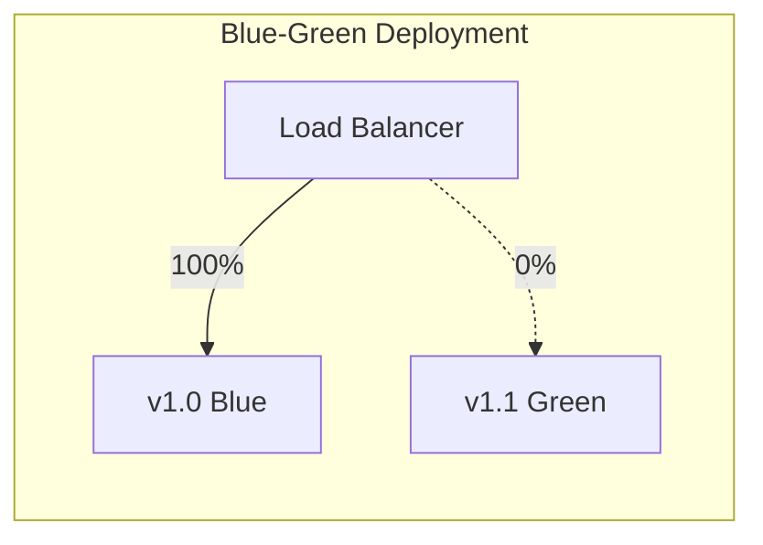

**Чем отличаются по сути:** `Blue-Green` держит два полных окружения и переключает трафик мгновенно -- откат тоже мгновенный, но нужны двойные ресурсы. `Canary` выпускает новую версию небольшой доле пользователей и наблюдает за метриками: проблема затронет лишь часть трафика, а раскатку можно остановить. В `Kubernetes` стратегия по умолчанию -- `Rolling Update` (поинстансная замена). Для `Canary` берут `Istio VirtualService` или `Argo Rollouts`, постепенно повышая процент трафика на новую версию. Подробнее -- в [стратегиях деплоя](../cicd/deployment-strategies-interview.md).

## Q39. (!) Что такое закон Конвея (Conway's Law) и как он влияет на микросервисы?

**Закон Конвея** (Conway's Law, 1968):

> "Организации, проектирующие системы, вынуждены воспроизводить в них свою собственную коммуникационную структуру."

Простыми словами: способы общения команд влияют на границы компонентов и стоимость изменений. Команды по техническим слоям чаще нуждаются в согласовании сквозных изменений; команды по бизнес-возможностям могут владеть вертикальными частями продукта. Закон описывает влияние организации, а не гарантирует конкретный тип архитектуры.

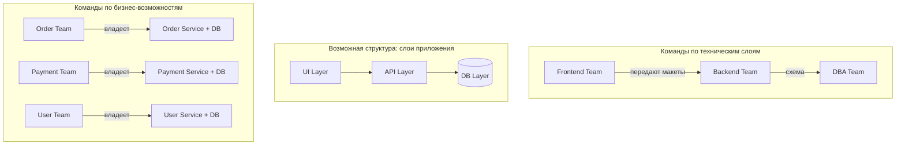

**"Обратный закон Конвея" (Inverse Conway Maneuver):**

Коммуникационные границы команд влияют на границы компонентов. При планировании разделения системы полезно согласовать ответственность команд и будущие контракты. Перестройка команд сама по себе не создаёт нужную архитектуру.

**Практические следствия:**
- У контекста и сервиса нужен понятный владелец; одна команда может владеть несколькими сервисами
- Размер сервиса задают связность изменений и границы ответственности, а не размер команды
- Слишком много согласований между командами — сигнал, что границы сервисов проведены неверно

## Q40. (!) Что такое Data Ownership в микросервисах и какие антипаттерны нарушают его?

**Data Ownership** — принцип: у каждого куска данных ровно один сервис-владелец, и менять эти данные может только он. Остальные читают и пишут их исключительно через API владельца, никогда — напрямую в его БД.

Зачем это жёсткое правило: владелец полностью контролирует схему и инварианты своих данных. Как только в его таблицу лезет другой сервис, схема замораживается (её правка ломает чужаков), а бизнес-правила можно обойти в обход кода владельца. Единоличное владение — то, что позволяет сервису эволюционировать независимо, ради чего микросервисы и затевались.

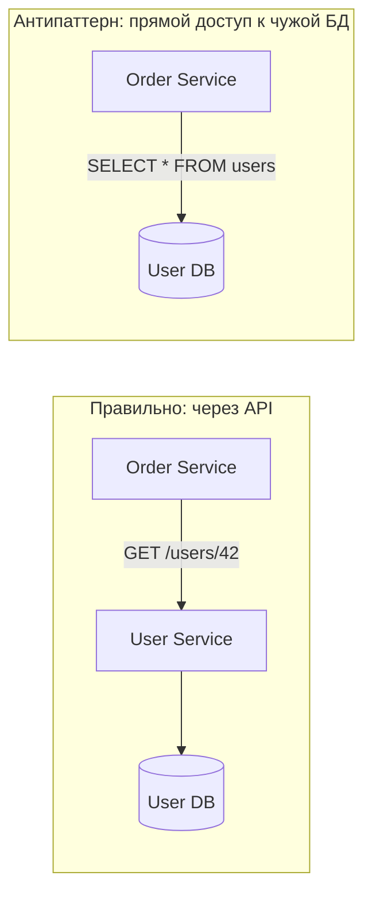

**Антипаттерны, нарушающие Data Ownership:**

| Антипаттерн | Описание | Решение |
|-------------|----------|---------|
| **Shared Database** | Несколько сервисов пишут в одну схему | Database per Service |
| **Direct DB Access** | Сервис A делает JOIN к таблицам сервиса B | API call или event-driven |
| **God Service** | Один сервис хранит данные для всех | Domain decomposition |
| **Distributed Monolith** | Сервисы раздельны, но деплоятся вместе из-за зависимостей данных | Разорвать зависимости через события |

**Стратегии организации данных:**

```
Вариант 1: API Composition
  Order Service нуждается в данных пользователя →
  вызывает User Service API при каждом запросе

Вариант 2: Event-driven denormalization
  User Service публикует UserUpdatedEvent →
  Order Service хранит копию нужных полей локально
  (eventual consistency — допустима задержка синхронизации)

Вариант 3: CQRS Read Model
  Агрегированные данные из нескольких сервисов
  собираются в отдельную read-модель
```

**Как выбрать вариант:** API Composition прост, но добавляет синхронную зависимость и латентность на каждый запрос; event-driven денормализация убирает зависимость в рантайме ценой eventual consistency и дублирования данных. Выбор между ними — это выбор между связанностью и согласованностью.

**Сигнал для проверки границ:** если один сценарий регулярно требует много синхронных межсервисных вызовов, оцените связность и задержку. Иногда лучше изменить границы, иногда достаточно `API Composition` или локальной read-модели.

## Q41. (!) Как реализовать distributed tracing с OpenTelemetry и Jaeger?

**Distributed tracing** — механизм отслеживания пути запроса через цепочку микросервисов. Каждый запрос получает уникальный `trace ID`; каждая операция внутри — `span ID`.

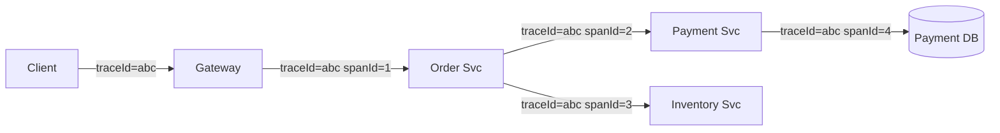

**Один из вариантов для Spring Boot 3.x с Micrometer Tracing и OTLP:**

```xml
<!-- pom.xml -->
<dependency>
    <groupId>org.springframework.boot</groupId>
    <artifactId>spring-boot-starter-actuator</artifactId>
</dependency>
<dependency>
    <groupId>io.micrometer</groupId>
    <artifactId>micrometer-tracing-bridge-otel</artifactId>
</dependency>
<dependency>
    <groupId>io.opentelemetry</groupId>
    <artifactId>opentelemetry-exporter-otlp</artifactId>
</dependency>
```

```yaml
# application.yml
management:
  tracing:
    sampling:
      probability: 1.0  # учебный пример; в production долю выбирают по нагрузке
  otlp:
    tracing:
      endpoint: http://jaeger:4318/v1/traces  # OTLP HTTP endpoint
```

**Propagation заголовков между сервисами (W3C TraceContext):**

```
traceparent: 00-4bf92f3577b34da6a3ce929d0e0e4736-00f067aa0ba902b7-01
             ^^  ^^^^^^^^^^^^^^^^^^^^^^^^^^^^^^^^ ^^^^^^^^^^^^^^^^ ^^
             ver  trace-id (128-bit)              span-id (64-bit) flags
```

Для `RestTemplate` и `WebClient` Spring Boot пропагирует контекст при создании клиента через автоконфигурированные builders. Для `OpenFeign` наличие зависимостей само по себе не доказывает передачу контекста: нужна совместимая конфигурация наблюдения и проверка исходящего вызова. В других версиях Spring Boot зависимости и свойства OTLP могут отличаться.

**Custom span для бизнес-операций:**

```java
@Service
public class OrderService {
    private final Tracer tracer;

    public Order processOrder(CreateOrderRequest request) {
        Span span = tracer.nextSpan()
            .name("order.process")
            .start();
        try (Tracer.SpanInScope ws = tracer.withSpan(span)) {
            return doProcessOrder(request);
        } finally {
            span.end();
        }
    }
}
```

**Что даёт Jaeger UI:** waterfall-диаграмма всего трейса, где сразу видно самый длинный span -- то есть сервис или вызов, который и есть узкое место запроса. Именно с этой картинки начинают разбор «почему ручка медленная».

## Q42. Как организовать inter-service communication: Feign vs WebClient vs gRPC?

Все три используются для межсервисных вызовов, но выбор зависит от контракта и модели выполнения. `WebClient` поддерживает неблокирующие цепочки, а gRPC — типизированные RPC и streaming. Реальная производительность зависит от нагрузки и реализации.

| Критерий | Feign (REST) | WebClient (REST) | gRPC |
|----------|-------------|-----------------|------|
| **Парадигма** | Декларативный REST | Реактивный REST | RPC с protobuf |
| **Блокирующий?** | Да (по умолчанию) | Нет в реактивной цепочке | Зависит от типа stub |
| **Streaming** | Обычно нет | Потоковые HTTP-ответы, SSE | Клиентский, серверный и двусторонний |
| **Контракт** | HTTP и DTO приложения | HTTP и DTO приложения | Сгенерированные типы из proto |
| **Производительность** | Зависит от реализации и нагрузки | Помогает при большом числе ожидающих I/O вызовов | Зависит от размера сообщений и нагрузки |
| **Отладка** | Простая (curl) | Средняя | Сложнее (protobuf) |
| **Применение** | Декларативные HTTP-контракты | Реактивные HTTP-клиенты | Типизированные RPC и потоки |

**OpenFeign — декларативный REST-клиент:**

```java
@FeignClient(name = "user-service", fallbackFactory = UserClientFallback.class)
public interface UserClient {
    @GetMapping("/users/{id}")
    UserDto getUser(@PathVariable Long id);
}
```

**WebClient — реактивный клиент (Spring WebFlux):**

```java
@Service
public class UserClientService {
    private final WebClient webClient;

    public Mono<UserDto> getUser(Long id) {
        return webClient.get()
            .uri("/users/{id}", id)
            .retrieve()
            .onStatus(HttpStatusCode::is4xxClientError,
                r -> Mono.error(new UserNotFoundException(id)))
            .bodyToMono(UserDto.class)
            .timeout(Duration.ofSeconds(2));
    }
}
```

---

## See also

- [Event-Driven паттерны](event-driven-patterns-interview.md) — EDA, Saga, Outbox и асинхронное взаимодействие в микросервисах
- [Spring Cloud](../frameworks/spring/spring-cloud-interview.md) — Service Discovery, Config Server, Circuit Breaker в Spring Cloud
- [Распределённые системы](distributed-systems-interview.md) — CAP, согласованность, репликация и партиционирование
- [CAP-теорема](cap-theorem-interview.md) — выбор CP/AP для каждого микросервиса
- [Apache Kafka](../messaging/kafka-interview.md) — брокер сообщений для асинхронной коммуникации
- [Kubernetes](../devops/kubernetes-interview.md) — оркестрация и деплой микросервисов
- [Паттерны отказоустойчивости](resilience-patterns-interview.md) — Circuit Breaker, Retry, Bulkhead между сервисами
- [Паттерны масштабируемости](scalability-patterns-interview.md) — горизонтальное масштабирование микросервисов

**Выбор клиента:** для существующего декларативного HTTP-контракта может подойти `OpenFeign`; для реактивной цепочки — `WebClient`; для типизированного RPC и потоков — `gRPC`. Сравнивайте реальную нагрузку и эксплуатационные требования. Spring Cloud считает OpenFeign завершённым по функциональности и рекомендует новым проектам рассмотреть Spring HTTP Service Clients (см. [вопросы по gRPC](../api/grpc-interview.md)).

- [API Gateway](api-gateway-interview.md)
- [BFF Pattern](bff-pattern-interview.md)
- [Стратегии кэширования](caching-strategies-interview.md)
- [CAP-теорема](cap-theorem-interview.md)
- [Clean Architecture](clean-architecture-interview.md)
- [Паттерны согласованности](consistency-patterns-interview.md)
- [Шпаргалка: Микросервисная архитектура](../../architecture/software-architecture/microservices.md) — теория
- [Service Discovery](service-discovery-interview.md) — Consul, Eureka, etcd, ZooKeeper, Kubernetes DNS; client-side vs server-side;…
- [Strangler Fig Pattern](strangler-fig-interview.md) — proxy, routing, Martin Fowler, incremental, rollback, feature flags, real…
