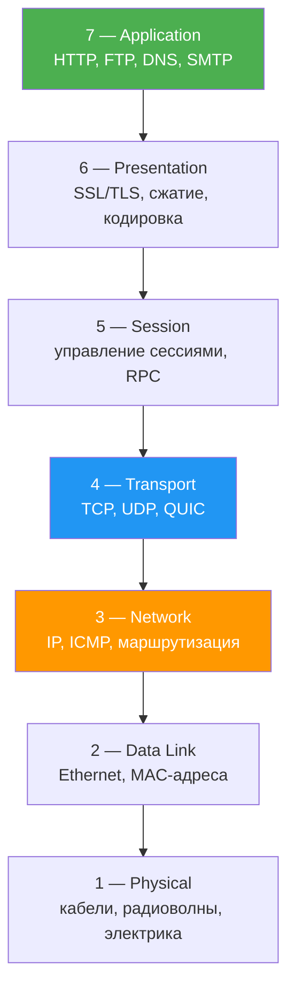
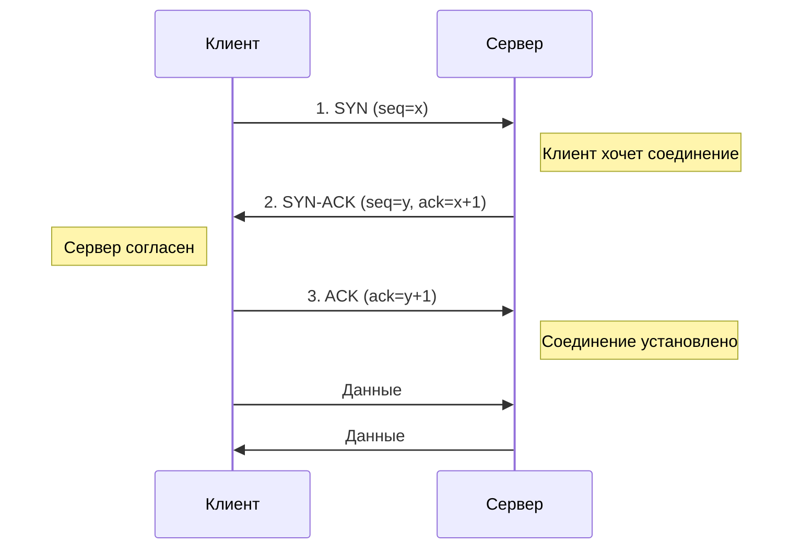
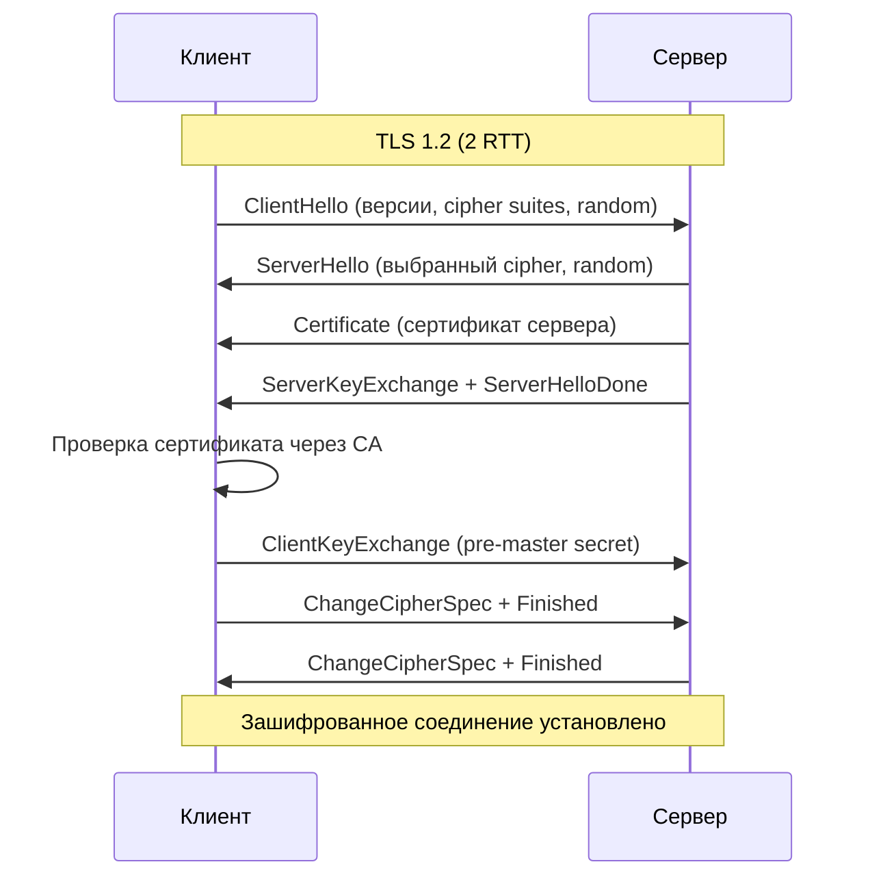
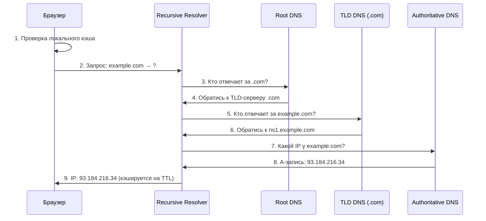
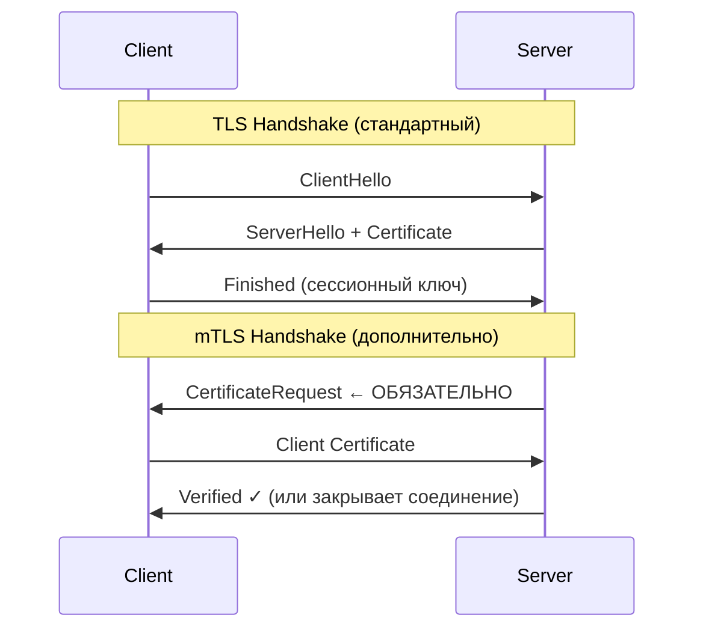
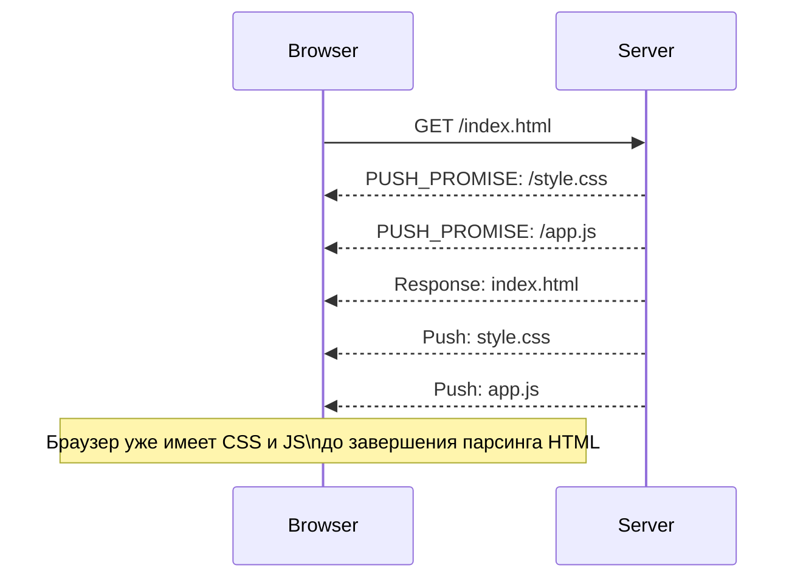
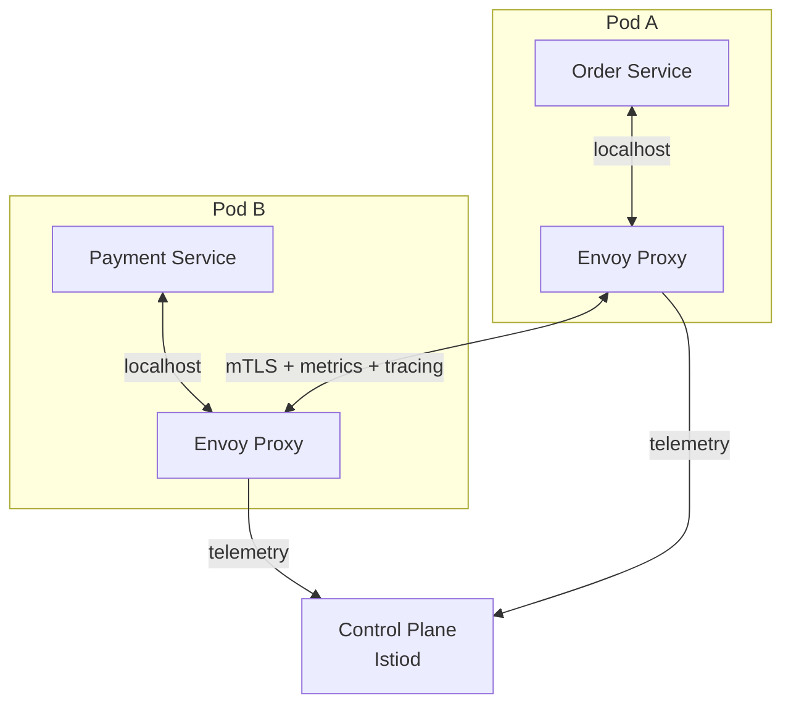

# Вопросы на собеседовании: `Сетевые протоколы и сети`

Ответы по сетевым протоколам для backend-разработчиков: модель `OSI`, стек `TCP/IP`, `TCP` vs `UDP`, эволюция `HTTP`, `TLS`, `DNS`, `WebSocket`, `SSE`, балансировка на уровнях L4/L7, `CDN`, `reverse proxy`, `NAT`, `CORS`, основы сокетов в Java.

**Сетевые протоколы** — фундамент любого backend-приложения. На собеседованиях ожидают, что разработчик понимает, как данные передаются от клиента к серверу, какие гарантии предоставляет каждый уровень стека, чем отличаются протоколы транспортного и прикладного уровней, и как инфраструктурные компоненты (`CDN`, `reverse proxy`, `load balancer`) влияют на архитектуру системы.

## Полезные ссылки

### Официальная документация

- [RFC 9293 — TCP](https://www.rfc-editor.org/rfc/rfc9293) — актуальная спецификация `TCP`
- [RFC 9000 — QUIC](https://www.rfc-editor.org/rfc/rfc9000) — транспортный протокол `QUIC`
- [RFC 9114 — HTTP/3](https://www.rfc-editor.org/rfc/rfc9114) — спецификация `HTTP/3`
- [RFC 9113 — HTTP/2](https://www.rfc-editor.org/rfc/rfc9113) — актуальная спецификация `HTTP/2`
- [RFC 9112 — HTTP/1.1](https://www.rfc-editor.org/rfc/rfc9112) — постоянные соединения
- [RFC 8446 — TLS 1.3](https://www.rfc-editor.org/rfc/rfc8446) — спецификация `TLS 1.3`
- [Fetch Standard](https://fetch.spec.whatwg.org/) — CORS и preflight
- [Java InetAddress](https://docs.oracle.com/en/java/javase/25/docs/api/java.base/java/net/InetAddress.html) — DNS-кэш JVM
- [Java HttpClient](https://docs.oracle.com/en/java/javase/25/docs/api/java.net.http/java/net/http/HttpClient.html) — повторное использование клиента и соединений
- [Kubernetes Services](https://kubernetes.io/docs/concepts/services-networking/service/) и [Network Policies](https://kubernetes.io/docs/concepts/services-networking/network-policies/) — сетевые контракты кластера
- [Istio ambient](https://istio.io/latest/docs/ambient/overview/) — Service Mesh без sidecar
- [OWASP Certificate and Public Key Pinning](https://community.owasp.org/controls/Certificate_and_Public_Key_Pinning) — ограничения pinning

## Содержание

- [Полезные ссылки](#полезные-ссылки)
- [See also](#see-also)

**Модель OSI и стек TCP/IP**
- [Q1. (!) Что такое модель OSI и зачем она нужна?](#q1--что-такое-модель-osi-и-зачем-она-нужна)
- [Q2. Чем стек TCP/IP отличается от модели OSI?](#q2-чем-стек-tcpip-отличается-от-модели-osi)
- [Q3. Какие протоколы работают на каждом уровне стека TCP/IP?](#q3-какие-протоколы-работают-на-каждом-уровне-стека-tcpip)

**TCP и UDP**
- [Q4. (!) В чём разница между TCP и UDP?](#q4--в-чём-разница-между-tcp-и-udp)
- [Q5. (!) Как работает TCP three-way handshake?](#q5--как-работает-tcp-three-way-handshake)
- [Q6. Что такое TCP congestion control и какие алгоритмы используются?](#q6-что-такое-tcp-congestion-control-и-какие-алгоритмы-используются)
- [Q7. Что такое TCP keep-alive и зачем он нужен?](#q7-что-такое-tcp-keep-alive-и-зачем-он-нужен)
- [Q8. Что такое TCP window size и flow control?](#q8-что-такое-tcp-window-size-и-flow-control)

**HTTP: эволюция протокола**
- [Q9. (!) Чем отличаются HTTP/1.1, HTTP/2 и HTTP/3?](#q9--чем-отличаются-http11-http2-и-http3)
- [Q10. Что такое HTTP keep-alive и connection pooling?](#q10-что-такое-http-keep-alive-и-connection-pooling)
- [Q11. Что такое head-of-line blocking и как HTTP/2 и HTTP/3 решают эту проблему?](#q11-что-такое-head-of-line-blocking-и-как-http2-и-http3-решают-эту-проблему)
- [Q12. Что такое QUIC и почему HTTP/3 использует его вместо TCP?](#q12-что-такое-quic-и-почему-http3-использует-его-вместо-tcp)

**HTTPS и TLS**
- [Q13. (!) Как работает TLS handshake?](#q13--как-работает-tls-handshake)
- [Q14. Чем отличается TLS 1.2 от TLS 1.3?](#q14-чем-отличается-tls-12-от-tls-13)
- [Q15. Что такое сертификат X.509 и цепочка доверия?](#q15-что-такое-сертификат-x509-и-цепочка-доверия)

**DNS**
- [Q16. (!) Как работает DNS-резолвинг?](#q16--как-работает-dns-резолвинг)
- [Q17. Какие типы DNS-записей существуют и для чего они используются?](#q17-какие-типы-dns-записей-существуют-и-для-чего-они-используются)
- [Q18. Что такое DNS TTL и как он влияет на кэширование?](#q18-что-такое-dns-ttl-и-как-он-влияет-на-кэширование)

**WebSocket и SSE**
- [Q19. (!) Что такое WebSocket и чем он отличается от HTTP?](#q19--что-такое-websocket-и-чем-он-отличается-от-http)
- [Q20. Что такое Server-Sent Events (SSE) и когда их использовать вместо WebSocket?](#q20-что-такое-server-sent-events-sse-и-когда-их-использовать-вместо-websocket)

**Инфраструктура: балансировка, CDN, proxy**
- [Q21. (!) В чём разница между балансировкой на L4 и L7?](#q21--в-чём-разница-между-балансировкой-на-l4-и-l7)
- [Q22. Что такое reverse proxy и зачем он нужен?](#q22-что-такое-reverse-proxy-и-зачем-он-нужен)
- [Q23. Что такое CDN и как она работает?](#q23-что-такое-cdn-и-как-она-работает)
- [Q24. Что такое NAT и какие виды NAT существуют?](#q24-что-такое-nat-и-какие-виды-nat-существуют)

**CORS и безопасность сетевого уровня**
- [Q25. (!) Что такое CORS и зачем он нужен?](#q25--что-такое-cors-и-зачем-он-нужен)
- [Q26. Что такое preflight-запрос в CORS?](#q26-что-такое-preflight-запрос-в-cors)

**IP-адресация и подсети**
- [Q27. Что такое IP-адрес и чем отличаются IPv4 и IPv6?](#q27-что-такое-ip-адрес-и-чем-отличаются-ipv4-и-ipv6)
- [Q28. Что такое подсети (subnets) и маска подсети?](#q28-что-такое-подсети-subnets-и-маска-подсети)

**Сокеты и сетевое программирование в Java**
- [Q29. (!) Как работают сокеты в Java?](#q29--как-работают-сокеты-в-java)
- [Q30. Как использовать Java HttpClient для HTTP-запросов?](#q30-как-использовать-java-httpclient-для-http-запросов)
- [Q31. Что такое connection pooling на уровне HTTP-клиента и зачем он нужен?](#q31-что-такое-connection-pooling-на-уровне-http-клиента-и-зачем-он-нужен)

**Дополнительные темы**
- [Q32. Что происходит, когда вы вводите URL в браузер?](#q32-что-происходит-когда-вы-вводите-url-в-браузер)
- [Q33. (!) Какие основные метрики сетевой производительности должен знать backend-разработчик?](#q33--какие-основные-метрики-сетевой-производительности-должен-знать-backend-разработчик)

**Продвинутые темы**
- [Q34. (!) Что такое mTLS и как он отличается от TLS?](#q34--что-такое-mtls-и-как-он-отличается-от-tls)
- [Q35. Как работает HTTP/2 Server Push и почему от него отказываются?](#q35-как-работает-http2-server-push-и-почему-от-него-отказываются)
- [Q36. Что такое Service Mesh и как Istio использует mTLS?](#q36-что-такое-service-mesh-и-как-istio-использует-mtls)

**Kubernetes и облачные сети**
- [Q37. DNS в Kubernetes — CoreDNS, service discovery, headless services](#q37-dns-в-kubernetes--coredns-service-discovery-headless-services)
- [Q38. Network Policies в Kubernetes — Ingress/Egress правила](#q38-network-policies-в-kubernetes--ingressegress-правила)
- [Q39. NAT и SNAT в облачных окружениях](#q39-nat-и-snat-в-облачных-окружениях)

**Современные технологии**
- [Q40. Что такое eBPF и как он применяется в networking?](#q40-что-такое-ebpf-и-как-он-применяется-в-networking)
- [Q41. Certificate Pinning — что это и зачем нужен?](#q41-certificate-pinning--что-это-и-зачем-нужен)

**TCP vs UDP: практика**
- [Q42. TCP vs UDP — когда что выбирать для реальных сервисов?](#q42-tcp-vs-udp--когда-что-выбирать-для-реальных-сервисов)
- [Q43. Istio vs Linkerd — сравнение Service Mesh решений](#q43-istio-vs-linkerd--сравнение-service-mesh-решений)

---

## Q1. (!) Что такое модель OSI и зачем она нужна?

**Модель OSI** (Open Systems Interconnection) — эталонная модель, разбивающая сетевое взаимодействие на 7 уровней. Идея в том, что каждый уровень решает одну узкую задачу и общается только с соседними: он принимает данные сверху, добавляет свою часть работы (заголовок, адресацию, шифрование) и передаёт ниже. Уровень выше не знает, как именно работает уровень ниже, — он видит только его интерфейс.



**Зачем нужна:**
- **Абстракция** — разработчик HTTP-сервиса не думает об электрических сигналах в кабеле; он работает на L7, а нижние уровни прозрачны.
- **Стандартизация** — благодаря фиксированным интерфейсам оборудование разных вендоров стыкуется друг с другом.
- **Диагностика** — модель даёт общий язык для локализации проблемы: «это L3 (маршрутизация не доходит) или L7 (приложение возвращает 500)?». Разбив проблему по уровням, её проще искать.

> На собеседовании редко требуют наизусть все 7 уровней OSI. Достаточно уверенно ориентироваться в 4-уровневой модели `TCP/IP` и понимать, на каком уровне работает каждый знакомый протокол.

---

## Q2. Чем стек TCP/IP отличается от модели OSI?

`TCP/IP` — стек протоколов, на котором работает интернет. В распространённой четырёхуровневой схеме его функции сгруппированы иначе, чем семь уровней `OSI`: несколько верхних уровней объединены в прикладной. Число уровней зависит от принятой учебной модели.

| TCP/IP (4 уровня) | OSI (7 уровней) | Примеры протоколов |
|--------------------|------------------|--------------------|
| Application | Application + Presentation + Session | `HTTP`, `DNS`, `FTP`, `SMTP` |
| Transport | Transport | `TCP`, `UDP`, `QUIC` |
| Internet | Network | `IP`, `ICMP` |
| Network Access | Data Link + Physical | `Ethernet`, `Wi-Fi`, `ARP` в IPv4-сетях |

**Ключевое отличие:** `OSI` описывает, «как должно быть» (учебная декомпозиция), а `TCP/IP` фиксирует, «как есть» (реальные протоколы интернета). Поэтому `OSI` удобна как словарь для разговора об уровнях, а `TCP/IP` — то, что действительно бегает по проводам.

---

## Q3. Какие протоколы работают на каждом уровне стека TCP/IP?

| Уровень | Протоколы | Назначение |
|---------|-----------|------------|
| Application | `HTTP/1.1`, `HTTP/2`, `HTTP/3`, `DNS`, `FTP`, `SMTP`, `SSH`, `WebSocket` | Логика приложений и представление данных |
| Transport | `TCP`, `UDP`, `QUIC` | Доставка данных между процессами, управление потоком |
| Internet | `IPv4`, `IPv6`, `ICMP`, `IGMP` | Маршрутизация пакетов между хостами |
| Network Access | `Ethernet`, `Wi-Fi (802.11)`, `ARP` | Передача фреймов в локальной сети |

Ключевая идея — **инкапсуляция**: данные приложения заворачиваются в `TCP`-сегмент, сегмент — в `IP`-пакет, пакет — в `Ethernet`-фрейм. На каждом уровне добавляется свой заголовок (как вложенные конверты), а на принимающей стороне заголовки снимаются в обратном порядке. Именно поэтому уровни независимы: `IP` не знает, что внутри лежит `HTTP`, — он видит только полезную нагрузку и адрес назначения.

---

## Q4. (!) В чём разница между TCP и UDP?

`TCP` даёт упорядоченный поток байтов с повторной передачей, контролем потока и перегрузки. `UDP` передаёт датаграммы без этих встроенных гарантий; приложение может добавить нужные механизмы поверх него. Задержка зависит от сети и реализации приложения, а не только от выбора транспорта.

| Характеристика | `TCP` | `UDP` |
|---------------|-------|-------|
| Соединение | Connection-oriented (handshake) | Connectionless |
| Надёжность | Повторяет потерянные данные в действующем соединении или сообщает об ошибке | Best-effort, потери возможны |
| Порядок | Сохраняет порядок байтов в потоке | Не гарантирует порядок датаграмм |
| Flow control | Да (sliding window) | Нет |
| Congestion control | Да, алгоритм зависит от реализации | Не задан самим UDP |
| Overhead заголовка | 20+ байт | 8 байт |
| Задержка | Зависит от сети, соединения и потерь | Зависит от сети и поведения приложения |

**Когда использовать `TCP`:**
- Веб-приложения (`HTTP`), email (`SMTP`), передача файлов (`FTP`)
- Любые сценарии, где важна целостность данных

**Когда использовать `UDP`:**
- VoIP, часть онлайн-игр и потоковых протоколов
- Обычные `DNS`-запросы, если ответ помещается в доступный размер датаграммы
- Приложения, где допустима потеря пакетов, но важна скорость

> `DNS` часто использует `UDP` для короткого обмена без TCP-handshake. При усечённом ответе клиент может повторить запрос по `TCP`; передача зоны тоже использует `TCP`. Порог размера ответа зависит в том числе от EDNS и сети.

---

## Q5. (!) Как работает TCP three-way handshake?

**Three-way handshake** — обмен тремя пакетами, которым клиент и сервер устанавливают `TCP`-соединение. Смысл трёх шагов в том, чтобы обе стороны убедились: канал работает в обе стороны и они согласовали начальные номера последовательности (`seq`), от которых дальше нумеруются байты.



**Шаги:**

1. **SYN** — клиент отправляет пакет с флагом `SYN` и случайным начальным номером последовательности `seq=x`
2. **SYN-ACK** — сервер отвечает пакетом `SYN-ACK`: своим `seq=y` и подтверждением `ack=x+1`
3. **ACK** — клиент подтверждает: `ack=y+1`. Соединение установлено, можно передавать данные

**Закрытие соединения** — каждая сторона закрывает своё направление передачи через `FIN` и подтверждение. Часто это показывают четырьмя сегментами `FIN` → `ACK` → `FIN` → `ACK`, но подтверждение и второй `FIN` могут быть объединены; это не жёсткая последовательность из четырёх пакетов.

> **Подводный камень — SYN flood.** Атакующий шлёт множество `SYN`-пакетов, но никогда не отправляет финальный `ACK`. Сервер держит полуоткрытые соединения в очереди (backlog), пока она не переполнится, и перестаёт принимать легитимных клиентов. Защита: `SYN cookies` (сервер не хранит состояние до завершения handshake) и ограничение размера backlog.

---

## Q6. Что такое TCP congestion control и какие алгоритмы используются?

**Congestion control** — механизм `TCP`, который не даёт отправителю «залить» сеть и вызвать массовые потери пакетов. Сеть не сообщает напрямую о своей загруженности, поэтому `TCP` определяет перегрузку косвенно — по потерям пакетов (классические алгоритмы) или по росту задержки (`BBR`) — и подстраивает темп отправки через размер окна (`cwnd`).

**Основные фазы:**

1. **Slow Start** — окно растёт экспоненциально (удваивается каждый RTT) до порога `ssthresh`
2. **Congestion Avoidance** — после порога окно растёт линейно (+1 MSS за RTT)
3. **Fast Retransmit** — при получении 3 дублирующих `ACK` пакет ретранслируется, не дожидаясь тайм-аута
4. **Fast Recovery** — после fast retransmit окно уменьшается вдвое, а не до 1 (как при тайм-ауте)

**Популярные алгоритмы:**

| Алгоритм | Особенности |
|----------|-------------|
| `Reno` | Классический, fast retransmit + fast recovery |
| `Cubic` | Распространён в Linux; поведение зависит от версии и настройки |
| `BBR` (Google) | Основан на оценке bandwidth и RTT, не на потерях |

> Для backend-разработчика важно понимать, что `TCP`-соединение не может мгновенно использовать весь канал — оно «разгоняется». Это объясняет, почему `HTTP keep-alive` и connection pooling так важны.

---

## Q7. Что такое TCP keep-alive и зачем он нужен?

**TCP keep-alive** — механизм проверки, жив ли всё ещё собеседник на другом конце простаивающего соединения. Проблема в том, что само `TCP` молчит, пока нет данных: если удалённая сторона внезапно умерла (краш, обрыв сети), соединение формально остаётся «открытым» неопределённо долго. Keep-alive решает это так: после заданного периода тишины одна сторона шлёт probe-пакет и ждёт ответа — нет ответа после нескольких попыток, соединение считается мёртвым и закрывается.

**Параметры (Linux):** `tcp_keepalive_time`, `tcp_keepalive_intvl` и `tcp_keepalive_probes` задают задержку до первого probe, интервал и число попыток. Значения проверяют на конкретном узле. TCP keep-alive — необязательная возможность, которую приложение включает для соединения; она не заменяет таймаут бизнес-операции.

**Зачем нужен:**
- Обнаружение сбоев на удалённой стороне (crash, сеть упала)
- Поддержание соединения через `NAT`/firewall (они сбрасывают idle-соединения)
- Освобождение ресурсов сервера от zombie-соединений

> Не путать с **HTTP keep-alive** — это механизм переиспользования `TCP`-соединения для нескольких HTTP-запросов (заголовок `Connection: keep-alive`).

---

## Q8. Что такое TCP window size и flow control?

**Flow control** — защита получателя от перегрузки: он сообщает отправителю, сколько данных готов принять прямо сейчас, чтобы быстрый отправитель не переполнил его буфер. Делается это через размер окна, который получатель указывает в каждом `ACK`.

- **Receive window (rwnd)** — сколько свободного места осталось в буфере получателя; число едет в каждом `ACK`. Если приложение медленно читает данные, буфер заполняется, `rwnd` уменьшается вплоть до нуля — и отправитель приостанавливается.
- **Window scaling** — расширение `RFC 7323`: поле размера окна в заголовке всего 16 бит (максимум 65535 байт), чего мало для быстрых каналов, поэтому scaling позволяет масштабировать окно до 1 ГБ.

**Отличие от congestion control:**
- **Flow control** — защищает получателя от переполнения
- **Congestion control** — защищает сеть от перегрузки
- Эффективное окно = `min(rwnd, cwnd)`, где `cwnd` — congestion window

---

## Q9. (!) Чем отличаются HTTP/1.1, HTTP/2 и HTTP/3?

Каждая версия `HTTP` решала главную проблему предыдущей. `HTTP/1.1` — текстовый и обрабатывает запросы в соединении по одному. `HTTP/2` добавил мультиплексирование (много запросов в одном соединении), но упёрся в `head-of-line blocking` на уровне `TCP`. `HTTP/3` ушёл с `TCP` на `QUIC` поверх `UDP` и устранил эту блокировку. Сводно:

| Характеристика | `HTTP/1.1` | `HTTP/2` | `HTTP/3` |
|---------------|------------|----------|----------|
| Транспорт | `TCP` | `TCP` | `QUIC` (поверх `UDP`) |
| Мультиплексирование | Нет (один ответ за раз в соединении) | Да (множество потоков в одном соединении) | Да (потоки QUIC без TCP HOL между ними) |
| Сжатие заголовков | Нет | `HPACK` | `QPACK` |
| Server Push | Нет | Да | Да (ограниченно) |
| Шифрование | Опционально | Де-факто обязательно | Обязательно (встроено в `QUIC`) |
| HOL blocking | На уровне соединения | На уровне `TCP` | Нет TCP HOL между потоками; общие ограничения сети остаются |
| Установка соединения | TCP: 1 RTT; при HTTPS добавляется TLS handshake | TCP: 1 RTT; при HTTPS добавляется TLS handshake | QUIC с TLS 1.3: обычно 1 RTT; 0-RTT возможно при возобновлении |

**`HTTP/1.1`** — текстовый протокол: одно соединение в каждый момент передаёт один ответ. Для параллельной загрузки браузеры могут открывать несколько соединений к серверу.

**`HTTP/2`** — бинарный протокол с мультиплексированием: одно `TCP`-соединение, много логических потоков одновременно. Потеря TCP-сегмента задерживает доставку последующих байтов всем потокам в этом соединении до восстановления пропуска.

**`HTTP/3`** — переносит мультиплексирование на транспорт `QUIC` (поверх `UDP`). Потеря данных одного потока не останавливает доставку данных другого из-за TCP-порядка. Общий congestion control и потеря пакета с данными нескольких потоков всё ещё могут влиять на них.

---

## Q10. Что такое HTTP keep-alive и connection pooling?

**HTTP keep-alive** — переиспользование соединения для нескольких HTTP-запросов вместо открытия нового на каждый. В `HTTP/1.1` постоянное соединение допускается по умолчанию; заголовок `Connection: keep-alive` не обязателен для этого. Повторное использование экономит TCP/TLS-handshake, а выигрыш зависит от сети и протокола.

- В `HTTP/1.0` соединение по умолчанию закрывалось после ответа; для переиспользования требовалось отдельное согласование.
- В `HTTP/1.1` keep-alive включён по умолчанию: соединение остаётся открытым между запросами.
- В `HTTP/2` несколько потоков могут идти по одному соединению; клиент может использовать больше одного соединения по условиям реализации.

**Connection pooling** — паттерн, при котором приложение поддерживает пул готовых `TCP`-соединений и переиспользует их:

```java
// Java HttpClient — connection pool управляется автоматически
HttpClient client = HttpClient.newBuilder()
    .connectTimeout(Duration.ofSeconds(5))
    .version(HttpClient.Version.HTTP_2)
    .build();

// Все запросы через этот клиент используют общий пул
HttpRequest request = HttpRequest.newBuilder()
    .uri(URI.create("https://api.example.com/data"))
    .GET()
    .build();

HttpResponse<String> response = client.send(request,
    HttpResponse.BodyHandlers.ofString());
```

**Почему важен connection pooling:**
- Экономия на `TCP` handshake (1 RTT) и `TLS` handshake (1-2 RTT)
- Нет повторной установки соединения; состояние контроля перегрузки после простоя зависит от реализации
- Снижение нагрузки на ОС (каждое соединение = file descriptor)

---

## Q11. Что такое head-of-line blocking и как HTTP/2 и HTTP/3 решают эту проблему?

**Head-of-line (HOL) blocking** — ситуация, когда «застрявший» элемент в начале очереди задерживает всё, что стоит за ним, даже если оно уже готово. В контексте `HTTP` это значит, что один медленный или потерянный запрос тормозит остальные. Тонкость в том, что блокировка может возникать на двух уровнях — приложения и транспорта, — и `HTTP/2` снимает первую, но не вторую.

**HOL blocking в `HTTP/1.1`:**
- Запросы в одном соединении обрабатываются последовательно
- Если первый запрос медленный, все последующие ждут
- Обходное решение — открывать несколько соединений (6-8 в браузерах)

**`HTTP/2` частично решает проблему:**
- Мультиплексирование позволяет передавать много потоков по одному `TCP`-соединению
- Но потеря **одного TCP-пакета** блокирует **все потоки** — это HOL blocking на уровне `TCP`

**`HTTP/3` устраняет TCP HOL между потоками:**
- `QUIC` реализует мультиплексирование на транспортном уровне
- Потеря данных одного потока не требует ждать их для выдачи данных другого потока
- Общие ограничения congestion control и потеря одного пакета с данными нескольких потоков сохраняются

---

## Q12. Что такое QUIC и почему HTTP/3 использует его вместо TCP?

**`QUIC`** — защищённый транспорт поверх `UDP`, стандартизированный IETF (RFC 9000). Он обеспечивает надёжную доставку данных внутри потоков, контроль перегрузки и поддержку миграции соединения. Использование `UDP` позволяет развивать реализацию транспорта без изменения TCP-стека ОС, но отдельные сети могут ограничивать UDP; поэтому HTTP/3 требует совместимого fallback.

**Преимущества QUIC над TCP:**

| Аспект | `TCP` | `QUIC` |
|--------|-------|--------|
| Handshake | TCP handshake + TLS handshake (2-3 RTT) | Совмещённый (1 RTT, 0-RTT при повторном) |
| HOL blocking | Все потоки блокируются при потере | Потеря влияет только на затронутый поток |
| Шифрование | Отдельный слой (TLS) | TLS 1.3 встроен; часть данных заголовка остаётся видимой |
| Миграция соединения | Привязка к IP:port | Возможна по Connection ID после проверки нового пути |
| Реализация | В ядре ОС, обновления медленные | В user space, легко обновляется |

> QUIC не наследует отсутствие гарантий UDP: он строит надёжные потоки поверх датаграмм. При смене сети Connection ID помогает сохранить соединение, если endpoints и сеть поддерживают миграцию.

---

## Q13. (!) Как работает TLS handshake?

**`TLS` handshake** — обмен сообщениями, в ходе которого клиент и сервер решают три задачи: проверяют подлинность сервера (по сертификату), согласуют алгоритмы шифрования (cipher suite) и совместно вырабатывают общий секретный ключ, не передавая его по сети в открытом виде. После handshake весь трафик шифруется симметричным ключом.



**Основные шаги:**

1. **ClientHello** — клиент отправляет поддерживаемые версии `TLS`, cipher suites и случайное число
2. **ServerHello** — сервер выбирает версию и cipher suite, отправляет свой random
3. **Certificate** — сервер отправляет свой сертификат `X.509`
4. **Key Exchange** — стороны обмениваются данными для генерации общего секрета (pre-master secret)
5. **Verification** — клиент проверяет сертификат сервера по цепочке доверия (CA)
6. **Finished** — обе стороны генерируют session keys из pre-master secret и переключаются на шифрование

> В `TLS 1.3` handshake сокращён до 1 RTT, а при повторном соединении возможен **0-RTT** — данные отправляются в первом же пакете.

---

## Q14. Чем отличается TLS 1.2 от TLS 1.3?

`TLS 1.3` — это `TLS 1.2`, переработанный ради двух целей: быстрее (handshake за 1 RTT вместо 2) и безопаснее (выкинуты все устаревшие и уязвимые алгоритмы). Главный приём ускорения — убрать лишний round-trip: клиент сразу присылает параметры для генерации ключа, не дожидаясь отдельного раунда согласования.

| Характеристика | `TLS 1.2` | `TLS 1.3` |
|---------------|-----------|-----------|
| Handshake | 2 RTT | 1 RTT (0-RTT при возобновлении) |
| Cipher suites | Множество, включая слабые (RSA, CBC) | Только 5 безопасных (все с AEAD) |
| Key exchange | RSA или (EC)DHE | (EC)DHE либо PSK при возобновлении; свойства зависят от режима |
| Совместимость | Широкая | Требует современных клиентов |
| Производительность | Медленнее | Быстрее за счёт меньшего числа round-trip |

**Forward secrecy** даёт эфемерный `(EC)DHE`-обмен. Возобновление только с PSK не даёт те же гарантии, а ранние данные `0-RTT` могут быть повторно воспроизведены. Для небезопасных к повтору операций 0-RTT требует отдельной защиты.

---

## Q15. Что такое сертификат X.509 и цепочка доверия?

**Сертификат `X.509`** — стандартный формат цифрового сертификата, содержащий:
- Публичный ключ владельца
- Имена, на которые выдан сертификат (обычно в Subject Alternative Name)
- Имя издателя (Certificate Authority)
- Срок действия
- Цифровую подпись CA

**Цепочка доверия:**

1. **Root CA** — корневой сертификат, предустановлен в ОС/браузере (самоподписанный)
2. **Intermediate CA** — промежуточный сертификат, подписан корневым
3. **Leaf certificate** — сертификат сервера, подписан промежуточным CA

Клиент идёт по цепочке от leaf к root и на каждом шаге проверяет, что текущий сертификат действительно подписан следующим. Доверие держится на одном якоре: если корневой CA лежит в доверенном хранилище клиента, то и всё, что подписано по цепочке от него, считается валидным. Промежуточный CA нужен, чтобы не подставлять под удар бесценный корневой ключ — его держат офлайн, а повседневной выдачей сертификатов занимаются промежуточные.

> В Java доверенные сертификаты берутся из настроенного truststore; стандартный `cacerts` содержит набор доверенных CA. Внутренний или самоподписанный сертификат требует явно настроенного доверия, иначе проверка цепочки завершится ошибкой.

---

## Q16. (!) Как работает DNS-резолвинг?

**`DNS`** (Domain Name System) — распределённая иерархическая система имён: позволяет получить адрес для `example.com`, по которому устанавливается соединение. Если ответа нет в кэше, рекурсивный резолвер может пройти от корня к зоне `.com`, затем к авторитативному серверу домена. Кэширование сокращает число таких обходов.



**Этапы резолвинга:**

1. **Локальный кэш** — сначала смотрим то, что уже под рукой: кэш браузера, кэш ОС, файл `/etc/hosts`. Если ответ есть — сети вообще не касаемся.
2. **Recursive resolver** — «прораб», который сам обходит всю иерархию и возвращает готовый ответ. Обычно его даёт ISP, либо это публичные `8.8.8.8` (Google), `1.1.1.1` (Cloudflare).
3. **Root servers** — 13 логических кластеров (A–M); сами адреса не знают, но подсказывают, к какому TLD-серверу идти.
4. **TLD servers** — серверы зоны верхнего уровня (`.com`, `.org`, `.ru`); знают, какой сервер авторитативен для конкретного домена.
5. **Authoritative server** — финальная инстанция: хранит сами записи (`A`, `MX` и т.д.) для домена.

Время обхода зависит от сети, кэшей и числа запросов к авторитетным серверам. Повторное разрешение часто быстрее за счёт кэширования, но фиксированного времени нет.

---

## Q17. Какие типы DNS-записей существуют и для чего они используются?

| Тип записи | Назначение | Пример |
|-----------|------------|--------|
| `A` | Доменное имя → IPv4-адрес | `example.com → 93.184.216.34` |
| `AAAA` | Доменное имя → IPv6-адрес | `example.com → 2606:2800:220:1:...` |
| `CNAME` | Алиас на другое доменное имя | `www.example.com → example.com` |
| `MX` | Почтовый сервер для домена | `example.com → mail.example.com` |
| `NS` | Авторитативный DNS-сервер | `example.com → ns1.example.com` |
| `TXT` | Произвольный текст (SPF, DKIM, верификация) | `v=spf1 include:_spf.google.com ~all` |
| `SRV` | Сервис + порт (используется в service discovery) | `_http._tcp.example.com → 8080 web.example.com` |
| `PTR` | Обратный DNS (IP → имя) | `34.216.184.93 → example.com` |

> `SRV`-записи особенно важны для backend: `Kubernetes`, `Consul` и другие системы service discovery используют их для автоматического обнаружения сервисов (подробнее в [вопросах по распределённым системам](distributed-systems-interview.md)).

---

## Q18. Что такое DNS TTL и как он влияет на кэширование?

**TTL** (Time to Live) — указанное в DNS-ответе время в секундах, ограничивающее кэширование записи у соблюдающего его резолвера. Меньший TTL сокращает срок хранения старого ответа, но клиентские кэши и открытые соединения тоже влияют на переключение. Более частые запросы увеличивают нагрузку на DNS.

**Примеры значений, а не готовые настройки:**
- `300` секунд (5 минут) — для сервисов, где важна быстрая смена IP (failover)
- `3600` секунд (1 час) — пример для записи, которую меняют реже
- `86400` секунд (24 часа) — для стабильных записей

**Влияние на backend:**
- **Низкий TTL** — может ускорить смену адреса у соблюдающих его резолверов, но увеличивает нагрузку на DNS
- **Высокий TTL** — меньше DNS-запросов, но долгое переключение при сбоях
- **При миграциях** — TTL снижают заранее, учитывая прежнее время кэширования и поведение клиентов

> JVM кэширует результаты DNS-разрешения по собственной политике. Значение по умолчанию для `networkaddress.cache.ttl` зависит от реализации и окружения; `-1` означает бесконечное кэширование. В сервисе с меняющимися адресами проверьте фактическую настройку и требования к обновлению, прежде чем выбирать TTL.

---

## Q19. (!) Что такое WebSocket и чем он отличается от HTTP?

**`WebSocket`** — протокол двустороннего обмена сообщениями поверх TCP (RFC 6455). После установки канала клиент и сервер могут слать сообщения в любой момент. Обычный HTTP-обмен строится вокруг запроса и ответа; для серверных событий в HTTP есть и отдельные механизмы, например SSE.

**Отличия от `HTTP`:**

| Аспект | `HTTP` | `WebSocket` |
|--------|--------|-------------|
| Направление | Request-response (клиент инициирует) | Полный дуплекс (обе стороны в любой момент) |
| Соединение | Может переиспользоваться для нескольких запросов | Обычно поддерживается открытым для обмена сообщениями |
| Overhead | Заголовки в каждом запросе | Минимальный фрейминг (2-14 байт) |
| Протокол | `http://` / `https://` | `ws://` / `wss://` |

**Установка соединения** — например, через HTTP/1.1 Upgrade:

```
GET /chat HTTP/1.1
Host: server.example.com
Upgrade: websocket
Connection: Upgrade
Sec-WebSocket-Key: dGhlIHNhbXBsZSBub25jZQ==
Sec-WebSocket-Version: 13
```

Сервер отвечает `101 Switching Protocols`, после чего соединение переключается на `WebSocket`.

**Применение:** чаты, уведомления в реальном времени, онлайн-игры, совместное редактирование, торговые платформы.

---

## Q20. Что такое Server-Sent Events (SSE) и когда их использовать вместо WebSocket?

**`SSE`** (Server-Sent Events) — однонаправленный поток данных от сервера к клиенту поверх HTTP. Это долгоживущий ответ, в который сервер постепенно дописывает события. Браузерный `EventSource` умеет переподключаться. Прокси и CDN должны пропускать поток без нежелательной буферизации и обрывов.

| Аспект | `SSE` | `WebSocket` |
|--------|-------|-------------|
| Направление | Только сервер → клиент | Двунаправленный |
| Протокол | Стандартный `HTTP`/`HTTPS` | Свой протокол (`ws://`) |
| Формат данных | Только текст (UTF-8) | Текст и бинарные данные |
| Переподключение | Автоматическое (встроено в API) | Нужно реализовывать вручную |
| Лимит соединений | Зависит от браузера и версии HTTP; в HTTP/2 действуют лимиты потоков | Зависит от клиента и сервера |
| Прокси/CDN | Требует поддержки потокового ответа без буферизации | Может потребовать настройки Upgrade или иного механизма установки |

**Когда использовать `SSE`:**
- Live-ленты, новостные обновления
- Стриминг ответов от AI/LLM (подробнее в [HTTP & REST](../api/http-rest-interview.md))
- Dashboards с обновлениями в реальном времени
- Уведомления

**Когда использовать `WebSocket`:**
- Чаты (клиент тоже отправляет данные)
- Онлайн-игры
- Совместное редактирование

> Если клиенту нужен только поток событий от сервера, сначала оцените `SSE`. Проверьте переподключение, таймауты и буферизацию в конкретной HTTP-инфраструктуре.

---

## Q21. (!) В чём разница между балансировкой на L4 и L7?

Разница в том, по каким данным принимается решение. **L4** обычно маршрутизирует по IP, порту и транспортному протоколу. **L7** может анализировать HTTP-путь и заголовки. Для чтения содержимого HTTPS конкретный компонент должен завершить TLS до анализа; при этом TLS termination как функция продукта может быть и у балансировщика, который затем маршрутизирует по L4. Задержку сравнивают на реальной конфигурации.

| Характеристика | L4 (Transport) | L7 (Application) |
|---------------|----------------|-------------------|
| Уровень OSI | Транспортный | Прикладной |
| Данные для решения | IP-адрес, порт, протокол | URL, заголовки, cookies, тело запроса |
| Производительность | Зависит от реализации и настройки | Дополнительный разбор HTTP может влиять на задержку |
| Терминация TLS | Может быть отдельной функцией продукта | Для анализа HTTPS нужен доступ к расшифрованному HTTP |
| Sticky sessions | По IP-адресу | По cookie, заголовку, URL |
| Content-based routing | Нет | Да (по URL, host, header) |
| Примеры | `HAProxy` (TCP mode), AWS NLB | `Nginx`, `HAProxy` (HTTP mode), AWS ALB |

**Когда использовать L4:**
- Маршрутизация по IP и порту без разбора приложения
- TCP/UDP-трафик, для которого не нужны правила по содержимому запроса

**Когда использовать L7:**
- Маршрутизация по URL (`/api/v1` → Service A, `/api/v2` → Service B)
- A/B-тестирование (по cookie или header)
- Маршрутизация HTTPS по содержимому после завершения TLS
- Канареечные деплои (подробнее в [вопросах по балансировке](load-balancing-interview.md))

---

## Q22. Что такое reverse proxy и зачем он нужен?

**Reverse proxy** — посредник, который стоит перед backend-серверами: принимает запросы клиентов и сам решает, на какой внутренний сервер их направить. Для клиента это выглядит как единый сервер — он не знает ни сколько машин стоит за прокси, ни их адресов. Именно эта точка «перед бэкендом» удобна, чтобы навесить на неё сквозные функции: балансировку, `TLS`, кэш, защиту.

**Отличие от forward proxy** — по тому, чьи интересы прокси представляет:
- **Forward proxy** стоит на стороне клиентов: о нём знает клиент, а сервер видит запрос как обычный (типичный пример — корпоративный прокси).
- **Reverse proxy** стоит на стороне серверов: клиент о нём не догадывается, для него прокси и есть «сервер».

**Задачи reverse proxy:**
- **Load balancing** — распределение нагрузки между серверами
- **SSL termination** — расшифровка `TLS` на прокси, backend получает plain HTTP
- **Кэширование** — кэширование статики и ответов API
- **Сжатие** — gzip/brotli-сжатие ответов
- **Rate limiting** — ограничение запросов от одного клиента
- **Защита** — скрытие IP и топологии backend, WAF

**Популярные reverse proxy:** `Nginx`, `HAProxy`, `Envoy`, `Traefik`, `Caddy`.

---

## Q23. Что такое CDN и как она работает?

**`CDN`** (Content Delivery Network) — сеть серверов (edge-узлов), разбросанных по миру и кэширующих контент рядом с пользователями. Идея простая: скорость загрузки ограничена скоростью света и числом round-trip, поэтому, отдавая файл с узла в том же городе вместо origin-сервера на другом континенте, мы радикально сокращаем задержку и заодно снимаем нагрузку с origin.

**Принцип работы:**

1. Пользователь запрашивает `https://cdn.example.com/image.png`
2. DNS и маршрутизация направляют запрос к выбранному edge-узлу; он не обязательно географически ближайший
3. Edge-сервер проверяет кэш:
   - **Cache hit** → возвращает контент (минимальная задержка)
   - **Cache miss** → запрашивает у origin-сервера, кэширует, возвращает клиенту

**Что кэширует CDN:**
- Статические файлы: CSS, JS, изображения, видео
- API-ответы с заголовком `Cache-Control`
- HTML-страницы (для статических сайтов)

**Важные HTTP-заголовки для CDN:**
- `Cache-Control: public, max-age=31536000` — кэшировать на год
- `Cache-Control: no-cache` — проверять свежесть перед использованием
- `Cache-Control: private` — не кэшировать на CDN (только в браузере)

**Популярные CDN:** Cloudflare, AWS CloudFront, Akamai, Fastly.

> Для backend-разработчика важно правильно настраивать `Cache-Control` заголовки (подробнее в [стратегиях кэширования](caching-strategies-interview.md)).

---

## Q24. Что такое NAT и какие виды NAT существуют?

**`NAT`** (Network Address Translation) — подмена IP-адресов в пакетах при прохождении через маршрутизатор. Появился как ответ на дефицит `IPv4`-адресов: вместо отдельного публичного IP на каждое устройство целая локальная сеть прячется за одним публичным адресом, а маршрутизатор разруливает, кому из внутренних хостов принадлежит ответный пакет (обычно — по номеру порта).

**Виды NAT:**

| Вид | Описание |
|-----|----------|
| **Static NAT** | 1:1 маппинг private → public IP |
| **Dynamic NAT** | Пул public IP, назначается динамически |
| **PAT (Port Address Translation)** | Один public IP, разные порты для разных устройств (наиболее распространён) |

**Проблемы NAT для backend:**
- Peer-to-peer соединения затруднены (нужен NAT traversal: STUN, TURN)
- `WebSocket` и долгоживущие соединения могут разрываться при тайм-ауте NAT-таблицы
- IP-адрес клиента за NAT не уникален — для идентификации нужны другие механизмы

> Если перед сервисом стоит доверенный прокси, исходный IP может передаваться в `Forwarded` или `X-Forwarded-For`. Принимать такой заголовок от произвольного клиента нельзя: он может быть подделан.

---

## Q25. (!) Что такое CORS и зачем он нужен?

**`CORS`** (Cross-Origin Resource Sharing) — способ серверу разрешить браузеру отдавать ответ JavaScript-коду с чужого origin. Важно: это правило **браузера**, а не сервера, и касается только запросов из JS.

**Зачем нужен.** Same-Origin Policy по умолчанию запрещает скрипту со страницы `https://frontend.com` прочитать ответ `https://api.backend.com` без разрешения. CORS позволяет серверу объявить, каким origin браузер может открыть ответ. Сам запрос при этом может дойти до сервера; защиту от CSRF и авторизацию проектируют отдельно.

**Ключевые заголовки:**

| Заголовок | Назначение |
|-----------|------------|
| `Access-Control-Allow-Origin` | Разрешённые origins (`*` или конкретный) |
| `Access-Control-Allow-Methods` | Разрешённые HTTP-методы |
| `Access-Control-Allow-Headers` | Разрешённые заголовки запроса |
| `Access-Control-Allow-Credentials` | Разрешить cookies/авторизацию |
| `Access-Control-Max-Age` | Время кэширования preflight-ответа |

**Конфигурация в Spring Boot:**

```java
@Configuration
public class CorsConfig implements WebMvcConfigurer {
    @Override
    public void addCorsMappings(CorsRegistry registry) {
        registry.addMapping("/api/**")
            .allowedOrigins("https://frontend.com")
            .allowedMethods("GET", "POST", "PUT", "DELETE")
            .allowedHeaders("*")
            .allowCredentials(true)
            .maxAge(3600);
    }
}
```

> Распространённая ошибка: `Access-Control-Allow-Origin: *` с `Access-Control-Allow-Credentials: true` — это запрещено спецификацией. Если нужны credentials, origin должен быть конкретным (подробнее в [Application Security](../security/application-security-interview.md)).

---

## Q26. Что такое preflight-запрос в CORS?

**Preflight** — предварительный `OPTIONS`-запрос, который браузер отправляет перед некоторыми cross-origin запросами. Он спрашивает, разрешены ли метод и заголовки будущего запроса. Успешный ответ может иметь статус `200` или `204`; CORS проверяет браузер, а запросы вне браузера требуют отдельной авторизации на сервере.

**Запрос считается «непростым», если:**
- Метод отличается от `GET`, `HEAD`, `POST`
- Заголовки выходят за пределы «простых» (`Accept`, `Content-Type`, `Content-Language`)
- `Content-Type` отличается от `application/x-www-form-urlencoded`, `multipart/form-data`, `text/plain`

**Пример preflight:**

```
OPTIONS /api/users HTTP/1.1
Host: api.backend.com
Origin: https://frontend.com
Access-Control-Request-Method: PUT
Access-Control-Request-Headers: Content-Type, Authorization
```

**Ответ сервера:**

```
HTTP/1.1 204 No Content
Access-Control-Allow-Origin: https://frontend.com
Access-Control-Allow-Methods: GET, POST, PUT, DELETE
Access-Control-Allow-Headers: Content-Type, Authorization
Access-Control-Max-Age: 86400
```

> **Оптимизация:** `Access-Control-Max-Age` управляет временем кэширования preflight-ответа в пределах ограничений браузера. При отсутствии заголовка браузер может использовать собственное короткое время кэша.

---

## Q27. Что такое IP-адрес и чем отличаются IPv4 и IPv6?

**IP-адрес** — адрес сетевого интерфейса, который участвует в доставке пакетов. `IPv4` использует 32 бита, `IPv6` — 128 бит и гораздо большее адресное пространство. IPv6 обычно позволяет обойтись без NAT для экономии публичных адресов, но конкретная сеть может применять трансляцию по своим причинам.

| Характеристика | `IPv4` | `IPv6` |
|---------------|--------|--------|
| Длина адреса | 32 бита (4 октета) | 128 бит (8 групп по 16 бит) |
| Формат | `192.168.1.1` | `2001:0db8:85a3::8a2e:0370:7334` |
| Пространство адресов | ~4.3 млрд | ~3.4 × 10^38 |
| NAT | Необходим (адресов мало) | Не нужен (адресов достаточно) |
| Заголовок | Переменной длины, сложный | Фиксированный, упрощённый |
| IPsec | Опционально | Встроено |

**Зарезервированные диапазоны IPv4:**

| Диапазон | Назначение |
|----------|------------|
| `10.0.0.0/8` | Private (класс A) |
| `172.16.0.0/12` | Private (класс B) |
| `192.168.0.0/16` | Private (класс C) |
| `127.0.0.0/8` | Loopback |
| `0.0.0.0` | Все интерфейсы (bind) |

> Для backend-разработчика: при конфигурации сервисов в Docker/Kubernetes важно понимать разницу между `0.0.0.0` (слушать на всех интерфейсах) и `127.0.0.1` (только localhost).

---

## Q28. Что такое подсети (subnets) и маска подсети?

**Подсеть** — способ разбить большой диапазон IP-адресов на части, чтобы маршрутизировать и изолировать трафик. Каждый IP-адрес делится на две части — адрес сети и адрес хоста внутри неё, — а граница между ними задаётся **маской подсети**: единицы в маске помечают биты сети, нули — биты хоста. По этой границе маршрутизатор и понимает, «свой» это адрес (та же подсеть) или пакет надо отправлять наружу.

**CIDR-нотация:**
- `192.168.1.0/24` — первые 24 бита = сеть, последние 8 = хост
- `/24` = маска `255.255.255.0` = 254 хоста
- `/16` = маска `255.255.0.0` = 65534 хоста
- `/32` = один конкретный хост

**Пример расчёта:**
- Адрес `192.168.1.100/24`
- Сетевой адрес: `192.168.1.0`
- Broadcast: `192.168.1.255`
- Доступные хосты: `192.168.1.1` — `192.168.1.254`

> В контексте Kubernetes и облаков: при создании VPC нужно правильно планировать CIDR-блоки. Слишком маленькая подсеть `/28` (14 хостов) может закончиться при масштабировании, слишком большая `/16` (65K хостов) — расточительна.

---

## Q29. (!) Как работают сокеты в Java?

**Сокет** — конечная точка сетевого соединения, однозначно заданная парой «IP-адрес + порт». Через него программа читает и пишет данные так же, как через обычный поток. В Java блокирующие `TCP`-сокеты живут в пакете `java.net`: `ServerSocket` слушает входящие подключения, а `Socket` представляет одно установленное соединение.

**TCP-сервер:**

```java
try (ServerSocket serverSocket = new ServerSocket(8080)) {
    System.out.println("Сервер запущен на порту 8080");

    while (true) {
        // accept() блокирует поток до подключения клиента
        Socket clientSocket = serverSocket.accept();

        // Обработка в отдельном потоке
        new Thread(() -> handleClient(clientSocket)).start();
    }
}

private void handleClient(Socket socket) {
    try (
        BufferedReader in = new BufferedReader(
            new InputStreamReader(socket.getInputStream()));
        PrintWriter out = new PrintWriter(
            socket.getOutputStream(), true)
    ) {
        String request = in.readLine();
        out.println("Echo: " + request);
    } catch (IOException e) {
        e.printStackTrace();
    }
}
```

**TCP-клиент:**

```java
try (Socket socket = new Socket("localhost", 8080);
     PrintWriter out = new PrintWriter(socket.getOutputStream(), true);
     BufferedReader in = new BufferedReader(
         new InputStreamReader(socket.getInputStream()))) {

    out.println("Hello, Server!");
    String response = in.readLine();
    System.out.println("Ответ: " + response);
}
```

**Важные моменты:**
- `ServerSocket.accept()` — блокирующий вызов, для масштабируемости используют `NIO` (`Selector`, `Channel`) или виртуальные потоки (Java 21+)
- Каждый сокет занимает file descriptor — при большом числе соединений возможен лимит (`ulimit -n`)
- Для серверного HTTP обычно используют готовые библиотеки и фреймворки; raw-сокеты подходят для специальных протоколов и низкоуровневых задач

---

## Q30. Как использовать Java HttpClient для HTTP-запросов?

`HttpClient` появился в Java 11 и заменяет устаревший `HttpURLConnection`:

```java
// Создание клиента (потокобезопасен, переиспользуйте!)
HttpClient client = HttpClient.newBuilder()
    .version(HttpClient.Version.HTTP_2)    // предпочитать HTTP/2
    .connectTimeout(Duration.ofSeconds(5))
    .followRedirects(HttpClient.Redirect.NORMAL)
    .build();

// Синхронный GET-запрос
HttpRequest getRequest = HttpRequest.newBuilder()
    .uri(URI.create("https://api.example.com/users/1"))
    .header("Accept", "application/json")
    .GET()
    .build();

HttpResponse<String> response = client.send(getRequest,
    HttpResponse.BodyHandlers.ofString());

System.out.println("Status: " + response.statusCode());
System.out.println("Body: " + response.body());

// Асинхронный POST-запрос
HttpRequest postRequest = HttpRequest.newBuilder()
    .uri(URI.create("https://api.example.com/users"))
    .header("Content-Type", "application/json")
    .POST(HttpRequest.BodyPublishers.ofString(
        """
        {"name": "John", "email": "john@example.com"}
        """))
    .build();

client.sendAsync(postRequest, HttpResponse.BodyHandlers.ofString())
    .thenApply(HttpResponse::body)
    .thenAccept(System.out::println)
    .join();
```

**Особенности `HttpClient`:**
- Поддерживает `HTTP/1.1` и `HTTP/2` с автоматическим fallback
- `send()` блокирует вызывающий поток, а `sendAsync()` возвращает `CompletableFuture<HttpResponse<T>>`
- Реализация `HttpClient` обычно управляет своим пулом соединений; размер и поведение зависят от JDK и настроек
- Поддерживает `WebSocket` через `HttpClient.newWebSocketBuilder()`
- Потокобезопасен — создайте один экземпляр и переиспользуйте

---

## Q31. Что такое connection pooling на уровне HTTP-клиента и зачем он нужен?

**Connection pooling** — клиент держит набор уже открытых соединений и переиспользует подходящее вместо установки нового на каждый запрос. Это экономит повторные TCP/TLS-handshake; величина выигрыша зависит от RTT, протокола и поведения сервера. Открытые сокеты при этом занимают ресурсы, а состояние контроля перегрузки после простоя зависит от реализации.

**Без пула (naive подход):**
```
Запрос 1: DNS → TCP handshake → TLS handshake → Request/Response → Close
Запрос 2: DNS/кэш → TCP handshake → TLS handshake → Request/Response → Close
         дополнительные RTT зависят от сети и режима TLS
```

**С пулом:**
```
Запрос 1: DNS → TCP → TLS → Request/Response (соединение остаётся в пуле)
Запрос 2: Request/Response (если соединение доступно и пригодно)
         новая установка транспорта не нужна
```

**Настройка в популярных клиентах:**

| Клиент | Что проверять |
|--------|--------------|
| Java `HttpClient` | Повторное использование экземпляра и соединений в установленной JDK |
| Apache `HttpClient` | Лимиты на маршрут и общий пул в используемой версии |
| OkHttp | Число idle-соединений и время их хранения в используемой версии |
| Spring `RestClient` | Настройки выбранного underlying клиента |

> При частых вызовах повторное использование HTTP-клиента и соединений обычно снижает цену установления TCP/TLS. Реальный выигрыш зависит от RTT, протокола и настроек сервера (подробнее в [микросервисной архитектуре](microservices-interview.md)).

---

## Q32. Что происходит, когда вы вводите URL в браузер?

Классический вопрос на собеседовании, проверяющий понимание всего сетевого стека:

1. **Парсинг URL** — браузер определяет протокол (`https`), хост (`example.com`), порт (`443`), путь (`/page`)

2. **DNS-резолвинг** — адрес берётся из кэша или запрашивается через настроенный резолвер; полный обход root → TLD → authoritative нужен не всегда (подробнее в [Q16](#q16--как-работает-dns-резолвинг))

3. **Транспорт** — для HTTP/1.1 и HTTP/2 обычно устанавливается TCP; HTTP/3 использует QUIC поверх UDP

4. **TLS handshake при HTTPS** — согласование шифрования и проверка сервера; число RTT зависит от TLS-версии, возобновления и выбранного транспорта

5. **HTTP-запрос** — браузер отправляет запрос в согласованной версии HTTP с подходящими заголовками

6. **Обработка на сервере** — запрос проходит через настроенную инфраструктуру и приложение; proxy и балансировщик есть не в каждой системе

7. **HTTP-ответ** — сервер возвращает статус, заголовки и содержимое; возможны redirect, ошибка или ответ из кэша

8. **Рендеринг** — браузер парсит HTML, запрашивает CSS/JS/изображения (параллельно), строит DOM, рендерит страницу

> Последовательность зависит от кэшей, service worker, версии HTTP и конфигурации сервера.

---

## Q33. (!) Какие основные метрики сетевой производительности должен знать backend-разработчик?

Полезно разделять метрики на две группы: про **скорость отклика** (`latency`, `RTT`, `TTFB` — насколько быстро приходит ответ) и про **объём** (`throughput`, `bandwidth` — сколько данных проходит за единицу времени). Низкая задержка и высокая пропускная способность — независимые вещи: толстый трансатлантический канал может иметь огромный `bandwidth`, но `RTT` всё равно упрётся в скорость света. Отдельно стоят показатели качества канала — `packet loss` и `jitter`.

| Метрика | Описание | Типичные значения |
|---------|----------|-------------------|
| **Latency (задержка)** | Время выполнения выбранной операции; границу измерения указывают явно | Зависит от сети и обработки |
| **RTT (Round-Trip Time)** | Время прохождения туда-обратно | Зависит от маршрута |
| **Throughput (пропускная способность)** | Объём данных за единицу времени | Мбит/с или запросов/сек |
| **Bandwidth** | Максимальная пропускная способность канала | 1 Гбит/с, 10 Гбит/с |
| **Packet loss** | Доля потерянных пакетов | Допустимый уровень зависит от протокола и SLO |
| **Jitter** | Вариация задержки между пакетами | Критично для VoIP/видео |
| **TTFB (Time to First Byte)** | Время до первого байта ответа, включая ожидание сервера | Порог задаёт SLO |

**Инструменты диагностики:**
- `ping` — RTT и packet loss
- `traceroute` / `mtr` — маршрут и задержка на каждом hop
- `curl -w` — детальная разбивка по фазам HTTP-запроса
- `ss` / `netstat` — состояние TCP-соединений
- `tcpdump` / `Wireshark` — анализ пакетов

```bash
# Детальная разбивка HTTP-запроса
curl -w "\nDNS: %{time_namelookup}s\nConnect: %{time_connect}s\nTLS: %{time_appconnect}s\nTTFB: %{time_starttransfer}s\nTotal: %{time_total}s\n" \
     -o /dev/null -s https://example.com
```

## Q34. (!) Что такое mTLS и как он отличается от TLS?

Разница в том, кто предъявляет сертификат. В типичном публичном HTTPS клиент проверяет сервер, а личность пользователя подтверждается отдельно. Сам TLS также поддерживает запрос клиентского сертификата; mTLS означает, что сервер требует и проверяет его.

**mTLS** (mutual TLS) — двусторонняя: теперь и клиент предъявляет сертификат, а сервер его проверяет. То есть сама криптография канала становится способом аутентификации клиента — без паролей и токенов. Технически это всё тот же `TLS`, просто сервер дополнительно требует клиентский сертификат (`CertificateRequest`) и рвёт соединение, если тот не валиден.



**Где применяется mTLS:**
- **Service Mesh (Istio, Linkerd)** — mTLS между workload, включёнными в mesh и охваченными политикой
- **API между партнёрами** — когда требуется удостоверить обе стороны соединения
- **IoT-устройства** — аутентификация устройств без паролей

**Настройка mTLS в Spring Boot:**

```yaml
# application.yml
server:
  ssl:
    enabled: true
    key-store: classpath:keystore.p12
    key-store-password: ${SSL_KEYSTORE_PASSWORD}
    key-store-type: PKCS12
    # mTLS: требуем клиентский сертификат
    client-auth: need          # need | want | none
    trust-store: classpath:truststore.p12
    trust-store-password: ${SSL_TRUSTSTORE_PASSWORD}
```

**Java HTTP-клиент с клиентским сертификатом:**

```java
SSLContext sslContext = SSLContext.getInstance("TLS");
KeyManagerFactory kmf = KeyManagerFactory.getInstance("SunX509");
KeyStore keyStore = KeyStore.getInstance("PKCS12");
keyStore.load(new FileInputStream("client.p12"), password);
kmf.init(keyStore, password);
sslContext.init(kmf.getKeyManagers(), trustManagers, null);

HttpClient client = HttpClient.newBuilder()
    .sslContext(sslContext)
    .build();
```

**mTLS vs API Key vs OAuth2:**

| Механизм | Аутентификация | Управление | Производительность |
|----------|---------------|------------|-------------------|
| mTLS | Криптографическая | PKI, сложная | Высокая (рукопожатие 1 раз) |
| API Key | Секретный токен | Простая | Высокая |
| OAuth2 | Токен + scopes | Гибкая | Средняя (проверка токена) |

## Q35. Как работает HTTP/2 Server Push и почему от него отказываются?

**HTTP/2 Server Push** — механизм, позволяющий серверу отправить ресурсы клиенту **до того**, как клиент их запросит, предугадав зависимости.

**Как работает:**



**Почему от Server Push отказываются:**

1. **Chrome отключил поддержку HTTP/2 Server Push** по умолчанию начиная с версии 106: выгода была непостоянной, а отправка уже закэшированного ресурса тратила канал.
2. **HTTP/3 формально поддерживает Server Push** через `PUSH_PROMISE` и push streams (RFC 9114). Сервер не может отправлять push, пока клиент не разрешил его через `MAX_PUSH_ID`; поддержка протокола не означает востребованность в браузерах.
3. **Альтернатива для части сценариев:** `103 Early Hints` с `Link: rel=preload` даёт клиенту возможность запросить ресурс заранее без серверной отправки тела.

**Заголовок `103 Early Hints` (замена Server Push):**

```
HTTP/1.1 103 Early Hints
Link: </style.css>; rel=preload; as=style
Link: </app.js>; rel=preload; as=script

... (сервер обрабатывает запрос) ...

HTTP/1.1 200 OK
Content-Type: text/html
```

Браузер начинает загрузку ресурсов, пока сервер генерирует HTML — без сложности PUSH_PROMISE.

## Q36. Что такое Service Mesh и как Istio использует mTLS?

**Service Mesh** — инфраструктурный слой для сетевых политик и телеметрии между сервисами. В Istio прокси могут работать как sidecar рядом с приложением или в ambient-режиме на уровне узла с дополнительным waypoint для L7. Mesh помогает с mTLS и маршрутизацией, но не заменяет бизнес-обработку отказов и авторизацию операций.



**Что даёт Istio Service Mesh:**

| Функция | Описание |
|---------|----------|
| **mTLS** | Трафик между включёнными в mesh workload может быть защищён без изменений кода; политику проверяют по режиму и охвату |
| **Traffic management** | Canary, circuit breaker, retry, timeout через `VirtualService` / `DestinationRule` |
| **Observability** | Distributed tracing, metrics, access logs — из коробки |
| **Authorization** | `AuthorizationPolicy`: "Order Service может вызывать только Payment Service" |

**Пример: mTLS политика в Istio:**

```yaml
# Требуем mTLS для всех сервисов в namespace
apiVersion: security.istio.io/v1beta1
kind: PeerAuthentication
metadata:
  name: default
  namespace: production
spec:
  mtls:
    mode: STRICT  # STRICT | PERMISSIVE | DISABLE
```

**Пример: AuthorizationPolicy:**

```yaml
apiVersion: security.istio.io/v1beta1
kind: AuthorizationPolicy
metadata:
  name: payment-service-policy
spec:
  selector:
    matchLabels:
      app: payment-service
  rules:
  - from:
    - source:
        principals:
        - "cluster.local/ns/production/sa/order-service"
    to:
    - operation:
        methods: ["POST"]
        paths: ["/payments/*"]
```

**Когда оценить другие средства:** если нужные сетевые политики уже обеспечены платформой или стоимость эксплуатации mesh превышает пользу. Фиксированного порога по числу сервисов нет; Istio и Linkerd сравнивают по требуемым функциям и ресурсам на своей нагрузке.

> Для backend-разработчика ключевые метрики — **TTFB**, **p99 latency** и **throughput**. Мониторинг этих метрик помогает вовремя обнаружить деградацию производительности (подробнее в [паттернах масштабируемости](scalability-patterns-interview.md)).

## Q37. DNS в Kubernetes — CoreDNS, service discovery, headless services

В Kubernetes DNS — основной механизм service discovery. Все pod-ы могут обращаться к сервисам по имени.

**CoreDNS** — распространённая реализация cluster DNS в Kubernetes. Способ развёртывания и число реплик задаёт конкретный кластер; часто это Deployment в `kube-system`.

**Структура DNS-имён:**

```
<service>.<namespace>.svc.<cluster-domain>

# Примеры:
payment-service.production.svc.cluster.local  # полное имя
payment-service.production                    # из другого namespace
payment-service                               # из того же namespace
```

**Типы DNS-записей для сервисов:**

| Тип сервиса | DNS-запись | Что возвращает |
|---|---|---|
| ClusterIP | A/AAAA | IP сервиса (виртуальный) |
| Headless (`clusterIP: None`) | A/AAAA | IP каждого pod-а |
| ExternalName | CNAME | Внешнее DNS-имя |
| NodePort / LoadBalancer | A/AAAA | IP сервиса |

**Headless Services** — когда нужен прямой доступ к pod-ам (без load balancing):

```yaml
apiVersion: v1
kind: Service
metadata:
  name: cassandra
spec:
  clusterIP: None  # headless!
  selector:
    app: cassandra
  ports:
    - port: 9042
---
# DNS вернёт IP всех pod-ов, а не виртуальный IP сервиса
# nslookup cassandra → 10.0.0.1, 10.0.0.2, 10.0.0.3 (по одному на pod)
```

**Когда headless нужен:**
- StatefulSet (Kafka, Cassandra, Redis Cluster) — прямая адресация pod-ов
- Клиентский load balancing (Consul, gRPC)
- Service discovery через DNS SRV-записи

**Настройка DNS в pod-е:**

```yaml
spec:
  dnsPolicy: ClusterFirst  # по умолчанию
  dnsConfig:
    options:
      - name: ndots
        value: "5"  # количество точек для определения FQDN
```

> `ndots: 5` — стандарт Kubernetes. Означает: если имя содержит < 5 точек, сначала ищем через search domains (`.svc.cluster.local` и т.д.), потом как глобальное имя.

## Q38. Network Policies в Kubernetes — Ingress/Egress правила

**Network Policy** — Kubernetes-ресурс, задающий правила входящего (Ingress) и исходящего (Egress) трафика для pod-ов; по сути это firewall на уровне pod-ов. Это важно, потому что по умолчанию сеть Kubernetes «плоская»: любой pod может достучаться до любого другого. Network Policy позволяет сегментировать сеть — например, разрешить ходить в базу только сервису, которому это реально нужно, и тем ограничить горизонтальное распространение атаки при компрометации одного pod-а.

**Важно:** NetworkPolicy требует поддержки со стороны сетевого плагина. Проверяйте фактическую реализацию и её ограничения в конкретном кластере.

**Пример: разрешить входящий трафик только от order-service:**

```yaml
apiVersion: networking.k8s.io/v1
kind: NetworkPolicy
metadata:
  name: allow-order-to-payment
  namespace: production
spec:
  podSelector:
    matchLabels:
      app: payment-service     # к каким pod-ам применяется
  policyTypes:
    - Ingress
    - Egress
  ingress:
    - from:
        - podSelector:
            matchLabels:
              app: order-service  # только от order-service
        - namespaceSelector:
            matchLabels:
              name: production    # только из namespace production
      ports:
        - protocol: TCP
          port: 8080
  egress:
    - to:
        - podSelector:
            matchLabels:
              app: postgres
      ports:
        - protocol: TCP
          port: 5432
    - to:                        # разрешить DNS, если pod обращается к резолверу
        - namespaceSelector:
            matchLabels:
              kubernetes.io/metadata.name: kube-system
      ports:
        - protocol: UDP
          port: 53
```

**Default deny all — базовый паттерн безопасности:**

```yaml
# Запретить весь входящий трафик в namespace
apiVersion: networking.k8s.io/v1
kind: NetworkPolicy
metadata:
  name: default-deny-ingress
  namespace: production
spec:
  podSelector: {}  # все pod-ы
  policyTypes:
    - Ingress
```

**Типичные ошибки:**
- Забыть разрешить UDP 53 (DNS) в egress → pod не может резолвить имена
- Селекторы AND vs OR: `from` с несколькими элементами → OR, внутри одного элемента → AND
- Network Policy применяется на уровне namespace — нужно создавать в каждом namespace

## Q39. NAT и SNAT в облачных окружениях

**NAT (Network Address Translation)** меняет адрес источника или назначения пакета при прохождении сетевого устройства. В облаке его применяют, когда приватным адресам нужен выход в другую сеть или входящий трафик направляют к внутреннему сервису. Конкретная схема зависит от CNI, маршрутизации и облачного провайдера.

**Типы NAT:**

| Тип | Направление | Что меняется | Применение |
|---|---|---|---|
| **SNAT** (Source NAT) | Исходящий | IP источника | Pod → интернет |
| **DNAT** (Destination NAT) | Входящий | IP назначения | Интернет → сервис |
| **Masquerading** | Исходящий | IP на IP маршрутизатора | Домашний роутер |
| **Full NAT** | Оба направления | Оба IP | Load balancer |

**SNAT в Kubernetes:**

При выходе pod во внешнюю сеть **может** выполняться SNAT на адрес ноды или egress gateway. Если сеть маршрутизирует pod-адреса иначе, схема будет другой; нельзя считать SNAT на ноде обязательным свойством Kubernetes.

```
Pod (10.0.0.5) → SNAT (node IP 192.168.1.10) → Интернет
Интернет → DNAT (192.168.1.10) → Pod (10.0.0.5)
```

**Проблема SNAT в Kubernetes:**
- Внешний сервис видит IP ноды, не pod-а → трудно audit trail
- При масштабировании node-pool IP меняются

**Решения:**
- **NAT Gateway** (AWS, GCP, Azure) — статический выходной IP для всего кластера
- **Cilium Egress Gateway** — SNAT через выделенный gateway pod
- **kube-proxy iptables rules** — Kubernetes управляет NAT правилами через iptables

**DNAT в Kubernetes (Service → Pod):**

```
Клиент → Service IP (10.96.0.1:80) → iptables DNAT → Pod IP (10.0.0.5:8080)
```

Kubernetes использует iptables (kube-proxy) или eBPF (Cilium) для реализации DNAT при обращении к Service.

**В облаке (AWS):**
- `NAT Gateway` — управляемый SNAT для приватных подсетей
- `Internet Gateway` — для публичных подсетей (нет NAT, публичный IP напрямую)
- `Elastic IP` — статический публичный IP для NAT Gateway

> Для диагностики нужно установить, какой адрес меняется на каждом участке пути. По одному виду адреса нельзя определить, где и каким компонентом выполнен NAT.

## Q40. Что такое eBPF и как он применяется в networking?

**eBPF** позволяет запускать проверенные ядром программы на поддерживаемых точках Linux без изменения исходников ядра и загрузки отдельного модуля для каждой программы. В сетевых задачах eBPF применяют для фильтрации, балансировки и телеметрии. Verifier ограничивает опасные операции, но не даёт гарантии отсутствия всех ошибок или отказов.

**Архитектура eBPF:**

```
User Space:
  Приложение → compiles eBPF program → loads into kernel

Kernel Space:
  eBPF verifier → JIT compilation → eBPF VM
  Hooks: kprobes, tracepoints, XDP, TC, socket filters
```

**Применение в networking:**

| Применение | Как | Инструмент |
|---|---|---|
| **Packet filtering** | XDP hook на сетевом интерфейсе (до network stack) | Cilium, XDP-based firewall |
| **Load balancing** | DNAT без iptables, на уровне NIC | Cilium, Facebook Katran |
| **Network policies** | Замена iptables на eBPF maps | Cilium |
| **Observability** | Сбор сетевых событий на поддерживаемых hooks | Pixie, Hubble |
| **DDoS protection** | Раннее отбрасывание части пакетов через XDP | XDP-based решения |

**Cilium** — CNI-плагин для Kubernetes на базе eBPF:

```
Традиционный путь:  NIC → network stack → правила маршрутизации/фильтрации → pod
Cilium eBPF:        NIC → eBPF hooks и maps → pod
```

Преимущества Cilium перед iptables:
- Производительность и масштабируемость зависят от размера и вида правил, ядра и нагрузки; универсального порога числа правил нет
- Hubble даёт видимость сетевых потоков, но сбор телеметрии тоже расходует ресурсы

**Почему eBPF важен для backend-разработчика:**

```bash
# Инструменты диагностики на eBPF:
bpftrace  # трейсинг системных вызовов
tcpdump + eBPF filters
pixie     # production observability без кода в приложении
```

> eBPF — фундаментальная технология следующего поколения сетевой инфраструктуры. Google, Meta, Cloudflare используют eBPF в production. На собеседованиях достаточно объяснить суть и знать Cilium как практическое применение.

## Q41. Certificate Pinning — что это и зачем нужен?

**Certificate Pinning** — дополнительное ограничение доверия: после обычной проверки TLS клиент сверяет сертификат или публичный ключ сервера с заранее заданным набором. Pinning не требует отключать системный trust store.

**Проблема без pinning:**

```
Стандартный TLS:
Клиент проверяет имя, срок, цепочку доверия и другие условия сертификата.
Компрометация доверенного CA — один из возможных рисков подмены.
```

**С certificate pinning:**

```
Клиент знает заранее: "Сервер api.myapp.com должен предъявить
публичный ключ с fingerprint = SHA256:abc123..."
Другой ключ из недоверенного набора → соединение разрывается.
```

**Типы pinning:**

| Тип | Что пинируется | Гибкость при ротации |
|---|---|---|
| Certificate pinning | Весь сертификат | Низкая (менять при каждом обновлении) |
| Public key pinning | Публичный ключ | Средняя (ключ живёт дольше сертификата) |
| CA pinning | Конкретный CA | Высокая |

**Реализация в Java (OkHttp):**

```java
OkHttpClient client = new OkHttpClient.Builder()
    .certificatePinner(new CertificatePinner.Builder()
        .add("api.myapp.com",
             "sha256/AAAAAAAAAAAAAAAAAAAAAAAAAAAAAAAAAAAAAAAAAAA=")
        .build())
    .build();
```

**Минусы certificate pinning:**
- При ротации сертификата — нужно обновить все клиенты
- Устаревшие клиенты перестают работать
- Сложнее отлаживать (инструменты вроде Charles Proxy не работают)

**Альтернативы:**
- **mTLS** — сервер проверяет клиента, взаимная аутентификация
- **Certificate Transparency** — публичный лог выданных сертификатов
- **HPKP** (deprecated) — HTTP-заголовок для pinning в браузерах

> Pinning добавляет риск отказа при ротации ключа или сертификата. OWASP рекомендует его только при особой модели угроз и контроле обеих сторон соединения. mTLS решает задачу взаимной аутентификации, а не является прямой заменой pinning.

## Q42. TCP vs UDP — когда что выбирать для реальных сервисов?

Выбор между TCP и UDP определяется требованиями к надёжности, latency и порядку доставки.

**Ключевые различия:**

| Характеристика | TCP | UDP |
|---|---|---|
| Доставка | Упорядоченный поток байтов при работающем соединении; сбой сообщается приложению | Датаграммы без подтверждения на уровне UDP |
| Порядок | Порядок байтов в потоке | Не гарантирован |
| Соединение | Connection-oriented | Connectionless |
| Overhead | Высокий (заголовок 20+ байт) | Низкий (заголовок 8 байт) |
| Congestion control | Да | Нет |
| Latency | Зависит от соединения и сети | Нет handshake UDP, но итоговая задержка зависит от приложения |
| HOL blocking | Есть | Нет |

**Когда TCP:**

```
✓ HTTP/REST API — надёжность важнее latency
✓ Базы данных (PostgreSQL, MySQL) — нельзя потерять транзакцию
✓ Kafka, RabbitMQ — гарантия доставки сообщений
✓ SSH, SFTP — управляющий трафик
✓ Email (SMTP) — нельзя потерять письмо
✓ Файловая передача — нужна целостность
```

**Когда UDP:**

```
✓ DNS — часть DNS-запросов идёт по UDP; возможны также TCP и другие транспорты
✓ VoIP / видеозвонки — важна latency, пропуск кадра лучше паузы
✓ Online gaming — старый пакет = устаревшие данные, не нужен
✓ Некоторые real-time потоки — когда приложение контролирует потери и задержку
✓ QUIC/HTTP/3 — UDP с собственной надёжностью поверх
✓ Service discovery (mDNS) — broadcast/multicast
✓ Некоторые системы телеметрии — если потеря части датаграмм допустима
```

**Гибридный подход — UDP с надёжностью поверх:**

```
QUIC = UDP + надёжность + TLS 1.3
WebRTC = UDP + SRTP/DTLS для медиа
SCTP = отдельный транспорт с собственной моделью доставки и мультипотоков
```

**Практический пример — выбор для real-time системы:**

```
Позиции трейдеров (stock trading):
- Рыночные данные (market data feed) → UDP multicast
  (потеря старого тика не критична, latency важна)
- Ордера (order placement) → TCP / FIX protocol
  (нельзя потерять ордер)
```

> UDP выбирают, когда приложению подходит обмен датаграммами и оно готово само задать нужные гарантии. TCP подходит для упорядоченного потока; QUIC добавляет поверх UDP защищённые надёжные потоки и миграцию соединения при соблюдении условий протокола.

## Q43. Istio vs Linkerd — сравнение Service Mesh решений

Оба проекта помогают управлять межсервисным трафиком и mTLS, но выбор нельзя свести к универсальному рейтингу «проще» или «быстрее». Istio использует Envoy в sidecar-режиме и поддерживает ambient-режим без sidecar у каждого pod. Linkerd использует собственный прокси; его автоматический mTLS действует между включёнными в mesh workload, а трафик вне mesh требует отдельной проверки политики.

**Что сравнивать в своём кластере:**

| Критерий | Вопрос для проверки |
|---|---|
| Сетевые политики | Нужны ли L7-маршрутизация, расширения или только mTLS и базовые политики? |
| Режим развёртывания | Подходят ли sidecar, ambient и действующая CNI-схема? |
| Безопасность | Каков охват mTLS, правила для трафика вне mesh и ротация сертификатов? |
| Эксплуатация | Какие ресурсы потребляют data/control plane на реальной нагрузке и как диагностировать сбой? |
| Контракты | Какие протоколы и версии поддерживает выбранная конфигурация? |

Сравнение требует проверки документации конкретных версий и теста на своей нагрузке. Одни только названия прокси не доказывают выигрыша по CPU, памяти или задержке.
---

## See also

- [HTTP & REST](../api/http-rest-interview.md) — методы, заголовки, коды ответов и REST-принципы поверх HTTP
- [Балансировка нагрузки](load-balancing-interview.md) — L4 vs L7 балансировка, алгоритмы распределения трафика
- [Распределённые системы](distributed-systems-interview.md) — сетевые партиции, CAP и latency в распределённых системах
- [API Gateway](api-gateway-interview.md) — маршрутизация и трансформация на уровне прикладного протокола
- [Микросервисная архитектура](microservices-interview.md) — service mesh, Istio и межсервисная сеть
- [Паттерны масштабируемости](scalability-patterns-interview.md) — CDN, шардирование и горизонтальное масштабирование
- [gRPC](../api/grpc-interview.md) — высокопроизводительный транспорт на базе HTTP/2 и Protocol Buffers
- [Docker](../devops/docker-interview.md) — сетевые режимы контейнеров: bridge, host, overlay
- [BFF Pattern](bff-pattern-interview.md)
- [Стратегии кэширования](caching-strategies-interview.md)
- [CAP-теорема](cap-theorem-interview.md)
- [Clean Architecture](clean-architecture-interview.md)
- [Паттерны согласованности](consistency-patterns-interview.md)
- [Reverse Proxy](reverse-proxy-interview.md) — Nginx, HAProxy, Envoy, Traefik как обратный прокси; SSL termination,…
