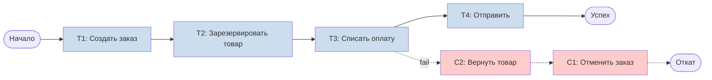
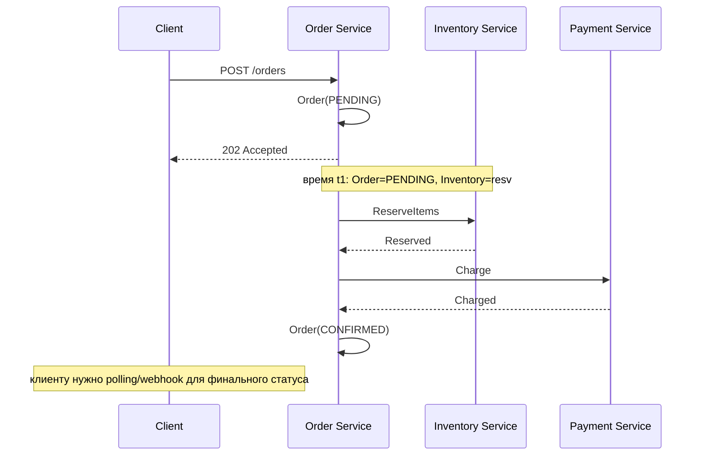
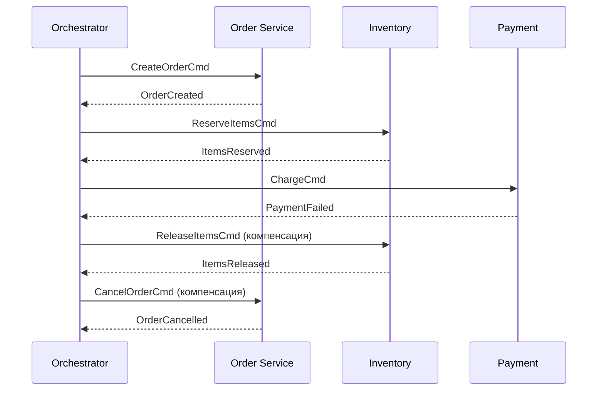
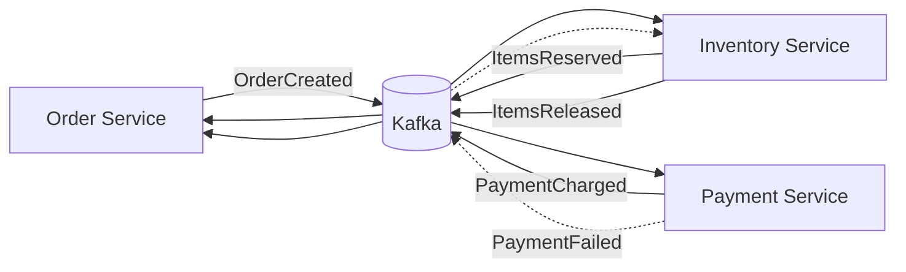
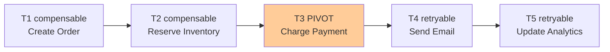
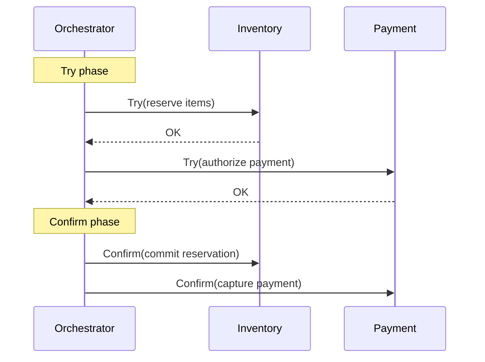
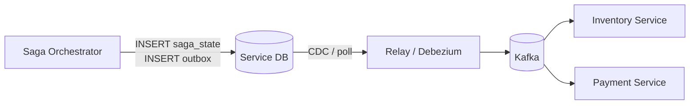
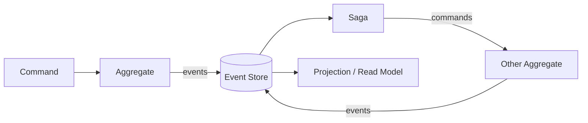

# Вопросы на собеседовании: Паттерн Saga

**Saga Pattern** -- один из ключевых паттернов управления распределёнными транзакциями в микросервисной архитектуре. Вместо общей долгой транзакции через `2PC` (двухфазную фиксацию), которая требует совместимых участников и удерживает ресурсы, `Saga` разбивает бизнес-операцию на последовательность локальных транзакций, шаги до точки невозврата имеют нужные компенсации. Тема обязательна на Senior-собеседованиях: проверяет понимание `eventual consistency`, компенсаций, семантических блокировок и практической реализации на `Spring Boot` с `Axon Framework 4`, `Eventuate Tram` или через `Kafka` + `Outbox`.

## Полезные ссылки

### Официальная документация

- [Pattern: Saga (microservices.io)](https://microservices.io/patterns/data/saga.html) -- каноническое описание паттерна от Chris Richardson
- [Saga Pattern in Microservices (Baeldung)](https://www.baeldung.com/cs/saga-pattern-microservices) -- обзор паттерна и видов координации
- [Two-Phase Commit vs Saga Pattern (Baeldung)](https://www.baeldung.com/cs/two-phase-commit-vs-saga-pattern) -- сравнение с 2PC
- [Saga Pattern in a Microservices Architecture with Spring Boot (Baeldung)](https://www.baeldung.com/orkes-conductor-saga-pattern-spring-boot) -- реализация на Spring Boot с Orkes Conductor
- [Saga Design Pattern (Microsoft Learn)](https://learn.microsoft.com/en-us/azure/architecture/patterns/saga) -- Azure Architecture Center
- [Axon Framework Sagas (docs.axoniq.io)](https://docs.axoniq.io/axon-framework-reference/4.11/sagas/) -- реализация Saga в Axon
- [Eventuate Tram Sagas (eventuate.io)](https://eventuate.io/docs/manual/eventuate-tram/latest/getting-started-eventuate-tram-sagas.html) -- фреймворк для orchestration-based Saga
- [Transactional Outbox (microservices.io)](https://microservices.io/patterns/data/transactional-outbox.html) -- Outbox для atomic publish
- [Developing Sagas Part 1--4 (Chris Richardson)](https://microservices.io/post/microservices/2019/07/09/developing-sagas-part-1.html) -- цикл статей с примерами

## Содержание

- [Полезные ссылки](#полезные-ссылки)
- [See also](#see-also)

**Основы Saga**
- [Q1. (!) Что такое Saga Pattern и зачем он нужен?](#q1--что-такое-saga-pattern-и-зачем-он-нужен)
- [Q2. (!) Какую проблему решает Saga в микросервисной архитектуре?](#q2--какую-проблему-решает-saga-в-микросервисной-архитектуре)
- [Q3. Что такое локальная транзакция в Saga?](#q3-что-такое-локальная-транзакция-в-saga)
- [Q4. Какие ACID-свойства сохраняет Saga, а какие теряет?](#q4-какие-acid-свойства-сохраняет-saga-а-какие-теряет)
- [Q5. Что такое semantic consistency и чем она отличается от strong consistency?](#q5-что-такое-semantic-consistency-и-чем-она-отличается-от-strong-consistency)

**Оркестрация**
- [Q6. (!) Что такое orchestration-based Saga?](#q6--что-такое-orchestration-based-saga)
- [Q7. Как устроен saga orchestrator?](#q7-как-устроен-saga-orchestrator)
- [Q8. Какие преимущества и недостатки у оркестрации?](#q8-какие-преимущества-и-недостатки-у-оркестрации)
- [Q9. (!) Как реализовать оркестратор как state machine?](#q9--как-реализовать-оркестратор-как-state-machine)

**Хореография**
- [Q10. (!) Что такое choreography-based Saga?](#q10--что-такое-choreography-based-saga)
- [Q11. Как события связывают шаги хореографии?](#q11-как-события-связывают-шаги-хореографии)
- [Q12. (!) Оркестрация vs хореография -- когда что выбрать?](#q12--оркестрация-vs-хореография----когда-что-выбрать)
- [Q13. Какой риск несёт хореография при росте числа сервисов?](#q13-какой-риск-несёт-хореография-при-росте-числа-сервисов)

**Компенсирующие транзакции**
- [Q14. (!) Что такое compensating transaction?](#q14--что-такое-compensating-transaction)
- [Q15. (!) Типы шагов: compensable, pivot, retryable](#q15--типы-шагов-compensable-pivot-retryable)
- [Q16. Почему компенсация не равна откату (rollback)?](#q16-почему-компенсация-не-равна-откату-rollback)
- [Q17. Что делать, если compensating transaction тоже упала?](#q17-что-делать-если-compensating-transaction-тоже-упала)

**Isolation и countermeasures**
- [Q18. (!) Почему Saga не обеспечивает isolation и какие возникают аномалии?](#q18--почему-saga-не-обеспечивает-isolation-и-какие-возникают-аномалии)
- [Q19. (!) Что такое semantic lock?](#q19--что-такое-semantic-lock)
- [Q20. Что такое commutative updates, pessimistic view, reread, version file?](#q20-что-такое-commutative-updates-pessimistic-view-reread-version-file)
- [Q21. Что такое by value strategy?](#q21-что-такое-by-value-strategy)

**Сравнение с 2PC**
- [Q22. (!) Saga vs 2PC -- ключевые отличия](#q22--saga-vs-2pc----ключевые-отличия)
- [Q23. Почему 2PC плохо работает в микросервисах?](#q23-почему-2pc-плохо-работает-в-микросервисах)
- [Q24. Что такое TCC (Try-Confirm-Cancel) и чем он отличается от Saga?](#q24-что-такое-tcc-try-confirm-cancel-и-чем-он-отличается-от-saga)

**Реализация на Spring Boot**
- [Q25. (!) Как реализовать оркестратор Saga на чистом Spring Boot + Kafka?](#q25--как-реализовать-оркестратор-saga-на-чистом-spring-boot--kafka)
- [Q26. (!) Как связать Saga с Outbox pattern?](#q26--как-связать-saga-с-outbox-pattern)
- [Q27. (!) Как реализовать Saga на Axon Framework?](#q27--как-реализовать-saga-на-axon-framework)
- [Q28. Как использовать Eventuate Tram для orchestration Saga?](#q28-как-использовать-eventuate-tram-для-orchestration-saga)
- [Q29. Как использовать Camunda/BPMN для Saga?](#q29-как-использовать-camundabpmn-для-saga)
- [Q30. Как реализовать persistent state saga orchestrator?](#q30-как-реализовать-persistent-state-saga-orchestrator)

**Pitfalls и антипаттерны**
- [Q31. (!) Какие антипаттерны Saga следует избегать?](#q31--какие-антипаттерны-saga-следует-избегать)
- [Q32. Что такое distributed monolith и как Saga может его спровоцировать?](#q32-что-такое-distributed-monolith-и-как-saga-может-его-спровоцировать)
- [Q33. Как бороться с зависшими (stuck) Saga?](#q33-как-бороться-с-зависшими-stuck-saga)
- [Q34. (!) Как обеспечить идемпотентность шагов Saga?](#q34--как-обеспечить-идемпотентность-шагов-saga)
- [Q35. Как бороться с out-of-order сообщениями в хореографии?](#q35-как-бороться-с-out-of-order-сообщениями-в-хореографии)

**Тестирование и наблюдаемость**
- [Q36. Как тестировать Saga?](#q36-как-тестировать-saga)
- [Q37. Как мониторить Saga в production?](#q37-как-мониторить-saga-в-production)
- [Q38. Как трассировать Saga через distributed tracing?](#q38-как-трассировать-saga-через-distributed-tracing)

**Продвинутые темы**
- [Q39. (!) Как реализовать timeout и circuit breaker в Saga?](#q39--как-реализовать-timeout-и-circuit-breaker-в-saga)
- [Q40. Как Saga взаимодействует с CQRS и Event Sourcing?](#q40-как-saga-взаимодействует-с-cqrs-и-event-sourcing)
- [Q41. Как версионировать Saga при изменении бизнес-процесса?](#q41-как-версионировать-saga-при-изменении-бизнес-процесса)
- [Q42. Long-running Saga -- особенности (часы, дни, недели)](#q42-long-running-saga----особенности-часы-дни-недели)
- [Q43. Как объяснить eventual consistency клиенту/пользователю?](#q43-как-объяснить-eventual-consistency-клиентупользователю)

---

## Q1. (!) Что такое Saga Pattern и зачем он нужен?

**Saga Pattern** -- это способ выполнить бизнес-операцию, затрагивающую несколько сервисов, без единой распределённой транзакции. Операция разбивается на последовательность локальных транзакций. Для шагов, за которыми возможен поздний бизнес-отказ, предусматривают допустимые компенсации. При сбое координация должна довести процесс до успешного итога, компенсации или явно наблюдаемого состояния для восстановления.

Ключевая идея: вместо «всё или ничего» в один момент времени Saga даёт «всё или ничего» в конечном счёте, проходя через видимые промежуточные состояния.

Исторически паттерн описан в статье Hector Garcia-Molina и Kenneth Salem (1987) для long-running transactions в базах данных; в микросервисную эпоху его адаптировал Chris Richardson.



**Зачем нужен:**
- В микросервисах каждый сервис владеет своей БД (`Database per Service`), поэтому обычная локальная `@Transactional` не охватывает БД разных сервисов
- `2PC` (двухфазная фиксация) технически возможен, но блокирует ресурсы на время операции и плохо масштабируется
- Нужна согласованность данных между сервисами без глобальных блокировок -- Saga даёт её ценой потери изоляции

**Гарантии:** локальные шаги сохраняют свойства ACID, но вся Saga не получает гарантии ACID общей транзакции: компенсации дают семантическое восстановление при предусмотренных сбоях, а промежуточные состояния видны другим -- промежуточные состояния видны другим, поэтому нужны `countermeasures` (см. [Q18](#q18--почему-saga-не-обеспечивает-isolation-и-какие-возникают-аномалии)).

## Q2. (!) Какую проблему решает Saga в микросервисной архитектуре?

Saga решает проблему атомарности бизнес-операции, которая затрагивает данные нескольких сервисов. В монолите операция «создать заказ» (создание записи Order, резерв Inventory, списание Payment) выполняется в одной `@Transactional` -- `ACID` из коробки. В микросервисах эти данные живут в разных БД, и классическая транзакция их не охватывает: коммит в одной БД ничего не знает о коммите в другой.

**Варианты решения и их проблемы:**

| Решение | Проблема |
|---|---|
| `XA / 2PC` через `JTA` | Нужны совместимые участники и восстановление координатора; подготовленные ресурсы удерживаются до решения |
| Единая БД на все сервисы | Нарушает принцип `Database per Service`, теряем независимость сервисов |
| Синхронные REST-цепочки с try/catch | Нет атомарности: если упал сервис в середине -- данные в несогласованном состоянии; зависимость от времени жизни HTTP-соединения |
| **Saga** | Бизнес-согласованность через локальные коммиты, надёжную координацию и компенсации |

`Saga` -- стандарт де-факто для бизнес-процессов типа `Place Order`, `Book Travel`, `Process Payment`, где нужно скоординировать несколько автономных сервисов без блокирующих глобальных транзакций.

## Q3. Что такое локальная транзакция в Saga?

Локальная транзакция -- это атомарная операция в пределах одного сервиса и одной БД: выполняется под обычной `@Transactional` и удовлетворяет `ACID`. Saga -- это цепочка таких транзакций $T_1, T_2, \dots, T_n$ с компенсациями $C_1, C_2, \dots, C_{n-1}$ для выполненных шагов, за которыми может следовать бизнес-отказ.

**Ключевое условие:** каждая $T_i$ коммитит свои изменения немедленно, не удерживая блокировки до конца Saga. Именно это отличает Saga от долгой транзакции: шаги становятся видимыми другим транзакциям (отсюда нарушение `isolation`), но зато ресурсы не залочены на всё время процесса -- система держит высокую пропускную способность.

```java
@Service
@Transactional
public class OrderService {

    public Order createOrder(CreateOrderCommand cmd) {
        // Локальная транзакция: пишем в БД + публикуем событие через Outbox
        Order order = new Order(cmd.customerId(), cmd.items(), OrderStatus.PENDING);
        orderRepository.save(order);
        outboxRepository.save(new OutboxEvent("OrderCreated", order.toPayload()));
        return order;
    }
}
```

## Q4. Какие ACID-свойства сохраняет Saga, а какие теряет?

| Свойство | В локальной транзакции | В Saga в целом |
|---|---|---|
| **A**tomicity | Да | Семантический эффект при успешных компенсациях, не атомарный коммит |
| **C**onsistency | Да | Требует бизнес-инвариантов и надёжного завершения |
| **I**solation | Да | **Нет** -- промежуточные состояния видны |
| **D**urability | Да | Да -- каждый шаг коммитится в свою БД |

Короткий ответ на собеседовании: Локальные шаги обладают ACID-гарантиями своей БД. Вся Saga не является одной ACID-транзакцией: компенсации могут семантически исправить результат уже выполненных шагов, если их удаётся довести до конца. Изоляции между шагами нет, и это главная «головная боль» при разработке: два одновременных Saga видят промежуточные состояния друг друга, из-за чего возникают аномалии -- `lost update`, `dirty read`, `fuzzy read` (non-repeatable). Лечатся они не на уровне СУБД, а прикладными `countermeasures` ([Q19](#q19--что-такое-semantic-lock)--[Q21](#q21-что-такое-by-value-strategy)).

## Q5. Что такое semantic consistency и чем она отличается от strong consistency?

Разница в том, *когда* система согласована и допустимы ли промежуточные состояния.

**Strong consistency** (сильная согласованность) -- после коммита транзакции любой следующий запрос видит обновлённые данные, промежуточных состояний нет. Это поведение ACID-транзакции.

**Semantic consistency** (семантическая согласованность) -- система приходит к согласованности в конечном счёте, по бизнес-смыслу. Промежуточные состояния допустимы и наблюдаемы (заказ `PENDING`, товар «временно зарезервирован»), но бизнес-инвариант восстанавливают успешным завершением или компенсациями; сбой компенсации требует отдельного восстановления. Несогласованность -- временная и ограниченная, проверка конечного состояния и обработка зависших саг обязательны.



На собеседовании важно подчеркнуть: `Saga` требует переосмысления UX -- клиент получает 202 Accepted + идентификатор саги, статус узнаёт через polling/SSE/webhook.

## Q6. (!) Что такое orchestration-based Saga?

В orchestration-based Saga есть **центральный координатор** (`Saga Orchestrator`), который хранит состояние процесса и по очереди отправляет командные сообщения участникам, дожидаясь ответа (`reply`). На основании ответов оркестратор решает, какой шаг выполнить дальше и какие компенсации запустить при ошибке.



Главное отличие от хореографии: знание о том, «какой шаг идёт следующим и что делать при ошибке», собрано в одном месте, а не размазано по участникам.

**Характеристики:**
- Оркестратор -- persistent сущность (запись в БД), чтобы пережить падение и продолжить с того же шага
- Общается с участниками через request/async-response (обычно Kafka/RabbitMQ)
- Участники не знают друг о друге, знают только своего оркестратора -- связность между ними низкая
- Логика «что делать при ошибке» централизована в оркестраторе

**Фреймворки:** `Axon Framework`, `Eventuate Tram`, `Camunda BPMN`, `Orkes Conductor`, `Netflix Conductor`, `Temporal`.

## Q7. Как устроен saga orchestrator?

По сути оркестратор -- это persistent state machine, которая хранит текущий шаг процесса и реагирует на ответы участников. Жизненный цикл:

1. Получает начальное событие/команду (например, `OrderPlaced`)
2. Создаёт запись Saga в БД со состоянием (`currentStep`, `completedSteps`, `sagaData`)
3. Для текущего шага формирует команду и отправляет её участнику через брокер
4. При получении reply обновляет состояние и переходит к следующему шагу
5. При ошибке -- идёт назад по `completedSteps` и запускает компенсации в обратном порядке

```java
@Entity
public class CreateOrderSagaState {
    @Id private UUID sagaId;
    private UUID orderId;
    private BigDecimal amount;
    private SagaStep currentStep;     // CREATE_ORDER, RESERVE_INVENTORY, CHARGE_PAYMENT, CONFIRM
    private SagaStatus status;         // IN_PROGRESS, COMPENSATING, COMPLETED, FAILED
    private List<SagaStep> completedSteps;
    private Instant lastUpdate;
    @Version private Long version;     // оптимистичная блокировка
}
```

Важно: оркестратор **не содержит бизнес-логики**, только flow; бизнес-решения принимают агрегаты участников.

## Q8. Какие преимущества и недостатки у оркестрации?

**Преимущества:**
- Централизованная логика -- легко читать, отлаживать, менять flow
- Явные состояния -- проще мониторить, подойдёт BPMN-диаграмма
- Легче добавить timeout, retry, circuit breaker на уровне оркестратора
- Проще реализовать сложные ветвления и условия
- Участники не знают друг о друге -- `low coupling` между ними

**Недостатки:**
- Оркестратор -- single point of failure (нужна HA и persistent state)
- Риск превратить оркестратор в `god-object` с бизнес-логикой (антипаттерн)
- Доп. сервис/модуль, который нужно разрабатывать и поддерживать
- Coupling участников к модели команд оркестратора

## Q9. (!) Как реализовать оркестратор как state machine?

Оркестратор моделируется как конечный автомат: каждое состояние -- это «где сейчас Saga», а входящее событие (reply участника) определяет переход и следующую команду. Классическая ручная реализация -- явный enum состояний и `switch` по текущему состоянию:

```java
public enum CreateOrderState {
    STARTED,
    ORDER_CREATED,
    INVENTORY_RESERVED,
    PAYMENT_CHARGED,
    COMPLETED,
    COMPENSATING_PAYMENT,
    COMPENSATING_INVENTORY,
    COMPENSATING_ORDER,
    FAILED
}

@Component
public class CreateOrderSagaManager {

    public void handle(SagaEvent event, CreateOrderSagaState state) {
        switch (state.getCurrentState()) {
            case STARTED -> {
                commandGateway.send(new CreateOrderCommand(...));
                state.setCurrentState(ORDER_CREATED);
            }
            case ORDER_CREATED -> {
                if (event instanceof OrderCreated ok) {
                    commandGateway.send(new ReserveInventoryCommand(...));
                    state.setCurrentState(INVENTORY_RESERVED);
                } else if (event instanceof OrderCreationFailed) {
                    state.setCurrentState(FAILED);
                }
            }
            case INVENTORY_RESERVED -> {
                if (event instanceof InventoryReserved) {
                    commandGateway.send(new ChargePaymentCommand(...));
                    state.setCurrentState(PAYMENT_CHARGED);
                } else {
                    commandGateway.send(new CancelOrderCommand(...));
                    state.setCurrentState(COMPENSATING_ORDER);
                }
            }
            // ... и так далее
        }
        sagaRepository.save(state);
    }
}
```

В продакшене лучше использовать готовые решения: `Spring Statemachine`, `Axon Saga`, `Temporal workflows`, `Camunda BPMN` -- они дают persistence, таймеры, версионирование, визуализацию.

## Q10. (!) Что такое choreography-based Saga?

В choreography-based Saga **нет центрального координатора**: каждый сервис публикует доменные события после своей локальной транзакции, а другие сервисы подписываются на эти события и реагируют. Координация распределена между участниками.



**Пример flow `PlaceOrder`:**
1. `Order Service` сохраняет `Order(PENDING)` и публикует `OrderCreated`
2. `Inventory Service` слушает `OrderCreated`, резервирует товар, публикует `ItemsReserved`
3. `Payment Service` слушает `ItemsReserved`, списывает деньги, публикует `PaymentCharged` или `PaymentFailed`
4. При `PaymentFailed`: `Inventory Service` слушает и отменяет резерв (`ItemsReleased`); `Order Service` слушает и отменяет заказ

Подробнее про брокеры сообщений -- в [event-driven паттернах](event-driven-patterns-interview.md).

## Q11. Как события связывают шаги хореографии?

Шаги связаны не вызовами, а событиями: завершение одной локальной транзакции публикует доменное событие, которое становится триггером для следующего сервиса. Связь идёт через `publish-subscribe` в брокере ([Kafka](../messaging/kafka-interview.md), [RabbitMQ](../messaging/rabbitmq-interview.md)). Чтобы понять, к какой именно Saga относится событие, в нём передают `correlation-id` = `sagaId` или `orderId` -- по нему получатель находит нужный контекст.

```java
@Component
public class InventoryEventHandler {

    @KafkaListener(topics = "order-events")
    @Transactional
    public void on(OrderCreatedEvent event) {
        // локальная транзакция: резерв + публикация результата через Outbox
        InventoryReservation reservation = inventoryService.reserve(
            event.orderId(), event.items()
        );
        outboxService.publish(new ItemsReservedEvent(
            event.orderId(),        // correlation id
            reservation.getId(),
            event.items()
        ));
    }

    @KafkaListener(topics = "payment-events")
    @Transactional
    public void on(PaymentFailedEvent event) {
        // компенсация
        inventoryService.release(event.orderId());
        outboxService.publish(new ItemsReleasedEvent(event.orderId()));
    }
}
```

## Q12. (!) Оркестрация vs хореография -- когда что выбрать?

| Критерий | Оркестрация | Хореография |
|---|---|---|
| Центр управления | Оркестратор | Нет -- распределён |
| Количество шагов | Само по себе не определяет выбор | Само по себе не определяет выбор |
| Ветвления и условия | Легко -- в одном месте | Сложно -- размазано |
| Сложность отладки | Проще -- логи оркестратора | Сложнее -- трассировка по брокеру |
| Coupling | Participants ↔ Orchestrator | Все ↔ все через события |
| Риск SPOF | Координатор нужно восстанавливать | Зависит от инфраструктуры |
| Антипаттерн | `god-orchestrator` с логикой | `distributed monolith` через события |
| Наблюдаемость | Хорошая -- state в БД | Требует distributed tracing |

**Эмпирическое правило:**
- **Оркестрация** -- сложные многошаговые процессы с ветвлениями, BPMN-like workflows, где важен явный контроль и audit trail (заказы с ветвлениями, кредитные процессы, supply chain)
- **Хореография** -- понятные реактивные цепочки без сложных общих ветвлений (notification pipeline, cache invalidation cascade, simple order flow)
- Можно комбинировать: крупный оркестратор, внутри отдельные хореографические цепочки

## Q13. Какой риск несёт хореография при росте числа сервисов?

Главный риск -- превращение в **implicit coupling monster**:

- Каждый сервис подписан на десятки событий и публикует свои -- flow становится невидимым
- Нет одного места, где бы описан полный процесс -- только через чтение кода всех участников
- Добавить новый шаг = обновить код нескольких сервисов и все их топики
- Cyclic dependencies: сервис A подписан на B, B на A -- легко получить event loop
- Отладка через брокер и распределённые логи, без общей view
- Rollback при частичном сбое распределён и ненадёжен

В книге Sam Newman'а это называют `distributed big ball of mud`. Когда ход процесса стал трудно проследить и безопасно изменить, рассмотрите более явную координацию.

## Q14. (!) Что такое compensating transaction?

**Compensating transaction** (компенсирующая транзакция) -- локальная транзакция, семантически отменяющая эффект ранее выполненной транзакции той же Saga. Это не `rollback` в SQL-смысле (который невозможен после коммита), а новая транзакция, которая приводит данные к состоянию «как будто операции не было».

**Примеры:**

| Шаг $T_i$ | Компенсация $C_i$ |
|---|---|
| Создать заказ | Отметить заказ как `CANCELLED` (не удалять -- нужен audit) |
| Зарезервировать 5 штук товара | Вернуть 5 штук на склад |
| Списать 1000 ₽ с карты | Выпустить refund на 1000 ₽ |
| Отправить email «заказ принят» | Отправить email «заказ отменён» |
| Начислить бонусы | Списать бонусы |

Требования к компенсациям:
- **Идемпотентность** -- компенсация может выполниться повторно ([Q34](#q34--как-обеспечить-идемпотентность-шагов-saga))
- **Коммутативность** -- по возможности порядок компенсаций не должен менять итог
- **Семантическая корректность** -- не «удалить запись», а «пометить отменённой» с причиной

## Q15. (!) Типы шагов: compensable, pivot, retryable

Chris Richardson выделяет три типа локальных транзакций в Saga:

**1. Compensable transactions** -- шаги, которые МОЖНО компенсировать. Если после них падает более поздний шаг, запускаем компенсацию.
- Пример: «зарезервировать товар», «создать заказ в статусе PENDING»

**2. Pivot transaction** -- «точка невозврата». После её успеха откат назад по обычному пути не предусмотрен: оставшиеся шаги должны быть повторяемыми до успеха. До неё -- все шаги compensable.
- Пример: «списать деньги с карты» (refund возможен, но это уже отдельный бизнес-процесс)

**3. Retryable transactions** -- шаги после pivot, для которых проектируют повторяемое завершение без ожидаемого бизнес-отказа.
- Пример: «отправить email», «начислить бонусы», «обновить аналитику»



Эта классификация помогает при проектировании: всё, что не вернуть -- pushni вправо за pivot.

## Q16. Почему компенсация не равна откату (rollback)?

| Характеристика | DB rollback | Saga compensation |
|---|---|---|
| Уровень | СУБД | Приложение |
| Когда возможен | До коммита | После коммита, если существует допустимое бизнес-действие |
| Видимость промежуточных состояний | Нет для незакоммиченных изменений | Да — уже закоммиченные шаги видны |
| Обратимость | Полная | Семантическая |
| Реализация | Автомат через WAL/undo log | Ручная бизнес-логика |

Коротко: rollback стирает изменения до того, как их кто-либо увидел; компенсация выполняется уже после коммита, когда эффект $T_i$ стал виден другим сервисам и пользователям. «Отменить» такой эффект физически нельзя -- его можно только нейтрализовать новым бизнес-действием.

**Яркий пример:** если $T_1$ -- «отправить email клиенту с подтверждением заказа», компенсация $C_1$ -- «отправить email с извинением об отмене», а не волшебно «развидеть» письмо.

**Аудит и бухгалтерия:** в compliant-системах компенсация НЕ удаляет запись, а создаёт reversing entry (как в бухучёте: списание + зачисление, а не удаление проводки).

## Q17. Что делать, если compensating transaction тоже упала?

Падение компенсации оставляет Saga незавершённой. Автоматическое восстановление возможно для части ошибок; для остальных нужны наблюдение и ручной разбор:

1. **Retry с экспоненциальной задержкой** -- большинство падений transient (сеть, таймаут); частоту и предел повторов выбирают по типу ошибки и нагрузке
2. **DLQ (Dead Letter Queue)** -- после исчерпания retry отправляем команду компенсации в DLQ для ручного разбора
3. **Saga stuck alert** -- мониторинг по `lastUpdate` Saga: если старше threshold -- алерт оператору
4. **Manual compensation** -- UI/runbook, в котором оператор может вручную запустить компенсацию или откорректировать данные
5. **Backward recovery pipeline** -- отдельный компонент, который периодически находит зависшие Saga и пытается завершить их
6. **Alternative compensation** -- если $C_i$ не работает, можно попробовать $C_i'$ (другую стратегию: вместо возврата товара -- списать как убыток)

**Критичный принцип:** компенсации должны быть как можно более устойчивыми -- идемпотентными, минимально зависимыми, с простейшей логикой. Положение pivot выбирают по бизнес-инвариантам и возможности компенсировать предшествующие шаги, чтобы после неё шли только retryable steps и не нужны были компенсации.

## Q18. (!) Почему Saga не обеспечивает isolation и какие возникают аномалии?

Локальные транзакции коммитятся немедленно, поэтому их результат виден другим транзакциям ДО того, как Saga завершится. Возникают аномалии:

**1. Lost update** -- одна Saga перезаписывает изменения другой
- Пример: Saga A резервирует 5 штук → Saga B резервирует ещё 5 штук → A компенсирует → на складе минус 5

**2. Dirty read** -- транзакция читает промежуточное состояние Saga, которая потом компенсирует
- Пример: UI показывает заказ как CONFIRMED, пользователь выставляет отзыв, но Saga откатывается → отзыв висит на несуществующем заказе

**3. Fuzzy/non-repeatable read** -- один и тот же запрос в рамках транзакции возвращает разные данные, т.к. параллельная Saga обновила их
- Пример: расчёт комиссии дважды дал разные суммы, т.к. в середине прошёл refund другой Saga

**4. Double-write** -- две параллельные Saga делают одинаковую операцию, у каждой свой ID
- Пример: два параллельных `PlaceOrder` на один `cartId` из-за таймаута -- создались два заказа

Для исправления применяют `countermeasures` (следующие вопросы).

## Q19. (!) Что такое semantic lock?

**Semantic lock** -- это countermeasure против аномалий изоляции: прикладная (не на уровне СУБД) блокировка через флаг в записи, который сигнализирует «запись участвует в незавершённой Saga, обрабатывать с осторожностью». Другие Saga и читатели видят флаг и либо ждут, либо отказываются от конкурирующего действия. По сути это явное промежуточное состояние, заменяющее настоящую изоляцию.

```java
public class Order {
    private UUID id;
    private OrderStatus status;          // PENDING, CONFIRMED, CANCELLED
    private String sagaLock;              // sagaId или null
    // ...

    public void approve(UUID sagaId) {
        if (this.sagaLock != null && !this.sagaLock.equals(sagaId.toString())) {
            throw new SagaLockViolation("Order locked by another saga");
        }
        this.sagaLock = sagaId.toString();
        this.status = OrderStatus.APPROVAL_PENDING;
    }

    public void confirm() {
        this.status = OrderStatus.CONFIRMED;
        this.sagaLock = null;  // освобождаем
    }
}
```

**Типичные статусы-локи:** `APPROVAL_PENDING`, `REVISION_PENDING`, `PAYMENT_IN_PROGRESS`, `CANCELLATION_PENDING`. UI показывает эти состояния как «обрабатывается» и не даёт совершить конкурирующие действия. Лок снимается при completion или по timeout watchdog'ом.

## Q20. Что такое commutative updates, pessimistic view, reread, version file?

Это остальные countermeasures из классификации Chris Richardson -- набор приёмов, которые компенсируют отсутствие изоляции на уровне проектирования операций, а не блокировками:

**Commutative updates** -- проектируем операции так, чтобы порядок применения не влиял на результат. Пример: вместо `balance = 100` (set) использовать `balance += delta` (increment) -- тогда компенсация `balance -= delta` может быть корректной при сохранении инвариантов и уникального ID операции, даже если порядок смешался.

**Pessimistic view** -- переупорядочиваем шаги, чтобы уменьшить бизнес-ущерб от чтения промежуточного состояния, когда уже нет риска компенсации.
- Пример: не увеличиваем лимит кредитной линии клиента до одобрения платежа -- чтобы он не успел им воспользоваться и не пришлось отбирать обратно

**Reread value** -- перед компенсацией заново читаем запись и проверяем, что значение не изменилось с момента $T_i$. Если изменилось -- не компенсируем, сигнализируем оператору или применяем альтернативную стратегию.

**Version file** -- храним все операции над записью с их ID; компенсация применяется как `inverse operation` с привязкой к ID, а не к значению. Если между $T_i$ и $C_i$ прошли другие операции -- они не затираются.

**By value** -- выбираем стратегию обработки по цене возможной аномалии для конкретного запроса; это одна из мер против бизнес-риска.

## Q21. Что такое by value strategy?

`By value` — мера из классификации Chris Richardson: выбираем тактику по бизнес-цене возможной аномалии конкретного запроса. Механизм может включать дополнительное подтверждение, резервирование или другой маршрут; переход на 2PC не является обязательным.
- Маленькая сумма, retail-клиент → `Saga` с компенсациями, eventual consistency
- Крупная сумма или высокий риск → дополнительное подтверждение, резервирование либо другой согласованный путь; выбор `2PC` возможен лишь при поддержке участников и короткой операции

**Компромисс:** разные пути усложняют тестирование и эксплуатацию. Их вводят, когда разница в риске действительно оправдывает эту цену.

## Q22. (!) Saga vs 2PC -- ключевые отличия

| Характеристика | `2PC` (XA) | `Saga` |
|---|---|---|
| Координация | `Transaction Coordinator` с двумя фазами (prepare, commit) | Оркестратор или события |
| Блокировки | Блокирует ресурсы до конца фазы commit | Нет глобальных блокировок |
| Согласованность | Strong -- атомарная (все или ничего) | Eventual -- через компенсации |
| Isolation | Зависит от изоляции каждого участника | Нет общей изоляции между шагами; нужны меры против аномалий |
| Производительность | Удержание ресурсов и дополнительные обмены | Зависит от длительности шагов и координации |
| Восстановление | Нужны журнал координатора и разбор `in-doubt` | Нужны durable state, повторы и обработка зависших шагов |
| Гетерогенные ресурсы | Все участники должны поддерживать нужный протокол | Участники реализуют локальные шаги и компенсации |
| Long-running | Удержание подготовленных ресурсов обычно неприемлемо | Возможны часы и дни при durable state и восстановлении |
| Сложность кода | Координатор и поддержка протокола у участников | Координация, компенсации и меры против аномалий |
| Применимость | Монолит с несколькими БД, legacy | Микросервисы |

**Вывод:** в микросервисах `2PC` применим при совместимых участниках и коротких операциях. Saga часто выбирают для долгих межсервисных процессов, несмотря на сложность.

Подробнее про проблемы 2PC -- в [consistency patterns](consistency-patterns-interview.md) и [distributed systems](distributed-systems-interview.md).

## Q23. Почему 2PC плохо работает в микросервисах?

Коротко: `2PC` требует синхронных блокировок и надёжного координатора -- два условия, которые в распределённой среде с независимыми сервисами и ненадёжной сетью почти невыполнимы. Конкретные причины:

1. **Блокировки ресурсов** -- во время фазы prepare ресурсы залочены, и если один из участников тормозит, все остальные ждут; при нагрузке растёт ожидание
2. **Восстановление координатора** -- если он падает после prepare, участники остаются `in-doubt` до восстановления решения
3. **Network partition** -- coordinator не может достучаться до участника; неизвестно, committ-ить или нет
4. **Гетерогенность** -- многие современные брокеры (`Kafka`, modern NoSQL) не поддерживают XA/JTA
5. **Производительность** -- дополнительные сообщения и ожидание участников увеличивают задержку; размер зависит от среды
6. **Масштабируемость** -- чем больше участников, тем больше вероятность таймаута и медленнее Commit
7. **Long-running** -- подготовленные ресурсы пришлось бы удерживать длительное время, что обычно неприемлемо

Инженерный консенсус: в микросервисах `2PC` имеет существенную цену при долгих межсервисных операциях. Выбор между короткой распределённой транзакцией и Saga зависит от гарантий участников и требований процесса.

## Q24. Что такое TCC (Try-Confirm-Cancel) и чем он отличается от Saga?

**TCC** (Try-Confirm-Cancel) — близкая модель координации, в которой участник поддерживает три операции. Try создаёт локально зафиксированный резерв; Confirm завершает бизнес-действие, Cancel освобождает резерв. Резерв сам может быть виден другим запросам, поэтому изоляцию нужно проектировать отдельно:
- **Try** -- локально зафиксировать временный резерв без финального бизнес-эффекта (например, «удержать 100 ₽ на карте»)
- **Confirm** -- финализировать (спишем удержанные 100 ₽)
- **Cancel** -- освободить резерв (снимем удержание 100 ₽)



**Saga vs TCC:**

| Критерий | Saga | TCC |
|---|---|---|
| Модель | T_i + C_i | Try + Confirm/Cancel |
| Isolation | Нет общей изоляции | Резерв ограничивает конкуренцию, но его видимость и защита зависят от реализации |
| Сложность API | T_i -- одно действие | Три метода на шаг |
| Применимость | Любые операции | Требует от сервисов поддерживать резервирование |
| Видимость промежуточных состояний | Зависит от модели данных | Зависит от видимости и срока резерва |

TCC популярен в Alibaba Seata и в финтехе, где важна минимизация временных окон с видимыми промежуточными состояниями. Реализация сложнее -- каждый сервис должен поддерживать три операции.

## Q25. (!) Как реализовать оркестратор Saga на чистом Spring Boot + Kafka?

Оркестратор хранит durable state экземпляра Saga: идентификатор, текущий шаг, статус, версию и данные, нужные для компенсации. Обработчик ответа сначала проверяет `sagaId`, ожидаемый шаг и уже обработанный идентификатор сообщения. Затем в одной транзакции БД фиксирует новый state и исходящую команду в Outbox. Отдельный relay публикует команду в Kafka.

```java
@Transactional
public void onOrderReply(OrderCreatedReply reply) {
    SagaState state = sagaRepository.findById(reply.sagaId()).orElseThrow();
    if (state.alreadyHandled(reply.messageId())) return;
    state.requireStep(SagaStep.CREATE_ORDER);
    state.record(reply.messageId());
    state.transitionTo(reply.success() ? SagaStep.RESERVE_INVENTORY : SagaStep.FAILED);
    sagaRepository.save(state);
    if (reply.success()) {
        outboxRepository.save(OutboxMessage.forSaga(reply.sagaId(),
                new ReserveInventoryCommand(reply.sagaId())));
    }
}
```

Это схема взаимодействия, а не готовый API сущностей: `alreadyHandled`, `record` и `transitionTo` должны атомарно сохранять результат обработки вместе с бизнес-эффектом. `@Version` помогает обнаружить конкурентный переход, но конфликт нужно повторно прочитать и разобрать. Таймеры и recovery находят шаги без ответа; повтор команды безопасен только при идемпотентном участнике. Подробности Outbox — в [Q26](#q26--как-связать-saga-с-outbox-pattern).

## Q26. (!) Как связать Saga с Outbox pattern?

Outbox решает проблему «dual write»: оркестратору нужно в одной транзакции и сохранить своё state, и отправить команду в Kafka, но БД и брокер -- два разных ресурса без общей транзакции. Любой порядок ненадёжен: если сохранили state, но не отправили команду -- Saga зависнет; если отправили команду, но не сохранили state -- команда уйдёт, а оркестратор о ней «забудет». Идея Outbox -- свести оба действия к одной записи в одну БД.

**Решение -- Outbox pattern:**



В транзакции оркестратора обновляют `saga_state` и вставляют сообщение в `outbox` с уникальным ID и ключом порядка. Relay читает committed записи и публикует их в Kafka. После подтверждения публикации он отмечает запись как доставленную; при сбое между публикацией и отметкой сообщение может уйти повторно. Поэтому потребитель должен атомарно защитить бизнес-эффект от дубля. При нескольких relay также нужны безопасное распределение записей и сохранение нужного порядка.

Альтернатива -- `Debezium` + Kafka Connect: CDC читает транзакционный лог и автоматически публикует изменения таблицы outbox в Kafka. Такой подход используют `Eventuate Tram CDC` и многие production-решения. Подробнее -- в [event-driven паттернах](event-driven-patterns-interview.md).

## Q27. (!) Как реализовать Saga на Axon Framework?

В **Axon Framework 4** Saga — класс `@Saga`, который получает события через `@SagaEventHandler`. `@StartSaga` создаёт экземпляр, `associationProperty` связывает событие с нужной сагой, `SagaLifecycle.associateWith` добавляет новый ключ корреляции, а `@EndSaga` завершает жизненный цикл. Команды участникам отправляют через `CommandGateway`; обработчик должен учитывать ошибки, повторы и компенсации.

```java
@Saga
public class CreateOrderSaga {
    @Autowired private transient CommandGateway commandGateway;
    private String orderId;

    @StartSaga
    @SagaEventHandler(associationProperty = "orderId")
    public void on(OrderCreatedEvent event) {
        orderId = event.orderId();
        commandGateway.send(new ReserveItemsCommand(orderId));
    }

    @EndSaga
    @SagaEventHandler(associationProperty = "orderId")
    public void on(OrderConfirmedEvent event) {
        // Завершаем только после подтверждения нужных бизнес-шагов.
    }
}
```

В **Axon Framework 5** аннотированные Saga из четвёртой версии заменены другими средствами, в частности Workflows. Такой пример нельзя переносить в Axon 5 без миграции. Для новых проектов проверьте версию, лицензирование Workflow и требования к восстановлению. [Документация Axon 4](https://docs.axoniq.io/axon-framework-reference/4.11/sagas/associations/) и [миграция на Axon 5](https://docs.axoniq.io/axon-framework-reference/5.3/migration/paths/sagas/).

## Q28. Как использовать Eventuate Tram для orchestration Saga?

`Eventuate Tram Sagas` -- специализированный фреймворк для orchestration-based Saga от Chris Richardson.

```java
public class CreateOrderSaga implements SimpleSaga<CreateOrderSagaData> {

    private SagaDefinition<CreateOrderSagaData> sagaDefinition =
        step()
          .invokeLocal(this::createOrder)
          .withCompensation(this::rejectOrder)
        .step()
          .invokeParticipant(this::reserveCredit)
          .onReply(CreditReservedReply.class, this::handleCreditReserved)
          .onReply(CreditLimitExceededReply.class, this::handleCreditLimitExceeded)
        .step()
          .invokeParticipant(this::chargePayment)
          .withCompensation(this::refund)
        .build();

    @Override
    public SagaDefinition<CreateOrderSagaData> getSagaDefinition() {
        return sagaDefinition;
    }

    private CommandWithDestination reserveCredit(CreateOrderSagaData data) {
        return send(new ReserveCreditCommand(data.getCustomerId(), data.getAmount()))
            .to("customerService")
            .build();
    }
    // ...
}
```

**Особенности:**
- DSL для декларативного описания steps и compensations
- Встроенный Outbox (через Eventuate Tram CDC с Debezium)
- Поддержку конкретного стека проверяют по используемой версии
- Поддерживаемые БД и брокеры зависят от выбранного модуля Eventuate Tram
- Хранение состояния и координация шагов средствами фреймворка; идемпотентность бизнес-операций проверяют отдельно

Плюс -- явный и компактный DSL; минус -- инфраструктурная зависимость от CDC и Kafka, сложнее отлаживать внутреннюю механику.

## Q29. Как использовать Camunda/BPMN для Saga?

В Camunda 7 и 8 Saga можно описать BPMN-процессом: service tasks представляют шаги, compensation boundary event связывает завершённый шаг с обработчиком компенсации, а throw event запускает компенсации в нужной области процесса. Движок хранит состояние экземпляра и управляет маршрутом. Само бизнес-действие выполняет внешний обработчик; его идемпотентность и корректность компенсации остаются ответственностью приложения.

Camunda 7 использует, например, External Task Worker с расширениями `camunda:*`. Camunda 8 использует Zeebe job worker с собственным описанием task type. Эти атрибуты и Java API не следует смешивать в одном BPMN-примере. В Camunda 8 общий throw event может запустить обработчики завершённых задач одновременно; если нужен порядок, запускайте компенсацию конкретной задачи или моделируйте зависимость явно.

[Компенсации Camunda 8](https://docs.camunda.io/docs/components/modeler/bpmn/compensation-events/) и [обработчики компенсации](https://docs.camunda.io/docs/components/modeler/bpmn/compensation-handler/).

## Q30. Как реализовать persistent state saga orchestrator?

Главное требование: оркестратор обязан пережить падение процесса и рестарт JVM, не потеряв ни одной идущей Saga. Значит, state живёт в БД, а не в памяти, и каждое его изменение фиксируется атомарно. Из этого вытекают остальные принципы:

1. **State в одной таблице с версионированием** -- `@Version` для optimistic locking
2. **Процесс изменения state + отправки команды -- в одной транзакции с Outbox** ([Q26](#q26--как-связать-saga-с-outbox-pattern))
3. **Load-on-event** -- при получении reply сначала грузим state из БД, проверяем совместимость, потом обновляем
4. **Scheduled recovery** -- отдельный job читает зависшие (stuck) саги и пытается продолжить

```java
@Component
public class SagaRecoveryJob {
    @Scheduled(fixedDelay = 60_000)
    @Transactional
    public void recoverStuckSagas() {
        Instant cutoff = Instant.now().minus(Duration.ofMinutes(5));
        List<CreateOrderSagaState> stuck = repo
            .findByStatusAndUpdatedAtBefore(SagaStatus.IN_PROGRESS, cutoff);

        for (CreateOrderSagaState s : stuck) {
            log.warn("Resuming stuck saga {} at step {}", s.getSagaId(), s.getCurrentStep());
            resume(s);  // повторяем команду текущего шага
        }
    }
}
```

5. **Idempotent command handling** -- участник проверяет, не обрабатывал ли он уже эту команду (по `sagaId` + `step`)
6. **Monitoring** -- метрика `saga_stuck_duration_seconds` и alert на долгие саги

## Q31. (!) Какие антипаттерны Saga следует избегать?

1. **Бизнес-логика в оркестраторе** -- оркестратор должен быть тупым координатором; бизнес-решения принимают агрегаты участников. Оркестратор = `workflow engine`, не `domain service`.

2. **Синхронная цепочка без восстановления** -- если оркестратор держит один HTTP-запрос на время всех шагов, сбой оставит процесс без durable состояния и безопасного продолжения. Синхронный вызов допустим при явных таймаутах и восстановлении.

3. **Компенсация как `rollback` через `DELETE`** -- удаление записи теряет audit trail и не работает, если на неё уже сослались другие записи. Компенсация — новое бизнес-действие: статус `CANCELLED`, возврат резерва или компенсирующая проводка по правилам домена.

4. **Забыть про isolation** -- отсутствие countermeasures ведёт к lost update, dirty read в production (особенно под нагрузкой).

5. **Не определена граница обратимости** -- для каждого шага нужно знать, допустим ли поздний бизнес-отказ и как компенсировать уже выполненное.

6. **Непрозрачная цепочка событий** -- если изменение процесса требует синхронных правок нескольких участников, пересмотрите контракты и способ координации.

7. **Игнорировать DLQ и stuck sagas** -- без recovery-процесса в production накопятся зависшие саги, данные разойдутся.

8. **Отсутствие correlation-id** -- без устойчивого `sagaId` в сообщениях трудно собрать события одного процесса; `traceId` решает другую задачу.

9. **Компенсации не идемпотентны** -- retry после transient fail создаёт двойную компенсацию (двойной refund).

10. **Нет таймаутов** -- Saga может висеть вечно, если один участник не ответил.

## Q32. Что такое distributed monolith и как Saga может его спровоцировать?

**Distributed monolith** -- худший из обоих миров: сервисы физически разделены (как в микросервисах), но связаны так жёстко (как в монолите), что независимости не дают. Признаки:
- Нельзя задеплоить один сервис без других
- Изменение в одном сервисе ломает другие
- Падение одного сервиса роняет весь процесс

**Как Saga провоцирует:**
- **Хореография с неявной связностью** -- сервис A зависит от event формата сервиса B, изменение схемы требует coordinated release
- **Orchestrator, знающий внутреннее устройство участников** -- оркестратор, который вызывает DB-методы или внутренние endpoint'ы участников
- **Жёсткие связи через команды** -- каждый сервис-участник должен поддерживать конкретный набор команд, изменение требует synchronized deploy
- **Циклические зависимости** -- событие из A триггерит B, из B -- C, из C -- снова A

**Как избежать:**
- Стабильные контракты событий/команд + `Schema Registry` с backward compatibility ([schema registry](../messaging/kafka-interview.md))
- Оркестратор общается только через async-commands, не знает internals
- Версионирование команд и событий
- Правило: изменение одного сервиса не должно требовать deploy других

## Q33. Как бороться с зависшими (stuck) Saga?

Stuck saga -- это Saga, которая застряла: формально ещё `in-progress`, но фактически не движется -- ни завершается, ни компенсируется. Причины: потерянное сообщение, падение участника без ответа, баг в обработке reply. Стратегия борьбы стоит на трёх китах -- надёжно обнаружить, автоматически разрешить, а остаток разобрать вручную.

**Обнаружение:**
- Колонка `updatedAt` в state + scheduled job, который ищет saga старше threshold
- Метрика `saga_age_seconds{status="IN_PROGRESS"}` -- алерт на перцентиль 99
- Dashboard с количеством активных саг по статусам

**Ресолюшн:**
1. **Автоматический retry** -- отдельный job находит stuck saga и повторно отправляет команду текущего шага (участник должен быть идемпотентен)
2. **Timeout + выяснение исхода** -- если ответ не пришёл, сначала проверяем, выполнил ли участник действие, затем выбираем повтор или компенсацию
3. **Ручное разрешение через admin UI** -- оператор может после проверки фактических эффектов повторить шаг, инициировать компенсацию или зафиксировать ручное разрешение
4. **Audit trail** -- логируем все переходы state для forensic-анализа
5. **Alert + runbook** -- stuck saga требует разбора по порогу и критичности процесса, runbook описывает шаги разбора

**Профилактика:**
- Таймауты на каждый шаг (запрос и обработка)
- Идемпотентность participants
- Health check участников с circuit breaker

## Q34. (!) Как обеспечить идемпотентность шагов Saga?

Идемпотентность означает, что повторная обработка того же сообщения не меняет результат по сравнению с однократной. Для шага с повторной доставкой это необходимое свойство: в асинхронной системе повторная доставка возможна -- из-за retry продюсера, rebalance consumer'а или recovery после падения. Без идемпотентности это двойной резерв, двойной refund, дубль заказа.

**Подходы:**

**1. Уникальный ключ операции + таблица обработанных сообщений:**

В одной транзакции БД резервируют уникальный `messageId` и выполняют бизнес-изменение. Конкурирующий повтор упирается в ограничение уникальности; после его обработки возвращают уже сохранённый результат. Проверка `existsById` до записи недостаточна: два обработчика могут одновременно увидеть «нет».

**2. Идемпотентность на уровне бизнес-операции:**
- «Create order with id=X» -- upsert by id, повтор не создаёт дубль
- «Reserve N items for order X» -- check if reservation exists, иначе создать
- «Charge payment P» -- Payment Service сам проверяет, был ли уже чардж на этот `paymentIntentId`

**3. Optimistic locking через version:**
```java
UPDATE order SET status='RESERVED', version=version+1
WHERE id=? AND version=?
```

**4. Conditional compensation:**
- Перед компенсацией проверяем, что шаг действительно был выполнен (иначе nop)

Подробнее про идемпотентность consumer'ов -- в [event-driven паттернах](event-driven-patterns-interview.md) и [Kafka](../messaging/kafka-interview.md).

## Q35. Как бороться с out-of-order сообщениями в хореографии?

В хореографии нет центрального контроля порядка, поэтому события могут прийти не в той последовательности, в какой произошли: `ItemsReserved` способен обогнать `OrderCreated`, если они летят через разные топики или партиции с независимой задержкой. Получатель должен быть готов к этому, иначе обработает событие, для которого ещё нет контекста.

**Стратегии:**

1. **Partition key = aggregate id** -- внутри одного топика события с одним `orderId` попадают в одну партицию и упорядочены там; между топиками общего порядка нет
2. **Causal ordering через version/sequence** -- каждый event несёт `sequenceNo`; consumer буферизует out-of-order и обрабатывает в нужной последовательности
3. **State check перед обработкой** -- при получении `ItemsReserved` проверяем, что в локальной read model Order уже существует; если нет -- откладываем (retry from DLQ)
4. **Process Manager** -- маленький локальный state machine в каждом сервисе, который знает, какой event ожидается следующим

**Анти-решение:** «просто ретраим» -- работает, но при массовом out-of-order создаёт хаос в DLQ. Ключ партиции полезен в одном топике; между разными топиками нужны версия события и проверка состояния.

## Q36. Как тестировать Saga?

Saga нельзя проверить одним типом тестов: отдельно тестируют логику шагов, отдельно -- переходы оркестратора, и отдельно -- весь процесс целиком, включая сценарии отказа. Пирамида тестов:

**1. Unit-тесты шагов и компенсаций** -- проверяем бизнес-логику каждой локальной транзакции изолированно (моки репозиториев и брокера).

**2. Unit-тесты оркестратора** -- state machine тестируется как набор переходов:
```java
@Test
void shouldTransitionToCompensatingWhenPaymentFails() {
    CreateOrderSagaState state = SagaFixture.atStep(PAYMENT_CHARGED);
    orchestrator.onPaymentReply(new PaymentReply(state.sagaId(), false));
    assertEquals(COMPENSATING, state.getStatus());
    verify(outboxRepository).save(argThat(message -> message.isReleaseInventory()));
}
```

**3. Тест happy path -- integration** -- поднимаем все сервисы в Testcontainers (PostgreSQL + Kafka), прогоняем end-to-end создание заказа, проверяем финальные состояния во всех БД.

**4. Chaos-тесты для компенсаций** -- искусственно падает один из участников, Saga должна корректно откатиться (например, через `@MockBean` поднять `PaymentService` в режим `alwaysFail`).

**5. Idempotency-тесты** -- отправляем команду дважды, проверяем, что результат как после одного раза.

**6. Concurrency-тесты** -- две параллельные Saga над одним агрегатом, проверяем countermeasures (semantic lock сработал, нет lost update).

**7. Contract-тесты** -- Pact/Spring Cloud Contract между оркестратором и participants, чтобы формат команд/replies не сломался.

В Axon есть `SagaTestFixture`:
```java
fixture.givenAggregate(orderId).published(new OrderCreatedEvent(...))
    .whenPublishingA(new ItemsReservedEvent(...))
    .expectDispatchedCommands(new ChargePaymentCommand(...));
```

## Q37. Как мониторить Saga в production?

Главная цель мониторинга Saga -- вовремя заметить две вещи: саги, которые зависли, и рост доли компенсаций (сигнал, что один из участников деградирует). Под это и собирают метрики, логи и алерты.

**Метрики (Prometheus/Micrometer):**
- `saga_started_total{name="CreateOrder"}` -- счётчик стартов
- `saga_completed_total{name, status}` -- completed / failed / compensated
- `saga_duration_seconds{name}` -- гистограмма времени жизни
- `saga_stuck_total{name}` -- количество зависших
- `saga_step_duration_seconds{name, step}` -- время каждого шага
- `saga_compensation_total{name, step}` -- сколько компенсаций запущено

**Логи:**
- Каждый переход состояния с `sagaId`, `step`, `reason`
- Компенсации логируются с уровнем по причине и критичности
- Structured logs для поиска по `sagaId`

**Алерты:**
- Rate компенсаций выше собственной базовой линии (причину проверяют по шагам)
- Возраст саги выше порога для конкретного шага
- Saga duration p99 > threshold
- Ratio `compensated / started` выше X%

**Dashboards:**
- Воронка completion -- какой процент достигает каждого шага
- Heatmap длительности шагов
- Real-time список in-progress saga

## Q38. Как трассировать Saga через distributed tracing?

`sagaId` — устойчивый бизнес-идентификатор процесса; `traceId` относится к трассе выполнения и не обязан совпадать с ним. Передавайте `sagaId` в командах, событиях и структурированных логах всех участников. Trace context (`traceparent`) передавайте отдельно через заголовки сообщений средствами инструментации OpenTelemetry или Micrometer Tracing.

Долгая Saga может пережить несколько HTTP-запросов, очередей и дней ожидания. Поэтому один trace не всегда охватит весь процесс: отдельные трассы связывают по `sagaId` или span links. В UI трассировки видны конкретные обработанные шаги, а журнал состояний остаётся источником полного жизненного цикла Saga.

## Q39. (!) Как реализовать timeout и circuit breaker в Saga?

При отправке команды оркестратор фиксирует срок ожидания ответа. Если срок истёк, он **не знает**, выполнилась ли операция у участника: мог потеряться только reply. Сначала проверяют фактический результат или повторяют команду с тем же идемпотентным ключом, затем выбирают следующий переход, компенсацию либо ручной разбор.

Circuit breaker полезен для синхронного вызова недоступного участника: он ограничивает новые попытки до восстановления. Он не заменяет таймер шага и не доказывает, что уже отправленная команда не выполнилась. Bulkhead отделяет ресурсы взаимодействия с разными участниками, если один медленный вызов способен занять общий пул. Для асинхронной доставки нужны отдельные ограничения очереди и политики повторов.

Подробнее о механизмах — в [resilience patterns](resilience-patterns-interview.md).

## Q40. Как Saga взаимодействует с CQRS и Event Sourcing?

В системах с `CQRS` + `Event Sourcing` Saga -- естественный способ координировать агрегаты:

- Каждый **агрегат** обрабатывает команды и генерирует события (`OrderCreated`, `InventoryReserved`)
- **Saga** подписывается на события из event store, реагирует и отправляет новые команды в другие агрегаты
- State Saga хранится отдельно (как process manager), может сам быть event-sourced
- Проекции для read model обновляются из тех же событий независимо от Saga



В Axon Framework 4 аннотированные Saga поддерживают такое взаимодействие с событиями и командами; в Axon 5 модель API изменилась. Детали -- в [CQRS + Event Sourcing](cqrs-event-sourcing-interview.md).

## Q41. Как версионировать Saga при изменении бизнес-процесса?

Проблема: вы деплоите новую версию Saga, но в БД уже есть in-progress instance'ы старой версии. Их нельзя ломать.

**Стратегии:**

1. **Версия в state** -- `@Column private Integer sagaVersion;` -- оркестратор читает версию и выбирает соответствующий handler
```java
public void handle(SagaEvent event, CreateOrderSagaState state) {
    CreateOrderSagaLogic logic = logicRegistry.get(state.getSagaVersion());
    logic.handle(event, state);
}
```

2. **Zero-break changes** -- новые шаги добавляются в конец, не ломая существующие перехода; старые compensation действия сохраняются
3. **Snapshot + migration** -- для long-running Saga делается migration script, переводящий старые instances в новую схему
4. **Workflow-системы** -- Camunda сохраняет версию определения запущенного процесса; Temporal требует стратегии совместимости replay или закрепления версии worker
5. **Deprecation period** -- держим две версии параллельно, пока все старые instances не завершатся

**Правило:** никогда не меняем семантику существующих команд/событий задним числом -- всегда новая версия команды (`ReserveItemsCommandV2`).

## Q42. Long-running Saga -- особенности (часы, дни, недели)

Long-running Saga -- это Saga, чьё время жизни измеряется не миллисекундами, а часами, днями и неделями, потому что она ждёт внешних событий: подтверждения человека, наступления даты, ответа партнёра. Примеры: `Process Loan Approval` (неделя), `Book Travel` (до даты поездки), `Subscription Renewal` (месяц). Из-за этого почти все требования к Saga обостряются.

**Ключевые особенности:**

1. **Persistent state -- обязательно** -- никаких in-memory state
2. **Timeouts на шаги + watchdog** -- шаг может ждать несколько дней (подтверждение от пользователя)
3. **Таймеры и отложенные события** -- `EventScheduler`, `@Scheduled`, Quartz; в workflow-движках (Temporal, Camunda) -- нативно
4. **Idempotency -- критична** -- за неделю может много чего случиться: restart JVM, redeploy, миграция БД
5. **Versioning обязателен** -- за время жизни одной Saga может выйти новая версия приложения
6. **Humans in the loop** -- пользователь/оператор может влиять на процесс; нужны UI для просмотра state и manual интервенции
7. **Externalize state -- DB, Redis, Temporal** -- не в памяти приложения
8. **Observability** -- нужен persistent log всех переходов с timestamps для аудита и анализа
9. **Compensation для старых шагов** -- компенсация, запускаемая через неделю, должна учитывать, что данные изменились; применяем `reread value`, `commutative updates`

Для таких задач обычно выбирают специализированные решения: **Temporal**, **AWS Step Functions**, **Camunda** -- они предоставляют устойчивое исполнение и таймеры; совместимость версий и бизнес-идемпотентность всё равно нужно проектировать.

## Q43. Как объяснить eventual consistency клиенту/пользователю?

Это не только технический, но и UX-вопрос: на собеседовании вас могут спросить «как показать статус заказа пользователю, если Saga ещё идёт?».

**Паттерны UX:**

1. **Optimistic UI** -- показываем «заказ создан» сразу после создания Order-записи, даже если ещё не списан платёж. Если платёж упадёт -- показываем уведомление «к сожалению, оплата не прошла, заказ отменён»
2. **Processing states** -- явный статус `Ожидает подтверждения платежа`, `Готовим к отправке` -- пользователь понимает, что процесс ещё не завершён
3. **202 Accepted + polling** -- REST API возвращает `202` с `Location: /sagas/{sagaId}`, клиент опрашивает статус
4. **Server-Sent Events / WebSocket** -- push-уведомления о смене статуса без polling
5. **Webhook callbacks** -- для B2B интеграций, когда клиент -- другой сервис
6. **Email / push-notifications** -- для долгих процессов (`ваш заказ подтверждён`)

**На собеседовании важно подчеркнуть:**
- Eventual consistency -- не bug, а design choice с trade-offs
- Обычно пользователю не важна мгновенная согласованность -- секундная задержка незаметна
- Критично корректно обработать failed saga -- пользователь должен узнать об отмене и, если списали деньги, увидеть refund
- Саги -- инструмент бизнеса, а не только кода: UX команда должна согласовать processing states

---

## See also

- [CQRS и Event Sourcing](cqrs-event-sourcing-interview.md) -- Saga как неотъемлемая часть CQRS/ES архитектур, orchestration с Axon Framework
- [Event-driven паттерны](event-driven-patterns-interview.md) -- брокеры, идемпотентность, Outbox, choreography -- основа для Saga
- [Микросервисная архитектура](microservices-interview.md) -- Saga в контексте микросервисов, сравнение с 2PC, Bounded Context
- [Паттерны согласованности](consistency-patterns-interview.md) -- eventual consistency, ACID vs BASE, CAP
- [Распределённые системы](distributed-systems-interview.md) -- 2PC, 3PC, FLP, консенсус, проблемы распределённых транзакций
- [Паттерны отказоустойчивости](resilience-patterns-interview.md) -- Circuit Breaker, Retry, Timeout, Bulkhead для шагов Saga
- [CAP-теорема](cap-theorem-interview.md) -- теоретическая основа выбора между consistency и availability
- [Kafka](../messaging/kafka-interview.md) -- партицирование для порядка событий, Schema Registry, Kafka как транспорт для Saga
- [DDD](ddd-interview.md) -- агрегаты, bounded context, domain events -- фундамент для проектирования Saga
- [Паттерны масштабирования](scalability-patterns-interview.md) -- independent scaling, eventual consistency как способ масштабирования
