# Вопросы на собеседовании: `Apache Cassandra`

Вопросы и ответы по `Apache Cassandra`: архитектура кластера, модель данных, `CQL`, `Primary Key`, репликация, уровни консистентности, `LWT`, стратегии компакции, `Spring Data Cassandra`, `Java Driver`.

**Apache Cassandra** — распределённая `NoSQL` БД с линейной масштабируемостью и высокой доступностью, спроектированная для обработки больших объёмов данных на множестве серверов без единой точки отказа. На собеседованиях спрашивают про архитектуру кластера, моделирование данных под запросы, `CQL`, уровни консистентности и сценарии использования.

## Полезные ссылки

### Официальная документация

- [Apache Cassandra Documentation](https://cassandra.apache.org/doc/latest/) — официальная документация
- [DataStax Java Driver](https://docs.datastax.com/en/developer/java-driver/) — драйвер для Java
- [Spring Data Cassandra Reference](https://docs.spring.io/spring-data/cassandra/docs/current/reference/html/) — Spring Data Cassandra

### Статьи Baeldung

- [Introduction to Spring Data Cassandra](https://www.baeldung.com/spring-data-cassandra-tutorial) — настройка и базовые операции
- [A Guide to Cassandra with Java](https://www.baeldung.com/cassandra-with-java) — работа через Java Driver
- [Cassandra Batch in CQL and Java](https://www.baeldung.com/java-cql-cassandra-batch) — пакетные операции
- [Cassandra Query Cheat Sheet](https://www.baeldung.com/cassandra-query-cheat-sheet) — справочник по CQL
- [Spring Data with Reactive Cassandra](https://www.baeldung.com/spring-data-cassandra-reactive) — реактивный стек
- [Secondary Indexes in Cassandra](https://www.baeldung.com/cassandra-secondary-indexes) — вторичные индексы
- [Data Modeling in Cassandra](https://www.baeldung.com/cassandra-data-modeling) — моделирование данных под запросы
- [Consistency Levels in Cassandra](https://www.baeldung.com/cassandra-consistency-levels) — уровни консистентности
- [Cassandra Partition Key, Composite Key, and Clustering Key](https://www.baeldung.com/cassandra-keys) — устройство ключей

## Содержание

- [Полезные ссылки](#полезные-ссылки)
- [See also](#see-also)

**Архитектура и основные концепции**
- [Q1. (!) Что такое `Apache Cassandra` и когда её выбирать?](#q1--что-такое-apache-cassandra-и-когда-её-выбирать)
- [Q2. (!) Какова архитектура кластера `Cassandra`?](#q2--какова-архитектура-кластера-cassandra)
- [Q3. (!) Что такое `Gossip`-протокол?](#q3--что-такое-gossip-протокол)
- [Q4. Что такое `Snitch` и какие типы существуют?](#q4-что-такое-snitch-и-какие-типы-существуют)
- [Q5. Как работает `Consistent Hashing` в `Cassandra`?](#q5-как-работает-consistent-hashing-в-cassandra)
- [Q6. Что такое `Virtual Nodes` (vnodes)?](#q6-что-такое-virtual-nodes-vnodes)

**Модель данных и Primary Key**
- [Q7. (!) Какую модель данных использует `Cassandra`?](#q7--какую-модель-данных-использует-cassandra)
- [Q8. (!) Что такое `Primary Key`, `Partition Key` и `Clustering Key`?](#q8--что-такое-primary-key-partition-key-и-clustering-key)
- [Q9. (!) Как правильно моделировать данные в `Cassandra`?](#q9--как-правильно-моделировать-данные-в-cassandra)
- [Q10. Какие факторы влияют на равномерное распределение данных?](#q10-какие-факторы-влияют-на-равномерное-распределение-данных)
- [Q11. Что такое `Wide Rows` и какие ограничения на размер партиции?](#q11-что-такое-wide-rows-и-какие-ограничения-на-размер-партиции)

**CQL и работа с данными**
- [Q12. (!) Основные команды `CQL`](#q12--основные-команды-cql)
- [Q13. Что такое `Secondary Index` и когда его использовать?](#q13-что-такое-secondary-index-и-когда-его-использовать)
- [Q14. Что такое `Materialized Views`?](#q14-что-такое-materialized-views)
- [Q15. Как выполнять агрегации и аналитические запросы?](#q15-как-выполнять-агрегации-и-аналитические-запросы)

**Запись и чтение данных**
- [Q16. (!) Как работает путь записи (`Write Path`)?](#q16--как-работает-путь-записи-write-path)
- [Q17. (!) Как работает путь чтения (`Read Path`)?](#q17--как-работает-путь-чтения-read-path)
- [Q18. Что такое `Tombstone` и как они влияют на производительность?](#q18-что-такое-tombstone-и-как-они-влияют-на-производительность)
- [Q19. Как работает механизм сжатия данных (`Compression`)?](#q19-как-работает-механизм-сжатия-данных-compression)

**Репликация и консистентность**
- [Q20. (!) Что такое `Replication` и какие стратегии существуют?](#q20--что-такое-replication-и-какие-стратегии-существуют)
- [Q21. (!) Какие уровни консистентности (`Consistency Levels`) существуют?](#q21--какие-уровни-консистентности-consistency-levels-существуют)
- [Q22. (!) Что означает формула `R + W > N`?](#q22--что-означает-формула-r--w--n)
- [Q23. Что такое `Hinted Handoff`?](#q23-что-такое-hinted-handoff)
- [Q24. Что такое `Read Repair`?](#q24-что-такое-read-repair)
- [Q25. (!) Что такое `Anti-Entropy Repair` и зачем он нужен?](#q25--что-такое-anti-entropy-repair-и-зачем-он-нужен)

**Компакция и TTL**
- [Q26. (!) Какие стратегии компакции (`Compaction`) существуют?](#q26--какие-стратегии-компакции-compaction-существуют)
- [Q27. Как управлять жизненным циклом данных через `TTL`?](#q27-как-управлять-жизненным-циклом-данных-через-ttl)

**Транзакции и Batch**
- [Q28. (!) Что такое `Lightweight Transactions` (`LWT`)?](#q28--что-такое-lightweight-transactions-lwt)
- [Q29. Что такое `Batch` и какие ограничения у `Batch`?](#q29-что-такое-batch-и-какие-ограничения-у-batch)
- [Q30. Как в `Cassandra` реализовать счётчики (`Counters`)?](#q30-как-в-cassandra-реализовать-счётчики-counters)

**Spring Data Cassandra и Java Driver**
- [Q31. (!) Как подключить `Spring Data Cassandra` к проекту?](#q31--как-подключить-spring-data-cassandra-к-проекту)
- [Q32. Как определить `Entity` и `Repository` в `Spring Data Cassandra`?](#q32-как-определить-entity-и-repository-в-spring-data-cassandra)
- [Q33. Как `Cassandra Java Driver` работает с кластером?](#q33-как-cassandra-java-driver-работает-с-кластером)
- [Q34. Как выполнять миграции схемы в `Cassandra`?](#q34-как-выполнять-миграции-схемы-в-cassandra)

**Операционные вопросы**
- [Q35. Как обеспечить безопасность кластера `Cassandra`?](#q35-как-обеспечить-безопасность-кластера-cassandra)
- [Q36. Какие метрики мониторить в production?](#q36-какие-метрики-мониторить-в-production)
- [Q37. Как масштабировать кластер `Cassandra`?](#q37-как-масштабировать-кластер-cassandra)
- [Q38. `Cassandra` vs другие `NoSQL` базы данных](#q38-cassandra-vs-другие-nosql-базы-данных)

**Анти-паттерны и лучшие практики**
- [Q39. Какие основные анти-паттерны при работе с `Cassandra`?](#q39-какие-основные-анти-паттерны-при-работе-с-cassandra)
- [Q40. (!) Как правильно обрабатывать коллекции в `CQL`?](#q40--как-правильно-обрабатывать-коллекции-в-cql)
- [Q41. Как реализовать `pagination` в `Cassandra`?](#q41-как-реализовать-pagination-в-cassandra)
- [Q42. (!) Что такое `Token-aware routing` и почему он важен?](#q42--что-такое-token-aware-routing-и-почему-он-важен)
- [Q43. Как выполнять агрегации и аналитику поверх `Cassandra`?](#q43-как-выполнять-агрегации-и-аналитику-поверх-cassandra)
- [Q44. Что такое `CDC` (`Change Data Capture`) в `Cassandra`?](#q44-что-такое-cdc-change-data-capture-в-cassandra)

---

## Q1. (!) Что такое `Apache Cassandra` и когда её выбирать?

Apache Cassandra — распределённая wide-column БД с репликацией без выделенного лидера для обычных операций. Любой узел может принять клиентский запрос. Успех операции зависит от доступности нужных реплик и заданного уровня согласованности.

Cassandra подходит для интенсивной записи и заранее известных запросов по ключу партиции, например «события устройства за день». LSM-движок пишет в commit log и memtable, а затем сбрасывает данные в SSTable. При оценке пропускной способности учитывайте compaction и распределение ключей. Добавление узлов помогает, когда нагрузку можно распределить. Один горячий ключ может остаться узким местом.

Уровень согласованности выбирают для операции. При сетевом разделении запрос завершится ошибкой, если доступных реплик недостаточно для выбранного уровня. Поэтому доступность зависит от топологии и условий запроса.

Если нужны произвольные соединения, меняющиеся запросы или общие транзакционные инварианты между партициями, проверьте, сколько дополнительных таблиц и прикладной логики потребует такая модель.

## Q2. (!) Какова архитектура кластера `Cassandra`?

Для обычной записи и чтения у Cassandra нет выделенного лидера партиции. Узел, получивший запрос клиента, становится координатором этой операции. Он определяет токен по ключу партиции, находит реплики по стратегии keyspace и отправляет им запрос. Consistency level задаёт, какие ответы нужны для успеха.

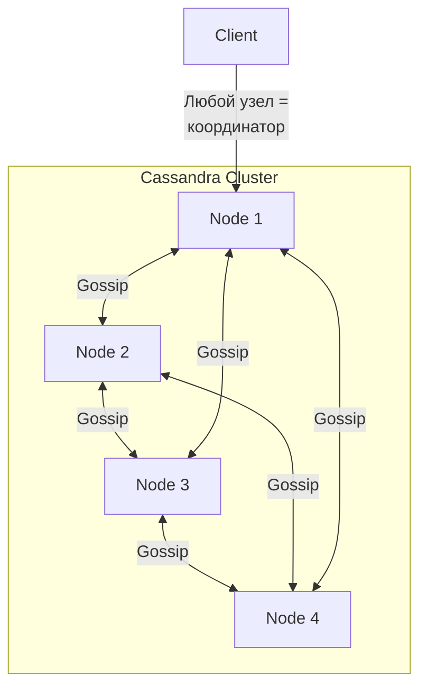

Дата-центры и стойки описывают домены отказа. Например, `NetworkTopologyStrategy` задаёт фактор репликации отдельно для каждого дата-центра и учитывает стойки при размещении. Координатор может сам хранить нужную партицию, но это необязательно.

Пример: при RF=3 в одном дата-центре `LOCAL_QUORUM` требует ответы двух локальных реплик. Потерю одной из трёх реплик операция может пережить, если две оставшиеся доступны координатору. Потеря второй уже не позволяет выполнить этот уровень.

## Q3. (!) Что такое `Gossip`-протокол?

Gossip — периодический обмен состоянием узлов. При запуске seed-узлы помогают найти участников. Дальше узлы обмениваются сведениями напрямую. Сообщения SYN, ACK и ACK2 помогают сопоставить дайджесты и передать изменения. Участники сравнивают версии состояния, чтобы не принять старое за новое.

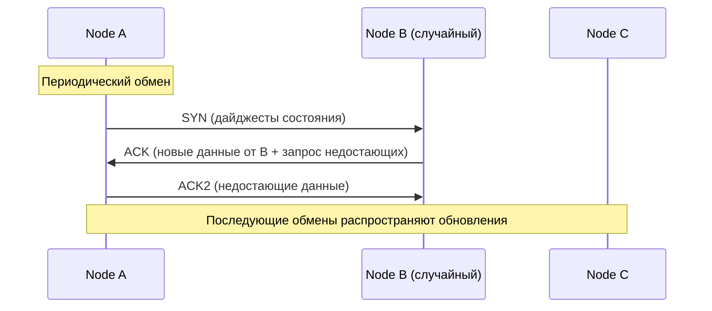

Обнаружение отказа — локальное решение каждого узла. Phi Accrual Failure Detector оценивает, насколько нетипично долго нет сообщений от соседа. При превышении `phi_convict_threshold` узел может считать соседа недоступным. Кратковременная недоступность сама по себе не меняет владельцев диапазонов и не запускает переразмещение данных.

Gossip передаёт состояние участников кластера. Строки таблиц реплицируются отдельным механизмом через доставку мутаций репликам, а расхождения устраняются в том числе через repair.

## Q4. Что такое `Snitch` и какие типы существуют?

В Cassandra 5.0 snitch сообщает, к какому дата-центру и стойке относится узел. `NetworkTopologyStrategy` использует эту топологию при размещении реплик. Например, при RF=3 и трёх доступных стойках в дата-центре стратегия размещает реплики на разных стойках. Cassandra также использует топологию при выборе реплик для внутренних запросов, а Java Driver выбирает координатора по собственной политике.

| Snitch | Откуда берётся топология |
|--------|--------------------------|
| `GossipingPropertyFileSnitch` | Локальные DC и rack заданы в `cassandra-rackdc.properties` и распространяются через gossip. |
| `PropertyFileSnitch` | Сопоставление узлов с DC и rack задано в `cassandra-topology.properties`. |
| `Ec2Snitch` | Регион EC2 соответствует DC, зона доступности — rack. Подходит для развёртывания внутри одного региона. |
| `GoogleCloudSnitch` | Регион GCE соответствует DC, зона доступности — rack. |
| `SimpleSnitch` | Не различает стойки или дата-центры. |

Пример локальных настроек для `GossipingPropertyFileSnitch`:

```properties
dc=dc-moscow
rack=rack1
```

## Q5. Как работает `Consistent Hashing` в `Cassandra`?

Partitioner вычисляет токен из полного ключа партиции. При стандартном `Murmur3Partitioner` токены образуют кольцо 64-битных значений. Назначенный узлу токен задаёт верхнюю включённую границу диапазона: для соседних токенов 25 и 50 токен 37 лежит в диапазоне `(25, 50]`.

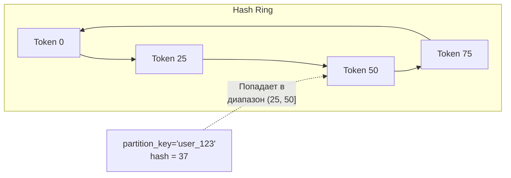

Набор реплик выбирает стратегия keyspace. `SimpleStrategy` обходит кольцо, пока не наберёт нужное число разных физических узлов. `NetworkTopologyStrategy` учитывает RF по дата-центрам и распределяет реплики по стойкам (Q4). Владелец токена не становится лидером партиции: запрос выполняет координатор, который обращается к нужным репликам (Q2).

При добавлении узла меняют размещение затронутых диапазонов. С vnodes новый узел может получить много диапазонов от разных соседей. Цена переноса зависит от объёма данных и раскладки реплик.

## Q6. Что такое `Virtual Nodes` (vnodes)?

Virtual node, или vnode, — одна из позиций физического узла в кольце токенов. Благодаря нескольким позициям узел владеет несколькими диапазонами. Это позволяет распределить перенос данных при добавлении узла между несколькими источниками и помогает сгладить перекос диапазонов.

`num_tokens` задаёт число токенов узла. В поставляемом `cassandra.yaml` ветки Cassandra 5.0 указано `16`. Если параметр не задан, Cassandra использует один токен для обратной совместимости. Значение 256 было характерно для Cassandra 2.x со случайным распределением токенов. Для существующего кластера смотрите фактически применённую конфигурацию.

Большее число токенов увеличивает число диапазонов, которые нужно учитывать при repair, и может усложнить обслуживание. Vnodes не делят одну горячую партицию: её ключ по-прежнему даёт один токен и один набор реплик.

## Q7. (!) Какую модель данных использует `Cassandra`?

`Cassandra` использует модель **wide-column store** (хранилище широких столбцов). Внешне это таблицы со строками и столбцами, но устроены они под распределённое хранение, поэтому отличаются от реляционных БД:

- CQL-таблица объявляет схему и типы столбцов. В отдельной строке часть неключевых значений может отсутствовать.
- Строки группируются в **партиции** по `partition key`, и партиция — это единица размещения: вся она целиком живёт на одном наборе реплик.
- Внутри партиции строки упорядочены по `clustering key` — отсюда дешёвые диапазонные выборки и сортировка по этому ключу.
- Нет JOIN и нет ссылочной целостности (referential integrity) — связи и согласованность обеспечивает приложение.
- Схема гибкая: добавление столбца не требует переписывать существующие строки.

**Иерархия структур данных:**

```
Cluster
  └── Keyspace (аналог schema/database)
       └── Table (аналог таблицы)
            └── Partition (группа строк с одним partition key)
                 └── Row (строка, определяется полным первичным ключом)
                      └── Column (пара name:value с timestamp)
```

**Пример создания keyspace и таблицы:**

```cql
CREATE KEYSPACE IF NOT EXISTS ecommerce
  WITH replication = {
    'class': 'NetworkTopologyStrategy',
    'dc-moscow': 3,
    'dc-spb': 2
  };

CREATE TABLE ecommerce.orders (
    user_id    UUID,
    order_date TIMESTAMP,
    order_id   UUID,
    total      DECIMAL,
    status     TEXT,
    PRIMARY KEY ((user_id), order_date, order_id)
) WITH CLUSTERING ORDER BY (order_date DESC, order_id ASC);
```

## Q8. (!) Что такое `Primary Key`, `Partition Key` и `Clustering Key`?

`Primary Key` в `Cassandra` делает сразу два дела: гарантирует уникальность строки и определяет, **где** и **как** данные лежат физически. Он включает `Partition Key` и может включать `Clustering Key`. Первый задаёт токен, по которому стратегия определяет набор реплик. Второй задаёт порядок строк внутри партиции. Понимание этого разделения — ключ к правильному моделированию.

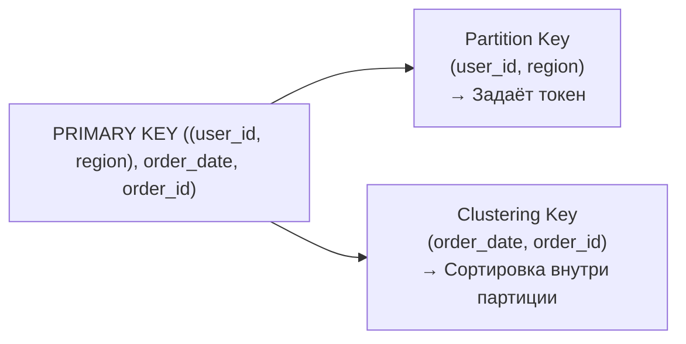

Как Primary Key распадается на две роли:

```
   ┌──────────────────────────────────────────────────────┐
   │ PRIMARY KEY ((user_id, region), order_date, order_id) │
   └───────────────────────┬──────────────────────────────┘
                ┌──────────┴──────────┐
                ▼                     ▼
   ┌────────────────────┐  ┌────────────────────────┐
   │ Partition Key      │  │ Clustering Key         │
   │ (user_id, region)  │  │ (order_date, order_id) │
   │ → Задаёт токен     │  │ → Сортировка внутри    │
   │                    │  │   партиции             │
   └────────────────────┘  └────────────────────────┘
```

| Понятие | Назначение | Пример |
|---------|-----------|--------|
| `Partition Key` | Задаёт токен, по которому стратегия выбирает реплики | `(user_id)` или `(user_id, region)` |
| `Clustering Key` | Определяет порядок строк внутри партиции | `order_date DESC` |
| `Primary Key` | `Partition Key` + `Clustering Key` — уникально идентифицирует строку | `((user_id), order_date, order_id)` |

**Варианты Primary Key:**

```cql
-- 1. Простой PK (одна колонка = partition key, нет clustering)
PRIMARY KEY (user_id)

-- 2. Составной PK (partition key + clustering key)
PRIMARY KEY (user_id, created_at)

-- 3. Composite Partition Key (несколько колонок в partition key)
PRIMARY KEY ((user_id, region), created_at, event_id)
```

**Правила выбора Partition Key:**
- **Высокая кардинальность** (много уникальных значений) — иначе данные собьются в несколько огромных партиций на немногих узлах.
- **Равномерное распределение запросов** — чтобы не возникало горячих партиций, к которым идёт непропорционально много трафика.
- **Размер партиции.** Ориентиры документации — менее 100 MB и 100 000 значений. Это не лимит строк. Проверяйте размер и задержку на своей нагрузке.

## Q9. (!) Как правильно моделировать данные в `Cassandra`?

Главное правило: в `Cassandra` моделируют **от запросов, а не от сущностей** (query-driven design). В реляционной БД сначала нормализуют сущности, а запросы пишут потом; здесь наоборот — сначала выписывают все запросы приложения, а затем проектируют таблицы под основные пути доступа. Несколько запросов могут использовать одну таблицу, если их фильтры и порядок совместимы с ключом. Подробнее о проектировании распределённых систем — в [вопросах по распределённым системам](../architecture/distributed-systems-interview.md).

**Принципы моделирования:**

1. **Таблица под путь доступа.** Дополнительная таблица ускоряет другое чтение, но её данные нужно синхронизировать при записи.
2. **Partition Key** соответствует WHERE-условию запроса
3. **Clustering Key** определяет сортировку результата
4. Дублирование данных — норма, а не проблема
5. Ограничивать рост партиций и проверять перекос нагрузки (Q8)

**Пример: пользователь и его заказы**

```cql
-- Запрос: "Показать последние 20 заказов пользователя"
CREATE TABLE orders_by_user (
    user_id    UUID,
    order_date TIMESTAMP,
    order_id   UUID,
    total      DECIMAL,
    PRIMARY KEY ((user_id), order_date, order_id)
) WITH CLUSTERING ORDER BY (order_date DESC, order_id ASC);
```

```cql
-- Запрос: "Показать заказы по статусу за день"
CREATE TABLE orders_by_status (
    status     TEXT,
    order_day  DATE,
    order_date TIMESTAMP,
    order_id   UUID,
    user_id    UUID,
    total      DECIMAL,
    PRIMARY KEY ((status, order_day), order_date, order_id)
) WITH CLUSTERING ORDER BY (order_date DESC, order_id ASC);
```

В первой таблице `order_id` различает заказы с одинаковым временем. Во второй `order_day` ограничивает партицию одним днём. Отчёт за несколько дней читает несколько партиций. При горячем статусе может понадобиться дополнительное разбиение внутри дня.

**Подводные камни:**
- `ALLOW FILTERING` — разрешает дополнительную фильтрацию. Объём чтения зависит от остальных предикатов: запрос может фильтровать внутри заданной партиции или читать множество партиций.
- Слишком низкокардинальный `partition key` — все данные оседают на одном-двух узлах, остальной кластер простаивает.
- Слишком большие партиции — горячие точки (hot spots) и риск `OutOfMemory` при чтении/компакции.
- Моделирование «как в PostgreSQL» с нормализацией — без JOIN это вырождается в множество последовательных запросов.

## Q10. Какие факторы влияют на равномерное распределение данных?

Равномерность распределения определяется в первую очередь выбором ключа партиции, но не только им. На что смотреть:

1. **Кардинальность Partition Key.** Берите высококардинальные значения (`UUID`, `user_id`), а не низкокардинальные (статус, страна): мало уникальных значений → мало партиций → перекос по узлам.
2. **Размер партиции.** Ориентиры документации — менее 100 MB на диске и 100 000 значений на партицию. Сверяйте оба показателя с задержками чтения и записи на своей нагрузке.
3. **Partitioner** — `Murmur3Partitioner` (по умолчанию) распределяет токены ключей по кольцу. Все строки с одним ключом партиции получают один токен.
4. **Vnodes** — много мелких диапазонов на узел сглаживают неравномерность распределения токенов.
5. **Паттерн запросов** — равномерные данные ещё не гарантируют равномерную нагрузку: если 90% трафика бьёт в 10% ключей, эти партиции станут горячими.

**Пример горячей партиции.** Если ключ партиции состоит из кода страны, весь поток событий популярной страны попадает в одну партицию. День в составе ключа ограничивает глубину истории в каждой партиции.

```cql
-- Одна партиция на страну
PRIMARY KEY (country_code, event_time)

-- Одна партиция на страну и день
PRIMARY KEY ((country_code, event_day), event_time)
```

Если записи за текущий день всё ещё перегружают реплики, добавьте в ключ номер корзины, вычисляемый из идентификатора события. Чтение за день тогда обращается ко всем корзинам и объединяет результаты.

## Q11. Что такое `Wide Rows` и какие ограничения на размер партиции?

**Wide Row** (широкая строка) — партиция, содержащая много строк (различающихся по clustering key). Данные партиции размещаются на одном наборе реплик, а порядок по clustering key позволяет читать нужный диапазон строк. Части одной партиции могут находиться в нескольких SSTable.

**Ограничения:**
- **Жёсткий предел** — около 2 млрд ячеек на партицию.
- **Ориентиры для проектирования** — менее **100 MB** на диске и **100 000 значений** на партицию. Подходящий размер зависит от нагрузки.
- **Чем грозит превышение:** широкие чтения и компакция могут стать дороже. Предикат по clustering key ограничивает диапазон чтения, а фактическая стоимость зависит в том числе от числа SSTable и tombstone.

**Борьба с большими партициями — bucketing:**

```cql
-- Вместо одной партиции на user_id навсегда:
PRIMARY KEY ((user_id), event_time)

-- Разбиваем по месяцу:
PRIMARY KEY ((user_id, month), event_time)
```

## Q12. (!) Основные команды `CQL`

`CQL` (`Cassandra Query Language`) — SQL-подобный язык запросов. Запрос `SELECT` работает с одной таблицей. CQL не поддерживает JOIN и подзапросы, а допустимые условия `WHERE` зависят от ключа и доступных индексов.

**DDL:**

```cql
-- Keyspace
-- Замените dc1 на имя дата-центра кластера; RF=3 предполагает три узла в нём.
CREATE KEYSPACE shop WITH replication = {
  'class': 'NetworkTopologyStrategy', 'dc1': 3
};

-- Таблица
CREATE TABLE shop.products (
    category TEXT,
    product_id UUID,
    name TEXT,
    price DECIMAL,
    tags SET<TEXT>,
    PRIMARY KEY ((category), product_id)
);

-- Индекс
CREATE INDEX ON shop.products (name);

-- Изменение таблицы
ALTER TABLE shop.products ADD description TEXT;
```

**DML:**

```cql
-- Вставка (INSERT = UPSERT в Cassandra)
INSERT INTO shop.products (category, product_id, name, price, tags)
VALUES ('electronics', 550e8400-e29b-41d4-a716-446655440000, 'Laptop', 999.99, {'new', 'sale'})
USING TTL 86400;

-- Чтение
SELECT * FROM shop.products
WHERE category = 'electronics'
AND product_id = 550e8400-e29b-41d4-a716-446655440000;

-- Обновление
UPDATE shop.products
SET price = 899.99, tags = tags + {'discount'}
WHERE category = 'electronics' AND product_id = 550e8400-e29b-41d4-a716-446655440000;

-- Удаление
DELETE FROM shop.products
WHERE category = 'electronics' AND product_id = 550e8400-e29b-41d4-a716-446655440000;

-- Пакетная операция
BEGIN BATCH
  INSERT INTO shop.products (category, product_id, name)
  VALUES ('electronics', 550e8400-e29b-41d4-a716-446655440001, 'Mouse');
  INSERT INTO shop.products (category, product_id, name)
  VALUES ('electronics', 550e8400-e29b-41d4-a716-446655440002, 'Keyboard');
APPLY BATCH;

-- Удаление таблицы после примеров DML
DROP TABLE IF EXISTS shop.products;
```

**Важные особенности:**
- Обычные `INSERT` и `UPDATE` работают как upsert. `UPDATE` также поддерживает операции над отдельными значениями, например добавление элементов к множеству.
- `DELETE` записывает tombstone. Физическое удаление данных происходит позже при компакции, когда выполнены условия очистки.
- Для показанного `UPDATE` нужен полный первичный ключ. В `SELECT` возможен предикат по индексированному неключевому столбцу.
- `ALLOW FILTERING` разрешает дополнительную фильтрацию. Стоимость зависит от числа прочитанных партиций и строк, даже если результат содержит мало записей.

## Q13. Что такое `Secondary Index` и когда его использовать?

**Вторичный индекс** даёт дополнительный путь чтения по столбцу, который не входит в ключ партиции. Классический индекс `2i` хранится локально на каждом узле. Если запрос ограничен ключом партиции, координатор знает, к каким репликам обратиться. Без ключа приходится искать по диапазонам токенов на разных узлах, даже когда совпадений мало.

```cql
-- В users_by_tenant ключ партиции tenant_id и кластеризующий столбец user_id.
CREATE INDEX idx_email ON users_by_tenant (email);

SELECT * FROM users_by_tenant
WHERE tenant_id = 42 AND email = 'user@example.com';
```

**Как выбрать путь доступа:**

- **`2i`** подходит для поддерживаемого индексом предиката внутри известной партиции. Низкая кардинальность сама по себе не помогает: популярное значение может вернуть слишком много строк. Высокая кардинальность без ключа партиции тоже не избавляет от распределённого поиска.
- **`SAI` (Storage-Attached Indexing)** доступен в Apache Cassandra начиная с 5.0. Он хранит индекс вместе с SSTable. Для запроса без ключа партиции по-прежнему нужно учитывать объём распределённого чтения.
- **Отдельная таблица** подходит для частого точечного чтения с предсказуемым маршрутом. Например, таблица с ключом партиции `email` обслуживает поиск пользователя по адресу. Согласование с основной таблицей нужно спроектировать при записи.

## Q14. Что такое `Materialized Views`?

**Materialized View** (MV) — производная таблица с собственным первичным ключом. Cassandra обновляет её по изменениям базовой таблицы, а приложение пишет в базовую таблицу. В ключ MV входят все столбцы первичного ключа базовой таблицы и максимум один дополнительный столбец. Пример ниже предполагает, что у `orders` ключ `PRIMARY KEY (order_id)`.

```cql
CREATE MATERIALIZED VIEW orders_by_status AS
    SELECT * FROM orders
    WHERE status IS NOT NULL AND order_id IS NOT NULL
    PRIMARY KEY (status, order_id);
```

**Плюсы:** приложение получает второй путь чтения без отдельной записи в представление.

**Ограничения:**

- После записи в базовую таблицу чтение представления может временно вернуть старые данные.
- Представление занимает место и добавляет работу при записи. В примере весь один статус попадает в одну партицию, поэтому популярный статус может стать горячим.
- В Apache Cassandra 5.0 MV помечены как экспериментальные. Для production можно спроектировать отдельную таблицу под запрос, заранее определив, как обрабатывать повторы и восстанавливать согласованность при частичных сбоях.

## Q15. Как выполнять агрегации и аналитические запросы?

Встроенные агрегаты `COUNT`, `SUM`, `AVG`, `MIN` и `MAX` обрабатывают строки, выбранные запросом. На одну партицию они не ограничены. Например, `COUNT(*)` без фильтра по ключу может пройти по всей таблице и дорого обойтись на большом наборе данных. Для регулярной аналитики обычно заранее считают нужные показатели или выносят обработку в отдельную систему.

**Подходы к аналитике:**

1. **Предварительная агрегация.** Храните готовую сводку по ключу запроса, например число заказов за день. При использовании CQL-счётчиков учитывайте, что повтор инкремента после таймаута может завысить итог.
2. **Apache Spark с Cassandra Connector.** Пакетные расчёты можно выполнять отдельно от транзакционных запросов, учитывая нагрузку чтения на Cassandra.
3. **CDC (Change Data Capture).** Отдельный потребитель передаёт изменения, например через Kafka в ClickHouse, где выполняются аналитические запросы.

```cql
-- Таблица orders_by_user из Q9. Чтение одной партиции.
SELECT COUNT(*), AVG(total) FROM orders_by_user
WHERE user_id = 550e8400-e29b-41d4-a716-446655440000;
```

`GROUP BY` следует порядку столбцов первичного ключа. Пользовательская агрегация (UDA) объявляется через `CREATE AGGREGATE` и использует функцию перехода состояния для каждой строки. Для получения итогового значения можно задать отдельную финальную функцию.

## Q16. (!) Как работает путь записи (`Write Path`)?

Обычная запись в Cassandra добавляет мутацию в журнал и обновляет memtable. При сбросе memtable движок создаёт отсортированную неизменяемую SSTable. Это путь записи LSM-движка.

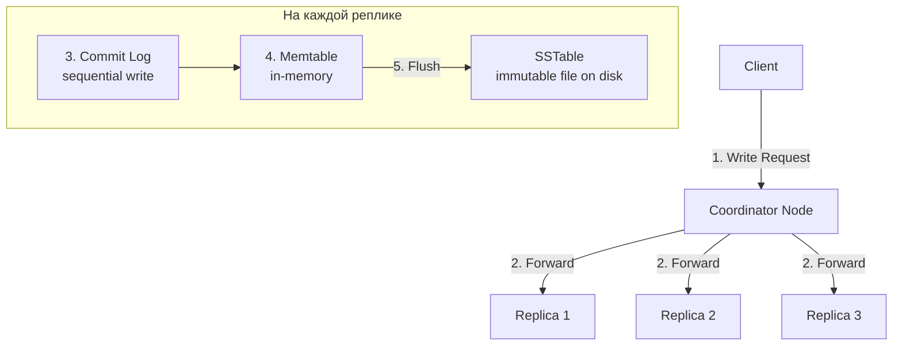

Схема пути записи:

```
   Client
     │ 1. Write Request
     ▼
   Coordinator Node
     │ 2. Forward
     ├──────────▶ Replica 1
     ├──────────▶ Replica 2
     └──────────▶ Replica 3

   На каждой реплике:
     3. Commit Log        4. Memtable          SSTable
     (sequential write) ──▶ (in-memory) ──────▶ (immutable file
                            5. flush              on disk)
```

**Шаги записи:**

1. Координатор определяет набор реплик по ключу партиции и отправляет им мутацию.
2. На реплике при включённом `durable_writes` мутация добавляется в локальный commit log для восстановления после сбоя. Реплика применяет мутацию к memtable.
3. Координатор отвечает после подтверждений, достаточных для запрошенного уровня согласованности. Сброс memtable в SSTable выполняется отдельно. Его могут вызвать порог памяти или нехватка места в commit log.

Момент подтверждения на реплике зависит от `commitlog_sync`. В режиме `periodic` подтверждение может уйти до синхронизации журнала с диском. В режиме `batch` оно ждёт синхронизации. Фоновая компакция объединяет SSTable и создаёт дополнительный дисковый I/O. Конфликтующие значения согласуются по timestamp, а удаление записывается как tombstone (Q18).

## Q17. (!) Как работает путь чтения (`Read Path`)?

При чтении по ключу партиции реплика собирает данные из memtable и подходящих SSTable. Разные версии одного значения могут лежать в нескольких файлах. Реплика согласует их по timestamp с учётом маркеров удаления.

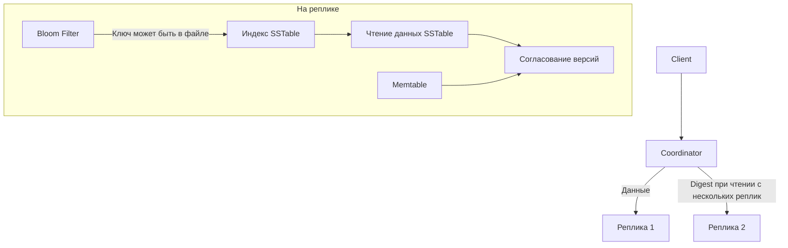

Схема чтения по ключу партиции:

```
   Клиент → Координатор ── данные ──▶ Реплика 1
                       └── digest ──▶ Реплика 2, если нужен

   На реплике:
     Bloom Filter → Индекс SSTable → Данные SSTable ──┐
                                                     ├─▶ Согласование версий
     Memtable ───────────────────────────────────────┘
```

- **На реплике.** Bloom filter отбрасывает SSTable, в которых ключа точно нет. Для остальных файлов индекс помогает найти позицию данных. При сжатии используются метаданные для поиска нужных блоков. В формате Big точку входа может дать key cache, если он включён. Формат BTI, доступный с Cassandra 5.0, использует trie-индексы. Включённый row cache может обслужить подходящее чтение партиции до обращения к SSTable.
- **На координаторе.** При чтении с нескольких реплик он может запросить полные данные у одной из них, а у других получить digest. Если дайджесты расходятся, координатор запрашивает полные данные и согласует результат. С Cassandra 4.0 настройка таблицы `read_repair = 'BLOCKING'` включает исправление реплик в ходе такого чтения. При `NONE` координатор согласует ответ без записи исправлений.
- **Стоимость чтения.** Чем больше SSTable содержат нужную партицию, тем больше файлов может потребоваться прочитать. `bloom_filter_fp_chance` задаёт вероятность ложного срабатывания и влияет на расход памяти под фильтры.

## Q18. Что такое `Tombstone` и как они влияют на производительность?

**Tombstone** — маркер удаления с timestamp. При чтении он подавляет более старые данные в своей области действия. Маркер может относиться к значению, строке, диапазону строк или целой партиции. Данные с истёкшим TTL также учитываются как удалённые.

```cql
-- Таблица из Q9. Удаление одной строки по полному первичному ключу.
DELETE FROM orders_by_user
WHERE user_id = 550e8400-e29b-41d4-a716-446655440000
  AND order_date = '2026-11-21T10:00:00Z'
  AND order_id = 550e8400-e29b-41d4-a716-446655440001;

-- TTL для значения total той же строки.
UPDATE orders_by_user USING TTL 3600 SET total = 42.00
WHERE user_id = 550e8400-e29b-41d4-a716-446655440000
  AND order_date = '2026-11-21T10:00:00Z'
  AND order_id = 550e8400-e29b-41d4-a716-446655440002;
```

**Когда маркер исчезает:**

1. Удаление проходит обычный путь записи. Недоступная реплика может пропустить обновление.
2. По истечении `gc_grace_seconds` (по умолчанию 10 дней) маркер становится кандидатом на очистку. Компакция может убрать его, когда учтены более старые данные, которые он подавляет.
3. Если реплика пропустила удаление и сохранила старую копию, после очистки маркера эти данные могут появиться снова. Интервал repair и допустимый простой реплик нужно учитывать при выборе `gc_grace_seconds`.

Чтение диапазона с большим количеством маркеров тратит ресурсы на обработку удалённых данных. Если на реплике во время сканирования превышен `tombstone_failure_threshold` (по умолчанию 100 000), чтение может завершиться ошибкой. TTL упрощает управление сроком хранения, но истёкшие данные тоже могут увеличить стоимость чтения. Для данных с TTL подбирайте границы партиций и стратегию компакции с учётом того, как данные записываются и истекают.

## Q19. Как работает механизм сжатия данных (`Compression`)?

Cassandra сжимает данные SSTable блоками. При чтении она находит и распаковывает блоки, в которые попал нужный диапазон. Больший блок может улучшить степень сжатия, но при точечных запросах увеличивает объём чтения и распаковки.

```cql
CREATE TABLE logs (
    event_id UUID PRIMARY KEY,
    message TEXT
) WITH compression = {
    'class': 'LZ4Compressor',
    'chunk_length_in_kb': 16
};
```

В Apache Cassandra 5.0 по умолчанию используются `LZ4Compressor` и блоки по 16 КиБ. `LZ4Compressor` и `SnappyCompressor` рассчитаны на быстрое сжатие. `DeflateCompressor` и `ZstdCompressor` могут дать более плотное сжатие за счёт CPU. Отключить сжатие можно через `compression = {'enabled': 'false'}`.

После изменения настройки существующие SSTable сохраняют прежний формат до перезаписи. Для `Zstd`, `Deflate` и режима LZ4HC Cassandra 5.0 обычно использует быстрый LZ4 при сбросе memtable и применяет выбранный формат при компакции.

## Q20. (!) Что такое `Replication` и какие стратегии существуют?

Репликация хранит копии каждой партиции на нескольких узлах. Фактор репликации (`RF`) задаётся для keyspace. Стратегия по токену партиции выбирает узлы для её копий. Доступность операции зависит ещё и от уровня согласованности (Q21).

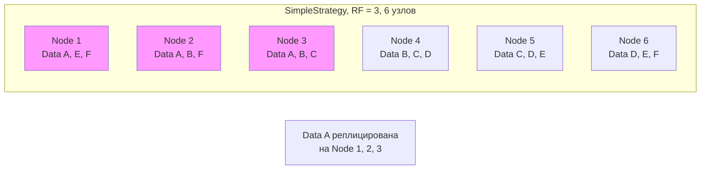

Раскладка реплик по кольцу (SimpleStrategy, RF = 3, 6 узлов):

```
   По одному токену на узел. Каждый диапазон хранится на трёх узлах.

   ┌────────────┐  ┌────────────┐  ┌────────────┐
   │ Node 1     │  │ Node 2     │  │ Node 3     │
   │ Data A,E,F │  │ Data A,B,F │  │ Data A,B,C │
   └────────────┘  └────────────┘  └────────────┘
   ┌────────────┐  ┌────────────┐  ┌────────────┐
   │ Node 4     │  │ Node 5     │  │ Node 6     │
   │ Data B,C,D │  │ Data C,D,E │  │ Data D,E,F │
   └────────────┘  └────────────┘  └────────────┘

   Data A реплицирована на Node 1, 2, 3
```

**Стратегии репликации:**

| Стратегия | Описание | Использование |
|-----------|----------|---------------|
| `SimpleStrategy` | Выбирает разные узлы по порядку токенов без учёта стоек | Только для одного ДЦ, разработки |
| `NetworkTopologyStrategy` | RF задаётся по дата-центрам. По возможности реплики размещаются в разных стойках | Production, включая один ДЦ |

```cql
-- SimpleStrategy (НЕ для production)
CREATE KEYSPACE dev_keyspace WITH replication = {
  'class': 'SimpleStrategy',
  'replication_factor': 3
};

-- Используйте имена дата-центров кластера и достаточное число узлов.
CREATE KEYSPACE prod_keyspace WITH replication = {
  'class': 'NetworkTopologyStrategy',
  'dc-moscow': 3,
  'dc-spb': 2
};
```

Например, при RF = 3 в одном ДЦ `LOCAL_QUORUM` требует двух ответов. Потерю одной из трёх реплик для данной партиции можно пережить, если две остальные доступны и отвечают вовремя. При нескольких ДЦ `QUORUM` считает большинство от общего RF, а `LOCAL_QUORUM` — от RF в ДЦ координатора.

## Q21. (!) Какие уровни консистентности (`Consistency Levels`) существуют?

`Consistency Level` (CL) определяет, какие ответы координатору нужны для успеха конкретного чтения или записи. Например, обычная запись направляется репликам партиции независимо от CL. Выбранный CL меняет то, каких подтверждений координатор ждёт. Чем больше ответов нужно, тем сильнее операция зависит от доступности и задержки реплик. Подробнее в [вопросах по CAP-теореме](../architecture/cap-theorem-interview.md).

| CL | Запись | Чтение |
|----|--------|--------|
| `ANY` | Подтверждение одной реплики или сохранённый hint | — |
| `ONE`, `TWO`, `THREE` | 1, 2 или 3 реплики | 1, 2 или 3 реплики |
| `LOCAL_ONE` | Одна реплика в ДЦ координатора | Одна реплика в ДЦ координатора |
| `QUORUM` | Большинство от общего RF | Большинство от общего RF |
| `LOCAL_QUORUM` | Большинство от RF в ДЦ координатора | Большинство от RF в ДЦ координатора |
| `EACH_QUORUM` | Большинство в каждом ДЦ | Большинство в каждом ДЦ |
| `ALL` | Все реплики | Все реплики |

Таблица описывает обычные операции в Apache Cassandra 5.0 с `NetworkTopologyStrategy`. Уровни `SERIAL` и `LOCAL_SERIAL` относятся к согласованию через Paxos (см. вопрос о LWT). Успешная запись с `ANY` может пока существовать только в виде hint и стать видимой после его доставки. При чтении и записи с `LOCAL_QUORUM` в **одном и том же ДЦ** кворумы пересекаются. Для операций в разных ДЦ такого пересечения из локальных уровней не следует (Q22).

## Q22. (!) Что означает формула `R + W > N`?

Условие `R + W > N` гарантирует пересечение множеств реплик, когда чтение и запись выбирают реплики из одного и того же набора.

- **R** — число реплик, ответы которых учитывает чтение.
- **W** — число реплик, подтвердивших запись.
- **N** — размер общего набора реплик для партиции.

```
RF = 3. Реплики A, B, C.
Запись QUORUM подтвердили A и B (W = 2).
Чтение QUORUM получило ответы B и C (R = 2).
2 + 2 > 3. Реплика B участвовала в обеих операциях.
```

| Запись и чтение при RF = 3 | Сумма | Пересечение гарантировано |
|---|---|---|
| `QUORUM` и `QUORUM` | 2 + 2 = 4 | Да |
| `ALL` и `ONE` | 3 + 1 = 4 | Да |
| `ONE` и `ONE` | 1 + 1 = 2 | Нет |
| `ONE` и `ALL` | 1 + 3 = 4 | Да |

При стабильном наборе реплик чтение после успешной записи получает эту версию или версию, которая побеждает её при сравнении timestamp. Порядок завершения запросов может отличаться от порядка timestamp, поэтому пересечение само по себе не даёт линейризуемости при конкурирующих записях. Для `LOCAL_QUORUM` с обеих сторон `N` — локальный RF, если обе операции проходят через координаторов одного ДЦ. Hint при `ANY` сам по себе не означает запись на реплику.

## Q23. Что такое `Hinted Handoff`?

**Hinted Handoff** помогает реплике догнать изменения после короткого простоя. Координатор сохраняет пропущенную мутацию как hint на своём диске и пытается доставить её, когда целевая реплика снова доступна.

1. Координатор определяет, что реплика недоступна, или не получает её подтверждение вовремя.
2. Если сохранение hints разрешено и окно простоя ещё открыто, координатор сохраняет hint для этой реплики.
3. Когда реплика возвращается, координатор пытается применить накопленные hints. Если часть мутаций не была сохранена или доставлена, расхождение может остаться до repair.

В Cassandra 5.0 `max_hint_window` по умолчанию равен трём часам. Он ограничивает период **создания новых hints** для недоступного узла. Уже сохранённые hints подчиняются отдельным правилам пригодности при доставке.

```yaml
# cassandra.yaml, Apache Cassandra 5.0
hinted_handoff_enabled: true
max_hint_window: 3h
```

При `ANY` сохранённый hint может обеспечить успешный ответ ещё до записи на любую реплику. Если единственная копия мутации находилась в hint и потерялась до доставки, запись пропадёт. Для планового восстановления согласованности нужен anti-entropy repair (Q25).

## Q24. Что такое `Read Repair`?

**Read Repair** исправляет расхождение реплик, обнаруженное при чтении. Если координатор получил разные версии или digest не совпали, он запрашивает необходимые полные данные и согласует ответ. Обычное чтение с `ONE` или `LOCAL_ONE` обычно получает одну версию, поэтому ему не с чем её сверить.

Начиная с Cassandra 4.0, поведение задаёт параметр таблицы `read_repair`.

- **`BLOCKING`** (по умолчанию). При обнаруженном расхождении координатор отправляет исправления и ждёт подтверждений, достаточных для уровня чтения. Это обеспечивает монотонность последовательных кворумных чтений. Исправляется только область запроса, поэтому чтение одной строки после частично применённой записи нескольких строк может распространить только эту строку.
- **`NONE`.** Координатор согласует полученные версии и отвечает клиенту без записи исправлений. Частичное исправление по узкому запросу исключается, но последовательные кворумные чтения могут увидеть разные версии после частично применённой записи.

Вероятностный фоновый read repair с параметрами `read_repair_chance` и `dclocal_read_repair_chance` удалён в Cassandra 4.0. Расхождения в данных, которые запрос не затронул, исправляет отдельный anti-entropy repair (Q25).

## Q25. (!) Что такое `Anti-Entropy Repair` и зачем он нужен?

**Anti-entropy repair** сверяет данные реплик в выбранных диапазонах токенов. Реплики строят деревья Меркла, чтобы найти расходящиеся участки, а затем передают данные для их синхронизации. Так обнаруживаются в том числе пропущенные изменения, до которых не дошли hints или read repair.

- **Full repair** повторно сверяет все данные в выбранной области, включая ранее помеченные как исправленные.
- **Incremental repair** сверяет данные, ещё не помеченные как исправленные. Это режим по умолчанию для `nodetool repair`. Периодический full repair позволяет повторно проверить уже исправленные данные.
- **Ограничение области.** Один запуск `nodetool repair` охватывает диапазоны целевого узла. Чтобы покрыть кластер без повторной сверки диапазонов, запускают `-pr` на каждом узле во всех ДЦ. Также можно указать keyspace, таблицы или границы диапазона токенов.

```bash
# Incremental repair для keyspace на целевом узле
nodetool repair ecommerce

# Full repair для keyspace на целевом узле
nodetool repair --full ecommerce

# Incremental repair для одной таблицы
nodetool repair ecommerce orders
```

Планируйте успешное завершение цикла repair для всех диапазонов с запасом до `gc_grace_seconds`. Иначе после очистки tombstone отставшая реплика может вернуть удалённые данные (Q18). Сверка и передача данных нагружают диски и сеть. Встроенный Auto Repair доступен с Cassandra 5.0.8 и требует явного включения.

## Q26. (!) Какие стратегии компакции (`Compaction`) существуют?

**Compaction** объединяет данные из нескольких неизменяемых SSTable и записывает один или несколько новых файлов. При слиянии движок отбрасывает перекрытые версии, а tombstone очищает, когда это безопасно (Q18). Компакция уменьшает объём работы при чтении ценой дополнительной записи и временного места для выходных файлов.

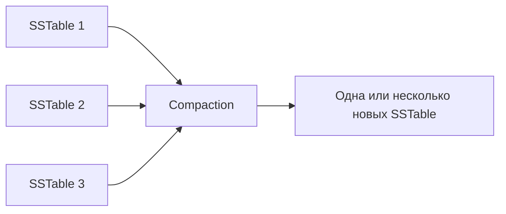

```
   SSTable 1 ──┐
   SSTable 2 ──┼──▶ Compaction ──▶ Одна или несколько SSTable
   SSTable 3 ──┘
```

| Стратегия | Когда подходит | Как работает |
|-----------|----------------|--------------|
| `STCS` (SizeTiered) | Нагрузка с большим числом записей | Сливает файлы близкого размера. Диапазоны файлов могут перекрываться, увеличивая число SSTable для чтения. |
| `LCS` (Leveled) | Частые точечные чтения | Размещает файлы по уровням. Выше L0 диапазоны в пределах уровня не перекрываются. Это ограничивает число файлов для точечного чтения, но повышает объём перезаписи. |
| `TWCS` (TimeWindow) | Временные ряды с TTL и редкими обновлениями старых данных | Группирует SSTable по окнам. Если данные в файле истекли и его можно удалить безопасно, файл удаляется целиком. Смешивание старых и свежих записей может задержать очистку. |
| `UCS` (Unified, с Cassandra 5.0) | Широкий набор нагрузок | Настройки определяют компромисс между числом файлов для чтения и объёмом перезаписи. Компакция может выполняться параллельно по диапазонам. |

```cql
CREATE TABLE sensor_data (
    sensor_id UUID,
    day DATE,
    measured_at TIMESTAMP,
    reading DOUBLE,
    PRIMARY KEY ((sensor_id, day), measured_at)
) WITH compaction = {
  'class': 'TimeWindowCompactionStrategy',
  'compaction_window_unit': 'DAYS',
  'compaction_window_size': '1'
};

-- Изменение стратегии для существующей таблицы orders.
ALTER TABLE orders WITH compaction = {
  'class': 'LeveledCompactionStrategy',
  'sstable_size_in_mb': '160'
};
```

## Q27. Как управлять жизненным циклом данных через `TTL`?

**TTL** (`Time To Live`) задаёт срок жизни записанных значений в секундах. После истечения значения перестают возвращаться при чтении. Освобождение места зависит от очистки при компакции. Предыдущая версия значения после истечения TTL не возвращается.

```cql
CREATE TABLE sessions (
    session_id UUID PRIMARY KEY,
    data TEXT
) WITH default_time_to_live = 86400;

-- Явный TTL записанного значения: один час.
INSERT INTO sessions (session_id, data)
VALUES (550e8400-e29b-41d4-a716-446655440000, 'payload')
USING TTL 3600;

-- Перезаписываем data и задаём ему новый TTL.
UPDATE sessions USING TTL 7200
SET data = 'updated'
WHERE session_id = 550e8400-e29b-41d4-a716-446655440000;

SELECT TTL(data) FROM sessions
WHERE session_id = 550e8400-e29b-41d4-a716-446655440000;
```

- `default_time_to_live` задаёт TTL для новых записей без явного `USING TTL`. `USING TTL 0` записывает указанные значения без срока истечения, даже если у таблицы задан TTL по умолчанию.
- Обновление задаёт TTL заново для перезаписанных значений. Срок жизни остальных значений в строке сохраняется. Столбцы первичного ключа собственного TTL не имеют.
- `TTL(data)` возвращает оставшиеся секунды для значения или `null`, если срок истечения не задан. Истёкшие данные могут увеличивать стоимость чтения (Q18). Для временных рядов с TTL и преимущественно последовательными записями можно рассмотреть `TWCS` (Q26).

## Q28. (!) Что такое `Lightweight Transactions` (`LWT`)?

**LWT** (Lightweight Transactions) — условная запись с семантикой «прочитай-проверь-запиши» как единой атомарной операции (`compare-and-set`). Чтобы несколько узлов договорились о результате при конкурентных попытках, под капотом работает консенсус `Paxos`; это даёт линеаризуемость, но **только в пределах одной партиции** и ценой нескольких сетевых раундов.

```cql
-- users_by_email: email — ключ партиции. Один адрес можно зарезервировать один раз.
INSERT INTO users_by_email (email, user_id, name)
VALUES ('user@example.com', uuid(), 'Иван')
IF NOT EXISTS;

-- accounts: account_id — первичный ключ. Здесь используется маркер параметра.
UPDATE accounts
SET balance = 900
WHERE account_id = ?
IF balance = 1000;
```

**Результат операции LWT:**
```
 [applied] | balance
-----------+---------
     False |     500   -- условие не выполнено, текущее значение = 500
```

**Упрощённая схема Paxos для RF = 3:**

Показан успешный обмен без конкурирующих предложений. Проверка условия выполняется перед предложением мутации. Число сообщений зависит от версии протокола и повторов при конкуренции.

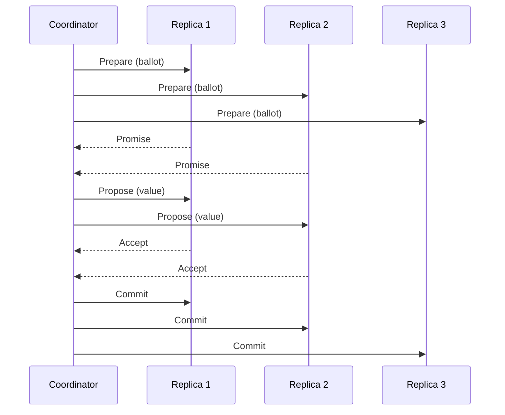

Тот же обмен в текстовом виде:

```
 Coordinator      Replica 1     Replica 2     Replica 3
     │                │             │             │
     │ Prepare(ballot)│             │             │
     ├───────────────▶│             │             │
     ├──────────────────────────────▶             │
     ├────────────────────────────────────────────▶
     │       Promise  │             │             │
     │◀───────────────┤             │             │
     │◀─────────────────────────────┤             │
     │ Propose(value) │             │             │
     ├───────────────▶│             │             │
     ├──────────────────────────────▶             │
     │        Accept  │             │             │
     │◀───────────────┤             │             │
     │◀─────────────────────────────┤             │
     │ Commit         │             │             │
     ├───────────────▶│             │             │
     ├──────────────────────────────▶             │
     ├────────────────────────────────────────────▶
     │                │             │             │
```

**Границы гарантии:**

- `SERIAL` и `LOCAL_SERIAL` задают область консенсуса. При `LOCAL_SERIAL` она ограничена ДЦ координатора. Обычный CL определяет, каких подтверждений ждать при записи согласованного результата.
- Для одного инварианта все конкурирующие изменения должны проходить через LWT. Обычная запись обходит Paxos. Для чтения с той же гарантией используется серийный уровень согласованности.
- Консенсус добавляет сетевые обмены, а конкуренция за одну партицию может вызывать повторы. Выигрыш от атомарной проверки оценивают вместе с задержкой на своей нагрузке.

## Q29. Что такое `Batch` и какие ограничения у `Batch`?

**Batch** группирует DML-команды в одном запросе. Поведение зависит от типа пакета и от того, сколько партиций он затрагивает.

| Тип | Что гарантирует |
|-----|-----------------|
| `LOGGED` (по умолчанию) | Batchlog позволяет завершить применение пакета после сбоя. Читатели могут увидеть изменения в одной партиции раньше, чем в другой. |
| `UNLOGGED` | Пакет в одной партиции применяется атомарно и изолированно. Для нескольких партиций сбой может оставить часть мутаций неприменённой. |
| `COUNTER` | Группирует обновления счётчиков. Повтор пакета может повторно применить приращения. |

```cql
-- user_events: ключ партиции user_id, кластеризующий столбец event_time типа TIMEUUID.
BEGIN UNLOGGED BATCH
  INSERT INTO user_events (user_id, event_time, type)
  VALUES ('user1', now(), 'login');
  INSERT INTO user_events (user_id, event_time, type)
  VALUES ('user1', now(), 'page_view');
APPLY BATCH;
```

**Практические ограничения:**

- Для пакетов по нескольким партициям в Cassandra 5.0 предупреждение по умолчанию начинается при превышении 5 КиБ, а отклонение — при превышении 50 КиБ. Пороги настраиваются через `batch_size_warn_threshold` и `batch_size_fail_threshold`.
- Пакет с batchlog добавляет запись журнала и рассылку мутаций по затронутым репликам. При таймауте часть мутаций уже могла примениться, а остальные могут быть доставлены позже.
- Для загрузки независимых строк подходят одиночные асинхронные записи с ограничением числа запросов в полёте. Batch полезен, когда совместное применение мутаций требуется приложению.

## Q30. Как в `Cassandra` реализовать счётчики (`Counters`)?

**Counter** — тип столбца для прибавления или вычитания целого числа. Сервер применяет приращения, поэтому клиенты могут увеличивать счётчик конкурентно без предварительного чтения и записи вычисленной суммы.

```cql
CREATE TABLE page_views (
    page_url TEXT,
    date     DATE,
    views    COUNTER,
    PRIMARY KEY ((page_url), date)
);

-- Инкремент
UPDATE page_views SET views = views + 1
WHERE page_url = '/home' AND date = '2026-04-12';

-- Декремент
UPDATE page_views SET views = views - 5
WHERE page_url = '/home' AND date = '2026-04-12';
```

**Ограничения counter-таблиц:**
- В таблице допустимы **только counter-колонки и колонки ключа** — смешивать со обычными нельзя.
- Нет `INSERT` — только `UPDATE` с инкрементом/декрементом (счётчик стартует с нуля).
- Обновление счётчика не поддерживает `USING TTL` и `USING TIMESTAMP`.
- После таймаута сервер уже мог учесть дельту. Слепой повтор `views = views + 1` может учесть одно событие дважды.
- Счётчик подходит для метрик, где такой риск можно принять или обработать. Для финансового учёта, где нужна однократная обработка операции, храните идентификаторы операций и обеспечьте их учёт в транзакционной модели.

## Q31. (!) Как подключить `Spring Data Cassandra` к проекту?

**Spring Data Cassandra** — модуль Spring Data для работы с `Cassandra` через репозитории и `CassandraTemplate`. Подробнее о Spring Data — в [вопросах по Spring Data JPA](../frameworks/spring/spring-data-jpa-interview.md) (общие концепции репозиториев).

**Зависимость (Gradle):**

```groovy
implementation 'org.springframework.boot:spring-boot-starter-data-cassandra'
```

**Конфигурация `application.yml`:**

```yaml
spring:
  cassandra:
    keyspace-name: ecommerce
    contact-points: cassandra-node1,cassandra-node2,cassandra-node3
    port: 9042
    local-datacenter: dc-moscow
    schema-action: create_if_not_exists  # none для production
    request:
      timeout: 5s
      consistency: LOCAL_QUORUM
```

**Конфигурация через Java (для тонкой настройки):**

```java
@Configuration
@EnableCassandraRepositories
public class CassandraConfig extends AbstractCassandraConfiguration {

    @Override
    protected String getKeyspaceName() {
        return "ecommerce";
    }

    @Override
    protected String getContactPoints() {
        return "cassandra-node1";
    }

    @Override
    public SchemaAction getSchemaAction() {
        return SchemaAction.CREATE_IF_NOT_EXISTS;
    }
}
```

## Q32. Как определить `Entity` и `Repository` в `Spring Data Cassandra`?

**Entity (модель):**

```java
@Table("orders")
public class Order {

    @PrimaryKeyColumn(name = "user_id", ordinal = 0,
                       type = PrimaryKeyType.PARTITIONED)
    private UUID userId;

    @PrimaryKeyColumn(name = "order_date", ordinal = 1,
                       type = PrimaryKeyType.CLUSTERED,
                       ordering = Ordering.DESCENDING)
    private Instant orderDate;

    @PrimaryKeyColumn(name = "order_id", ordinal = 2,
                       type = PrimaryKeyType.CLUSTERED)
    private UUID orderId;

    @Column("total")
    private BigDecimal total;

    @Column("status")
    private String status;

    // getters, setters
}
```

**Repository:**

```java
public interface OrderRepository
        extends CassandraRepository<Order, UUID> {

    // Spring Data автоматически генерирует CQL
    List<Order> findByUserId(UUID userId);

    @Query("SELECT * FROM orders WHERE user_id = ?0 AND order_date > ?1")
    List<Order> findRecentOrders(UUID userId, Instant since);
}
```

**CassandraTemplate (для сложных запросов):**

```java
@Service
@RequiredArgsConstructor
public class OrderService {

    private final CassandraTemplate cassandraTemplate;

    public List<Order> findByUser(UUID userId) {
        return cassandraTemplate.select(
            Query.query(Criteria.where("user_id").is(userId))
                 .limit(20),
            Order.class
        );
    }

    public void saveWithTtl(Order order, int ttlSeconds) {
        InsertOptions options = InsertOptions.builder()
            .ttl(Duration.ofSeconds(ttlSeconds))
            .build();
        cassandraTemplate.insert(order, options);
    }
}
```

## Q33. Как `Cassandra Java Driver` работает с кластером?

**DataStax Java Driver** (v4.x) — основной драйвер для взаимодействия с `Cassandra` из Java.

**Ключевые компоненты:**

| Компонент | Описание |
|-----------|----------|
| `CqlSession` | Основной объект, пул соединений, **singleton** на приложение |
| `PreparedStatement` | Подготовленный запрос, кэшируется на узлах |
| `Load Balancing Policy` | Выбор координатора (`DCAwareRoundRobinPolicy`) |
| `Retry Policy` | Стратегия повтора при сбоях |
| `Reconnection Policy` | Стратегия переподключения |

**Пример использования:**

```java
// Создание сессии (один раз на приложение)
CqlSession session = CqlSession.builder()
    .addContactPoint(new InetSocketAddress("cassandra-host", 9042))
    .withLocalDatacenter("dc-moscow")
    .withKeyspace("ecommerce")
    .build();

// Prepared Statement (подготовить один раз, использовать много)
PreparedStatement ps = session.prepare(
    "INSERT INTO orders (user_id, order_date, order_id, total) " +
    "VALUES (?, ?, ?, ?)"
);

// Bind и выполнение
BoundStatement bs = ps.bind(userId, Instant.now(), orderId, total)
    .setConsistencyLevel(ConsistencyLevel.LOCAL_QUORUM);
session.execute(bs);

// Асинхронное выполнение
CompletionStage<AsyncResultSet> future = session.executeAsync(bs);
```

**Настройка в `application.conf`:**

```hocon
datastax-java-driver {
  basic {
    contact-points = ["cassandra-node1:9042", "cassandra-node2:9042"]
    load-balancing-policy.local-datacenter = "dc-moscow"
    request.timeout = 5 seconds
    request.consistency = LOCAL_QUORUM
  }
  advanced {
    connection.pool.local.size = 3
    retry-policy.class = DefaultRetryPolicy
    reconnection-policy {
      class = ExponentialReconnectionPolicy
      base-delay = 1 second
      max-delay = 60 seconds
    }
  }
}
```

## Q34. Как выполнять миграции схемы в `Cassandra`?

У `Cassandra` нет встроенного механизма версионирования схемы вроде `Flyway`, поэтому миграции выстраивают вручную: храните номер применённой версии в служебной таблице и накатывайте только новые скрипты. Подходы:

**1. Скрипты CQL + таблица версий:**

```cql
-- Таблица для отслеживания миграций
CREATE TABLE IF NOT EXISTS schema_migrations (
    version INT PRIMARY KEY,
    description TEXT,
    applied_at TIMESTAMP
);

-- V001__create_orders.cql
CREATE TABLE IF NOT EXISTS orders (
    user_id UUID,
    order_date TIMESTAMP,
    order_id UUID,
    total DECIMAL,
    PRIMARY KEY ((user_id), order_date, order_id)
);

-- V002__add_status_column.cql
ALTER TABLE orders ADD status TEXT;
```

**2. Инструменты:**
- **cassandra-migration** (библиотека для Java)
- **cqlmigrate** (Sky UK)
- Собственный скрипт при деплое, читающий `schema_migrations` и применяющий новые

**Важно:**
- Миграции должны быть **идемпотентными** (`CREATE TABLE IF NOT EXISTS`, `ALTER TABLE ... ADD ...`)
- Изменение `partition key` невозможно без создания новой таблицы + перенос данных
- Тестировать миграции на копии кластера перед production

## Q35. Как обеспечить безопасность кластера `Cassandra`?

Безопасность кластера строится по трём осям: кто подключается (аутентификация), что ему разрешено (авторизация) и защита трафика (шифрование). По умолчанию Cassandra пускает всех — для production это нужно явно включить.

**Аутентификация и авторизация:**

```yaml
# cassandra.yaml
authenticator: PasswordAuthenticator
authorizer: CassandraAuthorizer
```

```cql
-- Создание пользователя
CREATE ROLE app_user WITH PASSWORD = 'strong_password'
    AND LOGIN = true;

-- Назначение прав
GRANT SELECT ON KEYSPACE ecommerce TO app_user;
GRANT MODIFY ON TABLE ecommerce.orders TO app_user;
```

**Шифрование:**

```yaml
# cassandra.yaml — шифрование между узлами
server_encryption_options:
  internode_encryption: all
  keystore: /path/to/keystore.jks
  keystore_password: changeit

# Шифрование клиент-узел
client_encryption_options:
  enabled: true
  keystore: /path/to/keystore.jks
  keystore_password: changeit
```

**Рекомендации:**
- Отдельные учётные записи для каждого приложения (least privilege)
- Регулярная ротация паролей
- `TLS` для межузлового и клиентского трафика
- Аудит доступа (в enterprise-версиях)

## Q36. Какие метрики мониторить в production?

**Ключевые метрики `Cassandra` (доступны через JMX, `Prometheus` exporter):**

| Категория | Метрика | Что смотреть |
|-----------|---------|-------------|
| Латентность | `ReadLatency`, `WriteLatency` | p99 < целевого SLA |
| Throughput | `ReadThroughput`, `WriteThroughput` | Тренды роста |
| Ошибки | `Timeouts`, `Unavailables`, `Failures` | Всплески |
| Compaction | `PendingCompactions` | Не должно расти постоянно |
| Memory | `HeapUsage`, `OffHeapUsage` | GC pressure |
| Disk | `LiveDiskSpaceUsed`, `TotalDiskSpaceUsed` | Планирование ёмкости |
| Thread Pools | `PendingTasks` по пулам | Blocked/Dropped — проблема |
| SSTable | `SSTableCount` per table | Рост = нужна компакция |
| Tombstones | `TombstoneScannedHistogram` | Много = проблема моделирования |

**Инструменты:**
- `nodetool status/tablestats/tpstats` — CLI
- `Prometheus` + `Grafana` (через JMX exporter или Metrics reporter)
- `DataStax OpsCenter` (коммерческий)

## Q37. Как масштабировать кластер `Cassandra`?

Cassandra масштабируется в первую очередь горизонтально — добавлением узлов, и делает это онлайн, без остановки кластера. Новый узел через consistent hashing и vnodes автоматически забирает свою долю данных.

**Горизонтальное масштабирование (добавление узлов):**

1. Установить `Cassandra` на новый сервер с той же конфигурацией
2. Указать seed-ноды кластера в `cassandra.yaml`
3. Запустить — узел автоматически присоединяется (bootstrap)
4. `nodetool status` — проверить статус
5. `nodetool cleanup` на существующих узлах (удалить данные, перемещённые на новый узел)

```bash
# Проверка статуса кластера
nodetool status

# Декомиссия узла (корректное удаление)
nodetool decommission

# Перемещение данных после изменения топологии
nodetool cleanup
```

**Масштабирование без vnodes:** ручной расчёт токенов и `nodetool move`.
**С vnodes (рекомендуется):** автоматическая ребалансировка.

**Вертикальное масштабирование:**
- Увеличение RAM (больше данных в page cache)
- SSD вместо HDD (ускорение чтения)
- Больше CPU (компакция, сжатие)

## Q38. `Cassandra` vs другие `NoSQL` базы данных

| Критерий | `Cassandra` | `MongoDB` | `Redis` | `HBase` |
|----------|-------------|-----------|---------|---------|
| Модель данных | Wide-column | Document | Key-Value | Wide-column |
| Архитектура | Masterless (P2P) | Replica Set (Primary-Secondary) | Master-Replica | Master (HMaster) |
| CAP | AP | CP | CP/AP | CP |
| Запись | Очень быстрая (LSM) | Быстрая | Очень быстрая (in-memory) | Быстрая (LSM) |
| Чтение | Быстрая по ключу | Гибкие запросы | Очень быстрая | Быстрая по ключу |
| Консистентность | Tunable | Strong (по умолчанию) | Eventual (replicas) | Strong |
| Multi-DC | Нативная | Ограниченная | Ограниченная | Через HDFS |
| Аналитика | Через Spark | Aggregation Pipeline | Нет | Через MapReduce/Spark |
| Сценарий | IoT, логи, time-series | CRUD, каталоги | Кэш, сессии | Большие таблицы на HDFS |

Подробнее о [MongoDB](mongodb-interview.md) и [Redis](redis-interview.md) — в соответствующих разделах.

## Q39. Какие основные анти-паттерны при работе с `Cassandra`?

На собеседовании важно продемонстрировать понимание ограничений Cassandra и умение их избегать.

**1. `ALLOW FILTERING` — антипаттерн №1**

```cql
-- ПЛОХО: полное сканирование всех партиций кластера
SELECT * FROM orders WHERE status = 'PENDING' ALLOW FILTERING;

-- ХОРОШО: создать отдельную таблицу под этот запрос
CREATE TABLE orders_by_status (
    status     TEXT,
    created_at TIMESTAMP,
    order_id   UUID,
    PRIMARY KEY ((status), created_at, order_id)
) WITH CLUSTERING ORDER BY (created_at DESC);
```

**2. Неограниченные широкие партиции (Unbounded Wide Partitions)**

```cql
-- ПЛОХО: все события пользователя за всё время — партиция растёт вечно
CREATE TABLE user_events (
    user_id  UUID,
    event_ts TIMESTAMP,
    data     TEXT,
    PRIMARY KEY ((user_id), event_ts)
);

-- ХОРОШО: bucketing по месяцу
CREATE TABLE user_events (
    user_id  UUID,
    month    TEXT,      -- '2026-04'
    event_ts TIMESTAMP,
    data     TEXT,
    PRIMARY KEY ((user_id, month), event_ts)
) WITH CLUSTERING ORDER BY (event_ts DESC);
```

**3. Использование Cassandra как реляционной БД**
- Нормализация данных → JOIN не существует → неэффективные multiple roundtrips
- Решение: денормализация, дублирование данных, моделирование под запросы

**4. Большое количество `Tombstone`**
- Частые DELETE + низкий `gc_grace_seconds` → накопление tombstone → degraded reads
- Решение: TTL вместо DELETE там, где применимо; регулярный repair; мониторинг tombstone

**5. Hot Spots из-за неудачного Partition Key**

```cql
-- ПЛОХО: status='ACTIVE' — 95% данных, один узел перегружен
PRIMARY KEY ((status), user_id)

-- ХОРОШО: добавить bucket для распределения
PRIMARY KEY ((status, shard), user_id)
-- shard = user_id % 10 (вычисляется на стороне приложения)
```

**6. Синхронный `LWT` везде**
- `IF NOT EXISTS` / `IF` условия — Paxos-консенсус → в 5-10 раз медленнее обычной записи
- Использовать только там, где действительно нужна compare-and-set семантика

**7. Unbounded IN clause**

```cql
-- ПЛОХО: IN с сотнями значений — запросы ко многим партициям
SELECT * FROM products WHERE category_id IN (1, 2, 3, ..., 500);

-- ХОРОШО: параллельные отдельные запросы через executeAsync
```

## Q40. (!) Как правильно обрабатывать коллекции в `CQL`?

`Cassandra` поддерживает три типа коллекций в качестве типа колонки — `LIST`, `SET`, `MAP` — плюс `FROZEN`-обёртку и пользовательские типы (`UDT`). Коллекции удобны для небольших наборов значений «при строке», но не заменяют отдельную таблицу: они читаются целиком и плохо переносят большой размер.

**Основные типы коллекций:**

```cql
CREATE TABLE user_profile (
    user_id  UUID PRIMARY KEY,
    emails   SET<TEXT>,          -- уникальные значения, неупорядоченные
    tags     LIST<TEXT>,         -- упорядоченные, дубли допустимы
    metadata MAP<TEXT, TEXT>,    -- ключ-значение
    address  FROZEN<address_type> -- UDT как атомарный тип
);

-- Пользовательский тип
CREATE TYPE address_type (
    street TEXT,
    city   TEXT,
    zip    TEXT
);
```

**Операции с коллекциями:**

```cql
-- SET: добавление/удаление элементов
UPDATE user_profile SET emails = emails + {'new@example.com'} WHERE user_id = ?;
UPDATE user_profile SET emails = emails - {'old@example.com'} WHERE user_id = ?;

-- LIST: append/prepend/удаление по индексу
UPDATE user_profile SET tags = tags + ['kotlin'] WHERE user_id = ?;
UPDATE user_profile SET tags[0] = 'java' WHERE user_id = ?;  -- по индексу

-- MAP: добавление/обновление/удаление ключей
UPDATE user_profile SET metadata['key'] = 'value' WHERE user_id = ?;
DELETE metadata['old_key'] FROM user_profile WHERE user_id = ?;
```

**Ограничения и рекомендации:**
- Коллекция **читается целиком** — достать один элемент, не подняв всю коллекцию, нельзя; поэтому большие коллекции бьют по производительности.
- Технический потолок — **65 535** элементов, но на практике держите < 100.
- `FROZEN` сериализует коллекцию как один blob: любое изменение перезаписывает её целиком (зато её можно использовать как часть ключа).
- Нужны частые точечные правки элементов большого набора — это сигнал вынести их в **отдельную таблицу** (строка = элемент).
- `SET` предпочтительнее `LIST`: у списка при частичных сбоях возможны дубли и неоднозначность операций по индексу.

**Когда использовать FROZEN:**

```cql
-- FROZEN нужен для вложенных коллекций и UDT как part of PRIMARY KEY
CREATE TABLE orders (
    order_id UUID PRIMARY KEY,
    items    LIST<FROZEN<order_item>>,  -- список UDT
    tags     FROZEN<SET<TEXT>>          -- frozen set как часть PK или для компакности
);
```

## Q41. Как реализовать `pagination` в `Cassandra`?

В `Cassandra` нет `OFFSET`, поэтому классический «пропусти N, возьми M» невозможен — и это сознательно: пропуск N строк потребовал бы их прочитать и выбросить. Вместо этого пейджинг **курсорный**: драйвер запоминает позицию (`paging state`) и продолжает с неё. Поэтому листать можно только вперёд и только последовательно.

**Автоматический пейджинг через Java Driver:**

```java
// Driver автоматически разбивает результаты на страницы
SimpleStatement stmt = SimpleStatement.newInstance(
    "SELECT * FROM events WHERE user_id = ?", userId)
    .setPageSize(100);  // размер страницы

ResultSet rs = session.execute(stmt);

// Итерация — driver запрашивает следующую страницу автоматически
for (Row row : rs) {
    processRow(row);
}
```

**Ручной пейджинг (для REST API):**

```java
// Первая страница
SimpleStatement stmt = SimpleStatement.newInstance(
    "SELECT * FROM events WHERE user_id = ?", userId)
    .setPageSize(20);

ResultSet rs = session.execute(stmt);
List<Row> page1 = rs.currentPage();

// Сохраняем paging state для следующей страницы
ByteBuffer pagingState = rs.getExecutionInfo().getPagingState();
String token = Base64.getEncoder().encodeToString(pagingState.array());

// API отдаёт: {"data": [...], "nextPageToken": "abc123=="}

// Следующая страница по токену
ByteBuffer savedState = ByteBuffer.wrap(Base64.getDecoder().decode(token));
SimpleStatement stmt2 = stmt.copy().setPagingState(savedState);
ResultSet rs2 = session.execute(stmt2);
```

**Пейджинг по clustering key (Token-based):**

```cql
-- Для time-series: используем clustering key как cursor
SELECT * FROM events WHERE user_id = ? AND event_ts < ? ORDER BY event_ts DESC LIMIT 20;
-- event_ts = значение последнего элемента предыдущей страницы
```

**Ограничения paging state:**
- `PagingState` привязан к конкретному запросу и кластеру
- Нельзя перейти сразу на страницу N (только последовательно)
- Состояние может устареть при изменении схемы или данных

## Q42. (!) Что такое `Token-aware routing` и почему он важен?

**Token-aware routing** — политика выбора координатора, при которой драйвер сам вычисляет токен партиции и шлёт запрос **сразу на узел, который её хранит**. Это убирает лишний сетевой хоп: иначе случайный координатор был бы вынужден переслать запрос «правильному» узлу и дождаться его ответа. Координатор перестаёт быть посредником и становится исполнителем.

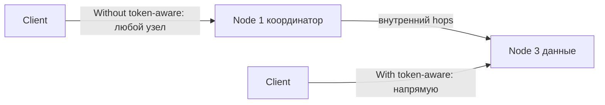

Сравнение маршрутов запроса:

```
   Without token-aware (лишний хоп):
     Client ──"любой узел"──▶ Node 1 (координатор)
                                │ внутренний hop
                                ▼
                             Node 3 (данные)

   With token-aware (напрямую):
     Client ──"напрямую"──────────────▶ Node 3 (данные)
```

**Настройка в Java Driver v4:**

```java
CqlSession session = CqlSession.builder()
    .addContactPoint(new InetSocketAddress("cassandra-host", 9042))
    .withLocalDatacenter("dc1")
    // TokenAwarePolicy включён по умолчанию в Driver v4
    // Дополнительно: DC-aware для мульти-датацентровых кластеров
    .withConfigLoader(DriverConfigLoader.fromClasspath("application.conf"))
    .build();
```

**application.conf (Typesafe Config):**

```hocon
datastax-java-driver {
  basic.load-balancing-policy {
    class = DefaultLoadBalancingPolicy
    local-datacenter = dc1
  }
  advanced.load-balancing-policy {
    # Token-awareness включена по умолчанию
    # Fallback при недоступности: другой реплика в том же DC
  }
}
```

**Почему важен:**
- Снижает задержку на 1 сетевой хоп (с ~5 мс до ~1 мс в одном датацентре)
- Уменьшает нагрузку на координирующие узлы
- При `CL=ONE` запрос обрабатывается без координации — максимальная скорость
- Требует корректного расчёта `routing key` (partition key в prepared statement)

**Пример с Prepared Statement (обязателен для token-awareness):**

```java
// Prepared statement — driver знает binding variables и вычисляет token
PreparedStatement prepared = session.prepare(
    "SELECT * FROM orders WHERE user_id = ? AND order_date > ?");

BoundStatement bound = prepared.bind(userId, fromDate);
// Driver автоматически вычисляет token(userId) и маршрутизирует к нужному узлу
ResultSet rs = session.execute(bound);
```

## Q43. Как выполнять агрегации и аналитику поверх `Cassandra`?

`Cassandra` намеренно ограничивает аналитические возможности (нет JOIN, GROUP BY, HAVING). Для аналитики используются внешние инструменты.

**Встроенные агрегаты CQL (ограниченно):**

```cql
-- Только по одной партиции, не по кластеру
SELECT COUNT(*), SUM(amount), AVG(amount), MIN(amount), MAX(amount)
FROM orders
WHERE user_id = 'd7c5db80-cf5e-4df1-8523-ebe9a8aa0b81';

-- User-defined aggregate (UDA) для кастомной логики
CREATE FUNCTION state_add(state DOUBLE, val DOUBLE)
    CALLED ON NULL INPUT RETURNS DOUBLE
    LANGUAGE java AS 'return state + val;';
```

**Apache Spark + Cassandra (основной подход):**

```scala
// Spark Cassandra Connector
val sc = new SparkContext(conf)
val ordersRDD = sc.cassandraTable("shop", "orders")

// Аналитика поверх всего кластера
val revenueByCategory = ordersRDD
  .filter(_.getDouble("amount") > 0)
  .keyBy(_.getString("category"))
  .aggregateByKey(0.0)(
    (acc, row) => acc + row.getDouble("amount"),
    _ + _
  )
  .collect()
```

**Apache Flink для stream аналитики:**

```java
// Flink Cassandra Sink — запись результатов обратно в Cassandra
CassandraSink.addSink(stream)
    .setQuery("INSERT INTO analytics.category_stats (category, total) VALUES (?, ?)")
    .setClusterBuilder(clusterBuilder)
    .build();
```

**Materialized Views vs Отдельные таблицы:**

```cql
-- Materialized View (осторожно — experimental feature, лучше избегать в prod)
CREATE MATERIALIZED VIEW orders_by_status AS
    SELECT * FROM orders WHERE status IS NOT NULL AND order_id IS NOT NULL
    PRIMARY KEY ((status), created_at, order_id);

-- Лучше: явная денормализация через приложение или Kafka streams
```

**Рекомендации:**
- `Spark` + `Cassandra Connector` — для batch-аналитики, ETL
- `Apache Flink` / `Kafka Streams` — для real-time агрегаций
- `Presto` / `Trino` — для SQL-запросов ad-hoc поверх Cassandra
- Избегать `ALLOW FILTERING` и cross-partition запросов в prod

## Q44. Что такое `CDC` (`Change Data Capture`) в `Cassandra`?

**CDC** (`Change Data Capture`) — захват потока изменений данных, чтобы реагировать на них вне Cassandra. Технически Cassandra просто сохраняет мутации из Commit Log в отдельную директорию `cdc_raw`, откуда их забирает внешний коннектор (обычно Debezium) и публикует в `Kafka`, а уже оттуда они расходятся по потребителям. Это типичный мост от Cassandra к поиску, аналитике и event-driven архитектуре.

**Как работает CDC в Cassandra:**

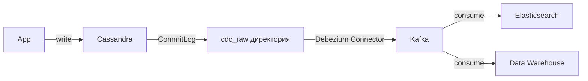

Цепочка захвата изменений:

```
   App ──write──▶ Cassandra ──CommitLog──▶ cdc_raw директория
                                                  │
                                          Debezium Connector
                                                  │
                                                  ▼
                                                Kafka
                                          consume │ consume
                                      ┌───────────┴───────────┐
                                      ▼                       ▼
                                Elasticsearch          Data Warehouse
```

**Включение CDC для таблицы:**

```cql
-- Включить CDC при создании таблицы
CREATE TABLE orders (
    order_id UUID PRIMARY KEY,
    status   TEXT,
    amount   DECIMAL
) WITH cdc = true;

-- Включить для существующей таблицы
ALTER TABLE orders WITH cdc = true;
```

**cassandra.yaml настройки:**

```yaml
cdc_enabled: true
cdc_raw_directory: /var/lib/cassandra/cdc_raw
cdc_total_space_in_mb: 4096    # максимум места под CDC logs
cdc_free_space_check_interval_ms: 250
```

**Debezium Connector для Cassandra (популярное решение):**

```json
{
  "name": "cassandra-cdc-connector",
  "config": {
    "connector.class": "io.debezium.connector.cassandra.CassandraConnector",
    "cassandra.config": "/etc/cassandra/cassandra.yaml",
    "cassandra.hosts": "cassandra-host",
    "kafka.producer.bootstrap.servers": "kafka:9092",
    "topic.prefix": "cassandra",
    "snapshot.mode": "initial"
  }
}
```

**Сценарии использования CDC:**
- Синхронизация Cassandra → Elasticsearch для поиска
- Построение event-driven архитектуры (Cassandra как event store)
- Репликация данных между кластерами
- Аудит изменений
- Cache invalidation при изменении данных

**Подводные камни:**
- CDC видит только явные мутации записи — TTL-истечения и события компакции в поток не попадают.
- Растёт нагрузка на диск: директорию `cdc_raw` нужно мониторить, иначе при заполнении записи начнут отклоняться.
- Гарантируется порядок изменений в пределах партиции, но не между разными партициями.

---

## See also

- [MongoDB](mongodb-interview.md) — другая NoSQL БД, документная модель
- [Redis](redis-interview.md) — in-memory хранилище, часто используется вместе с Cassandra как кэш
- [Распределённые системы](../architecture/distributed-systems-interview.md) — фундаментальные концепции, на которых построена Cassandra
- [CAP-теорема](../architecture/cap-theorem-interview.md) — Cassandra как AP-система
- [Архитектура баз данных](database-architecture-interview.md) — сравнение подходов к хранению данных
- [Apache Kafka](../messaging/kafka-interview.md) — интеграция через Kafka Connect для CDC и потоковой обработки
- [Elasticsearch](elasticsearch-interview.md) — часто используется вместе с Cassandra для полнотекстового поиска

- [ClickHouse](clickhouse-interview.md)
- [CockroachDB](cockroachdb-interview.md)
- [Database Architecture](database-architecture-interview.md)
- [Транзакции и уровни изоляции](database-transactions-interview.md)
- [DynamoDB](dynamodb-interview.md)
- [Elasticsearch](elasticsearch-interview.md)
