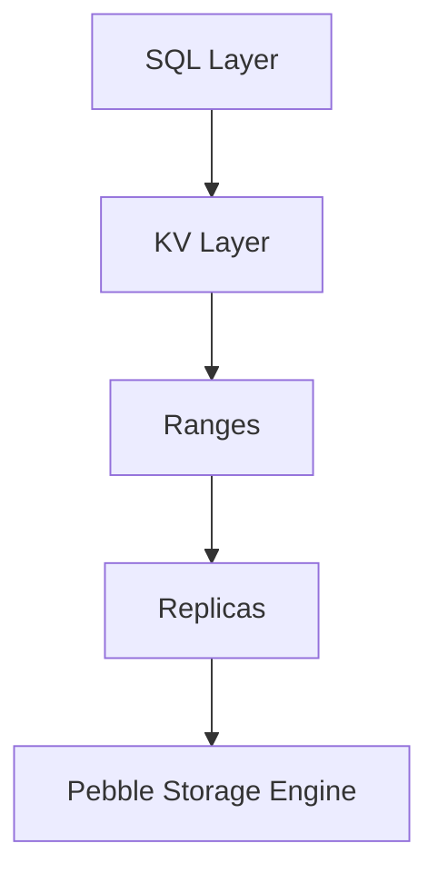

# Вопросы на собеседовании: `CockroachDB`

`CockroachDB` (Cockroach Labs, с 2015) — распределённая SQL-база данных, вдохновлённая Google Spanner. **Совместима с wire-протоколом PostgreSQL**, ACID-транзакции через множество узлов, поддержка multi-region. Open-source (лицензия BSL). Конкуренты: Spanner, Aurora, YugabyteDB, TiDB.

## Полезные ссылки

### Официальная документация и авторитетные источники

- [CockroachDB Documentation](https://www.cockroachlabs.com/docs/)
- [CockroachDB Architecture](https://www.cockroachlabs.com/docs/stable/architecture/overview.html)
- [Spanner Paper](https://research.google/pubs/pub39966/) — original inspiration
- [DistSQL — Cockroach Architecture](https://www.cockroachlabs.com/blog/distributed-sql-key-features/)
- [YugabyteDB vs CockroachDB](https://www.yugabyte.com/yugabytedb-vs-cockroachdb/)

## Содержание

- [Полезные ссылки](#полезные-ссылки)
- [See also](#see-also)

**Базовые понятия**
- [Q1. (!) Распределённую SQL-базу взяли ради роста записи, но одиночная вставка стала медленнее, чем на одном узле — почему?](#q1--распределённую-sql-базу-взяли-ради-роста-записи-но-одиночная-вставка-стала-медленнее-чем-на-одном-узле--почему)
- [Q2. (!) От распределённой SQL-базы ждали скорости хранилища ключей при обычном SQL, но короткие транзакции подорожали — почему?](#q2--от-распределённой-sql-базы-ждали-скорости-хранилища-ключей-при-обычном-sql-но-короткие-транзакции-подорожали--почему)
- [Q3. (!) Часы узлов слегка разошлись, и часть транзакций начала перечитывать данные и повторяться — почему?](#q3--часы-узлов-слегка-разошлись-и-часть-транзакций-начала-перечитывать-данные-и-повторяться--почему)

**Архитектура**
- [Q4. (!) Копии диапазона разложены по трём узлам, а чтения этой таблицы всё равно упираются в один — почему?](#q4--копии-диапазона-разложены-по-трём-узлам-а-чтения-этой-таблицы-всё-равно-упираются-в-один--почему)
- [Q5. Кластер из трёх копий переживал отказ одной, добавили четвёртую — устойчивость не выросла, почему?](#q5-кластер-из-трёх-копий-переживал-отказ-одной-добавили-четвёртую--устойчивость-не-выросла-почему)
- [Q6. (!) Таблица растёт и делится на диапазоны, но вся запись идёт на один узел и новые узлы не помогают — почему?](#q6--таблица-растёт-и-делится-на-диапазоны-но-вся-запись-идёт-на-один-узел-и-новые-узлы-не-помогают--почему)
- [Q7. Один узел получил от сбойного источника скачок времени вперёд, и метки времени во всём кластере ушли следом — почему?](#q7-один-узел-получил-от-сбойного-источника-скачок-времени-вперёд-и-метки-времени-во-всём-кластере-ушли-следом--почему)

**Распределённость**
- [Q8. (!) Кластер растянули на три региона ради отказоустойчивости, и задержка записи выросла с единиц миллисекунд до сотен — почему?](#q8--кластер-растянули-на-три-региона-ради-отказоустойчивости-и-задержка-записи-выросла-с-единиц-миллисекунд-до-сотен--почему)
- [Q9. (!) Базе задали переживание отказа целого региона, и число копий каждого диапазона выросло само собой — почему?](#q9--базе-задали-переживание-отказа-целого-региона-и-число-копий-каждого-диапазона-выросло-само-собой--почему)
- [Q10. Узлы подняли в трёх разных зонах, но все три копии диапазона оказались в одной зоне, и её отказ уронил базу — почему?](#q10-узлы-подняли-в-трёх-разных-зонах-но-все-три-копии-диапазона-оказались-в-одной-зоне-и-её-отказ-уронил-базу--почему)
- [Q11. Данные клиентов из Европы обязаны оставаться в Европе, но копии разъехались по всем регионам кластера — почему?](#q11-данные-клиентов-из-европы-обязаны-оставаться-в-европе-но-копии-разъехались-по-всем-регионам-кластера--почему)

**SQL и совместимость**
- [Q12. (!) Приложение подключилось к базе штатным драйвером PostgreSQL и работает, но накат схемы упал на середине — почему?](#q12--приложение-подключилось-к-базе-штатным-драйвером-postgresql-и-работает-но-накат-схемы-упал-на-середине--почему)
- [Q13. Приложение переносили с обычной базы, и под нагрузкой оно стало получать ошибку с требованием повторить транзакцию — почему?](#q13-приложение-переносили-с-обычной-базы-и-под-нагрузкой-оно-стало-получать-ошибку-с-требованием-повторить-транзакцию--почему)
- [Q14. Все узлы кластера обновили на новую версию, но обещанные возможности не появились, а откат на прежнюю версию ещё возможен — почему?](#q14-все-узлы-кластера-обновили-на-новую-версию-но-обещанные-возможности-не-появились-а-откат-на-прежнюю-версию-ещё-возможен--почему)

**Производительность**
- [Q15. (!) Из большой таблицы удалили половину строк, но число диапазонов не уменьшилось и полный обход не ускорился — почему?](#q15--из-большой-таблицы-удалили-половину-строк-но-число-диапазонов-не-уменьшилось-и-полный-обход-не-ускорился--почему)
- [Q16. По столбцу с документом создан индекс, но точечный поиск по одному полю внутри документа так и остался медленным — почему?](#q16-по-столбцу-с-документом-создан-индекс-но-точечный-поиск-по-одному-полю-внутри-документа-так-и-остался-медленным--почему)
- [Q17. (!) Ночной отчёт собирал данные из внешней базы прямо запросом, а после переноса собрать его стало нечем — почему?](#q17--ночной-отчёт-собирал-данные-из-внешней-базы-прямо-запросом-а-после-переноса-собрать-его-стало-нечем--почему)

**Сравнения**
- [Q18. (!) Клиент оборвал соединение посреди большой транзакции, и запросы к её таблице ещё долго шли заметно медленнее — почему?](#q18--клиент-оборвал-соединение-посреди-большой-транзакции-и-запросы-к-её-таблице-ещё-долго-шли-заметно-медленнее--почему)
- [Q19. (!) После переноса значения первичного ключа перестали идти подряд, и в них появились огромные пропуски — почему?](#q19--после-переноса-значения-первичного-ключа-перестали-идти-подряд-и-в-них-появились-огромные-пропуски--почему)
- [Q20. Подписка на изменения таблицы иногда отдаёт потребителю одно и то же изменение дважды — почему?](#q20-подписка-на-изменения-таблицы-иногда-отдаёт-потребителю-одно-и-то-же-изменение-дважды--почему)
- [Q21. Резервную копию за вчерашний день снять не удалось, хотя за последний час она снимается штатно — почему?](#q21-резервную-копию-за-вчерашний-день-снять-не-удалось-хотя-за-последний-час-она-снимается-штатно--почему)

**Прод**
- [Q22. (!) Счётчик в одной строке обновляют десятки транзакций в секунду, и на нём упёрлась пропускная способность всего кластера — почему?](#q22--счётчик-в-одной-строке-обновляют-десятки-транзакций-в-секунду-и-на-нём-упёрлась-пропускная-способность-всего-кластера--почему)
- [Q23. Столбец с индексом добавили в большую таблицу без остановки записи, но кластер часами работал под лишней нагрузкой — почему?](#q23-столбец-с-индексом-добавили-в-большую-таблицу-без-остановки-записи-но-кластер-часами-работал-под-лишней-нагрузкой--почему)
- [Q24. Соединение двух больших таблиц на прежней одиночной базе шло секунды, а в кластере стало занимать минуты — почему?](#q24-соединение-двух-больших-таблиц-на-прежней-одиночной-базе-шло-секунды-а-в-кластере-стало-занимать-минуты--почему)

## Q1. (!) Распределённую SQL-базу взяли ради роста записи, но одиночная вставка стала медленнее, чем на одном узле — почему?

**CockroachDB** — распределённая SQL-база данных, которая ведёт себя как один PostgreSQL, но физически размазана по множеству узлов и переживает отказы без потери данных и без ручного шардирования.

Ключевая идея: взять привычный SQL и ACID, но дать им горизонтальное масштабирование и отказоустойчивость уровня NoSQL. За это отвечают четыре свойства, и они связаны:

- **Горизонтальное масштабирование** — добавляешь узел, ёмкость и пропускная способность растут; данные перебалансируются автоматически.
- **Высокая доступность** — нет единой точки отказа: каждый кусок данных реплицирован, потеря узла не роняет кластер.
- **Строгая согласованность** — ACID и изоляция Serializable даже при записи через несколько узлов; приложение не видит «грязных» промежуточных состояний.
- **Совместимость с PostgreSQL** — говорит по wire-протоколу PG, поэтому драйверы, ORM и инструменты PostgreSQL работают почти без переделок.
- **Multi-region** — кластер можно растянуть на несколько географических регионов с контролем, где лежат данные.

**Происхождение:** создана в 2015 году бывшими инженерами Google, работавшими над Spanner и F1, — отсюда и архитектурное родство со Spanner.

**Сценарии применения:**
- Глобальные приложения, которым одновременно нужны масштаб и сильная согласованность.
- Финансовые системы — банковские реестры, платёжные платформы, где аномалии недопустимы.
- Multi-region SaaS с пользователями в разных частях света.
- Приложения, переросшие одиночный PostgreSQL и упёршиеся в его вертикальный потолок.

## Q2. (!) От распределённой SQL-базы ждали скорости хранилища ключей при обычном SQL, но короткие транзакции подорожали — почему?

**NewSQL** — это класс баз данных, который пытается получить лучшее сразу из двух миров: SQL-интерфейс и ACID-гарантии классических РСУБД плюс горизонтальную масштабируемость NoSQL. Раньше приходилось выбирать одно из двух; NewSQL отказывается от этого выбора.

Откуда взялся: традиционный SQL не масштабировался за пределы одной машины, а NoSQL ради масштаба пожертвовал транзакциями, join-ами и сильной согласованностью. NewSQL закрывает этот разрыв.

**Что он даёт по сравнению с каждым полюсом:**
- **Против традиционного SQL** — выходит за пределы одной машины: данные и нагрузка распределяются по узлам.
- **Против NoSQL** — сохраняет полноценный SQL, ACID-транзакции и join-ы, а не «eventual consistency» и денормализацию.

**Представители:** Google Spanner, CockroachDB, YugabyteDB, TiDB, VoltDB.

**Компромисс:** за это платят более сложным внутренним устройством (распределённый консенсус, координация транзакций), и на нагрузке, помещающейся в один узел, NewSQL нередко медленнее обычного PostgreSQL — накладные расходы распределённости окупаются только на масштабе.

## Q3. (!) Часы узлов слегка разошлись, и часть транзакций начала перечитывать данные и повторяться — почему?

CockroachDB переносит архитектурные идеи Spanner в open-source-мир, но реализует их так, чтобы работать на обычном железе — без атомных часов, доступных только Google.

**Spanner** (Google, 2012) — первая в мире глобально-распределённая SQL-БД. На чём он держится:

- **TrueTime** — API над атомными часами и GPS, дающий глобально согласованные метки времени с маленькой погрешностью.
- **Консенсус Paxos** — для согласованной репликации между узлами.
- **Multi-region записи** — запись в нескольких регионах с сохранением согласованности.
- **External consistency** — сильнейшая гарантия: порядок транзакций совпадает с порядком в реальном времени.

**CockroachDB повторяет эти концепции на доступном железе, заменяя ключевые компоненты:**

- **Hybrid Logical Clocks (HLC)** вместо TrueTime — потому что у обычных дата-центров нет атомных часов, и приходится сочетать NTP-время с логическим счётчиком.
- **Консенсус Raft** вместо Paxos — проще в реализации и понимании при тех же гарантиях.
- **Открытый код и self-host** — Spanner доступен только как managed-сервис в GCP, CockroachDB можно развернуть где угодно (с конца 2024 лицензия проприетарная — CockroachDB Software License, — но код открыт; см. Q23).

Практическое следствие для согласованности: HLC гарантирует лишь **ограниченный максимальный сдвиг часов** между узлами, а не абсолютную точность TrueTime. Если транзакция читает значение, чья метка попала в это окно неопределённости относительно чужой записи, CockroachDB не может однозначно установить порядок и делает **read refresh / повтор** — поэтому рассинхрон часов сверх допустимого напрямую оборачивается перечитываниями и ретраями.

Итог: к **2025** CockroachDB — основная распределённая SQL-база с открытым кодом (source-available), делающая идеи Spanner доступными вне Google.

## Q4. (!) Копии диапазона разложены по трём узлам, а чтения этой таблицы всё равно упираются в один — почему?



CockroachDB не хранит таблицы целиком на узлах: он разбивает всё пространство ключей на непрерывные куски (ranges), реплицирует каждый кусок отдельно и для каждого выбирает «главную» реплику, через которую идут запросы. Эти три понятия — range, replica, lease — и составляют ядро архитектуры.

**Range** — непрерывный фрагмент пространства ключей (по умолчанию до 512 MB).
- Идентифицируется парой граничных ключей (начальный/конечный).
- Каждый range реплицируется и масштабируется **независимо** от остальных — это и даёт горизонтальное масштабирование.

**Replica** — физическая копия range на конкретном узле. По умолчанию у каждого range **3 реплики**, разнесённые по разным узлам ради отказоустойчивости.

**Lease (leaseholder)** — одна из реплик range назначается leaseholder и становится единственной точкой, которая координирует чтения и записи в этот range. Это нужно, чтобы не запускать дорогой консенсус на каждое чтение: leaseholder может обслуживать чтения локально.

**Raft-группа** — все реплики одного range образуют свою Raft-группу и согласуют записи через консенсус. Как правило leaseholder одновременно является и лидером Raft, поэтому запись и её репликация координируются из одного места.

## Q5. Кластер из трёх копий переживал отказ одной, добавили четвёртую — устойчивость не выросла, почему?

**Raft** — это алгоритм, который позволяет группе реплик договориться о едином порядке записей, даже если часть узлов отказала. Запись считается зафиксированной, только когда её подтвердило большинство реплик, — поэтому ни один отдельный сбой не приводит к потере или расхождению данных. Важная деталь: CockroachDB запускает **отдельную Raft-группу на каждый range**, а не один консенсус на весь кластер, — это и позволяет масштабироваться.

**Как проходит запись:**
1. Лидер группы (он же leaseholder) принимает запись.
2. Реплицирует её на followers (остальные реплики).
3. Как только запись подтвердило **большинство** реплик (кворум) — она считается закоммиченной.
4. Запись применяется к state machine на каждой реплике.

**Почему кворум = «большинство»:** так гарантируется, что любые два кворума пересекаются хотя бы в одной реплике, и закоммиченная запись не может «потеряться» при последующих выборах.

- **3 реплики:** кворум = 2, кластер переживает отказ 1 реплики.
- **5 реплик:** кворум = 3, переживает отказ 2 реплик.

**Отказ лидера:** если лидер пропал, оставшиеся реплики по таймауту автоматически переизбирают нового — ручное вмешательство не требуется.

## Q6. (!) Таблица растёт и делится на диапазоны, но вся запись идёт на один узел и новые узлы не помогают — почему?

Когда range вырастает за порог (~512 MB), CockroachDB **сам** делит его пополам на два range, которые дальше живут и реплицируются независимо. Это автоматический механизм — администратору не нужно вручную решать, как нарезать данные.

```
Range 1: keys A-K (512 MB)
  ↓ growing к 1 GB
Split into:
  Range 1a: keys A-G (256 MB)
  Range 1b: keys G-K (256 MB)
```

**Зачем это нужно:** после разбиения новые range-ы можно разнести по узлам, и нагрузка распределяется. Новые range-ы система размещает на недозагруженных узлах — так выравнивается и объём данных, и пропускная способность.

**Ручное разбиение** доступно, когда нужно подготовить таблицу заранее:
```sql
ALTER TABLE orders SPLIT AT VALUES (100), (200), (300);
```

**Сценарий применения:** перед массовым импортом (bulk import) — заранее нарезанные range-ы дают параллельную запись на много узлов сразу, вместо того чтобы упереться в один range, пока авто-разбиение будет догонять.

## Q7. Один узел получил от сбойного источника скачок времени вперёд, и метки времени во всём кластере ушли следом — почему?

**HLC** — это способ присваивать событиям глобально упорядоченные метки времени без атомных часов: к физическому времени (NTP) добавляется логический счётчик, который доупорядочивает события, происходящие «почти одновременно».

**Формат метки:** `(physical_time, logical_counter)`. Физическая часть берётся из NTP-времени, а логический счётчик инкрементируется, когда два события приходят в один и тот же физический такт, — так получается строгий порядок даже при неточных часах.

**Почему не TrueTime:** у Spanner есть аппаратные атомные часы, у обычного дата-центра — нет. Отсюда разная погрешность:
- Spanner: атомные часы → крошечная неопределённость (~7 мс).
- CockroachDB: NTP + HLC → бо́льшая неопределённость (~250 мс — 1 с).

**Чем за это платит CockroachDB:** раз часы менее точны, при некоторых операциях нельзя сразу сказать, какое событие произошло раньше, и приходится:
- иногда **переждать окно неопределённости часов (clock uncertainty)**, прежде чем отдать результат;
- использовать повторные попытки (retries) для разрешения возникающих конфликтов;
- мириться с чуть более высокой латентностью записи.

На практике точности NTP+HLC хватает для подавляющего большинства нагрузок.

## Q8. (!) Кластер растянули на три региона ради отказоустойчивости, и задержка записи выросла с единиц миллисекунд до сотен — почему?

Один кластер CockroachDB можно растянуть на несколько географических регионов и при этом контролировать, где физически лежат реплики каждого куска данных. Это позволяет одновременно держать данные ближе к пользователям и переживать отказ целого региона.

```
us-east (3 replicas)
us-west (3 replicas)
eu-west (3 replicas)
```

**Две стратегии устойчивости** (задаются на уровне БД):
- **Region survival** — кластер переживает отказ целого региона.
- **Zone survival** — переживает отказ зоны внутри региона; дешевле и быстрее, но не спасает от падения всего региона.

**Ключевой компромисс — чтения против записей:**
- **Чтения** могут обслуживаться локально ближайшей репликой → низкая латентность.
- **Записи** должны собрать кворум, а при region survival реплики разнесены по регионам, поэтому подтверждение идёт через континенты → латентность записи выше. Это фундаментальная цена кросс-региональной согласованности.

## Q9. (!) Базе задали переживание отказа целого региона, и число копий каждого диапазона выросло само собой — почему?

Разница — в том, отказ какого масштаба кластер должен пережить без простоя, и эта разница напрямую определяет латентность записи. Чем шире разнесены реплики, тем больше отказов переживёшь, но тем дальше ехать кворуму.

**Zone survival** — реплики разнесены по зонам внутри одного региона:
- переживает отказ зоны (но не всего региона);
- **ниже латентность** записи — зоны рядом, кворум собирается быстро;
- дешевле — трафик и реплики в пределах одного региона.

**Region survival** — реплики разнесены по нескольким регионам:
- переживает отказ целого региона;
- **выше латентность** записи — кворум нужно собрать через регионы;
- дороже — кросс-региональный трафик и больше инфраструктуры.

Отсюда и рост числа копий: чтобы кворум пережил потерю целого региона, реплики диапазона обязаны лежать минимум в трёх регионах, поэтому при `SURVIVE REGION FAILURE` CockroachDB сам поднимает фактор репликации с трёх до пяти — число копий каждого диапазона увеличивается автоматически.

```sql
ALTER DATABASE my_db SURVIVE REGION FAILURE;
```

**Рекомендация:**
- **Zone survival** покрывает большинство случаев — отказ зоны куда вероятнее, чем падение целого региона.
- **Region survival** берут, когда этого требует комплаенс или приложение действительно критично и должно работать даже при потере региона — сознательно платя латентностью записи.

## Q10. Узлы подняли в трёх разных зонах, но все три копии диапазона оказались в одной зоне, и её отказ уронил базу — почему?

Locality — это метки, которыми каждый узел при старте сообщает кластеру, где он физически находится (регион, зона). Без этих меток CockroachDB не знает топологию и не может разумно размещать реплики — он будет считать все узлы равноудалёнными.

```bash
cockroach start --locality=region=us-east-1,zone=us-east-1a
```

**Зная locality, CockroachDB может:**
- разносить реплики одного range по разным зонам/регионам — изоляция отказов (две реплики не лягут вместе при падении одной зоны);
- размещать **leaseholder** ближе к пользователю — чтения и записи идут к близкой реплике, латентность падает;
- выполнять **follower reads** — отдавать чтение из локальной (не-лидерской) реплики, не гоняя запрос в другой регион.

## Q11. Данные клиентов из Европы обязаны оставаться в Европе, но копии разъехались по всем регионам кластера — почему?

Гео-партиционирование — это привязка строк таблицы к конкретному региону по значению колонки. Строки с разными значениями (например, страной клиента) физически хранятся в разных регионах. Решает сразу две задачи: соответствие законам о хранении данных (GDPR) и низкую латентность для локальных пользователей.

```sql
ALTER TABLE customers
PARTITION BY LIST (region) (
    PARTITION europe VALUES IN ('FR', 'DE'),
    PARTITION us VALUES IN ('US')
);

ALTER PARTITION europe OF TABLE customers
CONFIGURE ZONE USING constraints = '[+region=eu-west]';

ALTER PARTITION us OF TABLE customers
CONFIGURE ZONE USING constraints = '[+region=us-east]';
```

**Что это даёт:**
- Европейские клиенты → данные физически в EU (соответствие GDPR — данные не покидают регион).
- Клиенты из США → данные в US.
- Локальные чтения и записи для каждого региона → низкая латентность.

Это аналог regional placement у Spanner.

## Q12. (!) Приложение подключилось к базе штатным драйвером PostgreSQL и работает, но накат схемы упал на середине — почему?

Совместимость идёт на уровне **wire-протокола PostgreSQL**, а не форка кодовой базы PG. Это важное различие: драйверы и инструменты подключаются как к настоящему PostgreSQL и большинство приложений работают без изменений, но набор поддерживаемых SQL-фич — собственный, и совпадает с PG не на 100%.

**Работает без переделок:**
- стандартный SQL (большая его часть);
- pgBouncer и любые pgwire-клиенты/драйверы;
- ORM (Hibernate, ActiveRecord, Sequelize) — они общаются по тому же протоколу;
- инструменты миграции.

**Не работает или поддерживается ограниченно:**
- специфичные для PostgreSQL расширения (PostGIS, hstore и т.п.);
- часть встроенных функций;
- триггеры;
- хранимые процедуры.

**Подводный камень:** именно потому, что совместимость протокольная, а не «кодовая», миграция PostgreSQL → CockroachDB обычно проходит гладко, но именно поэтому её нужно **тщательно тестировать** — приложение может опираться на фичу, которой в CockroachDB нет.

## Q13. Приложение переносили с обычной базы, и под нагрузкой оно стало получать ошибку с требованием повторить транзакцию — почему?

CockroachDB даёт **полный ACID даже тогда, когда строки транзакции лежат на разных узлах** — это и есть его главная фишка по сравнению с шардированными решениями, где распределённых транзакций обычно нет.

```sql
BEGIN;
INSERT INTO orders (...) VALUES (...);
UPDATE inventory SET qty = qty - 1 WHERE id = 5;
COMMIT;
```

**Как это устроено под капотом:**
- транзакцию ведёт координатор на узле, принявшем запрос (TxnCoordSender);
- атомарность через несколько range-ов обеспечивается протоколом two-phase commit (2PC) — либо применяются все изменения, либо ни одного;
- при конкуренции за одни и те же строки (contention) транзакции автоматически перезапускаются.

**Подводный камень:** автоматические retries делают транзакции медленными на нагрузке с высокой конкуренцией — много транзакций бьётся за одни строки и постоянно перезапускается. Поэтому CockroachDB лучше всего раскрывается на **слабо конфликтующих** транзакциях, затрагивающих разные данные.

## Q14. Все узлы кластера обновили на новую версию, но обещанные возможности не появились, а откат на прежнюю версию ещё возможен — почему?

Обновление кластера CockroachDB идёт в два шага. Сначала на все узлы **накатывается новый бинарник** (rolling upgrade), и только потом кластер **финализирует версию** — переключает внутреннюю `cluster version`.

- **До финализации** новые возможности версии остаются выключенными (feature gate): узлы уже на новом коде, но ведут себя как прежняя версия, чтобы разные узлы кластера понимали друг друга во время выката.
- **Пока версия не финализирована**, возможен **откат** на прежний бинарник: на диск ещё не записаны форматы, которые старая версия не прочитает.
- **После финализации** включаются новые фичи, но откат уже невозможен — формат хранения переходит на новый.

По умолчанию финализация **автоматическая** (auto-finalize) после успешного обновления всех узлов. Если нужно подержать окно для отката, автофинализацию отключают (`cluster.preserve_downgrade_option`) и запускают финализацию вручную позже.

**Вывод для сценария:** возможности «не появились», потому что кластер ещё не финализировал версию; ровно поэтому откат пока и возможен. Как только финализация пройдёт — фичи включатся, а путь назад закроется.

## Q15. (!) Из большой таблицы удалили половину строк, но число диапазонов не уменьшилось и полный обход не ускорился — почему?

В CockroachDB шардирование **автоматическое** — в отличие от MongoDB или ручного шардирования PostgreSQL, разработчику не нужно заранее выбирать shard key и руками раскидывать данные.

**Как это работает:**
- все строки живут в едином отсортированном пространстве ключей, и оно нарезается на range-ы **по диапазонам первичного ключа**: каждый range — непрерывный отрезок строк, упорядоченных по PK;
- по умолчанию это именно **range-партиционирование, а не хеширование** — hash-распределение нужно включать явно (`USING HASH`);
- при росте range делится (~512 MB) и разносится по узлам;
- при добавлении узлов кластер сам ребалансирует range-ы — выравнивает нагрузку.

**Ручные рычаги, если автоматики мало:**
- `PARTITION BY` — гео-партиционирование (привязка строк к регионам);
- `SPLIT AT` — ручное разбиение range-ов (например, перед bulk import);
- `INDEX (col) USING HASH` — hash-sharded индекс, чтобы разнести нагрузку и избежать hot ranges.

**Главный подводный камень — hot range.** Поскольку range-ы нарезаются по диапазону PK, монотонно растущий первичный ключ (timestamp, sequence) направляет все новые записи в один и тот же «последний» range — и весь его трафик ложится на один leaseholder, сводя на нет распределённость. Лечится **UUID** (случайный ключ распределяет записи) или **hash-sharded индексом**.

Обратная сторона — удаление данных не уменьшает число range-ов сразу: `DELETE` оставляет MVCC-надгробия, старые версии физически убирает сборщик мусора лишь по истечении `gc.ttlseconds`, и только после этого мелкие соседние range-ы сливаются. Пока GC и merge не догнали, число range-ов и стоимость полного обхода не падают.

## Q16. По столбцу с документом создан индекс, но точечный поиск по одному полю внутри документа так и остался медленным — почему?

Набор близок к PostgreSQL, но с одним специфичным для распределённой БД дополнением — hash-sharded индексами.

**Стандартные B-tree индексы** — обычные одиночные и составные:
```sql
CREATE INDEX ON orders (customer_id);
CREATE INDEX ON orders (customer_id, created_at);
```

**Hash-sharded индексы** — уникальны для CockroachDB: префиксуют ключ хешем, чтобы «размазать» монотонно растущие значения по нескольким range-ам и убрать hot range:
```sql
CREATE INDEX ON events (timestamp) USING HASH WITH BUCKET_COUNT = 8;
```

**Частичные индексы (partial indexes)** — индексируют только подмножество строк, экономя место и ускоряя запросы по этому подмножеству:
```sql
CREATE INDEX active_users ON users (last_login) WHERE active = true;
```

**Инвертированные индексы (inverted indexes)** — для поиска внутри JSONB:
```sql
CREATE INVERTED INDEX ON orders (data);
```

**Пространственные индексы (spatial indexes)** — есть, но с ограниченной поддержкой PostGIS.

## Q17. (!) Ночной отчёт собирал данные из внешней базы прямо запросом, а после переноса собрать его стало нечем — почему?

Поскольку CockroachDB совместим с PostgreSQL по протоколу, а не является его форком, часть привычных по PG возможностей отсутствует или урезана. Это и есть главный риск при миграции — приложение может тихо зависеть от такой фичи.

**Отсутствует или поддерживается ограниченно:**
- хранимые процедуры (ограниченно);
- триггеры (ограниченно);
- материализованные представления (поддержка появилась позже);
- полнотекстовый поиск (ограниченно);
- PostGIS (ограниченно);
- часть JSONB-операторов;
- `LISTEN/NOTIFY`;
- foreign data wrappers (FDW);
- тип `XML`;
- пользовательские типы (ограниченно);
- `LATERAL` join-ы (частично).

**Подводный камень:** перед переездом legacy PostgreSQL-приложения этот список нужно сверить с тем, что реально использует код, и тщательно протестировать миграцию — иначе несовместимость всплывёт уже в проде.

## Q18. (!) Клиент оборвал соединение посреди большой транзакции, и запросы к её таблице ещё долго шли заметно медленнее — почему?

CockroachDB реализует транзакции через **write intents** — предварительные, ещё не закоммиченные версии строк, помеченные записью транзакции. Пока транзакция не завершилась, её intents лежат на затронутых строках.

Когда клиент **оборвал транзакцию**, её intents не убираются мгновенно — координатор пропал, и записи остаются «висеть». Последующие запросы, наткнувшись на такой intent, обязаны сначала выяснить судьбу оборванной транзакции и **разрешить** его (intent resolution): дочитать статус её записи, признать транзакцию abandoned и очистить intent. Пока это не сделано, каждый читающий эти строки запрос платит лишней работой — отсюда заметное замедление сразу после обрыва.

- Наткнувшийся запрос сам инициирует **cleanup**: помечает транзакцию abandoned по таймауту и удаляет её intents.
- Чистка идёт **лениво**, по мере обращения к строкам, а не одномоментно, поэтому «хвост» медленных запросов растянут во времени.
- Массовый обрыв большой транзакции оставляет много intents, и разрешать их приходится дольше.

**Вывод для сценария:** таблица тормозит не из-за самой нагрузки, а из-за **неубранных intents** оборванной транзакции — их лениво разрешают последующие запросы, пока все не будут вычищены.

## Q19. (!) После переноса значения первичного ключа перестали идти подряд, и в них появились огромные пропуски — почему?

Если при создании таблицы не задать первичный ключ явно, CockroachDB добавляет скрытый `rowid` и заполняет его функцией `unique_rowid()`. Она возвращает **не последовательное** число: старшие биты берутся из времени, младшие — из ID узла, и значения **намеренно не идут подряд**.

Зачем так: монотонно растущий ключ (обычный `SERIAL`/sequence) отправлял бы все новые строки в один «последний» range и создавал **hot range** — весь трафик вставки лёг бы на один leaseholder. Разбросанные значения `unique_rowid()` распределяют вставки по разным range-ам и узлам.

- Значения приблизительно растут во времени, но с **большими пропусками** — это не плотная последовательность.
- Тот же эффект даёт явный ключ типа `UUID` (случайный): подряд идущих номеров не будет.
- Плотный автоинкремент доступен через `SERIAL`-подобные последовательности, но он возвращает hot range и жертвует распределённостью.

**Вывод для сценария:** пропуски в ключе — не баг миграции, а следствие `unique_rowid()`/UUID: CockroachDB осознанно отказывается от монотонной нумерации, чтобы вставки не концентрировались в одном range.

## Q20. Подписка на изменения таблицы иногда отдаёт потребителю одно и то же изменение дважды — почему?

Подписка на изменения в CockroachDB — это **changefeed** (`CREATE CHANGEFEED`), поток строковых изменений в Kafka, облачное хранилище или sink через `EXPERIMENTAL CHANGEFEED`. Его контракт доставки — **at-least-once**: каждое изменение будет доставлено **хотя бы раз**, но порой **больше одного раза**.

Почему возможны дубли: changefeed периодически фиксирует прогресс (checkpoint). Если узел перезапустился, сеть моргнула или потребитель не успел подтвердить, поток **пере-отправляет** сообщения с последнего checkpoint — и часть изменений приходит повторно. Гарантии «ровно один раз» (exactly-once) changefeed не даёт.

- Каждое сообщение несёт **timestamp (MVCC)** и первичный ключ строки — по ним дубль можно распознать.
- Потребитель обязан быть **идемпотентным**: применять одно и то же изменение повторно без побочных эффектов (upsert по ключу, дедуп по timestamp).
- Порядок для одной строки сохраняется, но повтор доставки — штатное поведение, а не сбой.

**Вывод для сценария:** одно изменение приходит дважды не из-за бага, а потому что changefeed доставляет **at-least-once**; защита — идемпотентный потребитель, а не попытка отключить дубли.

## Q21. Резервную копию за вчерашний день снять не удалось, хотя за последний час она снимается штатно — почему?

CockroachDB хранит версии строк по модели **MVCC**: обновление и удаление не стирают данные сразу, а оставляют старые версии. Их подчищает фоновый **garbage collection** по настройке `gc.ttlseconds` (окно задаётся в zone config, по умолчанию — порядка суток).

Бэкап `AS OF SYSTEM TIME` и запросы «в прошлое» опираются на эти старые MVCC-версии. Снять копию на момент времени можно **только внутри GC-окна**: как только версия старше `gc.ttlseconds`, GC её удаляет, и данных на тот момент больше нет.

- Копия за **последний час** снимается штатно — эти версии свежие и ещё не собраны GC.
- Копия за **вчера** падает, если вчерашний момент уже **вышел за GC-окно** — версий на него не осталось.
- Чтобы бэкапить глубже в прошлое, окно увеличивают: поднимают `gc.ttlseconds`, но это раздувает объём хранения.

**Вывод для сценария:** бэкап за вчера не снялся не из-за прав или сети, а потому что нужный момент **старше GC TTL** — старые MVCC-версии уже удалены, и `AS OF SYSTEM TIME` на них не выполнить.

## Q22. (!) Счётчик в одной строке обновляют десятки транзакций в секунду, и на нём упёрлась пропускная способность всего кластера — почему?

Каждая строка живёт в конкретном **range**, а у range один **leaseholder**, который сериализует все записи в него. Когда десятки транзакций в секунду обновляют **одну и ту же строку** (счётчик), они конкурируют за один ключ — это **contention** на горячей строке.

Под Serializable конфликтующие транзакции нельзя применять параллельно: CockroachDB выстраивает их **в очередь** на этой строке, часть получает **retry**, и вся нагрузка упирается в пропускную способность **одного leaseholder одного range**. Добавление узлов не помогает — горячий ключ обслуживает по-прежнему один range.

- Узкое место — **сериализация конфликтующих записей** в один ключ, а не мощность кластера.
- Лечится **распределением** нагрузки: sharded-счётчик (несколько строк, сумма по ним), запись событий вместо инкремента, батч-агрегация.
- Больше узлов масштабируют **разные** ключи, но не запись в **один и тот же**.

**Вывод для сценария:** упёрлись не в кластер, а в **contention на одной строке** — её пишет один leaseholder, и конкурирующие транзакции сериализуются; помогает размазать счётчик по многим ключам, а не добавлять узлы.

## Q23. Столбец с индексом добавили в большую таблицу без остановки записи, но кластер часами работал под лишней нагрузкой — почему?

Добавление индекса в CockroachDB — это **online schema change**: запись в таблицу **не останавливается**, а новый индекс строится в фоне. Ядро этой операции — **backfill**: система должна прочитать **все существующие строки** большой таблицы и записать для них записи индекса.

На большой таблице backfill — это перекладывание огромного объёма данных: чтение всех строк, запись индексных ключей, их репликация по узлам. Всё это идёт **фоном под живой нагрузкой**, поэтому кластер часами несёт **дополнительную** работу, пока backfill не догонит таблицу.

- Схема меняется по **этапам** (delete-only → write-only → backfill → public), чтобы онлайн-переход был безопасным.
- Пока backfill идёт, индекс ещё **не используется** для чтения, но уже потребляет ресурсы на построение.
- Чем больше таблица, тем **дольше** backfill и выше фоновая нагрузка — это цена «без остановки записи».

**Вывод для сценария:** лишняя нагрузка на часы — это **index backfill** онлайн-операции: фоновая перестройка большого объёма под живой нагрузкой, а не сбой; она закончится, когда индекс достроится.

## Q24. Соединение двух больших таблиц на прежней одиночной базе шло секунды, а в кластере стало занимать минуты — почему?

Соединение двух больших таблиц в кластере — это **распределённый join**. Данные таблиц разложены по range-ам на **разных узлах**, поэтому исполнитель вынужден **гонять строки по сети** между узлами, чтобы свести совпадающие ключи вместе. Этот **сетевой обмен (data shuffle)** и есть источник замедления: на одиночной базе всё локально в памяти, а в кластере добавляется передача данных по сети.

- Если таблицы **не колоцированы** (их ключи разложены по узлам независимо), join собирает строки с многих узлов — сеть становится узким местом.
- Объём обмена растёт с размером таблиц, поэтому «секунды на одиночной базе» превращаются в «минуты в кластере».
- Уменьшить сеть помогает **колокация** по ключу соединения (общий префикс/партиционирование), чтобы совпадающие строки лежали рядом, и фильтрация до join.

CockroachDB оптимизирует такие планы (distributed SQL execution), но **физику сети не отменить**: если данные разбросаны, join платит межузловым обменом. Тяжёлую аналитику с большими join поэтому выносят в ClickHouse/Snowflake.

**Вывод для сценария:** join замедлился не из-за самой базы, а из-за **сетевого обмена распределённого join**: несколоцированные данные гоняются между узлами; лечится колокацией по ключу соединения.

---

## See also

- [PostgreSQL](postgresql-interview.md) — main compatibility target
- [ScyllaDB](scylladb-interview.md) — distributed wide-column (for сравнения)
- [Cassandra](cassandra-interview.md) — wide-column NoSQL
- [MongoDB](mongodb-interview.md) — document
- [DynamoDB](dynamodb-interview.md) — managed NoSQL
- [Database Architecture](database-architecture-interview.md) — distributed SQL context
- [Распределённые системы](../architecture/distributed-systems-interview.md) — Raft, consensus
- [CAP Theorem](../architecture/cap-theorem-interview.md) — consistency vs availability
- [Микросервисы](../architecture/microservices-interview.md) — где CockroachDB fits
- [Scalability Patterns](../architecture/scalability-patterns-interview.md) — horizontal scaling
- [Паттерны согласованности](../architecture/consistency-patterns-interview.md) — strong consistency
- [GCP](../cloud/gcp-interview.md) — Spanner alternative
- [AWS](../cloud/aws-interview.md) — Aurora alternative

- [Apache Cassandra](cassandra-interview.md)
- [ClickHouse](clickhouse-interview.md)
- [Database Architecture](database-architecture-interview.md)
- [Транзакции и уровни изоляции](database-transactions-interview.md)
- [DynamoDB](dynamodb-interview.md)
- [Elasticsearch](elasticsearch-interview.md)
