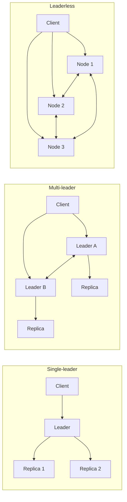

# Вопросы на собеседовании: Репликация баз данных

Репликация БД: `single-leader` (`primary-replica`), `multi-leader`, `leaderless`; `sync` vs `async`; `logical` vs `physical`; конкретика по `MySQL`, `PostgreSQL`, `Cassandra`, `MongoDB`; failover, split-brain, conflict resolution, CDC.

**Database Replication** — это поддержание копий одних и тех же данных на нескольких узлах. Цели: высокая доступность (`HA`), масштабирование чтений (`read scaling`), географическое распределение (`geo-distribution`), disaster recovery, разгрузка аналитики. На собеседованиях спрашивают про модели репликации, trade-off `sync` vs `async`, обработку конфликтов, реплик-лаг, failover и split-brain.

## Полезные ссылки

### Книги и теория

- [Designing Data-Intensive Applications, ch. 5 (Replication)](https://dataintensive.net/) — Martin Kleppmann, базовая глава
- [Database Internals, ch. 11-12](https://www.databass.dev/) — Alex Petrov

### Официальная документация

- [PostgreSQL: High Availability, Load Balancing, and Replication](https://www.postgresql.org/docs/current/high-availability.html)
- [PostgreSQL: Streaming Replication Protocol](https://www.postgresql.org/docs/current/protocol-replication.html)
- [PostgreSQL: Logical Replication](https://www.postgresql.org/docs/current/logical-replication.html)
- [MySQL: Replication Overview](https://dev.mysql.com/doc/refman/8.0/en/replication.html)
- [MySQL: GTID-Based Replication](https://dev.mysql.com/doc/refman/8.0/en/replication-gtids.html)
- [MySQL: Semisynchronous Replication](https://dev.mysql.com/doc/refman/8.0/en/replication-semisync.html)
- [MongoDB: Replica Sets](https://www.mongodb.com/docs/manual/replication/)
- [Cassandra: Data Replication](https://cassandra.apache.org/doc/latest/cassandra/architecture/dynamo.html)

### Инструменты и CDC

- [Debezium Documentation](https://debezium.io/documentation/) — CDC через replication log
- [Patroni — PostgreSQL HA](https://patroni.readthedocs.io/)
- [Orchestrator — MySQL HA](https://github.com/openark/orchestrator)
- [AWS RDS Read Replicas](https://docs.aws.amazon.com/AmazonRDS/latest/UserGuide/USER_ReadRepl.html)

## Содержание

- [Полезные ссылки](#полезные-ссылки)
- [See also](#see-also)

**Основы**
- [Q1. (!) Зачем нужна репликация и какие задачи она решает?](#q1--зачем-нужна-репликация-и-какие-задачи-она-решает)
- [Q2. (!) Какие модели репликации существуют?](#q2--какие-модели-репликации-существуют)
- [Q3. (!) Sync vs Async vs Semi-sync репликация — в чём разница?](#q3--sync-vs-async-vs-semi-sync-репликация--в-чём-разница)
- [Q4. (!) Logical vs Physical репликация — отличия и применимость](#q4--logical-vs-physical-репликация--отличия-и-применимость)
- [Q5. Replication vs Backup — в чём разница?](#q5-replication-vs-backup--в-чём-разница)

**Single-leader (master-slave / primary-replica)**
- [Q6. (!) Как устроена single-leader репликация?](#q6--как-устроена-single-leader-репликация)
- [Q7. Что такое replication lag и как его измерять?](#q7-что-такое-replication-lag-и-как-его-измерять)
- [Q8. Read-your-writes и monotonic reads consistency](#q8-read-your-writes-и-monotonic-reads-consistency)
- [Q9. Какие проблемы у async репликации?](#q9-какие-проблемы-у-async-репликации)

**Multi-leader**
- [Q10. (!) Когда оправдан multi-leader (master-master)?](#q10--когда-оправдан-multi-leader-master-master)
- [Q11. (!) Как разрешать конфликты: LWW, version vectors, CRDT?](#q11--как-разрешать-конфликты-lww-version-vectors-crdt)

**Leaderless**
- [Q12. (!) Как работает leaderless репликация (Cassandra, Dynamo)?](#q12--как-работает-leaderless-репликация-cassandra-dynamo)
- [Q13. Что такое quorum (R + W > N) и зачем он нужен?](#q13-что-такое-quorum-r--w--n-и-зачем-он-нужен)
- [Q14. Hinted handoff и anti-entropy repair](#q14-hinted-handoff-и-anti-entropy-repair)

**MySQL specifics**
- [Q15. (!) Как устроена репликация в MySQL?](#q15--как-устроена-репликация-в-mysql)
- [Q16. Чем различаются форматы binlog: statement-based, row-based, mixed?](#q16-чем-различаются-форматы-binlog-statement-based-row-based-mixed)
- [Q17. Что такое GTID и зачем он нужен?](#q17-что-такое-gtid-и-зачем-он-нужен)
- [Q18. Semi-sync replication в MySQL — как настроить?](#q18-semi-sync-replication-в-mysql--как-настроить)

**PostgreSQL specifics**
- [Q19. (!) Как устроена streaming replication в PostgreSQL?](#q19--как-устроена-streaming-replication-в-postgresql)
- [Q20. Replication slots — зачем нужны?](#q20-replication-slots--зачем-нужны)
- [Q21. Logical replication через publications/subscriptions](#q21-logical-replication-через-publicationssubscriptions)
- [Q22. Synchronous_commit и synchronous_standby_names](#q22-synchronous_commit-и-synchronous_standby_names)

**MongoDB и Cassandra**
- [Q23. Как устроен replica set в MongoDB?](#q23-как-устроен-replica-set-в-mongodb)
- [Q24. Replication factor и snitches в Cassandra](#q24-replication-factor-и-snitches-в-cassandra)

**Failover и Split-brain**
- [Q25. (!) Как работает автоматический failover?](#q25--как-работает-автоматический-failover)
- [Q26. (!) Что такое split-brain и как его избегать?](#q26--что-такое-split-brain-и-как-его-избегать)
- [Q27. Read replicas в облаке: RDS, Aurora, Cloud SQL](#q27-read-replicas-в-облаке-rds-aurora-cloud-sql)

**CDC и Cross-region**
- [Q28. (!) Что такое Change Data Capture (CDC)?](#q28--что-такое-change-data-capture-cdc)
- [Q29. Репликация через Kafka и Debezium](#q29-репликация-через-kafka-и-debezium)
- [Q30. Cross-region репликация: trade-off и подводные камни](#q30-cross-region-репликация-trade-off-и-подводные-камни)
- [Q31. Anti-patterns репликации](#q31-anti-patterns-репликации)

---

## Q1. (!) Зачем нужна репликация и какие задачи она решает?

**Репликация** — это поддержание нескольких копий одних и тех же данных на разных узлах. Одна копия (или несколько) служит источником истины, остальные синхронно или асинхронно её догоняют. Помогает решать несколько задач: доступность, масштабирование чтений, гео-распределение, disaster recovery и разгрузку аналитики.

**Основные цели:**

| Цель | Что даёт | Пример |
|---|---|---|
| **High Availability** | работа при падении узла | replica становится primary при отказе |
| **Read scaling** | разгрузка чтений | аналитика читает с replica, OLTP пишет в primary |
| **Geo-distribution** | низкая латентность для пользователей | replica в каждом регионе |
| **Disaster recovery** | RPO/RTO для катастроф | replica в другом ДЦ |
| **Analytics offload** | часть тяжёлых запросов уходит с primary | BI-отчёты с read-replica |
| **Rolling upgrades** | сокращение окна обслуживания | по очереди обновляем реплики |

**Что НЕ решает репликация** (частая ловушка на собесе):
- **Не заменяет backup.** Логическая ошибка вроде `DROP TABLE` может распространиться на все реплики.
- **Не масштабирует записи** в single-leader: все writes всё равно идут в один узел.
- **Не даёт strong consistency сама по себе** — гарантии зависят от протокола записи и маршрутизации чтения. Причинная согласованность и линеаризуемость — разные гарантии.

**Метрики, которыми меряют качество репликации:**
- `RPO` (Recovery Point Objective) — сколько данных допустимо потерять при катастрофе (в секундах/транзакциях).
- `RTO` (Recovery Time Objective) — за сколько система должна восстановиться.
- `Replication lag` — текущее отставание реплики от primary.

---

## Q2. (!) Какие модели репликации существуют?

Существуют три фундаментальные модели, и различаются они одним вопросом — **кто имеет право принимать запись**: один узел, несколько или вообще любой.



| Модель | Writes | Reads | Примеры | Конфликты |
|---|---|---|---|---|
| **Single-leader** | только primary | primary + replicas | `PostgreSQL`, `MySQL`, `MongoDB` (replica set) | конкурентные транзакции на primary |
| **Multi-leader** | доступный лидер | по правилам системы | `MySQL Group Replication`, `PostgreSQL BDR`, `CouchDB` | да, нужен resolution |
| **Leaderless** | любой узел (через клиент/координатор) | любой узел | `Cassandra`, исходный `Dynamo`, `Riak` | зависят от правил версионирования |

Выбор зависит от того, где нужно принимать запись и какие гарантии нужны приложению. При одном лидере проще согласовать единую историю. При нескольких лидерах особенно важны правила записи одного ключа. В leaderless-системе координатор может обратиться к набору реплик, а доступность зависит от требуемого числа ответов (Q6, Q10–Q13).

---

## Q3. (!) Sync vs Async vs Semi-sync репликация — в чём разница?

Режим определяет, входит ли подтверждение реплики в условия успешного ответа клиенту и какой этап она подтверждает.

- **Async.** Primary отвечает после выполнения собственных условий коммита. Реплика догоняет отдельно. При аварийном переключении на отставший узел часть подтверждённых транзакций может потеряться.
- **Sync.** Источник ждёт настроенное число реплик и выбранный этап, например сброс WAL или применение. Если подтверждений не хватает, коммит может ждать. Для сохранности при failover нужно выбрать узел, получивший нужную историю. Подробнее о PostgreSQL в Q22. [Настройки PostgreSQL 19](https://www.postgresql.org/docs/19/runtime-config-wal.html#GUC-SYNCHRONOUS-COMMIT).
- **Semi-sync в MySQL.** Источник ждёт, пока настроенное число реплик подтвердит сброс событий в relay log. Применение не входит в это подтверждение. При таймауте MySQL может перейти в асинхронный режим (Q18). [MySQL 8.4 Semisynchronous Replication](https://dev.mysql.com/doc/refman/8.4/en/replication-semisync.html).

---


## Q4. (!) Logical vs Physical репликация — отличия и применимость

Физическая репликация PostgreSQL начинает с базовой копии кластера и воспроизводит физический WAL. Standby соответствует применённой позиции журнала и может отставать. Для потоковой физической репликации обычно нужна одинаковая major-версия и совместимая архитектура. В режиме hot standby узел может обслуживать чтения (Q19). [PostgreSQL 19 Standby Servers](https://www.postgresql.org/docs/19/warm-standby.html).

Логическая репликация декодирует изменения и применяет их к таблицам подписчика. Она позволяет выбрать таблицы и использовать совместимые major-версии, но схема подписчика должна принимать изменения. DDL нужно согласовывать отдельно. У подписчика могут быть собственные индексы и локальная запись, но запись в те же строки может конфликтовать с применением потока. Ограничения последовательностей и идентификации строк разобраны в Q21. [PostgreSQL 19 Logical Replication Restrictions](https://www.postgresql.org/docs/19/logical-replication-restrictions.html).

MySQL row-based binlog передаёт изменения строк. Это по-прежнему логическое представление, даже когда оно содержит образы строк (Q16).

---


## Q5. Replication vs Backup — в чём разница?

Репликация поддерживает рабочую копию данных, чтобы продолжить обслуживание при отказе узла или разгрузить чтение. Копия может отставать, а ошибочный `DROP TABLE` может до неё дойти. Резервная копия сохраняет состояние, из которого можно восстановить данные после ошибки. Защита от компрометации зависит от того, изолированы ли копии и кто может их изменить или удалить.

При восстановлении на момент времени (PITR) сначала восстанавливают подходящую базовую копию, затем применяют непрерывный журнал до выбранной позиции. Например, после ошибочного удаления восстанавливают отдельный экземпляр до операции, проверяют данные и решают, как вернуть нужные строки, сохранив последующие корректные записи в рабочей базе. В PostgreSQL для этого нужна физическая базовая копия и архив WAL. Логический экспорт `pg_dump` можно восстановить отдельно, но он не служит базой для воспроизведения WAL. В MySQL для PITR используют резервную копию и последующие события binlog. [PostgreSQL 19 PITR](https://www.postgresql.org/docs/19/continuous-archiving.html) · [MySQL 8.4 PITR](https://dev.mysql.com/doc/refman/8.4/en/point-in-time-recovery.html).

Проверяйте failover и восстановление из копии отдельно. В первом случае важны доступность кандидата и его позиция. Во втором — пригодность копии, полнота архива и время до восстановления работы приложения. Периодичность таких проверок выбирают по целям RPO и RTO (Q30).

---


## Q6. (!) Как устроена single-leader репликация?

**Single-leader (primary-replica, master-slave)** — один узел принимает все записи и транслирует их остальным через журнал изменений. Это самая распространённая модель: её используют PostgreSQL, MySQL, MongoDB по умолчанию.

**Как это работает по шагам:**

1. Клиенты пишут **только в primary** (leader) — единственный источник истины.
2. Primary логирует каждое изменение в **replication log** (WAL в PG, binlog в MySQL, oplog в MongoDB).
3. Реплики получают журнал и применяют изменения по правилам конкретной СУБД. Получение журнала, его сброс на диск и применение к данным — разные этапы.
4. Чтения могут идти как на primary, так и на replicas — отсюда read scaling.

При асинхронной репликации ответ клиенту не ждёт реплику. При синхронном подтверждении источник ждёт выбранный этап и нужное число реплик. Например, в PostgreSQL `remote_apply` ждёт применения на подтвердившей реплике, а `remote_write` — записи WAL в её файловую систему. [Документация PostgreSQL 19](https://www.postgresql.org/docs/19/runtime-config-wal.html#GUC-SYNCHRONOUS-COMMIT).

**Ключевые свойства** (и почему они такие):
- **Нет независимых писателей для одного набора данных**, пока соблюдается роль primary. Конкурирующие транзакции на самом primary по-прежнему могут ждать блокировки, вызвать deadlock или получить ошибку сериализации.
- **Единый источник изменений** упрощает согласование реплик. При этом чтения с разных реплик могут видеть разные позиции журнала (Q7–Q8).
- **Primary — узкое место для записей** — добавление читающих реплик само по себе не увеличивает пропускную способность записи.
- **При отказе primary нужен failover** — пока новый лидер не выбран, записи невозможны.

**Как реплика помнит, где остановилась** (stateful-компоненты):
- Позиция в журнале: `pg_lsn` (`0/3000060`) в PG, `binlog file:position` или `GTID` в MySQL.
- Слот PostgreSQL удерживает WAL с позиции `restart_lsn` в пределах настроек. Эта позиция не равна позиции применения (Q20).

**Типичные топологии:**
- 1 primary + 2 replicas (HA + read scaling).
- 1 primary + 1 sync replica + N async replicas.
- Cascade replication: replica → replica (снижает нагрузку на primary).

---

## Q7. Что такое replication lag и как его измерять?

**Replication lag** — задержка между моментом, когда транзакция закоммичена на primary, и моментом, когда то же изменение применено на replica. Именно из-за лага async-реплика может вернуть устаревшие данные.

**Откуда берётся лаг:**
- Большие транзакции (long-running `UPDATE`/`DELETE`).
- Slow network между ДЦ.
- Слабое железо replica (IOPS, CPU).
- Single-threaded apply (исторически в MySQL до multi-thread replication).
- Lock contention на replica при read queries.
- Тяжёлые DDL на primary.

**Как мерить:**

`PostgreSQL`:
```sql
-- На primary:
SELECT client_addr, state, sent_lsn, write_lsn, flush_lsn, replay_lsn, replay_lag,
       pg_wal_lsn_diff(pg_current_wal_lsn(), sent_lsn) AS unsent_bytes,
       pg_wal_lsn_diff(sent_lsn, replay_lsn) AS sent_not_replayed_bytes
FROM pg_stat_replication;

-- На replica:
SELECT now() - pg_last_xact_replay_timestamp() AS time_since_last_replayed_xact;
```

Разницы LSN показывают объём WAL между этапами, а не секунды до догона. Время с последней воспроизведённой транзакции растёт даже при отсутствии новых записей на primary. Сопоставляйте отправку, запись, сброс и применение WAL. Например, если `flush_lsn` продвигается, а разрыв между ним и `replay_lsn` растёт, WAL доходит до диска реплики, а накопление происходит на этапе применения. `replay_lag` отражает измеренную задержку недавнего применения с учётом обратного сообщения отправителю. На догнавшей реплике без нового WAL показатель может стать NULL. Для оценки времени до догона нужны объём очереди и скорости её поступления и обработки. [Статистика PostgreSQL 19](https://www.postgresql.org/docs/19/monitoring-stats.html#MONITORING-PG-STAT-REPLICATION-VIEW).

`MySQL`:
```sql
SHOW REPLICA STATUS\G
-- Seconds_Behind_Source: 0
-- Replica_IO_Running: Yes
-- Replica_SQL_Running: Yes
```

`Seconds_Behind_Source = 0` может означать, что applier обработал уже полученные события, хотя поток приёма сам отстаёт от источника. Проверяйте оба потока и позиции. [SHOW REPLICA STATUS в MySQL 8.4](https://dev.mysql.com/doc/refman/8.4/en/show-replica-status.html).

`MongoDB`:
```javascript
rs.printSecondaryReplicationInfo()
db.getReplicationInfo()
```

Первая команда показывает статус вторичных узлов и их отставание. Вторая описывает локальный oplog, включая временной диапазон его записей. Этот диапазон помогает оценить, сколько истории доступно для догона с данного узла. [MongoDB — db.getReplicationInfo()](https://www.mongodb.com/docs/manual/reference/method/db.getreplicationinfo/).

**Как лечить:**
- Дробить большие транзакции на батчи, чтобы apply шёл мелкими порциями.
- Проверить, помогает ли параллельное применение в выбранном режиме. `replica_parallel_workers` относится к MySQL, а `max_parallel_apply_workers_per_subscription` — к логическим подпискам PostgreSQL и не ускоряет физический replay.
- Вынести тяжёлую аналитику на отдельную replica, которой допустимо отставать.
- Привязать порог к допустимой задержке чтения. Потерю связи отслеживать отдельно, поскольку пропуск измерения и измеренное нулевое отставание требуют разных действий.

**Подводный камень:** для гарантии чтения после записи проверяйте применение конкретной позиции или читайте с primary (Q8).

---

## Q8. Read-your-writes и monotonic reads consistency

Это две гарантии, которые async-репликация **не** даёт по умолчанию, но которые часто нужны для нормального UX. Обе решают разные симптомы одной болезни — реплика отстаёт.

**Read-your-writes consistency** — клиент **всегда видит хотя бы свои собственные** записи. Без неё происходит классика: пользователь сохранил профиль, тут же читает его с отставшей реплики и видит старые данные («где мои изменения?»).

**Как обеспечить:**
- **Sticky sessions** — направлять чтения пользователя на тот же узел, куда он писал.
- **Read-after-write на primary** — после успешного коммита читать с primary, пока выбранная реплика не подтвердила применение записи. Фиксированное окно в X секунд не даёт гарантии: реплика может отставать дольше.
- **LSN tracking в PostgreSQL.** После успешного `COMMIT` приложение получает на primary целевую позицию через `pg_current_wal_insert_lsn()`. На выбранной физической реплике той же истории WAL оно ждёт применения WAL до этой позиции и затем читает с новым снимком на том же узле. В PostgreSQL 18 приложение с ограниченным временем ожидания опрашивает `pg_last_wal_replay_lsn()` и сравнивает результат с целью. Начиная с PostgreSQL 19, сама реплика может ждать через `WAIT FOR LSN '0/12345678' WITH (MODE 'standby_replay', TIMEOUT '2s')`, где LSN подставляется из приложения. При таймауте можно повторить ожидание в пределах бюджета запроса или выбрать другой узел с подтверждённой видимостью записи. После failover сначала проверьте, что новый источник сохранил нужный коммит. И опрос replay LSN, и `WAIT` сравнивают числовые позиции. На новой ветке WAL реплика может пройти то же число, даже если нужный коммит остался на старой ветке. Переключение на новый primary в этом случае не восстанавливает запись. [Функции WAL PostgreSQL 18](https://www.postgresql.org/docs/18/functions-admin.html#FUNCTIONS-RECOVERY-INFO-TABLE), [WAIT в PostgreSQL 19](https://www.postgresql.org/docs/19/sql-wait.html), [Database Transactions Q41](database-transactions-interview.md#q41-read-your-writes-consistency--механизмы-обеспечения).
- **Причинно-согласованная сессия MongoDB.** Выполняйте запись и последующее чтение последовательно в одной сессии с `causalConsistency: true`. Для записи задайте `writeConcern: { w: "majority" }`, для чтения — `readConcern: { level: "majority" }`. После успешной записи чтение с реплики дождётся состояния, которое учитывает эту запись, либо завершится ошибкой, если это состояние получить не удастся. Одна опция `causalConsistency` без обоих уровней `majority` такой гарантии не даёт. [Causal Consistency and Read and Write Concerns](https://www.mongodb.com/docs/manual/core/causal-consistency-read-write-concerns/).

**Monotonic reads consistency** — пользователь не видит «откат во времени»: если он раз увидел значение, при следующем чтении оно не должно исчезнуть. Нарушается, когда два последовательных запроса попали на реплики с разным лагом (первая свежее второй).

**Как обеспечить:**
- Привязать пользователя к одной реплике, пока она остаётся доступной и продолжает применять ту же историю. При смене реплики проверить, что её история включает состояние, наблюдавшееся при последнем чтении. В PostgreSQL для этого числовую позицию WAL оценивают вместе с её принадлежностью к истории.
- Версионирование на клиенте, чтобы отбрасывать «более старые» ответы.

**Подводный камень:**
```java
userRepo.save(user);              // primary
User u = userRepo.findById(id);   // replica — может вернуть старое!
return u;
```
**Решение:** после успешной записи читать с primary при подходящих гарантиях записи и чтения либо дождаться, пока реплика применит запись. В MongoDB для чтения с реплики используйте одну причинно-согласованную сессию с указанными выше уровнями `majority`.

---

## Q9. Какие проблемы у async репликации?

Async-репликация быстра и доступна, но платит за это тем, что primary может подтвердить коммит, не дожидаясь реплик.

**1. Потеря данных при failover.**
Если при переключении подтверждённые записи отсутствуют на выбранной реплике и недоступны ей через архив WAL, они могут отсутствовать и на новом primary. Доступность этих записей на старом узле зависит от характера сбоя. Возврат узла в кластер сам по себе не объединяет истории.

**2. Несогласованность из-за replication lag.**
- Клиент пишет → читает с реплики → видит старое значение.
- Особенно болезненно для UI: dashboard показал «save successful», но после F5 на экране снова старые данные.

**3. Выбор кандидата и возврат узлов.** Сравнивайте кандидатов по доступному WAL на совместимой линии истории, а не только по задержке в секундах. Отставшая реплика может догнать новый primary, если её история совместима и нужный WAL доступен. В PostgreSQL `pg_rewind` применяют к копии с разошедшейся историей, например к старому primary. Это приведение к истории нового primary, а не слияние записей. [pg_rewind](https://www.postgresql.org/docs/19/app-pgrewind.html).

**4. Split-brain после неудачного failover.**
- Старый primary поднимается, считает себя лидером и принимает writes.
- Новый primary тоже принимает writes.
- Две истории разошлись — автоматически их уже не слить.

**5. Задержка применения WAL.** Получение WAL и его применение могут отставать по разным причинам. Например, запрос на hot standby может удерживать снимок, которому ещё нужны версии строк, уже удалённые в WAL. Standby либо отложит применение записи, либо отменит конфликтующий запрос по своим настройкам. [Конфликты на Hot Standby](https://www.postgresql.org/docs/19/hot-standby.html#HOT-STANDBY-CONFLICT).

**Чем закрываются эти риски:**
- Мониторинг lag и алерты — чтобы видеть проблему до инцидента.
- Для критичных данных уточняйте, что именно подтверждает реплика: получение, запись на диск или применение. Гарантия при failover зависит и от того, какой узел выбран новым primary.
- Fencing/STONITH старого primary при failover — чтобы не словить split-brain.
- Идемпотентные операции с дедупликацией на стороне приложения — чтобы повтор не ломал данные.

---

## Q10. (!) Когда оправдан multi-leader (master-master)?

**Multi-leader** — несколько узлов одновременно принимают writes и обмениваются изменениями между собой. При асинхронном обмене это позволяет подтверждать запись локально, но два региона могут одновременно изменить один ключ. Режимы с межрегиональным подтверждением добавляют сетевой обмен в путь коммита. Поэтому оправдан он только там, где выигрыш от локальной записи перевешивает цену разрешения конфликтов.

**Когда оправдан:**

| Сценарий применения | Причина |
|---|---|
| **Multi-region writes** | пользователи в разных регионах пишут локально с низкой латентностью |
| **Offline-first apps** | мобильные клиенты пишут локально, синхронизируются позже (CouchDB/PouchDB) |
| **Совместное редактирование** | приложение умеет согласовывать параллельные правки одной сущности |
| **Запись при недоступности региона** | другой регион принимает операции, если его режим репликации и правила владения это допускают |

**Когда НЕ оправдан:**
- Простой OLTP с одним ДЦ — добавляет сложность conflict resolution без выгоды.
- Финансовые транзакции с strong consistency — конфликты опасны.
- Если нет понятной стратегии разрешения конфликтов.

**Реализации:**
- `MySQL Group Replication` + ProxySQL.
- `PostgreSQL BDR` (Bi-Directional Replication, EDB).
- `CouchDB` (изначально multi-master).
- `Galera Cluster` для MySQL/MariaDB (sync multi-master).

**Главная сложность — конфликты:** когда два leader одновременно меняют одну строку, нужна стратегия разрешения (см. Q11). Без неё multi-leader превращается в источник тихой потери данных.

---

## Q11. (!) Как разрешать конфликты: LWW, version vectors, CRDT?

Как только запись принимают несколько узлов (multi-leader или leaderless), конфликты неизбежны: два узла независимо меняют одно значение, а потом эти версии встречаются. Стратегии отличаются тем, **жертвуют ли они данными ради простоты или сохраняют всё ценой сложности**.

| Стратегия | Как работает | Плюсы | Минусы |
|---|---|---|---|
| **Last-Write-Wins (LWW)** | побеждает запись с большим timestamp | просто | потеря данных при clock skew |
| **Version vectors** | каждый узел инкрементит свой счётчик | детектирует concurrent updates | сложнее, нужно application merge |
| **CRDT** | структуры данных, у которых merge всегда работает | автоматический merge | ограниченный набор операций |
| **Application-level merge** | приложение решает | гибко | сложно, ошибочно |
| **Reject conflicts** | вторая запись отклоняется | строго | плохой UX |

**LWW (Last-Write-Wins)** — побеждает запись с бо́льшим timestamp:
- В DynamoDB Global Tables с режимом MREC конфликтующие записи одного элемента разрешаются по внутренней временной метке. Это свойство режима MREC, поэтому его не следует переносить на все Global Tables. [Документация DynamoDB](https://docs.aws.amazon.com/amazondynamodb/latest/developerguide/V2globaltables_HowItWorks.html).
- Главная опасность — часы узлов расходятся (NTP может ошибиться на сотни мс), и тогда «более новой» окажется не та запись.
- При двух конкурентных записях одна **тихо теряется** — никто не получит ошибку.

**Version vectors** — отслеживают причинно-следственную связь версий:
- Каждый узел A, B, C ведёт счётчик: `{A:3, B:5, C:2}`.
- При write узел инкрементит свой компонент.
- Если `V1` ≤ `V2` по всем компонентам и хотя бы один компонент строго меньше, `V2` причинно следует за `V1`. Равные векторы сами по себе не показывают, какая версия новее.
- Если векторы несравнимы (`V1={A:3,B:5}`, `V2={A:5,B:3}`) → записи **конкурентны**. Вектор обнаруживает конфликт, а способ его разрешения задаётся отдельно.

**CRDT (Conflict-free Replicated Data Types)** — структуры данных, для которых merge математически всегда сходится к одному результату:
- Для приведённого G-Counter слияние берёт максимум каждого компонента, а итог складывает компоненты. Повторная доставка состояния не увеличивает счётчик повторно. Реплики сходятся, когда обменялись всеми обновлениями. Сходимость не гарантирует соблюдение бизнес-ограничений, например запрета превышать общий лимит.
- Примеры: G-Counter, OR-Set, LWW-Element-Set, RGA (для текста).
- Применяются в Redis Enterprise (CRDB), Riak, Yjs/Automerge для совместного редактирования.
- Цена — ограниченный набор операций: не любую бизнес-логику можно выразить как CRDT.

```java
// G-Counter (grow-only counter)
class GCounter {
    Map<String, Long> nodeCounts = new HashMap<>();
    // Каждый узел увеличивает только свой компонент.
    void increment(String nodeId) { nodeCounts.merge(nodeId, 1L, Long::sum); }
    long value() { return nodeCounts.values().stream().mapToLong(Long::longValue).sum(); }
    void merge(GCounter other) {
        other.nodeCounts.forEach((k, v) -> nodeCounts.merge(k, v, Math::max));
    }
}
```

---

## Q12. (!) Как работает leaderless репликация (Cassandra, Dynamo)?

**Leaderless (Dynamo-style)** — для обычных операций нет единственного лидера раздела. Узел, принявший запрос, выступает координатором и обращается к репликам. Доступность зависит от требуемого числа ответов, а видимость записи — от пересечения наборов реплик и правил выбора версии.

**Ключевые концепции:**
- **Replication factor (RF)** — сколько копий каждого ключа (`RF=3` в примере ниже).
- **Consistent hashing** — ключ маппится на токен в ring, копии на следующих узлах.
- **Quorum reads/writes** — клиент ждёт `W` подтверждений на write, `R` ответов на read.
- **Hinted handoff** — если узел недоступен, координатор может сохранить подсказку и доставит позже.
- **Read repair** — при чтении расхождения координатор пишет актуальную версию.
- **Anti-entropy repair** — периодический фоновой `nodetool repair` сверяет реплики через Merkle trees.

**Поток write:**
```
Client → Coordinator (любой узел) → forward to RF=3 replicas
                                  ← W ACKs (например, W=2)
        ← OK to client
```

**Поток read:**
```
Client → Coordinator → query R=2 replicas
                    ← responses (возможно, с разными версиями)
                    → reconcile versions (механизм зависит от СУБД)
```

**Примеры:**
- `Apache Cassandra` — Dynamo-inspired.
- `Amazon Dynamo` — система из статьи 2007 года. Гарантии управляемого DynamoDB проверяют отдельно.
- `Riak` — также Dynamo-style.
- `ScyllaDB` — Cassandra-compatible.

---

## Q13. Что такое quorum (R + W > N) и зачем он нужен?

Пусть для одного ключа есть фиксированный набор из `N` реплик. Если запись подтвердили `W` разных реплик, а чтение получило ответы от `R` разных реплик из того же набора, при `R + W > N` хотя бы одна реплика входит в оба множества.

| Чтение `R` | Запись `W` | Пересечение при `N = 3` |
|-------------|-------------|---------------------------|
| 1 | 3 | Да. Для записи нужны все три реплики. |
| 3 | 1 | Да. Для чтения нужны все три реплики. |
| 2 | 2 | Да. Обе операции могут пережить отсутствие одной реплики. |
| 1 | 1 | Не гарантировано. |
| 3 | 3 | Да. Обе операции требуют всех реплик. |

**Видимость и согласование версий.** Пересечение даёт чтению ответ хотя бы от одной реплики, подтвердившей запись. Какое значение получит клиент, зависит от правил выбора версии и обработки параллельных или частично выполненных записей. Например, Cassandra согласует конфликтующие значения по timestamp. Пересечение само по себе не гарантирует линеаризуемость.

**Read repair в Cassandra.** Начиная с 4.0, при `read_repair = 'BLOCKING'` координатор, обнаруживший расхождение, согласует значения и ждёт достаточных подтверждений исправления. Это обеспечивает монотонность последовательных кворумных чтений. При `NONE` он согласует ответ без записи исправлений. Поэтому после частично выполненной записи один кворум может увидеть новую версию, а следующий — более старую. [Read Repair в Apache Cassandra](https://cassandra.apache.org/doc/stable/cassandra/managing/operating/read_repair.html)

В Cassandra `ONE`, `TWO` и `THREE` требуют ответы одной, двух или трёх реплик соответственно. `QUORUM` требует `floor(RF/2) + 1`, `LOCAL_QUORUM` считает большинство в ДЦ координатора, `EACH_QUORUM` — в каждом ДЦ, а `ALL` требует ответы всех реплик. Локальные кворумы чтения и записи в разных ДЦ могут не пересечься. [Архитектура Apache Cassandra](https://cassandra.apache.org/doc/latest/cassandra/architecture/dynamo.html)

В исходном Dynamo при **sloppy quorum** вместо недоступных владельцев ключа могут участвовать следующие доступные узлы из списка предпочтений. В этом случае `R` и `W` могут относиться к разным наборам узлов. Hinted handoff позже передаёт изменения владельцам. [Статья Dynamo, §4.6](https://courses.cs.washington.edu/courses/cse444/26wi/papers/p205-decandia.pdf)

---

## Q14. Hinted handoff и anti-entropy repair

В Cassandra эти механизмы устраняют расхождения в разных ситуациях.

- **Hinted handoff.** Если реплика не приняла изменение, координатор может сохранить подсказку и доставить её после восстановления реплики. В Cassandra 5.0 `max_hint_window` по умолчанию равен `3h`. Это окно, в течение которого для недоступного узла создаются подсказки, а не момент удаления всех ранее сохранённых подсказок. Подсказки доставляются по возможности и не заменяют repair. [Hints](https://cassandra.apache.org/doc/latest/cassandra/managing/operating/hints.html).
- **Read repair.** Если обнаружено расхождение при чтении, Cassandra согласует ответы. При `read_repair = 'BLOCKING'` (по умолчанию) она дожидается нужных подтверждений записи исправления, прежде чем вернуть ответ. При `NONE` координатор согласует результат чтения, но не записывает исправление на реплики в рамках этого механизма. [Read Repair](https://cassandra.apache.org/doc/latest/cassandra/managing/operating/read_repair.html).
- **Anti-entropy repair.** `nodetool repair` сравнивает диапазоны на репликах через деревья Merkle и синхронизирует различия. Repair запускают по расписанию, учитывая охват диапазонов, доступность реплик и `gc_grace_seconds` таблицы. Если реплика пропустила удаление и tombstone успел исчезнуть на остальных, старая запись может вернуться (Q31). [Repair](https://cassandra.apache.org/doc/latest/cassandra/managing/operating/repair.html).

---


## Q15. (!) Как устроена репликация в MySQL?

Репликация MySQL построена на **binary log** и двух потоках на стороне реплики: один тянет журнал, другой его применяет. Такое разделение позволяет реплике принимать события быстро, даже если применяет их медленнее.

**Три компонента:**
- **Binary log (binlog)** на master — последовательный журнал всех изменений данных.
- **IO thread** на replica — читает binlog с master и складывает его в локальный **relay log**.
- **SQL thread** (или несколько workers) на replica — применяет relay log к данным.

Источник передаёт события binlog, поток приёма сохраняет их в relay log, а applier выполняет изменения независимо. Асинхронный коммит не ждёт реплику. В полусинхронном режиме подтверждение от реплики означает, что события записаны и сброшены в relay log. Оно не означает, что изменения уже применены. [Потоки репликации MySQL 8.4](https://dev.mysql.com/doc/refman/8.4/en/replication-threads.html) · [Полусинхронная репликация](https://dev.mysql.com/doc/refman/8.4/en/replication-semisync.html).

**Конфиг master (`my.cnf`):**
```ini
[mysqld]
server-id = 1
log-bin = mysql-bin
binlog-format = ROW
sync-binlog = 1
innodb-flush-log-at-trx-commit = 1
gtid-mode = ON
enforce-gtid-consistency = ON
```

**Конфиг replica:**
```ini
[mysqld]
server-id = 2
relay-log = relay-bin
read-only = 1
super-read-only = 1
gtid-mode = ON
enforce-gtid-consistency = ON
log-bin = mysql-bin      # обязательно для chain replication
log_replica_updates = ON
```

**Запуск репликации:**
```sql
CHANGE REPLICATION SOURCE TO
  SOURCE_HOST='master.example.com',
  SOURCE_USER='repl',
  SOURCE_PASSWORD='secret',
  SOURCE_AUTO_POSITION=1;  -- использовать GTID
START REPLICA;
SHOW REPLICA STATUS\G
```

GTID идентифицирует транзакцию. При `SOURCE_AUTO_POSITION=1` реплика передаёт набор уже полученных или выполненных GTID, а источник отправляет недостающие транзакции. Если источник уже удалил нужные события, автонастройка позиции не восстановит их. Для новой реплики сначала подготовьте согласованную копию данных и соответствующее состояние GTID. [GTID auto-positioning](https://dev.mysql.com/doc/refman/8.4/en/replication-gtids-auto-positioning.html).

**Параллельное применение в MySQL 8.4:**
```sql
SET GLOBAL replica_parallel_workers = 8;
```

---

## Q16. Чем различаются форматы binlog: statement-based, row-based, mixed?

Форматы различаются тем, **что именно** master пишет в binlog: текст SQL-запроса, конкретные изменённые строки или их смесь. Это напрямую влияет на детерминизм репликации — выполнит ли реплика ровно то же, что и master.

**Три формата:**

| Формат | Что пишется | Плюсы | Минусы |
|---|---|---|---|
| **STATEMENT (SBR)** | SQL-стейтменты целиком | компактный, читаемый | некоторые выражения, например `UUID()`, небезопасны при повторном исполнении |
| **ROW (RBR)** | измененные строки | детерминированный, безопасный | объёмный, сложно читать |
| **MIXED** | автоматический выбор | компромисс | сложнее дебажить |

**Statement-based.** Реплика повторно выполняет записанную команду. MySQL считает `NOW()` безопасной для такого журналирования: при повторном исполнении используется время исходного оператора. `UUID()` относится к небезопасным функциям. [Безопасные и небезопасные операторы MySQL 8.4](https://dev.mysql.com/doc/refman/8.4/en/replication-rbr-safe-unsafe.html).

**Row-based (RBR, default с MySQL 5.7):**
```
-- В binlog (бинарный, упрощённо):
UPDATE users
  WHERE id = 42 AND last_login = '2026-05-01 10:00:00'
  SET last_login = '2026-05-21 14:32:11';
```
- Записывает события изменения строк. Набор столбцов в образах строки зависит от `binlog_row_image`.
- Детерминированно, безопасно.
- Больше объём (особенно для bulk-операций).
- `MINIMAL` может сократить журнал, но оставляет неполные образы строк. Для MySQL-коннектора Debezium нужны `ROW` и `binlog_row_image=FULL`. [Настройка MySQL для Debezium](https://debezium.io/documentation/reference/stable/connectors/mysql.html).

**Mixed:**
- По умолчанию пишет как SBR, но автоматически переключается на RBR для unsafe-стейтментов.
- Сложнее для CDC-инструментов (Debezium, Maxwell) — формат события заранее неизвестен.

В MySQL 8.4 `ROW` — формат по умолчанию, а смена формата через `binlog_format` объявлена устаревшей. Настройки образа строк проверяйте по требованиям потребителя журнала. [Форматы репликации MySQL 8.4](https://dev.mysql.com/doc/refman/8.4/en/replication-formats.html).

---

## Q17. Что такое GTID и зачем он нужен?

**GTID (Global Transaction Identifier)** — глобально уникальный идентификатор транзакции, который сопровождает её на всех узлах кластера MySQL. Главная ценность: реплика отслеживает прогресс не по хрупкой паре «файл + смещение», а по набору применённых GTID — и это радикально упрощает failover.

**Формат:** обычно `source_id:transaction_id`, где `source_id` — UUID исходного сервера. MySQL 8.4 поддерживает также `source_id:tag:transaction_id`. [Формат GTID](https://dev.mysql.com/doc/refman/8.4/en/replication-gtids-concepts.html).
```
3E11FA47-71CA-11E1-9E33-C80AA9429562:23
```

**До GTID** позиция задавалась как `binlog file + position`, и это создавало проблемы:
- При failover приходилось вручную искать, «где остановилась replica», через `SHOW SLAVE STATUS`.
- При смене master позицию надо было пересчитывать заново — координаты в его binlog другие.
- Ошибка в расчётах оборачивалась потерей или дублированием транзакций.

**При смене источника** `SOURCE_AUTO_POSITION=1` позволяет передать набор полученных или выполненных GTID вместо координат файла. Уже выполненная транзакция с тем же GTID повторно не применяется. Новый источник должен иметь нужные транзакции, а его история должна подходить реплике.

Перед повышением кандидата сравните наборы выполненных GTID в обе стороны. Дополнительный GTID на кандидате может оказаться локальной транзакцией, которой нет в ожидаемой истории (errant transaction). Высокий номер транзакции одного источника не покрывает пропуски или дополнительные GTID другого источника. Если нужные GTID уже удалены из binlog, понадобится подходящий источник или новая согласованная копия. [GTID Auto-Positioning](https://dev.mysql.com/doc/refman/8.4/en/replication-gtids-auto-positioning.html) · [Функции GTID](https://dev.mysql.com/doc/refman/8.4/en/gtid-functions.html).

**Включение:**
```ini
gtid-mode = ON
enforce-gtid-consistency = ON
```

**Проверка:**
```sql
SELECT @@gtid_executed;       -- какие GTID применены
SELECT @@gtid_purged;         -- выполненные GTID, которых нет в локальных binlog
SHOW REPLICA STATUS\G         -- Retrieved_Gtid_Set, Executed_Gtid_Set
```

**Ограничения:**
- `enforce-gtid-consistency` ограничивает, например, смешивание изменений транзакционных и нетранзакционных таблиц. Ограничения отдельных DDL зависят от версии и движка. [Ограничения GTID](https://dev.mysql.com/doc/refman/8.4/en/replication-gtids-restrictions.html).

---

## Q18. Semi-sync replication в MySQL — как настроить?

**Semi-sync в MySQL 8.4** — источник ждёт подтверждений от настроенного числа полусинхронных реплик. Реплика подтверждает запись и сброс событий в relay log. Применение транзакции к таблицам может произойти позже, поэтому чтение с этой реплики всё ещё может вернуть старые данные. [MySQL 8.4 Semisynchronous Replication](https://dev.mysql.com/doc/refman/8.4/en/replication-semisync.html).

**Установка плагина:**
```sql
-- На master:
INSTALL PLUGIN rpl_semi_sync_source SONAME 'semisync_source.so';

-- На replica:
INSTALL PLUGIN rpl_semi_sync_replica SONAME 'semisync_replica.so';
```

**Конфиг master:**
```ini
[mysqld]
rpl_semi_sync_source_enabled = 1
rpl_semi_sync_source_timeout = 10000           # 10 секунд
rpl_semi_sync_source_wait_for_replica_count = 1
rpl_semi_sync_source_wait_point = AFTER_SYNC   # после flush в binlog
```

**Конфиг replica:**
```ini
[mysqld]
rpl_semi_sync_replica_enabled = 1
```
Перезапустить IO thread на replica: `STOP REPLICA IO_THREAD; START REPLICA IO_THREAD;`

**Когда источник ждёт подтверждение:**
- `AFTER_SYNC` (по умолчанию) ждёт после сброса binlog источника и до коммита в движке хранения.
- `AFTER_COMMIT` ждёт после коммита в движке. Другие сеансы на источнике могут увидеть запись, пока клиент ещё ждёт ответ.
- Если нужное число подтверждений не набралось до таймаута, источник переходит к асинхронной репликации. После догона реплик полусинхронный режим возобновляется. При failover проверяйте, получил ли выбранный кандидат нужные транзакции. [Настройки semisync](https://dev.mysql.com/doc/refman/8.4/en/replication-semisync-interface.html).

**Мониторинг:**
```sql
SHOW STATUS LIKE 'Rpl_semi_sync_source%';
-- Rpl_semi_sync_source_status: ON
-- Rpl_semi_sync_source_clients: 2
-- Rpl_semi_sync_source_tx_avg_wait_time: 1234 (мкс)
```

Значение `rpl_semi_sync_source_enabled` отражает конфигурацию, а `Rpl_semi_sync_source_status` показывает, действует ли режим сейчас.

---

## Q19. (!) Как устроена streaming replication в PostgreSQL?

Streaming replication передаёт реплике поток WAL — того же журнала, которым PostgreSQL обеспечивает crash recovery. Standby начинает с базовой копии кластера и применяет WAL. Её данные соответствуют воспроизведённой позиции и могут отставать от primary.

**Четыре действующих лица:**
- **WAL (Write-Ahead Log)** на primary — последовательный журнал изменений страниц.
- **walsender** на primary — отправляет WAL по сети реплике.
- **walreceiver** на replica — принимает WAL и пишет на диск.
- **startup process** на replica — применяет (replays) WAL к страницам данных.

```
Primary:
  Backend → WAL → walsender → network
                                            ↓
Replica:
  walreceiver → WAL on disk → startup process replays → pages
```

**Создание replica:**
```bash
# 1. На primary в pg_hba.conf:
# host replication repl_user replica.ip/32 scram-sha-256

# 2. На primary в postgresql.conf:
wal_level = replica            # достаточно для физической репликации
max_wal_senders = 10
max_replication_slots = 10
wal_keep_size = 1GB            # минимальный запас старого WAL, не лимит места

# 3. На replica — pg_basebackup:
pg_basebackup -h primary -U repl_user -D /var/lib/postgresql/data \
              -X stream -R -C -S replica1_slot

# -R создаёт standby.signal и пишет primary_conninfo и primary_slot_name
# в postgresql.auto.conf
```

**postgresql.conf на replica:**
```ini
hot_standby = on                  # позволяет read queries
hot_standby_feedback = on         # уменьшает конфликты очистки; возможен bloat на primary
max_standby_streaming_delay = 30s # допустимая задержка применения полученного WAL
```

`max_standby_streaming_delay` относится к задержке применения WAL, поэтому запрос не получает свой отдельный интервал в 30 секунд. `hot_standby_feedback` не отменяет все типы конфликтов. [pg_basebackup](https://www.postgresql.org/docs/19/app-pgbasebackup.html) · [Настройки репликации](https://www.postgresql.org/docs/19/runtime-config-replication.html).

При каскадной репликации одна standby отправляет WAL другой. Это сокращает число прямых соединений с primary, но добавляет зависимость от промежуточного узла.

**Проверка:**
```sql
-- На primary:
SELECT * FROM pg_stat_replication;
-- pid | state | sent_lsn | write_lsn | flush_lsn | replay_lsn

-- На replica:
SELECT pg_is_in_recovery();        -- true
SELECT pg_last_wal_replay_lsn();
```

---

## Q20. Replication slots — зачем нужны?

**Replication slot** позволяет PostgreSQL удерживать WAL, который ещё нужен физической реплике или потребителю логического потока. Слот также может удерживать старые версии строк через `xmin` и `catalog_xmin`, ограничивая очистку через VACUUM.

**Без слота** отставшая реплика может запросить сегмент WAL, который уже удалён на primary. Если сегмент сохранился в архиве, реплика может продолжить с него. Если нужную историю восстановить нельзя, реплику придётся инициализировать заново.

**Со слотом** `restart_lsn` показывает старейшую позицию WAL, которая ещё может понадобиться потребителю. Это позиция удержания, а не позиция применения на standby. Без лимита забытый слот может удерживать WAL, пока не заполнится диск. Этапы получения и применения показаны в Q8.

**Типы:**

| Тип | Применение |
|---|---|
| **Physical** | для streaming replication |
| **Logical** | для logical decoding (Debezium, pglogical) |

**Создание physical slot:**
```sql
SELECT pg_create_physical_replication_slot('replica1_slot');
SELECT * FROM pg_replication_slots;
```

**На replica указать слот:**
```ini
primary_slot_name = 'replica1_slot'
```

**Создание logical slot:**
```sql
SELECT pg_create_logical_replication_slot('debezium_slot', 'pgoutput');
-- или 'wal2json', 'test_decoding'
```

**Как диагностировать:** `max_slot_wal_keep_size` ограничивает удержание на контрольной точке, но не задаёт жёсткий потолок размера `pg_wal`. Статус `unreserved` означает, что нужные файлы перестали удерживаться слотом и могут быть удалены на следующем checkpoint. Статус `lost` означает, что слот уже непригоден. `confirmed_flush_lsn` относится к логическим слотам. У физических слотов следите за `restart_lsn`, состоянием слота и отдельно за прогрессом реплики. [Настройки репликации](https://www.postgresql.org/docs/19/runtime-config-replication.html) · [pg_replication_slots](https://www.postgresql.org/docs/19/view-pg-replication-slots.html).

```sql
-- Расстояние от текущей позиции WAL до restart_lsn:
SELECT slot_name, slot_type, active, wal_status,
       safe_wal_size, invalidation_reason,
       restart_lsn, confirmed_flush_lsn, catalog_xmin,
       pg_size_pretty(pg_wal_lsn_diff(pg_current_wal_lsn(), restart_lsn)) AS wal_distance
FROM pg_replication_slots;
```

**Пример.** Если CDC остановился, `wal_distance` растёт, а `safe_wal_size` уменьшается, слот приближается к потере требуемого WAL. `safe_wal_size` показывает запас в байтах записи WAL. Значение NULL возможно как при потерянном слоте, так и при отключённом лимите. Сверьте его с `wal_status` и настройкой лимита, а свободное место проверяйте отдельно. `confirmed_flush_lsn` показывает позицию, получение которой подтвердил потребитель логического слота. Для Debezium она сама по себе не показывает прогресс обработки событий потребителями Kafka (Q29).

---

## Q21. Logical replication через publications/subscriptions

**Logical replication** в PostgreSQL передаёт не байты WAL, а **логические события** (`INSERT`/`UPDATE`/`DELETE`), и делает это выборочно по таблицам. Модель «издатель — подписчик»: publisher объявляет набор таблиц через `PUBLICATION`, subscriber подписывается через `SUBSCRIPTION`. Именно логическая природа даёт то, чего не может physical: реплицировать между разными версиями PG, только часть таблиц и в writable-реплику.

**Зачем используют:**
- Миграция между major-версиями с коротким окном переключения.
- Миграция данных между разными PG-инстансами.
- Реплика подмножества таблиц (multi-tenant).
- ETL в DWH (через Debezium → Kafka).

**Настройка:**

На **publisher** (источник) настройка ниже подходит и для PostgreSQL 18, и для PostgreSQL 19. В PostgreSQL 18 для логического декодирования требуется `wal_level = logical`. В PostgreSQL 19 можно оставить `wal_level = replica`: создание первого логического слота поднимает фактический уровень до `logical` без перезапуска сервера. После удаления или инвалидирования последнего логического слота фактический уровень возвращается к `replica`. Проверьте его через `SHOW effective_wal_level` (PostgreSQL 19+). В обоих случаях на издателе должны быть свободные слоты и процессы отправки WAL с запасом на начальную синхронизацию таблиц и одновременные физические подключения. [Настройки PostgreSQL 18](https://www.postgresql.org/docs/18/logical-replication-config.html), [настройки PostgreSQL 19](https://www.postgresql.org/docs/19/logical-replication-config.html), [уровни WAL PostgreSQL 19](https://www.postgresql.org/docs/19/runtime-config-wal.html#GUC-WAL-LEVEL).

```ini
wal_level = logical
max_replication_slots = 10
max_wal_senders = 10
```

```sql
CREATE PUBLICATION my_pub FOR TABLE users, orders;
-- или для всех таблиц:
CREATE PUBLICATION all_pub FOR ALL TABLES;
-- с фильтром (PG 15+):
CREATE PUBLICATION ru_pub FOR TABLE users WHERE (country = 'RU');
```

На **subscriber** (получатель):
```sql
CREATE SUBSCRIPTION my_sub
  CONNECTION 'host=publisher.example.com user=repl_user dbname=app'
  PUBLICATION my_pub;
```

**Ограничения логической репликации**

- PostgreSQL не пересылает DDL и large objects. Схему таблиц на подписчике создают заранее, а изменения схемы согласуют отдельно. Добавление столбца часто безопаснее выполнить сначала на подписчике. `TRUNCATE` поддерживается с PostgreSQL 11, если он включён в публикацию.
- Для публикации `UPDATE` и `DELETE` нужен способ найти исходную строку. По умолчанию используется первичный ключ. Можно выбрать подходящий уникальный индекс через `REPLICA IDENTITY USING INDEX` или использовать `FULL`, при котором поиск по значениям строки может быть дороже.
- В PostgreSQL 18 значения столбцов `serial` и `identity` копируются вместе со строками, но состояние самих последовательностей нужно переносить отдельно. В PostgreSQL 19 последовательности можно опубликовать через `FOR ALL SEQUENCES` и синхронизировать при начальном копировании или повторно через `ALTER SUBSCRIPTION ... REFRESH SEQUENCES`. Для этого издатель должен работать на PostgreSQL 19 или новее. Каждый `nextval()` по-прежнему не передаётся, поэтому перед переключением записи проверьте, что синхронизация завершилась и состояния последовательностей актуальны.

[Ограничения PostgreSQL 19](https://www.postgresql.org/docs/19/logical-replication-restrictions.html) · [Синхронизация последовательностей](https://www.postgresql.org/docs/19/logical-replication-sequences.html) · [Replica Identity](https://www.postgresql.org/docs/19/logical-replication-publication.html#LOGICAL-REPLICATION-PUBLICATION-REPLICA-IDENTITY)

**Мониторинг:**
```sql
SELECT * FROM pg_stat_subscription;
SELECT * FROM pg_stat_replication;        -- на publisher
```

---

## Q22. Synchronous_commit и synchronous_standby_names

Эти два параметра вместе определяют, **насколько прочно** PostgreSQL фиксирует транзакцию перед ответом клиенту. `synchronous_commit` задаёт уровень гарантии (от «не ждать диск» до «дождаться применения на реплике»), а `synchronous_standby_names` — какие именно реплики считаются синхронными.

| Режим `synchronous_commit` | Чего ждёт коммит |
|---|---|
| `off` | Не ждёт локального сброса WAL на диск. Недавние подтверждённые транзакции могут потеряться при сбое. |
| `local` | Ждёт локального сброса WAL, подтверждение standby не требуется. |
| `remote_write` | Ждёт локального сброса и записи WAL в файловую систему синхронной standby. Сброс на диск standby ещё не гарантирован. |
| `on` (по умолчанию) | Ждёт локального сброса и сброса WAL на синхронной standby. |
| `remote_apply` | Дополнительно ждёт применения WAL на подтвердившей standby. Для чтения изменений нужен свежий снимок на этой реплике. |

Если список `synchronous_standby_names` пуст, `remote_write`, `on` и `remote_apply` ждут только локального сброса. [Настройки WAL PostgreSQL 19](https://www.postgresql.org/docs/19/runtime-config-wal.html#GUC-SYNCHRONOUS-COMMIT).

**`synchronous_standby_names`** — определяет sync replicas:

```ini
# Одна конкретная replica:
synchronous_standby_names = 'replica1'

# Подтверждение от любой одной реплики из списка:
synchronous_standby_names = 'ANY 1 (replica1, replica2, replica3)'

# FIRST N (приоритетный порядок):
synchronous_standby_names = 'FIRST 2 (replica1, replica2, replica3)'

# Кворум:
synchronous_standby_names = 'ANY 2 (r1, r2, r3, r4)'
```

**Application name** на replica должен совпадать:
```ini
primary_conninfo = 'host=primary application_name=replica1 ...'
```

Если настроено ожидание двух реплик, а подтверждать может только одна, коммит с синхронным режимом продолжит ждать. `FIRST N` выбирает текущие синхронные реплики по приоритету, `ANY N` принимает подтверждения от любых N подходящих реплик. Список из нескольких кандидатов позволяет пережить отказ одной реплики в обоих режимах, если остаётся достаточно подходящих узлов.

**Пример с пулом чтения.** При `ANY 1 (replica1, replica2, replica3)` и `remote_apply` коммит может завершиться после подтверждения от `replica1`. Если балансировщик направит следующий GET на `replica2`, она ещё может возвращать прежнее значение. Для read-your-writes прочитайте с primary, содержащего коммит, либо дождитесь применения нужной позиции на выбранной реплике по схеме из Q8. После ожидания чтению нужен новый снимок. Текущее значение `sync_state` помогает проверить конфигурацию, но не показывает, какой узел подтвердил конкретный коммит.

Проверьте `pg_stat_replication.sync_state` и ожидание `SyncRep`. Перевод новых операций на `local` устраняет ожидание реплики для этих операций, но повышает риск потери записей при переключении. По таймауту клиента отдельно выясняйте исход операции: отсутствие ответа не доказывает откат на primary. [Синхронная репликация PostgreSQL 19](https://www.postgresql.org/docs/19/warm-standby.html#SYNCHRONOUS-REPLICATION).

---


## Q23. Как устроен replica set в MongoDB?

**Replica set** — это single-leader-реализация MongoDB: группа инстансов с одинаковым набором данных, где один узел — primary, остальные за ним повторяют. Особенность MongoDB в том, что выборы нового primary и failover встроены прямо в кластер, без внешних инструментов.

**Состав:**
- **Primary** — единственный узел, принимающий writes.
- **Secondaries** — реплицируют primary и могут обслуживать чтения (опционально).
- **Arbiter** — голосует на выборах, но данных не хранит и запись не подтверждает. В схеме primary–secondary–arbiter отказ единственной secondary оставляет голоса для выборов, но не даёт подтвердить запись с `w: "majority"`.

**Oplog (operations log)** — механизм, через который secondaries догоняют primary:
- Это capped-коллекция в служебной БД `local` (`local.oplog.rs`).
- Каждая операция primary пишется в oplog, secondaries читают его и применяют у себя.
- Окно oplog измеряется временем между самой старой и самой новой доступной записью. При том же размере oplog это окно сокращается, если поток изменений растёт.

**Инициализация:**
```javascript
rs.initiate({
  _id: "rs0",
  members: [
    { _id: 0, host: "node1:27017", priority: 2 },
    { _id: 1, host: "node2:27017", priority: 1 },
    { _id: 2, host: "node3:27017", priority: 1 }
  ]
})
rs.status()
rs.conf()
```

**Primary election** — как выбирается новый лидер:
- Через Raft-подобный протокол консенсуса.
- Если secondaries не видят primary дольше `electionTimeoutMillis` (по умолчанию 10s) — они запускают выборы.
- Кандидату нужны право стать primary и голоса большинства. Актуальность данных влияет на возможность избрания, а `priority` влияет на то, какие узлы предпочтительны. Больший `priority` не гарантирует победу.
- Для решения нужен **majority** голосующих — это и защищает от split-brain (меньшинство не может выбрать своего primary).

**Read preferences:**
```javascript
db.users.find().readPref("secondary")
// primary | primaryPreferred | secondary | secondaryPreferred | nearest
```

**Write concerns:**
```javascript
db.users.insertOne({ name: "Alice" }, {
  writeConcern: { w: "majority", wtimeout: 5000, j: true }
})
// w: "majority" ждёт подтверждений от рассчитанного числа голосующих узлов с данными
// j: true — wait journal flush
```

В MongoDB 8.0 подтверждение `w: "majority"` не означает, что каждая secondary уже применила запись. После таймаута ожидания подтверждений запись могла сохраниться на primary. [Write Concern](https://www.mongodb.com/docs/v8.0/reference/write-concern/) · [Replica Set Elections](https://www.mongodb.com/docs/v8.0/core/replica-set-elections/).

**Causal consistency** (read-your-writes при последовательных операциях в сессии с `readConcern: "majority"` и `writeConcern: "majority"`):
```javascript
const session = client.startSession({ causalConsistency: true });
```

---

## Q24. Replication factor и snitches в Cassandra

В Cassandra репликация настраивается на уровне **keyspace**, и два понятия определяют её поведение: **replication factor** (сколько копий каждого ключа) и **snitch** (как кластер понимает, какой узел в каком ДЦ и rack). Snitch сообщает топологию, а стратегия репликации использует её при выборе узлов. В `NetworkTopologyStrategy` RF задаётся отдельно для каждого дата-центра.

**Replication strategies:**

```cql
-- Для разработки (single DC):
CREATE KEYSPACE app WITH replication = {
  'class': 'SimpleStrategy',
  'replication_factor': 3
};

-- Для production, в том числе в одном ДЦ:
CREATE KEYSPACE app_prod WITH replication = {
  'class': 'NetworkTopologyStrategy',
  'dc_east': 3,
  'dc_west': 3
};
```

**Snitches** — определяют топологию кластера (какой узел в каком ДЦ/rack).

| Snitch | Применение |
|---|---|
| `SimpleSnitch` | single datacenter, dev |
| `GossipingPropertyFileSnitch` | production, конфиг в `cassandra-rackdc.properties` |
| `Ec2Snitch` | AWS single region |
| `Ec2MultiRegionSnitch` | AWS multi region |
| `GoogleCloudSnitch` | GCP |
| `RackInferringSnitch` | по октетам IP |

**Конфиг `cassandra-rackdc.properties`:**
```properties
dc=dc_east
rack=rack1
```

**Replica placement:** `NetworkTopologyStrategy` старается размещать реплики на разных стойках внутри каждого ДЦ. Если стоек меньше, чем RF, часть копий окажется в одной стойке. В примере выше RF = 3 в каждом ДЦ: при трёх стойках с одной копией на каждой `LOCAL_QUORUM` может пережить отказ одной стойки, если две остальные копии доступны. [Стратегии репликации Cassandra 5.0](https://cassandra.apache.org/doc/latest/cassandra/architecture/dynamo.html) · [Рекомендации для production](https://cassandra.apache.org/doc/latest/cassandra/getting-started/production.html).

**Consistency levels:**
- `LOCAL_QUORUM` — quorum только в локальном ДЦ (быстрее, без cross-DC latency).
- `EACH_QUORUM` — quorum в каждом ДЦ (надёжнее, медленнее).
- `LOCAL_ONE` — один узел в локальном ДЦ (eventual consistency).

Уровень согласованности выбирают с учётом требований операции. Локальный кворум не ждёт подтверждений другого ДЦ и сам по себе не гарантирует свежего чтения там сразу после записи.

---

## Q25. (!) Как работает автоматический failover?

**Автоматический failover** — переключение на нового primary при отказе старого, без участия человека. Идея проста, но дьявол в двух местах: правильно **обнаружить** отказ (не приняв за него сетевой глюк) и надёжно **изолировать** старый primary, чтобы он не продолжил принимать записи.

**Пять шагов:**
1. **Detection** — обнаружить, что primary недоступен (health checks, таймауты).
2. **Election** — выбрать подходящую реплику с учётом истории WAL и правил кластера.
3. **Fencing** — лишить старый primary возможности принимать запись. Потеря связи сама по себе этого не доказывает.
4. **Promotion** — повысить выбранный узел до primary после выполнения условия изоляции.
5. **Reconfiguration** — переключить клиентов и оставшиеся реплики на новый primary. [Failover в PostgreSQL 19](https://www.postgresql.org/docs/19/warm-standby-failover.html).

**Инструменты по системам:**

| СУБД | Инструмент |
|---|---|
| **PostgreSQL** | `Patroni` + `etcd`/`Consul`/`ZooKeeper` |
| **MySQL** | `Orchestrator`, `MHA`, `MySQL Router` + Group Replication |
| **MongoDB** | встроенный election в replica set |
| **Cassandra** | не нужен — leaderless |
| **AWS RDS** | Multi-AZ, автоматический failover |

**Patroni (PostgreSQL HA):**
- Хранит state кластера в `etcd`/`Consul`.
- Лидер обновляет ключ лидерства в DCS. Остальные узлы могут претендовать на него после истечения срока действия.
- Если primary не обновил lock → начинаются выборы.
- Promote через `pg_promote()` или `pg_ctl promote`.
- При включённом `use_pg_rewind` Patroni может попытаться вернуть бывшего лидера как реплику. Для этого должны выполняться требования `pg_rewind`. [Конфигурация Patroni](https://patroni.readthedocs.io/en/latest/yaml_configuration.html).

При потере ключа Patroni старается остановить PostgreSQL. Остановка может не сработать, например если сам процесс завис. Watchdog добавляет защиту от этого сценария. Переключение только адреса подключения не изолирует клиентов, которые всё ещё могут подключаться к старому primary. [Patroni Watchdog](https://patroni.readthedocs.io/en/latest/watchdog.html).

**Конфиг Patroni (выдержка):**
```yaml
scope: postgres-cluster
namespace: /service/
name: pg-01

restapi:
  listen: 0.0.0.0:8008

etcd3:
  hosts: etcd1:2379,etcd2:2379,etcd3:2379

bootstrap:
  dcs:
    ttl: 30
    loop_wait: 10
    retry_timeout: 10
    maximum_lag_on_failover: 1048576  # 1 MiB WAL
    check_timeline: true
    synchronous_mode: true
```

Ключ `etcd3` выбирает API v3. Параметры из `bootstrap.dcs` записываются при инициализации кластера. В работающем кластере их меняют через динамическую конфигурацию Patroni. [Конфигурация Patroni](https://patroni.readthedocs.io/en/latest/yaml_configuration.html).

**Что произойдёт при отказе.** Например, при `synchronous_mode: true` единственная синхронная реплика стала недоступна. При выключенном `synchronous_mode_strict` primary может продолжить принимать записи без синхронной копии. Если primary затем откажет и безопасного кандидата нет, автоматическое повышение остановится. Строгий режим оставляет ожидание синхронной реплики, поэтому обычные синхронные записи могут заблокироваться уже при её отказе. При асинхронной репликации `maximum_lag_on_failover` ограничивает отставание кандидата по последней известной позиции WAL primary. Между её измерением и отказом primary мог записать дополнительный WAL, поэтому сам порог в байтах не задаёт RPO. [Режимы репликации Patroni](https://patroni.readthedocs.io/en/latest/replication_modes.html).

**Подводные камни — почему failover тонкая штука:**
- Слишком чувствительный health check → ложные failover на каждый сетевой всплеск.
- Слишком терпимый → долгий downtime, пока система «решается» переключиться.
- Без fencing → split-brain, когда старый primary возвращается и тоже принимает writes.

---

## Q26. (!) Что такое split-brain и как его избегать?

**Split-brain** — ситуация, когда два узла одновременно считают себя primary и оба принимают writes. Это худший исход неудачного failover: вместо одной согласованной истории получаются две расходящиеся, и слить их автоматически уже невозможно.

**Как возникает** (классический сценарий с network partition):
1. Сеть между primary и репликами «расщепилась» (network partition).
2. Реплики не видят primary и решают, что он умер → выбирают нового.
3. Но старый primary жив и продолжает принимать writes от клиентов своего сегмента сети.
4. Итог — два узла пишут параллельно → потеря данных, конфликты и боль при ручном merge.

**Как избегать:**

1. **Кворум определяет право на лидерство.** В группе из трёх голосующих участников для большинства нужны два. При разделении 2+1 только группа из двух может получить новое право на лидерство. При разделении 1+1+1 ни у одной группы нет большинства. Для PostgreSQL под Patroni считайте голоса участников DCS, а не число экземпляров PostgreSQL.
2. **Fencing лишает старый primary возможности писать.** Кворум сам по себе не отключает старый процесс, который всё ещё доступен части клиентов. Перенос маршрута также не лишает его прямых соединений. Перед повышением нового primary механизм failover должен обеспечить остановку старого либо надёжно закрыть ему возможность записи, как описано в Q25.
3. **Поведение при потере связи зависит от реализации.** PostgreSQL сам не проверяет ключ DCS перед каждым SQL-запросом. В обычном режиме Patroni пытается остановить PostgreSQL, если ключ лидерства не удаётся обновить. Watchdog защищает от случая, когда штатная остановка не срабатывает. Настройка `watchdog.mode: required` запрещает узлу стать лидером, если watchdog не удалось активировать. [Patroni Watchdog](https://patroni.readthedocs.io/en/latest/watchdog.html).

**Сценарий с Patroni 4.1.** Primary теряет доступ к DCS, но связь с репликами ещё работает. При включённом `failsafe_mode` он может продолжить запись, если ошибка обновления ключа не связана с несовпадением его версии, значения или индекса и все участники из сохранённого списка `/failsafe` подтверждают его через Patroni REST API. Подтверждения только большинства недостаточно. Если хотя бы один участник не отвечает, Patroni понижает primary. Режим помогает сохранить работу уже действующего primary при сбое DCS. [Patroni DCS Failsafe Mode](https://patroni.readthedocs.io/en/latest/dcs_failsafe_mode.html).

Для watchdog отдельно проверьте время срабатывания относительно `ttl`. `mode: required` проверяет возможность активировать устройство при повышении, а временной запас задаёт `safety_margin`. При стандартном запасе в 5 секунд пауза процесса Patroni между обновлением ключа и отправкой heartbeat в watchdog может сдвинуть сброс узла за границу истечения ключа. Для этого случая документация предлагает `safety_margin: -1`, при котором таймаут watchdog составляет `ttl // 2`. Значения `ttl`, `loop_wait` и `retry_timeout` нужно подобрать вместе, чтобы штатный цикл успевал обновлять watchdog. [Patroni Watchdog](https://patroni.readthedocs.io/en/latest/watchdog.html).

**Если split-brain уже случился** (крайняя мера):
- Автоматики нет — придётся мёржить руками либо выбрать «победивший» ДЦ и отбросить расхождения второго. Это честный, но болезненный downtime с возможной потерей части данных.

---

## Q27. Read replicas в облаке: RDS, Aurora, Cloud SQL

При выборе конфигурации проверьте две вещи: может ли резервный узел обслуживать чтение и кто переводит его в режим записи при отказе.

- **Amazon RDS Multi-AZ DB instance.** Резервный узел в другой зоне предназначен для автоматического failover и не обслуживает чтения. Отдельная read replica разгружает чтение и может отставать. Повышение такой реплики до самостоятельной БД — отдельная операция. [RDS Multi-AZ](https://docs.aws.amazon.com/AmazonRDS/latest/UserGuide/Concepts.MultiAZ.html) · [RDS Read Replicas](https://docs.aws.amazon.com/AmazonRDS/latest/UserGuide/USER_ReadRepl.html).
- **Amazon RDS Multi-AZ DB cluster.** Два читающих узла обслуживают запросы и могут стать writer при failover. Это отличается от конфигурации Multi-AZ DB instance. [RDS Multi-AZ DB cluster failover](https://docs.aws.amazon.com/AmazonRDS/latest/UserGuide/multi-az-db-clusters-concepts-failover.html).
- **Amazon Aurora.** В одном кластере writer и Aurora Replicas используют общее хранилище. Reader может обслуживать чтения и стать writer при failover. Для межрегионального Aurora Global Database нужно отдельно проверить лаг и порядок переключения. [Aurora High Availability](https://docs.aws.amazon.com/AmazonRDS/latest/AuroraUserGuide/Concepts.AuroraHighAvailability.html).
- **Cloud SQL for PostgreSQL.** Резервный узел зональной HA-конфигурации предназначен для автоматического переключения. Обычная read replica имеет собственное подключение для чтения, может отставать, а её повышение — отдельная операция. [Cloud SQL HA](https://docs.cloud.google.com/sql/docs/postgres/high-availability) · [Read replicas](https://docs.cloud.google.com/sql/docs/postgres/replication).

**Сценарий с пулом соединений в Aurora.** После добавления второй реплики нагрузка может остаться на первой. Reader endpoint распределяет новые подключения, а запросы через уже открытое соединение продолжают идти на выбранный узел. Для диагностики сравните распределение соединений и нагрузки по репликам. Если у кластера вообще нет Aurora Replicas, reader endpoint подключает к writer. Для приложения, которому нужно только чтение, ограничьте права пользователя базы независимо от адреса подключения. [Aurora Reader Endpoint](https://docs.aws.amazon.com/AmazonRDS/latest/AuroraUserGuide/Aurora.Endpoints.Reader.html).

Проверьте, какой адрес использует приложение для записи и как пул соединений восстанавливается при переключении. Старые соединения могут оборваться. Если ответ на запись потерян, повторяйте её только после проверки исхода или с защитой от дублей. Длительность восстановления измеряйте для своей конфигурации и нагрузки.

---


## Q28. (!) Что такое Change Data Capture (CDC)?

**CDC (Change Data Capture)** — паттерн, который превращает изменения данных в БД в поток событий, на который могут подписаться другие системы. По сути это «репликация наружу»: вместо догоняющей реплики поток изменений потребляют search-индекс, DWH, кэш или микросервисы.

**Зачем используют:**
- Real-time синхронизация с search index (Elasticsearch).
- Заполнение DWH/data lake (Snowflake, BigQuery).
- Event-driven architecture (микросервисы реагируют на изменения).
- Cache invalidation.
- Audit log.
- Outbox pattern.

**Подходы:**

| Подход | Как работает | Плюсы | Минусы |
|---|---|---|---|
| **Query-based** | периодически выбираем строки по `updated_at` | просто | промежуточные изменения и физические удаления могут остаться незамеченными |
| **Trigger-based** | триггеры на `INSERT`, `UPDATE`, `DELETE` записывают данные в audit-таблицу | можно явно выбрать события и поля | overhead на каждом write |
| **Log-based** | читаем binlog/WAL | не требует опроса таблиц, передаёт удаления | нужно следить за удержанием журнала и позицией чтения |

**Граница опроса по времени.** Допустим, транзакция PostgreSQL присвоила строке `updated_at = now()` в 12:00 и зафиксировалась в 12:03. Опрос в 12:02 на уровне Read Committed ещё не увидит изменение. Если он сохранит 12:02 как нижнюю границу следующей выборки, строка со временем 12:00 будет пропущена и после фиксации. Дополнительная сортировка по ID разрешает совпадения меток, но сохраняет этот риск. Если нужны все зафиксированные изменения, включая удаления, используйте поток журнала с сохранением позиции и обработкой повторов. [PostgreSQL — функции времени](https://www.postgresql.org/docs/19/functions-datetime.html#FUNCTIONS-DATETIME-CURRENT), [Read Committed](https://www.postgresql.org/docs/19/transaction-iso.html#XACT-READ-COMMITTED).

**Снимок и продолжение потока.** Например, Debezium для PostgreSQL при начальном снимке читает согласованное состояние таблиц и запоминает позицию WAL. После снимка он продолжает с этой позиции, чтобы захватить изменения, которые произошли во время копирования. При сбое после публикации, но до сохранения позиции коннектор может повторно отправить уже опубликованные события. Если необходимый WAL утрачен, нужна отдельная процедура восстановления, например повторный снимок. Следите за лагом и удержанием WAL, а потребитель должен уметь обрабатывать повторы. [Debezium PostgreSQL Connector](https://debezium.io/documentation/reference/stable/connectors/postgresql.html).

**Инструменты:**
- **Debezium** — open-source CDC платформа на Kafka Connect.
- **Maxwell** — MySQL → Kafka.
- **Airbyte** — ELT, поддерживает CDC.
- **AWS DMS** — managed CDC.
- **Striim**, **HVR** — commercial.

**Outbox pattern** — как надёжно публиковать события, не теряя их при сбое. Бизнес-запись и запись в таблицу `outbox` делаются в одной транзакции (атомарно), а CDC уже забирает событие из outbox. Так запись в outbox фиксируется вместе с основной записью. Доставка дальше идёт отдельно и может повториться:
```sql
BEGIN;
  INSERT INTO orders (...) VALUES (...);
  INSERT INTO outbox (event_type, payload) VALUES ('OrderCreated', '{...}');
COMMIT;
-- Debezium ловит изменения в outbox → публикует в Kafka
```

---

## Q29. Репликация через Kafka и Debezium

**Debezium** — open-source CDC-платформа поверх Kafka Connect. Она подключается к replication-логу БД, превращает каждое изменение строки в сообщение Kafka и тем самым делает Kafka шиной для распространения изменений по всем потребителям (поиск, аналитика, сервисы).

**Архитектура:**
```
PostgreSQL/MySQL/MongoDB ←─ Debezium Connector ─→ Kafka topics
                                                       ↓
                                          Consumers: Elasticsearch, ClickHouse, services
```

**Как работает коннектор PostgreSQL:**
1. Логический слот удерживает нужный WAL, а публикация определяет доступные изменения таблиц. Коннектор может использовать подготовленную публикацию или создать её при соответствующей настройке и правах.
2. При `snapshot.mode=initial` коннектор делает начальный снимок, если сохранённой позиции ещё нет, затем читает изменения с согласованной позиции WAL.
3. По умолчанию события таблицы попадают в топик вида `topic.prefix.schema.table`. Например, для конфигурации ниже это `app.public.users`.

**Конфиг Debezium для PostgreSQL:**
```json
{
  "name": "postgres-connector",
  "config": {
    "connector.class": "io.debezium.connector.postgresql.PostgresConnector",
    "database.hostname": "postgres.example.com",
    "database.port": "5432",
    "database.user": "debezium",
    "database.password": "***",
    "database.dbname": "app",
    "topic.prefix": "app",
    "plugin.name": "pgoutput",
    "publication.name": "debezium_pub",
    "slot.name": "debezium_slot",
    "snapshot.mode": "initial",
    "table.include.list": "public.users,public.orders"
  }
}
```

**Структура события (Debezium):**
```json
{
  "before": { "id": 42, "name": "Alice", "email": "a@x.com" },
  "after":  { "id": 42, "name": "Alice", "email": "alice@x.com" },
  "source": { "version": "2.4.0", "ts_ms": 1716285600000, "lsn": 50331808 },
  "op": "u",
  "ts_ms": 1716285600100
}
```

**Подводные камни:**
- Logical slot удерживает WAL: при длительной остановке журнал может заполнить диск, а при ограничении удержания слот может потерять нужный WAL (та же ловушка, что в Q20).
- Изменения схемы могут поменять формат событий. Schema Registry помогает проверять совместимость схем, но потребитель всё равно должен уметь читать изменения.
- Порядок событий гарантирован только внутри одной partition; между partition его нет — это надо учитывать при выборе ключа партиционирования.

**Перезапуск и повторы.** Kafka Connect хранит позицию источника, в том числе LSN PostgreSQL, отдельно от смещения, которое потребитель фиксирует в Kafka. Без режима exactly-once для источника коннектор может отправить событие и упасть до сохранения позиции. При возобновлении возможен повтор. Если потребитель записал результат во внешнюю систему и упал до фиксации своего смещения, он также может получить событие повторно. Для внешних эффектов используйте идемпотентную запись или дедупликацию. [Документация Debezium для PostgreSQL](https://debezium.io/documentation/reference/stable/connectors/postgresql.html).

**Граница exactly-once.** Kafka Connect с версии 3.3 поддерживает этот режим для совместимых source connectors в distributed mode. Для поддерживаемой версии Debezium PostgreSQL у workers включают `exactly.once.source.support=enabled`, а у коннектора задают `exactly.once.support=required` и оставляют `transaction.boundary=poll`. Connect фиксирует записи и позицию источника в одной транзакции Kafka. Если процесс упал до её коммита, читатель с `isolation.level=read_committed` не увидит записи прерванной транзакции. Запись в отдельную БД или вызов внешнего API требует собственного механизма идемпотентности либо координации фиксации. [Kafka Connect — Exactly-once support](https://kafka.apache.org/43/kafka-connect/user-guide/#exactly-once-support), [Debezium — Exactly once delivery](https://debezium.io/documentation/reference/stable/configuration/eos.html).

**Переключение primary.** В PostgreSQL 17+ параметр Debezium `slot.failover=true` позволяет создать логический слот с поддержкой failover. PostgreSQL должен синхронизировать этот слот на кандидате. Для этого включают `sync_replication_slots` на standby и настраивают физическую репликацию через слот. На primary `synchronized_standby_slots` задерживает выдачу логических изменений, пока указанные физические реплики не сбросят соответствующий WAL на диск.

Например, перед плановым переключением проверьте на кандидате, что слот коннектора синхронизирован, постоянный и действительный. После повышения реплики направьте коннектор на новый primary, сохранив его offset и имя слота. Одного совпадения имени мало: новый слот с тем же именем может начать чтение с более поздней позиции. При отсутствии пригодного слота или нужного WAL требуется процедура восстановления потока. Синхронизация слота сохраняет возможность продолжить чтение WAL. За границы повторной доставки отвечают описанные выше механизмы фиксации позиции и обработки событий. [Debezium — failover slots](https://debezium.io/documentation/reference/stable/connectors/postgresql.html#postgresql-enable-failover-slots), [PostgreSQL — logical decoding и синхронизация слотов](https://www.postgresql.org/docs/19/logicaldecoding-explanation.html#LOGICALDECODING-REPLICATION-SLOTS-SYNCHRONIZATION).


---

## Q30. Cross-region репликация: trade-off и подводные камни

Межрегиональная репликация помогает пережить потерю региона и обслуживать часть чтений ближе к пользователям. Основной компромисс возникает при записи. Если коммит должен дождаться подтверждения из другого региона, время сетевого обмена и удалённой обработки входит в задержку записи. При асинхронной репликации коммит может завершиться раньше, но смена региона рискует потерять подтверждённые изменения, которые не успели попасть на новый primary.

- **RPO** задаёт допустимую потерю данных. Например, цель RPO в 30 секунд означает, что бизнес готов потерять изменения за интервал до 30 секунд. Чтобы проверить достижимость цели, смотрите, какая позиция была доступна кандидату на момент переключения. Средний лаг в штатном режиме не доказывает соблюдение RPO при аварии.
- **RTO** задаёт допустимое время до восстановления работы. Замеряйте путь от обнаружения сбоя до успешной операции приложения. В него входят выбор и повышение реплики, переключение клиентов и восстановление соединений.
- **Плановое и аварийное переключение.** Например, Aurora Global Database при плановом switchover синхронизирует целевой кластер перед сменой ролей. При аварийном failover доступный целевой кластер продвигается с возможной потерей данных в зависимости от лага. [Aurora Global Database: switchover и failover](https://docs.aws.amazon.com/AmazonRDS/latest/AuroraUserGuide/aurora-global-database-disaster-recovery.html).

**Возобновление записи после аварии.** При managed failover Aurora Global Database пытается остановить запись в старом primary на уровне хранилища. Эта попытка может завершиться по таймауту, поэтому старый регион иногда ещё принимает записи. Приостановите запись приложения на время переключения. Global writer endpoint сохраняет своё имя, но его DNS-адрес меняется. Перед возобновлением трафика проверьте обновление DNS, пересоздайте соединения, оставшиеся на старом адресе, и подтвердите запись через приложение в новом регионе. [AWS — managed failover и write fencing](https://docs.aws.amazon.com/AmazonRDS/latest/AuroraUserGuide/aurora-global-database-disaster-recovery.html#aurora-global-database-failover.managed).

В схеме active-passive заранее выбирают резервный регион и проверяют, что приложение может там запуститься с доступными зависимостями. При записи в нескольких регионах определяют, кто владеет ключом и что происходит при конкурентных изменениях. Стоимость оценивают по реальному объёму межрегионального трафика и тарифу выбранной конфигурации. Размещение копий и резервных данных сверяют с требованиями конкретной системы.

---


## Q31. Anti-patterns репликации

- **Чтение после записи по общему lag.** Сводный показатель может быть устаревшим и не подтверждает, что нужная запись видна на выбранной реплике. Читайте с primary либо дождитесь применения нужной позиции и начните чтение с новым снимком (Q8).
- **Переключение только клиентского адреса.** Старый primary может остаться доступным для записи. Изолируйте его и проверьте, за каким источником следуют остальные реплики (Q25–Q26). Совместимая копия может догнать новый primary. Для разошедшейся копии PostgreSQL используют `pg_rewind`, если выполнены его условия, либо новую базовую копию. [PostgreSQL 19 pg_rewind](https://www.postgresql.org/docs/19/app-pgrewind.html).
  Например, после failover у старого primary PostgreSQL 19 появились записи на собственной линии истории. Перед возвратом узла остановите его и проверьте, что на нём были включены контрольные суммы данных или `wal_log_hints`, а также `full_page_writes`. Для `pg_rewind` нужен WAL старого узла до точки расхождения. Если нужных сегментов уже нет в `pg_wal`, их можно получить из доступного архива. Если WAL недоступен, понадобится новая базовая копия. После успешного `pg_rewind` проверьте настройки standby перед запуском: часть конфигурации копируется с источника, а для завершения восстановления нужен WAL нового primary. Записи, оставшиеся только на старой линии истории, при этом не переносятся. [PostgreSQL 19 pg_rewind](https://www.postgresql.org/docs/19/app-pgrewind.html).
- **Реплика вместо резервной копии.** Ошибочное удаление таблицы может распространиться на реплики. Храните отдельную резервную копию и проверяйте восстановление до нужной точки. [PostgreSQL 19 PITR](https://www.postgresql.org/docs/19/continuous-archiving.html).
- **Мониторинг слота только по `active`.** Даже подключённый потребитель может отставать. Следите за позицией удержания WAL, состоянием слота и диском (Q20). Для синхронной схемы отдельно проверяйте, хватает ли доступных реплик для подтверждений (Q22).
- **Длинные запросы на единственной читающей реплике.** Запросы могут конфликтовать с применением WAL. `hot_standby_feedback` уменьшает часть конфликтов очистки, но может задерживать удаление старых версий на primary. [PostgreSQL 19 Hot Standby](https://www.postgresql.org/docs/19/hot-standby.html).
- **Единый график repair для всех таблиц Cassandra.** Если реплика пропустила удаление, а tombstone уже удалён при compaction, старая запись может вернуться. Планируйте ремонт и восстановление реплик с учётом `gc_grace_seconds` конкретной таблицы. [Apache Cassandra: Tombstones](https://cassandra.apache.org/doc/stable/cassandra/managing/operating/compaction/tombstones.html).
- **Outbox как гарантия доставки без повторов.** Транзакция связывает бизнес-запись с записью события. Дальше коннектор и потребитель сохраняют позиции отдельно, поэтому повтор возможен (Q28–Q29).

---


## See also

- [PostgreSQL](postgresql-interview.md) — встроенные механизмы репликации PostgreSQL: WAL, streaming, replication slots
- [MongoDB](mongodb-interview.md) — replica set, election, oplog, read preferences и write concerns
- [Cassandra](cassandra-interview.md) — leaderless, replication factor, consistency levels, snitches, anti-entropy repair
- [Архитектура БД](database-architecture-interview.md) — где репликация вписывается в общую архитектуру БД и распределённых систем
- [Транзакции БД](database-transactions-interview.md) — связка с репликацией: visibility и durability при sync/async commit
- [Распределённые системы](../architecture/distributed-systems-interview.md) — consensus, failure detection, причины split-brain
- [CAP-теорема](../architecture/cap-theorem-interview.md) — теоретическая база trade-off между consistency и availability при репликации
- [Паттерны согласованности](../architecture/consistency-patterns-interview.md) — read-your-writes, monotonic reads, causal consistency
- [Kafka](../messaging/kafka-interview.md) — Debezium → Kafka как стандартный паттерн CDC
- [System Design](../system-design/system-design-interview.md) — как выбирать модель репликации под нагрузку в system design интервью
