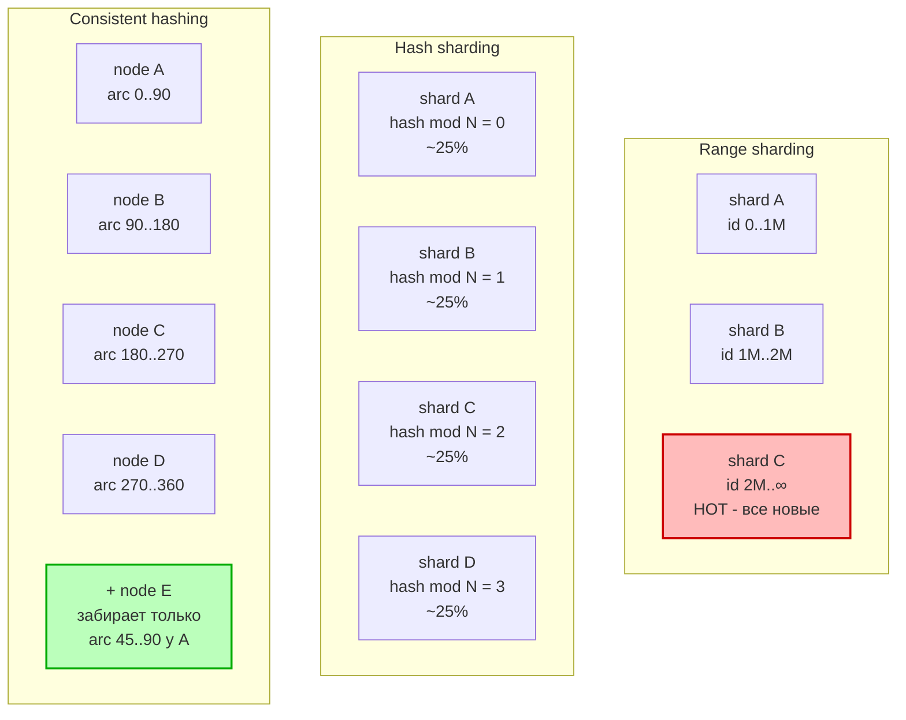

# Вопросы на собеседовании: Шардирование баз данных

`Database Sharding` — horizontal partitioning: разрезание одной логической таблицы/БД на N независимых физических подмножеств (shards), каждое на своём узле. Зачем: storage > RAM/диска одного сервера, write throughput > одного master, latency через локальность данных. Цена: cross-shard queries дорогие, joins ломаются, distributed transactions сложны, resharding — отдельная инженерная задача.

## Полезные ссылки

### Официальная документация и авторитетные источники

- [MongoDB Sharding](https://www.mongodb.com/docs/manual/sharding/)
- [Vitess Documentation](https://vitess.io/docs/)
- [Citus Documentation](https://docs.citusdata.com/)
- [Cassandra — Data distribution & replication](https://cassandra.apache.org/doc/latest/cassandra/architecture/dynamo.html)
- [CockroachDB — Distribution Layer](https://www.cockroachlabs.com/docs/stable/architecture/distribution-layer.html)
- [DynamoDB Partitions and data distribution](https://docs.aws.amazon.com/amazondynamodb/latest/developerguide/HowItWorks.Partitions.html)
- [Karger et al. — Consistent Hashing (1997)](https://www.cs.princeton.edu/courses/archive/fall09/cos518/papers/chash.pdf)
- [DDIA — Chapter 6: Partitioning](https://www.oreilly.com/library/view/designing-data-intensive-applications/9781491903063/) — М. Клеппманн

## Содержание

- [Полезные ссылки](#полезные-ссылки)
- [See also](#see-also)

**Основы**
- [Q1. (!) Мастер упёрся в запись, диск почти полон, чтения уже разобраны репликами. Инженер предлагает долить реплик. Как оценить предложение и как считать узлы?](#q1--мастер-упёрся-в-запись-диск-почти-полон-чтения-уже-разобраны-репликами-инженер-предлагает-долить-реплик-как-оценить-предложение-и-как-считать-узлы)
- [Q2. (!) Таблица `users` разрослась: строка широкая, а девять чтений из десяти берут три поля. Инженер предлагает разрезать — по какой оси?](#q2--таблица-users-разрослась-строка-широкая-а-девять-чтений-из-десяти-берут-три-поля-инженер-предлагает-разрезать--по-какой-оси)
- [Q3. Биллинг: 400 ГБ на треть занятого NVMe, 48k из 52k записей в секунду, клиенты в одном регионе — какой драйвер здесь упирается и что из этого следует?](#q3-биллинг-400-гб-на-треть-занятого-nvme-48k-из-52k-записей-в-секунду-клиенты-в-одном-регионе--какой-драйвер-здесь-упирается-и-что-из-этого-следует)
- [Q4. Монолитную базу магазина режут на восемь шардов: что из нынешнего кода перестанет работать как раньше?](#q4-монолитную-базу-магазина-режут-на-восемь-шардов-что-из-нынешнего-кода-перестанет-работать-как-раньше)
- [Q5. Каталог 300 ГБ, 2 500 вставок в секунду, p99 чтения 120 мс — резать по `category_id`?](#q5-каталог-300-гб-2-500-вставок-в-секунду-p99-чтения-120-мс--резать-по-category_id)

**Стратегии шардирования**
- [Q6. (!) Логи по `event_time` на шести узлах: недельные отчёты быстрые и попадают в один узел, вся запись идёт туда же — что это за схема разреза и что с ней делать?](#q6--логи-по-event_time-на-шести-узлах-недельные-отчёты-быстрые-и-попадают-в-один-узел-вся-запись-идёт-туда-же--что-это-за-схема-разреза-и-что-с-ней-делать)
- [Q7. (!) Кластер на `hash(user_id) mod 4` расширяют до пяти шардов. Какая доля ключей сменит владельца и почему именно такая?](#q7--кластер-на-hashuser_id-mod-4-расширяют-до-пяти-шардов-какая-доля-ключей-сменит-владельца-и-почему-именно-такая)
- [Q8. (!) Кластер на `hash mod N`: доливка девятого узла уносит в переезд почти весь набор. Что даст кольцо в этом кластере и чего оно не закроет?](#q8--кластер-на-hash-mod-n-доливка-девятого-узла-уносит-в-переезд-почти-весь-набор-что-даст-кольцо-в-этом-кластере-и-чего-оно-не-закроет)
- [Q9. Шесть узлов Cassandra, `num_tokens` равен единице: один узел держит вчетверо больше ключей, чем сосед. В чём причина и что менять?](#q9-шесть-узлов-cassandra-num_tokens-равен-единице-один-узел-держит-вчетверо-больше-ключей-чем-сосед-в-чём-причина-и-что-менять)
- [Q10. Маппинг `shard_key → shard_id` вынесен в отдельный сервис с репликами и кэшем. Как это меняет профиль отказов кластера?](#q10-маппинг-shard_key--shard_id-вынесен-в-отдельный-сервис-с-репликами-и-кэшем-как-это-меняет-профиль-отказов-кластера)
- [Q11. Разрез по `region`: ЕС и США, запрет на вывоз персональных данных резидентов ЕС, продакт просит глобальный «топ-100» — что даёт такой разрез и чем за него платят?](#q11-разрез-по-region-ес-и-сша-запрет-на-вывоз-персональных-данных-резидентов-ес-продакт-просит-глобальный-топ-100--что-даёт-такой-разрез-и-чем-за-него-платят)
- [Q12. Три подсистемы в одном продукте: метрики по времени, сессии в живом кластере, крупные SaaS-арендаторы. Какую стратегию каждой?](#q12-три-подсистемы-в-одном-продукте-метрики-по-времени-сессии-в-живом-кластере-крупные-saas-арендаторы-какую-стратегию-каждой)

**Shard key и hot spots**
- [Q13. (!) Шестнадцать шардов по `country`: p99 вырос втрое, пятнадцать узлов держатся ниже 20 % CPU, шестнадцатый упёрся в полку. Что происходит?](#q13--шестнадцать-шардов-по-country-p99-вырос-втрое-пятнадцать-узлов-держатся-ниже-20--cpu-шестнадцатый-упёрся-в-полку-что-происходит)
- [Q14. Сто узлов под заказы, ищут почти всегда по клиенту, реже по дате. Кандидаты в ключ разреза — четыре. Какой брать?](#q14-сто-узлов-под-заказы-ищут-почти-всегда-по-клиенту-реже-по-дате-кандидаты-в-ключ-разреза--четыре-какой-брать)
- [Q15. (!) Один узел из двенадцати: p99 записи 400 мс против 40 мс у соседей, write IOPS втрое выше, CPU 90 %, железо у всех одинаковое — что это за явление и с чего начинать разбор?](#q15--один-узел-из-двенадцати-p99-записи-400-мс-против-40-мс-у-соседей-write-iops-втрое-выше-cpu-90--железо-у-всех-одинаковое--что-это-за-явление-и-с-чего-начинать-разбор)
- [Q16. Один `user_id` даёт сорок процентов записи и перегревает свой shard. Инженер предлагает соль на шестнадцать корзин. Что даёт приём и чем он отличается от составного ключа?](#q16-один-user_id-даёт-сорок-процентов-записи-и-перегревает-свой-shard-инженер-предлагает-соль-на-шестнадцать-корзин-что-даёт-приём-и-чем-он-отличается-от-составного-ключа)

**Cross-shard queries и distributed transactions**
- [Q17. (!) Отчёт по сорока шардам идёт 2,1 с при p99 отдельных узлов до 140 мс, память координатора растёт вместе с числом шардов — из чего складывается эта цена?](#q17--отчёт-по-сорока-шардам-идёт-21-с-при-p99-отдельных-узлов-до-140-мс-память-координатора-растёт-вместе-с-числом-шардов--из-чего-складывается-эта-цена)
- [Q18. Заказы разрезаны по `user_id`, позиции заказа — по `order_id`, и JOIN между ними тянет строки по сети. Насколько это дорого и что с этим делают?](#q18-заказы-разрезаны-по-user_id-позиции-заказа--по-order_id-и-join-между-ними-тянет-строки-по-сети-насколько-это-дорого-и-что-с-этим-делают)
- [Q19. Координатор `2PC` падает между фазами, участники висят с локами, а оформление заказов останавливать нельзя: что выбрать и чем за это платят?](#q19-координатор-2pc-падает-между-фазами-участники-висят-с-локами-а-оформление-заказов-останавливать-нельзя-что-выбрать-и-чем-за-это-платят)
- [Q20. Shard key — `user_id`, а форма входа ищет по `email`: каждый логин расходится по сотне узлов. Как устроен поиск по колонке вне shard key?](#q20-shard-key--user_id-а-форма-входа-ищет-по-email-каждый-логин-расходится-по-сотне-узлов-как-устроен-поиск-по-колонке-вне-shard-key)

**Resharding и migration**
- [Q21. (!) Восемь шардов по `country_id`, объём вырос вчетверо, один узел горячий: что запускает переразрез и чем стратегии отличаются?](#q21--восемь-шардов-по-country_id-объём-вырос-вчетверо-один-узел-горячий-что-запускает-переразрез-и-чем-стратегии-отличаются)
- [Q22. Шардированную БД переводят на новую раскладку ключа, останавливать сервис нельзя. Как устроен такой переезд по фазам?](#q22-шардированную-бд-переводят-на-новую-раскладку-ключа-останавливать-сервис-нельзя-как-устроен-такой-переезд-по-фазам)
- [Q23. В MongoDB-кластере из четырёх шардов упал primary одного из них. Как соотносятся шардирование и репликация и что происходит с записью?](#q23-в-mongodb-кластере-из-четырёх-шардов-упал-primary-одного-из-них-как-соотносятся-шардирование-и-репликация-и-что-происходит-с-записью)

**Реальные системы**
- [Q24. Кластер MongoDB: одна точка подключения, перекос объёма вдвое, ночью растёт трафик между узлами — кто за что отвечает?](#q24-кластер-mongodb-одна-точка-подключения-перекос-объёма-вдвое-ночью-растёт-трафик-между-узлами--кто-за-что-отвечает)
- [Q25. Проектируют таблицу временных рядов в Cassandra и спорят о выборе первичного ключа. Как связаны token ranges, vnodes, partition key и clustering key?](#q25-проектируют-таблицу-временных-рядов-в-cassandra-и-спорят-о-выборе-первичного-ключа-как-связаны-token-ranges-vnodes-partition-key-и-clustering-key)
- [Q26. (!) Приложение ходит в Vitess обычным MySQL-драйвером, а решардинг идёт без остановки: кто здесь за что отвечает?](#q26--приложение-ходит-в-vitess-обычным-mysql-драйвером-а-решардинг-идёт-без-остановки-кто-здесь-за-что-отвечает)
- [Q27. Схему PostgreSQL переводят на Citus: крупная `orders`, справочник `currencies` на двести строк и служебная таблица миграций. Как разложить их по классам?](#q27-схему-postgresql-переводят-на-citus-крупная-orders-справочник-currencies-на-двести-строк-и-служебная-таблица-миграций-как-разложить-их-по-классам)
- [Q28. Команда переезжает с ручного шардирования на CockroachDB. Как движок раскладывает таблицу по узлам и что делает с диапазонами при росте?](#q28-команда-переезжает-с-ручного-шардирования-на-cockroachdb-как-движок-раскладывает-таблицу-по-узлам-и-что-делает-с-диапазонами-при-росте)
- [Q29. DynamoDB: один ключ троттлится при свободной ёмкости таблицы, а `GSI` отдаёт устаревшие данные — почему?](#q29-dynamodb-один-ключ-троттлится-при-свободной-ёмкости-таблицы-а-gsi-отдаёт-устаревшие-данные--почему)
- [Q30. Разрез зашит в код как `userId % SHARD_COUNT`: просят добавить узлы без простоя и соединять данные разных узлов. Что даст промежуточный слой?](#q30-разрез-зашит-в-код-как-userid--shard_count-просят-добавить-узлы-без-простоя-и-соединять-данные-разных-узлов-что-даст-промежуточный-слой)
- [Q31. В SaaS три тысячи мелких аккаунтов и дюжина enterprise-клиентов, которым по договору нужна отдельная БД. Чем silo, bridge и pool различаются?](#q31-в-saas-три-тысячи-мелких-аккаунтов-и-дюжина-enterprise-клиентов-которым-по-договору-нужна-отдельная-бд-чем-silo-bridge-и-pool-различаются)

**Anti-patterns**
- [Q32. Аналитик предлагает резать таблицу событий по `created_at` — дневная нарезка на восемь узлов. Что скажете?](#q32-аналитик-предлагает-резать-таблицу-событий-по-created_at--дневная-нарезка-на-восемь-узлов-что-скажете)
- [Q33. В шардированном на Citus кластере есть крошечный справочник `countries`, к которому джойнятся почти все запросы. Как разложить такую таблицу по узлам?](#q33-в-шардированном-на-citus-кластере-есть-крошечный-справочник-countries-к-которому-джойнятся-почти-все-запросы-как-разложить-такую-таблицу-по-узлам)
- [Q34. (!) На ревью приносят план разреза: ключ выбран, стратегия описана, дашборды нарисованы. Как оценить полноту плана перед запуском?](#q34--на-ревью-приносят-план-разреза-ключ-выбран-стратегия-описана-дашборды-нарисованы-как-оценить-полноту-плана-перед-запуском)

---

## Основы

## Q1. (!) Мастер упёрся в запись, диск почти полон, чтения уже разобраны репликами. Инженер предлагает долить реплик. Как оценить предложение и как считать узлы?

Коротко: **sharding делит данные, репликация их копирует**. Это решения для разных проблем, и часто их применяют вместе.

**Sharding** — горизонтальное разрезание набора данных по `shard key`: каждая строка логически относится к одному шарду (который может хранить несколько копий). Цель — масштабировать **запись и объём**: добавляя shards, мы получаем больше независимых мастеров и больше дисков, между которыми распределена нагрузка.

**Репликация** — копирование одного и того же набора данных на несколько узлов. Цель — масштабировать **чтение и доступность**: читающие реплики могут разгрузить primary, а подходящая реплика может стать новым primary при настроенном failover. Но саму запись это не ускоряет — в single-leader моделях она всё ещё упирается в один master.

При равномерной нагрузке шарды распределяют запись и объём. Слишком горячий ключ может оставить узкое место в одном шарде. Для оценки узлов считайте полные копии с учётом primary: 8 шардов, каждый из которых состоит из одного primary и двух secondary с данными, дают 24 экземпляра, хранящих данные. Служебные компоненты считаются отдельно, а число физических машин зависит от размещения. См. Q23. [MongoDB 8.0 Sharded Cluster](https://www.mongodb.com/docs/v8.0/sharding/).

| Свойство | Sharding | Replication |
|---|---|---|
| Данные на узле | часть общего набора | копия данных своего шарда или всей нешардированной базы |
| Масштабирует | write throughput + storage | read throughput + availability |
| Failover узла | shard недоступен, если нет реплик | при подходящей конфигурации выбирается новый primary |
| Сложность | высокая (key, routing, cross-shard) | средняя (lag, конфликты) |

## Q2. (!) Таблица `users` разрослась: строка широкая, а девять чтений из десяти берут три поля. Инженер предлагает разрезать — по какой оси?

Разница в том, **что именно разрезается**: horizontal режет таблицу по строкам, vertical — по колонкам.

**Горизонтальное разделение** распределяет строки по частям. Части могут оставаться на одном сервере, как при декларативном партиционировании PostgreSQL. При шардировании их размещают на разных узлах. Например:
- shard A: `user_id 1..1M`
- shard B: `user_id 1M..2M`

Каждый узел хранит свой набор строк целиком. Так растёт и объём, и пропускная способность записи.

**Vertical partitioning** — колонки одной таблицы разделены по разным таблицам/узлам, **схемы разные**, связаны по PK:
- таблица `users_hot` (id, email, login) — частые поля
- таблица `users_profile` (id, bio, avatar_url, prefs_json) — редко читаемые

Смысл vertical — отделить «горячие» часто читаемые поля от тяжёлого редко используемого балласта, чтобы горячий набор помещался в кэш и страницы были плотнее.

В этом сценарии сначала измерьте выигрыш от выноса редко читаемых полей и стоимость дополнительных соединений. Если ограничение связано с объёмом или записью, которые один узел уже не выдерживает, оцените горизонтальное распределение отдельно. [Партиционирование PostgreSQL 19](https://www.postgresql.org/docs/19/ddl-partitioning.html).

## Q3. Биллинг: 400 ГБ на треть занятого NVMe, 48k из 52k записей в секунду, клиенты в одном регионе — какой драйвер здесь упирается и что из этого следует?

По условиям первым ограничением выглядит **пропускная способность записи**: 48 тысяч из измеренных 52 тысяч записей в секунду оставляют около 8% запаса относительно предела. По диску занята треть, а межрегиональной задержки в сценарии нет. Проверьте, что предел в 52 тысячи получен на сопоставимой нагрузке с приемлемым p99, и найдите конкретную причину насыщения: WAL, I/O, CPU, блокировки или обновление индексов.

Если ограничения одного писателя подтверждены, проверьте распределение записей по кандидату в ключ шарда. Например, при делении по `tenant_id` самый активный арендатор всё ещё попадает на один шард. Оценивать нужно нагрузку самого загруженного шарда, а также цену операций, которые затрагивают несколько шардов.


## Q4. Монолитную базу магазина режут на восемь шардов: что из нынешнего кода перестанет работать как раньше?

Главная мысль: данные перестают жить в одном месте, поэтому всё, что раньше СУБД делала за вас в одном узле (joins, FK, транзакции, уникальные ID), теперь становится распределённой задачей.

- **Joins across shards** — распределённая СУБД может выполнить JOIN, но иногда потребуется переслать строки между узлами. Совместное размещение связанных данных по одному ключу позволяет выполнить подходящий JOIN локально.
- **Foreign keys** — поддержка зависит от СУБД и размещения. В Citus 13 для совместно размещённых `orders` и `order_items` с распределением по `tenant_id` внешний ключ `(tenant_id, order_id)` может ссылаться на одноимённый первичный ключ заказов. Ограничение `UNIQUE (tenant_id, order_id)` даёт уникальность в пределах арендатора. Для одной распределённой таблицы Citus требует включать столбец распределения в `PRIMARY KEY` и `UNIQUE`. [Citus 13 — ограничения](https://docs.citusdata.com/en/v13.0/develop/reference_ddl.html#adding-removing-constraints)
- **Транзакции через несколько shards** — проверьте поддержку распределённых транзакций. 2PC координирует атомарный коммит, а Saga выполняет локальные транзакции с компенсациями (Q19).
- **Auto-increment ID** — независимые локальные счётчики могут выдать одинаковый ID на разных шардах. Если клиентам нужен единый числовой идентификатор, можно настроить общую sequence, например в Vitess 23. При миграции существующих заказов начальное значение должно быть выше ранее выданных ID. Явная вставка ID в Vitess не сдвигает sequence, поэтому такие вставки нужно отдельно согласовать с генератором. Если достаточно уникальности внутри арендатора, можно оставить составной ключ с `tenant_id`. [Vitess 23 — Sequences](https://vitess.io/docs/23.0/reference/features/vitess-sequences/)
- **Global secondary indexes** — поиск по не-shard-key требует отдельной инфраструктуры (Q20).
- **Аналитические запросы** (`COUNT`, `GROUP BY` по всей таблице) — должны обойти все shards и собрать частичные результаты, затраты зависят от параллелизма, объёма частичных результатов и самого медленного шарда.
- **Операционная сложность** — backups, migrations, monitoring умножаются на N shards.

**Вывод:** шардирование — это не «ещё немного железа», а смена модели данных. Поэтому Q5 — про то, как этого избежать.

## Q5. Каталог 300 ГБ, 2 500 вставок в секунду, p99 чтения 120 мс — резать по `category_id`?

Из этих трёх чисел нельзя определить причину p99 в 120 мс. Сначала разберите медленные запросы: сравните планы, число прочитанных строк, ожидание блокировок и время вне базы. Одновременно измерьте запас CPU, I/O и записи при пиковой нагрузке. Универсального порога в гигабайтах или вставках в секунду нет.

Если медленные чтения вызваны неоптимальным планом, начните с запроса и индексов. Для чтений, допускающих устаревшие данные, проверьте реплики. Если выбран путь шардирования, для `category_id` сначала посмотрите распределение объёма и частоты запросов по категориям. Популярная категория может перегрузить один шард, а запрос без категории может обратиться к нескольким. Выбор подтверждают профилем запросов и измерениями на представительных данных.

---

## Стратегии шардирования

## Q6. (!) Логи по `event_time` на шести узлах: недельные отчёты быстрые и попадают в один узел, вся запись идёт туда же — что это за схема разреза и что с ней делать?

Суть: каждый shard отвечает за **непрерывный диапазон** значений shard key. Соседние по значению ключи лежат рядом — это даёт и главный плюс, и главный минус.

- shard A: `user_id ∈ [0, 1_000_000)`
- shard B: `user_id ∈ [1_000_000, 2_000_000)`
- shard C: `user_id ∈ [2_000_000, +∞)`

**Плюсы:**
- `range queries` эффективны: `WHERE user_id BETWEEN 500_000 AND 700_000` попадает в один shard, не нужно опрашивать остальные.
- Простая логика роутинга — достаточно знать границы диапазонов.
- Локальность: соседние ключи рядом, диапазонное сканирование дёшево.

**Минусы — hot spots** (обратная сторона локальности):
- Если `shard key` монотонный (timestamp, auto-increment id), все **новые** записи идут в **последний** shard — он перегружен, а остальные простаивают. Локальность работает против вас: «свежие» данные всегда соседние.
- Перекос (skew) при неравномерном распределении: один большой tenant забивает свой диапазон.

Для этого потока логов разбиение активного диапазона только по времени перемещает горячую границу, но не распределяет одновременную запись. Если запись упирается в один шард, можно добавить источник событий или хешируемую корзину в ключ, сохранив время для диапазонов внутри неё. Тогда недельный отчёт без условия по корзине читает несколько частей. [MongoDB 8.0 Ranged Sharding](https://www.mongodb.com/docs/v8.0/core/ranged-sharding/).

Используется в: HBase, MongoDB (ranged sharding), Bigtable, CockroachDB.

## Q7. (!) Кластер на `hash(user_id) mod 4` расширяют до пяти шардов. Какая доля ключей сменит владельца и почему именно такая?

Идея: вычисляем `shard_id = hash(shard_key) mod N` (N — число shards). Хеш «размазывает» соседние значения ключа по всему пространству — это зеркальный компромисс к range-based.

**Плюсы:**
- Равномерное распределение при хорошей hash-функции (MurmurHash, xxHash) — каждый shard получает примерно равную долю.
- Хеш распределяет разные последовательные ID, но повторные записи одного горячего ключа всё равно попадают на один шард.

**Минусы** (прямое следствие перемешивания):
- **Диапазонный поиск.** Соседние значения хешируемого ключа не обязательно находятся рядом. Маршрутизатор может обратиться к нескольким шардам для запроса без точного ключа. [MongoDB 8.0 Hashed Sharding](https://www.mongodb.com/docs/v8.0/core/hashed-sharding/).
- **Переход с 4 на 5.** Если номера старых шардов сохраняются, посмотрите на 20 остатков хеша по НОК(4, 5). Значения `hash mod 4` и `hash mod 5` совпадают только для остатков 0, 1, 2 и 3. При равномерном хеше останется примерно 4/20 ключей, а **80% сменят владельца**.

```text
hash("user_42") = 0xA3F7...  ->  mod 4 = 3  ->  shard #3
```

## Q8. (!) Кластер на `hash mod N`: доливка девятого узла уносит в переезд почти весь набор. Что даст кольцо в этом кластере и чего оно не закроет?

**Зачем:** в обычном `hash mod N` добавление узла перемещает почти все ключи (Q7). Consistent hashing (Karger, 1997) убирает зависимость от `N`: при добавлении девятого узла к восьми переезжают ключи его новой доли кольца. При равномерном размещении это около 1/9 ключей. Для сравнения, в `hash mod N` при переходе с 8 на 9 владельца сменят около 8/9 ключей.

**Как работает** — ключевая идея в том, что и узлы, и ключи живут на одном кольце:
1. Hash space сворачивается в **кольцо** (например, `[0, 2^32)`).
2. Каждый узел получает позицию на кольце через `hash(node_id)`.
3. Каждый ключ получает позицию `hash(key)`.
4. Ключ принадлежит **первому узлу по часовой стрелке** от своей позиции.

**Почему rebalancing минимален.** Добавление узла N+1 — это просто новая точка на кольце. Она «перехватывает» только те ключи, что лежат **между новым узлом и его предшественником на кольце**; все остальные ключи как принадлежали своим узлам, так и принадлежат. Удаление узла симметрично: его ключи достаются единственному соседу справа, остальное кольцо не трогается. В `hash mod N` так не выходит, потому что там позиция ключа зависит от N для всех ключей сразу.



Одна случайная позиция на узел может дать неравные дуги. Виртуальные узлы сглаживают разброс, но не делят один горячий ключ. Кольцо определяет владельца. Копирование данных, переключение маршрутов и перенос дополнительных реплик остаются отдельными операциями. [Архитектура Apache Cassandra](https://cassandra.apache.org/doc/latest/cassandra/architecture/dynamo.html).


## Q9. Шесть узлов Cassandra, `num_tokens` равен единице: один узел держит вчетверо больше ключей, чем сосед. В чём причина и что менять?

При одном токене на узел размеры принадлежащих узлам диапазонов могут сильно отличаться. Сначала сравните доли токенов, фактическое число и объём партиций, а также частоту обращений. Если перекос виден в размерах диапазонов, несколько токенов на узел и подходящий алгоритм их распределения могут выровнять нагрузку. Если причина в одной горячей партиции, виртуальные узлы её не разделят.

Количество токенов выбирают по версии Cassandra, алгоритму размещения и размеру кластера. Настройку планируют вместе с вводом или заменой узлов и переносом данных. Простое изменение значения в конфигурации действующего узла не перераспределяет уже размещённые диапазоны. [Конфигурация Cassandra 5.0](https://cassandra.apache.org/doc/latest/cassandra/managing/configuration/cass_yaml_file.html).

## Q10. Маппинг `shard_key → shard_id` вынесен в отдельный сервис с репликами и кэшем. Как это меняет профиль отказов кластера?

Directory хранит явное соответствие `tenant_id → shard_id`. Кэш может сохранить маршрутизацию известных арендаторов при кратком отказе directory. Промахи кэша и операции, которым нужны актуальные метаданные, могут перестать работать. Отказ directory поэтому влияет на разные запросы по-разному.

Главный риск при переносе арендатора — устаревшая запись кэша. Копирование данных и смену маршрута нужно согласовать: догнать изменения до контрольной точки, переключить владельца и обновить версию маршрута. Старый шард должен отклонять записи по старой версии после переключения. Иначе часть клиентов продолжит писать на прежний узел. Реплики directory повышают его доступность, но не отменяют эту проверку.

## Q11. Разрез по `region`: ЕС и США, запрет на вывоз персональных данных резидентов ЕС, продакт просит глобальный «топ-100» — что даёт такой разрез и чем за него платят?

Ключ по региону помогает ограничить размещение исходных записей и направить региональные запросы к местным данным. Это часть выполнения заданного ограничения на вывоз данных. Нужно также проверить размещение реплик, резервных копий, журналов и результаты глобальных запросов. Задержку измеряют от клиента до фактического владельца данных.

Для точного глобального топ-100 по единому порядку и уникальным записям можно взять локальный топ-100 каждого региона и объединить результаты. Это работает, если оценка каждой записи уже вычислена целиком в её регионе. Если рейтинг сначала суммирует показатели одного объекта из нескольких регионов, локальных топов недостаточно. Если сырые записи нельзя передавать, отдельно согласуйте допустимую форму результата и место расчёта. При недоступном регионе явно возвращайте частичный результат или ошибку.


## Q12. Три подсистемы в одном продукте: метрики по времени, сессии в живом кластере, крупные SaaS-арендаторы. Какую стратегию каждой?

- **Метрики по времени.** Делить историю на диапазоны времени, чтобы запрос за период затрагивал только нужные диапазоны. Если текущий диапазон перегревается, распределить запись внутри него по источникам или корзинам (Q6).
- **Сессии.** При обращении по идентификатору сессии и частых изменениях состава кластера подходит consistent hashing. Смена состава меняет владельцев части ключей. Горячая сессия всё равно может перегрузить своего владельца.
- **Крупные SaaS-арендаторы.** Каталог позволяет направить крупного арендатора на выделенный шард и управлять его переездом. Запрос должен содержать идентификатор арендатора, а перенос данных требует согласованного переключения маршрута (Q10).

---

## Shard key и hot spots

## Q13. (!) Шестнадцать шардов по `country`: p99 вырос втрое, пятнадцать узлов держатся ниже 20 % CPU, шестнадцатый упёрся в полку. Что происходит?

Первый подозреваемый — горячий шард. Сверьте распределение запросов и записей по странам с картой размещения. Одна страна может давать основную нагрузку, а несколько активных стран могут попасть на один узел.

При выборе ключа проверьте три свойства:

1. **Кардинальность.** Должно быть достаточно разных значений для распределения данных. Если один ключ принадлежит одному шарду, страну нельзя разделить по узлам одним увеличением их числа.
2. **Распределение данных и нагрузки.** Частое значение может хранить много строк или получать много запросов. Хеширование одного и того же значения сохраняет его на одном шарде.
3. **Фильтры запросов.** Измерьте, какие частые запросы позволяют ограничить набор шардов. Например, в MongoDB 8.0 предикат по префиксу составного ключа может сузить маршрутизацию, но число затронутых шардов зависит от предиката и размещения данных.

Для SaaS `tenant_id` подходит, если запросы привязаны к арендатору, а самые крупные арендаторы укладываются в ёмкость своих шардов или размещаются отдельно.

## Q14. Сто узлов под заказы, ищут почти всегда по клиенту, реже по дате. Кандидаты в ключ разреза — четыре. Какой брать?

Начните с хеширования `customer_id`, если клиенты достаточно многочисленны, а нагрузка самых активных укладывается в пределы одного шарда. Запрос с равенством по клиенту попадёт на его шард. Запрос только по дате потребует обращения к нескольким шардам или отдельной модели чтения.

- **Дата или последовательный ID с разрезом по диапазонам.** Новые заказы концентрируются в крайнем диапазоне. Дата удобна для запросов за период, но плохо соответствует основному поиску по клиенту.
- **Хеш ID заказа.** Распределяет отдельные заказы и направляет запрос по ID заказа. Поиск всех заказов клиента без ID не даёт такого маршрута.
- **Часто меняющееся поле, например статус.** Значений мало. Смена значения может потребовать переноса записи на другой шард, если меняется её владелец.
- **Составной ключ.** Префикс `customer_id` может сузить поиск до шардов с заказами клиента. Если суффикс делит заказы крупного клиента между узлами, запрос по одному клиенту может обращаться к нескольким узлам.

## Q15. (!) Один узел из двенадцати: p99 записи 400 мс против 40 мс у соседей, write IOPS втрое выше, CPU 90 %, железо у всех одинаковое — что это за явление и с чего начинать разбор?

Hot shard — это shard, на который приходится непропорционально много данных или трафика. Разбираем по схеме «откуда → как увидеть → чем лечить», и важно различать перекос **объёма** и перекос **трафика**: лечатся они по-разному.

**Причины:**
- Перекос **данных** (один tenant держит 50% объёма) — упираемся в storage и vacuum.
- Перекос **трафика** (celebrity user, виральный контент) — упираемся в CPU/IOPS, при том что объём может быть нормальным.
- Монотонный shard key — весь поток записи в один shard.

**Диагностика** (без метрик лечить нельзя — сначала найти горячий shard и горячий ключ):
- Метрики per-shard: CPU, write IOPS, latency p99, queue depth — покажут, какой shard горит.
- Топ shard key по числу запросов (sampling в proxy/router) — покажет, кто именно греет.
- В MongoDB: `db.collection.getShardDistribution()`; в Cassandra: `nodetool status` + `tablestats`.

**Лечение** (от лёгких мер к тяжёлым):
1. **Кэширование** перед DB (Redis) — самое дешёвое для перекоса *трафика на чтение*: горячие чтения не доходят до shard.
2. **Корзины в ключе.** Для независимых событий используйте `(user_id, hash(event_id) % 16)` со стабильным идентификатором события. Это может разнести запись, если корзины размещены на разных шардах. Чтение всех событий пользователя охватывает все его корзины. Обновления одной и той же записи корзины не распараллелят.
3. **Составной ключ** с дополнительной размерностью: `(user_id, day)` — разрезает историю по дням, а запись за текущий день по-прежнему может перегружать один шард.
4. **Ручная ребалансировка** через directory (Q10): перевести hot tenant на выделенный shard.
5. **Разделение диапазона и перенос частей.** Помогает, если нагрузка распределена между разными значениями ключа внутри диапазона. Если весь поток приходится на одно полное значение, сначала нужно изменить модель распределения или снизить нагрузку на это значение.

## Q16. Один `user_id` даёт сорок процентов записи и перегревает свой shard. Инженер предлагает соль на шестнадцать корзин. Что даёт приём и чем он отличается от составного ключа?

Соль здесь — вычисляемая часть составного ключа. Для независимых событий используйте `(user_id, hash(event_id) % 16)`. Хеш самого `user_id` дал бы одну и ту же корзину для всех событий этого пользователя. Стабильный `event_id` позволяет при повторе записи или точечном чтении вычислить ту же корзину.

Запись распределится, если события достаточно равномерно попадают в корзины, а корзины размещены на разных шардах. Для чтения всех событий пользователя нужно собрать данные со всех его корзин. Число затронутых физических шардов зависит от их размещения.

Обычный составной ключ может включать полезное для запроса поле, например день. Диапазоны по `(user_id, day)` помогают ограничить поиск по пользователю и периоду, но один горячий день всё ещё может перегружать шард. Запрос по одному префиксу может затронуть несколько шардов, если диапазоны пользователя распределены между ними.

---

## Cross-shard queries и distributed transactions

## Q17. (!) Отчёт по сорока шардам идёт 2,1 с при p99 отдельных узлов до 140 мс, память координатора растёт вместе с числом шардов — из чего складывается эта цена?

Scatter-gather — параллельная отправка запроса нескольким шардам и сбор результатов. Если роутер не может исключить ни один шард по предикатам и карте размещения, запрос рассылается всем. Даже предикат по ключу может охватывать несколько диапазонов на разных шардах.

- **Задержка.** Если для ответа нужны все шарды, критический путь включает самый медленный ответ, ожидание в очередях, передачу данных и слияние. По p99 отдельных узлов нельзя вычислить p99 отчёта.
- **Сеть и память.** Цена зависит от числа запросов и объёма переданных данных. Потоковое слияние отсортированных результатов может обходиться небольшими буферами. Глобальная группировка по множеству ключей может потребовать заметно больше памяти.
- **Частичные агрегаты.** Если движок выполняет часть работы на шардах, координатор может сложить частичные `SUM` и `COUNT`. Для `AVG` он делит общую сумму на общее число значений, отличных от NULL вместо усреднения средних шардов.

Если заказы шардированы по `user_id`, поиск только по `order_id` может потребовать опроса всех шардов. Чтобы сузить маршрут, можно использовать глобальный вторичный индекс (Q20), таблицу `order_id → user_id` или идентификатор заказа, из которого извлекается ключ маршрутизации.

## Q18. Заказы разрезаны по `user_id`, позиции заказа — по `order_id`, и JOIN между ними тянет строки по сети. Насколько это дорого и что с этим делают?

При соединении по `order_id` строки заказа и его позиции могут находиться на разных узлах. План может перераспределить строки по ключу JOIN или передать небольшой отфильтрованный набор на узлы с другой стороной соединения. Основная цена — объём переданных строк, работа на принимающих узлах и перекос нагрузки. Смотрите план и фактический объём обмена после фильтрации.

1. **Совместное размещение.** Добавить `user_id` в позиции, распределить обе таблицы по нему и соединять по `user_id` и `order_id`. В Citus для локального соединения соответствующие шарды должны быть совместно размещены. Фильтр по одному пользователю может ограничить запрос одним рабочим узлом.
2. **Денормализация.** Для частого запроса хранить нужные поля вместе. При изменениях нужно поддерживать согласованность копий.
3. **Справочная таблица.** Небольшой общий справочник можно реплицировать на рабочие узлы, как reference table в Citus. Это помогает соединять заказы со справочником, если такая сторона JOIN достаточно мала для репликации.
4. **Соединение в приложении.** Для небольшого набора заказов можно пакетно запросить позиции и собрать ответ в памяти. Сеть по-прежнему участвует, а согласованность отдельных чтений зависит от модели транзакций.

## Q19. Координатор `2PC` падает между фазами, участники висят с локами, а оформление заказов останавливать нельзя: что выбрать и чем за это платят?

Если заказ и резерв должны принять одно решение commit/abort, нужен протокол атомарной фиксации, например **2PC**. Если бизнес допускает заказ в статусе «ожидает резерва», можно выбрать **Saga** и завершать оформление асинхронно.

- **2PC.** Участники голосуют на фазе prepare. Для commit нужно согласие всех участников. Координатор сохраняет принятое решение и сообщает его участникам. Если после prepare решение недоступно, участник не может самовольно откатиться по таймауту: другие уже могли получить commit. В PostgreSQL подготовленная транзакция сохраняет блокировки до `COMMIT PREPARED` или `ROLLBACK PREPARED`. Восстановление опирается на сохранённое решение координатора.
- **Saga.** Создание заказа, резерв и подтверждение проходят отдельными локальными транзакциями. При отказе резерва заказ можно отменить. Уже видимый результат шага приходится компенсировать отдельной операцией, а сама компенсация может потребовать повторов. Нужны идемпотентность и явные состояния заказа.
- **Transactional outbox** помогает надёжно передавать события между шагами. Запись заказа и запись события фиксируются одной локальной транзакцией. Публикация идёт отдельно и при повторе может дать дубликат, поэтому получатель должен уметь повторно обработать событие без повторного бизнес-эффекта.

## Q20. Shard key — `user_id`, а форма входа ищет по `email`: каждый логин расходится по сотне узлов. Как устроен поиск по колонке вне shard key?

Локальный индекс по `email` ускоряет поиск внутри каждого шарда. Чтобы сократить число обращений, нужен отдельный маршрут от `email` к `user_id` или непосредственно к месту размещения записи.

1. **Таблица маршрутизации.** По нормализованному `email` получаем `user_id`, затем читаем запись на её шарде. При асинхронном обновлении таблицы новый адрес может временно отсутствовать, а старый — по-прежнему вести к записи. При входе сверяйте адрес с основной записью.
2. **DynamoDB GSI.** Ключ GSI можно построить по `email`. Данные из базовой таблицы попадают в индекс асинхронно, чтение GSI поддерживает только eventual consistency, значения его ключа могут повторяться.
3. **Vitess lookup Vindex.** Сопоставляет значение колонки с одним или несколькими keyspace ID, по которым роутер выбирает шарды. Локальный индекс на целевой таблице ускоряет поиск уже внутри выбранных шардов.

Если адрес должен быть глобально уникальным, проверка через асинхронный индекс не защищает от одновременной регистрации. Уникальность должна обеспечиваться при записи, например атомарным резервированием нормализованного адреса в одном месте. Согласованность резерва и учётной записи зависит от выбранной схемы записи и восстановления.

---

## Resharding и migration

## Q21. (!) Восемь шардов по `country_id`, объём вырос вчетверо, один узел горячий: что запускает переразрез и чем стратегии отличаются?

Сначала проверьте, что перегружает узел. При росте объёма можно добавить ёмкость и перенести часть диапазонов. Если нагрузка приходится на одно неделимое значение `country_id`, перенос этого значения переместит перегрузку. Чтобы распределить нагрузку внутри страны, нужен дополнительный признак или новая схема ключа. Это может увеличить число шардов для запросов по одной стране.

- **Перемещение существующих диапазонов.** Заранее нарезанные диапазоны можно переносить независимо. Ключ и принадлежность записи диапазону сохраняются, меняется владелец диапазона. Копирование и переключение маршрута всё равно нужны.
- **Consistent hashing.** При добавлении узла перераспределяется часть пространства хеша (Q8). Оценка доли предполагает близкое к равномерному распределение. Время переезда зависит от объёма данных, нагрузки и пропускной способности.
- **Переразрез по новому ключу.** Копируем данные на новую раскладку, догоняем изменения и переключаем трафик. Например, MongoDB 8.0 поддерживает переразрез с прежним ключом через `forceRedistribution` и смену ключа через `reshardCollection`. На финальном переключении запись в коллекцию кратковременно блокируется. Порядок миграции и работа с переключением разобраны в Q22.

## Q22. Шардированную БД переводят на новую раскладку ключа, останавливать сервис нельзя. Как устроен такой переезд по фазам?

До переключения исходная раскладка принимает запись, целевая получает копию. Для переезда под нагрузкой нужно согласовать копирование истории, поток изменений и смену владельца записи.

1. **Копирование и CDC.** Зафиксируйте позицию журнала, согласованную со снимком, и сохраните изменения после неё. Копируйте данные по новой раскладке с контрольными точками. Если копирование и применение изменений идут одновременно, старая версия из снимка не должна затереть новую или вернуть удалённую строку.
2. **Догоняющая репликация.** Применяйте изменения с учётом порядка и повторов. Контролируйте отставание и ошибки. Таблица outbox может передавать изменения, если все затронутые записи и удаления отражаются в событиях. Два независимых вызова записи из приложения могут завершиться по-разному.
3. **Сверка.** Сравните данные на сопоставимой позиции журнала или снимке, например по диапазонам и контрольным суммам. Теневые чтения проверяют реальные запросы, но расхождение при ненулевом лаге ещё не доказывает потерю данных.
4. **Переключение.** Остановите или буферизуйте запись на источнике, дождитесь применения последних изменений и направьте запись на цель. Старый маршрут больше не должен принимать запись. Короткая пауза записи возможна даже при миграции под нагрузкой. После первой записи на цели возврат требует обратной репликации или переноса накопившихся изменений.

**Пример границы применимости.** В Vitess 23 workflow `Reshard` может разделить шард `0` на `-80` и `80-`. В этом сценарии меняются границы диапазонов, а Primary Vindex по-прежнему вычисляет keyspace ID по тем же правилам. VReplication копирует данные и догоняет изменения. Перед переключением дождитесь завершения VDiff и проверьте, что он не нашёл расхождений. При `SwitchTraffic` для primary Vitess останавливает запись на источнике и ждёт применения изменений до позиции остановки. Успешная сверка VDiff сама по себе не означает, что цель уже достигла этой позиции.

См. [пример переразреза Vitess 23](https://vitess.io/docs/23.0/user-guides/configuration-advanced/resharding/) и [контракт SwitchTraffic](https://vitess.io/docs/23.0/reference/vreplication/reshard/).

## Q23. В MongoDB-кластере из четырёх шардов упал primary одного из них. Как соотносятся шардирование и репликация и что происходит с записью?

Каждый из четырёх шардов хранит свою часть данных. Члены replica set внутри шарда хранят копии этой части. При падении primary выборы проходят в его replica set. Нужны доступное большинство голосующих членов и подходящий кандидат.

До успешного завершения выборов операции записи, которым нужен этот шард, не могут завершиться. Когда новый primary выбран, `mongos` направляет запись ему. Запись, адресованная только здоровым шардам, может продолжаться. Операция, затрагивающая несколько шардов, всё ещё зависит от доступности требуемого шарда.

Чтение с secondary может продолжиться, если это разрешено настройками чтения и остались подходящие реплики. Из-за отставания они могут вернуть более старые данные. Длительность переключения зависит от конфигурации и связи между узлами.

**Что с уже подтверждённой записью.** В MongoDB 8.0 представим шард с тремя голосующими узлами, хранящими данные. Primary подтвердил создание заказа с `{ w: 1 }` и потерял связь с обоими secondary до репликации этой записи. Secondary могут выбрать новый primary без этого заказа. Когда прежний primary вернётся в набор, расходящаяся запись может быть откачена. При успешном подтверждении с `{ w: "majority" }` и включённым журналированием с настройкой `writeConcernMajorityJournalDefault: true` запись в таком сценарии уже зафиксирована в журналах большинства и переживает выборы. При отсутствии нужного числа доступных реплик подтверждения большинства придётся ждать либо запрос получит ошибку write concern по таймауту. Такой таймаут оставляет результат записи неопределённым для клиента.

См. [откат при смене primary](https://www.mongodb.com/docs/v8.0/core/replica-set-rollbacks/) и [write concern MongoDB 8.0](https://www.mongodb.com/docs/v8.0/reference/write-concern/).

---

## Реальные системы

## Q24. Кластер MongoDB: одна точка подключения, перекос объёма вдвое, ночью растёт трафик между узлами — кто за что отвечает?

- **`mongos`** принимает клиентские запросы и по метаданным направляет их на один или несколько нужных шардов. Для доступности можно использовать несколько экземпляров.
- **Config Server Replica Set** хранит метаданные кластера, включая карту диапазонов по шардам. По этой карте `mongos` строит маршруты.
- **Shard** хранит часть данных коллекции и сам работает как replica set. **Chunk** описывает диапазон значений ключа. Настроенный размер диапазона (128 MB по умолчанию) служит ориентиром балансировки, фактические объёмы могут различаться.
- **Balancer** в MongoDB 8.0 работает на primary набора config servers. Он учитывает объём данных каждой шардированной коллекции, пороги миграции и зоны. Перенос диапазонов создаёт сетевую нагрузку, поэтому ночной пик стоит сопоставить с окном балансировки и фактическими миграциями.

**Как проверить ночной пик.** Через `mongos` выполните `db.getSiblingDB("mydb").orders.getShardDistribution()`, чтобы сравнить объём данных и число документов коллекции по шардам. В `mongosh` 2.3.3 и новее эти показатели исключают оставшиеся после миграции документы, ожидающие удаления. Затем вызовите `sh.balancerCollectionStatus("mydb.orders")`. Поле `balancerCompliant` описывает состояние на момент проверки. При нарушении `firstComplianceViolation` указывает первую причину, например несоответствие зоне.

Чтобы связать пик трафика с балансировкой, сопоставьте время переноса диапазонов в журналах с сетевыми метриками. Даже при равномерном объёме данных один шард может получать больше запросов из-за горячего ключа. Проверку распределения нагрузки проводят отдельно.

См. [распределение коллекции](https://www.mongodb.com/docs/v8.0/reference/method/db.collection.getsharddistribution/) и [статус балансировки коллекции](https://www.mongodb.com/docs/v8.0/reference/method/sh.balancercollectionstatus/).

Примеры для разных коллекций в MongoDB 8.0:

```javascript
sh.shardCollection("mydb.orders", { user_id: "hashed" })
sh.shardCollection("mydb.events", { created_at: 1 })
sh.shardCollection("mydb.tenant_events", { tenant_id: 1, event_id: 1 })
```

Для непустой коллекции заранее нужен индекс, поддерживающий выбранный ключ. С MongoDB 6.0 предварительный вызов `sh.enableSharding()` необязателен.

Хеш ключа помогает распределять значения, но диапазон по исходному полю обычно затрагивает несколько шардов. Ключ по диапазонам упрощает запросы по этому диапазону, но монотонная запись может перегружать крайний шард. MongoDB 4.4 добавила составной хешированный ключ, а 5.0 — смену ключа через `reshardCollection` (Q21).

## Q25. Проектируют таблицу временных рядов в Cassandra и спорят о выборе первичного ключа. Как связаны token ranges, vnodes, partition key и clustering key?

Cassandra — каноничный пример **consistent hashing + vnodes** (Q8, Q9) в проде, плюс важное различие двух частей ключа. Главная особенность: нет ни master, ни отдельного роутера — все узлы равноправны.

**Архитектура:**
- Кольцо токенов `[-2^63, 2^63)` (Murmur3 partitioner).
- Параметр `num_tokens` задаёт число токенов узла. Узел может владеть несколькими разнесёнными диапазонами кольца (vnodes). Значение смотрят в конфигурации кластера.
- `replication_factor=3` → для партиции выбираются три реплики в области действия этого RF. В `NetworkTopologyStrategy` RF задают по дата-центрам, а размещение учитывает стойки.
- Координатором запроса может быть любой узел; token-aware клиент при известном routing key может выбрать реплику партиции координатором. Тот обращается к другим репликам по необходимости.

Первичный ключ содержит partition key и может включать clustering columns. Пример CQL:

```sql
CREATE TABLE events (
    user_id    UUID,         -- partition key (хешируется в токен)
    event_time TIMESTAMP,
    event_id   UUID,
    payload    TEXT,
    PRIMARY KEY ((user_id), event_time, event_id)
) WITH CLUSTERING ORDER BY (event_time DESC, event_id ASC);
```

Ключевое различие — какая часть ключа за что отвечает:
- **Partition key** задаёт токен партиции. Реплики определяются по токену и стратегии репликации.
- **Clustering key** упорядочивает строки **внутри одной партиции** и позволяет выбирать диапазоны времени для известной партиции. `event_id` различает события с одинаковым временем.
- Compound partition key: `PRIMARY KEY ((user_id, day), event_time, event_id)` ограничивает партицию одним днём. Поиск за несколько дней охватывает несколько партиций, а текущий день всё ещё может оставаться горячим.

**Как выбрать размер бакета.** Если один пользователь генерирует 2 000 событий в минуту, дневная партиция получит до 2,88 млн строк при такой постоянной нагрузке. Пятиминутный бакет уменьшит эту оценку до 10 000 строк, но чтение полного часа по выровненным границам затронет 12 партиций. Оцените число ячеек и размер данных, затем проверьте типичные запросы и пиковую нагрузку.

Более короткий временной бакет ограничивает период накопления данных, но в текущем бакете по-прежнему может быть горячая партиция. Если требуется распределить одновременную запись, добавьте в partition key номер корзины, вычисленный стабильным хешем `event_id`. Тогда чтение за период должно обойти нужные корзины и объединить результаты в требуемом порядке. Фактическое распределение нагрузки зависит от размещения реплик этих партиций.

См. [моделирование временных рядов](https://cassandra.apache.org/doc/latest/cassandra/developing/data-modeling/data-modeling_logical.html) и [оценку размера партиции](https://cassandra.apache.org/doc/latest/cassandra/developing/data-modeling/data-modeling_refining.html).


## Q26. (!) Приложение ходит в Vitess обычным MySQL-драйвером, а решардинг идёт без остановки: кто здесь за что отвечает?

Vitess — sharding-слой поверх MySQL (разработан в YouTube; используют Slack, GitHub, Square). Ключевая идея: приложение продолжает говорить обычным MySQL-протоколом, а Vitess прозрачно превращает один логический keyspace в множество физических shards. Понять надо два уровня — компоненты (кто куда маршрутизирует) и vindex (как колонка отображается в shard).

**Архитектура:**
- **VTGate** — stateless router (роль как у mongos). Клиент подключается обычным MySQL-протоколом и не знает о шардировании.
- **VTTablet** — sidecar к каждому MySQL-инстансу: прокси с connection pooling, throttling и streaming.
- **Topology service** (etcd/Zookeeper) — хранит метаданные кластера.
- **Keyspace** — логическая БД; может быть шардированной (`sharded: true`) или нет (`unsharded`).
- **Shard** — диапазон keyspace IDs: `-80`, `80-` или мельче `-40`, `40-80`, `80-c0`, `c0-`. Такая запись диапазонами и позволяет дробить shards при resharding.

**Vindex** — это функция отображения колонки в `keyspace_id`, то есть «как из значения колонки понять shard»:

| Vindex type | Описание |
|---|---|
| `hash` | Хеширует числовое значение и получает keyspace ID. |
| `lookup` | Отдельная таблица value → keyspace_id (как directory). Для secondary lookup. |
| `numeric` | Identity-функция, для числовых ID. |
| `consistent_lookup` | Lookup с прозрачным управлением консистентностью. |
| `xxhash` | Строит keyspace ID с помощью xxHash. |

Пример VSchema. Таблица отображения `directory.user_email_lookup` создаётся отдельно.

```json
{
  "sharded": true,
  "vindexes": {
    "hash": { "type": "hash" },
    "user_email_lookup": {
      "type": "lookup",
      "params": { "table": "directory.user_email_lookup", "from": "email", "to": "keyspace_id" },
      "owner": "users"
    }
  },
  "tables": {
    "users": {
      "column_vindexes": [
        { "column": "user_id", "name": "hash" },
        { "column": "email", "name": "user_email_lookup" }
      ]
    }
  }
}
```

Идея в том, что у одной таблицы может быть несколько vindex: primary (`hash` по основному ключу) определяет, куда писать, а secondary (`lookup` по `email`) — это встроенный аналог GSI из Q20, для поиска по email. Если одному email соответствуют разные keyspace ID, маршрутов может быть несколько.

**vReplication** — MySQL-binlog-based механизм миграций: resharding, materialize, online schema changes. Для смены маршрута записи требуется согласованное переключение (Q22).

## Q27. Схему PostgreSQL переводят на Citus: крупная `orders`, справочник `currencies` на двести строк и служебная таблица миграций. Как разложить их по классам?

В Citus 13 выбор зависит от того, где нужны строки. Если заказы и позиции чаще читают вместе в пределах арендатора, распределите обе таблицы по `tenant_id` и поместите их в одну группу co-location (Q18). `currencies` сделайте справочной таблицей, если она нужна при JOIN на workers. Таблицу истории миграций оставьте на координаторе, если инструмент миграций обращается только к нему.

**Типы таблиц:**
- **Distributed table** — горизонтально шардирована по `distribution column`.
- **Reference table** — содержит один шард с полной копией на каждом worker. Подходит для маленьких и редко обновляемых справочников (Q33).
  ```sql
  SELECT create_reference_table('currencies');
  ```
- **Local table** — обычная таблица PostgreSQL на координаторе. Если к ней нужно обращаться с других узлов, `citus_add_local_table_to_metadata` распространяет схему и метаданные. Сами строки остаются на координаторе.

**Co-located JOIN.** Когда условие связывает одноимённые ключи распределения, соответствующие шарды можно соединить на одном worker. Фильтр по одному `tenant_id` ограничивает запрос нужной парой шардов. Без этого фильтра соединение может выполняться локально на нескольких workers.

```sql
-- Обе таблицы co-located по tenant_id
SELECT create_distributed_table('orders',     'tenant_id');
SELECT create_distributed_table('order_items','tenant_id', colocate_with => 'orders');

-- JOIN работает локально на каждом shard
SELECT o.id, oi.product_id
FROM orders o
JOIN order_items oi ON o.tenant_id = oi.tenant_id AND o.id = oi.order_id
WHERE o.tenant_id = 42;
```

Координатор использует метаданные распределения при планировании. Workers хранят шарды и выполняют задачи распределённого запроса. [Citus 13: функции управления таблицами](https://docs.citusdata.com/en/v13.0/develop/api_udf.html) · [Группы co-location](https://docs.citusdata.com/en/v13.0/develop/reference_ddl.html#co-locating-tables).

## Q28. Команда переезжает с ручного шардирования на CockroachDB. Как движок раскладывает таблицу по узлам и что делает с диапазонами при росте?

CockroachDB хранит таблицы и индексы в упорядоченном KV-пространстве. Первичный ключ задаёт порядок ключей строк в первичном индексе. Движок делит это пространство на непрерывные диапазоны и ведёт карту размещения их реплик.

- У каждого диапазона своя группа Raft. Число и размещение реплик зависят от настроек.
- CockroachDB делит диапазоны по размеру или по нагрузке. Для деления по нагрузке движок ищет границу, которая распределит обращения между новыми диапазонами. Сразу после деления новые диапазоны могут иметь тот же набор узлов, что и исходный. Размещение реплик и перенос leaseholder происходят отдельно.
- Монотонный ведущий ключ концентрирует вставки в крайнем диапазоне индекса. Деление по размеру не убирает горячий край: следующие вставки снова идут в один из диапазонов. По той же причине деление по нагрузке здесь обычно не помогает.

Случайный UUID в начале первичного ключа распределяет вставки первичного индекса. Отдельный вторичный индекс с монотонным ведущим ключом всё ещё может перегреваться. Другой вариант — hash-sharded index. В CockroachDB 26.2 пример для первичного индекса выглядит так:

```sql
CREATE TABLE events (
    ts TIMESTAMPTZ,
    event_id UUID,
    payload STRING,
    PRIMARY KEY (ts, event_id) USING HASH WITH (bucket_count = 16)
);
```

Движок добавляет к ключу префикс корзины. Поиск диапазона только по `ts` может читать несколько корзин, а 16 корзин не означают 16 физических узлов.

Если типичный запрос читает историю одного датчика, в CockroachDB 26.2 можно выбрать ключ `(sensor_id, ts, event_id)` и указать `USING HASH WITH (bucket_count = 16, shard_columns = (sensor_id))`. При равенстве по `sensor_id` движок может вычислить одну корзину и читать интервал времени внутри неё. Данные разных датчиков распределяются по корзинам. Если основную нагрузку создаёт один датчик, хеш только по `sensor_id` оставит все его записи в одной корзине. [CockroachDB 26.2 — hash-sharded indexes](https://www.cockroachlabs.com/docs/v26.2/hash-sharded-indexes).

## Q29. DynamoDB: один ключ троттлится при свободной ёмкости таблицы, а `GSI` отдаёт устаревшие данные — почему?

DynamoDB управляет физическими партициями сам. Хеш partition key участвует в размещении данных. Если задан sort key, элементы с одним partition key логически образуют коллекцию, которую можно читать по диапазону sort key.

Свободная пропускная способность таблицы не исключает throttling горячего ключа. На уровне физической партиции действуют пределы до 3 000 RCU и 1 000 WCU в секунду. Число операций при этом зависит от размера элементов и режима чтения. Adaptive capacity помогает использовать доступную ёмкость при перекосе, но отдельный горячий элемент всё равно может упереться в предел партиции.

Для независимых событий можно добавить корзину по стабильному ID события (Q16). Это распределяет операции по разным значениям ключа ценой чтения по нескольким корзинам. Кэш помогает при повторяющихся чтениях. Проверьте `ThrottlingReasons` в ответе DynamoDB и ARN ресурса. Например, `IndexWriteKeyRangeThroughputExceeded` указывает на предел записи физической партиции конкретного GSI. В этом случае проверяйте распределение нагрузки по ключу индекса. `IndexWriteProvisionedThroughputExceeded` указывает на исчерпание выделенной пропускной способности GSI. В этом случае сопоставьте потребление с настройками ёмкости индекса. Обе причины могут проявиться при записи в базовую таблицу. [Диагностика throttling в DynamoDB](https://docs.aws.amazon.com/amazondynamodb/latest/developerguide/throttling-diagnosing-workflow.html).

GSI использует собственную схему ключа. DynamoDB обновляет его асинхронно, поэтому сразу после подтверждённой записи запрос к GSI может вернуть старые данные или пропустить новый элемент (Q20).

## Q30. Разрез зашит в код как `userId % SHARD_COUNT`: просят добавить узлы без простоя и соединять данные разных узлов. Что даст промежуточный слой?

Подмена `SHARD_COUNT` меняет адреса уже записанных строк. Например, для `userId = 13` при четырёх шардах индекс равен 1, а при пяти — 3. При смене маршрута без переноса поиск пойдёт на узел, где строки ещё нет.

- **Маршрутизация в приложении.** Для существующей раскладки по четырём остаткам можно ввести 256 логических корзин: `bucket = userId % 256` для неотрицательного `userId`. На старте корзина `b` принадлежит узлу `b % 4`, поэтому строки остаются на прежних узлах. При расширении переносите выбранные корзины и меняйте их владельцев в карте. Число корзин в формуле остаётся прежним. Для добавления узла нужны копирование, догон изменений и согласованное переключение владельца (Q22).
- **Прокси с правилами.** ProxySQL направляет запросы в настроенные группы серверов. Такое правило решает задачу выбора назначения. Для соединения данных из нескольких групп нужен отдельный механизм выполнения и слияния.
- **Слой с поддержкой распределённых запросов.** В Vitess 23 Primary Vindex вычисляет `keyspace ID`, а обслуживающий шард определяется диапазоном, в который входит этот ID. При разделении диапазона можно сохранить Vindex и ID строк. VReplication копирует данные и догоняет изменения перед переключением трафика. Проверьте конкретные запросы: локальный JOIN по совместно размещённым данным и JOIN с обменом строками имеют разную цену (Q18).

См. [диапазоны ключей Vitess 23](https://vitess.io/docs/23.0/reference/features/sharding/) и [процесс решардинга](https://vitess.io/docs/23.0/user-guides/configuration-advanced/resharding/).


## Q31. В SaaS три тысячи мелких аккаунтов и дюжина enterprise-клиентов, которым по договору нужна отдельная БД. Чем silo, bridge и pool различаются?

Для двенадцати enterprise-клиентов выделите по отдельной БД согласно договору. Для трёх тысяч небольших аккаунтов используйте общие таблицы с `tenant_id`, если они допускают совместное размещение.

| Модель | Размещение | Что нужно учесть |
|---|---|---|
| **Pool** | Общие таблицы с `tenant_id`. Можно шардировать по арендатору при росте. | Нужна проверяемая изоляция строк, например RLS в PostgreSQL. |
| **Bridge** | Например, отдельная схема на арендатора в общей БД. | Схемы дают отдельные пространства имён и права, но делят ресурсы БД. Миграции выполняются по всем схемам. |
| **Silo** | В этом сценарии отдельная БД на арендатора. | Уточните, требует ли договор отдельного экземпляра. Разные БД на одном экземпляре всё ещё делят его ресурсы. |

**Проверка изоляции в pool.** В PostgreSQL 19 включите RLS на общей таблице и задайте политики чтения и записи. `USING` ограничивает доступные существующие строки, а `WITH CHECK` проверяет новые значения при вставке и обновлении. Если сервис использует одну роль для всех арендаторов, политика должна получать идентификатор из доверенного контекста запроса. При переиспользовании соединений ограничьте этот контекст транзакцией.

Проверьте две операции под рабочей ролью сервиса. При контексте арендатора A строка B не должна появляться в результатах `SELECT`, а попытка вставить строку с `tenant_id` арендатора B должна быть отклонена. Для этого роль сервиса должна подчиняться RLS. Владелец таблицы обычно обходит политики, если не включён `FORCE ROW LEVEL SECURITY`. Суперпользователи и роли с `BYPASSRLS` обходят их и при включённом `FORCE`. [PostgreSQL 19 — Row Security Policies](https://www.postgresql.org/docs/19/ddl-rowsecurity.html)

Каталог может хранить назначение каждого арендатора: общий кластер или конкретная отдельная БД (Q10). Переезд из pool в silo требует переноса данных, проверки и согласованного переключения маршрута (Q22).

---

## Анти-паттерны

## Q32. Аналитик предлагает резать таблицу событий по `created_at` — дневная нарезка на восемь узлов. Что скажете?

Если один дневной диапазон принадлежит одному узлу и большинство событий поступает за текущий день, восемь узлов не дают восемь путей записи. Пик принимает узел текущего дня. Зато запросы по дате могут исключать старые диапазоны.

Если основные запросы включают `tenant_id` или `device_id`, распределите запись по этому измерению, а внутри каждого шарда разбейте таблицу по времени. Например, в PostgreSQL `PARTITION BY RANGE (created_at)` позволяет исключать локальные секции по условию периода. Глобальный отчёт только по дате всё равно обращается ко всем нужным шардам и объединяет результаты.

**Граница дня и запоздалые события.** Для `created_at` типа `timestamptz` задайте границы секции в UTC, например от `2026-11-21 00:00:00+00` включительно до `2026-11-22 00:00:00+00` исключительно. В запросе используйте те же границы: `created_at >= :from AND created_at < :to`. Событие с отметкой времени за 21 ноября, пришедшее 22 ноября, попадёт в секцию за 21-е. Если эта секция уже удалена и подходящей `DEFAULT`-секции нет, вставка завершится ошибкой. Поэтому срок хранения секций и порядок обработки поздних событий согласуют заранее. На каждом шарде проверьте через `EXPLAIN`, какие секции исключаются. [Документация PostgreSQL 18](https://www.postgresql.org/docs/18/ddl-partitioning.html#DDL-PARTITION-PRUNING)

Если поиск обычно идёт только по времени, можно делить каждый день на корзины по стабильному идентификатору события или источника. Разместите корзины на разных узлах. Отчёт за день прочитает все его корзины, а один горячий источник может потребовать разреза на уровне событий (Q16).

## Q33. В шардированном на Citus кластере есть крошечный справочник `countries`, к которому джойнятся почти все запросы. Как разложить такую таблицу по узлам?

Сделайте `countries` справочной таблицей Citus. В Citus 13 она хранится как один шард с полной копией на каждом worker. Когда worker соединяет свои строки заказов со справочником, нужные страны есть локально. Если сами заказы распределены по нескольким шардам, запрос всё ещё может выполняться на нескольких workers.

```sql
SELECT create_reference_table('countries');
```

Цена — полная копия на каждом worker и согласованное обновление копий. Citus использует 2PC при изменении справочной таблицы. Поэтому подход хорошо подходит для маленького и редко обновляемого справочника, который часто участвует в JOIN.

## Q34. (!) На ревью приносят план разреза: ключ выбран, стратегия описана, дашборды нарисованы. Как оценить полноту плана перед запуском?

Попросите показать, что выбранная раскладка снимает измеренное ограничение и что команда сможет восстановить данные при сбое.

1. **Зачем делить.** Зафиксировать узкое место и целевые показатели. Проверить, хватит ли оптимизации запросов, архивирования, роста одного узла или реплик чтения (Q5).
2. **Ключ и стратегия.** На реальном распределении данных и запросов оценить объём на шард, самый горячий ключ и долю операций, которые затрагивают несколько шардов (Q6–Q15).
3. **Запросы и целостность.** Проверить планы критичных JOIN и агрегатов, стоимость обмена и требования к уникальности. Для инвариантов между шардами выбрать атомарную фиксацию либо явно определить допустимые промежуточные состояния и компенсации (Q17–Q20).
4. **Миграция.** Описать копирование, применение изменений, сверку, переключение записи и условия возврата. Оценить время и дополнительную нагрузку на источник и цель (Q21–Q22).
5. **Эксплуатация.** Проверить отказ шарда и роутера, резервное копирование и восстановление согласованного состояния, порядок миграций схемы и совместимость версий при поэтапном развёртывании (Q23).
6. **Критерии допуска.** Задать измеримые пределы задержки, ошибок и лага. Прогнать сценарии перекоса и отказа, довести до переключения на тестовом наборе и показать, как команда остановит или вернёт миграцию при выходе за пороги.

**Пример решения на ревью.** В Vitess 23 команда меняет раскладку заказов через `Reshard`. Сверка `VDiff` прошла, но во время репетиции запись на источнике остановилась, а цель не успела догнать последнюю позицию за бюджет переключения. Это причина отложить запуск: сверка данных и укладывание в бюджет паузы проверяют разные свойства. В Vitess `SwitchTraffic` для primary ждёт догона до точки остановки записи и возвращает ошибку, если истёк `--timeout`. При репетиции зафиксируйте, где запись снова доступна после ошибки, и проверьте запись через штатный маршрут.

Отдельно проверьте возврат **после** успешного переключения. Отправьте контрольную запись на новую раскладку, выполните `ReverseTraffic` с настроенной обратной репликацией и убедитесь, что запись доступна после возврата на исходный маршрут. Без этого опыта возможность вернуть старые правила маршрутизации ещё ничего не говорит о сохранности новых данных. [Vitess 23 — Reshard](https://vitess.io/docs/23.0/reference/vreplication/reshard/) · [Vitess 23 — VDiff](https://vitess.io/docs/23.0/reference/vreplication/vdiff/)

---

## See also

- [database-architecture-interview](database-architecture-interview.md) — общая архитектура БД, partitioning, replication patterns
- [database-transactions-interview](database-transactions-interview.md) — ACID, изоляция, распределённые транзакции
- [database-replication-interview](database-replication-interview.md) — master-slave, multi-master, sync vs async
- [postgresql-interview](postgresql-interview.md) — PG-нативные partitioning + Citus
- [mongodb-interview](mongodb-interview.md) — mongos, config servers, chunks, balancer (детали)
- [cassandra-interview](cassandra-interview.md) — consistent hashing, vnodes, partition key
- [dynamodb-interview](dynamodb-interview.md) — partition key + sort key, GSI
- [../architecture/distributed-systems-interview](../architecture/distributed-systems-interview.md) — CAP, consensus, partition tolerance
- [../architecture/scalability-patterns-interview](../architecture/scalability-patterns-interview.md) — vertical/horizontal scaling, шардирование как паттерн
- [../architecture/consistency-patterns-interview](../architecture/consistency-patterns-interview.md) — eventual / strong consistency, quorum
- [../system-design/system-design-interview](../system-design/system-design-interview.md) — sharding в system design интервью

