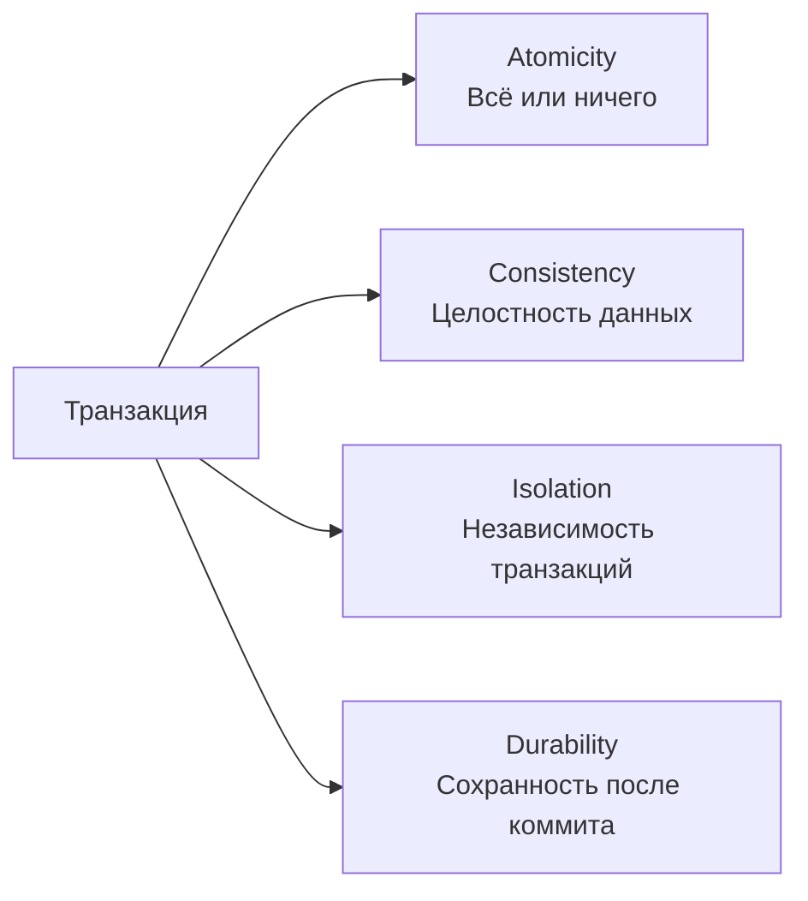
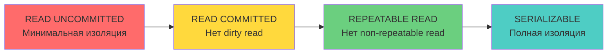
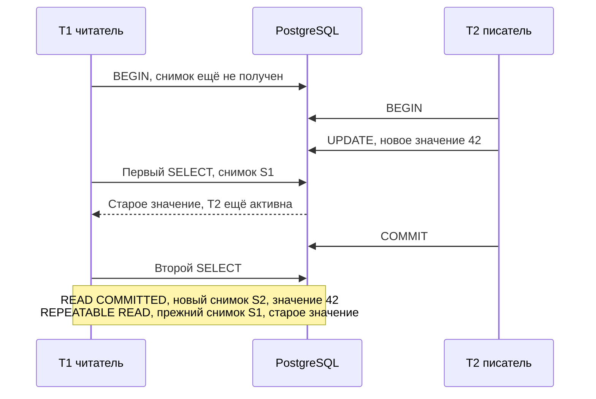
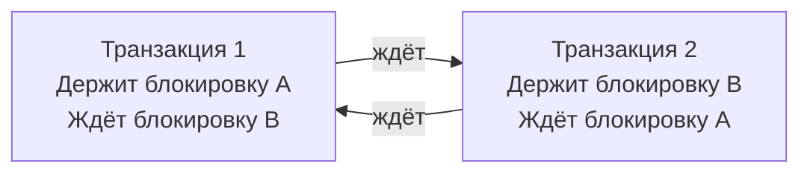
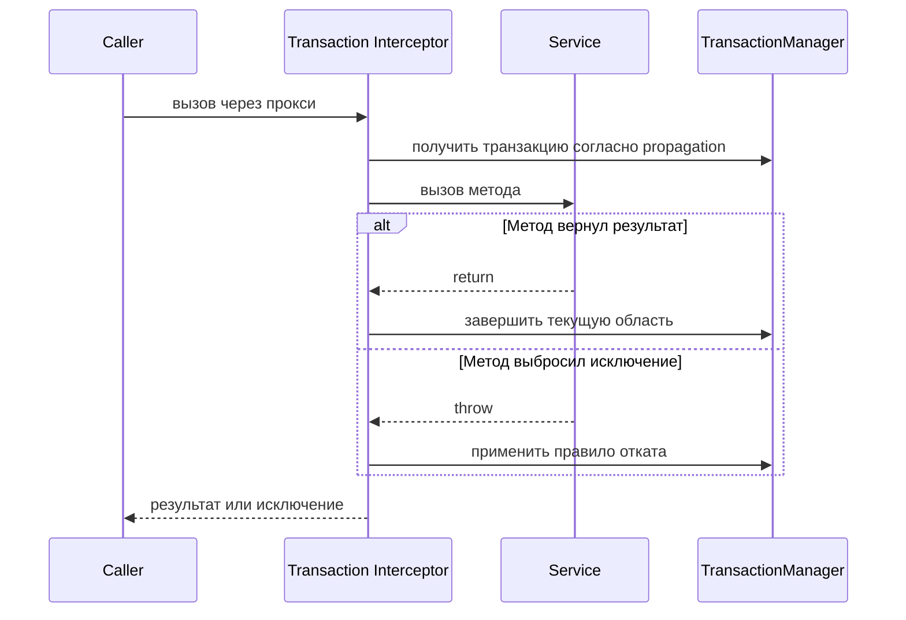
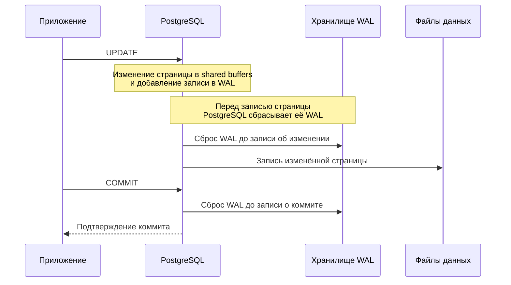
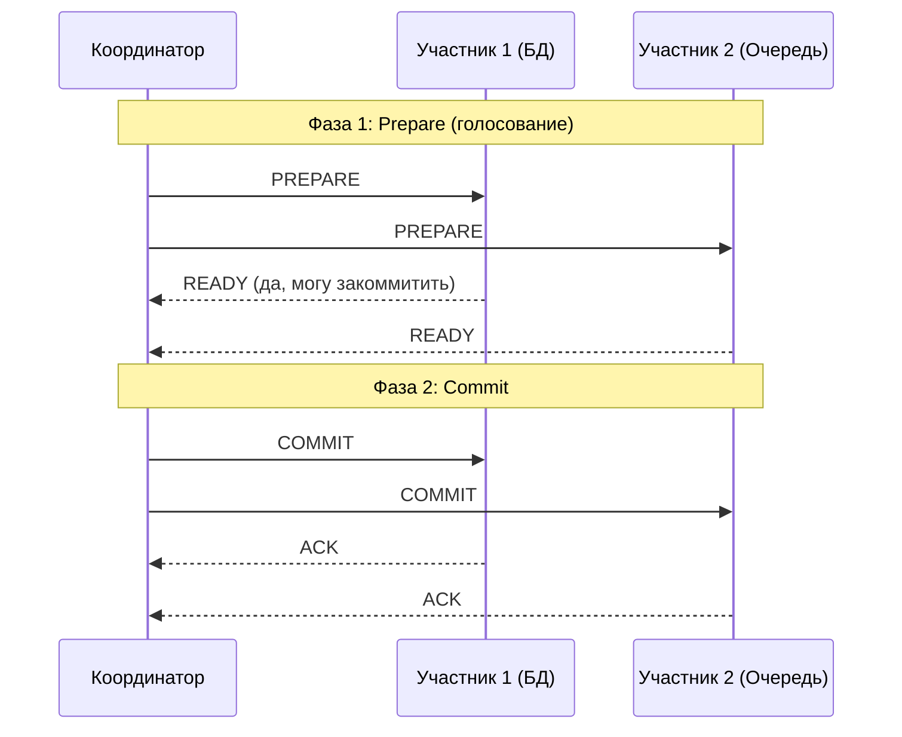
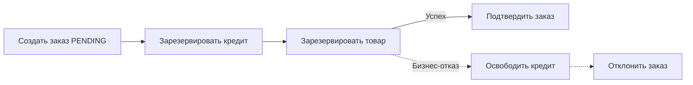

# Вопросы на собеседовании: `Транзакции и уровни изоляции`

Полный набор вопросов по транзакциям в реляционных БД: свойства `ACID`, уровни изоляции, аномалии параллельного доступа, механизмы блокировок, `MVCC`, `Spring @Transactional`, распределённые транзакции и специфика `PostgreSQL`.

**Транзакции** -- фундаментальный механизм обеспечения целостности данных в СУБД. На собеседовании проверяют понимание свойств `ACID`, умение выбрать правильный уровень изоляции, знание аномалий параллельного доступа (`dirty read`, `phantom read`, `lost update`), а также практические навыки работы с `Spring @Transactional`, программным управлением транзакциями и распределёнными транзакциями в микросервисной архитектуре.

## Полезные ссылки

### Официальная документация

- [PostgreSQL: Transaction Isolation](https://www.postgresql.org/docs/current/transaction-iso.html) — уровни изоляции в PostgreSQL
- [PostgreSQL: Write-Ahead Logging (WAL)](https://www.postgresql.org/docs/current/wal-intro.html) — механизм WAL
- [PostgreSQL: MVCC Introduction](https://www.postgresql.org/docs/current/mvcc-intro.html) — многоверсионное управление параллельным доступом
- [Jakarta Persistence Specification](https://jakarta.ee/specifications/persistence/) — спецификация JPA

### Статьи Baeldung

- [Transaction Propagation and Isolation in Spring @Transactional](https://www.baeldung.com/spring-transactional-propagation-isolation) — Spring транзакции: propagation и isolation
- [Programmatic Transaction Management in Spring](https://www.baeldung.com/spring-programmatic-transaction-management) — программное управление транзакциями
- [Optimistic Locking in JPA](https://www.baeldung.com/jpa-optimistic-locking) — оптимистическая блокировка
- [Pessimistic Locking in JPA](https://www.baeldung.com/jpa-pessimistic-locking) — пессимистическая блокировка
- [Transactions Across Microservices](https://www.baeldung.com/transactions-across-microservices) — распределённые транзакции
- [Saga Pattern in Microservices](https://www.baeldung.com/cs/saga-pattern-microservices) — паттерн Saga

## Содержание

- [Полезные ссылки](#полезные-ссылки)
- [See also](#see-also)

**Свойства ACID**
- [Q1. (!) Что такое ACID и зачем эти свойства нужны?](#q1--что-такое-acid-и-зачем-эти-свойства-нужны)
- [Q2. Как обеспечивается атомарность транзакции на уровне СУБД?](#q2-как-обеспечивается-атомарность-транзакции-на-уровне-субд)
- [Q3. Что означает консистентность в контексте ACID?](#q3-что-означает-консистентность-в-контексте-acid)
- [Q4. (!) Чем изоляция отличается от консистентности?](#q4--чем-изоляция-отличается-от-консистентности)
- [Q5. Как СУБД обеспечивает долговечность (Durability)?](#q5-как-субд-обеспечивает-долговечность-durability)

**Уровни изоляции**
- [Q6. (!) Какие уровни изоляции определяет стандарт SQL?](#q6--какие-уровни-изоляции-определяет-стандарт-sql)
- [Q7. (!) Что такое dirty read, non-repeatable read и phantom read?](#q7--что-такое-dirty-read-non-repeatable-read-и-phantom-read)
- [Q8. Что такое lost update и на каком уровне изоляции он возможен?](#q8-что-такое-lost-update-и-на-каком-уровне-изоляции-он-возможен)
- [Q9. (!) Какой уровень изоляции по умолчанию в PostgreSQL и MySQL?](#q9--какой-уровень-изоляции-по-умолчанию-в-postgresql-и-mysql)
- [Q10. Как выбрать уровень изоляции для конкретной задачи?](#q10-как-выбрать-уровень-изоляции-для-конкретной-задачи)

**MVCC**
- [Q11. (!) Что такое MVCC и как он работает?](#q11--что-такое-mvcc-и-как-он-работает)
- [Q12. Как MVCC реализован в PostgreSQL?](#q12-как-mvcc-реализован-в-postgresql)
- [Q13. Что такое VACUUM и зачем он нужен?](#q13-что-такое-vacuum-и-зачем-он-нужен)

**Блокировки и конкурентный доступ**
- [Q14. (!) В чём разница между оптимистической и пессимистической блокировкой?](#q14--в-чём-разница-между-оптимистической-и-пессимистической-блокировкой)
- [Q15. Как реализовать оптимистическую блокировку в JPA?](#q15-как-реализовать-оптимистическую-блокировку-в-jpa)
- [Q16. Как реализовать пессимистическую блокировку в JPA?](#q16-как-реализовать-пессимистическую-блокировку-в-jpa)
- [Q17. (!) Что такое deadlock и как его предотвратить?](#q17--что-такое-deadlock-и-как-его-предотвратить)
- [Q18. Какие типы блокировок существуют в PostgreSQL?](#q18-какие-типы-блокировок-существуют-в-postgresql)

**Spring @Transactional**
- [Q19. (!) Как работает аннотация @Transactional в Spring?](#q19--как-работает-аннотация-transactional-в-spring)
- [Q20. (!) Какие типы propagation существуют и когда их использовать?](#q20--какие-типы-propagation-существуют-и-когда-их-использовать)
- [Q21. Как задать уровень изоляции в @Transactional?](#q21-как-задать-уровень-изоляции-в-transactional)
- [Q22. (!) Как работает rollbackFor и noRollbackFor?](#q22--как-работает-rollbackfor-и-norollbackfor)
- [Q23. Почему @Transactional не работает на private методах?](#q23-почему-transactional-не-работает-на-private-методах)
- [Q24. Что такое self-invocation problem в Spring транзакциях?](#q24-что-такое-self-invocation-problem-в-spring-транзакциях)
- [Q25. (!) Как использовать @Transactional в read-only сценариях?](#q25--как-использовать-transactional-в-read-only-сценариях)

**Программное управление транзакциями**
- [Q26. Как управлять транзакциями программно через TransactionTemplate?](#q26-как-управлять-транзакциями-программно-через-transactiontemplate)
- [Q27. Когда программное управление предпочтительнее декларативного?](#q27-когда-программное-управление-предпочтительнее-декларативного)

**WAL и Savepoints**
- [Q28. (!) Что такое WAL (Write-Ahead Log) и какую роль он играет?](#q28--что-такое-wal-write-ahead-log-и-какую-роль-он-играет)
- [Q29. Что такое savepoint и как его использовать?](#q29-что-такое-savepoint-и-как-его-использовать)

**Распределённые транзакции**
- [Q30. (!) Что такое двухфазный коммит (2PC)?](#q30--что-такое-двухфазный-коммит-2pc)
- [Q31. Что такое XA-транзакции?](#q31-что-такое-xa-транзакции)
- [Q32. (!) Что такое паттерн Saga и чем он отличается от 2PC?](#q32--что-такое-паттерн-saga-и-чем-он-отличается-от-2pc)

**Connection Pooling и транзакции**
- [Q33. Как connection pool взаимодействует с транзакциями?](#q33-как-connection-pool-взаимодействует-с-транзакциями)
- [Q34. Какие проблемы возникают при неправильном управлении соединениями в транзакциях?](#q34-какие-проблемы-возникают-при-неправильном-управлении-соединениями-в-транзакциях)

**PostgreSQL и продвинутые темы**
- [Q35. MVCC в PostgreSQL — vacuum, dead tuples, bloat](#q35-mvcc-в-postgresql--vacuum-dead-tuples-bloat)
- [Q36. Savepoints в транзакциях — SAVEPOINT / ROLLBACK TO](#q36-savepoints-в-транзакциях--savepoint--rollback-to)
- [Q37. Advisory Locks в PostgreSQL — pg_try_advisory_lock](#q37-advisory-locks-в-postgresql--pg_try_advisory_lock)
- [Q38. Distributed transactions: 2PC, XA в Java (Atomikos, Narayana)](#q38-distributed-transactions-2pc-xa-в-java-atomikos-narayana)
- [Q39. Saga: Choreography vs Orchestration — детальное сравнение](#q39-saga-choreography-vs-orchestration--детальное-сравнение)
- [Q40. Optimistic vs Pessimistic Locking в Hibernate — аннотации, примеры](#q40-optimistic-vs-pessimistic-locking-в-hibernate--аннотации-примеры)
- [Q41. Read-your-writes consistency — механизмы обеспечения](#q41-read-your-writes-consistency--механизмы-обеспечения)
- [Q42. Transaction Log (WAL) — для чего используется](#q42-transaction-log-wal--для-чего-используется)
- [Q43. Как возникает write skew и что повторять после SQLSTATE 40001?](#q43-как-возникает-write-skew-и-что-повторять-после-sqlstate-40001)

---

## Q1. (!) Что такое ACID и зачем эти свойства нужны?

**ACID** -- набор из четырёх свойств, гарантирующих надёжную обработку транзакций в СУБД:

| Свойство | Описание |
|----------|----------|
| **Atomicity** (атомарность) | Транзакция выполняется целиком или не выполняется вовсе. Частичное применение изменений невозможно |
| **Consistency** (консистентность) | Транзакция переводит БД из одного согласованного состояния в другое. Все ограничения (`constraints`, `triggers`) соблюдаются |
| **Isolation** (изоляция) | Параллельные транзакции не влияют друг на друга так, как если бы они выполнялись последовательно |
| **Durability** (долговечность) | После коммита данные сохраняются даже при сбое системы |



На практике полное соблюдение всех свойств `ACID` стоит дорого с точки зрения производительности, поэтому СУБД предлагают разные **уровни изоляции**, позволяя разработчику выбирать баланс между строгостью и скоростью.

## Q2. Как обеспечивается атомарность транзакции на уровне СУБД?

Атомарность означает, что после завершения транзакции её изменения данных либо применяются вместе, либо отбрасываются. Конкретный механизм зависит от движка.

В PostgreSQL обычный `UPDATE` создаёт новую версию строки и помечает старую идентификатором обновляющей транзакции. При `ROLLBACK` транзакция прерывается. Для назначенного идентификатора транзакции PostgreSQL фиксирует статус abort. Правила видимости MVCC учитывают этот статус: новая версия не видна другим транзакциям, а отметка отменённого обновления не скрывает прежнюю версию. Ненужные версии очищаются позже, например при `VACUUM`. [Реализация завершения транзакций PostgreSQL 19](https://github.com/postgres/postgres/blob/REL_19_STABLE/src/backend/access/transam/xact.c), [правила видимости heap](https://github.com/postgres/postgres/blob/REL_19_STABLE/src/backend/access/heap/heapam_visibility.c)

WAL нужен для восстановления после сбоя. Запись WAL попадает на диск до соответствующей страницы, а восстановление воспроизводит изменения вперёд (redo). Физическое повторение записей WAL само по себе не делает версии незавершённой транзакции видимыми: для этого нужен commit. В MySQL InnoDB для отмены изменений используются отдельные undo logs. Они также помогают строить прежние версии строк для согласованного чтения. [WAL в PostgreSQL 19](https://www.postgresql.org/docs/19/wal-intro.html), [Undo Logs в MySQL 8.4](https://dev.mysql.com/doc/refman/8.4/en/innodb-undo-logs.html)

```sql
BEGIN;
UPDATE accounts SET balance = balance - 100 WHERE id = 1;
UPDATE accounts SET balance = balance + 100 WHERE id = 2;
-- Если операция должна быть отменена, откатываем оба изменения.
ROLLBACK;
```

## Q3. Что означает консистентность в контексте ACID?

**Консистентность** означает, что транзакция переводит БД из одного **валидного состояния** в другое: если до неё все правила соблюдались, после её фиксации они тоже будут соблюдаться. На практике «валидное состояние» складывается из трёх слоёв:

- Все ограничения целостности (`NOT NULL`, `UNIQUE`, `FOREIGN KEY`, `CHECK`) соблюдены после завершения транзакции
- Все триггеры и каскадные правила отработали корректно
- Бизнес-инварианты не нарушены (например, при переводе денег суммарный баланс на счетах не изменился)

Ключевой нюанс для собеседования: консистентность -- это **ответственность приложения и схемы БД**, а не только СУБД. СУБД проверяет лишь те ограничения, которые вы объявили. Если бизнес-правило не выражено через `constraint` или триггер, СУБД о нём не знает и защитить его не сможет -- следить за инвариантом придётся коду приложения.

## Q4. (!) Чем изоляция отличается от консистентности?

| Аспект | Consistency | Isolation |
|--------|------------|-----------|
| **О чём** | Корректность данных | Видимость изменений между транзакциями |
| **Кто обеспечивает** | Схема БД + приложение | СУБД (уровни изоляции) |
| **Что нарушается** | Ограничения целостности | Возникают аномалии чтения |
| **Настраивается** | Через `constraints` | Через `SET TRANSACTION ISOLATION LEVEL` |

Проще всего развести их двумя вопросами:

- **Консистентность** отвечает: «Данные корректны сами по себе?» -- то есть не нарушены ли ограничения и инварианты.
- **Изоляция** отвечает: «Что видит параллельная транзакция?» -- то есть как соседние транзакции влияют на видимость данных.

Связь между ними прямая: изоляция -- это инструмент, который помогает удержать консистентность в многопользовательском окружении. Без изоляции две корректные по отдельности транзакции, выполняясь одновременно, могут оставить БД в несогласованном состоянии (типичный пример -- lost update).

## Q5. Как СУБД обеспечивает долговечность (Durability)?

Долговечность (durability) означает, что подтверждённый коммит переживает сбои в пределах гарантий выбранной конфигурации. Например, в PostgreSQL 19 при `fsync = on` синхронный коммит ждёт локального сброса WAL. После подтверждения сервер может восстановить изменения из журнала, даже если их страницы ещё не записаны в файлы таблиц и индексов. [PostgreSQL 19 — Write-Ahead Logging](https://www.postgresql.org/docs/19/wal-intro.html)

- **WAL.** Перед записью изменённой страницы в файл данных PostgreSQL сбрасывает описывающие изменения записи журнала в устойчивое хранилище. Для восстановления после сбоя сервер повторяет необходимые изменения из WAL.
- **Синхронизация хранилища.** Конкретный способ сброса WAL задаёт `wal_sync_method`. Гарантия при потере питания зависит и от того, корректно ли ОС, контроллер и накопитель выполняют запрос на сброс. [PostgreSQL 19 — Reliability](https://www.postgresql.org/docs/19/wal-reliability.html)
- **Контрольные точки.** Запись изменённых страниц ограничивает участок WAL, который придётся воспроизвести после сбоя. Коммит может быть подтверждён между контрольными точками. [PostgreSQL 19 — WAL Internals](https://www.postgresql.org/docs/19/wal-internals.html)
- **Репликация.** При настроенных синхронных standby режим `synchronous_commit = on` ждёт также удалённого сброса WAL на требуемых репликах. При асинхронной репликации подтверждённый primary коммит может ещё не быть на узле, который повысят при отказе. См. Q41–Q42. [PostgreSQL 19 — Write Ahead Log Settings](https://www.postgresql.org/docs/19/runtime-config-wal.html#GUC-SYNCHRONOUS-COMMIT)

При `synchronous_commit = off` и сохранённом `fsync = on` клиент может получить успех до локального сброса WAL. Если сервер аварийно остановится в этом окне, часть недавно подтверждённых транзакций может потеряться. Восстановление оставит БД в согласованном состоянии. [PostgreSQL 19 — Asynchronous Commit](https://www.postgresql.org/docs/19/wal-async-commit.html)

## Q6. (!) Какие уровни изоляции определяет стандарт SQL?

Стандарт SQL определяет четыре уровня изоляции. Их смысл -- задать, какие **аномалии параллельного чтения** допустимы: чем выше уровень, тем меньше аномалий, но тем дороже он обходится по конкурентности. Уровни от наименее строгого к наиболее строгому:

| Уровень | Dirty Read | Non-Repeatable Read | Phantom Read |
|---------|------------|--------------------:|-------------:|
| `READ UNCOMMITTED` | Возможен | Возможен | Возможен |
| `READ COMMITTED` | Невозможен | Возможен | Возможен |
| `REPEATABLE READ` | Невозможен | Невозможен | Возможен |
| `SERIALIZABLE` | Невозможен | Невозможен | Невозможен |



Шкала строгости (каждый шаг вправо снимает ещё одну аномалию ценой конкурентности):

```
 слабее изоляция, выше конкурентность ───────────▶ строже, меньше аномалий

 READ UNCOMMITTED ──▶ READ COMMITTED ──▶ REPEATABLE READ ──▶ SERIALIZABLE
   всё допустимо        нет dirty           нет non-repeat       нет аномалий
```

Две детали про `PostgreSQL`, на которых ловят на собеседовании:

- `PostgreSQL` вообще не реализует `READ UNCOMMITTED` -- при его запросе молча используется `READ COMMITTED`, потому что благодаря `MVCC` грязное чтение невозможно в принципе.
- `REPEATABLE READ` в `PostgreSQL` защищает ещё и от `phantom read` (за счёт снимка данных в `MVCC`), то есть он строже, чем требует стандарт. По таблице фантомы там «возможны», а на практике -- нет.

## Q7. (!) Что такое dirty read, non-repeatable read и phantom read?

Это три аномалии параллельного чтения, по нарастанию «тонкости». Главное отличие: грязное чтение -- про **незакоммиченные** данные, а два остальных -- про уже **закоммиченные** изменения соседней транзакции, которые «просочились» внутрь вашей. Non-repeatable read касается **одной строки** (изменилось значение), phantom read -- **набора строк** (появились или исчезли строки под условие `WHERE`).

### Dirty Read (грязное чтение)

Транзакция читает данные, изменённые другой **незакоммиченной** транзакцией. Если та откатится, прочитанные данные окажутся невалидными -- вы прочитали то, чего на самом деле в БД нет.

```
Транзакция A:  UPDATE accounts SET balance = 500 WHERE id = 1;  (не коммитит)
Транзакция B:  SELECT balance FROM accounts WHERE id = 1;  -- читает 500 (dirty read!)
Транзакция A:  ROLLBACK;  -- баланс возвращается к исходному
```

### Non-Repeatable Read (неповторяемое чтение)

Транзакция повторно читает ту же строку и получает **другое значение**, потому что другая транзакция закоммитила изменение между двумя чтениями.

```
Транзакция A:  SELECT balance FROM accounts WHERE id = 1;  -- 1000
Транзакция B:  UPDATE accounts SET balance = 500 WHERE id = 1; COMMIT;
Транзакция A:  SELECT balance FROM accounts WHERE id = 1;  -- 500 (non-repeatable read!)
```

### Phantom Read (фантомное чтение)

Транзакция повторно выполняет запрос с условием `WHERE` и получает **другой набор строк**, потому что другая транзакция вставила или удалила строки, подходящие под условие.

```
Транзакция A:  SELECT COUNT(*) FROM orders WHERE status = 'NEW';  -- 5
Транзакция B:  INSERT INTO orders (status) VALUES ('NEW'); COMMIT;
Транзакция A:  SELECT COUNT(*) FROM orders WHERE status = 'NEW';  -- 6 (phantom read!)
```

## Q8. Что такое lost update и на каком уровне изоляции он возможен?

**Lost update** (потерянное обновление) -- две транзакции читают одно и то же значение, каждая считает на его основе новое и записывает обратно; та, что записывает второй, затирает результат первой, и одно из изменений бесследно исчезает. Это аномалия не чтения, а конкурентной записи по схеме «прочитал -- посчитал -- записал».

```
Транзакция A:  SELECT balance FROM accounts WHERE id = 1;  -- 1000
Транзакция B:  SELECT balance FROM accounts WHERE id = 1;  -- 1000
Транзакция A:  UPDATE accounts SET balance = 1000 + 100 WHERE id = 1; COMMIT;  -- 1100
Транзакция B:  UPDATE accounts SET balance = 1000 - 200 WHERE id = 1; COMMIT;  -- 800
-- Ожидали 900, получили 800. Обновление A потеряно!
```

Пример воспроизводится в PostgreSQL 19, если обе транзакции работают в `READ COMMITTED`. В PostgreSQL запрос уровня `READ UNCOMMITTED` также выполняется с семантикой `READ COMMITTED`. В `REPEATABLE READ` транзакция B из примера получит `40001` при попытке изменить строку, которую A обновила после снимка B. Повторять нужно всю транзакцию с новым чтением. Для другой СУБД проверяйте правила её реализации изоляции. [PostgreSQL 19 — Transaction Isolation](https://www.postgresql.org/docs/19/transaction-iso.html)

**Как защититься**

- **Вычислить новое значение в SQL.** Если обе операции меняют баланс относительно его текущего значения, используйте `SET balance = balance + 100` для A и `SET balance = balance - 200` для B. В `READ COMMITTED` второй `UPDATE` применяет выражение к новой версии строки, если она по-прежнему подходит под `WHERE`. При исходном балансе 1000 обе операции дадут 900.
- **Проверить версию при записи.** С `@Version` запись на основе устаревшей версии отклоняется. Если операцию можно повторить, перечитайте данные и пересчитайте значение в новой транзакции.
- **Захватить блокировку при чтении.** В `READ COMMITTED` каждый участник, вычисляющий новое значение в приложении, сначала читает строку через `SELECT ... FOR UPDATE` в той же транзакции, где затем пишет. Второй такой читатель ждёт освобождения блокировки и получает обновлённое значение. Обычный `SELECT` может прочитать прежнюю видимую версию, поэтому оставленный в другом пути обычный read-modify-write способен снова затереть изменение. [PostgreSQL 19 — Row-Level Locks](https://www.postgresql.org/docs/19/explicit-locking.html#LOCKING-ROWS)

## Q9. (!) Какой уровень изоляции по умолчанию в PostgreSQL и MySQL?

Коротко: у большинства СУБД дефолт -- `READ COMMITTED`, а MySQL (InnoDB) выделяется тем, что по умолчанию ставит `REPEATABLE READ`.

| СУБД | Уровень по умолчанию | Особенности |
|------|---------------------|-------------|
| `PostgreSQL` | `READ COMMITTED` | `MVCC`-реализация; `READ UNCOMMITTED` фактически = `READ COMMITTED`; `REPEATABLE READ` защищает от phantom read |
| `MySQL` (InnoDB) | `REPEATABLE READ` | Использует `MVCC` + `next-key locking`; phantom read частично предотвращён через gap locks |
| `Oracle` | `READ COMMITTED` | `MVCC` через undo segments; поддерживает только `READ COMMITTED` и `SERIALIZABLE` |
| `SQL Server` | `READ COMMITTED` | По умолчанию использует блокировки, но можно включить `READ_COMMITTED_SNAPSHOT` для `MVCC` |

В PostgreSQL задайте уровень изоляции сразу после `BEGIN`, до первого запроса или изменения данных. Можно также указать его прямо в `BEGIN`. [SET TRANSACTION](https://www.postgresql.org/docs/19/sql-set-transaction.html)

```sql
BEGIN;
SET TRANSACTION ISOLATION LEVEL REPEATABLE READ;
-- ...
COMMIT;

-- Альтернатива для текущей транзакции
BEGIN ISOLATION LEVEL REPEATABLE READ;
-- ...
COMMIT;

-- Значение по умолчанию для следующих транзакций сессии
SET SESSION CHARACTERISTICS AS TRANSACTION ISOLATION LEVEL SERIALIZABLE;
```

## Q10. Как выбрать уровень изоляции для конкретной задачи?

| Сценарий | Рекомендация | Обоснование |
|----------|-------------|-------------|
| Аналитические отчёты | `REPEATABLE READ` | Консистентный снимок данных на время отчёта |
| OLTP, высокая нагрузка | `READ COMMITTED` | Баланс между изоляцией и производительностью |
| Финансовые операции | `SERIALIZABLE` или `REPEATABLE READ` + явные блокировки | Недопустимы аномалии |
| Чтение справочников | `READ COMMITTED` | Данные редко меняются, строгая изоляция не нужна |
| Массовый импорт | `READ COMMITTED` | Минимум блокировок, максимум throughput |

**Эмпирическое правило:** начинайте с `READ COMMITTED` (default в `PostgreSQL`) и повышайте уровень точечно -- только там, где конкретная аномалия реально ломает бизнес-логику. Более строгий уровень не бесплатен: больше конфликтов сериализации, больше retry на стороне приложения, ниже throughput. Поэтому выбор уровня -- это всегда компромисс между корректностью при конкуренции и пропускной способностью.

## Q11. (!) Что такое MVCC и как он работает?

**MVCC** (`Multi-Version Concurrency Control`) позволяет параллельным операциям работать с разными версиями одной строки. В PostgreSQL обычный `SELECT` читает видимую ему версию без блокировки строки. Конкурирующие изменения одной строки и явно блокирующие чтения по-прежнему могут ждать друг друга.

- **`READ COMMITTED`.** Каждая команда, которой нужен снимок, получает новый. Два обычных `SELECT` в одной транзакции могут увидеть разные версии, если между ними другая транзакция завершилась.
- **`REPEATABLE READ`.** Снимок фиксируется при первой команде, которой нужен снимок, и используется последующими командами. Сам `BEGIN` снимок не фиксирует. В обоих режимах запрос видит собственные предыдущие изменения транзакции.
- **Видимость версии.** PostgreSQL учитывает транзакции, которые создали и заменили или удалили строку, их статусы и то, какие транзакции были активны при создании снимка. Одного сравнения `xid ≤ N` недостаточно: транзакция с меньшим `xid` могла ещё выполняться либо откатиться. Старые версии очищаются, когда они перестают быть нужны.

В примере первый `SELECT` выполняется после изменения строки в T2, но до её коммита. Если бы T2 успела закоммитить изменение до первого снимка T1, этот снимок мог бы включать новую версию и при `REPEATABLE READ`. [Transaction Isolation](https://www.postgresql.org/docs/19/transaction-iso.html), [функции работы со снимками](https://www.postgresql.org/docs/19/functions-info.html#FUNCTIONS-PG-SNAPSHOT)



```
 T1                       PostgreSQL                 T2
 BEGIN ─────────────────▶ (без снимка)
                           ◀──────────────────────── BEGIN
                           ◀──────────── UPDATE, значение 42
 Первый SELECT ──────────▶ снимок S1, T2 ещё активна
 ◀──────────────────────── старое значение
                           ◀──────────────────────── COMMIT
 Второй SELECT ──────────▶ RC: новый снимок S2 → 42
                           RR: прежний снимок S1 → старое значение
```

## Q12. Как MVCC реализован в PostgreSQL?

PostgreSQL хранит версии строк (tuples) в самой таблице. При `UPDATE` появляется новая версия, а при `DELETE` прежняя версия помечается как удалённая и может остаться видимой для более ранних снимков.

| Столбец | Что показывает |
|---------|----------------|
| `xmin` | Идентификатор транзакции, создавшей эту версию строки. |
| `xmax` | Поле заголовка версии, используемое при удалении, обновлении и блокировке строки. Ненулевое значение само по себе не означает, что версия невидима. |
| `ctid` | Физическое местоположение версии в таблице. Может измениться при обновлении или переписывании таблицы. |

При проверке видимости PostgreSQL учитывает снимок, статус транзакций и признаки в заголовке версии. Например, если другая транзакция удалила строку после получения снимка или откатила удаление, старая версия может оставаться видимой при ненулевом `xmax`. При блокировке строки без удаления `xmax` тоже может быть ненулевым.

Свою вставку или новую версию после `UPDATE` транзакция видит в следующей команде до коммита. После собственного `DELETE` следующая команда уже не увидит удалённую строку. Для таких проверок PostgreSQL учитывает порядок команд внутри транзакции, а не только её `xid`. [Системные столбцы PostgreSQL 19](https://www.postgresql.org/docs/19/ddl-system-columns.html), [изоляция транзакций](https://www.postgresql.org/docs/19/transaction-iso.html), [реализация MVCC для heap](https://github.com/postgres/postgres/blob/REL_19_STABLE/src/backend/access/heap/heapam_visibility.c)

```sql
SELECT xmin, xmax, ctid, * FROM accounts WHERE id = 1;
```

Этот запрос выводит системные столбцы версии, которую `SELECT` уже признал видимой. Старые версии остаются в таблице, пока могут понадобиться активным снимкам. Когда они больше не нужны, `VACUUM` освобождает их место для повторного использования.

## Q13. Что такое VACUUM и зачем он нужен?

`VACUUM` -- процесс очистки мёртвых (dead) версий строк, которые уже не видны ни одной активной транзакции. Он нужен именно потому, что `MVCC` в PostgreSQL не удаляет старые версии сразу, а копит их в таблице (см. Q12).

**Зачем нужен:**

- Освобождает место, занятое мёртвыми tuple-ами, и помечает его доступным для новых строк
- Предотвращает `bloat` (раздувание) таблиц и индексов, из-за которого замедляется сканирование
- Может обновлять оценки размера и числа строк отношения (`pg_class.relpages`, `pg_class.reltuples`). Статистику распределения значений столбцов, например гистограммы и частые значения, собирает `ANALYZE`. [Статистика планировщика PostgreSQL 19](https://www.postgresql.org/docs/19/planner-stats.html)
- Предотвращает `transaction ID wraparound` -- критическую проблему переполнения счётчика `xid` (2^31 транзакций), при которой старые строки могут «исчезнуть» из видимости

**Виды:**

| Вид | Описание |
|-----|----------|
| `VACUUM` | Освобождает место для повторного использования в таблице. Может вернуть ОС свободные страницы в конце файла при усечении. |
| `VACUUM FULL` | Полностью перестраивает таблицу, возвращает место ОС. Требует эксклюзивную блокировку! |
| `VACUUM ANALYZE` | Сначала обслуживает таблицу через `VACUUM`, затем собирает статистику через `ANALYZE`. |
| `autovacuum` | Фоновая подсистема запускает `VACUUM` и `ANALYZE` по отдельным условиям. |

[Документация VACUUM](https://www.postgresql.org/docs/19/sql-vacuum.html)

```sql
-- Ручной запуск
VACUUM VERBOSE accounts;

-- Проверка состояния autovacuum
SELECT relname, n_dead_tup, last_autovacuum
FROM pg_stat_user_tables
WHERE n_dead_tup > 1000;
```

## Q14. (!) В чём разница между оптимистической и пессимистической блокировкой?

Разница -- в моменте контроля конкурирующих изменений. При оптимистической блокировке JPA `@Version` чтение сущности не ставит заранее удерживаемую блокировку строки; провайдер сравнивает версию при изменении, например во время `merge`, `flush` или коммита. При пессимистической `PESSIMISTIC_WRITE` провайдер запрашивает блокировку строки раньше, при чтении для изменения. Для PostgreSQL это обычно `SELECT ... FOR UPDATE`: конкурентные записи или несовместимые блокировки ждут, а обычный MVCC `SELECT` не обязан ждать.

| Аспект | Оптимистическая | Пессимистическая |
|--------|----------------|-----------------|
| **Контроль конфликта** | Версия `@Version` проверяется при записи/синхронизации; заранее строка не заблокирована | `PESSIMISTIC_WRITE` запрашивает блокировку строки при чтении для изменения |
| **Блокировки БД** | Обычный SQL `UPDATE`/`DELETE` всё равно берёт блокировки | Строка удерживается уже после запроса блокировки до завершения транзакции |
| **Конфликт** | `OptimisticLockException`, транзакция к откату; повторять всю операцию в новой транзакции | Ожидание несовместимой блокировки, возможны timeout/deadlock и повтор после отката |
| **Цена** | Проверка версии и повтор работы при конфликте | Ожидание и более долгое удержание блокировки |

**Выбор:** оптимистическая схема подходит, когда конфликтов за конкретные сущности достаточно мало и операция допускает повтор после перечитывания данных. Пессимистическая полезна, когда нужно заранее ограничить конкурентное изменение выбранных строк и стоимость позднего отката велика. Число конфликтов само по себе не даёт универсального порога или победителя по пропускной способности: учитывайте длительность транзакции, ожидание блокировки и стоимость повтора.

Пессимистическая блокировка не гарантирует завершения операции: возможны timeout и deadlock. Длинная транзакция увеличивает время удержания строки и мешает другим изменениям, поэтому не является рекомендацией для этого подхода. Оптимистический `UPDATE` тоже может участвовать в deadlock при нескольких изменяемых строках; `@Version` не заменяет порядок обновления и защиту бизнес-инварианта, охватывающего несколько строк. Конкретные JPA-примеры -- в Q15 и Q40.

## Q15. Как реализовать оптимистическую блокировку в JPA?

Оптимистическая блокировка в `JPA` реализуется через поле с аннотацией `@Version`:

```java
@Entity
public class Account {
    @Id
    private Long id;
    
    @Version
    private Long version;
    
    private BigDecimal balance;
}
```

При записи изменённой версионированной сущности провайдер сравнивает её версию с версией в БД. Например, Hibernate может выполнить такой `UPDATE`:

```sql
UPDATE account SET balance = ?, version = version + 1 
WHERE id = ? AND version = ?
```

Если версии расходятся, провайдер сообщает о конфликте через `OptimisticLockException`. Проверка может произойти при `merge`, `flush` или коммите; форма SQL и момент исключения зависят от провайдера. Текущая транзакция после такого исключения помечается для отката. Повторять можно **всю операцию в новой транзакции**, заново читая данные и проверяя бизнес-условия; внешний побочный эффект нельзя бездумно выполнять повторно.

Если конфликт ожидаемо редок, ограниченный повтор можно вынести за границу транзакции. В примере `TransferRetryService` вызывает транзакционный метод другого Spring-бина через прокси; каждая попытка получает новую транзакцию:

```java
@Service
public class TransferRetryService {
    private final AccountService accountService;

    public TransferRetryService(AccountService accountService) {
        this.accountService = accountService;
    }

    @Retryable(retryFor = ObjectOptimisticLockingFailureException.class, maxAttempts = 3)
    public void transfer(Long fromId, Long toId, BigDecimal amount) {
        accountService.transfer(fromId, toId, amount);
    }
}

@Service
public class AccountService {
    private final AccountRepository accountRepository;

    public AccountService(AccountRepository accountRepository) {
        this.accountRepository = accountRepository;
    }

    @Transactional
    public void transfer(Long fromId, Long toId, BigDecimal amount) {
        Account from = accountRepository.findById(fromId).orElseThrow();
        Account to = accountRepository.findById(toId).orElseThrow();
        from.setBalance(from.getBalance().subtract(amount));
        to.setBalance(to.getBalance().add(amount));
    }
}
```

Здесь `@Retryable` показан для Spring Retry 2.x и переведённого Spring-исключения. Если наружу выходит `OptimisticLockException` JPA, его тоже нужно явно включить в политику повтора. Повтор не гарантирует успеха и требует идемпотентности действий вне БД.

Версионные детали: [Jakarta Persistence 3.2, optimistic locking](https://jakarta.ee/specifications/persistence/3.2/jakarta-persistence-spec-3.2), [`OptimisticLockException`](https://jakarta.ee/specifications/persistence/3.2/apidocs/jakarta.persistence/jakarta/persistence/optimisticlockexception) и [Spring Retry 2.x `@Retryable`](https://docs.spring.io/spring-retry/docs/current/apidocs/spring.retry/org/springframework/retry/annotation/Retryable.html).

Типы `LockModeType` для оптимистической блокировки:
- `OPTIMISTIC` (= `READ`) -- проверка версии без обязательного её увеличения
- `OPTIMISTIC_FORCE_INCREMENT` (= `WRITE`) -- принудительное увеличение версии даже без изменения полей

## Q16. Как реализовать пессимистическую блокировку в JPA?

Пессимистическая блокировка в `JPA` задаётся через `LockModeType` при загрузке сущности. В активной транзакции провайдер запрашивает блокировку в БД, чтобы конфликтующие изменения строки ждали завершения этой транзакции.

```java
// Через EntityManager
Account account = em.find(Account.class, id, LockModeType.PESSIMISTIC_WRITE);

// Через Spring Data JPA
@Lock(LockModeType.PESSIMISTIC_WRITE)
@Query("SELECT a FROM Account a WHERE a.id = :id")
Optional<Account> findByIdForUpdate(@Param("id") Long id);
```

Пример SQL для PostgreSQL. Точная команда зависит от JPA-провайдера, диалекта и запроса:

```sql
SELECT * FROM account WHERE id = ? FOR UPDATE;
```

Режимы Jakarta Persistence и возможное соответствие в PostgreSQL:

| LockModeType | Возможный SQL | Поведение |
|-------------|-----|----------|
| `PESSIMISTIC_READ` | `FOR SHARE` | В PostgreSQL конфликтует с `UPDATE`, `DELETE`, `FOR UPDATE` и `FOR NO KEY UPDATE` на той же строке. Совместим с `FOR SHARE` и `FOR KEY SHARE`. |
| `PESSIMISTIC_WRITE` | `FOR UPDATE` | В PostgreSQL конфликтует с изменением, удалением и любой попыткой взять блокировку строки в другой транзакции. Обычный `SELECT` читает версию, видимую по MVCC, и не ждёт из-за этой блокировки строки. |
| `PESSIMISTIC_FORCE_INCREMENT` | Зависит от провайдера | Для сущности с `@Version` берёт пессимистическую блокировку и увеличивает версию. |

[Строчные блокировки PostgreSQL 19](https://www.postgresql.org/docs/19/explicit-locking.html#LOCKING-ROWS), [пессимистические блокировки Jakarta Persistence 3.2](https://jakarta.ee/specifications/persistence/3.2/jakarta-persistence-spec-3.2).

Ожидание блокировки удерживает соединение из пула. Таймаут можно указать через подсказку JPA в миллисекундах. Проверьте, что сочетание провайдера и СУБД её учитывает. [Документация EntityManager](https://jakarta.ee/specifications/persistence/3.2/apidocs/jakarta.persistence/jakarta/persistence/EntityManager.html)

```java
@QueryHints({@QueryHint(name = "jakarta.persistence.lock.timeout", value = "3000")})
@Lock(LockModeType.PESSIMISTIC_WRITE)
Optional<Account> findByIdForUpdate(Long id);
```

## Q17. (!) Что такое deadlock и как его предотвратить?

**Deadlock** (взаимная блокировка) -- две или более транзакций ждут друг друга по кругу: каждая держит ресурс, нужный соседу, и ждёт ресурс, который держит сосед. Ни одна не может продвинуться, и без вмешательства они зависли бы навсегда. Поэтому СУБД не «лечит» deadlock, а разрывает его, принудительно откатывая одну из транзакций.



```
        держит A, ждёт B            держит B, ждёт A
      ┌───────────────────┐      ┌───────────────────┐
      │   Транзакция 1    │      │   Транзакция 2    │
      └───────────────────┘      └───────────────────┘
            │      ▲                    │      ▲
            │      └──── ждёт A ────────┘      │
            └──────────── ждёт B ──────────────┘
                  (цикл ожидания → deadlock)
```

**Пример:**

```sql
-- Транзакция 1
BEGIN;
UPDATE accounts SET balance = balance - 100 WHERE id = 1;  -- блокирует строку 1
UPDATE accounts SET balance = balance + 100 WHERE id = 2;  -- ждёт строку 2

-- Транзакция 2
BEGIN;
UPDATE accounts SET balance = balance - 50 WHERE id = 2;   -- блокирует строку 2
UPDATE accounts SET balance = balance + 50 WHERE id = 1;   -- ждёт строку 1 → DEADLOCK!
```

**Способы предотвращения** (самый действенный -- первый):

1. **Единый порядок блокировки** -- всегда захватывать ресурсы в одном и том же порядке (например, по возрастанию `id`). Тогда цикл ожидания в принципе не сможет замкнуться -- это устраняет причину deadlock, а не симптом.
2. **Короткие транзакции** -- чем меньше время удержания блокировок, тем уже окно для пересечения.
3. **Таймауты** -- `lock_timeout` в PostgreSQL, `@QueryHint(lock.timeout)` в JPA: лучше быстро упасть с ошибкой, чем висеть.
4. **Оптимистическая проверка версии** позволяет отложить захват блокировки до записи. Сам `UPDATE` всё равно берёт блокировки строк. Если две транзакции обновляют несколько строк в разном порядке, их ожидания могут образовать цикл даже с `@Version` (см. Q14). [Deadlocks в PostgreSQL 19](https://www.postgresql.org/docs/19/explicit-locking.html#LOCKING-DEADLOCKS)
5. **`NOWAIT`** -- `SELECT ... FOR UPDATE NOWAIT` сразу возвращает ошибку, если строка занята, вместо ожидания.

`PostgreSQL` сам обнаруживает deadlock: если транзакция ждёт блокировку дольше `deadlock_timeout` (по умолчанию 1 секунда), запускается поиск цикла, и одна из транзакций откатывается с ошибкой. То есть приложение обязано быть готово к ретраю такой транзакции.

## Q18. Какие типы блокировок существуют в PostgreSQL?

`PostgreSQL` различает блокировки по гранулярности -- от целой таблицы до отдельной строки. Чем мельче объект блокировки, тем выше конкурентность. Сами блокировки группируются по тому, с какими другими режимами они конфликтуют: две неконфликтующие блокировки могут сосуществовать, конфликтующие -- нет.

**Table-level locks (блокировки таблиц):**

| Режим | Конфликтует с | Типичная операция |
|-------|---------------|-------------------|
| `ACCESS SHARE` | `ACCESS EXCLUSIVE` | `SELECT` |
| `ROW SHARE` | `EXCLUSIVE`, `ACCESS EXCLUSIVE` | `SELECT FOR UPDATE` |
| `ROW EXCLUSIVE` | `SHARE`, `SHARE ROW EXCLUSIVE`, `EXCLUSIVE`, `ACCESS EXCLUSIVE` | `UPDATE`, `DELETE`, `INSERT` |
| `SHARE` | `ROW EXCLUSIVE`, `SHARE UPDATE EXCLUSIVE`, `SHARE ROW EXCLUSIVE`, `EXCLUSIVE`, `ACCESS EXCLUSIVE` | `CREATE INDEX` |
| `ACCESS EXCLUSIVE` | Все | Многие формы `ALTER TABLE`, `DROP TABLE`, `VACUUM FULL` |

**Row-level locks (блокировки строк):**

| Режим | SQL | Описание |
|-------|-----|----------|
| `FOR UPDATE` | `SELECT ... FOR UPDATE` | Эксклюзивная блокировка строки |
| `FOR NO KEY UPDATE` | `SELECT ... FOR NO KEY UPDATE` | Допускает одновременный `FOR KEY SHARE` на той же строке |
| `FOR SHARE` | `SELECT ... FOR SHARE` | Разделяемая блокировка |
| `FOR KEY SHARE` | `SELECT ... FOR KEY SHARE` | Блокирует удаление строки, изменение ключа и захват `FOR UPDATE` |

```sql
-- Просмотр текущих блокировок
SELECT pid, locktype, relation::regclass, mode, granted
FROM pg_locks
WHERE NOT granted;
```

Полная таблица конфликтов и пример совместимости строковых режимов приведены в [PostgreSQL Q51](postgresql-interview.md#q51--какие-типы-блокировок-существуют-в-postgresql). [Explicit Locking](https://www.postgresql.org/docs/18/explicit-locking.html).

## Q19. (!) Как работает аннотация @Transactional в Spring?

В стандартном режиме Spring перехватывает вызов через AOP-прокси. Для императивного метода перехватчик запрашивает транзакцию у менеджера. Например, при `REQUIRED` менеджер присоединяет метод к существующей транзакции или открывает новую (см. Q20). После вызова перехватчик применяет правила завершения. Физический коммит общей транзакции происходит на внешней границе.



Даже при нормальном возврате внешнего метода менеджер может откатить общую транзакцию, уже помеченную `rollback-only`. Разбор такого случая — в Q22.

Ключевые атрибуты `@Transactional`:

```java
@Transactional(
    propagation = Propagation.REQUIRED,      // присоединение к текущей транзакции или открытие новой
    isolation = Isolation.DEFAULT,            // уровень изоляции
    timeout = 30,                             // таймаут в секундах
    readOnly = false,                         // оптимизация для read-only
    rollbackFor = Exception.class,            // откат при checked exceptions
    noRollbackFor = BusinessException.class   // не откатывать при этих исключениях
)
public void performOperation() { ... }
```

Что важно помнить (прямые следствия прокси-модели):

- Транзакция применяется только при **внешнем вызове** через бин -- вызов `this.method()` идёт мимо прокси и игнорирует `@Transactional` (см. Q24).
- По умолчанию откат происходит только при **unchecked exceptions** (`RuntimeException`, `Error`); checked-исключение по умолчанию само по себе не помечает транзакцию к откату (см. Q22).
- Тип прокси зависит от конфигурации. JDK-прокси перехватывает публичный метод проксируемого интерфейса. Для прокси-подкласса с Spring Framework 6.0 по умолчанию доступны также переопределяемые `protected` и package-visible методы. В режиме AspectJ транзакционный аспект встраивается в байткод.

См. [Spring Framework 6.2 — @Transactional](https://docs.spring.io/spring-framework/reference/6.2/data-access/transaction/declarative/annotations.html).

## Q20. (!) Какие типы propagation существуют и когда их использовать?

`Propagation` определяет, что делать, когда транзакционный метод вызывается **внутри уже идущей транзакции**: присоединиться к ней, открыть новую, приостановить текущую или потребовать/запретить её наличие. Это самый частый источник тонких багов в Spring-транзакциях, потому что от выбора зависит, что именно откатится при ошибке.

| Propagation | Описание | Типичный сценарий |
|-------------|----------|-------------------|
| `REQUIRED` | Использует текущую транзакцию или создаёт новую | По умолчанию. Большинство бизнес-методов |
| `REQUIRES_NEW` | Всегда создаёт новую транзакцию, текущую приостанавливает | Запись о попытке операции, которую нужно сохранить независимо от её исхода |
| `NESTED` | При активной транзакции создаёт точку сохранения, если менеджер поддерживает этот режим. Без активной транзакции открывает новую | Частичный откат в рамках основной транзакции |
| `SUPPORTS` | Использует текущую транзакцию, если есть; иначе работает без транзакции | Методы чтения, которые могут работать и без транзакции |
| `NOT_SUPPORTED` | Приостанавливает текущую транзакцию и работает без неё | Вызов внешнего API, который не должен быть в транзакции |
| `MANDATORY` | Требует наличия текущей транзакции, иначе выбрасывает исключение | Методы, которые нельзя вызывать вне транзакции |
| `NEVER` | Выбрасывает исключение, если транзакция существует | Операции, несовместимые с транзакциями |

```java
@Service
public class OrderService {

    @Transactional(propagation = Propagation.REQUIRED)
    public void createOrder(Order order) {
        orderRepository.save(order);
        // Аудит сохранится даже если createOrder откатится
        auditService.log("Order creation attempted: " + order.getId());
    }
}

@Service
public class AuditService {

    @Transactional(propagation = Propagation.REQUIRES_NEW)
    public void log(String message) {
        auditRepository.save(new AuditEntry(message));
    }
}
```

В примере `log()` объявлен с `REQUIRES_NEW`, поэтому аудит-запись пишется в **отдельной** транзакции и фиксируется независимо. Если основной `createOrder` откатится, запись аудита всё равно останется -- это и есть типичный сценарий для `REQUIRES_NEW`. Обратите внимание: эффект достигается только потому, что `log()` вызывается у другого бина (`auditService`) через прокси; при self-invocation `REQUIRES_NEW` был бы проигнорирован.

Для `NESTED` с JDBC см. Q36. При `REQUIRES_NEW` внутренняя транзакция может занять второе соединение, пока внешняя удерживает первое (см. Q33). [Spring Framework 6.2 — Transaction Propagation](https://docs.spring.io/spring-framework/reference/6.2/data-access/transaction/declarative/tx-propagation.html)

## Q21. Как задать уровень изоляции в @Transactional?

```java
@Transactional(isolation = Isolation.REPEATABLE_READ)
public BigDecimal calculateTotalBalance(Long userId) {
    // Для новой транзакции запрашивается REPEATABLE READ
    List<Account> accounts = accountRepository.findByUserId(userId);
    return accounts.stream()
        .map(Account::getBalance)
        .reduce(BigDecimal.ZERO, BigDecimal::add);
}
```

Доступные значения `Isolation`:

| Значение | Описание |
|----------|----------|
| `Isolation.DEFAULT` | Уровень изоляции СУБД по умолчанию |
| `Isolation.READ_UNCOMMITTED` | Допускает dirty read |
| `Isolation.READ_COMMITTED` | Только закоммиченные данные |
| `Isolation.REPEATABLE_READ` | Повторяемое чтение |
| `Isolation.SERIALIZABLE` | Полная сериализация |

Уровень изоляции применяется при открытии новой транзакции, если менеджер и ресурс поддерживают его настройку. Например, внешний метод с `READ_COMMITTED` вызывает через прокси метод из примера с обычным `REQUIRED`. При стандартной конфигурации менеджера оба метода выполняются с `READ_COMMITTED`. При `validateExistingTransaction=true` Spring может отклонить присоединение из-за различия уровней. `REQUIRES_NEW` позволяет задать уровень для независимой транзакции. Поведение снимков PostgreSQL разобрано в Q11. [Spring Framework 6.2 — Transaction Propagation](https://docs.spring.io/spring-framework/reference/6.2/data-access/transaction/declarative/tx-propagation.html)

## Q22. (!) Как работает rollbackFor и noRollbackFor?

В стандартной конфигурации `Spring @Transactional` откатывает транзакцию при `RuntimeException` и `Error`. Checked-исключения (наследники `Exception`, но не `RuntimeException`) сами по себе откат не вызывают: при выходе такого исключения Spring попытается закоммитить транзакцию. `rollbackFor` задаёт типы для отката, `noRollbackFor` — типы без отката. Если правила пересекаются, выигрывает наиболее конкретное совпадение, а не порядок атрибутов. Правило без отката не отменяет `rollback-only`, уже установленный другим участником или ресурсом.

```java
// Откат при любом Exception (включая checked)
@Transactional(rollbackFor = Exception.class)
public void riskyOperation() throws IOException {
    repository.save(entity);
    Files.write(path, data); // IOException после записи в БД
}

// Не откатывать при бизнес-исключении
@Transactional(
    rollbackFor = Exception.class,
    noRollbackFor = InsufficientFundsException.class
)
public void transfer(Long from, Long to, BigDecimal amount) {
    // Для InsufficientFundsException Spring не помечает транзакцию к откату.
    // Если она уже rollback-only, коммит всё равно невозможен.
}
```

Типичная ошибка -- забыть про `rollbackFor`:

```java
@Transactional  // rollbackFor не указан!
public void processFile() throws IOException {
    repository.save(entity);
    externalService.upload(file);  // бросает IOException
    // По умолчанию Spring попытается закоммитить БД, несмотря на IOException.
}
```

Обе настройки управляют **транзакцией БД**, но не возвращают прежнее содержимое файла и не отменяют уже выполненную часть внешней загрузки. Если `Files.write` сам завершился ошибкой, его внешний результат нужно проверять отдельно. В примерах предполагается, что исключение вышло из метода через транзакционный прокси и БД-транзакция не была раньше помечена `rollback-only`.

В Spring Framework 6.2+ можно выбрать общий режим `@EnableTransactionManagement(rollbackOn = ALL_EXCEPTIONS)`; локальные правила конкретной транзакции сохраняют приоритет. В более ранних версиях или при локальном исключении из общего правила используйте `rollbackFor = Exception.class` и точечный `noRollbackFor`. При выборе проверьте, какие checked-исключения в проекте означают штатный бизнес-исход.

**Сценарий с общей транзакцией.** Внешний метод сохраняет заказ и через прокси вызывает метод другого бина с `PROPAGATION_REQUIRED`. Оба используют один менеджер и одну физическую транзакцию. Если внутренний метод выбросил `RuntimeException`, его транзакционный перехватчик при стандартных настройках помечает общую транзакцию `rollback-only`. Внешний метод может поймать исходное исключение и нормально завершить своё тело. При попытке коммита Spring откатит транзакцию, включая запись заказа, и вызывающий код получит `UnexpectedRollbackException`. Перехват исключения снаружи внутреннего прокси не снимает уже выставленную отметку. См. [Spring Framework 6.2: PROPAGATION_REQUIRED](https://docs.spring.io/spring-framework/reference/6.2/data-access/transaction/declarative/tx-propagation.html#tx-propagation-required).

См. [Spring Framework: rollback rules](https://docs.spring.io/spring-framework/reference/data-access/transaction/declarative/rolling-back.html) и [`@Transactional` settings](https://docs.spring.io/spring-framework/reference/data-access/transaction/declarative/annotations.html).

## Q23. Почему @Transactional не работает на private методах?

В стандартном Spring proxy mode транзакцию навешивает **прокси**, а `private` метод он не перехватывает. Java-интерфейс может содержать собственный `private` вспомогательный метод, но такой метод не входит в публичный контракт интерфейсного прокси; прокси на основе класса не может переопределить `private` метод целевого класса:

- **JDK Dynamic Proxy** реализует интерфейс бина и видит только его `public` методы.
- **Прокси на основе класса (CGLIB)** создаёт подкласс, поэтому не может переопределить `private`, `final` и `static` методы; аннотация на `private` методе через такой прокси не сработает.

```java
@Service
public class PaymentService {
    
    @Transactional  // Внешний вызов проходит через прокси
    public void processPayment(Payment payment) {
        // ...
        updateBalance(payment);  // Самовызов: REQUIRES_NEW не применяется
    }
    
    @Transactional(propagation = Propagation.REQUIRES_NEW)
    private void updateBalance(Payment payment) {  // ОШИБКА: private + @Transactional
        // Новая транзакция НЕ создаётся; выполняется внутри текущей processPayment
    }
}
```

Правила:
- Для интерфейсного прокси нужен `public` метод интерфейса. Начиная со Spring Framework 6.0, прокси на основе класса по умолчанию поддерживает также `protected` и package-private методы при внешнем вызове; `private` не поддерживается.
- `final` метод нельзя переопределить в прокси на основе класса; `static` метод не является вызовом экземпляра бина. Эти ограничения нельзя автоматически переносить на интерфейсный прокси.
- Чтобы сработала аннотация, вызов должен пройти через прокси. Обычный вызов через `this` обходит эту границу.

Правила относятся к стандартному proxy mode. В режиме AspectJ перехват основан на weaving, а не на прокси.

См. [Spring Framework: видимость методов и proxy mode](https://docs.spring.io/spring-framework/reference/data-access/transaction/declarative/annotations.html).

## Q24. Что такое self-invocation problem в Spring транзакциях?

**Self-invocation** -- вызов `@Transactional` метода **из того же класса** через `this`. Прокси оборачивает только ссылку на бин, которую раздаёт контейнер; внутри объекта `this` указывает на сам экземпляр, а не на прокси. Поэтому внутренний вызов идёт напрямую, минуя обёртку, и аннотация на целевом методе просто не срабатывает -- ни новая транзакция, ни смена propagation/isolation не применяются.

```java
@Service
public class OrderService {
    
    public void processOrder(Order order) {
        // self-invocation: вызов через this, прокси не участвует!
        this.saveOrder(order);  // @Transactional НЕ сработает
    }
    
    @Transactional
    public void saveOrder(Order order) {
        orderRepository.save(order);
    }
}
```

В показанном примере аннотация `saveOrder()` не создаёт транзакцию для всего метода. Если `orderRepository` — Spring Data JPA, унаследованный `save()` сам вызывается через прокси репозитория и при стандартной конфигурации может открыть свою транзакцию. Поэтому успешное сохранение заказа ещё не подтверждает, что сработала аннотация на `saveOrder()`.

Если внешний `processOrder()` уже выполняется в транзакции, прямой вызов `saveOrder()` продолжает работу в ней. Даже если на `saveOrder()` указать `REQUIRES_NEW`, отдельной фиксации через `this` не будет. При откате внешней транзакции откатится и запись заказа, сделанная через стандартный `save()` в той же транзакции. См. [Spring Data JPA — Transactionality](https://docs.spring.io/spring-data/jpa/reference/jpa/transactions.html).

**Решения:**

1. **Вынести в отдельный сервис** (рекомендуемый способ):

```java
@Service
@RequiredArgsConstructor
public class OrderService {
    private final OrderPersistenceService persistenceService;
    
    public void processOrder(Order order) {
        persistenceService.saveOrder(order);  // через прокси
    }
}
```

2. **Внедрить ссылку на собственный прокси.** Пример ниже предполагает прокси на основе класса. Для JDK-прокси типом ссылки должен быть проксируемый интерфейс с методом `saveOrder()`.

```java
@Service
public class OrderService {
    @Lazy @Autowired
    private OrderService self;
    
    public void processOrder(Order order) {
        self.saveOrder(order);  // через прокси
    }
}
```

3. **Использовать `TransactionTemplate`** и задать границу транзакции вокруг нужных операций (см. Q26).

При включённом транзакционном AspectJ weaving перехват происходит в байткоде и может охватывать самовызов. [Spring Framework 6.2 — Proxying Mechanisms](https://docs.spring.io/spring-framework/reference/6.2/core/aop/proxying.html)

## Q25. (!) Как использовать @Transactional в read-only сценариях?

`@Transactional(readOnly = true)` помечает транзакцию как предназначенную для чтения. Что произойдёт дальше, зависит от менеджера транзакций, ORM, драйвера и сервера.

```java
@Transactional(readOnly = true)
public List<Account> findAllActive() {
    return accountRepository.findByActiveTrue();
}
```

| Уровень | Что происходит |
|---------|----------------|
| **Spring и Hibernate** | Spring при интеграции с Hibernate может выбрать `FlushMode.MANUAL`. Тогда Hibernate синхронизирует изменения с БД при явном `flush()`. Проверка изменений сущностей зависит от их режима read-only. Сам `MANUAL` управляет моментом flush, а не отключает dirty checking целиком. |
| **JDBC и pgJDBC** | Менеджер транзакций может вызвать `Connection.setReadOnly(true)`. При `readOnlyMode=transaction` pgJDBC с выключенным autocommit начинает транзакцию командой `BEGIN READ ONLY`. При `ignore` флаг игнорируется, а `always` применяет read-only и на уровне сессии при включённом autocommit. |
| **PostgreSQL** | Если транзакция действительно открыта как `READ ONLY`, сервер отклоняет изменения обычных таблиц. Для временных таблиц есть исключения. |
| **HikariCP** | Параметр `readOnly` задаёт состояние по умолчанию для соединений пула. Выбор сервера определяется конфигурацией подключения или отдельной маршрутизацией. |

Чтобы направлять чтение на реплики, настройте отдельный `DataSource` с адресами реплик или правилами выбора хоста pgJDBC, например `targetServerType=secondary`, и явно выбирайте его до получения соединения. При использовании `preferSecondary` драйвер может подключиться к primary, если подходящих реплик нет. [pgJDBC](https://jdbc.postgresql.org/documentation/use/), [HikariCP](https://github.com/brettwooldridge/HikariCP), [Hibernate FlushMode](https://docs.hibernate.org/orm/7.1/javadocs/org/hibernate/FlushMode.html), [PostgreSQL SET TRANSACTION](https://www.postgresql.org/docs/19/sql-set-transaction.html)

Можно задать read-only по умолчанию на классе и переопределить его на методах записи. При присоединении к уже открытой транзакции действуют её настройки.

```java
@Service
@Transactional(readOnly = true)
public class ReportService {

    public List<Report> findAll() { ... }

    @Transactional
    public void generateReport() { ... }
}
```

## Q26. Как управлять транзакциями программно через TransactionTemplate?

`TransactionTemplate` задаёт границу транзакционного блока в императивном коде. С пропагацией по умолчанию (`REQUIRED`) вызов `execute(...)` открывает транзакцию при её отсутствии или присоединяется к существующей. После успешного callback шаблон просит менеджер завершить блок. Физический коммит происходит при завершении новой транзакции, а при присоединении решение остаётся за внешней границей.

Исключение, вышедшее из callback, приводит к запросу отката. Если callback сам обработал ошибку, он может вызвать `status.setRollbackOnly()`. При участии в общей транзакции с `REQUIRED` такая отметка влияет и на внешнюю границу (см. Q22). Шаблон вызывается напрямую, поэтому транзакционный прокси для метода, содержащего `execute`, не требуется.

```java
@Service
@RequiredArgsConstructor
public class PaymentService {
    private final TransactionTemplate transactionTemplate;
    private final PlatformTransactionManager txManager;
    private final AccountRepository accountRepository;

    // Вариант 1: TransactionTemplate (рекомендуемый)
    public void processPayment(Payment payment) {
        transactionTemplate.execute(status -> {
            accountRepository.debit(payment.getFrom(), payment.getAmount());
            accountRepository.credit(payment.getTo(), payment.getAmount());
            return null;
        });
    }

    // Вариант 2: TransactionTemplate с настройками
    public void processWithCustomIsolation(Payment payment) {
        TransactionTemplate tmpl = new TransactionTemplate(txManager);
        tmpl.setIsolationLevel(TransactionDefinition.ISOLATION_SERIALIZABLE);
        tmpl.setPropagationBehavior(TransactionDefinition.PROPAGATION_REQUIRES_NEW);
        tmpl.setTimeout(10);

        tmpl.execute(status -> {
            // бизнес-логика
            return null;
        });
    }

    // Вариант 3: сообщаем вызывающему коду о бизнес-отказе
    public boolean tryPayment(Payment payment) {
        return transactionTemplate.execute(status -> {
            accountRepository.debit(payment.getFrom(), payment.getAmount());
            if (!accountRepository.creditIfActive(payment.getTo(), payment.getAmount())) {
                status.setRollbackOnly();
                return false;
            }
            return true;
        });
    }
}
```

В третьем примере оба вызова репозитория используют одну транзакционную БД, а `creditIfActive` возвращает признак обновления счёта. При отказе списание откатывается. Если вызов присоединился к внешней транзакции, `true` означает успех callback, а окончательный исход известен на внешней границе. Настройки `SERIALIZABLE` и таймаут из второго примера относятся к новой транзакции и зависят от поддержки менеджером и ресурсом. [Программное управление транзакциями Spring Framework 6.2](https://docs.spring.io/spring-framework/reference/6.2/data-access/transaction/programmatic.html), [пропагация](https://docs.spring.io/spring-framework/reference/6.2/data-access/transaction/declarative/tx-propagation.html).

## Q27. Когда программное управление предпочтительнее декларативного?

Используйте `@Transactional`, когда граница транзакции совпадает с вызовом метода. `TransactionTemplate` подходит, когда граница должна быть явно видна внутри метода, например чтобы обратиться к внешнему сервису между двумя транзакционными блоками.

| Сценарий | Подход | Причина |
|----------|--------|---------|
| Один транзакционный метод | `@Transactional` | Границу задаёт вызов метода через транзакционный прокси в стандартном proxy-режиме. |
| Откат по исключению или бизнес-условию | Оба подхода | В декларативном режиме `rollbackFor` настраивает откат по исключению. При бизнес-условии код внутри активной декларативной транзакции может вызвать `TransactionAspectSupport.currentTransactionStatus().setRollbackOnly()`. В callback шаблона доступен `status.setRollbackOnly()`. |
| Несколько блоков в одном методе | `TransactionTemplate` | Каждый вызов `execute` задаёт границу блока. С `REQUIRED` он присоединится к уже открытой транзакции, а для отдельной можно выбрать `REQUIRES_NEW`. |
| Транзакция в callback или для части метода | `TransactionTemplate` | Код явно запускает транзакционный блок и задаёт его параметры через шаблон. |
| Управление тестовой транзакцией | `TestTransaction` | В тестах Spring TestContext позволяет явно выбрать коммит или откат и завершить транзакцию. |

Программный откат внутри аннотированного метода связывает бизнес-код с транзакционным API Spring. Если исключение выражает причину отката, `rollbackFor` позволяет оставить правило в аннотации. Шаблон полезен прежде всего там, где границы операции не совпадают с границами метода. [Правила отката Spring](https://docs.spring.io/spring-framework/reference/data-access/transaction/declarative/rolling-back.html), [программное управление транзакциями](https://docs.spring.io/spring-framework/reference/data-access/transaction/programmatic.html).

## Q28. (!) Что такое WAL (Write-Ahead Log) и какую роль он играет?

**WAL** (`Write-Ahead Log`) -- журнал предварительной записи. В PostgreSQL правило относится к **записи файлов на диск**: WAL-запись об изменении должна быть надёжно сохранена до сброса соответствующей страницы таблицы или индекса. Страницу при этом можно изменить в `shared buffers` раньше, чем WAL попадёт на диск. При `synchronous_commit = on` сервер ждёт локального сброса WAL до записи о коммите включительно. Если настроены синхронные standby, сервер также ждёт подтверждения сброса WAL от требуемых реплик. Запись изменённых страниц в файлы данных может завершиться до или после коммита. При `synchronous_commit = off` клиент может получить подтверждение до локального сброса WAL и потерять последние подтверждённые изменения при сбое.



На схеме показан один возможный порядок для обычной журналируемой таблицы без синхронных реплик. PostgreSQL может записать страницу ещё до коммита. Само наличие версии строки в файле данных не делает её видимой другим транзакциям — видимость определяется снимком и состоянием транзакции (см. Q11–Q12).

Сброс страниц происходит и вне checkpoint; checkpoint гарантирует, что изменения до определённой точки уже отражены в файлах данных, и ограничивает объём WAL для crash recovery.

**Зачем нужен WAL:**

1. **Durability** -- при синхронном коммите подтверждённые изменения можно восстановить из сохранённого WAL; настройки `synchronous_commit` и `fsync` задают границы гарантии
2. **Производительность** -- коммиту не требуется ждать записи каждой изменённой страницы в её файл
3. **Crash recovery** -- при сбое СУБД читает WAL и доигрывает незаписанные изменения (REDO)
4. **Репликация** -- WAL-записи передаются на реплики (`streaming replication`)
5. **Point-in-Time Recovery** -- базовая копия и непрерывная цепочка архивированных WAL позволяют восстановиться до доступной точки после окончания копирования

```sql
-- Позиции WAL на primary: вставка в буфер, запись, сброс
SELECT pg_current_wal_insert_lsn() AS insert_lsn,
       pg_current_wal_lsn() AS write_lsn,
       pg_current_wal_flush_lsn() AS flush_lsn;

-- Позиции отправки и применения WAL на подключённых standby см. в Q42
```

`write_lsn` показывает, до какой позиции WAL передан из внутренних буферов на запись. Для границы локальной сохранности при штатных настройках смотрят на `flush_lsn`. Эти функции возвращают общие позиции сервера, а для подтверждения конкретного коммита важна позиция его записи. [Функции PostgreSQL 19 для работы с WAL](https://www.postgresql.org/docs/19/functions-admin.html#FUNCTIONS-ADMIN-BACKUP)

## Q29. Что такое savepoint и как его использовать?

**Savepoint** — именованная точка частичного отката внутри транзакции. В PostgreSQL после ошибки SQL-команды `ROLLBACK TO SAVEPOINT` позволяет продолжить транзакцию с этой точки. Выбранная точка остаётся доступной для повторного отката, а созданные после неё точки удаляются. `RELEASE SAVEPOINT` освобождает точку, сохраняя изменения во внешней транзакции до общего `COMMIT`. [ROLLBACK TO SAVEPOINT](https://www.postgresql.org/docs/19/sql-rollback-to.html) · [RELEASE SAVEPOINT](https://www.postgresql.org/docs/19/sql-release-savepoint.html)

Допустим, `order_items.product_id` ссылается на каталог через внешний ключ с немедленной проверкой. Товар 100 отсутствует, а товар 200 есть. Команды выполняются по очереди. После ошибки внешнего ключа приложение отдельно отправляет `ROLLBACK TO SAVEPOINT`.

```sql
BEGIN;
INSERT INTO orders (id, status) VALUES (1, 'NEW');

SAVEPOINT sp1;
INSERT INTO order_items (order_id, product_id) VALUES (1, 100);
-- PostgreSQL: SQLSTATE 23503. Следующая команда восстанавливает транзакцию.
ROLLBACK TO SAVEPOINT sp1;

INSERT INTO order_items (order_id, product_id) VALUES (1, 200);
RELEASE SAVEPOINT sp1;
COMMIT;  -- фиксируем заказ и позицию с product_id=200
```

В Spring `Propagation.NESTED` использует savepoint **в одной локальной JDBC-транзакции**, например с `DataSourceTransactionManager`. В стандартном proxy-режиме вызов вложенного метода должен пройти через транзакционный прокси. В примере это вызов другого Spring-бина. Обе операции используют одну транзакционную `DataSource`:

```java
@Transactional // локальный JDBC transaction manager
public void processOrder(long orderId) {
    jdbcTemplate.update("INSERT INTO orders (id, status) VALUES (?, ?)", orderId, "NEW");
    try {
        bonusJdbcService.applyBonus(orderId); // другой бин, метод с Propagation.NESTED
    } catch (DataAccessException e) {
        // Вложенная JDBC-операция откатилась к savepoint; внешний метод продолжается.
        log.warn("Bonus failed, continuing without bonus");
    }
}
```

В примере `DataAccessException` выходит из `applyBonus` и по стандартному правилу Spring вызывает откат к savepoint до выполнения внешнего `catch`. Для проверяемого исключения правило отката можно задать через `rollbackFor`. Сохранённый заказ до общего `COMMIT` ещё не зафиксирован: поздний откат внешней транзакции отменит и его. JDBC-драйвер должен поддерживать savepoint. `JpaTransactionManager` по умолчанию запрещает nested-транзакции; при явном разрешении savepoint касается JDBC-соединения, **не** состояния `EntityManager`. `JtaTransactionManager` делегирует попытку открыть вложенную транзакцию реализации JTA. Её поддержка зависит от провайдера. Подробнее о ручном savepoint — Q36. [Spring Framework 6.2: пропагация](https://docs.spring.io/spring-framework/reference/6.2/data-access/transaction/declarative/tx-propagation.html), [правила отката](https://docs.spring.io/spring-framework/reference/6.2/data-access/transaction/declarative/rolling-back.html), [JtaTransactionManager](https://docs.spring.io/spring-framework/docs/6.2.x/javadoc-api/org/springframework/transaction/jta/JtaTransactionManager.html#useSavepointForNestedTransaction()).

## Q30. (!) Что такое двухфазный коммит (2PC)?

**2PC** (`Two-Phase Commit`) -- протокол согласования одного решения `commit` или `rollback` для нескольких транзакционных участников. Сначала координатор выясняет, может ли каждый участник зафиксировать свою ветку; затем принимает и доводит до них общее решение. Цель -- атомарная фиксация, но она требует поддержки подготовки всеми участниками, сохранения решения координатора и восстановления после сбоев. Само название протокола не означает, что произвольные БД, очередь или внешний вызов уже участвуют в одной транзакции.



**Фаза 1 (Prepare/Vote):**
- Координатор запрашивает подготовку у каждого участника.
- Участник либо сообщает об успешной подготовке, либо отказывает; подготовленная ветка ждёт общего решения и может удерживать блокировки. Детали журналирования определяет реализация ресурса. Например, PostgreSQL 19 сохраняет подготовленное состояние и показывает его в `pg_prepared_xacts`. [PostgreSQL 19 — PREPARE TRANSACTION](https://www.postgresql.org/docs/19/sql-prepare-transaction.html)
- XA-ресурс может ответить `XA_RDONLY`, если его ветка только читала данные: она уже завершена и не ждёт второй фазы. При одном ресурсе TM может применить однофазную оптимизацию; это не многоучастниковый 2PC.

**Фаза 2 (Commit/Abort):**
- Если все нужные участники подготовились, координатор сохраняет решение и доводит `COMMIT` до подготовленных веток; при отказе до решения выбирает `ROLLBACK`. Неподготовленную или уже завершённую ветку повторно откатывать не требуется.
- Подготовленная ветка остаётся в состоянии *in-doubt*, пока участник ждёт итогового решения. Если команда дошла, а ответ потерялся, ветка уже могла завершиться. По одному таймауту координатор не может различить эти ситуации. При восстановлении XA-координатор сопоставляет сохранённое решение со списком веток из `XAResource.recover()`, который возвращает подготовленные и эвристически завершённые ветки. [Java SE 25 — XAResource.recover](https://docs.oracle.com/en/java/javase/25/docs/api/java.transaction.xa/javax/transaction/xa/XAResource.html#recover(int))

Например, координатор сохранил решение `COMMIT`, отправил его первой БД и упал до отправки второй. Вторая БД по-прежнему держит подготовленную ветку и её блокировки. Восстановившийся координатор должен довести сохранённый `COMMIT` до второй БД. Если оператор откатит эту ветку вручную, первая БД уже может содержать зафиксированные изменения.

**Ограничения 2PC:**

- Подготовленный участник может ждать решения и удерживать блокировки при недоступности координатора или сети. Это задержка до восстановления, а не обязательная окончательная потеря атомарности.
- Координатор и его журнал критичны для завершения операции; восстановленный координатор может довести ранее принятое решение. Утверждение о постоянной «единой точке отказа» зависит от реализации и эксплуатации.
- Подготовка, журналирование, обмены и удержание ресурсов добавляют задержку. Влияние числа участников на доступность и пропускную способность оценивают по конкретной топологии и времени операции, а не универсальным ярлыком «плохая масштабируемость».

## Q31. Что такое XA-транзакции?

**XA** -- стандартный интерфейс взаимодействия `Transaction Manager` (TM) с `Resource Manager` (RM), определённый X/Open. 2PC -- схема согласования решения; XA задаёт операции для участия ресурса, в том числе `prepare`/`commit`/`rollback`. В Java отображение XA -- `javax.transaction.xa.XAResource`, а Jakarta Transactions/JTA задаёт границу транзакции, подключение ресурсов и координацию TM. Сам стандарт не поставляет готовый TM.

TM и RM идентифицируют ветку через `Xid`. В примере обе ветки перевода относятся к одному глобальному идентификатору, но имеют разные идентификаторы веток (`branch qualifier`). При восстановлении координатор по `Xid` связывает подготовленную ветку с сохранённым решением о глобальной транзакции (см. Q30 и Q38). [Java SE 25 — Xid](https://docs.oracle.com/en/java/javase/25/docs/api/java.transaction.xa/javax/transaction/xa/Xid.html)

Компоненты XA:

| Компонент | Роль | Пример |
|-----------|------|--------|
| `Application` | Бизнес-логика | Spring-приложение |
| `Transaction Manager` (TM) | Координирует решение и восстановление | Atomikos, Narayana |
| `Resource Manager` (RM) | Исполняет свою ветку транзакции | PostgreSQL, XA-совместимый JMS-брокер |

Для перевода средств между двумя БД нужны **два** XA DataSource, зарегистрированных у одного JTA TM, и репозитории, работающие именно с ними. Конфигурация одного `AtomikosDataSourceBean` не подтверждает участие второй БД. В Spring Boot 3.5 `@Transactional` может управлять такой глобальной транзакцией через `JtaTransactionManager`, если JTA-среда и XA-ресурсы настроены; детали встроенного Atomikos или Narayana TM и recovery задаются отдельно (см. Q38).

```java
// Схема применения после регистрации обеих XA DataSource у JTA TM.
@Transactional
public void transferBetweenDatabases(Long fromId, Long toId, BigDecimal amount) {
    sourceRepository.debit(fromId, amount);   // XA DataSource первой БД
    targetRepository.credit(toId, amount);    // XA DataSource второй БД
}
```

**Компромисс:** корректно подключённые XA-ресурсы позволяют TM согласовать их общий коммит, но подготовка может удерживать блокировки и требует восстановления незавершённых веток. `@Transactional` без проверенной JTA/XA-конфигурации такого обещания не даёт. Saga (Q32) фиксирует локальные шаги отдельно и проектирует компенсации, если они нужны; это иной контракт атомарности, а не универсальная прибавка к доступности или масштабируемости.

## Q32. (!) Что такое паттерн Saga и чем он отличается от 2PC?

**Saga** -- способ координировать бизнес-операцию через последовательность **локальных транзакций** разных сервисов. Завершённый шаг фиксируется сразу; общего ACID-коммита и автоматического отката уже зафиксированных шагов нет. Если следующий шаг отклонён по бизнес-причине, процесс выполняет нужные **компенсации** ранее зафиксированных эффектов: например, освобождает резерв, а не «откатывает» чужую транзакцию. Компенсация нужна для шага, после которого возможен отказ и чей эффект в таком случае требуется отменить; последнему шагу или шагу, за которым следует только гарантированное завершение, она может не понадобиться. При техническом сбое доставки сперва возобновляют обработку и выясняют исход шага, а не автоматически компенсируют всё подряд.



В этой ветке резерв кредита и создание ожидающего заказа уже зафиксированы, поэтому их последствия снимают отдельными локальными транзакциями в обратном порядке зависимости. Если резерв товара не состоялся, его компенсировать нечего. Компенсация сама может завершиться ошибкой: её повторяют безопасно и отслеживают состояние процесса.

Допустим, сервис резервирует кредит и сообщает об этом сообщением. Если он упадёт после коммита резерва и до публикации, следующий шаг может так и не начаться. Запись резерва и запись события в transactional outbox фиксируют одной локальной транзакцией. Отдельный процесс отправляет зафиксированные события. Если он упадёт после отправки и до отметки об успехе, событие может прийти повторно, поэтому получатель должен идемпотентно обработать его по стабильному идентификатору. [AWS — Transactional outbox](https://docs.aws.amazon.com/prescriptive-guidance/latest/cloud-design-patterns/transactional-outbox.html)

**Два подхода к реализации:**

| Подход | Описание | Плюсы | Минусы |
|--------|----------|-------|--------|
| **Choreography** | Участники выбирают переходы по событиям | Нет отдельного управляющего процесса | Правила и состояние распределены между сервисами |
| **Orchestration** | Оркестратор выбирает переходы по ответам на команды | Явное состояние и ветвления процесса | Нужны надёжность и эксплуатация оркестратора |

**Сравнение Saga и 2PC:**

| Аспект | 2PC | Saga |
|--------|-----|------|
| **Атомарность между ресурсами** | Единое решение commit/rollback для подготовленных участников | Нет общего коммита; последствия снимают бизнес-компенсациями |
| **Промежуточное состояние** | Подготовленные изменения не подтверждены, ресурсы могут удерживать блокировки до решения | Завершённые локальные шаги уже видимы другим операциям |
| **Изоляция** | Зависит от уровней изоляции и управления конкурентностью участников; сам 2PC не задаёт serializable | У каждого шага своя локальная изоляция; для всей Saga нужны бизнес-ограничения, например `PENDING` |
| **Сбой и ожидание** | Подготовленный участник может ждать решения координатора, удерживая ресурсы | Координация может возобновиться после сбоя, если сохранены состояние и сообщения; компенсация тоже может задержаться |
| **Цена реализации** | Координатор, поддержка 2PC всеми ресурсами и удержание транзакционных ресурсов | Надёжные сообщения, идемпотентность, статусы и компенсации |

Выбор зависит от требуемой атомарности, поддержки протокола участниками, времени операции и допустимой видимости промежуточных состояний. Если нужны общие commit/rollback и все ресурсы поддерживают 2PC, он решает задачу атомарной фиксации. Если шаги уже являются самостоятельными бизнес-действиями или участник не поддерживает 2PC, проектируют Saga с явными переходами и компенсациями. Подробности хореографии и оркестрации -- в Q39 и [вопросах по распределённым системам](../architecture/distributed-systems-interview.md).

## Q33. Как connection pool взаимодействует с транзакциями?

**Connection pool** (например, `HikariCP`) переиспользует ограниченный набор соединений к БД. Важен не срок работы метода с `@Transactional`, а время, в течение которого его JDBC-транзакция действительно удерживает соединение из пула.

Для локальной JDBC-транзакции Spring `DataSourceTransactionManager` привязывает `Connection` к текущему потоку. `JdbcTemplate` и `DataSourceUtils` используют эту привязку, поэтому запросы в одной физической транзакции идут через одно соединение. После получения соединение остаётся занятым до завершения транзакции; при исчерпании пула следующий заёмщик ждёт не дольше `connectionTimeout`. Сам вход в `@Transactional` не всегда означает немедленную выдачу **физического** соединения: `LazyConnectionDataSourceProxy` откладывает её до первого JDBC-оператора и не занимает слот для транзакции без SQL. Это граница именно локальной JDBC-схемы, а не правило для любого transaction manager.

Пример настроек Spring Boot с HikariCP (`application.yml`; значения подбирают под нагрузку и лимит БД):

```yaml
spring:
  datasource:
    hikari:
      maximum-pool-size: 10
      connection-timeout: 30000
      leak-detection-threshold: 60000
```

`REQUIRES_NEW` приостанавливает внешнюю транзакцию, сохраняя её ресурсы, и начинает независимую физическую транзакцию с собственным соединением. Для одного потока одновременно могут понадобиться два соединения. Если десять потоков уже держат по внешнему соединению в пуле на десять слотов, все десять могут ждать внутреннее; размер пула выбирают с учётом такой вложенности. Последовательные внутренние вызовы **не** требуют третьего одновременного соединения: после завершения первого его слот можно использовать для второго. Третий нужен только при одновременной более глубокой вложенности или иной параллельной работе. В примере `step1` и `step2` — методы другого Spring-бина с `REQUIRES_NEW`.

```java
@Transactional
public void process(long orderId) {
    jdbcTemplate.update("UPDATE orders SET status = ? WHERE id = ?", "PROCESSING", orderId);
    innerService.step1();   // REQUIRES_NEW: второе соединение
    innerService.step2();   // после step1: снова нужен один дополнительный слот
}
```

В этом примере есть два разных ожидания. Если свободного слота нет, `step1()` ждёт соединение до таймаута HikariCP. Если слот есть, но `step1()` тоже выполняет `UPDATE orders SET status = ? WHERE id = ?` для того же заказа, в PostgreSQL внутренний запрос ждёт блокировку строки. Внешняя транзакция всё ещё держит её, а вызывающий поток ждёт возврата из `step1()` и потому не доходит до завершения внешней транзакции. Увеличение пула устраняет только нехватку слотов. Во втором случае PostgreSQL видит одностороннее ожидание блокировки, поэтому детектор взаимоблокировок может его не прервать. Причину можно различить по ожидающим выдачи соединения в пуле и по блокирующей сессии в PostgreSQL. Если оба изменения заказа должны фиксироваться вместе, выполните их в одной транзакции через `REQUIRED`. [Блокировки строк и взаимоблокировки в PostgreSQL 18](https://www.postgresql.org/docs/18/explicit-locking.html)

Для применения `REQUIRES_NEW` вызов должен пройти через транзакционный прокси; вызов метода своего же объекта в обычном proxy-режиме не создаст новую транзакцию. См. [Spring Transactions Q5](../frameworks/spring/spring-transaction-interview.md#q5--чем-requires_new-отличается-от-nested-при-уже-открытой-транзакции-и-поддерживаемой-jdbc-вложенности), [Q11](../frameworks/spring/spring-transaction-interview.md#q11--почему-self-invocation-ломает-transactional) и [JDBC Pool Q6](jdbc-connection-pool-interview.md#q6-как-отличить-исчерпание-пула-hikaricp-от-потерянного-соединения).

Источники: [Spring Framework 7.0 Transaction Propagation](https://docs.spring.io/spring-framework/reference/data-access/transaction/declarative/tx-propagation.html), [`DataSourceTransactionManager`](https://docs.spring.io/spring-framework/docs/current/javadoc-api/org/springframework/jdbc/datasource/DataSourceTransactionManager.html), [Spring Boot 3.5 DataSource](https://docs.spring.io/spring-boot/3.5/reference/data/sql.html), [HikariCP configuration](https://github.com/brettwooldridge/HikariCP#configuration-knobs-baby).

## Q34. Какие проблемы возникают при неправильном управлении соединениями в транзакциях?

Проблемы различаются по причине и способу проверки. **Утечка** — код взял соединение и не закрыл его при ошибке. **Долгое удержание** — соединение закрывается, но транзакция ждёт внешний сервис, выполняет медленный SQL или продолжительный потоковый экспорт. **Таймаут выдачи** также возможен, когда пул не смог создать новое физическое соединение из-за БД или сети; он сам по себе не доказывает утечку. Сравните active/idle/total/pending в HikariCP, время транзакций, ошибки создания соединений и лимит БД; подробный разбор — в [JDBC Pool Q6](jdbc-connection-pool-interview.md#q6-как-отличить-исчерпание-пула-hikaricp-от-потерянного-соединения).

В самостоятельном JDBC-коде закрывайте выданный пулом `Connection` через `try-with-resources`, а открытую транзакцию явно завершайте `commit()` или `rollback()` (см. [JDBC Pool Q2–Q3](jdbc-connection-pool-interview.md#q2-как-закрывать-connection-statement-и-resultset)). В Spring-managed транзакции используйте `JdbcTemplate`; если получили соединение через `DataSourceUtils.getConnection()`, освобождайте его через `DataSourceUtils.releaseConnection()`, не вызывая вручную `commit()` и `setAutoCommit()`.

Особенно опасно менять `autoCommit` на выданном Spring соединении. По контракту JDBC переход от `false` к `true` **фиксирует текущую транзакцию**; Spring продолжит считать её своей, а результат дальнейшей работы и завершения зависит от драйвера и transaction manager. Если значение уже было `true`, повторный вызов ничего не меняет. Пул не может отменить уже зафиксированные изменения. В HikariCP 7.0.2 закрытие логического соединения откатывает **незафиксированное** состояние при выключенном auto-commit и сбрасывает изменённые настройки; это страховка на возврате, а не замена явного управления транзакцией.

**Пример диагностики в PostgreSQL 18.** Сервис обновил строку, затем начал ждать HTTP-ответ внутри той же транзакции. В пуле соединение остаётся занятым, а в `pg_stat_activity` сессия видна как `idle in transaction`. Поле `xact_start` показывает возраст транзакции, а `state_change` — когда сессия перешла в текущее состояние. Если вместо этого сессия выполняет оператор и ждёт блокировку, состояние будет `active`, а тип ожидания — `Lock`. В первом случае ищите паузу между SQL-вызовами в приложении, во втором — блокирующую транзакцию.

`statement_timeout` ограничивает выполнение SQL-оператора. Пока сервер ждёт следующую команду клиента внутри транзакции, действует отдельный `idle_in_transaction_session_timeout`: при превышении порога PostgreSQL завершает сессию, и приложение должно обработать потерю соединения. Основное исправление в этом примере — вынести ожидание HTTP за границы транзакции, сохранив нужные гарантии операции. [PostgreSQL 18 — pg_stat_activity](https://www.postgresql.org/docs/18/monitoring-stats.html#MONITORING-PG-STAT-ACTIVITY-VIEW), [таймауты сессии и операторов](https://www.postgresql.org/docs/18/runtime-config-client.html).

`leakDetectionThreshold` в HikariCP лишь пишет предупреждение о длительной выдаче соединения: оно не доказывает утечку и не закрывает соединение. Увеличивать пул до диагностики причины опасно для БД; сокращайте время удержания и проверяйте доступность новых соединений. Источники: [JDBC `Connection` в Java 25](https://docs.oracle.com/en/java/javase/25/docs/api/java.sql/java/sql/Connection.html), [Spring `DataSourceUtils`](https://docs.spring.io/spring-framework/docs/current/javadoc-api/org/springframework/jdbc/datasource/DataSourceUtils.html), [HikariCP 7.0.2 `ProxyConnection`](https://github.com/brettwooldridge/HikariCP/blob/HikariCP-7.0.2/src/main/java/com/zaxxer/hikari/pool/ProxyConnection.java), [HikariCP configuration](https://github.com/brettwooldridge/HikariCP#configuration-knobs-baby).

---

## Q35. MVCC в PostgreSQL — vacuum, dead tuples, bloat

В PostgreSQL 18 `UPDATE` создаёт новую версию изменяемой строки, а прежняя остаётся доступной снимкам, которым она ещё нужна. Когда версия больше не нужна ни одному снимку, она становится **мёртвым кортежем** (`dead tuple`) и её можно очистить. Накопление мёртвых версий может увеличить таблицу и индексы (**bloat**); обычный `VACUUM` освобождает место прежде всего **для повторного использования внутри таблицы**. `VACUUM FULL` переписывает таблицу, когда нужно вернуть значительный объём диска ОС, но надолго блокирует доступ.

`xmin` обозначает создавшую версию транзакцию, `xmax` участвует в отметке замены, удаления или блокировки. Один `xmax` не определяет видимость: важны снимок и исход транзакций. На `READ COMMITTED` обычный `SELECT` берёт снимок для каждого оператора, а на `REPEATABLE READ` — при первом содержательном операторе транзакции. Поэтому старая версия после коммита обновления ещё может быть нужна читателю. Часть промежуточных `HOT`-версий очищается и при обычном доступе к странице; не всякий `UPDATE` добавляет записи во все индексы. Подробный механизм — в [PostgreSQL Q27–Q28](postgresql-interview.md#q27--как-работает-mvcc-в-postgresql).

`n_dead_tup` в `pg_stat_user_tables` — оценка числа мёртвых строк, а не точное измерение bloat. Рост размера файла сам по себе тоже ничего не доказывает: могли вырасти живые данные или свободное место для будущих вставок. Для оценки физического состояния таблицы можно использовать расширение `pgstattuple`, учитывая стоимость полного сканирования и то, что результат меняется при конкурентных записях. Универсального порога `dead_tuple_percent > 20%` для `VACUUM FULL` нет.

```sql
-- Оценки и история обслуживания, а не точный процент bloat:
SELECT relname, n_live_tup, n_dead_tup, last_autovacuum, last_autoanalyze
FROM pg_stat_user_tables
WHERE relname = 'orders';

-- Обычная очистка и обновление статистики планировщика:
VACUUM ANALYZE orders;

-- Если действительно нужен возврат значительного места ОС и допустима блокировка:
VACUUM FULL orders;

-- Ищем сеансы с удерживаемым XID или снимком; длительность сама по себе не причина:
SELECT pid, xact_start, backend_xid, backend_xmin, state
FROM pg_stat_activity
WHERE backend_xid IS NOT NULL OR backend_xmin IS NOT NULL;
```

Обычный `VACUUM` обычно идёт параллельно с чтением и записью, но при обрезке свободного хвоста файла может кратко взять `ACCESS EXCLUSIVE`. `VACUUM FULL` держит такую блокировку на время переписывания и требует дополнительного диска. Если мёртвые версии сохраняются после очистки, сначала проверьте удерживаемые снимки, replication slots и ход autovacuum (см. [PostgreSQL Q31–Q34](postgresql-interview.md#q31--зачем-нужен-vacuum-и-что-такое-dead-tuples)).

**Сценарий диагностики.** После массового `UPDATE orders` autovacuum прошёл, но старые версии остались. Если сессия открыла `REPEATABLE READ` и успела прочитать таблицу до обновления, проверьте её `backend_xmin`. Пока сессия держит снимок, очистка должна сохранить версии, которые он ещё может видеть. Отдельно проверьте горизонты слотов:

```sql
SELECT slot_name, active, xmin, catalog_xmin, restart_lsn
FROM pg_replication_slots;
```

`xmin` слота может удерживать версии строк, а `catalog_xmin` относится к системным каталогам. Отстающий `restart_lsn` указывает на потенциальное удержание WAL. Сам по себе он не объясняет, почему не очищаются строки `orders`. Когда удерживающий горизонт продвинется, следующий `VACUUM` сможет освободить подходящие версии для повторного использования. [Поля pg_replication_slots в PostgreSQL 18](https://www.postgresql.org/docs/18/view-pg-replication-slots.html)

**Пример настройки autovacuum для конкретной таблицы:**
```sql
ALTER TABLE orders SET (
    autovacuum_vacuum_scale_factor = 0.01,
    autovacuum_analyze_scale_factor = 0.005
);
```

Эти коэффициенты **не** означают запуск ровно после 1% мёртвых строк: к расчёту добавляются базовый порог, для `VACUUM` действует верхний предел, а демон проверяет таблицы периодически. Для вставок и защиты от XID wraparound есть отдельные условия. Меняйте параметры после проверки нагрузки, размера таблицы и частоты очистки, а не по одному числу `n_dead_tup`.

Источники: [PostgreSQL 18 Transaction Isolation](https://www.postgresql.org/docs/18/transaction-iso.html), [Routine Vacuuming](https://www.postgresql.org/docs/18/routine-vacuuming.html), [VACUUM](https://www.postgresql.org/docs/18/sql-vacuum.html), [Vacuuming Configuration](https://www.postgresql.org/docs/18/runtime-config-vacuum.html), [Monitoring Statistics](https://www.postgresql.org/docs/18/monitoring-stats.html), [pgstattuple](https://www.postgresql.org/docs/18/pgstattuple.html), [Heap-Only Tuples](https://www.postgresql.org/docs/18/storage-hot.html).

---

## Q36. Savepoints в транзакциях — SAVEPOINT / ROLLBACK TO

**Savepoint** — промежуточная точка сохранения внутри транзакции. `ROLLBACK TO SAVEPOINT` откатывает только изменения, сделанные **после** этой точки, а всё, что было до неё, остаётся и продолжает работать в той же транзакции. Это даёт «частичный откат»: можно отменить неудавшийся шаг и попробовать другой, не теряя уже выполненную работу.

```sql
BEGIN;
  INSERT INTO orders (id, status) VALUES (1, 'PENDING');

  SAVEPOINT after_order;   -- создаём точку

  INSERT INTO order_discounts (order_id, code) VALUES (1, 'PROMO100');
  -- Ошибка при локальной записи в эту же БД
  ROLLBACK TO SAVEPOINT after_order;  -- откатываем только локальную запись скидки

  -- Order ещё есть внутри транзакции, но пока не зафиксирован.
  INSERT INTO order_discounts (order_id, code) VALUES (1, 'PROMO90');
  RELEASE SAVEPOINT after_order;  -- необязательно; пока транзакция ещё активна
COMMIT;  -- фиксируем заказ и второй вариант скидки

```

**Ручной savepoint в локальной JDBC-транзакции Spring:**

```java
@Transactional
public void applyOptionalDiscount(long orderId) {
    TransactionStatus status = TransactionAspectSupport.currentTransactionStatus();
    Object savepoint = status.createSavepoint();

    try {
        jdbcTemplate.update("INSERT INTO order_discounts (order_id, code) VALUES (?, ?)",
                orderId, "PROMO100");
    } catch (DuplicateKeyException e) {
        status.rollbackToSavepoint(savepoint);
        jdbcTemplate.update("INSERT INTO order_discounts (order_id, code) VALUES (?, ?)",
                orderId, "PROMO90");
    }
}
```

Здесь предполагается `DataSourceTransactionManager` и `JdbcTemplate` для той же `DataSource`; при другом transaction manager `createSavepoint()` может не поддерживаться. После `rollbackToSavepoint` точка остаётся доступной; её можно явно освободить до конца транзакции, но общий `COMMIT` завершит её и без отдельного `RELEASE`. В примере ловится только ожидаемый конфликт уникальности. Другие ошибки должны завершать внешнюю транзакцию согласно её правилам отката.

**Блокировки после частичного отката.** В PostgreSQL, если транзакция захватила строку заказа до savepoint, а после него обновила строку скидки, откат к точке освобождает блокировку, полученную при обновлении скидки. Блокировка заказа остаётся до завершения внешней транзакции. Сама точка остаётся доступной, более поздние savepoints удаляются. Позиция курсора, открытого до точки, при этом сохраняет продвижение от `FETCH`. [Блокировки PostgreSQL 19](https://www.postgresql.org/docs/19/explicit-locking.html) · [ROLLBACK TO SAVEPOINT](https://www.postgresql.org/docs/19/sql-rollback-to.html)

**Когда использовать:** частичный откат локальных операций одной БД, в том числе при `PROPAGATION_NESTED` и обработке отдельных записей в batch. Savepoint не откатывает вызов платёжного провайдера, сообщение в брокере или уже завершённую другую транзакцию. Стандартный JDBC `Connection.setSavepoint()`/`rollback(savepoint)` не предназначен для соединения, участвующего в распределённой транзакции; Spring `JtaTransactionManager` не создаёт savepoint для `NESTED`. Не следует распространять это ограничение на любые внутренние механизмы каждой XA-совместимой СУБД.

---

## Q37. Advisory Locks в PostgreSQL — pg_try_advisory_lock

**Advisory locks** — блокировки PostgreSQL по числовому ключу, значение которого определяет приложение. Они не привязаны к строке или таблице, и БД сама не заставляет код соблюдать выбранное соглашение. Процессы, работающие с одной БД и одним ключом, могут согласовать доступ к критической секции; это работает, только если все её исполнители используют тот же ключ и тот же механизм.

**Сценарии:** исключить одновременный запуск короткой задачи с БД на нескольких экземплярах приложения или согласовать обработку одного бизнес-объекта. Ключи выделяют по стабильному правилу с пространством имён и проверяют возможные коллизии; Java `String.hashCode()` даёт стабильный, но лишь 32-битный хеш и не доказывает уникальность разных задач.

```sql
-- Попытка захватить блокировку (не ждёт, возвращает true/false)
SELECT pg_try_advisory_lock(12345);   -- session-level: привязана к сессии БД

-- Освободить в той же сессии; false означает, что она не держала этот lock
SELECT pg_advisory_unlock(12345);

-- Блокировка на уровне транзакции (автоматически освобождается при COMMIT/ROLLBACK)
BEGIN;
SELECT pg_try_advisory_xact_lock(12345);
-- Продолжайте работу только при true, в этой же транзакции.
COMMIT;

-- Блокировка по двум int4 (для пространства имён: тип + id)
SELECT pg_try_advisory_lock(1, 12345);  -- type=1, id=12345
```

Session-level `pg_try_advisory_lock` остаётся у сессии после `COMMIT` и `ROLLBACK`. Повторный захват той же сессией успешен и требует такого же числа `pg_advisory_unlock`; другая сессия в это время видит занятый ключ. Раздельные вызовы `JdbcTemplate` вне закреплённой транзакции могут попасть на разные соединения из пула: `unlock` тогда не снимет прежний lock, а возврат первого соединения в пул не завершит его сессию. Для session-level варианта нужно явно удерживать **одно физическое соединение** на весь критический участок и корректно освобождать все захваты. Для короткой локальной операции с БД удобнее transaction-level вариант: он не имеет явного `unlock` и освобождается при завершении транзакции.

**Две границы при внедрении.** В режиме autocommit отдельный `SELECT pg_try_advisory_xact_lock(...)` может вернуть `true`, но к следующему SQL-оператору его транзакция уже завершена и ключ свободен. Держите захват и защищаемый SQL в одной явной транзакции. Кроме того, ключ `bigint` и пара `integer, integer` относятся к разным пространствам. При миграции формата ключа старые и новые экземпляры могут одновременно войти в критическую секцию. Согласуйте формат между всеми исполнителями. [Advisory Lock Functions](https://www.postgresql.org/docs/19/functions-admin.html#FUNCTIONS-ADVISORY-LOCKS) · [Транзакции PostgreSQL 19](https://www.postgresql.org/docs/19/tutorial-transactions.html)

**Spring/JDBC: короткая работа в одной локальной транзакции:**

```java
@Service
@RequiredArgsConstructor
public class CleanupService {
    private final JdbcTemplate jdbcTemplate;
    private final CleanupRepository cleanupRepository; // использует ту же DataSource
    private static final long CLEANUP_LOCK_KEY = 4_242_001L;

    @Transactional // локальный DataSourceTransactionManager
    public void runOnce() {
        Boolean acquired = jdbcTemplate.queryForObject(
                "SELECT pg_try_advisory_xact_lock(?)", Boolean.class, CLEANUP_LOCK_KEY);
        if (!Boolean.TRUE.equals(acquired)) {
            return; // другой экземпляр держит lock
        }
        cleanupRepository.deleteExpiredRows();
        // COMMIT/ROLLBACK завершит удержание lock; unlock не вызывается.
    }
}

@Component
@RequiredArgsConstructor
public class CleanupScheduler {
    private final CleanupService cleanupService;

    @Scheduled(fixedDelay = 60_000)
    public void tick() {
        cleanupService.runOnce(); // вызов через Spring-прокси
    }
}
```

`JdbcTemplate` и репозиторий должны участвовать в **одной** транзакции через одну `DataSource`; при локальном Spring transaction manager соединение привязано к потоку. Проверять отсутствие одновременного выполнения следует по той же БД, а не только по одному экземпляру приложения. Держать такую транзакцию открытой во время долгого HTTP-вызова или ожидания пользователя не стоит. Advisory lock не делает внешний побочный эффект атомарным и не гарантирует однократное исполнение при сбое после локального коммита. По сравнению с Redis отдельный сервис блокировок не нужен, если PostgreSQL уже используется, но возрастает нагрузка на БД и время удержания соединения; выбор зависит от критической секции и эксплуатационных требований.

---

## Q38. Distributed transactions: 2PC, XA в Java (Atomikos, Narayana)

**XA** — интерфейс взаимодействия менеджера транзакций (TM) с менеджерами ресурсов (RM) по спецификации X/Open. В Java ресурс участвует через `javax.transaction.xa.XAResource` (это имя пакета сохраняется и при Jakarta Transactions). TM координирует глобальное решение `commit`/`rollback`, обычно по 2PC. Это позволяет согласовать две БД или БД и JMS-брокер **при условии**, что оба ресурса поддерживают XA, зарегистрированы у одного JTA TM и операция действительно выполняется через их XA-подключения.

`@Transactional` задаёт границу метода, но сам по себе не превращает локальные транзакции или обычную отправку сообщения в XA. В Spring Boot 3.5 при обнаружении JTA используется `JtaTransactionManager`; сервер приложений может предоставить TM через JNDI. Для встроенного TM нужны отдельная интеграция, XA `DataSource`/`ConnectionFactory` и настройка восстановления после сбоя. У Atomikos для Spring Boot 3 есть собственный `transactions-spring-boot3-starter`, а для ветки Boot 3.4 — отдельный стартер; совместимость конкретных версий проверяют при сборке. Narayana — другой TM, его регистрацию ресурсов и recovery настраивают по его документации.

```java
// Схема применения после настройки JTA TM, XA DataSource и XA JMS ConnectionFactory.
// JmsTemplate здесь использует именно зарегистрированную XA ConnectionFactory.
@Service
public class OrderPlacementService {
    private final OrderRepository orderRepository;
    private final JmsTemplate jmsTemplate;

    public OrderPlacementService(OrderRepository orderRepository, JmsTemplate jmsTemplate) {
        this.orderRepository = orderRepository;
        this.jmsTemplate = jmsTemplate;
    }

    @Transactional // выбран JtaTransactionManager
    public void placeOrder(OrderRequest request) {
        Order order = orderRepository.save(new Order(request));
        jmsTemplate.convertAndSend("order.created", order.getId());
    }
}
```

Код показывает **использование** уже настроенных ресурсов, а не их конфигурацию. Для PostgreSQL включают подготовленные транзакции (`max_prepared_transactions`), наблюдают за `pg_prepared_xacts` и обеспечивают восстановление решения TM. Сообщение через non-XA `ConnectionFactory`, внешний HTTP-вызов или неподключённый к TM ресурс не входят в общий атомарный коммит. При сбое между подготовкой и завершением участники могут оставаться в состоянии in-doubt; журнал и recovery TM нужны, чтобы довести решение до всех участников. Возможны и эвристические исходы, поэтому обещание «либо оба, либо ничего» без условий о ресурсах и восстановлении некорректно.

**Сценарий восстановления Java-приложения.** PostgreSQL и JMS-брокер уже подготовили ветви. TM записал решение commit, но процесс завершился до отправки команды брокеру. После рестарта recovery-компоненту нужны сохранённый журнал решения и доступ к тому же менеджеру ресурсов через `XAResource`. Он может найти незавершённую ветвь через `recover()` и довести записанное решение до брокера. Если журнал исчез вместе с контейнером, список подготовленных XID на стороне ресурса сам по себе не восстанавливает глобальное решение.

При развёртывании проверяют доступность журнала после замены экземпляра и область ответственности recovery. В Narayana за неё отвечают, в частности, уникальный `CoreEnvironmentBean.nodeIdentifier` и список `JTAEnvironmentBean.xaRecoveryNodes`. В Atomikos для нескольких менеджеров, работающих с общей БД, задают разные `com.atomikos.icatch.tm_unique_name`. Конкретное место хранения журнала зависит от интеграции. [Narayana — XA recovery](https://www.narayana.io/docs/project/index.html), [Atomikos — журнал и восстановление](https://www.atomikos.com/Documentation/TransactionLogging), [Atomikos — настройки JTA](https://www.atomikos.com/Documentation/JtaProperties).

**Цена и ограничения XA/2PC:** подготовленные участники могут удерживать блокировки до решения, в том числе при недоступности координатора; prepare и завершение добавляют работу и сетевые обмены. Задержка зависит от числа участников, их расположения, журналирования и восстановления — универсального множителя «два round-trip вместо одного» нет. Поддержка XA зависит от конкретных ресурсов и версий: PostgreSQL 18 поддерживает подготовленные транзакции с эксплуатационными ограничениями; MySQL 8.4 поддерживает XA для InnoDB и документирует ограничения реализации. Нельзя объявлять одну СУБД безусловно надёжной, а другую ненадёжной или делать общий вывод о горизонтальном масштабировании без сценария нагрузки.

**Другие варианты:** Saga координирует отдельные локальные транзакции с нужными компенсациями; transactional outbox атомарно записывает локальное состояние и сообщение для последующей отправки. Идемпотентная обработка помогает безопасно переживать повторы, но сама по себе не создаёт атомарности между ресурсами.

**Когда рассматривать XA:** требуется единое решение о фиксации для нескольких транзакционных ресурсов, каждый ресурс действительно участвует в XA, а цена блокировок, задержки и recovery приемлема. Для независимых сервисов и долгих бизнес-процессов сначала оценивают границы операции и варианты из Q32/Q39.

---

## Q39. Saga: Choreography vs Orchestration — детальное сравнение

**Saga** — цепочка локальных транзакций, которая координирует бизнес-операцию между сервисами без общего ACID-коммита. При бизнес-отказе уже зафиксированные эффекты, которые нужно отменить, компенсируют отдельными действиями; технический сбой доставки прежде всего требует возобновления обработки. Различие двух подходов — **кто выбирает следующий шаг**: сами участники по событиям или оркестратор по ответам на команды.

**Choreography (хореография).** Участники реагируют на события и публикуют исход своих локальных операций; отдельного управляющего процесса нет. Сервису нужно знать свои входные события и правила перехода, но общий ход распределён между участниками.

```text
OrderService: PENDING + OrderCreated
  → CreditService: резервирует лимит + CreditReserved
  → InventoryService: не смог зарезервировать товар + StockRejected
  → CreditService: освобождает резерв; OrderService: REJECTED
```

```text
Одна локальная транзакция CreditService:
  зарезервировать лимит в своей БД + записать CreditReserved в outbox
После коммита relay отправляет событие в брокер; получатель обрабатывает повторы идемпотентно.
```

Прямой вызов `charge()` и следом `kafkaTemplate.send()` не делает запись в БД и публикацию атомарными: процесс может упасть между ними. Outbox связывает **локальное** изменение и запись сообщения одной транзакцией; relay может опубликовать его повторно, поэтому обработчики должны учитывать дубликаты. Вызов внешнего платёжного провайдера требует отдельного проектирования статусов, повторов и компенсаций.

**Orchestration (оркестрация).** Оркестратор хранит состояние процесса, отправляет участникам команды и по их ответам выбирает следующий шаг или компенсацию. Участники выполняют свои локальные транзакции. Оркестратор не заменяет надёжную доставку и идемпотентную обработку.

```text
Оркестратор: ReserveCredit → CreditReserved → ReserveStock
                                          → StockRejected → ReleaseCredit → RejectOrder
```

**Что делать с запоздалым ответом.** Оркестратор отправил `ReserveStock`, но до дедлайна ответа нет. Таймаут оставляет результат неизвестным: склад уже мог зафиксировать резерв, а ответ мог задержаться. Пока заказ ожидает резерва, оркестратор может запросить состояние операции или повторить команду с тем же идентификатором, если склад поддерживает идемпотентный повтор.

Если бизнес-дедлайн истёк и заказ перешёл в отмену, запоздалый `StockReserved` должен привести к освобождению именно этого резерва, без возврата заказа на успешный путь. Для этого обработчик сверяет идентификатор операции и текущее состояние заказа. Если команда отмены может прийти на склад раньше самой команды резерва, склад может сохранять отметку об отмене по тому же идентификатору и проверять её атомарно с созданием резерва. Повтор команды освобождения должен давать тот же результат. В хореографии эти же проверки размещают в переходах участников, которые обрабатывают соответствующие события. [Компенсирующие транзакции](https://learn.microsoft.com/en-us/azure/architecture/patterns/compensating-transaction), [Повторы и поздние запросы](https://aws.amazon.com/builders-library/making-retries-safe-with-idempotent-APIs/).

Например, Eventuate Tram Sagas описывает шаги и компенсации через `SagaDefinition`. Аннотации `@Saga`, `@StartSaga` и `@SagaEventHandler` относятся к старому API Axon Framework 4; в Axon Framework 5 они доступны только через слой миграции `axoniq-legacy`, поэтому смешивать их с Eventuate Tram в одном примере нельзя.

| Критерий | Choreography | Orchestration |
|---|---|---|
| Кто выбирает следующий шаг | Код участников по полученным событиям | Оркестратор по ответам на команды |
| Где виден процесс | В правилах нескольких сервисов | В состоянии и переходах оркестратора |
| Связанность | Участники знают схемы нужных событий | Оркестратор знает команды и ответы участников |
| Когда удобнее | Простая цепочка с понятными переходами | Ветвления, таймауты и компенсации требуют явного управления |

Число сервисов само по себе не задаёт выбор. Для обоих подходов заранее определяют корреляцию сообщений, поведение при повторной доставке, компенсации зафиксированных эффектов и восстановление процесса после сбоя.

---

## Q40. Optimistic vs Pessimistic Locking в Hibernate — аннотации, примеры

Оба подхода помогают защитить обновление одной сущности от перезаписи конкурентным изменением. Они различаются тем, когда возникает ожидание или обнаруживается конфликт. Ни один из них сам по себе не защищает инвариант, охватывающий несколько строк.

**Оптимистическая блокировка** через `@Version` не удерживает блокировку между чтением и изменением сущности. Hibernate сравнивает версию при `UPDATE`/`DELETE` во время `flush` — в том числе перед коммитом, но не обязательно только в момент коммита. Если строка уже изменилась, операция завершается ошибкой оптимистической блокировки. Сам SQL `UPDATE` при этом всё равно использует обычные блокировки БД.

```java
@Entity
public class Product {
    @Id
    private Long id;
    private String name;
    private int stock;

    @Version
    private Long version;
}

// Метод в отдельном Spring bean StockTxService
@Transactional
public void decreaseStock(Long productId, int qty) {
    if (qty <= 0) throw new IllegalArgumentException("qty must be positive");
    Product product = productRepo.findById(productId).orElseThrow();
    if (product.getStock() < qty) throw new InsufficientStockException();
    product.setStock(product.getStock() - qty);
    // При flush Hibernate сравнит прежнюю версию в WHERE и увеличит её.
}

// Метод в другом Spring bean StockRetryService; включён @EnableRetry.
@Retryable(retryFor = OptimisticLockingFailureException.class, maxAttempts = 3)
public void decreaseStockWithRetry(Long productId, int qty) {
    stockTxService.decreaseStock(productId, qty);
}
```

`stockTxService` — другой Spring bean: при отсутствии внешней транзакции каждый повтор проходит через его транзакционный прокси, перечитывает актуальную сущность и начинает новую транзакцию. Если вызывающий код уже открыл транзакцию, обычный `REQUIRED` присоединится к ней: границу retry нужно вынести за пределы этой транзакции. В Spring Data JPA исключение JPA может быть переведено в `OptimisticLockingFailureException`; при прямой работе с `EntityManager` проверьте фактический тип исключения. Повтор должен охватывать всю операцию, включая возможную ошибку при коммите. Вызов `this.decreaseStock(...)` не проходит через прокси вложенного метода. После исчерпания попыток ошибку нужно обработать на границе операции, а не бесконечно повторять.

**Если остаток меняет ещё и пакетное задание.** JPQL bulk update обходит автоматическую проверку `@Version` и может оставить уже загруженную сущность со старыми данными в контексте персистентности. Например, сервис прочитал остаток 10 с версией 7, а пакетное задание выставило остаток 4 и сохранило версию 7. Сервис сможет записать остаток 8 по прежней версии и затрёт результат задания.

Если пакетная операция сама меняет остаток, увеличивайте числовую версию в той же записи. Если решение основано на ранее прочитанном состоянии, включите ожидаемую версию в `WHERE` и проверьте число обновлённых строк. После bulk-операции обновите затронутые управляемые сущности через `refresh()` либо выполните её в отдельном контексте персистентности. [Jakarta Persistence 3.2, § 4.11](https://jakarta.ee/specifications/persistence/3.2/jakarta-persistence-spec-3.2.html).

**Пессимистическая блокировка** запрашивает блокировку БД при выборке и обычно удерживает её до завершения транзакции. В PostgreSQL откат к savepoint освобождает блокировку, полученную после этой точки (см. Q36). Для PostgreSQL `PESSIMISTIC_WRITE` обычно приводит к `SELECT ... FOR UPDATE`: конкурентные изменения и попытки взять несовместимую блокировку ждут, но обычное чтение по MVCC не блокируется. Ожидание может закончиться таймаутом или deadlock; повтор иногда нужен и здесь, но после отката всей транзакции.

```java
// Spring Data JPA
public interface ProductRepository extends JpaRepository<Product, Long> {
    @Lock(LockModeType.PESSIMISTIC_WRITE)
    @Query("SELECT p FROM Product p WHERE p.id = :id")
    Optional<Product> findByIdWithLock(@Param("id") Long id);
}

// JPA напрямую, внутри транзакции
entityManager.find(Product.class, id, LockModeType.PESSIMISTIC_WRITE);

// Jakarta Persistence 3.x: hint в миллисекундах, не гарантия ровно 2 секунд
Map<String, Object> hints = Map.of("jakarta.persistence.lock.timeout", 2000);
entityManager.find(Product.class, id, LockModeType.PESSIMISTIC_WRITE, hints);
```

Реальное поведение timeout зависит от провайдера и БД. В PostgreSQL серверный `lock_timeout` ограничивает ожидание получения блокировки; это отдельная настройка от JPA hint.

| Критерий | Optimistic (`@Version`) | Pessimistic (`PESSIMISTIC_WRITE`) |
|---|---|---|
| Между чтением и записью | Нет удерживаемой блокировки | Удерживается блокировка выбранной строки |
| Конфликт | Проверка версии при `flush` | Ожидание или ошибка при захвате блокировки |
| Цена | Повтор операции при конфликте | Ожидание, таймауты, возможный deadlock |
| Выбор | Короткая операция с редкими конфликтами | Нужна ранняя сериализация доступа к конкретной строке |

---

## Q41. Read-your-writes consistency — механизмы обеспечения

**Read-your-writes (RYW)** означает: после подтверждённой записи следующее чтение того же клиента должно увидеть эту запись или более новое состояние. В PostgreSQL 18 чтение с `primary` после коммита удовлетворяет этому требованию при новом снимке; асинхронная hot standby может ещё не применить WAL и вернуть прежнее значение. Задержка репликации зависит от нагрузки и состояния системы, фиксированного числа миллисекунд нет.

**Маршрутизация на primary.** После успешного коммита сервис возвращает клиенту признак, что следующие чтения нужно направлять на `primary`, либо хранит такую привязку в общем для запросов хранилище. `ThreadLocal` внутри обработчика записи не переносится в следующий HTTP-запрос. Произвольные «5 секунд после записи» — эвристика: если реплика отстаёт дольше, гарантия пропадает. До подтверждённого догона выбранной реплики читайте с `primary`.

**Ожидание позиции WAL на выбранной standby.** После `COMMIT` отдельным запросом к тому же `primary` можно получить `pg_current_wal_insert_lsn()` и передать позицию как консервативный барьер чтения. Это **не точный LSN своего коммита**: между командами в WAL могут попасть чужие записи, поэтому ожидание иногда будет длиннее нужного. На выбранной standby проверяйте, что `pg_last_wal_replay_lsn()` достиг этой позиции, и только затем начинайте новое чтение. Проверка должна выполняться в новых коротких запросах; старый снимок `REPEATABLE READ` от догона WAL не обновится.

```sql
-- primary: выполнить отдельным оператором ПОСЛЕ успешного COMMIT
SELECT pg_current_wal_insert_lsn() AS fence_lsn;

-- выбранная standby: подставить полученный fence_lsn вместо примера
SELECT pg_last_wal_replay_lsn() >= '0/306EE20'::pg_lsn AS caught_up;
```

Если standby не догнала позицию за допустимое время или функция вернула `NULL`, направьте чтение на `primary` либо явно сообщите о задержке. `pg_wal_replay_pause()` здесь **не подходит**: она останавливает применение WAL. Проверяйте позицию и выполняйте чтение на одной и той же standby. Если пул может отправить следующий запрос на другой узел, закрепите соединение до конца чтения. Правила проверки барьера при смене primary описаны ниже.

**Синхронная репликация.** `synchronous_commit = on` по умолчанию ждёт локальный сброс WAL; при настроенном `synchronous_standby_names` он ждёт сброса WAL на выбранной синхронной standby, **но не применения**. Для видимости после подтверждённого коммита на standby, чьего ответа дождался `primary`, нужен `synchronous_commit = remote_apply` и настроенная синхронная standby. Это не гарантия для любой другой read-реплики; ожидание применения увеличивает задержку коммита и влияет на доступность записи.

Возврат обновлённого объекта в ответе `POST`/`PUT` позволяет показать результат без отдельного `GET`, но не гарантирует свежесть последующего чтения с отстающей реплики. Чтение собственных изменений в той же транзакции решает только локальный шаг до ответа.

**PostgreSQL 19.** На выбранной standby можно выполнить `WAIT FOR LSN '0/306EE20' WITH (TIMEOUT '100ms', NO_THROW)`, подставив барьер, полученный на primary после коммита. По умолчанию команда ждёт применения WAL (`standby_replay`). Выполняйте её отдельной командой до начала читающей транзакции. Только после статуса `success` начинайте чтение с новым снимком на той же standby. При `timeout` или `not in recovery` заново проверьте маршрутизацию и при необходимости направьте чтение на primary. В PostgreSQL 18 используйте проверку replay LSN из примера выше. См. также [PostgreSQL Q44](postgresql-interview.md#q44--что-такое-streaming-replication-в-postgresql).

**После failover проверьте историю WAL.** И проверка через `pg_last_wal_replay_lsn()`, и `WAIT FOR LSN` сравнивают числовые позиции. Если новый primary был повышен до того, как получил нужный коммит, его ветка WAL может позже пройти тот же числовой LSN без этой записи. Используйте барьер только на сервере, чья история WAL включает защищаемый коммит. При смене primary сначала установите, что новая ветка содержит защищаемый коммит. Например, если история новой timeline включает старую ветку до сохранённого барьера, коммит входит в общую историю. Если ветки разошлись раньше барьера, результат неопределён: барьер мог включать и чужой WAL после коммита. Проверьте результат операции на новом primary по её идентификатору, если приложение сохраняет его атомарно с записью. Снимать новый LSN как барьер исходной операции можно только после подтверждения её результата. [PostgreSQL 19 — WAIT](https://www.postgresql.org/docs/19/sql-wait.html).

Источники: [PostgreSQL 18 WAL settings](https://www.postgresql.org/docs/18/runtime-config-wal.html), [Hot Standby](https://www.postgresql.org/docs/18/hot-standby.html), [WAL functions](https://www.postgresql.org/docs/18/functions-admin.html), [Synchronous Replication](https://www.postgresql.org/docs/18/warm-standby.html#SYNCHRONOUS-REPLICATION), [PostgreSQL 19 WAIT](https://www.postgresql.org/docs/19/sql-wait.html), [PostgreSQL 19 read-your-writes](https://www.postgresql.org/docs/19/warm-standby.html#READ-YOUR-WRITES-CONSISTENCY).

---

## Q42. Transaction Log (WAL) — для чего используется

**WAL** в PostgreSQL — журнал записей об изменениях страниц данных и транзакциях. Его правило описано в Q28: запись о странице должна попасть на надёжное хранение раньше самой страницы. WAL нужен для восстановления после сбоя, физической репликации и восстановления на заданную точку; логическое декодирование использует его для потока изменений.

1. **Коммит и crash recovery.** При обычном `synchronous_commit = on` PostgreSQL ждёт локального сброса WAL до подтверждения коммита. Если настроены синхронные standby, режим `on` дополнительно ждёт их сброса WAL. При `off` сервер может подтвердить коммит раньше локального сброса: сбой способен потерять последние подтверждённые транзакции, но не должен из-за этого нарушить целостность БД. После сбоя PostgreSQL находит запись контрольной точки по указателю в `pg_control`. В самой записи указана позиция WAL, с которой сервер начинает **REDO**. [PostgreSQL 19 — WAL Internals](https://www.postgresql.org/docs/19/wal-internals.html). Незавершённые транзакции не становятся зафиксированными; описывать восстановление как обязательный построчный `undo` неверно.
2. **Физическая репликация.** Primary передаёт WAL standby, которая записывает, сбрасывает и воспроизводит его. Отставание может возникнуть на передаче, записи, сбросе или воспроизведении; одна цифра не описывает все стадии.
3. **PITR.** Физическое восстановление поднимает весь кластер PostgreSQL из базовой копии и непрерывной цепочки WAL от начала копирования до выбранной точки. Нужные сегменты могут находиться в самой копии, архиве или сохранённом `pg_wal`. Например, после восстановления базовой копии параметр `recovery_target_time` задают в конфигурации сервера, а не запускают как команду оболочки:

```ini
recovery_target_time = '2026-04-13 14:30:00+00'
```

   Целевая точка должна быть достижима по сохранённому WAL и находиться после окончания базовой копии. Например, если таблицу удалили в 14:31, а копирование завершилось в 14:35, для восстановления на 14:30 нужна более ранняя копия. Чтобы вернуть только таблицу, поднимите кластер из копии отдельно и перенесите нужные данные логически. Настройка `restore_command` и запуск archive recovery здесь опущены. [PostgreSQL 19 — Continuous Archiving and PITR](https://www.postgresql.org/docs/19/continuous-archiving.html).
4. **Логическое декодирование и CDC.** При `wal_level = logical` PostgreSQL может преобразовать физические WAL-записи в поток изменений таблиц через logical replication slot и output plugin. Формат зависит от плагина; WAL сам по себе не является готовым аудит-логом и не гарантирует сохранение всей истории для аудита.

Для подключённых физических standby `pg_stat_replication` показывает позиции последовательных стадий:

```sql
SELECT application_name, state, sent_lsn, write_lsn, flush_lsn, replay_lsn,
       pg_wal_lsn_diff(sent_lsn, replay_lsn) AS sent_not_replayed_bytes
FROM pg_stat_replication;
```

`sent_not_replayed_bytes` — разница позиций в байтах, а не время применения. Она включает этапы после отправки и зависит от последнего сообщения standby; для диагностики сравнивают соседние LSN и состояние соединения. `wal_level` определяет объём данных в WAL (`minimal`, `replica`, `logical`), а `max_wal_size` — мягкий ориентир объёма перед checkpoint, не жёсткий предел размера каталога `pg_wal`.

---

## Q43. Как возникает write skew и что повторять после SQLSTATE 40001?

**Write skew** — две транзакции читают один и тот же инвариант, но меняют **разные строки** так, что после обоих коммитов инвариант нарушается. Например, в смене должны оставаться хотя бы один дежурный врач. Изначально `on_call = true` у Анны и Бориса. Каждая транзакция видит двоих дежурных и снимает с дежурства только **своего** врача. Если оба снимка получены до коммита любой из транзакций и показывают исходное состояние в PostgreSQL `REPEATABLE READ`, они могут успешно закоммитить изменения разных строк: дежурных не останется. Это не lost update одной строки; отсутствие phantom read на этом уровне тоже не спасает.

```text
T1: читает Анну=true, Бориса=true  → обновляет Анну=false
T2: читает Анну=true, Бориса=true  → обновляет Бориса=false
После двух коммитов: Анна=false, Борис=false; инвариант нарушен.
```

Если проверка инварианта и оба изменения выполняются в PostgreSQL `SERIALIZABLE`, СУБД отслеживает зависимости чтения/записи. При таком конфликте **одна транзакция должна прерваться**, чтобы результат подтверждённых транзакций соответствовал некоторому последовательному порядку. При `SQLSTATE 40001` приложение открывает **новую транзакцию** и заново выполняет всю бизнес-логику: чтение, решение «можно ли снять врача», SQL и коммит. Повтор одного `UPDATE` или только `COMMIT` со старым решением некорректен. `40001` возможен и на `REPEATABLE READ` при конфликтующем обновлении; само по себе его отсутствие там не доказывает отсутствие write skew.

На практике ограничивают число повторов и время ожидания, а внешние побочные эффекты не выпускают до успешного коммита (например, фиксируют намерение в outbox). Если выбирают явные блокировки, все операции, влияющие на этот инвариант, должны соблюдать один протокол. Например, в `READ COMMITTED` сначала блокируют существующую строку смены через `SELECT ... FOR UPDATE`, а затем отдельным запросом пересчитывают дежурных. Если вторая транзакция ждала завершения первой, её запрос подсчёта получит новый снимок и увидит только одного дежурного. Оба оператора выполняются в одной транзакции, которая держит блокировку строки смены до коммита. Например, Анна и Борис одновременно начинают снятие с дежурства. Транзакция Анны первой блокирует строку смены, видит Бориса и фиксирует изменение. Транзакция Бориса получает блокировку следом и отдельным запросом видит, что он остался один. Она оставляет его дежурным. Если объединить захват блокировки и проверку в одном операторе, проверка будет работать со снимком на начало этого оператора, который мог быть получен до ожидания.

В `REPEATABLE READ` ожидание блокировки само по себе не обновляет снимок. Блокировка только строки своего врача также оставляет гонку. [PostgreSQL 19 — Row-Level Locks](https://www.postgresql.org/docs/19/explicit-locking.html#LOCKING-ROWS). Детали PostgreSQL см. в [Transaction Isolation](https://www.postgresql.org/docs/19/transaction-iso.html) и [Serialization Failure Handling](https://www.postgresql.org/docs/19/mvcc-serialization-failure-handling.html).

## See also

- [SQL](sql-interview.md) — основы SQL, DDL/DML, оптимизация запросов
- [Hibernate](hibernate-interview.md) — ORM, кэширование, маппинг сущностей, JPA-транзакции
- [Spring Data JPA](../frameworks/spring/spring-data-jpa-interview.md) — репозитории, query methods, спецификации
- [Database Architecture](database-architecture-interview.md) — архитектура БД, индексы, репликация, ACID на уровне движка
- [Flyway и Liquibase](flyway-liquibase-interview.md) — миграции БД и их связь с транзакционным контекстом
- [Распределённые системы](../architecture/distributed-systems-interview.md) — CAP, консистентность, распределённые алгоритмы

- [Apache Cassandra](cassandra-interview.md)
- [ClickHouse](clickhouse-interview.md)
- [CockroachDB](cockroachdb-interview.md)
- [Database Architecture](database-architecture-interview.md)
- [DynamoDB](dynamodb-interview.md)
- [Elasticsearch](elasticsearch-interview.md)
