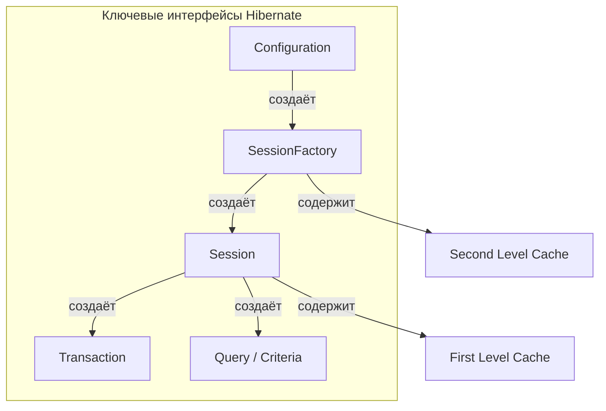
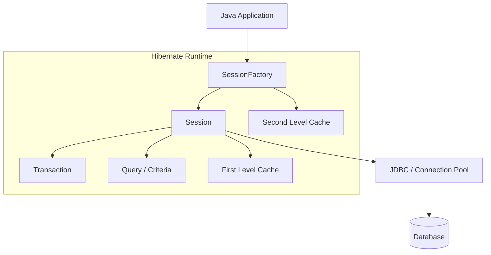
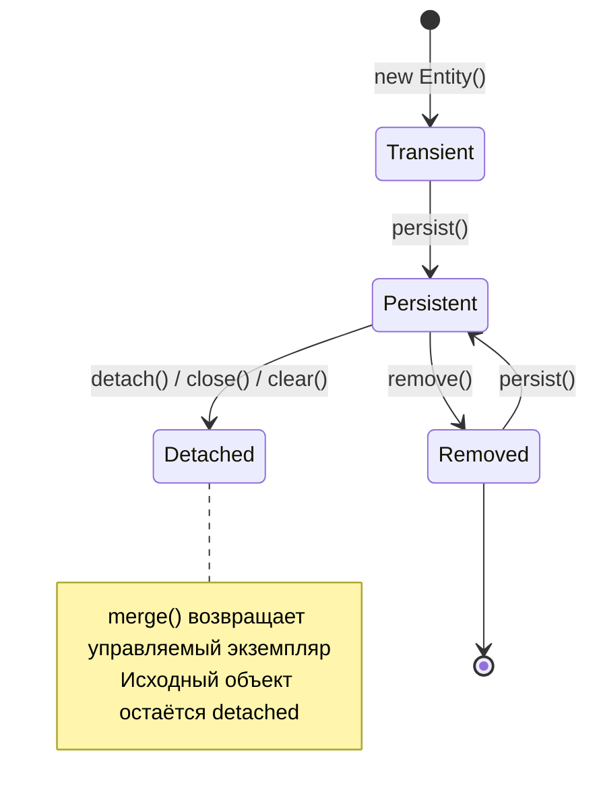
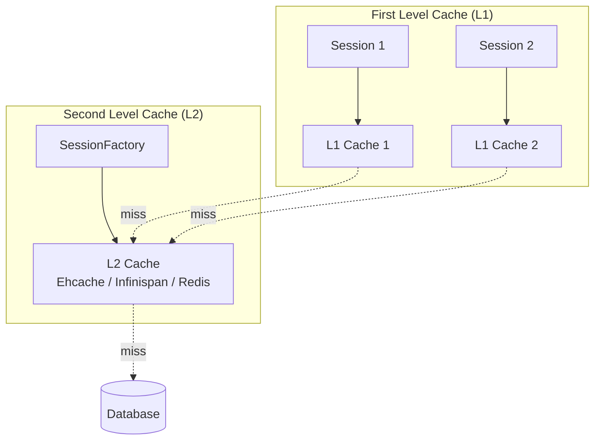
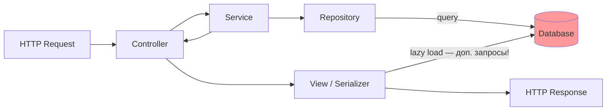

# Вопросы на собеседовании: `Hibernate`

Полное покрытие `Hibernate ORM`: маппинги, `Session`, lazy loading, N+1, кэширование, состояния entity, `Criteria API`, `JPQL`, транзакции, блокировки, наследование, batch processing.

Краткое введение: **Hibernate** — самая популярная реализация спецификации `JPA` для работы с реляционными БД в `Java`. На собеседовании проверяют глубокое понимание маппингов, жизненного цикла сущностей, механизмов кэширования, стратегий загрузки, N+1 проблемы, управления транзакциями и блокировок. Знание `Hibernate` тесно связано с [Spring Data JPA](../frameworks/spring/spring-data-jpa-interview.md) и [SQL](sql-interview.md).

## Полезные ссылки

### Официальная документация

- [Hibernate ORM Documentation](https://hibernate.org/orm/documentation/) — основная документация
- [Hibernate User Guide 6.x](https://docs.jboss.org/hibernate/orm/6.4/userguide/html_single/Hibernate_User_Guide.html) — руководство пользователя
- [JPA Specification](https://jakarta.ee/specifications/persistence/) — спецификация Jakarta Persistence

### Статьи Baeldung

- [N+1 Problem in Hibernate and Spring Data JPA](https://www.baeldung.com/spring-hibernate-n1-problem) — проблема N+1 и решения
- [Hibernate Second-Level Cache](https://www.baeldung.com/hibernate-second-level-cache) — кэш второго уровня
- [Hibernate Entity Lifecycle](https://www.baeldung.com/hibernate-entity-lifecycle) — жизненный цикл сущностей
- [Hibernate Inheritance Mapping](https://www.baeldung.com/hibernate-inheritance) — стратегии наследования
- [Optimistic Locking in JPA](https://www.baeldung.com/jpa-optimistic-locking) — оптимистичная блокировка
- [Pessimistic Locking in JPA](https://www.baeldung.com/jpa-pessimistic-locking) — пессимистичная блокировка
- [Batch Insert/Update with Hibernate/JPA](https://www.baeldung.com/jpa-hibernate-batch-insert-update) — batch-операции
- [JPA and Hibernate – Criteria vs. JPQL vs. HQL Query](https://www.baeldung.com/jpql-hql-criteria-query) — сравнение подходов к запросам
- [FetchMode in Hibernate](https://www.baeldung.com/hibernate-fetchmode) — стратегии загрузки связанных сущностей

## Содержание

- [Полезные ссылки](#полезные-ссылки)
- [See also](#see-also)

**Основы Hibernate и JPA**
- [Q1. (!) Что такое `Hibernate ORM` и чем он отличается от `JPA`?](#q1--что-такое-hibernate-orm-и-чем-он-отличается-от-jpa)
- [Q2. (!) Каковы преимущества `Hibernate` перед `JDBC`?](#q2--каковы-преимущества-hibernate-перед-jdbc)
- [Q3. (!) Назовите ключевые интерфейсы `Hibernate`](#q3--назовите-ключевые-интерфейсы-hibernate)
- [Q4. Что такое `Session` и `SessionFactory`?](#q4-что-такое-session-и-sessionfactory)
- [Q5. Является ли `Session` потокобезопасной?](#q5-является-ли-session-потокобезопасной)
- [Q6. Объясните архитектуру `Hibernate`](#q6-объясните-архитектуру-hibernate)

**Жизненный цикл сущностей**
- [Q7. (!) Какие состояния может иметь `Entity`?](#q7--какие-состояния-может-иметь-entity)
- [Q8. (!) Что такое `Dirty Checking` и как работает `flush`?](#q8--что-такое-dirty-checking-и-как-работает-flush)
- [Q9. В чём разница между `persist()`, `save()`, `merge()` и `update()`?](#q9-в-чём-разница-между-persist-save-merge-и-update)
- [Q10. В чём разница между `get()` и `load()`?](#q10-в-чём-разница-между-get-и-load)
- [Q11. Зачем `Entity` нужен конструктор без аргументов?](#q11-зачем-entity-нужен-конструктор-без-аргументов)
- [Q12. (!) Можно ли объявить `Entity` класс `final`?](#q12--можно-ли-объявить-entity-класс-final)

**Маппинг и аннотации**
- [Q13. Какие основные аннотации `JPA` используются для маппинга?](#q13-какие-основные-аннотации-jpa-используются-для-маппинга)
- [Q14. (!) Что такое `Hibernate Inheritance Mapping`?](#q14--что-такое-hibernate-inheritance-mapping)
- [Q15. Как маппить связь `One-To-Many` / `Many-To-One`?](#q15-как-маппить-связь-one-to-many--many-to-one)
- [Q16. Как маппить связь `Many-To-Many`?](#q16-как-маппить-связь-many-to-many)
- [Q17. В чём разница между `@JoinColumn` и `mappedBy`?](#q17-в-чём-разница-между-joincolumn-и-mappedby)
- [Q18. Что такое `@Embeddable` и `@Embedded`?](#q18-что-такое-embeddable-и-embedded)

**Lazy Loading и стратегии загрузки**
- [Q19. (!) Что такое `Lazy Loading` и `Eager Loading`?](#q19--что-такое-lazy-loading-и-eager-loading)
- [Q20. (!) Что такое проблема N+1?](#q20--что-такое-проблема-n1)
- [Q21. (!) Как решить проблему N+1?](#q21--как-решить-проблему-n1)
- [Q22. Что такое `LazyInitializationException` и как его избежать?](#q22-что-такое-lazyinitializationexception-и-как-его-избежать)
- [Q23. Что такое `Entity Graph`?](#q23-что-такое-entity-graph)

**Кэширование**
- [Q24. (!) В чём разница между `First Level Cache` и `Second Level Cache`?](#q24--в-чём-разница-между-first-level-cache-и-second-level-cache)
- [Q25. Как настроить кэш второго уровня?](#q25-как-настроить-кэш-второго-уровня)
- [Q26. Что такое `Query Cache`?](#q26-что-такое-query-cache)
- [Q27. (!) Какие `Concurrency Strategy` доступны для кэша?](#q27--какие-concurrency-strategy-доступны-для-кэша)

**Запросы: HQL, JPQL и Criteria API**
- [Q28. Что такое `HQL` и `JPQL`?](#q28-что-такое-hql-и-jpql)
- [Q29. Что такое `Criteria API`?](#q29-что-такое-criteria-api)
- [Q30. Что такое `NamedQuery`?](#q30-что-такое-namedquery)
- [Q31. Поддерживает ли `Hibernate` нативные `SQL`-запросы?](#q31-поддерживает-ли-hibernate-нативные-sql-запросы)
- [Q32. Подвержен ли `Hibernate` `SQL Injection`?](#q32-подвержен-ли-hibernate-sql-injection)

**Транзакции и блокировки**
- [Q33. (!) Что такое `@Version` и оптимистичная блокировка?](#q33--что-такое-version-и-оптимистичная-блокировка)
- [Q34. В чём разница между оптимистичной и пессимистичной блокировкой?](#q34-в-чём-разница-между-оптимистичной-и-пессимистичной-блокировкой)
- [Q35. Как работают транзакции в `Hibernate`?](#q35-как-работают-транзакции-в-hibernate)

**Производительность и оптимизация**
- [Q36. (!) Что такое `Batch Processing` в `Hibernate`?](#q36--что-такое-batch-processing-в-hibernate)
- [Q37. В чём разница между `setMaxResults()` и `setFetchSize()`?](#q37-в-чём-разница-между-setmaxresults-и-setfetchsize)
- [Q38. Что такое `@Immutable`?](#q38-что-такое-immutable)
- [Q39. Как использовать `Hibernate Statistics` для мониторинга?](#q39-как-использовать-hibernate-statistics-для-мониторинга)

**Конфигурация и интеграция**
- [Q40. Как настроить `Hibernate` в `Spring Boot`?](#q40-как-настроить-hibernate-в-spring-boot)
- [Q41. В чём разница между `getCurrentSession()` и `openSession()`?](#q41-в-чём-разница-между-getcurrentsession-и-opensession)
- [Q42. Что такое `Hibernate Dialect`?](#q42-что-такое-hibernate-dialect)

**Продвинутые темы**
- [Q43. (!) Что такое `Open-in-View` антипаттерн и как его избежать?](#q43--что-такое-open-in-view-антипаттерн-и-как-его-избежать)
- [Q44. Что такое `Hibernate Envers` и как организовать аудит изменений?](#q44-что-такое-hibernate-envers-и-как-организовать-аудит-изменений)
- [Q45. (!) Как использовать `Projections` для оптимизации запросов?](#q45--как-использовать-projections-для-оптимизации-запросов)
- [Q46. Что такое `StatelessSession` и когда его использовать?](#q46-что-такое-statelesssession-и-когда-его-использовать)
- [Q47. (!) Какие типичные ошибки производительности в `Hibernate`?](#q47--какие-типичные-ошибки-производительности-в-hibernate)
- [Q48. Как тестировать `Hibernate`-код?](#q48-как-тестировать-hibernate-код)
- [Q49. (!) Как маппить JSON-колонки в Hibernate 6 через `@JdbcTypeCode`?](#q49--как-маппить-json-колонки-в-hibernate-6-через-jdbctypecode)
- [Q50. Что такое `@Struct` в Hibernate 6?](#q50-что-такое-struct-в-hibernate-6)

---

## Q1. (!) Что такое `Hibernate ORM` и чем он отличается от `JPA`?

**JPA** (`Jakarta Persistence API`, ранее `Java Persistence API`) — это **спецификация**, определяющая стандартный API для ORM в Java. **Hibernate** — это **реализация** этой спецификации (наряду с `EclipseLink`, `OpenJPA` и др.).

Ключевые различия:

| Аспект | `JPA` | `Hibernate` |
|--------|-------|-------------|
| Тип | Спецификация (интерфейсы) | Реализация (конкретные классы) |
| Пакет | `jakarta.persistence.*` | `org.hibernate.*` |
| Запросы | `JPQL` | `HQL` (надмножество `JPQL`) |
| Кэш L2 | Определяет API | Поддерживает `Ehcache`, `Infinispan` и др. |
| Расширения | Нет | `@Formula`, `@Where`, `@BatchSize`, `@NaturalId` и др. |

```java
// JPA-стандартный код — переносимый между реализациями
@Entity
@Table(name = "users")
public class User {
    @Id
    @GeneratedValue(strategy = GenerationType.IDENTITY)
    private Long id;

    @Column(nullable = false, length = 100)
    private String name;

    @OneToMany(mappedBy = "user", cascade = CascadeType.ALL, orphanRemoval = true)
    private List<Order> orders = new ArrayList<>();
}
```

На собеседовании важно подчеркнуть: рекомендуется программировать против `JPA` API (переносимость), а специфичные аннотации `Hibernate` использовать только когда стандартных возможностей недостаточно.

## Q2. (!) Каковы преимущества `Hibernate` перед `JDBC`?

Главное преимущество: `Hibernate` убирает рутину `JDBC` и даёт работать с объектами, а не со строками результата. Вы описываете маппинг один раз аннотациями — а `Hibernate` сам генерирует SQL, заполняет объекты из `ResultSet`, отслеживает изменения и синхронизирует их с БД.

| Аспект | `JDBC` | `Hibernate` |
|--------|--------|-------------|
| Код | Много boilerplate (`ResultSet`, `PreparedStatement`) | Чистый код, работа с объектами |
| SQL | Ручное написание, зависимость от диалекта | `HQL`/`JPQL` — независимость от БД |
| Транзакции | Ручное управление (`commit`/`rollback`) | Декларативное через `@Transactional` |
| Исключения | Checked `SQLException` | Unchecked `HibernateException` |
| Кэширование | Нет встроенного | L1 + L2 кэш |
| Маппинг | Ручной маппинг `ResultSet` → объект | Автоматический через аннотации |
| Ассоциации | `JOIN`-ы вручную | `@OneToMany`, `@ManyToMany` и др. |

```java
// JDBC — много boilerplate
try (Connection conn = dataSource.getConnection();
     PreparedStatement ps = conn.prepareStatement("SELECT * FROM users WHERE id = ?")) {
    ps.setLong(1, userId);
    ResultSet rs = ps.executeQuery();
    if (rs.next()) {
        User user = new User();
        user.setId(rs.getLong("id"));
        user.setName(rs.getString("name"));
    }
}

// Hibernate — чистый код
User user = session.get(User.class, userId);
```

**Обратная сторона:** за удобство платят потерей контроля над генерируемым SQL и более сложной отладкой производительности (N+1, lazy loading, кэширование). Поэтому на собеседовании важно показать не только плюсы, но и понимание этих ловушек — им посвящена бо́льшая часть остальных вопросов.

## Q3. (!) Назовите ключевые интерфейсы `Hibernate`



Те же связи как схема:

```
                  ┌─────────────────┐
                  │  Configuration  │
                  └────────┬────────┘
                           │ создаёт
                           ▼
        содержит   ┌─────────────────┐
   L2 Cache ◀──────│  SessionFactory │
                   └────────┬────────┘
                            │ создаёт
                            ▼
        содержит    ┌─────────────────┐
   L1 Cache ◀───────│     Session     │
                    └───┬─────────┬───┘
                создаёт │         │ создаёт
                        ▼         ▼
                ┌───────────┐ ┌──────────────────┐
                │Transaction│ │ Query / Criteria │
                └───────────┘ └──────────────────┘
```

Интерфейсы выстроены в цепочку «конфигурация → фабрика → сессия → транзакция/запрос» — каждый следующий создаётся предыдущим. Запомнить порядок проще, чем зубрить список:

1. **`Configuration`** — читает настройки из `hibernate.cfg.xml` или `persistence.xml` и регистрирует маппинги. Используется один раз на старте, чтобы собрать `SessionFactory`.
2. **`SessionFactory`** — потокобезопасная фабрика сессий, один экземпляр на приложение. Дорогая в создании, поэтому живёт всё время работы приложения; хранит кэш L2 и метаданные маппинга.
3. **`Session`** — единица работы (`unit of work`): короткоживущая, не потокобезопасная, содержит кэш L1 (persistence context).
4. **`Transaction`** — управляет границами транзакции (`begin`, `commit`, `rollback`), обёртка над JDBC/JTA-транзакцией.
5. **`Query`** / **`CriteriaBuilder`** — выполнение запросов `HQL`/`JPQL`/`Criteria`/`SQL`.

## Q4. Что такое `Session` и `SessionFactory`?

**`SessionFactory`** — дорогая в создании потокобезопасная фабрика сессий. Она хранит метаданные маппинга и обращается к настроенным сервисам, включая опциональный L2 cache и поставщика JDBC-соединений. Фабрику обычно создают при старте и переиспользуют. Если сервис работает с отдельными базами заказов и аудита через две единицы персистентности, у каждой может быть своя фабрика с собственным маппингом и настройками. [Hibernate ORM 7.4 — архитектура](https://docs.hibernate.org/stable/core/userguide/html_single/#architecture).

**`Session`** — лёгкий объект, представляющий единицу работы с БД. Содержит **кэш первого уровня** (Persistence Context): управляемая сущность представлена одним экземпляром для данной идентичности. Повторный поиск той же сущности по ID может использовать уже управляемый экземпляр, а JPQL-запрос по-прежнему может выполнить SQL. Типичный жизненный цикл: открыть → выполнить операции → закрыть.

```java
// Классический подход (без Spring)
SessionFactory sf = new Configuration().configure().buildSessionFactory();

try (Session session = sf.openSession()) {
    Transaction tx = session.beginTransaction();
    User user = session.get(User.class, 1L); // загружается в L1 cache
    User same = session.get(User.class, 1L); // берётся из L1 cache, SQL не выполняется
    assert user == same; // true — один и тот же объект
    tx.commit();
}
```

В `Spring` управление `Session` берёт на себя фреймворк через `@Transactional` — подробнее в [Spring Data JPA](../frameworks/spring/spring-data-jpa-interview.md).

## Q5. Является ли `Session` потокобезопасной?

Нет. **`Session`** не потокобезопасна. Одновременный доступ из нескольких потоков к одной `Session` приводит к гонкам, повреждению кэша L1 и непредсказуемому поведению.

**Правило**: одна `Session` на один поток (обычно — на один HTTP-запрос). В `Spring` при использовании `@Transactional` каждый поток получает свою сессию через `ThreadLocal`-привязку. Не храните `Session` в статическом поле и не передавайте между потоками.

**`SessionFactory`**, напротив, **потокобезопасна** и должна быть синглтоном.

## Q6. Объясните архитектуру `Hibernate`



Тот же поток как схема:

```
   ┌──────────────────┐
   │ Java Application │
   └────────┬─────────┘
            ▼
┌ Hibernate Runtime ──────────────────────────────────────┐
│   ┌─────────────────┐                                    │
│   │  SessionFactory │──────────────▶ ┌────────────────┐  │
│   └────────┬────────┘                │ L2 Cache       │  │
│            ▼                          └────────────────┘  │
│   ┌─────────────────┐──────────────▶ ┌────────────────┐  │
│   │     Session     │                │ L1 Cache       │  │
│   └──┬───────┬───────┘                └────────────────┘  │
│      ▼       ▼                                            │
│  ┌─────────┐ ┌──────────────────┐                        │
│  │Transact.│ │ Query / Criteria │                        │
│  └─────────┘ └──────────────────┘                        │
└──────────┬───────────────────────────────────────────────┘
           ▼
   ┌──────────────────────┐
   │ JDBC / Connection Pool│
   └──────────┬───────────┘
              ▼
       ┌────────────┐
       │  Database  │
       └────────────┘
```

`Hibernate` — это прослойка между объектной моделью приложения и реляционной БД. Сверху вниз архитектура делится на слои:

1. **Java Application** — доменные сущности и бизнес-логика, которые не знают про SQL.
2. **Hibernate Framework** — `SessionFactory`, `Session`, `Transaction`, `Query`: здесь объекты превращаются в SQL и обратно.
3. **Internal APIs** — `JDBC`, `JTA` (Java Transaction API), `JNDI`: через них `Hibernate` реально общается с БД и менеджером транзакций.
4. **Database** — `PostgreSQL`, `MySQL`, `Oracle` и др.

Как это работает вместе. Приложение переиспользует `SessionFactory` выбранной конфигурации и получает из неё `Session` для единицы работы. `Session` держит persistence context (L1 cache), отслеживает изменения сущностей (dirty checking) и сбрасывает их в БД при flush. `Transaction` задаёт границы транзакции, внутри которых СУБД или менеджер транзакций обеспечивает атомарность участвующих операций. Всё это в конечном счёте транслируется в обычные `JDBC`-вызовы — `Hibernate` не заменяет драйвер, а надстраивается над ним.

## Q7. (!) Какие состояния может иметь `Entity`?

Сущность `Hibernate` живёт в одном из четырёх состояний — **Transient, Persistent, Detached, Removed** — и состояние определяет, отслеживаются ли изменения объекта и попадут ли они в БД. Это центральная концепция: непонимание состояний — источник большинства багов вроде «почему мои изменения не сохранились» или «почему сохранились без вызова `save()`».



У одного и того же объекта возможны переходы `Transient → Managed → Detached` и `Managed → Removed`. Ветка `merge(detached)` показывает передачу состояния между экземплярами. Исходный объект остаётся detached, а результатом будет уже управляемый экземпляр с тем же ID или новая управляемая копия (см. Q9).

| Состояние | Описание | В Persistence Context? | Есть в БД? |
|-----------|----------|----------------------|------------|
| **Transient** | Новый объект, не связан с сессией | Нет | Нет |
| **Persistent** (Managed) | Привязан к сессии, tracked dirty checking | Да | Строка может уже существовать или ещё ожидать INSERT |
| **Detached** | Ранее был управляемым, теперь вне контекста | Нет | Состояние объекта не подтверждает наличие строки |
| **Removed** | Помечен на удаление | Да | Удаление синхронизируется при flush |

```java
// Внутри активной транзакции. Пользователь с ID 1 уже существует.
User user = session.find(User.class, 1L);
session.detach(user);
user.setName("Bob");

User merged = session.merge(user);
assert merged != user;
assert session.contains(merged);
assert !session.contains(user);

merged.setName("Robert"); // это изменение будет синхронизировано при flush
```

В Hibernate 7.0 методы `Session.save()` и `Session.delete()` удалены. Для этих переходов используют `persist()` и `remove()`. [Jakarta Persistence 3.2 — жизненный цикл сущностей](https://jakarta.ee/specifications/persistence/3.2/jakarta-persistence-spec-3.2.html#entity-instance-life-cycle). [Hibernate 7.0 Migration Guide](https://docs.hibernate.org/orm/7.0/migration-guide/).

## Q8. (!) Что такое `Dirty Checking` и как работает `flush`?

**Dirty Checking** — механизм `Hibernate`, который автоматически обнаруживает изменённые (dirty) сущности в persistence context и генерирует `UPDATE` SQL при `flush`. Не требует явного вызова `update()`.

**Как это работает**: в обычном diff-based механизме Hibernate хранит последнее известное состояние сущности и при `flush` сравнивает с текущим. При включённом bytecode enhancement возможен in-line dirty tracking: изменённые атрибуты отмечает сама сущность, а Hibernate запрашивает их при flush. В обоих случаях изменение managed-сущности может привести к `UPDATE` без вызова `update()`. [Hibernate ORM 7.4, in-line dirty tracking](https://docs.hibernate.org/orm/7.4/userguide/html_single/).

**`flush()`** — синхронизация persistence context с БД без подтверждения транзакции. При стандартном `AUTO` Hibernate выполняет её перед commit и перед JPQL/HQL-запросом, **если он пересекается с ожидающими изменениями**. Явно вызвать его можно через `session.flush()`.

Для **нативного SQL** в Hibernate 7.4 имеет значение режим совместимости. В активной транзакции при `AUTO`, если Hibernate не знает таблиц запроса, в JPA-совместимом режиме он выполняет flush перед запросом. В нативном режиме без JPA-совместимости такой запрос сам по себе flush не запускает. Если задать затронутые таблицы, Hibernate проверяет их пересечение с ожидающими изменениями. Например, после добавления пользователя запрос `SELECT count(*) FROM users` в нативном режиме может вернуть прежний счётчик. Вызов `addSynchronizedEntityClass(User.class)` на `NativeQuery` сообщает Hibernate таблицы маппинга `User` и позволяет ему выполнить необходимый flush. Явный `flush()` перед запросом тоже синхронизирует изменения в текущей транзакции. [Hibernate 7.4, NativeQuery](https://docs.hibernate.org/orm/7.4/javadocs/org/hibernate/query/NativeQuery.html).

```java
@Transactional
public void updateUserName(Long id, String newName) {
    User user = entityManager.find(User.class, id);
    user.setName(newName);
    // НЕ нужно вызывать save() или update()!
    // Dirty checking сам обнаружит изменение и сгенерирует UPDATE при commit
}
```

**`FlushMode`** управляет моментом flush:
- `AUTO` (по умолчанию) — при необходимости для согласованности запроса и перед commit, а не перед каждым SELECT;
- `COMMIT` — старается отложить flush до commit, но может выполнить его раньше; JPA не определяет видимость ожидающих изменений в промежуточном запросе;
- `MANUAL` — специфичный для Hibernate режим: только явный `flush()`.

JPA стандартизирует `AUTO` и `COMMIT`, а Hibernate также предлагает `MANUAL` и `ALWAYS`. [Hibernate ORM 7.4, Flushing](https://docs.hibernate.org/orm/7.4/userguide/html_single/); [Jakarta Persistence 3.2, FlushModeType](https://jakarta.ee/specifications/persistence/3.2/apidocs/jakarta.persistence/jakarta/persistence/flushmodetype).

## Q9. В чём разница между `persist()`, `save()`, `merge()` и `update()`?

`persist()` и `merge()` — методы JPA, доступные и через Hibernate `Session`. `Session.save()`/`update()` — старый API: в Hibernate 6.6 они были deprecated, а в Hibernate **7.0 удалены**. Не путайте их с `CrudRepository.save()` в Spring Data JPA — у него другая сигнатура и выбор между `persist`/`merge` (см. [Spring Data JPA Q19](../frameworks/spring/spring-data-jpa-interview.md#q19--какие-состояния-имеет-сущность-в-jpa)).

| Метод | Версия/контракт | Поведение |
|-------|-----------------|-----------|
| `persist()` | JPA, Hibernate 6/7 | Делает новый аргумент managed; возвращает `void`. SQL `INSERT` возможен при flush/commit или раньше, например при `IDENTITY`. |
| `merge()` | JPA, Hibernate 6/7 | Копирует состояние нового или detached аргумента в возвращённый managed-экземпляр; исходный detached аргумент не переподключается. Если аргумент уже managed, возвращается он же. |
| `Session.save()` | Hibernate 6.6: deprecated с 6.0; Hibernate 7: удалён | Исторический метод для нового объекта; в 6.6 возвращал `Object` (ID). Заменяйте на `persist()`. |
| `Session.update()` | Hibernate 6.6: deprecated с 6.0; Hibernate 7: удалён | Исторически переподключал detached-аргумент, а при другой managed-сущности с тем же ID бросал исключение. Заменяйте на `merge()` и используйте его результат. |

```java
// persist() — JPA стандарт, рекомендуется
User user = new User("Alice");
entityManager.persist(user); // user теперь managed

// merge() — для detached объектов
User detached = ... ; // получен из другой сессии, десериализации и т.д.
User managed = entityManager.merge(detached);
// managed — возвращённый управляемый экземпляр, detached — по-прежнему detached
managed.setName("Bob"); // будет синхронизировано с БД
```

При `merge(detached)` результат может быть уже существовавшей managed-сущностью того же ID, поэтому слово «новая копия» не всегда верно. На Hibernate 7 используйте `persist()` для нового объекта и `merge()` для передачи состояния detached-объекта. [Hibernate 7.0 Migration Guide](https://docs.hibernate.org/orm/7.0/migration-guide/); [Hibernate 6.6 `Session` API](https://docs.hibernate.org/orm/6.6/javadocs/org/hibernate/Session.html); [Hibernate 7.4 `Session` API](https://docs.hibernate.org/orm/7.4/javadocs/org/hibernate/Session.html); [Jakarta Persistence 3.2, merge](https://jakarta.ee/specifications/persistence/3.2/jakarta-persistence-spec-3.2).

## Q10. В чём разница между `get()` и `load()`?

Это исторические имена Hibernate `Session`: `load()` **удалён с 7.0** в пользу JPA `getReference()`, а `get()` в 7.0 помечен deprecated в пользу `find()`. Для нового кода сравнивайте `EntityManager.find()` и `getReference()`.

| Аспект | `find()` (`Session.get()` в старом коде) | `getReference()` (`Session.load()` до 7.0) |
|--------|--------------------|-----------------------------|
| Загрузка | Возвращает инициализированную сущность; если она уже managed, SQL не нужен | Hibernate 7.4 не читает БД при вызове; может вернуть proxy или уже имеющийся managed-экземпляр |
| Если не найден | Возвращает `null` | JPA допускает `EntityNotFoundException` при вызове или первом обращении к состоянию; отсутствие строки не превращается в `null` |
| Когда использовать | Нужны данные сущности или проверка существования | Нужна ссылка по ID, например для связи, без обязательной загрузки состояния |

```java
User user = entityManager.find(User.class, 1L);
if (user == null) { /* строки нет */ }

User ref = entityManager.getReference(User.class, 1L);
// Для Hibernate это не требует SELECT; обращение к состоянию может его вызвать.
String name = ref.getName();
```

`getReference()` полезен, когда нужно только установить связь (FK), не загружая состояние связанной сущности:

```java
Order order = new Order();
order.setUser(entityManager.getReference(User.class, userId)); // без SELECT для User
entityManager.persist(order);
```

Ссылка **не доказывает существование** строки: неверный FK может обнаружиться лишь на SQL `INSERT`/commit. `find()` тоже не обязан делать новый `SELECT`, если объект уже есть в persistence context или может быть получен из кэша. [Hibernate 7.0 Migration Guide](https://docs.hibernate.org/orm/7.0/migration-guide/); [Hibernate 7.4 `Session` API](https://docs.hibernate.org/orm/7.4/javadocs/org/hibernate/Session.html); [Jakarta Persistence 3.2 `EntityManager` API](https://jakarta.ee/specifications/persistence/3.2/apidocs/jakarta.persistence/jakarta/persistence/entitymanager).

## Q11. Зачем `Entity` нужен конструктор без аргументов?

Jakarta Persistence требует у класса сущности конструктор без аргументов с доступом `public` или `protected`. Провайдер использует его при создании экземпляра. Для бизнес-кода можно добавить конструкторы с аргументами. Если объявить такой конструктор без явного no-arg, Java больше не сгенерирует конструктор по умолчанию.

Hibernate 7.4 допускает менее широкую видимость. Для прокси-подкласса конструктор должен быть доступен подклассу. `protected` подходит и для проксирования, и для переносимого JPA-маппинга. [Hibernate ORM 7.4 — требования к конструктору](https://docs.hibernate.org/orm/7.4/userguide/html_single/#entity-pojo-constructor).

```java
@Entity
public class User {
    @Id
    @GeneratedValue(strategy = GenerationType.IDENTITY)
    private Long id;
    private String name;

    protected User() {} // доступ для провайдера JPA

    public User(String name) { // для бизнес-логики
        this.name = name;
    }
}
```

## Q12. (!) Можно ли объявить `Entity` класс `final`?

Для переносимого маппинга Jakarta Persistence класс сущности должен быть открытым для наследования. Hibernate допускает сохранение экземпляров `final`-класса, но не может создать прокси как подкласс такой сущности.

Например, при `Order.customer` с `@ManyToOne(fetch = LAZY)` и `final class Customer` обычный прокси-подкласс `Customer` невозможен. Hibernate может загрузить связь раньше, чем ожидает приложение. Bytecode enhancement предоставляет другой механизм ленивой загрузки. Проверяйте SQL для конкретного маппинга и конфигурации. [Hibernate ORM 7.4 — классы сущностей и прокси](https://docs.hibernate.org/orm/7.4/userguide/html_single/#entity-pojo-final).

Если задача состоит в том, чтобы Hibernate не записывал изменения состояния справочника через dirty checking, можно обозначить это в маппинге:

```java
@Entity
@Immutable
public class Country { ... }
```

`@Immutable` управляет обработкой изменений в Hibernate. Java-объект при этом может оставаться изменяемым, а защита строк от записи другими клиентами требует отдельного контроля. [Hibernate ORM 7.4 — immutability](https://docs.hibernate.org/orm/7.4/userguide/html_single/#immutability).

## Q13. Какие основные аннотации `JPA` используются для маппинга?

Базовый набор — это `@Entity` + `@Table` (что и куда маппится), `@Id` + `@GeneratedValue` (первичный ключ), `@Column` (тонкая настройка колонок), аннотации связей (`@ManyToOne`, `@OneToMany` и др.) и служебные (`@Transient`, `@Version`, `@Enumerated`). Ниже — типичная сущность со всеми ключевыми аннотациями в контексте:

```java
@Entity                          // Помечает класс как сущность
@Table(name = "orders")          // Имя таблицы
public class Order {

    @Id                           // Первичный ключ
    @GeneratedValue(strategy = GenerationType.IDENTITY) // Стратегия генерации ID
    private Long id;

    @Column(name = "order_date", nullable = false) // Маппинг колонки
    private LocalDateTime orderDate;

    @Enumerated(EnumType.STRING)  // Enum как строка (не ordinal!)
    private OrderStatus status;

    @ManyToOne(fetch = FetchType.LAZY)  // Связь N:1
    @JoinColumn(name = "user_id")       // FK колонка
    private User user;

    @OneToMany(mappedBy = "order", cascade = CascadeType.ALL, orphanRemoval = true)
    private List<OrderItem> items = new ArrayList<>();

    @Transient                    // Поле не маппится в БД
    private BigDecimal calculatedTotal;

    @Version                      // Оптимистичная блокировка
    private Integer version;

    @CreationTimestamp             // Hibernate — автоматическая дата создания
    private LocalDateTime createdAt;
}
```

Jakarta Persistence 3.2 определяет пять стратегий `@GeneratedValue`.

- **`IDENTITY`** — идентификатор выдаёт столбец identity при вставке. В Hibernate 7.4 для таких сущностей отключён JDBC insert batching в обычной `Session` (Q36).
- **`SEQUENCE`** — идентификаторы берутся из последовательности БД. Hibernate может получить их до вставки, поэтому эта стратегия совместима с JDBC batching при подходящей конфигурации.
- **`TABLE`** — значения выделяются через отдельную таблицу. Стоимость зависит от частоты обращений к генератору и конкуренции за его строки.
- **`UUID`** — провайдер генерирует UUID для поля типа `UUID` или `String`. Стандартная стратегия доступна с Jakarta Persistence 3.1.
- **`AUTO`** — для `UUID` и `String` в Jakarta Persistence 3.2 эквивалентна `UUID`. Для `Long` и `Integer` провайдер выбирает между `TABLE`, `SEQUENCE` и `IDENTITY` с учётом БД.

[Jakarta Persistence 3.2, GeneratedValue](https://jakarta.ee/specifications/persistence/3.2/jakarta-persistence-spec-3.2.html), [Hibernate 7.4, JDBC batching](https://docs.hibernate.org/orm/7.4/userguide/html_single/#batch).


## Q14. (!) Что такое `Hibernate Inheritance Mapping`?

Inheritance Mapping укладывает иерархию `@Entity` в таблицы. `Hibernate` поддерживает все три стратегии Jakarta Persistence; по JPA 3.2 только `SINGLE_TABLE` (умолчание) и `JOINED` обязательны для любого провайдера, а `TABLE_PER_CLASS` необязательна. Цена каждой стратегии зависит от полиморфного запроса и объёма данных:

```mermaid
graph TD
    subgraph "SINGLE_TABLE"
        ST[vehicles<br/>id | type | make | payload | seats]
    end

    subgraph "JOINED"
        JV[vehicles<br/>id | make] --> JT[trucks<br/>id | payload]
        JV --> JC[cars<br/>id | seats]
    end

    subgraph "TABLE_PER_CLASS"
        TT[trucks<br/>id | make | payload]
        TC[cars<br/>id | make | seats]
    end
```

Те же раскладки по таблицам как схема:

```
SINGLE_TABLE
  ┌──────────────────────────────────────────┐
  │ vehicles: id | type | make | payload | seats │
  └──────────────────────────────────────────┘

JOINED
  ┌─────────────────┐
  │ vehicles: id | make │
  └──────┬──────┬────┘
   id ──▶│      │◀── id
  ┌──────┴─────┐ ┌─┴───────────┐
  │ trucks:    │ │ cars:        │
  │ id|payload │ │ id|seats     │
  └────────────┘ └─────────────┘

TABLE_PER_CLASS
  ┌──────────────────────┐   ┌────────────────────┐
  │ trucks:              │   │ cars:              │
  │ id | make | payload  │   │ id | make | seats  │
  └──────────────────────┘   └────────────────────┘
```

| Стратегия | Аннотация | Плюсы | Минусы |
|-----------|-----------|-------|--------|
| **Single Table** | `@Inheritance(strategy = SINGLE_TABLE)` | Одна таблица, нет JOIN между таблицами иерархии | Поля подтипов допускают NULL в строках других типов; условную обязательность можно выразить CHECK |
| **Joined** | `@Inheritance(strategy = JOINED)` | Таблицы подтипов допускают свои NOT NULL-ограничения | JOIN при материализации подтипа и полиморфном чтении |
| **Table Per Class** | `@Inheritance(strategy = TABLE_PER_CLASS)` | Таблица каждого конкретного класса содержит и унаследованные поля | Для полиморфного чтения Hibernate использует UNION; стратегия непереносима по JPA 3.2 |

```java
@Entity
@Inheritance(strategy = InheritanceType.SINGLE_TABLE)
@DiscriminatorColumn(name = "vehicle_type", discriminatorType = DiscriminatorType.STRING)
public abstract class Vehicle {
    @Id @GeneratedValue(strategy = GenerationType.IDENTITY)
    private Long id;
    private String make;
}

@Entity
@DiscriminatorValue("TRUCK")
public class Truck extends Vehicle {
    private Double payload;
}

@Entity
@DiscriminatorValue("CAR")
public class Car extends Vehicle {
    private Integer seats;
}
```

**На собеседовании:** `SINGLE_TABLE` — умолчание; `JOINED` позволяет разделить ограничения подтипов; `TABLE_PER_CLASS` стоит выбирать только после проверки поддержки провайдера и плана полиморфных запросов. SQL может отличаться в запросах к конкретному подтипу и ко всей иерархии. [Jakarta Persistence 3.2, inheritance mapping](https://jakarta.ee/specifications/persistence/3.2/jakarta-persistence-spec-3.2); [Hibernate ORM 7.4, inheritance](https://docs.hibernate.org/orm/7.4/userguide/html_single/).

## Q15. Как маппить связь `One-To-Many` / `Many-To-One`?

Связь `@OneToMany` / `@ManyToOne` — самая распространённая в JPA. Владелец связи (owning side) — сторона `@ManyToOne` в двусторонней связи. `@JoinColumn` задаёт колонку внешнего ключа в этом примере. Если её имя подходит по умолчанию, аннотацию можно опустить.

```java
@Entity
public class Department {
    @Id @GeneratedValue(strategy = GenerationType.IDENTITY)
    private Long id;
    private String name;

    // Сотрудника можно перевести в другой отдел: удаление сироты здесь не подходит
    @OneToMany(mappedBy = "department", cascade = {CascadeType.PERSIST, CascadeType.MERGE})
    private List<Employee> employees = new ArrayList<>();

    void linkEmployee(Employee employee) {
        employees.add(employee);
    }

    void unlinkEmployee(Employee employee) {
        employees.remove(employee);
    }
}

@Entity
public class Employee {
    @Id @GeneratedValue(strategy = GenerationType.IDENTITY)
    private Long id;
    private String name;

    @ManyToOne(fetch = FetchType.LAZY) // LAZY — best practice для @ManyToOne
    @JoinColumn(name = "department_id")
    private Department department;

    public void moveTo(Department target) {
        if (department == target) {
            return;
        }
        if (department != null) {
            department.unlinkEmployee(this);
        }
        department = target;
        if (target != null) {
            target.linkEmployee(this);
        }
    }
}
```

В транзакции вызовите `employee.moveTo(newDepartment)` для сущностей из одного контекста персистентности. При flush Hibernate сохранит новый внешний ключ из `Employee.department`. В памяти сотрудник исчезнет из коллекции старого отдела и появится в новом. Передача `null` подходит, если схема допускает сотрудника без отдела.

**Важно:** `@ManyToOne` по умолчанию `EAGER`; обычно полезно задать `LAZY` явно и выбирать нужный fetch-план для запроса. Сам `LAZY` не гарантирует отсутствие N+1 при последующем обходе связей (см. Q19–Q21). `orphanRemoval` подходит для приватно принадлежащих детей, например `OrderItem` у `Order`, но не для сотрудника, которого можно переводить между отделами. [Jakarta Persistence 3.2, orphan removal](https://jakarta.ee/specifications/persistence/3.2/jakarta-persistence-spec-3.2).

## Q16. Как маппить связь `Many-To-Many`?

`@ManyToMany` маппится через **промежуточную (join) таблицу** с двумя внешними ключами — отдельной сущности для связи нет. В двунаправленной связи владельцем может быть любая сторона. В примере это `Student.courses`: он задаёт маппинг таблицы через `@JoinTable`. Если аннотацию опустить, применятся стандартные имена. `Course.students` указывает на поле владельца через `mappedBy`. В однонаправленной связи есть только владелец.

```java
@Entity
public class Student {
    @Id @GeneratedValue(strategy = GenerationType.IDENTITY)
    private Long id;

    @ManyToMany(cascade = {CascadeType.PERSIST, CascadeType.MERGE})
    @JoinTable(
        name = "student_course",
        joinColumns = @JoinColumn(name = "student_id"),
        inverseJoinColumns = @JoinColumn(name = "course_id")
    )
    private Set<Course> courses = new HashSet<>();
}

@Entity
public class Course {
    @Id @GeneratedValue(strategy = GenerationType.IDENTITY)
    private Long id;

    @ManyToMany(mappedBy = "courses")
    private Set<Student> students = new HashSet<>();
}
```

Чтобы записать зачисление, добавьте курс в `Student.courses`. Если приложение читает связь в обе стороны в том же контексте, обновите также `Course.students`. Изменение одной обратной коллекции не гарантирует запись связи.

**Практические детали**
- Выбирайте `Set` для уникальных значений, `List` — если важен порядок/повторы и настроена соответствующая семантика. Не выводите стоимость обновления join-таблицы только из Java-типа. Если каждую пару студент–курс можно записать лишь один раз, закрепите это составным первичным ключом или ограничением `UNIQUE (student_id, course_id)` в миграции. Тогда инвариант действует и при параллельных транзакциях.
- Не задавайте `CascadeType.ALL` / `REMOVE` для разделяемых сущностей в `@ManyToMany`: каскад при `remove` владельца затронет сами связанные сущности, а удаление элемента коллекции меняет таблицу связи; `cascade=REMOVE` вне `@OneToOne`/`@OneToMany` непереносим по Jakarta Persistence.
- Для join-таблиц с дополнительными полями (дата записи, оценка и т.д.) — создавайте отдельную `@Entity`

[Hibernate ORM 7.4, `@ManyToMany`](https://docs.hibernate.org/orm/7.4/userguide/html_single/); [Jakarta Persistence 3.2, каскад удаления](https://jakarta.ee/specifications/persistence/3.2/jakarta-persistence-spec-3.2).

## Q17. В чём разница между `@JoinColumn` и `mappedBy`?

**`@JoinColumn`** задаёт колонку соединения, обычно внешний ключ. Таблица, в которой находится колонка, определяется видом маппинга. Например, в двусторонней связи `ManyToOne` / `OneToMany` владельцем является сторона `ManyToOne`. Она может использовать имя колонки по умолчанию, если `@JoinColumn` опущена.

**`mappedBy`** — маркер **inverse side** (обратная сторона). Указывает имя поля или свойства на стороне владельца в зависимости от выбранного способа доступа.

```java
// Owning side — Employee владеет связью, в таблице employee есть FK department_id
@ManyToOne
@JoinColumn(name = "department_id")
private Department department;

// Inverse side — Department не владеет связью, ссылается на поле "department" у Employee
@OneToMany(mappedBy = "department")
private List<Employee> employees;
```

За запись связи отвечает атрибут владельца. Например, при переводе сотрудника в другой отдел обновите `Employee.department` и приведите коллекции обоих отделов в соответствие. Если изменить только `Department.employees`, перенос сотрудника в БД не гарантирован.

В односторонней связи `@OneToMany @JoinColumn(name = "department_id")` владельцем будет коллекция отдела, а колонка `department_id` находится в таблице сотрудников. Если связь использует `@JoinTable`, колонки соединения задают в промежуточной таблице. [Jakarta Persistence 3.2, разделы 2.11 и 11.1.26](https://jakarta.ee/specifications/persistence/3.2/jakarta-persistence-spec-3.2.html).

## Q18. Что такое `@Embeddable` и `@Embedded`?

`@Embeddable` объявляет тип значения без собственной идентичности в контексте персистентности. `@Embedded` отмечает одиночный атрибут этого типа. Для атрибута с типом, помеченным `@Embeddable`, Jakarta Persistence применяет такой же маппинг по умолчанию, даже если `@Embedded` опущена. В примере ниже простые поля адреса занимают колонки строки `Customer`.

```java
@Embeddable
public class Address {
    private String city;
    private String street;
    @Column(name = "zip_code")
    private String zipCode;
}

@Entity
public class Customer {
    @Id @GeneratedValue(strategy = GenerationType.IDENTITY)
    private Long id;

    @Embedded
    private Address homeAddress;

    @Embedded
    @AttributeOverrides({
        @AttributeOverride(name = "city", column = @Column(name = "work_city")),
        @AttributeOverride(name = "street", column = @Column(name = "work_street")),
        @AttributeOverride(name = "zipCode", column = @Column(name = "work_zip"))
    })
    private Address workAddress;
}
```

Результат — **одна таблица** `customer` с колонками: `id`, `city`, `street`, `zip_code`, `work_city`, `work_street`, `work_zip`.

Если у клиента несколько дополнительных адресов, `@ElementCollection` хранит их в таблице коллекции. Каждая строка содержит внешний ключ на клиента и колонки адреса. Элементы по-прежнему остаются значениями без собственного идентификатора сущности. [Jakarta Persistence 3.2, разделы 2.7, 2.8 и 2.10](https://jakarta.ee/specifications/persistence/3.2/jakarta-persistence-spec-3.2.html).

## Q19. (!) Что такое `Lazy Loading` и `Eager Loading`?

Это политики загрузки связи, а не готовые SQL-планы. В Jakarta Persistence `EAGER` требует загрузить связь до выдачи результата; `LAZY` лишь подсказывает отложить её и может быть переопределён провайдером или fetch-планом запроса. Поэтому `EAGER` не гарантирует JOIN, а `LAZY` — отдельный SELECT при каждом обращении.

| Стратегия | Описание | По умолчанию для |
|-----------|----------|-----------------|
| **`LAZY`** | Загрузка может быть отложена до обращения | `@OneToMany`, `@ManyToMany` |
| **`EAGER`** | Связь должна быть загружена до выдачи результата | `@ManyToOne`, `@OneToOne` |

В Hibernate to-one `LAZY` часто реализован через proxy, коллекции — через persistent wrapper; уже загруженная связь не требует нового SELECT. При выборке списка JPQL/HQL без `JOIN FETCH` даже `EAGER` to-one может загружаться вторичными SELECT и дать N+1.

Обычно полезно задавать `LAZY` и явно выбирать нужные связи для конкретного сценария через `JOIN FETCH`, `@EntityGraph` или пакетную загрузку. Для некоторых отображений to-one реализация LAZY требует учёта proxy/bytecode enhancement; фактическое число запросов проверяйте по SQL. [Jakarta Persistence 3.2 `FetchType`](https://jakarta.ee/specifications/persistence/3.2/apidocs/jakarta.persistence/jakarta/persistence/fetchtype); [Hibernate ORM 7.4, fetching](https://docs.hibernate.org/orm/7.4/userguide/html_single/).

```java
@Entity
public class Order {
    @ManyToOne(fetch = FetchType.LAZY) // явно LAZY для @ManyToOne
    @JoinColumn(name = "user_id")
    private User user;

    @OneToMany(mappedBy = "order", fetch = FetchType.LAZY) // LAZY по умолчанию
    private List<OrderItem> items;
}
```

## Q20. (!) Что такое проблема N+1?

Проблема **N+1** — ситуация, когда `Hibernate` выполняет **1 запрос** для получения списка из N сущностей, а затем отдельные запросы для загрузки связей каждой сущности. В простом случае получается ещё N SELECT; фактическое число зависит от кэша, общих связанных объектов и fetch-плана. Это возможно при обращении к `LAZY`-связи в цикле **и при `EAGER` to-one в JPQL/HQL без `JOIN FETCH`**: Hibernate может загрузить такую связь вторичными SELECT до возврата списка.

```java
// 1 запрос: SELECT * FROM authors
List<Author> authors = session.createQuery("FROM Author", Author.class).list();

// N запросов: для каждого автора — SELECT * FROM books WHERE author_id = ?
for (Author author : authors) {
    System.out.println(author.getBooks().size()); // отдельный SELECT при указанных ниже условиях
}
```

В этом примере все коллекции при входе в цикл ещё не загружены, сессия открыта, а batch fetch, subselect fetch и попадания в кэш исключены. В таком случае на список авторов и их книги приходится **1 + N запросов**. При 1000 авторах это 1001 запрос к БД.

```
-- 1-й запрос
SELECT * FROM authors;

-- 2-й запрос (автор #1)
SELECT * FROM books WHERE author_id = 1;
-- 3-й запрос (автор #2)
SELECT * FROM books WHERE author_id = 2;
-- ... и так N раз
```

Проверяйте количество SQL на выборке списка, а не выводите его из одной аннотации `FetchType`. [Hibernate ORM 7.4, fetching](https://docs.hibernate.org/orm/7.4/userguide/html_single/). Подробнее о запросах — в [вопросах по SQL](sql-interview.md).

## Q21. (!) Как решить проблему N+1?

Способ зависит от требуемых связей и объёма выборки:

**1. `JOIN FETCH` в JPQL**, когда связь нужна именно этому запросу:

```java
// Один SQL с JOIN; INNER JOIN исключит авторов без книг
List<Author> authors = entityManager
    .createQuery("SELECT a FROM Author a JOIN FETCH a.books", Author.class)
    .getResultList();
```

**2. `EntityGraph`** задаёт граф требуемых атрибутов без фиксации формы SQL:

```java
@Entity
@NamedEntityGraph(name = "Author.withBooks",
    attributeNodes = @NamedAttributeNode("books"))
public class Author { ... }

// Использование
EntityGraph<?> graph = entityManager.getEntityGraph("Author.withBooks");
List<Author> authors = entityManager
    .createQuery("SELECT a FROM Author a", Author.class)
    .setHint("jakarta.persistence.fetchgraph", graph)
    .getResultList();
```

**3. `@BatchSize`** объединяет часть дополнительных SELECT:

```java
@Entity
public class Author {
    @OneToMany(mappedBy = "author")
    @BatchSize(size = 25) // до 25 ещё не загруженных коллекций за раз
    private List<Book> books;
}
```

При первой дозагрузке Hibernate подбирает другие ещё не загруженные коллекции этого маппинга из той же сессии. Если авторов читают и обрабатывают по одному, подходящих коллекций для пакета может не оказаться. Размер 25 задаёт верхнюю границу пакета. Число SELECT зависит от того, какие коллекции доступны для группировки в момент каждого обращения. [Hibernate ORM 7.4, BatchSize](https://docs.hibernate.org/orm/7.4/javadocs/org/hibernate/annotations/BatchSize.html).

**4. `@Fetch(FetchMode.SUBSELECT)`**:

```java
@OneToMany(mappedBy = "author")
@Fetch(FetchMode.SUBSELECT)
private List<Book> books;
// При обращении к коллекции Hibernate может загрузить коллекции владельцев одним subselect
```

**Не считайте `EAGER` лечением N+1:** он требует ранней загрузки, но не JOIN; JPQL/HQL без fetch join способен дать вторичные SELECT по каждой to-one связи. Несколько параллельных fetch joins коллекций могут дать декартово произведение, а несколько bag — `MultipleBagFetchException`. Проверяйте SQL и количество строк; для нескольких коллекций часто удобнее отдельные/пакетные запросы. [Hibernate ORM 7.4, fetch joins/batch/subselect](https://docs.hibernate.org/orm/7.4/userguide/html_single/); [Hibernate `MultipleBagFetchException`](https://docs.hibernate.org/orm/7.4/javadocs/org/hibernate/loader/MultipleBagFetchException.html).

## Q22. Что такое `LazyInitializationException` и как его избежать?

`LazyInitializationException` возникает, когда операция требует загрузить ещё не полученные данные, а прокси или коллекция уже не связаны с открытой stateful `Session`. Так бывает после закрытия сессии или отсоединения сущности. Уже загруженные данные доступны после выхода из сессии.

В примере пользователь с ID 1 существует, а коллекция `orders` отображена как `LAZY` и осталась неинициализированной в момент закрытия сессии.

```java
User user;
try (Session session = sf.openSession()) {
    user = session.get(User.class, 1L);
}

user.getOrders().size(); // Требует дозагрузки и вызывает LazyInitializationException
```

Если контроллеру нужны заказы, сервис может загрузить их через `JOIN FETCH` или `@EntityGraph` и собрать DTO внутри транзакции. Если нужны только поля для ответа API, можно выбрать их DTO-проекцией сразу. В обоих случаях сериализатор получает данные, которые уже доступны.

В Spring Boot для Servlet-приложения с JPA `spring.jpa.open-in-view=true` оставляет `EntityManager` открытым на время HTTP-запроса. Это позволяет дозагрузить данные при сериализации, но запросы могут попасть за границу сервисной транзакции и дать N+1. Открытый контекст сам по себе не продлевает транзакцию. [Hibernate ORM 7.4, LazyInitializationException](https://docs.hibernate.org/orm/7.4/javadocs/org/hibernate/LazyInitializationException.html), [Spring Boot 3.5, Open EntityManager in View](https://docs.spring.io/spring-boot/3.5/reference/data/sql.html).

## Q23. Что такое `Entity Graph`?

**Entity Graph** — механизм `JPA` 2.1+ для декларативного определения, какие атрибуты загрузить вместе с сущностью. Узлы графа могут описывать как связи, так и базовые атрибуты.

```java
// Через аннотацию
@Entity
@NamedEntityGraph(name = "Order.withItems",
    attributeNodes = {
        @NamedAttributeNode("items"),
        @NamedAttributeNode("user")
    })
public class Order { ... }

// Через API (программно)
EntityGraph<Order> graph = entityManager.createEntityGraph(Order.class);
graph.addAttributeNodes("items", "user");

Map<String, Object> hints = Map.of("jakarta.persistence.loadgraph", graph);
Order order = entityManager.find(Order.class, orderId, hints);
```

Два типа hint:
- **`fetchgraph`** — указанные атрибуты считаются `EAGER`, остальные — `LAZY`-подсказкой;
- **`loadgraph`** — указанные атрибуты считаются `EAGER`, остальные сохраняют настройки маппинга.

Эти правила применяются рекурсивно. Первичный ключ и версию провайдер загружает независимо от перечисленных узлов. Если в граф включена связь с сущностью без подграфа, провайдер загружает целевые сущности по их графу загрузки по умолчанию. Он включает атрибуты, помеченные `EAGER` явно или по умолчанию.

Например, граф выше требует загрузить `Order.items`. Если в `OrderItem` связь `product` имеет `LAZY`-маппинг, одного узла `items` для обязательной загрузки товара недостаточно. Её можно запросить через подграф.

```java
EntityGraph<Order> detailGraph = entityManager.createEntityGraph(Order.class);
detailGraph.addAttributeNodes("user");
detailGraph.addSubgraph("items", OrderItem.class).addAttributeNodes("product");
```

Граф определяет требуемые данные. Форму SQL и число запросов выбирает провайдер, который также вправе загрузить дополнительные данные сверх графа. [Jakarta Persistence 3.2, entity graphs](https://jakarta.ee/specifications/persistence/3.2/jakarta-persistence-spec-3.2).

В [Spring Data JPA](../frameworks/spring/spring-data-jpa-interview.md) Entity Graph используется через аннотацию `@EntityGraph` на методе репозитория.

## Q24. (!) В чём разница между `First Level Cache` и `Second Level Cache`?

Ключевое различие — **область видимости и время жизни**. L1 привязан к контексту персистентности обычной `Session`/`EntityManager`. Вручную открытая сессия может пережить одну транзакцию. `detach(entity)` исключает конкретную сущность из контекста, `clear()` отсоединяет все сущности, а закрытие сессии завершает работу контекста. L2 привязан к `SessionFactory` и переживает отдельные сессии. Без cache-провайдера L2 выключен; если настроен `RegionFactory`, `hibernate.cache.use_second_level_cache` по умолчанию `true`. L1 не требует отдельной настройки. У `StatelessSession` нет контекста персистентности. Начиная с Hibernate 7.0 такая сессия по умолчанию может использовать настроенный L2 (см. Q46). [Hibernate ORM 7.4, StatelessSession](https://docs.hibernate.org/orm/7.4/javadocs/org/hibernate/StatelessSession.html).

При обычной загрузке по идентификатору Hibernate сначала проверяет контекст текущей сессии. При промахе он может проверить L2, если тип кэшируется и режим чтения разрешает использовать кэш. Если состояние получить из кэша не удалось, Hibernate загружает его из БД.



Та же схема поиска при загрузке по идентификатору. Она предполагает, что Hibernate может читать эту сущность из L2.

```
  First Level Cache (L1)        Second Level Cache (L2)
  ┌──────────┐  ┌──────────┐
  │ Session 1│  │ Session 2│
  └────┬─────┘  └────┬─────┘
       ▼             ▼
  ┌──────────┐  ┌──────────┐
  │ L1 Cache1│  │ L1 Cache2│
  └────┬─────┘  └────┬─────┘
  miss │             │ miss     ┌──────────────────────────┐
       └──────┬──────┘          │ SessionFactory           │
              ▼                 └────────────┬─────────────┘
       ┌─────────────────────────┐          ▼
       │ L2 Cache                │◀─────────┘
       │ Ehcache/Infinispan/Redis│
       └────────────┬────────────┘
                miss │
                     ▼
              ┌────────────┐
              │  Database  │
              └────────────┘
```

| Аспект | L1 (First Level) | L2 (Second Level) |
|--------|------------------|-------------------|
| Область | Одна `Session` | `SessionFactory` (все сессии) |
| По умолчанию | Есть у stateful `Session` | Выключен без провайдера; с ним обычно включён |
| Жизненный цикл | Пока сущность остаётся управляемой в данном контексте | Связан с `SessionFactory` и провайдером |
| Настройка | Не нужна | Требует провайдера (Ehcache, Infinispan) |
| Совместное использование | Сессию нельзя использовать одновременно из нескольких потоков | Регионами пользуются разные сессии. Согласованность зависит от провайдера и стратегии из Q27 |

В примере строка пользователя существует, тип `User` не кэшируется в L2, а код выполняется в новой сессии без запроса блокировки.

```java
try (Session session = sf.openSession()) {
    User u1 = session.find(User.class, 1L); // SELECT из БД
    User u2 = session.find(User.class, 1L); // Уже управляемый экземпляр, без повторного SQL
    assert u1 == u2;
}
```

При попадании в L2 разные сессии всё равно управляют собственными экземплярами сущности. Если вместо второго `find()` выполнить JPQL-запрос с тем же ID, Hibernate при выключенном Query Cache выполнит SQL для получения результата. Если строка вошла в результат, для неё будет переиспользован уже управляемый экземпляр из L1. Кэширование самого результата запроса разобрано в Q26. [Hibernate ORM 7.4 — Caching](https://docs.hibernate.org/orm/7.4/userguide/html_single/#caching).

## Q25. Как настроить кэш второго уровня?

Для подключения L2 cache (на примере `Ehcache`):

**1. Зависимость** (Gradle):
```groovy
implementation 'org.hibernate.orm:hibernate-jcache' // версия согласована с hibernate-core
implementation 'org.ehcache:ehcache'                 // совместимая версия через BOM/catalog
```

**2. Конфигурация** (`application.yml`):
```yaml
spring:
  jpa:
    properties:
      hibernate:
        cache:
          use_second_level_cache: true
          region.factory_class: jcache
        javax:
          cache:
            provider: org.ehcache.jsr107.EhcacheCachingProvider
            uri: ehcache.xml
            missing_cache_strategy: fail
```

**3. Регион в `src/main/resources/ehcache.xml`**:

```xml
<config xmlns="http://www.ehcache.org/v3">
    <cache alias="countries">
        <heap unit="entries">1000</heap>
    </cache>
</config>
```

Пример предполагает, что префикс имён регионов не задан. Размер heap здесь условный.

**4. Аннотации на сущности**:
```java
@Entity
@Cacheable                                           // JPA стандарт
@Cache(usage = CacheConcurrencyStrategy.READ_WRITE, region = "countries")
public class Country {
    @Id
    private Long id;
    private String name;
    private String region; // Используется в JPQL-примере из Q26
}
```


**5. Проверка на двух сессиях.** В тестовой конфигурации включите `hibernate.generate_statistics=true`. Возьмите существующий `Country` из холодного региона и прочитайте его по ID в первой сессии. Завершите транзакцию и закройте сессию. Затем прочитайте тот же ID во второй сессии той же фабрики. При стандартном режиме кэша и без вытеснения записи второй вызов должен увеличить `getSecondLevelCacheHitCount()`. Сверьте также SQL для загрузки строки `Country`. Два чтения в одной сессии из примера Q24 могут пройти через L1, поэтому такой тест ничего не доказывает о попадании в L2. Счётчики относятся ко всей фабрике, поэтому проверяйте их изменение в изолированном тесте. [Hibernate ORM 7.4, Statistics](https://docs.hibernate.org/orm/7.4/javadocs/org/hibernate/stat/Statistics.html).

L2 cache наиболее эффективен для сущностей, которые **часто читаются и редко изменяются** (справочники, конфигурации).

`hibernate-jcache` и реализация JCache нужны для приведённого примера. При настроенном `RegionFactory` Hibernate 7.4 включает L2 по умолчанию; явный `use_second_level_cache=true` здесь служит для наглядности. По умолчанию кэшируются только выбранные сущности (`ENABLE_SELECTIVE`). В Hibernate 7.4 интеграция JCache по умолчанию использует `missing_cache_strategy=fail`. Если при инициализации региона Hibernate не найдёт `countries` у провайдера, настройка завершится ошибкой. Поэтому имя в `@Cache` должно совпадать с alias в Ehcache. Для Q26 с включённым кэшем запросов потребуется определить также его регионы. [Hibernate ORM 7.4, ConfigSettings](https://github.com/hibernate/hibernate-orm/blob/7.4/hibernate-jcache/src/main/java/org/hibernate/cache/jcache/ConfigSettings.java), [Ehcache 3.11, JCache и XML](https://www.ehcache.org/documentation/3.11/107.html).

## Q26. Что такое `Query Cache`?

**Query Cache** сохраняет результат конкретного запроса с его параметрами. Скалярная проекция может храниться как значения результата. Для сущностей и коллекций состав записи зависит от формата кэша. В Hibernate 7.4 формат `AUTO` по умолчанию выбирает `SHALLOW` для объектов, настроенных на кэширование в L2, и `FULL` для остальных. `SHALLOW` хранит идентификатор сущности или ключ владельца коллекции. При промахе L2 Hibernate может дополнительно обратиться к БД по этому ключу. `FULL` хранит данные, загруженные исходным запросом. Настройка формата доступна с Hibernate 6.5.

В конфигурации из Q25 добавьте `spring.jpa.properties.hibernate.cache.use_query_cache: true`. При `missing_cache_strategy=fail` в том же `ehcache.xml` должны быть объявлены ещё два alias. Без префикса регионов это `default-query-results-region` для результатов и `default-update-timestamps-region` для меток обновления таблиц. При отсутствии нужного региона Hibernate завершит инициализацию с ошибкой.

Затем пометьте конкретный запрос кэшируемым. В примере он использует регион результатов по умолчанию.

```java
List<Country> countries = entityManager
    .createQuery("SELECT c FROM Country c WHERE c.region = :region", Country.class)
    .setParameter("region", "Europe")
    .setHint("org.hibernate.cacheable", true)
    .getResultList();
```

**Когда использовать.** Например, один и тот же запрос справочника с параметром `Europe` выполняется часто, а данные меняются редко. Hibernate проверяет актуальность записи по меткам изменений таблиц, от которых зависит запрос. Изменение, учтённое Hibernate, может сделать устаревшими результаты с разными параметрами, даже если конкретные строки в них не поменялись.

Если внешний импорт после commit переносит страну из `Europe` в другой регион, устареть могут и список стран в Query Cache, и состояние `Country` в L2. Для конфигурации из Q25 после подтверждения commit обработчик может удалить изменённую сущность через `sessionFactory.getCache().evictEntityData(Country.class, countryId)` и очистить регион результатов через `evictDefaultQueryRegion()`. Если запросы используют именованные регионы, очистите затронутые регионы через `evictQueryRegion(regionName)`. При локальном кэше обработчик нужен в каждом экземпляре приложения, который хранит эти записи.

Инвалидация общих регионов не обновляет объекты, уже управляемые открытой сессией. Между commit и обработкой события остаётся окно устаревших чтений. Если такая задержка недопустима, исключите затронутые данные из общего кэширования и отдельно учитывайте снимок транзакции и состояние текущей сессии. [Hibernate ORM 7.4, Cache API](https://docs.hibernate.org/orm/7.4/javadocs/org/hibernate/Cache.html).

Пользу кэша проверяйте по попаданиям и по фактическому числу SQL-запросов.

Регион результатов и регион меток изменений настраиваются отдельно. Например, результат запроса стран можно хранить с TTL пять минут. Если провайдер раньше удалит из `default-update-timestamps-region` метку обновления таблицы стран, Hibernate может принять ещё живой результат за актуальный. Поэтому для региона меток Hibernate рекомендует отключить TTL и вытеснение по размеру, включая LRU. Политику очистки задавайте для региона результатов.

[Hibernate ORM 7.4 — Query Cache](https://docs.hibernate.org/orm/7.4/userguide/html_single/#caching-query), [CacheLayout API](https://docs.hibernate.org/orm/7.4/javadocs/org/hibernate/annotations/CacheLayout.html).

## Q27. (!) Какие `Concurrency Strategy` доступны для кэша?

Стратегии параллелизма для L2 cache определяют, как обрабатываются конкурентные чтения/записи:

| Стратегия | Описание | Когда использовать |
|-----------|----------|--------------------|
| **`READ_ONLY`** | Для неизменяемых данных. Обновление сущности через Hibernate с этой стратегией приводит к исключению | Справочники, enum-таблицы |
| **`NONSTRICT_READ_WRITE`** | Инвалидация записи кэша до и после завершения обновляющей транзакции. Возможны устаревшие данные | Данные, которые редко меняются и eventual consistency допустима |
| **`READ_WRITE`** | Soft-lock помечает запись кэша на время обновления. Другой читатель обращается к БД | Версионированные сущности, которые обновляются |
| **`TRANSACTIONAL`** | Транзакционная стратегия с JTA при поддержке cache-провайдера | Сценарий, где требуется и доступна такая интеграция |

`NONE` в `CacheConcurrencyStrategy` оставляет выбор стратегии по умолчанию. Это значение само по себе не отключает L2-кэш.

```java
@Entity
@Cache(usage = CacheConcurrencyStrategy.READ_ONLY)
public class Currency { ... }

@Entity
@Cache(usage = CacheConcurrencyStrategy.READ_WRITE)
public class Product {
    @Id
    private Long id;

    @Version
    private long version;
}
```

При обновлении `Product` soft-lock действует на запись L2-кэша. Он не блокирует строку в БД. Что увидит читатель, который обратился к БД, определяется её изоляцией транзакций. Hibernate указывает, что `READ_WRITE` и `NONSTRICT_READ_WRITE` несовместимы с гарантиями `SERIALIZABLE`. Уровень изоляции СУБД распространяется на операции в БД. При попадании в общий L2-кэш чтение состояния сущности проходит мимо механизмов изоляции СУБД, поэтому одного уровня изоляции JDBC для такого чтения недостаточно.

`TRANSACTIONAL` не следует понимать как автоматическое включение XA или кластерного кэша одним значением enum. Поддержку и границы транзакций проверяют у конкретного провайдера. [Hibernate ORM 7.4 — CacheConcurrencyStrategy](https://docs.hibernate.org/orm/7.4/javadocs/org/hibernate/annotations/CacheConcurrencyStrategy.html).

## Q28. Что такое `HQL` и `JPQL`?

**`JPQL`** (`Jakarta Persistence Query Language`) — стандартный язык запросов `JPA`, объектно-ориентированный (работает с сущностями и полями, не с таблицами и колонками).

**`HQL`** (`Hibernate Query Language`) — надмножество `JPQL` с дополнительными возможностями (`Hibernate`-специфичными).

```java
// JPQL — стандарт JPA
TypedQuery<User> query = entityManager.createQuery(
    "SELECT u FROM User u WHERE u.name LIKE :name AND u.active = true",
    User.class
);
query.setParameter("name", "%Alice%");
List<User> users = query.getResultList();

// JPQL — агрегация
List<Object[]> stats = entityManager.createQuery(
    "SELECT u.department, COUNT(u), AVG(u.salary) " +
    "FROM User u GROUP BY u.department HAVING COUNT(u) > 5",
    Object[].class
).getResultList();

// JPQL — JOIN FETCH
List<Author> authors = entityManager.createQuery(
    "SELECT DISTINCT a FROM Author a JOIN FETCH a.books WHERE a.active = true",
    Author.class
).getResultList();

// JPQL — bulk UPDATE внутри активной транзакции
int updated = entityManager.createQuery(
    "UPDATE User u SET u.active = false WHERE u.lastLogin < :date"
).setParameter("date", cutoffDate)
 .executeUpdate();
```

В Hibernate 7.4 можно заменить `u.name LIKE :name` на `u.name ILIKE :name`, чтобы искать по шаблону без учёта регистра. `ILIKE` здесь — расширение HQL. Для JPQL используйте `LOWER(u.name) LIKE LOWER(:name)` с учётом правил преобразования регистра в СУБД. [Hibernate ORM 7.4 — String pattern matching](https://docs.hibernate.org/orm/7.4/querylanguage/html_single/#string-pattern-matching).

В примере `JOIN FETCH` исключает авторов без книг. Чтобы вернуть и их, используйте `LEFT JOIN FETCH`. `DISTINCT` в примере явно задаёт уникальность результата JPQL. Начиная с Hibernate 6, провайдер сам убирает повторные ссылки на корневую сущность, возникшие из-за `JOIN FETCH`. Для этой цели `DISTINCT` при работе с Hibernate больше не нужен. [Hibernate ORM 7.4 — Duplicate removal](https://docs.hibernate.org/orm/7.4/querylanguage/html_single/#hql-distinct).

Массовый `UPDATE` выполняется напрямую в БД, минуя обычные проверки оптимистической блокировки. Уже загруженный `User` может сохранить прежнее значение `active` в контексте. Выполняйте такую операцию до загрузки затронутых сущностей либо явно обновите нужный экземпляр через `refresh()`. [Jakarta Persistence 3.2 — Bulk Update and Delete Operations](https://jakarta.ee/specifications/persistence/3.2/jakarta-persistence-spec-3.2.html).

## Q29. Что такое `Criteria API`?

**Criteria API** — программный способ построения запросов с типизированным результатом. Статическая метамодель позволяет проверять имена и типы атрибутов при компиляции. При обращении по строке, например `root.get("name")`, имя проверяется во время выполнения. Особенно полезен для **динамических запросов** (фильтры, сортировки, которые зависят от пользовательского ввода).

Собственный `org.hibernate.Criteria` объявили устаревшим в Hibernate 5.x и удалили в 6.0. Для переносимых запросов используйте Jakarta Persistence Criteria API. [Hibernate ORM 6.0 Migration Guide](https://docs.hibernate.org/orm/6.0/migration-guide/migration-guide/).

```java
CriteriaBuilder cb = entityManager.getCriteriaBuilder();
CriteriaQuery<User> cq = cb.createQuery(User.class);
Root<User> root = cq.from(User.class);

// Динамическое построение условий
List<Predicate> predicates = new ArrayList<>();

if (nameFilter != null) {
    String escaped = nameFilter.replace("!", "!!")
                               .replace("%", "!%")
                               .replace("_", "!_");
    String namePattern = "%" + escaped + "%";
    predicates.add(cb.like(root.get("name"), namePattern, '!'));
}
if (minAge != null) {
    predicates.add(cb.greaterThanOrEqualTo(root.get("age"), minAge));
}
if (active != null) {
    predicates.add(cb.equal(root.get("active"), active));
}

cq.where(predicates.toArray(new Predicate[0]));
cq.orderBy(cb.asc(root.get("name")));

List<User> users = entityManager.createQuery(cq).getResultList();
```

Фильтр по имени ищет буквальную подстроку. Для ввода `A_B` шаблон `%A!_B%` с escape-символом `!` ищет само подчёркивание. Сначала экранируется сам `!`, затем специальные символы `LIKE` — `%` и `_`. [Jakarta Persistence 3.2 — CriteriaBuilder](https://jakarta.ee/specifications/persistence/3.2/apidocs/jakarta.persistence/jakarta/persistence/criteria/CriteriaBuilder.html).

**С Metamodel** (compile-time проверка полей):

```java
// Замена вызова cb.like внутри блока if из примера выше
predicates.add(cb.like(root.get(User_.name), namePattern, '!'));
```

В [Spring Data JPA](../frameworks/spring/spring-data-jpa-interview.md) для динамических запросов чаще используют `Specification` API, который оборачивает `Criteria API`.

## Q30. Что такое `NamedQuery`?

**`@NamedQuery`** объявляет JPQL-запрос под именем. Имя доступно в пределах persistence unit, даже если аннотация стоит на конкретной сущности. Для именованного SQL-запроса есть `@NamedNativeQuery`. [Jakarta Persistence 3.2 — Named Queries](https://jakarta.ee/specifications/persistence/3.2/jakarta-persistence-spec-3.2.html).

```java
@Entity
@NamedQueries({
    @NamedQuery(
        name = "User.findByEmail",
        query = "SELECT u FROM User u WHERE u.email = :email"
    ),
    @NamedQuery(
        name = "User.findActive",
        query = "SELECT u FROM User u WHERE u.active = true ORDER BY u.name"
    )
})
public class User { ... }

// Использование
TypedQuery<User> query = entityManager.createNamedQuery("User.findByEmail", User.class);
query.setParameter("email", "alice@example.com");
User user = query.getSingleResultOrNull();
```

В примере email уникален по ограничению БД, но пользователь с таким адресом может отсутствовать. В Jakarta Persistence 3.2 `getSingleResultOrNull()` возвращает `null`, если результат пуст. При нескольких результатах он выбрасывает `NonUniqueResultException`. Для запроса, который должен вернуть ровно одну запись, `getSingleResult()` дополнительно сигнализирует об отсутствии результата через `NoResultException`. [Jakarta Persistence 3.2 — TypedQuery](https://jakarta.ee/specifications/persistence/3.2/apidocs/jakarta.persistence/jakarta/persistence/TypedQuery.html).

В Hibernate ORM 7.4 проверка именованных запросов при запуске фабрики включена по умолчанию. Её можно отключить через `hibernate.query.startup_check`. Именованный запрос удобно переиспользовать и проверять в одном месте. План исполнения в СУБД зависит от её настроек и условий выполнения. [Hibernate ORM 7.4 — QuerySettings](https://docs.hibernate.org/orm/7.4/javadocs/org/hibernate/cfg/QuerySettings.html#QUERY_STARTUP_CHECKING).

При стартовой проверке Hibernate разбирает именованный JPQL/HQL и сверяет его с моделью. Например, опечатка `u.emali` при наличии только атрибута `email` приведёт к ошибке при создании фабрики. Проверка проходит без выполнения запроса в СУБД. Ошибка в имени столбца в `@NamedNativeQuery` может обнаружиться при обращении к БД, поэтому такой запрос проверяют интеграционным тестом с целевой схемой. [Hibernate ORM 7.4 — проверка именованных запросов](https://github.com/hibernate/hibernate-orm/blob/7.4/hibernate-core/src/main/java/org/hibernate/query/internal/NamedObjectRepositoryImpl.java#L268).

## Q31. Поддерживает ли `Hibernate` нативные `SQL`-запросы?

Да. Нативный SQL удобен, когда запрос использует возможности конкретной СУБД. Для вызова хранимой процедуры Jakarta Persistence предоставляет отдельный API `createStoredProcedureQuery()`.

### Сущность или скалярные значения

```java
// Все столбцы, необходимые для маппинга User, входят в SELECT.
List<?> users = entityManager.createNativeQuery(
    "SELECT u.* FROM users u WHERE u.created_at > ?", User.class
).setParameter(1, cutoffDate)
 .getResultList();

// Каждая строка результата — Object[] с именем и количеством заказов.
List<?> rows = entityManager.createNativeQuery("""
    SELECT u.name AS user_name, COUNT(o.id) AS order_count
    FROM users u LEFT JOIN orders o ON u.id = o.user_id
    GROUP BY u.id, u.name
    """).getResultList();
```

Первый запрос возвращает экземпляры `User`, управляемые текущим контекстом. Для полного маппинга нужны и колонки внешних ключей, если они входят в маппинг сущности. Второй запрос группирует по идентификатору, поэтому пользователи с одинаковым именем получают отдельные строки. `COUNT(o.id)` даёт ноль для пользователя без заказов.

### Именованный запрос с маппингом на DTO

```java
// Аннотации размещаются на существующей сущности User.
@SqlResultSetMapping(
    name = "UserWithOrderCount",
    classes = @ConstructorResult(
        targetClass = UserOrderCount.class,
        columns = {
            @ColumnResult(name = "user_name", type = String.class),
            @ColumnResult(name = "order_count", type = Long.class)
        }
    )
)
@NamedNativeQuery(
    name = "User.findWithOrderCount",
    query = """
        SELECT u.name AS user_name, COUNT(o.id) AS order_count
        FROM users u LEFT JOIN orders o ON u.id = o.user_id
        GROUP BY u.id, u.name
        """,
    resultSetMapping = "UserWithOrderCount"
)
// DTO объявляется отдельно: public record UserOrderCount(String name, Long count) {}
```

Порядок и типы колонок в `@ConstructorResult` соответствуют параметрам конструктора DTO. Для переносимого нативного SQL используйте плейсхолдер `?` и привязку через `setParameter(1, value)`. [Jakarta Persistence 3.2 — SQL Queries](https://jakarta.ee/specifications/persistence/3.2/jakarta-persistence-spec-3.2.html).

### Когда нативный запрос видит изменения текущей транзакции

Предположим, транзакция меняет статус управляемого заказа, а затем считает оплаченные заказы через нативный `SELECT COUNT(*)`. Пока изменение остаётся в контексте, SQL читает старый статус. Чтобы получить актуальный счётчик, в присоединённой к транзакции сессии можно вызвать `entityManager.flush()` перед запросом. После этого SQL видит запись текущей транзакции. Её по-прежнему можно откатить.

В Hibernate 7.4 при `AUTO` способ синхронизации зависит от режима совместимости с JPA и известных Hibernate таблиц запроса. Если контекст присоединён к активной транзакции и таблицы запроса неизвестны, Hibernate 7.4 при `AUTO` делает flush, когда фабрика создана через JPA bootstrap. При нативном bootstrap в этом случае запрос выполняется без автоматического flush. Это различие определяется способом создания фабрики, поэтому один лишь вызов через `EntityManager` или `Session` не определяет поведение. Без активной транзакции или при неприсоединённом контексте провайдер не сбрасывает изменения в БД. [Hibernate ORM 7.4 — NativeQueryImpl](https://github.com/hibernate/hibernate-orm/blob/7.4/hibernate-core/src/main/java/org/hibernate/query/sql/internal/NativeQueryImpl.java#L672-L705), [Jakarta Persistence 3.2 — Queries and Flush Mode](https://jakarta.ee/specifications/persistence/3.2/jakarta-persistence-spec-3.2.html#a4370). Для примера со счётчиком вызов `NativeQuery.addSynchronizedEntityClass(Order.class)` указывает Hibernate таблицы заказа. При `AUTO` Hibernate учитывает их, решая, нужен ли flush. Для запроса, который зависит и от других таблиц, нужно объявить и эти зависимости. [Hibernate ORM 7.4: NativeQuery](https://docs.hibernate.org/orm/7.4/javadocs/org/hibernate/query/NativeQuery.html).

Подробнее о SQL-оптимизации — в [вопросах по SQL](sql-interview.md).

## Q32. Подвержен ли `Hibernate` `SQL Injection`?

`Hibernate` **не обеспечивает автоматическую защиту** от SQL Injection. Всё зависит от того, как пишутся запросы:

```java
// ❌ УЯЗВИМО — конкатенация строк
String hql = "FROM User WHERE name = '" + userInput + "'";
session.createQuery(hql); // SQL Injection возможен!

// ✅ БЕЗОПАСНО — параметризованные запросы
session.createQuery("FROM User WHERE name = :name")
       .setParameter("name", userInput);

// ✅ БЕЗОПАСНО — Criteria API с явным параметром
ParameterExpression<String> name = cb.parameter(String.class, "name");
cq.where(cb.equal(root.get("name"), name));
entityManager.createQuery(cq).setParameter(name, userInput);

// ✅ БЕЗОПАСНО — нативный SQL с параметрами
entityManager.createNativeQuery("SELECT * FROM users WHERE name = ?")
             .setParameter(1, userInput);
```

**Правило**: всегда используйте параметризованные запросы (`setParameter()`), никогда не конкатенируйте пользовательский ввод в HQL/SQL строку. Параметр передаёт значение. Для управляемой пользователем сортировки сопоставляйте внешний ключ сортировки с заранее определённым полем и направлением. [Jakarta Persistence 3.2 — Query Parameters](https://jakarta.ee/specifications/persistence/3.2/jakarta-persistence-spec-3.2.html).

## Q33. (!) Что такое `@Version` и оптимистичная блокировка?

**Оптимистичная блокировка** (`Optimistic Locking`) позволяет читать сущность без предварительной блокировки строки и обнаруживать конфликт при проверке её версии. Для версионированной сущности Jakarta Persistence использует поле `@Version`; проверка возможна при `merge`, `flush` или коммите.

```java
@Entity
public class Product {
    @Id @GeneratedValue(strategy = GenerationType.IDENTITY)
    private Long id;
    private String name;
    private BigDecimal price;

    @Version
    private Integer version; // значение обновляет провайдер при записи состояния сущности
}
```

Как это работает:

```sql
-- Упрощённый пример SQL для обновления версионированной сущности:
UPDATE products SET name = 'New', price = 99.99, version = 3
WHERE id = 1 AND version = 2;

-- При устаревшей версии строка не обновится: конфликт версии
```

```java
@Transactional
public void changePrice(Long id, BigDecimal newPrice) {
    Product product = entityManager.find(Product.class, id);
    product.setPrice(newPrice);
    entityManager.flush(); // необязательно; проверка может произойти и при коммите
}
```

При конфликте провайдер выбрасывает `OptimisticLockException` и помечает текущую транзакцию к откату. Повторять нужно **всю операцию в новой транзакции**: заново прочитать сущность и проверить бизнес-условия. Обработка исключения после `flush` внутри того же метода не восстанавливает транзакцию. Массовые JPQL `UPDATE` обходят обычную проверку `@Version`; при таких запросах версию нужно проверять и обновлять явно, если требуется защита от потерянного обновления.

После массового JPQL UPDATE уже загруженный управляемый объект может содержать прежние данные. Например, если сначала загрузить товар, а затем массовым запросом изменить его цену, повторный `find()` в том же контексте может вернуть ранее загруженный объект со старой ценой. Выполняйте массовую операцию до загрузки затронутых сущностей или в отдельном контексте. Если нужно перечитать одну сущность, `refresh()` заменит её состояние данными из БД и затрёт её несохранённые изменения. Если нужно очистить весь контекст через `clear()`, сначала выполните `flush()` для изменений, которые требуется сохранить. [Jakarta Persistence 3.2, массовые обновления и удаления](https://jakarta.ee/specifications/persistence/3.2/jakarta-persistence-spec-3.2.html#a5636).

**Тип поля `@Version` в Jakarta Persistence 3.2**: `int`/`Integer`, `short`/`Short`, `long`/`Long`, `LocalDateTime`, `Instant` или `Timestamp`. Обычно выбирают числовую версию: её сравнение не зависит от точности временной метки в БД.

## Q34. В чём разница между оптимистичной и пессимистичной блокировкой?

Разница — в том, **когда согласуется конкурентное изменение**. При оптимистичной блокировке `@Version` чтение сущности не удерживает заранее блокировку строки; Hibernate проверяет версию при записи, например во время `flush`, в том числе перед коммитом. Для detached-сущности проверка может произойти и при `merge`. При пессимистичной `PESSIMISTIC_WRITE` провайдер запрашивает блокировку БД при чтении для изменения. В PostgreSQL это обычно `SELECT ... FOR UPDATE`: конкурентные записи и несовместимые блокировки ждут, но обычный MVCC `SELECT` не обязан ждать.

У версионированной сущности можно явно запросить проверку при чтении. Например, внутри активной транзакции `find(Product.class, id, LockModeType.OPTIMISTIC)` требует проверки версии даже тогда, когда код только читает товар и меняет другую сущность. Провайдер может отложить проверку до коммита. Если нужно ещё и принудительно изменить версию товара без изменения его полей, используйте `OPTIMISTIC_FORCE_INCREMENT`. Это пометит прежнюю версию товара устаревшей для других транзакций. [Jakarta Persistence 3.2, режимы блокировок](https://jakarta.ee/specifications/persistence/3.2/jakarta-persistence-spec-3.2.html#a2068).

| Аспект | Оптимистичная | Пессимистичная |
|--------|---------------|----------------|
| Контроль конфликта | `@Version` проверяется при `merge`/`flush`/коммите; заранее строка не заблокирована | `PESSIMISTIC_WRITE` запрашивает блокировку строки до её изменения |
| Блокировки БД | SQL `UPDATE`/`DELETE` всё равно использует обычные блокировки | Блокировка обычно удерживается до завершения транзакции; в PostgreSQL откат к savepoint освобождает блокировки, полученные после него |
| Сбой | Устаревшая версия вызывает `OptimisticLockException` и откат текущей транзакции | Возможны ожидание, timeout или deadlock; после отката иногда нужен повтор |
| Цена | Проверка версии и повтор всей операции при конфликте | Ожидание и более долгое удержание блокировки |

```java
// Оптимистичная — @Version на сущности
@Version
private Integer version;

// Пессимистичная — через JPA внутри активной транзакции
Product product = entityManager.find(Product.class, id,
    LockModeType.PESSIMISTIC_WRITE); // для PostgreSQL обычно SELECT ... FOR UPDATE
if (product != null && product.getStock() > 0) {
    product.setStock(product.getStock() - 1);
}
// Конкурентная запись может ждать; обычное MVCC-чтение — продолжиться.

// Пессимистичная — через JPQL
entityManager.createQuery("SELECT p FROM Product p WHERE p.id = :id")
    .setParameter("id", id)
    .setLockMode(LockModeType.PESSIMISTIC_WRITE)
    .getSingleResult();
```

В этом примере товар впервые загружается в текущем persistence context. В PostgreSQL при `READ COMMITTED` второй запрос с блокировкой той же строки дождётся завершения первой транзакции и при успешном захвате увидит обновлённый остаток. Если осталась одна единица, после первого списания проверка во второй транзакции не даст списать её повторно. [PostgreSQL, блокировки строк](https://www.postgresql.org/docs/current/explicit-locking.html#LOCKING-ROWS).

Если товар уже загружен в текущий persistence context, `find(Product.class, id, PESSIMISTIC_WRITE)` возвращает тот же managed-экземпляр и запрашивает блокировку. Сам захват блокировки не гарантирует перечитывания полей. Если бизнес-проверке нужен остаток из БД под блокировкой, вызовите `entityManager.refresh(product, LockModeType.PESSIMISTIC_WRITE)` до изменения остатка. `refresh` перечитывает состояние и перезаписывает несброшенные изменения объекта. Для версионированной сущности запрос пессимистичной блокировки также включает проверку версии и может завершиться `OptimisticLockException`. [Jakarta Persistence 3.2, EntityManager](https://jakarta.ee/specifications/persistence/3.2/apidocs/jakarta.persistence/jakarta/persistence/EntityManager.html).

Jakarta Persistence 3.2 различает последствия сбоя при захвате блокировки. При откате только SQL-оператора провайдер выбрасывает `LockTimeoutException` и не помечает транзакцию для отката. При сбое с откатом всей транзакции он выбрасывает `PessimisticLockException` и помечает транзакцию для отката. Настройка `jakarta.persistence.lock.timeout` задаёт подсказку, которую конкретные провайдер и БД могут не выполнить. [Jakarta Persistence 3.2, режимы блокировок](https://jakarta.ee/specifications/persistence/3.2/jakarta-persistence-spec-3.2.html#a2068).

Оптимистичный `UPDATE` тоже может ждать и участвовать в deadlock, если транзакции изменяют несколько строк в разном порядке. Пессимистичная блокировка не гарантирует успешного коммита: возможны timeout, deadlock и другие ошибки. Для обеих стратегий нужны короткие транзакции и обработка сбоя; при повторе заново читайте данные и проверяйте бизнес-условия. Универсального победителя по throughput или правила «финансы — значит пессимистичная» нет: измеряйте конкуренцию и цену повтора для конкретной операции. Оба подхода защищают отдельную сущность от перезаписи, но не заменяют проверку инварианта между несколькими строками (см. [Database Transactions Q14/Q40](database-transactions-interview.md)).

## Q35. Как работают транзакции в `Hibernate`?

`Hibernate` поддерживает локальные транзакции через JDBC и транзакции под управлением JTA. JTA может координировать несколько ресурсов, но его применение не означает, что транзакция обязательно распределённая. Для Jakarta Persistence по умолчанию в Java SE выбирается `RESOURCE_LOCAL`, а в Jakarta EE — `JTA`. В Spring границу транзакции обычно задают через `@Transactional`. Для одной `EntityManagerFactory` подходит `JpaTransactionManager`. Он также позволяет включить JDBC-операции с тем же `DataSource`, если JDBC-код получает соединение через Spring и настроен подходящий `JpaDialect`. Для общей транзакции с несколькими независимыми ресурсами в модели JTA нужно настроить менеджер и участие каждого ресурса. [Spring, JpaTransactionManager](https://docs.spring.io/spring-framework/docs/current/javadoc-api/org/springframework/orm/jpa/JpaTransactionManager.html).

```java
// Локальная JDBC-транзакция — ручное управление
try (Session session = sf.openSession()) {
    Transaction tx = session.beginTransaction();
    try {
        session.persist(new User("Alice"));
        session.persist(new User("Bob"));
        tx.commit(); // при обычном AUTO перед фиксацией записываются изменения
    } catch (RuntimeException e) {
        if (tx.isActive()) tx.rollback();
        throw e;
    }
}

// С Spring — декларативное управление
@Service
@RequiredArgsConstructor
public class UserService {
    private final UserRepository userRepository;

    @Transactional // вызов через Spring proxy участвует в транзакции
    public void createUsers(List<String> names) {
        names.forEach(name -> userRepository.save(new User(name)));
    }
}
```

По умолчанию Spring использует `REQUIRED`: метод присоединяется к существующей транзакции выбранного менеджера или открывает новую. Транзакцию фиксирует её владелец при успешном завершении; `RuntimeException` и `Error` по умолчанию вызывают откат, а checked-исключения — нет, если не переопределены правила отката. Например, можно задать `rollbackFor` для конкретного исключения или с Spring Framework 6.2 изменить общий режим на `ALL_EXCEPTIONS`. При стандартном proxy-режиме внутренний вызов метода того же объекта обходит `@Transactional` на вызываемом методе. `flush` отправляет изменения в БД, но сам по себе не фиксирует транзакцию. При обычном режиме `AUTO` Hibernate выполняет необходимый `flush` перед коммитом; отдельный `flush()` ради фиксации не нужен.

**Уровень изоляции** в `@Transactional(isolation = Isolation.READ_COMMITTED)` применяется при открытии новой транзакции, если менеджер и БД поддерживают этот уровень. Если внешний сервис уже открыл `REPEATABLE_READ` и вызвал `createUsers` с `REQUIRED`, операции сохранят изоляцию внешней транзакции, даже если внутренний метод объявляет `READ_COMMITTED`. При включённом `validateExistingTransaction` менеджер Spring может отклонить такое несовпадение. [Spring, распространение транзакций](https://docs.spring.io/spring-framework/reference/data-access/transaction/declarative/tx-propagation.html) · [Spring 6.2, @Transactional](https://docs.spring.io/spring-framework/reference/6.2/data-access/transaction/declarative/annotations.html). Подробнее — в [вопросах по архитектуре БД](database-architecture-interview.md).

## Q36. (!) Что такое `Batch Processing` в `Hibernate`?

JDBC batching передаёт несколько совместимых SQL-операций одного `PreparedStatement` драйверу пакетом. Это может сократить сетевые вызовы при массовых `INSERT`/`UPDATE`; конкретный выигрыш зависит от драйвера, SQL и БД. `hibernate.jdbc.batch_size` задаёт максимальное число операций в пакете для stateful session; положительное значение включает batching, ноль или отрицательное отключают его. Для конкретной `Session` настройку можно переопределить через `setJdbcBatchSize()`.

**Конфигурация:**
```yaml
spring:
  jpa:
    properties:
      hibernate:
        jdbc:
          batch_size: 50          # максимум операций в JDBC batch
        order_inserts: true       # необязательно: по типу и ключу
        order_updates: true       # необязательно: проверить измерением
```

**Важно:** Hibernate 7.4 отключает JDBC **insert** batching при `GenerationType.IDENTITY`: ID получается после INSERT. `SEQUENCE` позволяет получить ID заранее и применять batching, если он настроен и поддерживается БД. Это не означает, что любая операция с `IDENTITY` отключает batching всех `UPDATE`.

Пример рассчитан на самостоятельный импорт в собственном persistence context. При вызове через Spring-прокси без внешней транзакции импорт выполняется в одной транзакции.

```java
@Transactional
public void batchInsert(List<UserDto> dtos) {
    int count = 0;
    for (UserDto dto : dtos) {
        entityManager.persist(toEntity(dto));
        count++;

        if (count % 50 == 0) {
            entityManager.flush();  // выполнить SQL внутри транзакции
            entityManager.clear();  // отсоединить все управляемые сущности
        }
    }
    // Оставшиеся изменения выполнит flush перед commit.
}
```

Здесь число 50 в конфигурации ограничивает размер JDBC-пакета, а в цикле задаёт частоту очистки контекста. Число вызовов `persist()` не определяет число SQL-операций: каскады, разные таблицы и разные формы SQL могут дать несколько пакетов. `flush()` синхронизирует весь контекст, а `clear()` отсоединяет все его сущности. Если импорт присоединится к внешней транзакции с тем же контекстом, эти вызовы затронут и сущности вызывающего кода.

Записи после промежуточного `flush()` остаются частью той же транзакции и откатываются вместе с ней. Чтобы фиксировать импорт порциями и раньше освобождать ресурсы, каждой порции нужна отдельная транзакция. При сбое уже зафиксированные порции сохраняются, поэтому повтор должен учитывать частичный результат. `order_inserts`/`order_updates` сортируют операции для повышения заполнения пакетов и могут добавить свою стоимость, поэтому их проверяют измерением. [Hibernate ORM 7.4, JDBC и session batching](https://docs.hibernate.org/orm/7.4/userguide/html_single/#batch).

## Q37. В чём разница между `setMaxResults()` и `setFetchSize()`?

`setMaxResults(n)` ограничивает **число результатов** запроса; вместе с `setFirstResult()` используется для пагинации. В PostgreSQL Hibernate обычно выражает этот предел через SQL `LIMIT`. `setFetchSize(n)` не ограничивает результат: это подсказка JDBC-драйверу о размере порции при чтении строк. Её эффект зависит от драйвера и условий выполнения запроса.

| Метод | Назначение | Аналог в SQL | Влияет на |
|-------|-----------|-------------|-----------|
| `setMaxResults(n)` | Ограничивает число результатов | `LIMIT n` в PostgreSQL | Результат запроса |
| `setFetchSize(n)` | Задаёт подсказку о размере порции | Не является SQL-пределом | Чтение результата драйвером |

При `join fetch` коллекции одна корневая сущность может занять несколько строк SQL. Например, при выборке страницы заказов вместе с позициями лимит в десять строк соединения мог бы вернуть меньше десяти заказов и обрезать позиции последнего. В Hibernate 6 и 7.0–7.3 такой запрос с пагинацией ограничивается в JVM после чтения результата. Hibernate 7.4 может применить пагинацию в БД, если диалект поддерживает лимит и смещение в подзапросах. Настройка `hibernate.query.fail_on_pagination_over_collection_fetch=true` заставляет Hibernate выбросить исключение, если лимит пришлось бы применить в памяти. [Hibernate ORM 7.4: Limits and Fetch Joins](https://docs.hibernate.org/orm/7.4/whats-new/#limits-and-fetch-joins) · [Hibernate ORM 7.4: QuerySettings](https://docs.hibernate.org/orm/7.4/javadocs/org/hibernate/cfg/QuerySettings.html#FAIL_ON_PAGINATION_OVER_COLLECTION_FETCH).

```java
// setMaxResults — получить первые 10 записей
List<User> top10 = entityManager.createQuery("SELECT u FROM User u ORDER BY u.rating DESC, u.id", User.class)
    .setMaxResults(10)
    .getResultList();

// Читать внутри транзакции с отключённым JDBC autocommit.
// process читает данные и не сохраняет ссылки на обработанные сущности.
Session session = entityManager.unwrap(Session.class);
try (ScrollableResults<LogEntry> results = session
        .createSelectionQuery("from LogEntry", LogEntry.class)
        .setFetchSize(100)
        .scroll(ScrollMode.FORWARD_ONLY)) {
    while (results.next()) {
        LogEntry entry = results.get();
        process(entry);
        session.detach(entry); // не накапливать обработанные сущности в Session
    }
}
```

Для курсорной выборки pgJDBC нужны положительный `fetchSize`, соединение без autocommit, `ResultSet.TYPE_FORWARD_ONLY` и один SQL-оператор. При неподходящей конфигурации драйвер может прочитать весь результат сразу. Например, удерживаемый после коммита `ResultSet` (`HOLD_CURSORS_OVER_COMMIT`) исключает этот курсорный режим pgJDBC даже с положительным `fetchSize`. [pgJDBC, условия включения курсорного чтения](https://github.com/pgjdbc/pgjdbc/blob/REL42.7.8/pgjdbc/src/main/java/org/postgresql/jdbc/PgStatement.java). Значение `fetchSize = 0` отключает порционное чтение через курсор. Даже при чтении порциями `Session` удерживает загруженные managed-сущности в persistence context: при длинном обходе их нужно отсоединять или ограничивать объём работы другим способом. Даже если JDBC читает строки порциями, `getResultList()` собирает весь результат запроса в список. При обходе через `ScrollableResults` потребление памяти также зависит от загружаемых связей и от того, сохраняет ли обработчик ссылки на записи.

`try-with-resources` закрывает `ScrollableResults` при полном обходе, досрочном выходе или исключении. Транзакция живёт до собственной границы. Если чтение выполняется внутри внешней транзакции, закрытие курсора освобождает ресурсы запроса, а завершение транзакции остаётся за вызывающим кодом. [Hibernate ORM 7.4: `SelectionQuery`](https://docs.hibernate.org/orm/7.4/javadocs/org/hibernate/query/SelectionQuery.html) · [Hibernate ORM 7.4: `ScrollableResults.close()`](https://docs.hibernate.org/orm/7.4/javadocs/org/hibernate/ScrollableResults.html#close()) · [pgJDBC: чтение через курсор](https://jdbc.postgresql.org/documentation/query/).

## Q38. Что такое `@Immutable`?

**`@Immutable`** на классе сущности сообщает Hibernate, что её состояние после создания не должно обновляться обычным механизмом управления сущностями. Загруженная сущность работает в режиме read-only: Hibernate не хранит снимок для dirty checking и пропускает проверку её изменений при `flush`. Изменение полей managed-сущности остаётся в Java-объекте, но не превращается в SQL `UPDATE` и само по себе не вызывает исключение.

```java
@Entity
@Immutable
@Cache(usage = CacheConcurrencyStrategy.READ_ONLY) // если L2 cache настроен
public class Country {
    @Id
    private Long id;
    private String name;
    private String isoCode;
}
```

Область аннотации меняет поведение. Для обычного атрибута изменяемой сущности `@Immutable` исключает этот атрибут из dirty checking. Для коллекции, на которой явно стоит `@Immutable`, добавление или удаление элемента приводит к `HibernateException` при синхронизации. Например, изменение имени загруженного `Country` останется в памяти, а добавление элемента в отдельно помеченную неизменяемую коллекцию приведёт к ошибке при `flush()`. [Hibernate ORM 7.4, @Immutable](https://docs.hibernate.org/orm/7.4/javadocs/org/hibernate/annotations/Immutable.html).

**Применение**: справочники и исторические данные, которые действительно не обновляются после создания. Пропуск dirty checking уменьшает работу при `flush` и объём хранимого состояния. Если для такой сущности настроен провайдер L2 cache, `READ_ONLY` — подходящая стратегия; одна аннотация `@Cache` не подключает провайдера и не делает данные неизменяемыми вне Hibernate.

`merge(detached)` не является проигнорированным вызовом: он возвращает managed-экземпляр по общему контракту `merge` (см. Q9). Но изменение уже существующей `@Immutable` сущности через него не сохраняется обычным dirty checking. Новую сущность можно вставить. `Session.update()` удалён в Hibernate 7.0, поэтому совет вызывать его здесь устарел.

В Hibernate 7.4 массовые HQL/JPQL `UPDATE` и `DELETE` для неизменяемой сущности регулирует `hibernate.query.immutable_entity_update_query_handling_mode`. Значение по умолчанию `exception` приводит к `HibernateException`, а `allow` разрешает такие запросы. В Hibernate 6.6 массовый `UPDATE` такой сущности по умолчанию выполняется с предупреждением (`warning`). При обновлении Hibernate проверьте bulk-запросы, которые полагались на это поведение. [Hibernate ORM 6.6, QuerySettings](https://docs.hibernate.org/orm/6.6/javadocs/org/hibernate/cfg/QuerySettings.html#IMMUTABLE_ENTITY_UPDATE_QUERY_HANDLING_MODE). Прямой SQL подчиняется правам и ограничениям БД. [Hibernate ORM 7.4, QuerySettings](https://docs.hibernate.org/orm/7.4/javadocs/org/hibernate/cfg/QuerySettings.html#IMMUTABLE_ENTITY_UPDATE_QUERY_HANDLING_MODE).

## Q39. Как использовать `Hibernate Statistics` для мониторинга?

`Hibernate Statistics` собирает счётчики по всем сессиям одной `SessionFactory`: выполнение запросов, загрузки сущностей, операции с L2 cache и время запросов. Сбор по умолчанию выключен; его включают для диагностики или наблюдения за выбранными метриками.

```yaml
# Включение статистики
spring:
  jpa:
    properties:
      "[hibernate.generate_statistics]": true
```

```java
// Программный доступ к статистике
Statistics stats = sessionFactory.getStatistics();
// Альтернатива настройке выше: stats.setStatisticsEnabled(true);

// После выполнения операций
log.info("Query executions: {}, prepared statements: {}",
    stats.getQueryExecutionCount(), stats.getPrepareStatementCount());

long hits = stats.getSecondLevelCacheHitCount();
long misses = stats.getSecondLevelCacheMissCount();
if (hits + misses > 0) {
    log.info("L2 hit ratio: {}", (double) hits / (hits + misses));
}
```

`getQueryExecutionCount()` считает исполнения запросов, учтённые Hibernate; это **не число всех SQL statement**. Для расследования N+1 сопоставляйте счётчики запросов, загрузок сущностей (`getEntityFetchCount()`) и подготовленных statement (`getPrepareStatementCount()`) с конкретной операцией и SQL-логом. Один подготовленный JDBC statement можно использовать для нескольких операций, например при batching. Чтобы измерить одну операцию, сравните значения счётчиков до и после неё на изолированной фабрике и сверьте разницу с SQL. На общей фабрике в этот интервал могут попасть действия других сессий. Для ленивых коллекций дополнительно смотрите `getCollectionFetchCount()`. Например, в изолированном тесте с холодным кэшем загрузка 20 заказов и обход каждой коллекции позиций могут дать один SELECT заказов и 20 однотипных SELECT позиций. Сравните SQL до и после изменения плана загрузки при одинаковых данных.

Показанный hit ratio охватывает L2 cache сущностей и коллекций. Для кэша результатов запросов есть отдельные `getQueryCacheHitCount()` и `getQueryCacheMissCount()`, а для кэша соответствий натуральных ключей — `getNaturalIdCacheHitCount()` и `getNaturalIdCacheMissCount()`. Для выбранного кэша долю попаданий считайте как `hits / (hits + misses)` при ненулевом знаменателе. [Hibernate ORM 7.4, реализация счётчиков](https://github.com/hibernate/hibernate-orm/blob/7.4/hibernate-core/src/main/java/org/hibernate/stat/internal/StatisticsImpl.java). `stats.clear()` сбрасывает общую статистику `SessionFactory`, поэтому его не вызывают посреди постоянного мониторинга.

Сбор статистики добавляет работу приложению: в production включайте его осознанно и измеряйте накладные расходы. В Spring Boot 3.5 при наличии `org.hibernate.orm:hibernate-micrometer` автоконфигурация Micrometer регистрирует метрики каждой доступной Hibernate `EntityManagerFactory` с включённой статистикой. Метрики различаются тегом с именем фабрики, производным от имени бина. Для отправки в систему мониторинга настройте соответствующий реестр или endpoint сбора. [Hibernate 7.4 Statistics](https://docs.hibernate.org/orm/7.4/javadocs/org/hibernate/stat/Statistics.html), [Spring Boot 3.5 Hibernate Metrics](https://docs.spring.io/spring-boot/3.5/reference/actuator/metrics.html#actuator.metrics.supported.hibernate).


## Q40. Как настроить `Hibernate` в `Spring Boot`?

`spring-boot-starter-data-jpa` подключает Spring Data JPA и позволяет Spring Boot настроить `EntityManagerFactory` с Hibernate, если он выбран JPA-провайдером. Параметры `spring.jpa.*` управляют интеграцией Boot, а `spring.jpa.properties.*` передаются провайдеру как его настройки. Под `spring.jpa.properties.*` нужны точные имена Hibernate: Spring Boot не преобразует `batch-size` или `batchSize` в `batch_size`. Пример для Spring Boot 3.5, PostgreSQL и проекта, где схемой управляют миграции:

```yaml
spring:
  datasource:
    url: jdbc:postgresql://localhost:5432/mydb
    username: app_user
    password: ${DB_PASSWORD}
  jpa:
    hibernate:
      ddl-auto: validate  # проверка схемы; вместо неё можно выбрать none
    show-sql: false
    open-in-view: false   # отключить автонастройку Open EntityManager in View
    properties:
      hibernate:
        default_batch_fetch_size: 25   # пакетная загрузка связей при чтении
        jdbc:
          batch_size: 50               # отдельный механизм: JDBC batching при записи
```

**`ddl-auto` значения**:
- `none` — Hibernate не создаёт, не меняет и не проверяет схему; миграции выполняют отдельно.
- `validate` — Hibernate проверяет соответствие маппинга существующей схеме и не меняет её.
- `update` — Hibernate пытается изменить схему; для контролируемых миграций production его обычно не используют.
- `create` — создаёт схему заново; существующие данные могут быть потеряны.
- `create-drop` — создаёт схему при старте и удаляет при закрытии фабрики; подходит для изолированных тестов.

При стандартной автоконфигурации Spring Boot 3.5 выбирает `create-drop` для встроенной БД, если её схемой не управляет Flyway или Liquibase. В остальных случаях по умолчанию действует `none`. В примере миграции создают схему, а `validate` проверяет маппинг при создании фабрики. Если миграция не добавила колонку, которую ожидает Hibernate, проверка может остановить запуск.

В Servlet-приложении со Spring MVC Boot 3.5 по умолчанию регистрирует `OpenEntityManagerInViewInterceptor`, если приложение не настроило собственный интерцептор или фильтр. Он привязывает `EntityManager` к HTTP-запросу. Сервисная транзакция при этом может завершиться раньше. Например, сериализация JSON может обратиться к ленивой связи после выхода из сервиса и вызвать дополнительные SELECT. При `open-in-view: false` и отсутствии собственной настройки нужные данные можно загрузить в сервисной транзакции и передать контроллеру как DTO.

`hibernate.default_batch_fetch_size` задаёт глобальный размер пакетной загрузки ещё не загруженных сущностей и коллекций по ID, аналогично применению `@BatchSize` на отдельных маппингах. Он не включает JDBC batching `INSERT`/`UPDATE`: за него отвечает `hibernate.jdbc.batch_size` (см. Q36). Эффект обоих параметров нужно проверить на запросах конкретного приложения. [Spring Boot: инициализация БД](https://docs.spring.io/spring-boot/3.5/how-to/data-initialization.html), [Свойства JPA в Boot 3.5](https://docs.spring.io/spring-boot/3.5/how-to/data-access.html#howto.data-access.jpa-properties), [Условия автонастройки Open EntityManager in View](https://docs.spring.io/spring-boot/3.5/api/java/org/springframework/boot/autoconfigure/orm/jpa/JpaBaseConfiguration.JpaWebConfiguration.html), [Hibernate 7.4 `Session` API](https://docs.hibernate.org/orm/7.4/javadocs/org/hibernate/Session.html).

Подробнее о конфигурации — в [вопросах по Spring Boot](../frameworks/spring/spring-boot-interview.md).

## Q41. В чём разница между `getCurrentSession()` и `openSession()`?

`getCurrentSession()` возвращает `Session` из настроенного **текущего контекста**. Что значит «текущая» и кто закрывает сессию, задаёт реализация `CurrentSessionContext`: Hibernate поддерживает контекст JTA-транзакции, потока и внешний managed-контекст. `openSession()` создаёт новую `Session` с отдельным persistence context; её жизненным циклом управляет вызывающий код. Открытие сессии само по себе не начинает отдельную транзакцию. Момент получения JDBC-соединения зависит от режима его использования. В Hibernate 7.4 при стандартном режиме для `RESOURCE_LOCAL` вызов `beginTransaction()` обычно уже берёт соединение из пула, чтобы отключить auto-commit. Если поставщик гарантирует `autoCommit=false` для каждого выданного соединения, настройка `hibernate.connection.provider_disables_autocommit=true` позволяет отложить получение соединения до первого обращения к JDBC. Этот флаг сообщает Hibernate о гарантии поставщика, а состояние соединения задаёт сам поставщик. [Hibernate 7.4 — управление JDBC-соединениями](https://docs.hibernate.org/orm/7.4/userguide/html_single/#transactions-connection-handling).

В нативной конфигурации эту область задаёт свойство `hibernate.current_session_context_class`. Например, `hibernate.current_session_context_class=thread` выбирает `ThreadLocalSessionContext`. Допустимы также `jta`, `managed` и имя собственного класса. Если Hibernate не настроил ни один контекст, вызов `getCurrentSession()` выбросит `HibernateException`. В той же конфигурации `openSession()` по-прежнему позволяет явно открыть сессию. [Настройка контекста в Hibernate 7.4](https://docs.hibernate.org/orm/7.4/javadocs/org/hibernate/cfg/AvailableSettings.html#CURRENT_SESSION_CONTEXT_CLASS), [реализация SessionFactory](https://github.com/hibernate/hibernate-orm/blob/7.4/hibernate-core/src/main/java/org/hibernate/internal/SessionFactoryImpl.java).


| Аспект | `getCurrentSession()` | `openSession()` |
|--------|----------------------|-----------------|
| Привязка | К области, заданной `CurrentSessionContext` | Новая `Session` и отдельный persistence context |
| Закрытие | Зависит от контекста: JTA/thread управляют сроком сессии, managed требует внешнего управления | Вызывающий код закрывает сессию |
| Конфигурация | Нужен подходящий `CurrentSessionContext`; без явного контекста при включённом JTA Hibernate выбирает JTA-контекст | Контекст текущей сессии не нужен |
| Применение | Когда приложение настроило контекст текущей сессии | Когда код явно управляет новой сессией |

```java
// Внутри активной JTA-транзакции при использовании JTASessionContext.
// Контекст повторно возвращает ту же сессию для этой транзакции.
Session current = sf.getCurrentSession();
```

```java

// Отдельный пример для resource-local: границы задаёт вызывающий код.
try (Session session = sf.openSession()) {
    Transaction tx = session.beginTransaction();
    try {
        session.persist(user);
        tx.commit();
    } catch (RuntimeException e) {
        if (tx.isActive()) tx.rollback();
        throw e;
    }
}
```

В `ManagedSessionContext` приложение само привязывает, отвязывает и закрывает `Session`; в `JTASessionContext` она ограничена JTA-транзакцией. `ThreadLocalSessionContext` привязывает её к потоку, но это только один из вариантов, а не общий контракт метода.

В штатном контексте `thread` Hibernate 7.4 первый `getCurrentSession()` создаёт сессию и привязывает её к потоку и фабрике. Вызов `find()` на такой автоматически созданной сессии до `beginTransaction()` завершится ошибкой. После коммита или отката контекст снимает привязку, а Hibernate закрывает сессию. Следующий `getCurrentSession()` в том же потоке может создать новую сессию. [Исходник ThreadLocalSessionContext в Hibernate 7.4](https://github.com/hibernate/hibernate-orm/blob/7.4/hibernate-core/src/main/java/org/hibernate/context/internal/ThreadLocalSessionContext.java).

В обычном Spring Data JPA код работает через внедрённый `EntityManager` или репозиторий и `@Transactional`; прямой `getCurrentSession()` нужен лишь при соответствующей настройке нативной интеграции Hibernate. Для нативного кода с локальной транзакцией Hibernate 7.4 также предоставляет `sf.inTransaction(session -> session.persist(user))`: фабрика открывает и закрывает сессию и управляет завершением транзакции. Также существует `openStatelessSession()` без persistence context и dirty checking (см. Q46). [Hibernate 7.4 User Guide](https://docs.hibernate.org/orm/7.4/userguide/html_single/), [`SessionFactory` API](https://docs.hibernate.org/orm/7.4/javadocs/org/hibernate/SessionFactory.html#getCurrentSession()), [Spring JPA](https://docs.spring.io/spring-framework/reference/data-access/orm/jpa.html).

## Q42. Что такое `Hibernate Dialect`?

**Dialect** — класс, который сообщает `Hibernate` особенности конкретной СУБД: синтаксис SQL, поддерживаемые типы данных, функции, пагинацию и т.д.

| СУБД | Dialect |
|------|---------|
| `PostgreSQL` | `org.hibernate.dialect.PostgreSQLDialect` |
| `MySQL` | `org.hibernate.dialect.MySQLDialect` |
| `Oracle` | `org.hibernate.dialect.OracleDialect` |
| `H2` | `org.hibernate.dialect.H2Dialect` |
| `SQLite` | `SQLiteDialect` из отдельного модуля `org.hibernate.orm:hibernate-community-dialects` |

Таблица указывает классы для Hibernate 7.4. Для встроенных диалектов Hibernate публикует минимальные поддерживаемые версии СУБД. Например, для `PostgreSQLDialect` в 7.4 это PostgreSQL 14. Диалекты из community-модуля имеют отдельный уровень поддержки.

В Hibernate 6+ для поддерживаемой СУБД обычно достаточно настроить подключение. Hibernate определяет диалект при запуске по информации JDBC, включая метаданные продукта и его версии. Свойство `hibernate.dialect` применяют, например, для собственного диалекта. Оно выбирает реализацию класса, а сведения о версии поступают из метаданных или явных настроек запуска. Проверьте также тексты native SQL: выбор диалекта влияет на SQL, который строит Hibernate, а переносимость написанных вручную запросов зависит от их синтаксиса и функций.

Если при старте Hibernate 7.4 нельзя подключиться к БД для чтения метаданных, платформу и версию можно передать явно. Например, при подготовке SQL для PostgreSQL 18:

```properties
hibernate.boot.allow_jdbc_metadata_access=false
jakarta.persistence.database-product-name=PostgreSQL
jakarta.persistence.database-major-version=18
jakarta.persistence.database-minor-version=0
```

Имя продукта берут из `DatabaseMetaData.getDatabaseProductName()`. В примере числа описывают целевой PostgreSQL 18.0. При другой версии укажите её значения, поскольку Hibernate использует версию при выборе возможностей платформы. Настройка отключает чтение JDBC-метаданных на старте Hibernate. Проверка или применение схемы и миграции, которым требуется соединение, настраиваются отдельно.

[Hibernate ORM 7.4 — Dialects](https://docs.hibernate.org/orm/7.4/dialect/), [JdbcSettings](https://docs.hibernate.org/orm/7.4/javadocs/org/hibernate/cfg/JdbcSettings.html#DIALECT), [запуск без JDBC-метаданных](https://docs.hibernate.org/orm/7.4/introduction/html_single/).


## Q43. (!) Что такое `Open-in-View` антипаттерн и как его избежать?

**Open-in-View** (`OSIV` — Open Session In View) оставляет `Hibernate Session` или JPA `EntityManager` открытым на время обработки web-запроса, включая слой представления. Это позволяет лениво загрузить связь после завершения сервисной транзакции. В Spring Boot 3.5 автоконфигурация JPA регистрирует `OpenEntityManagerInViewInterceptor` по умолчанию для Servlet-приложения со Spring MVC, если свойство `spring.jpa.open-in-view` не отключено и приложение не зарегистрировало собственный фильтр или интерцептор OSIV. В API запросы к БД тогда могут выполняться во время сериализации или маппинга ответа.

**Проблемы OSIV:**



Тот же поток как схема (нижняя стрелка к БД из View — и есть проблема OSIV):

```
  HTTP Request ──▶ Controller ──▶ Service ──▶ Repository
                       ▲             │             │
                       │             ◀─────────────┘
                       │                           │ query
                       ▼                           ▼
              View / Serializer            ┌──────────────┐
                  │     ▲                  │   Database   │
                  │     └─────────────────▶│              │
                  │   lazy load — доп.     └──────────────┘
                  │   запросы! (проблема OSIV)
                  ▼
             HTTP Response
```

1. **Скрытые запросы к БД в web-слое** — lazy-загрузка может произойти после завершения сервисной транзакции.
2. **Долгоживущий persistence context** — `EntityManager` остаётся открытым до завершения обработки запроса; JDBC-соединение при этом не обязательно удерживается всё время. Его получение и освобождение зависят от транзакций и режима управления соединением.
3. **Непредсказуемое число запросов** — оно зависит от того, какие связи читает mapper, view или сериализатор.

**Пример с PostgreSQL.** Сервис в транзакции читает пользователя, оставляя список заказов незагруженным. После фиксации этой транзакции другой запрос добавляет заказ. Если сериализатор впервые читает список после фиксации нового заказа, дополнительный `SELECT` может увидеть его. Открытый `EntityManager` сохраняет контекст объектов, но сам по себе не задаёт единый снимок БД для HTTP-ответа. Если нужен согласованный снимок, загрузите данные и соберите DTO внутри одной транзакции с подходящим уровнем изоляции. В PostgreSQL при `READ COMMITTED` даже два `SELECT` в одной транзакции могут видеть разные снимки. [PostgreSQL 18: уровни изоляции](https://www.postgresql.org/docs/18/transaction-iso.html).

**Диагностика:**

```yaml
# Включить логирование SQL
logging:
  level:
    org.hibernate.SQL: DEBUG
```

**Отключение OSIV для API, где данные готовятся в сервисе:**

```yaml
spring:
  jpa:
    open-in-view: false
```

После отключения `LazyInitializationException` возможен, если код обращается к **ещё не загруженной** связи у сущности, уже отсоединённой от закрытой `Session`. Само завершение транзакции не является условием этого исключения: важна доступность открытой сессии и состояние связи. Подготовьте нужные данные внутри сервисной границы через fetch join, entity graph или DTO-проекцию. Выбор `open-in-view=false` зависит от архитектуры приложения, а не только от окружения production.

**Для API — загружать нужные данные в сервисе:**

```java
// ❌ OSIV-зависимый код
@GetMapping("/users/{id}")
public UserDto getUser(@PathVariable Long id) {
    User user = userRepository.findById(id).orElseThrow();
    return mapper.toDto(user); // mapper может лениво прочитать orders здесь, после метода репозитория
}

// ✅ Явная загрузка в сервисе
@Service
public class UserService {
    @Transactional(readOnly = true)
    public UserDto getUserWithOrders(Long id) {
        User user = userRepository.findByIdWithOrders(id).orElseThrow(); // fetch join
        return mapper.toDto(user); // все данные уже загружены
    }
}

// Repository с fetch join
@Query("SELECT u FROM User u LEFT JOIN FETCH u.orders WHERE u.id = :id")
Optional<User> findByIdWithOrders(@Param("id") Long id);
```

**Альтернатива — DTO Projection на уровне запроса:**

```java
@Transactional(readOnly = true)
public UserSummaryDto getUserSummary(Long id) {
    return userRepository.findUserSummaryById(id).orElseThrow(); // только нужные поля
}

// Repository
@Query("SELECT new com.example.dto.UserSummaryDto(u.id, u.name, SIZE(u.orders)) " +
       "FROM User u WHERE u.id = :id")
Optional<UserSummaryDto> findUserSummaryById(@Param("id") Long id);
```

[Spring Boot 3.5: Open EntityManager in View](https://docs.spring.io/spring-boot/3.5/reference/data/sql.html#data.sql.jpa-and-spring-data.open-entity-manager-in-view), [условия автоконфигурации](https://github.com/spring-projects/spring-boot/blob/v3.5.0/spring-boot-project/spring-boot-autoconfigure/src/main/java/org/springframework/boot/autoconfigure/orm/jpa/JpaBaseConfiguration.java#L220-L225), [Spring `OpenEntityManagerInViewInterceptor`](https://docs.spring.io/spring-framework/docs/current/javadoc-api/org/springframework/orm/jpa/support/OpenEntityManagerInViewInterceptor.html), [Hibernate 7.4: управление соединением](https://docs.hibernate.org/orm/7.4/userguide/html_single/), [`LazyInitializationException`](https://docs.hibernate.org/orm/7.4/javadocs/org/hibernate/LazyInitializationException.html).

## Q44. Что такое `Hibernate Envers` и как организовать аудит изменений?

**Hibernate Envers** — модуль истории для сущностей, помеченных `@Audited`. При обычных операциях Hibernate над такой сущностью Envers записывает ревизии добавления, изменения и удаления в отдельную audit-таблицу. При обычной работе одна транзакция с аудируемыми изменениями получает общую ревизию для всех затронутых сущностей. Например, если в транзакции изменили цены двух товаров, их audit-строки ссылаются на один номер ревизии. Если транзакцию откатили, её audit-записи тоже откатываются. Несколько изменений поля до фиксации могут отразиться в одной версии. [Hibernate ORM 7.4: Envers](https://docs.hibernate.org/orm/7.4/userguide/html_single/#envers).

**Граница аудита.** Envers опирается на события изменения отдельных сущностей. Массовые `UPDATE` и `DELETE` в JPQL/HQL или Criteria, а также прямой SQL обходят эти события. Например, массовое снижение цены через `UPDATE Product p SET p.price = p.price * 0.9` изменит строки в БД, но само по себе не создаст ревизии цен в `products_AUD`. Если история Envers должна включать эту операцию, обновляйте управляемые `Product` и сохраняйте изменения через обычный flush. [Hibernate ORM 7.4: границы аудита Envers](https://docs.hibernate.org/orm/7.4/userguide/html_single/#envers-basics), [Jakarta Persistence 3.2: массовое обновление и удаление](https://jakarta.ee/specifications/persistence/3.2/jakarta-persistence-spec-3.2.html#a5636).

**Подключение:**

```xml
<dependency>
    <groupId>org.hibernate.orm</groupId>
    <artifactId>hibernate-envers</artifactId>
</dependency>
```

**Аннотирование сущности:**

```java
@Entity
@Audited  // аудит обычных операций над сущностью
@Table(name = "products")
public class Product {
    @Id @GeneratedValue
    private Long id;

    private String name;
    private BigDecimal price;

    @NotAudited  // это поле не аудируется
    private byte[] thumbnail;

    @ManyToOne
    @Audited(targetAuditMode = RelationTargetAuditMode.NOT_AUDITED)
    private Category category;  // в истории хранится ссылка на текущую Category
}
```

**Структура таблиц:** по умолчанию Envers использует таблицу вида `products_AUD` для истории Product и `REVINFO` для номера и времени ревизии. Audit-строка содержит ID, `REV`, `REVTYPE` (`ADD`, `MOD`, `DEL`) и аудируемые поля, включая ID связи с Category. Конкретные имена и DDL зависят от настроек и диалекта. Envers создаёт audit-таблицы через Hibernate schema generation только при `create`, `create-drop` или `update`; при управляемой схеме их добавляют миграцией. `@NotAudited` исключает `thumbnail`. При `targetAuditMode=NOT_AUDITED` историческая ссылка ведёт к **текущей** Category, а не к её состоянию на дату ревизии.

**Как хранится история между ревизиями.** Если цена товара менялась в ревизиях 10 и 15, запрос состояния на существующую ревизию 12 вернёт цену из ревизии 10. Стратегия по умолчанию хранит начальную ревизию каждой версии и ищет последнюю подходящую запись. `ValidityAuditStrategy` хранит также конец интервала: при записи ревизии 15 она обновляет предыдущую audit-строку, чтобы её интервал стал `[10, 15)`. Это добавляет обновление при записи, зато запрос состояния может проверять границы интервала. Выбор стратегии имеет смысл проверять на реальных запросах к истории. [Hibernate ORM 7.4: стратегии аудита Envers](https://docs.hibernate.org/orm/7.4/userguide/html_single/#envers-configuration).

**Расширение RevisionEntity для доп. метаданных:**

```java
@Entity
@Table(name = "REVINFO")
@RevisionEntity(AuditRevisionListener.class)
public class AuditRevision extends RevisionMapping {
    private String username;

    public void setUsername(String username) {
        this.username = username;
    }
}

public class AuditRevisionListener implements RevisionListener {
    @Override
    public void newRevision(Object revisionEntity) {
        AuditRevision rev = (AuditRevision) revisionEntity;
        Authentication auth = SecurityContextHolder.getContext().getAuthentication();
        rev.setUsername(auth != null && auth.isAuthenticated()
            && !(auth instanceof AnonymousAuthenticationToken)
            ? auth.getName() : "system");
    }
}
```

В Hibernate 7.4 `DefaultRevisionEntity` — `final`; для пользовательской revision-сущности наследуют `RevisionMapping`, который уже содержит номер и timestamp. `RevisionListener` должен иметь конструктор без аргументов. Пример берёт пользователя из контекста того потока, в котором Envers создаёт ревизию. В фоновой задаче инициатора операции передают отдельно, если его нужно сохранить для аудита. Значение `system` здесь означает отсутствие установленного пользователя. Timestamp фиксирует создание ревизии и сам по себе не задаёт порядок фиксации параллельных транзакций. [RevisionListener](https://docs.hibernate.org/orm/7.4/javadocs/org/hibernate/envers/RevisionListener.html), [RevisionTimestamp](https://docs.hibernate.org/orm/7.4/javadocs/org/hibernate/envers/RevisionTimestamp.html).

**Чтение истории через AuditReader:**

```java
@Service
public class ProductAuditService {
    @PersistenceContext
    private EntityManager em;

    @Transactional(readOnly = true)
    public List<?> getProductHistory(Long productId) {
        AuditReader reader = AuditReaderFactory.get(em);

        // Тройки: Product, AuditRevision, RevisionType (включая удаление)
        return reader.createQuery()
            .forRevisionsOfEntity(Product.class, false, true)
            .add(AuditEntity.id().eq(productId))
            .addOrder(AuditEntity.revisionNumber().asc())
            .getResultList();
    }

    // Состояние на конкретный момент времени
    @Transactional(readOnly = true)
    public Product getProductAt(Long productId, Date date) {
        AuditReader reader = AuditReaderFactory.get(em);
        return reader.find(Product.class, productId, date);
    }
}
```

У выборок разные задачи. Список ревизий показывает события для конкретного товара. Например, при создании, изменении цены и удалении будут строки `ADD`, `MOD` и `DEL`. У строки удаления по умолчанию сохраняется идентификатор, а значения аудируемых полей можно сохранить настройкой `org.hibernate.envers.store_data_at_delete=true`. Поиск по дате показывает состояние товара на последней общей ревизии не позднее этой даты. Если товар тогда ещё не существовал или уже был удалён, результатом будет `null`. Если дата предшествует первой ревизии вообще, метод бросит `RevisionDoesNotExistException`.

[Hibernate ORM 7.4 Envers](https://docs.hibernate.org/orm/7.4/userguide/html_single/), [`DefaultRevisionEntity`](https://docs.hibernate.org/orm/7.4/javadocs/org/hibernate/envers/DefaultRevisionEntity.html), [`RevisionMapping`](https://docs.hibernate.org/orm/7.4/javadocs/org/hibernate/envers/RevisionMapping.html), [`AuditReader`](https://docs.hibernate.org/orm/7.4/javadocs/org/hibernate/envers/AuditReader.html), [`AuditQueryCreator`](https://docs.hibernate.org/orm/7.4/javadocs/org/hibernate/envers/query/AuditQueryCreator.html).

## Q45. (!) Как использовать `Projections` для оптимизации запросов?

Проекция задаёт форму результата, например набор скалярных полей, `Tuple` или DTO. Если запрос выбирает только нужные колонки, это может уменьшить объём данных и работу по созданию сущностей. Выигрыш зависит от SQL, связей и нагрузки: проверяйте сгенерированный запрос и план.

**1. Закрытая интерфейсная проекция Spring Data JPA:**

```java
public interface UserSummary {
    Long getId();
    String getFirstName();
    String getLastName();

    default String getFullName() {
        return getFirstName() + " " + getLastName();
    }
}

public interface UserRepository extends JpaRepository<User, Long> {
    List<UserSummary> findByDepartmentId(Long departmentId);
}
```

Spring Data знает поля закрытой проекции и может ограничить выборку полями корневой сущности. `@Value` со SpEL превращает её в открытую: выражение может обратиться к любому полю `target`, поэтому такой оптимизации нет. Вложенные свойства могут привести к загрузке всего связанного объекта через join. Виды проекций подробнее разобраны в [Spring Data JPA Q13](../frameworks/spring/spring-data-jpa-interview.md#q13--что-такое-projections-и-какие-виды-бывают).

Для списка сотрудников отдела при прямом маппинге `departmentId` на `department_id` ожидаемая форма запроса — `SELECT id, first_name, last_name FROM users WHERE department_id = ?`. `getFullName()` вычисляется в Java из уже выбранных полей. Если добавить вложенную проекцию отдела с путём `getDepartment().getName()`, SQL может выбрать всю связанную сущность. Когда нужны ровно имя сотрудника и имя отдела, задайте оба скалярных поля явно в DTO-запросе с `JOIN`.

Если у `User` есть и скалярное свойство `departmentId`, и связь `department` с идентификатором `id`, Spring Data сначала находит прямое совпадение `departmentId`. Поэтому `findByDepartmentId(42L)` фильтрует по скалярному свойству. Чтобы явно пройти по связи и фильтровать по `department.id`, объявите `List<UserSummary> findByDepartment_Id(Long departmentId)`. В обоих случаях `UserSummary` задаёт форму результата, а имя метода задаёт условие поиска. [Spring Data JPA — разбор пути свойства](https://docs.spring.io/spring-data/jpa/reference/repositories/query-methods-details.html#repositories.query-methods.query-property-expressions).

Если идентификатор сущности называется `id`, объявите отдельный метод `Optional<UserSummary> findProjectedById(Long id)`. Унаследованный `findById(Long)` выполняет базовый CRUD-поиск по идентификатору и возвращает `Optional<User>`.

Предположим, у `User` ключ помечен `@Id` и называется `pk`, а отдельное поле `id` содержит внешний номер. Тогда `findById(42L)` ищет по `pk`, а производный `findProjectedById(42L)` — по внешнему номеру `id`. Для проекции по первичному ключу объявите `findProjectedByPk(Long pk)`. В этом варианте интерфейс проекции должен объявить `getPk()`, если результату нужен первичный ключ. [Spring Data JPA — зарезервированные имена методов](https://docs.spring.io/spring-data/jpa/reference/repositories/query-methods-details.html#repositories.query-methods.reserved), [проекции](https://docs.spring.io/spring-data/jpa/reference/repositories/projections.html).

**2. JPQL-конструктор для DTO с агрегатами:**

```java
public record OrderStats(String categoryName, Long count, BigDecimal totalRevenue) {}

@Query("""
    SELECT new com.example.dto.OrderStats(
        o.categoryName, COUNT(o), SUM(o.amount)
    )
    FROM Order o
    WHERE o.createdAt >= :from
    GROUP BY o.categoryName
""")
List<OrderStats> findOrderStats(@Param("from") LocalDateTime from);
```

`SELECT new` создаёт DTO через подходящий конструктор; типы аргументов должны совпадать с его параметрами. Здесь `categoryName` — строковое поле, а `amount` — `BigDecimal`. `COUNT(o)` возвращает `Long` и считает все заказы в группе. `SUM(o.amount)` возвращает `BigDecimal` и пропускает `null`. Если в категории три заказа с суммами 100, 200 и `null`, DTO получит `count = 3` и `totalRevenue = 300`. Если у всех заказов в группе сумма `null`, итоговая сумма тоже будет `null`. Категория без заказов, прошедших фильтр, в этом запросе не образует группу. DTO не становится управляемой Entity. [Jakarta Persistence 3.2, §4.9.5](https://jakarta.ee/specifications/persistence/3.2/jakarta-persistence-spec-3.2.html#aggregate-functions-in-the-select-clause).


**Граница оптимизации.** Конструктор DTO можно вызвать и с сущностью в аргументе. Например, `SELECT new com.example.dto.UserCard(u, d.name) FROM User u JOIN u.department d` передаёт в DTO управляемый `User` в текущем persistence context. Сам DTO остаётся обычным объектом. Если экрану нужны только ID и имя сотрудника, передайте `u.id` и `u.firstName`: эти аргументы не требуют возвращать управляемый `User`. Для `Tuple` также важно, выбраны ли отдельные поля или целая сущность. [Jakarta Persistence 3.2: выражения конструктора](https://jakarta.ee/specifications/persistence/3.2/jakarta-persistence-spec-3.2.html#constructor-expressions-in-the-select-clause).

**3. `Tuple` через Criteria API:**

```java
CriteriaBuilder cb = em.getCriteriaBuilder();
CriteriaQuery<Tuple> q = cb.createTupleQuery();
Root<Product> p = q.from(Product.class);

q.select(cb.tuple(
    p.get("id").alias("id"),
    p.get("name").alias("name"),
    p.get("price").alias("price")
)).where(cb.greaterThan(p.get("price"), BigDecimal.valueOf(1000)));

List<Tuple> results = em.createQuery(q).getResultList();
results.forEach(t -> {
    Long id = t.get("id", Long.class);
    String name = t.get("name", String.class);
});
```

В Jakarta Persistence 3.2 `multiselect` помечен deprecated; `select(cb.tuple(...))` явно задаёт состав результата. Для native SQL с несовпадающими типами или порядком колонок используйте `@SqlResultSetMapping`/`@ConstructorResult`, а не полагайтесь на случайное совпадение конструктора. Выбирайте Entity, когда нужна управляемая сущность и её изменение; проекцию — когда достаточно результата чтения. Сравнивайте фактический SQL и время на своей нагрузке.

Источники: [Spring Data JPA — Projections](https://docs.spring.io/spring-data/jpa/reference/repositories/projections.html), [Jakarta Persistence 3.2 — CriteriaQuery](https://jakarta.ee/specifications/persistence/3.2/apidocs/jakarta.persistence/jakarta/persistence/criteria/criteriaquery), [Hibernate ORM — User Guide](https://docs.hibernate.org/stable/core/userguide/html_single/).

## Q46. Что такое `StatelessSession` и когда его использовать?

`StatelessSession` выполняет явные операции с отсоединёнными объектами без persistence context, L1-кэша, dirty checking и write-behind. `insert()`, `update()` и `delete()` по умолчанию обращаются к БД синхронно при вызове; изменение прочитанного объекта само по себе не записывается. Операции не каскадируют на связанные сущности. Это полезно при потоковой обработке большого объёма строк, когда не нужна управляемая модель обычной `Session`.

| Аспект | `Session` | `StatelessSession` |
|--------|-----------|--------------------|
| Контекст и L1-кэш | Управляемые объекты | Нет; объекты отсоединены |
| Изменения | Dirty checking и `flush()` | Явный `update()`; `flush()` нет |
| Каскады | По настройкам маппинга | Операции не каскадируют |
| Ленивая связь | Загрузка через контекст | Явный `fetch()` либо выборка с join fetch |

Отсутствие L1 не означает отсутствия *всех* кэшей: начиная с Hibernate 7 stateless-сессия по умолчанию взаимодействует с L2-кэшем, если он настроен для сущности. При необходимости его обходят через `setCacheMode(CacheMode.IGNORE)`. `fetch()` для ленивой связи существует, но без identity map возможны разные Java-объекты для одной строки. В Hibernate 7.4 явный `update()` сущности с обычным числовым `@Version` использует прежнюю версию как условие записи и назначает новую. Если обе копии товара прочитаны с версией 5 и первая запись уже подняла её до 6, запись второй копии с версией 5 обнаружит конфликт. При повторе прочитайте товар заново и заново примените нужное изменение. [Реализация StatelessSession в Hibernate 7.4](https://github.com/hibernate/hibernate-orm/blob/7.4/hibernate-core/src/main/java/org/hibernate/internal/StatelessSessionImpl.java#L431-L467).

**Пример с повторным чтением.** Импорт дважды загружает товар с одним ID и получает два отдельных объекта. Если код меняет цену в первом объекте, второй сохраняет прежнее значение. Явный `update()` второго объекта может затереть новую цену, если нет проверки версии и SQL обновляет колонку цены. Если на ID должны действовать несколько изменений, соберите их в одном объекте либо обновляйте только нужные столбцы с явной проверкой конкуренции.

Отсутствие каскада на связанные сущности не исключает SQL для управляемой маппингом коллекции. Например, при обновлении владельца Hibernate 7.4 может удалить и заново записать строки принадлежащей ему коллекции значений. Для импорта, который должен менять только цену, проверяйте фактический SQL по маппингу. [Обновление коллекций в Hibernate 7.4](https://github.com/hibernate/hibernate-orm/blob/7.4/hibernate-core/src/main/java/org/hibernate/internal/StatelessSessionImpl.java#L474-L499).

**Пакетная запись в Hibernate 7+:**

```java
try (StatelessSession session = sessionFactory.openStatelessSession()) {
    Transaction tx = session.beginTransaction();
    try {
        List<Product> batch = new ArrayList<>(100);
        for (ProductDto item : productSource) { // источник отдаёт элементы постепенно
            batch.add(mapper.toEntity(item));
            if (batch.size() == 100) {
                session.insertMultiple(batch);
                batch.clear();
            }
        }
        if (!batch.isEmpty()) session.insertMultiple(batch);
        tx.commit();
    } catch (RuntimeException e) {
        if (tx.isActive()) tx.rollback();
        throw e;
    }
}
```

С Hibernate 7 свойство `hibernate.jdbc.batch_size` не управляет stateless-сессией; автоматический batching можно включить для конкретной сессии через `setJdbcBatchSize(...)`, и тогда выполнение пакетируемых операций может откладываться. Для явной пакетной работы предусмотрены `insertMultiple()`/`updateMultiple()`/`deleteMultiple()`. В Hibernate 7.4 `insertMultiple()` временно задаёт размер JDBC-пакета по числу переданных объектов, выполняет накопленный пакет перед возвратом и восстанавливает настройку сессии. Это граница выполнения записи, а границу фиксации задаёт `tx.commit()`. Размер 100 в примере ограничивает буфер входных объектов. Число SQL-операторов и сетевых обменов зависит от маппинга, генерации ID и драйвера. [Реализация insertMultiple() в Hibernate 7.4](https://github.com/hibernate/hibernate-orm/blob/7.4/hibernate-core/src/main/java/org/hibernate/internal/StatelessSessionImpl.java#L199-L212). Если третья порция завершается ошибкой, явный rollback откатывает и предыдущие порции этой транзакции. Исключение из операции stateless-сессии само по себе не помечает транзакцию для отката на уровне этого API. Фактическое состояние транзакции после ошибки также зависит от СУБД.

Обычная `Session` с периодическими `flush()`/`clear()` тоже остаётся вариантом. Выбор делайте по требованиям к каскадам, связям, кэшу и замерам на своей нагрузке. Отсутствие L1 не защищает от переполнения памяти, если весь вход уже собран в `List`.

Источники: [Hibernate ORM 7.4 — StatelessSession](https://docs.hibernate.org/orm/7.4/javadocs/org/hibernate/StatelessSession.html), [Hibernate ORM 7.0 — What's New](https://docs.hibernate.org/orm/7.0/whats-new/).

## Q47. (!) Какие типичные ошибки производительности в `Hibernate`?

Сначала измерьте число SQL-запросов, объём результата, план выполнения и время обработки. Частые причины различаются: лишние обращения к БД, слишком широкий результат, неудачная загрузка связей и отсутствие пакетной записи.

**1. N+1 при обходе связей.** Загрузка списка, а затем обращение к ленивой связи для каждого элемента может дать дополнительный запрос на элемент. Когда связь нужна всему списку, рассмотрите один `join fetch` для подходящей связи, entity graph или batch/subselect fetching. Сверьте SQL: выбор зависит от числа корневых строк и мощности коллекций. Подробнее — [Q20](#q20--что-такое-проблема-n1) и [Q21](#q21--как-решить-проблему-n1).

**2. Загрузка Entity ради нескольких полей.** Если нужен только результат чтения, выбирайте нужные скалярные поля или DTO. Это уменьшает выборку, когда SQL действительно ограничивает колонки; детали — в [Q45](#q45--как-использовать-projections-для-оптимизации-запросов).

```java
@Query("SELECT u.name FROM User u")
List<String> findAllUserNames();
```

**3. Безусловный `EAGER` там, где связь нужна не всегда.** `@OneToMany` по умолчанию `LAZY`; явный `EAGER` расширяет загрузку. Для конкретного чтения задайте план выборки и проверьте SQL. Просто переключить всё на `LAZY` недостаточно: это может вернуть N+1.

**4. Параллельная загрузка двух коллекций через `join fetch`.** Два независимых `LEFT JOIN FETCH` дают по строке на каждую комбинацию элементов. Например, для пользователя с 40 заказами и 10 ролями это 400 строк SQL. Если ролей нет, левое соединение всё равно вернёт 40 строк. Если запрос выполняется, Hibernate 6+ удаляет дубли корневой сущности в Java-результате после чтения строк. Поэтому размер списка пользователей не показывает, сколько строк вернула БД. Два bag-маппинга могут дополнительно вызвать `MultipleBagFetchException`. `@EntityGraph` с теми же двумя коллекциями сам по себе не устраняет эту проблему. Разделите загрузку или используйте batch/subselect fetching для одной связи и измерьте результат.

```java
@Query("SELECT u FROM User u " +
       "LEFT JOIN FETCH u.orders " +
       "LEFT JOIN FETCH u.roles")
List<User> findWithTwoCollections(); // возможны раздувание строк или MultipleBagFetchException
```

**5. `flush()` после каждой записи.** Это может разрушить эффект JDBC batching. В обычной `Session` делайте `flush()`/`clear()` порциями и задайте разумный размер пачки; порцию определяйте по памяти и драйверу, а не по магическому числу. Для `StatelessSession` правила другие — см. [Q46](#q46-что-такое-statelesssession-и-когда-его-использовать).

**6. Неверные ожидания от `@Transactional(readOnly = true)`.** В Spring Framework 6.2 `HibernateJpaDialect` устанавливает для read-only транзакции режим `MANUAL`, который подавляет автоматический flush. Для `EntityManager`, созданного на время этой транзакции, диалект дополнительно вызывает `setDefaultReadOnly(true)`. Тогда обычные сущности, загруженные с этим умолчанием, Hibernate не проверяет на изменения. Явный flush и прямые операции записи имеют собственные правила, а возможность записи зависит также от JDBC-соединения и СУБД. Если метод присоединяется к уже открытой транзакции через `REQUIRED`, учитывайте настройки внешней транзакции. [Spring Framework 6.2.19, HibernateJpaDialect](https://raw.githubusercontent.com/spring-projects/spring-framework/v6.2.19/spring-orm/src/main/java/org/springframework/orm/jpa/vendor/HibernateJpaDialect.java), [Hibernate 7.4, FlushMode](https://docs.hibernate.org/orm/7.4/javadocs/org/hibernate/FlushMode.html).

**7. Отсутствие или неверная настройка JDBC batching.** Для обычной `Session` `hibernate.jdbc.batch_size` задаёт верхнюю границу пакета; `order_inserts`/`order_updates` могут помочь сгруппировать однотипные SQL. Эти настройки не обещают пакетную запись сами по себе и не действуют так же для `StatelessSession` в Hibernate 7+.

```yaml
spring:
  jpa:
    properties:
      hibernate:
        jdbc:
          batch_size: 50
        order_inserts: true
        order_updates: true
```

**8. `IDENTITY` в потоке stateful-вставок.** Hibernate не может пакетировать INSERT сущностей с `GenerationType.IDENTITY`, потому что идентификатор нужен после вставки. Если схема позволяет, sequence-based генерация может сохранить batching; `allocationSize` настраивают в соответствии с генератором и нагрузкой.

```java
@Id
@SequenceGenerator(name = "productIdGenerator", sequenceName = "product_seq", allocationSize = 50)
@GeneratedValue(strategy = GenerationType.SEQUENCE, generator = "productIdGenerator")
private Long id;
```

В схеме PostgreSQL под управлением миграций создайте `product_seq` с `START WITH 1 INCREMENT BY 50`: начальное значение соответствует умолчанию `initialValue = 1`, шаг — `allocationSize = 50`. Для уже существующей последовательности проверьте её параметры до смены маппинга. Hibernate получает идентификаторы блоками, поэтому частота вызовов последовательности и размер JDBC-пакета INSERT настраиваются независимо. [Hibernate 7.4 — Generated identifiers](https://docs.hibernate.org/orm/7.4/introduction/html_single/#generated-identifiers).

**Как проверить причину на одном запросе приложения.** Если эндпоинт возвращает 100 пользователей, повторите его на одинаковых данных и с одинаковым состоянием кеша. Соберите SQL именно этого запроса приложения. Если видите 101 SELECT (один список и 100 однотипных чтений связей с разными идентификаторами), сначала проверьте N+1. Если после замены плана загрузки остаётся один SELECT, но он возвращает 40 000 строк для тех же 100 пользователей, проверьте размножение строк в соединениях. Одного счётчика SQL для сравнения этих вариантов мало.

В PostgreSQL выполните `EXPLAIN (ANALYZE, BUFFERS)` для соответствующего SELECT с репрезентативными параметрами на тестовых данных. Сравните фактическую кратность узлов соединения и буферные обращения. При нескольких запусках узла `actual rows` усреднён по `loops`. План показывает работу СУБД, а время передачи результата и сборки объектов Hibernate измеряйте в приложении. Счётчики Hibernate `Statistics` суммируют работу сессий всей `SessionFactory`. Их разность подходит для изолированного прогона, а при параллельной нагрузке используйте трассу конкретного запроса.

Источники: [Hibernate ORM 7.4 — User Guide](https://docs.hibernate.org/orm/7.4/userguide/html_single/), [Hibernate ORM 7.4 — HQL fetch joins](https://docs.hibernate.org/orm/7.4/querylanguage/html_single/), [Spring Data JPA — Transactionality](https://docs.spring.io/spring-data/jpa/reference/jpa/transactions.html), [Hibernate ORM 7.4 — Statistics](https://docs.hibernate.org/orm/7.4/javadocs/org/hibernate/stat/Statistics.html), [PostgreSQL 18 — Using EXPLAIN](https://www.postgresql.org/docs/18/using-explain.html).

## Q48. Как тестировать `Hibernate`-код?

Разделяйте проверку логики приложения и поведения ORM. Unit-тест с подменённым репозиторием проверяет ветвление сервиса, но не доказывает корректность JPQL, маппинга, транзакций и SQL. Для этих свойств нужен интеграционный тест с БД. Встроенная БД подходит для быстрого базового теста, а поведение диалекта, миграции и план запроса проверяйте на той же СУБД и совместимой версии, что в рабочем окружении.

**1. Unit-тест сервиса:**

```java
@ExtendWith(MockitoExtension.class)
class UserServiceTest {
    @Mock UserRepository userRepository;
    @InjectMocks UserService userService;

    @Test
    void shouldReturnUserDto() {
        User user = TestUserBuilder.aUser().withName("Ivan").build();
        when(userRepository.findById(1L)).thenReturn(Optional.of(user));

        UserDto dto = userService.getUser(1L);
        assertThat(dto.getName()).isEqualTo("Ivan");
    }
}
```

Такой тест не проверяет работу `EntityManager`: мок возвращает заранее заданный объект.

**2. Интеграционный тест репозитория на PostgreSQL:**

```java
@DataJpaTest
@AutoConfigureTestDatabase(replace = AutoConfigureTestDatabase.Replace.NONE)
@Testcontainers
class UserRepositoryTest {
    @Container
    static PostgreSQLContainer<?> postgres =
        new PostgreSQLContainer<>("postgres:16"); // выбрать совместимую с production версию

    @DynamicPropertySource
    static void datasource(DynamicPropertyRegistry registry) {
        registry.add("spring.datasource.url", postgres::getJdbcUrl);
        registry.add("spring.datasource.username", postgres::getUsername);
        registry.add("spring.datasource.password", postgres::getPassword);
    }

    @Autowired UserRepository userRepository;
    @Autowired EntityManager em;

    @Test
    void findByDepartment_shouldReturnCorrectUsers() {
        Department dept = new Department("Engineering");
        Department sales = new Department("Sales");
        em.persist(dept);
        em.persist(sales);
        em.persist(new User("Ivan", dept));
        em.persist(new User("Anna", sales));
        em.flush();
        em.clear(); // чтение не должно пройти только через L1

        List<User> result = userRepository.findByDepartment(dept);
        assertThat(result).extracting(User::getName).containsExactly("Ivan");
    }
}
```

`@DataJpaTest` поднимает JPA-срез и по умолчанию откатывает тестовую транзакцию. В Spring Boot 3.4+ политика `NON_TEST` по умолчанию сохраняет автоконфигурируемый `DataSource`, если подключение распознано как тестовое, включая JDBC URL контейнера, заданный через `@DynamicPropertySource`. Здесь `Replace.NONE` явно запрещает подмену `DataSource`. Данные содержат сотрудника из другого отдела, поэтому тест упадёт, если запрос вернёт всех пользователей. После `clear()` объект `dept` отсоединён, но его первичный ключ доступен для сравнения с сущностью в запросе. Запускайте реальные миграции схемы и готовьте данные так, чтобы тест проходил через нужный SQL-путь.

**Проверка фиксации.** `flush()` отправляет накопленный SQL в текущей транзакции, а `clear()` отсоединяет сущности. Например, в PostgreSQL вставка с нарушением внешнего ключа в режиме `DEFERRED` может пройти `flush()`, а транзакция завершится ошибкой при `COMMIT`. Чтобы проверить этот сценарий в транзакционном тесте Spring, вызовите `TestTransaction.flagForCommit()`, затем проверяйте результат вызова `TestTransaction.end()`. При успешной фиксации данные переживают тестовый rollback, поэтому используйте изолированную БД или явно очищайте данные.

**3. Проверка N+1 и кэша.** После подготовки данных очистите persistence context, затем измеряйте *конкретное действие*. Hibernate `Statistics` доступна при `hibernate.generate_statistics=true`; `stats.clear()` обнуляет накопленные счётчики. `getPrepareStatementCount()` считает подготовленные JDBC statements, а не только SELECT. Для точного числа SELECT используйте счётчик на уровне `DataSource` или SQL-логи с проверяемым сценарием. Для проверки L2-кэша включите его для тестируемой сущности. Подготовьте зафиксированные данные и начните с пустого региона. Загрузите сущность по ID в одной транзакции, завершите её и повторите чтение в другом persistence context. Проверьте прирост попаданий в L2 для нужного региона во время второго чтения. Разные контексты исключают повторное использование объекта из L1, но сами по себе ещё не доказывают попадание в L2. Снимайте разность счётчиков в изолированном прогоне, поскольку они общие для `SessionFactory`. Не фиксируйте «ровно один запрос» без учёта миграций, подготовки данных, ленивых связей и условий кэширования.

В `@DataJpaTest` два вызова репозитория по умолчанию выполняются в одной тестовой транзакции. Даже два вызова `TransactionTemplate` с распространением `REQUIRED` присоединятся к ней. Для отдельного теста L2 поставьте на тестовый метод `@Transactional(propagation = Propagation.NOT_SUPPORTED)`. Подготовьте зафиксированную строку в изолированной БД и очистите регион после подготовки. Затем выполните два последовательных вызова `TransactionTemplate` с `JpaTransactionManager` и обычным транзакционным `EntityManager`. Каждый вызов открывает и завершает свою транзакцию со своим persistence context. Снимите `stats.getDomainDataRegionStatistics(regionName).getHitCount()` сразу после первого чтения и после второго. Первое чтение заполняет пустой регион при включённой записи в кеш, прирост после второго подтверждает попадание в L2. Фиксацию тестовых данных нужно учитывать при очистке БД. [Spring Framework 6.2, транзакции в тестах](https://docs.spring.io/spring-framework/reference/6.2/testing/testcontext-framework/tx.html), [Hibernate 7.4, статистика региона](https://docs.hibernate.org/orm/7.4/javadocs/org/hibernate/stat/Statistics.html#getDomainDataRegionStatistics(java.lang.String)).

Источники: [Spring Boot 3.5 — Data JPA Tests](https://docs.spring.io/spring-boot/3.5/reference/testing/spring-boot-applications.html), [Spring Boot 3.5 — политика NON_TEST](https://docs.spring.io/spring-boot/3.5/api/java/org/springframework/boot/test/autoconfigure/jdbc/AutoConfigureTestDatabase.Replace.html), [Spring TestContext — управление транзакциями](https://docs.spring.io/spring-framework/reference/testing/testcontext-framework/tx.html), [PostgreSQL 16 — SET CONSTRAINTS](https://www.postgresql.org/docs/16/sql-set-constraints.html), [Spring Boot — Testcontainers](https://docs.spring.io/spring-boot/reference/testing/testcontainers.html), [Hibernate ORM 7.4 — Statistics](https://docs.hibernate.org/orm/7.4/javadocs/org/hibernate/stat/Statistics.html), [Jakarta Persistence 3.2 — сравнение сущностей](https://jakarta.ee/specifications/persistence/3.2/jakarta-persistence-spec-3.2#equality-and-comparison-semantics).

## Q49. (!) Как маппить JSON-колонки в Hibernate 6 через `@JdbcTypeCode`?

Начиная с Hibernate 6, поле можно пометить `@JdbcTypeCode(SqlTypes.JSON)`: ядро знает, как сопоставить его с SQL JSON-типом, поэтому для этого базового сценария не требуется отдельный тип из `hibernate-types`. Для сериализации нужен доступный JSON mapper (например, Jackson или JSON-B); Hibernate обнаруживает его в classpath либо использует заданный `hibernate.type.json_format_mapper`.

```java
@Entity
public class Product {
    @Id @GeneratedValue
    private Long id;

    @JdbcTypeCode(SqlTypes.JSON)
    @Column(columnDefinition = "jsonb")
    private Map<String, String> attributes;
}
```

`@Column(columnDefinition = "jsonb")` здесь привязывает DDL к PostgreSQL. Для агрегатного JSON-маппинга `@Embeddable`, доступного с Hibernate 6.2 при поддержке диалекта, аннотацию `@JdbcTypeCode` размещают на **поле сущности**, а не на классе embeddable. Другие Java-типы зависят от выбранного mapper и формы данных; коллекция внутри JSON-документа и отдельное поле `@ElementCollection` — разные маппинги. Проверяйте сериализацию и чтение на целевой версии Hibernate и БД.

В PostgreSQL `jsonb` обычно удобнее для поиска и поддерживает индексы, но теряет порядок ключей, пробелы и повторяющиеся ключи исходного JSON. Если ключ повторяется, `jsonb` сохраняет последнее значение. Тип `json` сохраняет текст, который получила БД, включая все повторы. При извлечении поля из `json` PostgreSQL также использует последнее значение. Например, для `{"color":"red","color":"blue"}` оператор `->> 'color'` вернёт `blue` с обоими типами. Если приложение сначала разобрало запрос в `Map` и Hibernate сериализовал карту заново, замена `jsonb` на `json` не восстановит пробелы и повторяющиеся ключи исходного запроса. Для сохранения исходного текста передавайте его в БД без преобразования в карту. Выбор формата колонки и нужного индекса проверяйте по запросам.

**Пример фильтра в PostgreSQL.** Если каталог часто ищет товары с заданной парой ключ–значение, индекс добавляют миграцией. Маппинг Hibernate отвечает за чтение и запись колонки.

```sql
CREATE INDEX product_attributes_gin ON product USING gin (attributes);

SELECT id FROM product WHERE attributes @> '{"color": "blue"}'::jsonb;
```

Запрос вернёт товары с парой `"color": "blue"`, в том числе если документ содержит другие ключи. GIN с классом операторов по умолчанию поддерживает `@>`; какой план выберет PostgreSQL, зависит от данных и оценки стоимости. Если запросы используют только `attributes ->> 'color' = 'blue'`, для этого выражения можно рассмотреть отдельный B-tree индекс. [PostgreSQL 18 — индексация jsonb](https://www.postgresql.org/docs/18/datatype-json.html#JSON-INDEXING).

Например, фильтр по текстовому значению цвета может использовать индекс на результате извлечения ключа.

```sql
CREATE INDEX product_color_idx ON product ((attributes ->> 'color'));

SELECT id FROM product WHERE attributes ->> 'color' = 'blue';
```

При выборе индекса учитывайте семантику фильтра. `->>` возвращает текст, поэтому в документах с неоднородными типами JSON-число `123` и JSON-строка `"123"` дадут одинаковый текст. Условие `@> '{"color": "123"}'::jsonb` найдёт строковое значение, а числовое пропустит. На практике сначала определите допустимые типы данных и нужное сравнение, затем проверьте план запроса. [PostgreSQL 18 — операторы JSON](https://www.postgresql.org/docs/18/functions-json.html), [индексы по выражениям](https://www.postgresql.org/docs/18/indexes-expressional.html).

**Отсутствующий ключ и явный JSON `null`.** Например, в каталоге ключ `color` может отсутствовать, потому что цвет ещё не заполнен, или иметь значение `null`, потому что цвет неприменим. При извлечении через `attributes ->> 'color'` оба случая дают SQL `NULL`. Для колонки с JSON-объектами различайте их отдельными условиями.

```sql
-- Ключ отсутствует в существующем объекте
SELECT id FROM product
WHERE jsonb_typeof(attributes) = 'object' AND NOT (attributes ? 'color');

-- Ключ присутствует и содержит JSON null
SELECT id FROM product WHERE attributes @> '{"color": null}'::jsonb;

-- Сама колонка содержит SQL NULL
SELECT id FROM product WHERE attributes IS NULL;
```

Такое различие важно учесть и в Java. Если mapper сохранил запись с `null`, вызов `map.get("color")` вернёт `null` и при её наличии, и при отсутствии ключа. Для различения используйте `containsKey` и проверьте, что настройки сериализации сохраняют явные `null`. [PostgreSQL 18 — типы JSON](https://www.postgresql.org/docs/18/datatype-json.html), [операторы JSON](https://www.postgresql.org/docs/18/functions-json.html).

Источники: [Hibernate ORM 7.4 — JSON mapping](https://docs.hibernate.org/orm/7.4/userguide/html_single/), [PostgreSQL 18 — JSON types](https://www.postgresql.org/docs/18/datatype-json.html).

## Q50. Что такое `@Struct` в Hibernate 6?

Начиная с Hibernate 6.2, `@Struct` маппит `@Embeddable` на именованный SQL object/composite type вместо набора колонок таблицы. Аннотацию можно разместить на классе embeddable или на поле сущности. Поддержка зависит от диалекта: в Hibernate 7.4 она указана, например, для PostgreSQL и Oracle, но не для MySQL и H2.

```java
// Address.java
@Embeddable
@Struct(name = "address_type")
public record Address(String street, String city, String zip) {}
```

```java
// Customer.java
@Entity
public class Customer {
    @Id private Long id;
    private Address address; // колонка типа address_type
}
```

Для PostgreSQL схеме нужен совместимый тип, например `CREATE TYPE address_type AS (street varchar(255), city varchar(255), zip varchar(255))`, и колонка `address` этого типа. Порядок и SQL-типы атрибутов должны совпадать с ожидаемыми Hibernate. По умолчанию для `record` Hibernate использует порядок компонентов канонического конструктора, а для обычного класса — алфавитный порядок имён Java-атрибутов. Если заменить `Address` из примера обычным классом, Hibernate по умолчанию ожидает `city, street, zip`. Чтобы оставить приведённый DDL, задайте `@Struct(name = "address_type", attributes = {"street", "city", "zip"})`.

При миграции проверьте обе стороны маппинга с разными значениями полей. Если поменять местами `street` и `city`, оба значения по-прежнему подходят по SQL-типу, поэтому ошибка порядка может остаться незаметной. Запишите через Hibernate клиента с ID 42 и адресом `new Address("Tverskaya", "Moscow", "125009")` и проверьте значения напрямую в PostgreSQL.

```sql
SELECT (address).street, (address).city, (address).zip
FROM customer
WHERE id = 42;
```

Для проверки чтения вставьте строку с другим идентификатором напрямую через SQL, используя `ROW('Tverskaya', 'Moscow', '125009')::address_type`, и прочитайте её в новом persistence context. Чтение через тот же маппинг сразу после записи может скрыть одинаковую перестановку в обе стороны. [PostgreSQL 18 — составные типы](https://www.postgresql.org/docs/18/rowtypes.html).

**Ограничения составного значения.** PostgreSQL `CREATE TYPE … AS` задаёт имена и типы полей. Он не принимает `NOT NULL` или `CHECK` для отдельных полей. Если в таблице каждый клиент должен иметь адрес и индекс, первое условие задайте на колонке, а второе — через проверку её поля.

```sql
ALTER TABLE customer
    ALTER COLUMN address SET NOT NULL,
    ADD CONSTRAINT customer_address_zip_not_null
        CHECK ((address).zip IS NOT NULL);
```

Одного `address NOT NULL` недостаточно. Например, `ROW('Tverskaya', 'Moscow', NULL)::address_type` создаёт составное значение с отсутствующим индексом. Проверка поля отклонит такую запись. Проверка `CHECK (address IS NOT NULL)` имела бы другую семантику: для составного значения она требует, чтобы все поля были ненулевыми. Если `address` и `zip` обязательны, а `city` может отсутствовать, оставьте `NOT NULL` на колонке и отдельную проверку `zip`. [PostgreSQL 18 — сравнение составных значений с NULL](https://www.postgresql.org/docs/18/functions-comparison.html). Если ограничение должно переиспользоваться в нескольких таблицах, PostgreSQL позволяет определить домен над составным типом. Совместимость домена с маппингом Hibernate проверяйте отдельно на целевой связке диалекта и драйвера. [PostgreSQL 18 — определение составных типов](https://www.postgresql.org/docs/18/rowtypes.html#ROWTYPES-DECLARING).

Если структурного типа в схеме нет, обычный `@Embeddable` с колонками таблицы проще и переносимее. [Hibernate ORM 7.4 — Aggregate embeddable mapping](https://docs.hibernate.org/orm/7.4/userguide/html_single/#embeddable-aggregate-mapping).

---

## See also

- [Spring Data JPA](../frameworks/spring/spring-data-jpa-interview.md) — репозитории, query methods, спецификации
- [SQL](sql-interview.md) — SQL-запросы, оптимизация, индексы
- [Архитектура баз данных](database-architecture-interview.md) — архитектура СУБД, MVCC, WAL
- [Транзакции и уровни изоляции](database-transactions-interview.md) — ACID, MVCC, блокировки
- [Spring Framework](../frameworks/spring/spring-framework-interview.md) — IoC/DI, AOP, управление транзакциями
- [JVM](../jvm/jvm-interview.md) — управление памятью, GC, производительность

- [Apache Cassandra](cassandra-interview.md)
- [ClickHouse](clickhouse-interview.md)
- [CockroachDB](cockroachdb-interview.md)
- [Database Architecture](database-architecture-interview.md)
- [Транзакции и уровни изоляции](database-transactions-interview.md)
- [DynamoDB](dynamodb-interview.md)
- [Hibernate JPQL & Criteria API](hibernate-jpql-criteria-interview.md) — синтаксис, subqueries, Criteria Query, JPA Metamodel, Spring Data…
- [jOOQ](jooq-interview.md) — SQL-centric альтернатива ORM с генерацией кода из схемы
