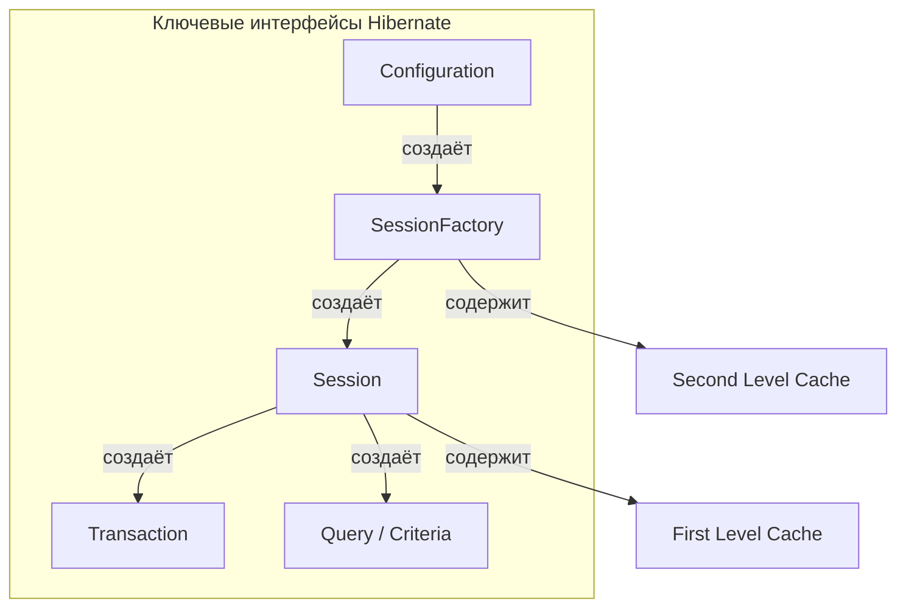
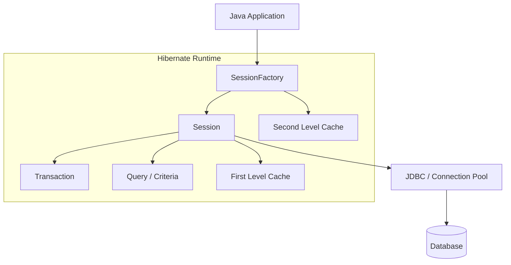
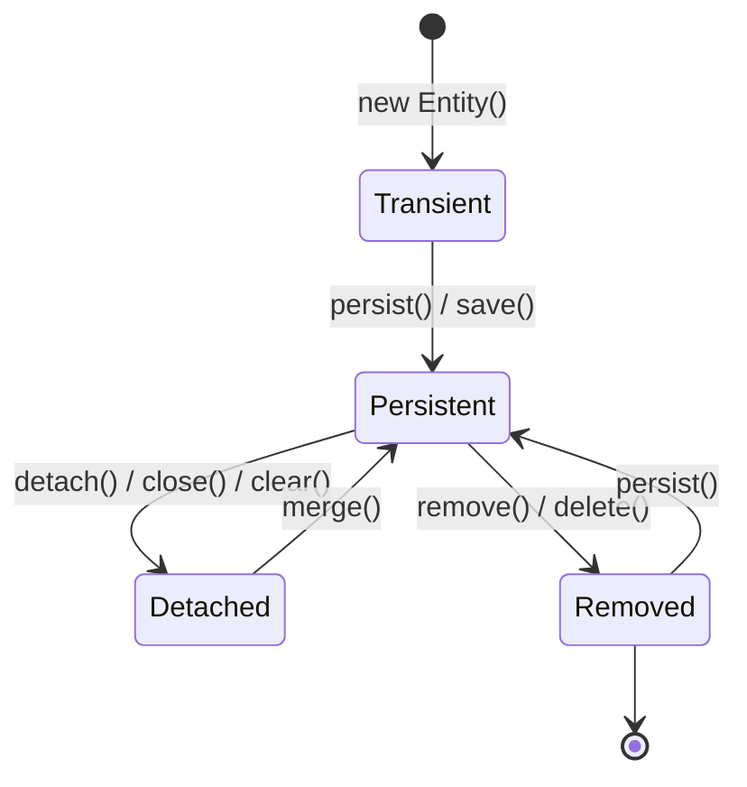
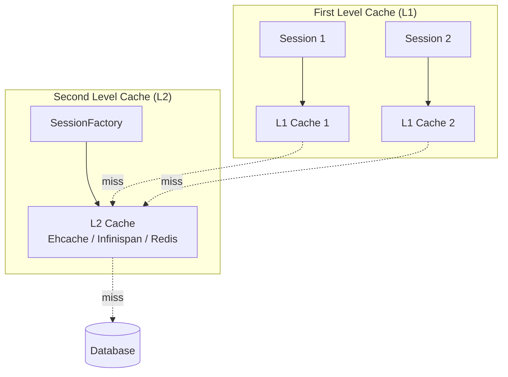
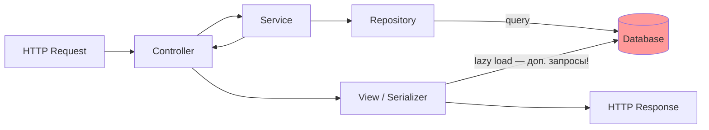

# Вопросы на собеседовании: `Hibernate`

Полное покрытие `Hibernate ORM`: маппинги, `Session`, lazy loading, N+1, кэширование, состояния entity, `Criteria API`, `JPQL`, транзакции, блокировки, наследование, batch processing.

Краткое введение: **Hibernate** — самая популярная реализация спецификации `JPA` для работы с реляционными БД в `Java`. На собеседовании проверяют глубокое понимание маппингов, жизненного цикла сущностей, механизмов кэширования, стратегий загрузки, N+1 проблемы, управления транзакциями и блокировок. Знание `Hibernate` тесно связано с [Spring Data JPA](../frameworks/spring/spring-data-jpa-interview.md) и [SQL](sql-interview.md).

## Полезные ссылки

### Официальная документация

- [Hibernate ORM Documentation](https://hibernate.org/orm/documentation/) — основная документация
- [Hibernate User Guide 6.x](https://docs.jboss.org/hibernate/orm/6.4/userguide/html_single/Hibernate_User_Guide.html) — руководство пользователя
- [JPA Specification](https://jakarta.ee/specifications/persistence/) — спецификация Jakarta Persistence

### Статьи Baeldung

- [N+1 Problem in Hibernate and Spring Data JPA](https://www.baeldung.com/spring-hibernate-n1-problem) — проблема N+1 и решения
- [Hibernate Second-Level Cache](https://www.baeldung.com/hibernate-second-level-cache) — кэш второго уровня
- [Hibernate Entity Lifecycle](https://www.baeldung.com/hibernate-entity-lifecycle) — жизненный цикл сущностей
- [Hibernate Inheritance Mapping](https://www.baeldung.com/hibernate-inheritance) — стратегии наследования
- [Optimistic Locking in JPA](https://www.baeldung.com/jpa-optimistic-locking) — оптимистичная блокировка
- [Pessimistic Locking in JPA](https://www.baeldung.com/jpa-pessimistic-locking) — пессимистичная блокировка
- [Batch Insert/Update with Hibernate/JPA](https://www.baeldung.com/jpa-hibernate-batch-insert-update) — batch-операции
- [JPA and Hibernate – Criteria vs. JPQL vs. HQL Query](https://www.baeldung.com/jpql-hql-criteria-query) — сравнение подходов к запросам
- [FetchMode in Hibernate](https://www.baeldung.com/hibernate-fetchmode) — стратегии загрузки связанных сущностей

## Содержание

- [Полезные ссылки](#полезные-ссылки)
- [See also](#see-also)

**Основы Hibernate и JPA**
- [Q1. (!) Что такое `Hibernate ORM` и чем он отличается от `JPA`?](#q1--что-такое-hibernate-orm-и-чем-он-отличается-от-jpa)
- [Q2. (!) Каковы преимущества `Hibernate` перед `JDBC`?](#q2--каковы-преимущества-hibernate-перед-jdbc)
- [Q3. (!) Назовите ключевые интерфейсы `Hibernate`](#q3--назовите-ключевые-интерфейсы-hibernate)
- [Q4. Что такое `Session` и `SessionFactory`?](#q4-что-такое-session-и-sessionfactory)
- [Q5. Является ли `Session` потокобезопасной?](#q5-является-ли-session-потокобезопасной)
- [Q6. Объясните архитектуру `Hibernate`](#q6-объясните-архитектуру-hibernate)

**Жизненный цикл сущностей**
- [Q7. (!) Какие состояния может иметь `Entity`?](#q7--какие-состояния-может-иметь-entity)
- [Q8. (!) Что такое `Dirty Checking` и как работает `flush`?](#q8--что-такое-dirty-checking-и-как-работает-flush)
- [Q9. В чём разница между `persist()`, `save()`, `merge()` и `update()`?](#q9-в-чём-разница-между-persist-save-merge-и-update)
- [Q10. В чём разница между `get()` и `load()`?](#q10-в-чём-разница-между-get-и-load)
- [Q11. Зачем `Entity` нужен конструктор без аргументов?](#q11-зачем-entity-нужен-конструктор-без-аргументов)
- [Q12. (!) Можно ли объявить `Entity` класс `final`?](#q12--можно-ли-объявить-entity-класс-final)

**Маппинг и аннотации**
- [Q13. Какие основные аннотации `JPA` используются для маппинга?](#q13-какие-основные-аннотации-jpa-используются-для-маппинга)
- [Q14. (!) Что такое `Hibernate Inheritance Mapping`?](#q14--что-такое-hibernate-inheritance-mapping)
- [Q15. Как маппить связь `One-To-Many` / `Many-To-One`?](#q15-как-маппить-связь-one-to-many--many-to-one)
- [Q16. Как маппить связь `Many-To-Many`?](#q16-как-маппить-связь-many-to-many)
- [Q17. В чём разница между `@JoinColumn` и `mappedBy`?](#q17-в-чём-разница-между-joincolumn-и-mappedby)
- [Q18. Что такое `@Embeddable` и `@Embedded`?](#q18-что-такое-embeddable-и-embedded)

**Lazy Loading и стратегии загрузки**
- [Q19. (!) Что такое `Lazy Loading` и `Eager Loading`?](#q19--что-такое-lazy-loading-и-eager-loading)
- [Q20. (!) Что такое проблема N+1?](#q20--что-такое-проблема-n1)
- [Q21. (!) Как решить проблему N+1?](#q21--как-решить-проблему-n1)
- [Q22. Что такое `LazyInitializationException` и как его избежать?](#q22-что-такое-lazyinitializationexception-и-как-его-избежать)
- [Q23. Что такое `Entity Graph`?](#q23-что-такое-entity-graph)

**Кэширование**
- [Q24. (!) В чём разница между `First Level Cache` и `Second Level Cache`?](#q24--в-чём-разница-между-first-level-cache-и-second-level-cache)
- [Q25. Как настроить кэш второго уровня?](#q25-как-настроить-кэш-второго-уровня)
- [Q26. Что такое `Query Cache`?](#q26-что-такое-query-cache)
- [Q27. (!) Какие `Concurrency Strategy` доступны для кэша?](#q27--какие-concurrency-strategy-доступны-для-кэша)

**Запросы: HQL, JPQL и Criteria API**
- [Q28. Что такое `HQL` и `JPQL`?](#q28-что-такое-hql-и-jpql)
- [Q29. Что такое `Criteria API`?](#q29-что-такое-criteria-api)
- [Q30. Что такое `NamedQuery`?](#q30-что-такое-namedquery)
- [Q31. Поддерживает ли `Hibernate` нативные `SQL`-запросы?](#q31-поддерживает-ли-hibernate-нативные-sql-запросы)
- [Q32. Подвержен ли `Hibernate` `SQL Injection`?](#q32-подвержен-ли-hibernate-sql-injection)

**Транзакции и блокировки**
- [Q33. (!) Что такое `@Version` и оптимистичная блокировка?](#q33--что-такое-version-и-оптимистичная-блокировка)
- [Q34. В чём разница между оптимистичной и пессимистичной блокировкой?](#q34-в-чём-разница-между-оптимистичной-и-пессимистичной-блокировкой)
- [Q35. Как работают транзакции в `Hibernate`?](#q35-как-работают-транзакции-в-hibernate)

**Производительность и оптимизация**
- [Q36. (!) Что такое `Batch Processing` в `Hibernate`?](#q36--что-такое-batch-processing-в-hibernate)
- [Q37. В чём разница между `setMaxResults()` и `setFetchSize()`?](#q37-в-чём-разница-между-setmaxresults-и-setfetchsize)
- [Q38. Что такое `@Immutable`?](#q38-что-такое-immutable)
- [Q39. Как использовать `Hibernate Statistics` для мониторинга?](#q39-как-использовать-hibernate-statistics-для-мониторинга)

**Конфигурация и интеграция**
- [Q40. Как настроить `Hibernate` в `Spring Boot`?](#q40-как-настроить-hibernate-в-spring-boot)
- [Q41. В чём разница между `getCurrentSession()` и `openSession()`?](#q41-в-чём-разница-между-getcurrentsession-и-opensession)
- [Q42. Что такое `Hibernate Dialect`?](#q42-что-такое-hibernate-dialect)

**Продвинутые темы**
- [Q43. (!) Что такое `Open-in-View` антипаттерн и как его избежать?](#q43--что-такое-open-in-view-антипаттерн-и-как-его-избежать)
- [Q44. Что такое `Hibernate Envers` и как организовать аудит изменений?](#q44-что-такое-hibernate-envers-и-как-организовать-аудит-изменений)
- [Q45. (!) Как использовать `Projections` для оптимизации запросов?](#q45--как-использовать-projections-для-оптимизации-запросов)
- [Q46. Что такое `StatelessSession` и когда его использовать?](#q46-что-такое-statelesssession-и-когда-его-использовать)
- [Q47. (!) Какие типичные ошибки производительности в `Hibernate`?](#q47--какие-типичные-ошибки-производительности-в-hibernate)
- [Q48. Как тестировать `Hibernate`-код?](#q48-как-тестировать-hibernate-код)
- [Q49. (!) Как маппить JSON-колонки в Hibernate 6 через `@JdbcTypeCode`?](#q49--как-маппить-json-колонки-в-hibernate-6-через-jdbctypecode)
- [Q50. Что такое `@Struct` в Hibernate 6?](#q50-что-такое-struct-в-hibernate-6)

---

## Q1. (!) Что такое `Hibernate ORM` и чем он отличается от `JPA`?

**JPA** (`Jakarta Persistence API`, ранее `Java Persistence API`) — это **спецификация**, определяющая стандартный API для ORM в Java. **Hibernate** — это **реализация** этой спецификации (наряду с `EclipseLink`, `OpenJPA` и др.).

Ключевые различия:

| Аспект | `JPA` | `Hibernate` |
|--------|-------|-------------|
| Тип | Спецификация (интерфейсы) | Реализация (конкретные классы) |
| Пакет | `jakarta.persistence.*` | `org.hibernate.*` |
| Запросы | `JPQL` | `HQL` (надмножество `JPQL`) |
| Кэш L2 | Определяет API | Поддерживает `Ehcache`, `Infinispan` и др. |
| Расширения | Нет | `@Formula`, `@Where`, `@BatchSize`, `@NaturalId` и др. |

```java
// JPA-стандартный код — переносимый между реализациями
@Entity
@Table(name = "users")
public class User {
    @Id
    @GeneratedValue(strategy = GenerationType.IDENTITY)
    private Long id;

    @Column(nullable = false, length = 100)
    private String name;

    @OneToMany(mappedBy = "user", cascade = CascadeType.ALL, orphanRemoval = true)
    private List<Order> orders = new ArrayList<>();
}
```

На собеседовании важно подчеркнуть: рекомендуется программировать против `JPA` API (переносимость), а специфичные аннотации `Hibernate` использовать только когда стандартных возможностей недостаточно.

## Q2. (!) Каковы преимущества `Hibernate` перед `JDBC`?

Главное преимущество: `Hibernate` убирает рутину `JDBC` и даёт работать с объектами, а не со строками результата. Вы описываете маппинг один раз аннотациями — а `Hibernate` сам генерирует SQL, заполняет объекты из `ResultSet`, отслеживает изменения и синхронизирует их с БД.

| Аспект | `JDBC` | `Hibernate` |
|--------|--------|-------------|
| Код | Много boilerplate (`ResultSet`, `PreparedStatement`) | Чистый код, работа с объектами |
| SQL | Ручное написание, зависимость от диалекта | `HQL`/`JPQL` — независимость от БД |
| Транзакции | Ручное управление (`commit`/`rollback`) | Декларативное через `@Transactional` |
| Исключения | Checked `SQLException` | Unchecked `HibernateException` |
| Кэширование | Нет встроенного | L1 + L2 кэш |
| Маппинг | Ручной маппинг `ResultSet` → объект | Автоматический через аннотации |
| Ассоциации | `JOIN`-ы вручную | `@OneToMany`, `@ManyToMany` и др. |

```java
// JDBC — много boilerplate
try (Connection conn = dataSource.getConnection();
     PreparedStatement ps = conn.prepareStatement("SELECT * FROM users WHERE id = ?")) {
    ps.setLong(1, userId);
    ResultSet rs = ps.executeQuery();
    if (rs.next()) {
        User user = new User();
        user.setId(rs.getLong("id"));
        user.setName(rs.getString("name"));
    }
}

// Hibernate — чистый код
User user = session.get(User.class, userId);
```

**Обратная сторона:** за удобство платят потерей контроля над генерируемым SQL и более сложной отладкой производительности (N+1, lazy loading, кэширование). Поэтому на собеседовании важно показать не только плюсы, но и понимание этих ловушек — им посвящена бо́льшая часть остальных вопросов.

## Q3. (!) Назовите ключевые интерфейсы `Hibernate`



Те же связи как схема:

```
                  ┌─────────────────┐
                  │  Configuration  │
                  └────────┬────────┘
                           │ создаёт
                           ▼
        содержит   ┌─────────────────┐
   L2 Cache ◀──────│  SessionFactory │
                   └────────┬────────┘
                            │ создаёт
                            ▼
        содержит    ┌─────────────────┐
   L1 Cache ◀───────│     Session     │
                    └───┬─────────┬───┘
                создаёт │         │ создаёт
                        ▼         ▼
                ┌───────────┐ ┌──────────────────┐
                │Transaction│ │ Query / Criteria │
                └───────────┘ └──────────────────┘
```

Интерфейсы выстроены в цепочку «конфигурация → фабрика → сессия → транзакция/запрос» — каждый следующий создаётся предыдущим. Запомнить порядок проще, чем зубрить список:

1. **`Configuration`** — читает настройки из `hibernate.cfg.xml` или `persistence.xml` и регистрирует маппинги. Используется один раз на старте, чтобы собрать `SessionFactory`.
2. **`SessionFactory`** — потокобезопасная фабрика сессий, один экземпляр на приложение. Дорогая в создании, поэтому живёт всё время работы приложения; хранит кэш L2 и метаданные маппинга.
3. **`Session`** — единица работы (`unit of work`): короткоживущая, не потокобезопасная, содержит кэш L1 (persistence context).
4. **`Transaction`** — управляет границами транзакции (`begin`, `commit`, `rollback`), обёртка над JDBC/JTA-транзакцией.
5. **`Query`** / **`CriteriaBuilder`** — выполнение запросов `HQL`/`JPQL`/`Criteria`/`SQL`.

## Q4. Что такое `Session` и `SessionFactory`?

**`SessionFactory`** — тяжёлый потокобезопасный объект, создаётся один раз при старте приложения. Хранит метаданные маппинга, кэш второго уровня, пулы соединений. Создание `SessionFactory` — дорогая операция (парсинг маппингов, валидация).

**`Session`** — лёгкий объект, представляющий единицу работы с БД. Содержит **кэш первого уровня** (Persistence Context): все загруженные сущности хранятся в памяти сессии и повторно не запрашиваются из БД. Типичный жизненный цикл: открыть → выполнить операции → закрыть.

```java
// Классический подход (без Spring)
SessionFactory sf = new Configuration().configure().buildSessionFactory();

try (Session session = sf.openSession()) {
    Transaction tx = session.beginTransaction();
    User user = session.get(User.class, 1L); // загружается в L1 cache
    User same = session.get(User.class, 1L); // берётся из L1 cache, SQL не выполняется
    assert user == same; // true — один и тот же объект
    tx.commit();
}
```

В `Spring` управление `Session` берёт на себя фреймворк через `@Transactional` — подробнее в [Spring Data JPA](../frameworks/spring/spring-data-jpa-interview.md).

## Q5. Является ли `Session` потокобезопасной?

Нет. **`Session`** не потокобезопасна. Одновременный доступ из нескольких потоков к одной `Session` приводит к гонкам, повреждению кэша L1 и непредсказуемому поведению.

**Правило**: одна `Session` на один поток (обычно — на один HTTP-запрос). В `Spring` при использовании `@Transactional` каждый поток получает свою сессию через `ThreadLocal`-привязку. Не храните `Session` в статическом поле и не передавайте между потоками.

**`SessionFactory`**, напротив, **потокобезопасна** и должна быть синглтоном.

## Q6. Объясните архитектуру `Hibernate`



Тот же поток как схема:

```
   ┌──────────────────┐
   │ Java Application │
   └────────┬─────────┘
            ▼
┌ Hibernate Runtime ──────────────────────────────────────┐
│   ┌─────────────────┐                                    │
│   │  SessionFactory │──────────────▶ ┌────────────────┐  │
│   └────────┬────────┘                │ L2 Cache       │  │
│            ▼                          └────────────────┘  │
│   ┌─────────────────┐──────────────▶ ┌────────────────┐  │
│   │     Session     │                │ L1 Cache       │  │
│   └──┬───────┬───────┘                └────────────────┘  │
│      ▼       ▼                                            │
│  ┌─────────┐ ┌──────────────────┐                        │
│  │Transact.│ │ Query / Criteria │                        │
│  └─────────┘ └──────────────────┘                        │
└──────────┬───────────────────────────────────────────────┘
           ▼
   ┌──────────────────────┐
   │ JDBC / Connection Pool│
   └──────────┬───────────┘
              ▼
       ┌────────────┐
       │  Database  │
       └────────────┘
```

`Hibernate` — это прослойка между объектной моделью приложения и реляционной БД. Сверху вниз архитектура делится на слои:

1. **Java Application** — доменные сущности и бизнес-логика, которые не знают про SQL.
2. **Hibernate Framework** — `SessionFactory`, `Session`, `Transaction`, `Query`: здесь объекты превращаются в SQL и обратно.
3. **Internal APIs** — `JDBC`, `JTA` (Java Transaction API), `JNDI`: через них `Hibernate` реально общается с БД и менеджером транзакций.
4. **Database** — `PostgreSQL`, `MySQL`, `Oracle` и др.

Как это работает вместе: `SessionFactory` (один на приложение) по запросу выдаёт `Session`. `Session` держит persistence context (L1 cache), отслеживает изменения сущностей (dirty checking) и сбрасывает их в БД при flush. `Transaction` гарантирует атомарность набора операций. Всё это в конечном счёте транслируется в обычные `JDBC`-вызовы — `Hibernate` не заменяет драйвер, а надстраивается над ним.

## Q7. (!) Какие состояния может иметь `Entity`?

Сущность `Hibernate` живёт в одном из четырёх состояний — **Transient, Persistent, Detached, Removed** — и состояние определяет, отслеживаются ли изменения объекта и попадут ли они в БД. Это центральная концепция: непонимание состояний — источник большинства багов вроде «почему мои изменения не сохранились» или «почему сохранились без вызова `save()`».



Те же переходы как диаграмма состояний (`[*]` — начало/конец жизни объекта):

```
   [*]
    │ new Entity()
    ▼
┌───────────┐  persist() / save()  ┌────────────┐
│ Transient │─────────────────────▶│ Persistent │
└───────────┘                      └────┬───┬────┘
                  detach()/close()/clear()│   │ remove() / delete()
                          ▼               │   ▼
                    ┌──────────┐          │ ┌─────────┐
                    │ Detached │          │ │ Removed │──▶ [*]
                    └────┬─────┘          │ └────┬────┘
                merge()  │                │      │ persist()
                         └────────────────┴──────┘
                              (обратно в Persistent)
```

| Состояние | Описание | В Persistence Context? | Есть в БД? |
|-----------|----------|----------------------|------------|
| **Transient** | Новый объект, не связан с сессией | Нет | Нет |
| **Persistent** (Managed) | Привязан к сессии, tracked dirty checking | Да | Да (или будет при flush) |
| **Detached** | Был persistent, но сессия закрыта | Нет | Да |
| **Removed** | Помечен на удаление | Да | Будет удалён при flush |

```java
User user = new User("Alice"); // Transient

session.persist(user);         // Persistent (managed)
user.setName("Bob");           // dirty checking отследит изменение

session.detach(user);          // Detached — изменения не синхронизируются

User merged = session.merge(user); // снова Persistent (merged — новый managed объект)

session.remove(merged);        // Removed — удалится при flush/commit
```

## Q8. (!) Что такое `Dirty Checking` и как работает `flush`?

**Dirty Checking** — механизм `Hibernate`, который автоматически обнаруживает изменённые (dirty) сущности в persistence context и генерирует `UPDATE` SQL при `flush`. Не требует явного вызова `update()`.

**Как это работает**: в обычном diff-based механизме Hibernate хранит последнее известное состояние сущности и при `flush` сравнивает с текущим. При включённом bytecode enhancement возможен in-line dirty tracking: изменённые атрибуты отмечает сама сущность, а Hibernate запрашивает их при flush. В обоих случаях изменение managed-сущности может привести к `UPDATE` без вызова `update()`. [Hibernate ORM 7.4, in-line dirty tracking](https://docs.hibernate.org/orm/7.4/userguide/html_single/).

**`flush()`** — синхронизация persistence context с БД без подтверждения транзакции. При стандартном `AUTO` Hibernate выполняет её перед commit и перед JPQL/HQL-запросом, **если он пересекается с ожидающими изменениями**; нативный SQL без зарегистрированной синхронизации тоже может вызвать flush. Явно вызвать его можно через `session.flush()`.

```java
@Transactional
public void updateUserName(Long id, String newName) {
    User user = entityManager.find(User.class, id);
    user.setName(newName);
    // НЕ нужно вызывать save() или update()!
    // Dirty checking сам обнаружит изменение и сгенерирует UPDATE при commit
}
```

**`FlushMode`** управляет моментом flush:
- `AUTO` (по умолчанию) — при необходимости для согласованности запроса и перед commit, а не перед каждым SELECT;
- `COMMIT` — старается отложить flush до commit, но может выполнить его раньше; JPA не определяет видимость ожидающих изменений в промежуточном запросе;
- `MANUAL` — специфичный для Hibernate режим: только явный `flush()`.

JPA стандартизирует `AUTO` и `COMMIT`, а Hibernate также предлагает `MANUAL` и `ALWAYS`. [Hibernate ORM 7.4, Flushing](https://docs.hibernate.org/orm/7.4/userguide/html_single/); [Jakarta Persistence 3.2, FlushModeType](https://jakarta.ee/specifications/persistence/3.2/apidocs/jakarta.persistence/jakarta/persistence/flushmodetype).

## Q9. В чём разница между `persist()`, `save()`, `merge()` и `update()`?

`persist()` и `merge()` — методы JPA, доступные и через Hibernate `Session`. `Session.save()`/`update()` — старый API: в Hibernate 6.6 они были deprecated, а в Hibernate **7.0 удалены**. Не путайте их с `CrudRepository.save()` в Spring Data JPA — у него другая сигнатура и выбор между `persist`/`merge` (см. [Spring Data JPA Q19](../frameworks/spring/spring-data-jpa-interview.md#q19--какие-состояния-имеет-сущность-в-jpa)).

| Метод | Версия/контракт | Поведение |
|-------|-----------------|-----------|
| `persist()` | JPA, Hibernate 6/7 | Делает новый аргумент managed; возвращает `void`. SQL `INSERT` возможен при flush/commit или раньше, например при `IDENTITY`. |
| `merge()` | JPA, Hibernate 6/7 | Копирует состояние нового или detached аргумента в возвращённый managed-экземпляр; исходный detached аргумент не переподключается. Если аргумент уже managed, возвращается он же. |
| `Session.save()` | Hibernate 6.6: deprecated с 6.0; Hibernate 7: удалён | Исторический метод для нового объекта; в 6.6 возвращал `Object` (ID). Заменяйте на `persist()`. |
| `Session.update()` | Hibernate 6.6: deprecated с 6.0; Hibernate 7: удалён | Исторически переподключал detached-аргумент, а при другой managed-сущности с тем же ID бросал исключение. Заменяйте на `merge()` и используйте его результат. |

```java
// persist() — JPA стандарт, рекомендуется
User user = new User("Alice");
entityManager.persist(user); // user теперь managed

// merge() — для detached объектов
User detached = ... ; // получен из другой сессии, десериализации и т.д.
User managed = entityManager.merge(detached);
// managed — возвращённый управляемый экземпляр, detached — по-прежнему detached
managed.setName("Bob"); // будет синхронизировано с БД
```

При `merge(detached)` результат может быть уже существовавшей managed-сущностью того же ID, поэтому слово «новая копия» не всегда верно. На Hibernate 7 используйте `persist()` для нового объекта и `merge()` для передачи состояния detached-объекта. [Hibernate 7.0 Migration Guide](https://docs.hibernate.org/orm/7.0/migration-guide/); [Hibernate 6.6 `Session` API](https://docs.hibernate.org/orm/6.6/javadocs/org/hibernate/Session.html); [Hibernate 7.4 `Session` API](https://docs.hibernate.org/orm/7.4/javadocs/org/hibernate/Session.html); [Jakarta Persistence 3.2, merge](https://jakarta.ee/specifications/persistence/3.2/jakarta-persistence-spec-3.2).

## Q10. В чём разница между `get()` и `load()`?

Это исторические имена Hibernate `Session`: `load()` **удалён с 7.0** в пользу JPA `getReference()`, а `get()` в 7.0 помечен deprecated в пользу `find()`. Для нового кода сравнивайте `EntityManager.find()` и `getReference()`.

| Аспект | `find()` (`Session.get()` в старом коде) | `getReference()` (`Session.load()` до 7.0) |
|--------|--------------------|-----------------------------|
| Загрузка | Возвращает инициализированную сущность; если она уже managed, SQL не нужен | Hibernate 7.4 не читает БД при вызове; может вернуть proxy или уже имеющийся managed-экземпляр |
| Если не найден | Возвращает `null` | JPA допускает `EntityNotFoundException` при вызове или первом обращении к состоянию; отсутствие строки не превращается в `null` |
| Когда использовать | Нужны данные сущности или проверка существования | Нужна ссылка по ID, например для связи, без обязательной загрузки состояния |

```java
User user = entityManager.find(User.class, 1L);
if (user == null) { /* строки нет */ }

User ref = entityManager.getReference(User.class, 1L);
// Для Hibernate это не требует SELECT; обращение к состоянию может его вызвать.
String name = ref.getName();
```

`getReference()` полезен, когда нужно только установить связь (FK), не загружая состояние связанной сущности:

```java
Order order = new Order();
order.setUser(entityManager.getReference(User.class, userId)); // без SELECT для User
entityManager.persist(order);
```

Ссылка **не доказывает существование** строки: неверный FK может обнаружиться лишь на SQL `INSERT`/commit. `find()` тоже не обязан делать новый `SELECT`, если объект уже есть в persistence context или может быть получен из кэша. [Hibernate 7.0 Migration Guide](https://docs.hibernate.org/orm/7.0/migration-guide/); [Hibernate 7.4 `Session` API](https://docs.hibernate.org/orm/7.4/javadocs/org/hibernate/Session.html); [Jakarta Persistence 3.2 `EntityManager` API](https://jakarta.ee/specifications/persistence/3.2/apidocs/jakarta.persistence/jakarta/persistence/entitymanager).

## Q11. Зачем `Entity` нужен конструктор без аргументов?

`Hibernate` создаёт экземпляры сущностей через **рефлексию** при загрузке из БД. Для этого необходим конструктор без аргументов (`no-arg constructor`). Это **требование спецификации JPA**.

Конструктор может быть `public` или `protected` (для инкапсуляции). Если его нет — `Hibernate` выбросит `InstantiationException`.

```java
@Entity
public class User {
    @Id
    @GeneratedValue(strategy = GenerationType.IDENTITY)
    private Long id;
    private String name;

    protected User() {} // для Hibernate — может быть protected

    public User(String name) { // для бизнес-логики
        this.name = name;
    }
}
```

## Q12. (!) Можно ли объявить `Entity` класс `final`?

**Не рекомендуется.** `Hibernate` создаёт **прокси-подклассы** для ленивой загрузки (`lazy loading`). Если класс `final` — его нельзя расширить, и прокси создать невозможно.

Последствия:
- Ленивая загрузка для ассоциаций к этой сущности **не будет работать**
- `load()` / `getReference()` вернёт реальный объект вместо прокси
- Потенциальное снижение производительности

```java
// ❌ Плохо — Hibernate не сможет создать proxy
@Entity
public final class User { ... }

// ✅ Хорошо — @Immutable для данных «только чтение»
@Entity
@Immutable
public class Country { ... }
```

Если нужна неизменяемость данных — используйте `@Immutable`, а не `final` на классе.

## Q13. Какие основные аннотации `JPA` используются для маппинга?

Базовый набор — это `@Entity` + `@Table` (что и куда маппится), `@Id` + `@GeneratedValue` (первичный ключ), `@Column` (тонкая настройка колонок), аннотации связей (`@ManyToOne`, `@OneToMany` и др.) и служебные (`@Transient`, `@Version`, `@Enumerated`). Ниже — типичная сущность со всеми ключевыми аннотациями в контексте:

```java
@Entity                          // Помечает класс как сущность
@Table(name = "orders")          // Имя таблицы
public class Order {

    @Id                           // Первичный ключ
    @GeneratedValue(strategy = GenerationType.IDENTITY) // Стратегия генерации ID
    private Long id;

    @Column(name = "order_date", nullable = false) // Маппинг колонки
    private LocalDateTime orderDate;

    @Enumerated(EnumType.STRING)  // Enum как строка (не ordinal!)
    private OrderStatus status;

    @ManyToOne(fetch = FetchType.LAZY)  // Связь N:1
    @JoinColumn(name = "user_id")       // FK колонка
    private User user;

    @OneToMany(mappedBy = "order", cascade = CascadeType.ALL, orphanRemoval = true)
    private List<OrderItem> items = new ArrayList<>();

    @Transient                    // Поле не маппится в БД
    private BigDecimal calculatedTotal;

    @Version                      // Оптимистичная блокировка
    private Integer version;

    @CreationTimestamp             // Hibernate — автоматическая дата создания
    private LocalDateTime createdAt;
}
```

Ключевые стратегии `@GeneratedValue`:
- **`IDENTITY`** — автоинкремент БД (не подходит для batch insert)
- **`SEQUENCE`** — sequence в БД (рекомендуется для `PostgreSQL`)
- **`TABLE`** — отдельная таблица для генерации (медленнее всего)
- **`AUTO`** — `Hibernate` выбирает стратегию сам

## Q14. (!) Что такое `Hibernate Inheritance Mapping`?

Inheritance Mapping укладывает иерархию `@Entity` в таблицы. `Hibernate` поддерживает все три стратегии Jakarta Persistence; по JPA 3.2 только `SINGLE_TABLE` (умолчание) и `JOINED` обязательны для любого провайдера, а `TABLE_PER_CLASS` необязательна. Цена каждой стратегии зависит от полиморфного запроса и объёма данных:

```mermaid
graph TD
    subgraph "SINGLE_TABLE"
        ST[vehicles<br/>id | type | make | payload | seats]
    end

    subgraph "JOINED"
        JV[vehicles<br/>id | make] --> JT[trucks<br/>id | payload]
        JV --> JC[cars<br/>id | seats]
    end

    subgraph "TABLE_PER_CLASS"
        TT[trucks<br/>id | make | payload]
        TC[cars<br/>id | make | seats]
    end
```

Те же раскладки по таблицам как схема:

```
SINGLE_TABLE
  ┌──────────────────────────────────────────┐
  │ vehicles: id | type | make | payload | seats │
  └──────────────────────────────────────────┘

JOINED
  ┌─────────────────┐
  │ vehicles: id | make │
  └──────┬──────┬────┘
   id ──▶│      │◀── id
  ┌──────┴─────┐ ┌─┴───────────┐
  │ trucks:    │ │ cars:        │
  │ id|payload │ │ id|seats     │
  └────────────┘ └─────────────┘

TABLE_PER_CLASS
  ┌──────────────────────┐   ┌────────────────────┐
  │ trucks:              │   │ cars:              │
  │ id | make | payload  │   │ id | make | seats  │
  └──────────────────────┘   └────────────────────┘
```

| Стратегия | Аннотация | Плюсы | Минусы |
|-----------|-----------|-------|--------|
| **Single Table** | `@Inheritance(strategy = SINGLE_TABLE)` | Одна таблица, нет JOIN между таблицами иерархии | Поля подтипов допускают NULL в строках других типов; условную обязательность можно выразить CHECK |
| **Joined** | `@Inheritance(strategy = JOINED)` | Таблицы подтипов допускают свои NOT NULL-ограничения | JOIN при материализации подтипа и полиморфном чтении |
| **Table Per Class** | `@Inheritance(strategy = TABLE_PER_CLASS)` | Таблица каждого конкретного класса содержит и унаследованные поля | Для полиморфного чтения Hibernate использует UNION; стратегия непереносима по JPA 3.2 |

```java
@Entity
@Inheritance(strategy = InheritanceType.SINGLE_TABLE)
@DiscriminatorColumn(name = "vehicle_type", discriminatorType = DiscriminatorType.STRING)
public abstract class Vehicle {
    @Id @GeneratedValue(strategy = GenerationType.IDENTITY)
    private Long id;
    private String make;
}

@Entity
@DiscriminatorValue("TRUCK")
public class Truck extends Vehicle {
    private Double payload;
}

@Entity
@DiscriminatorValue("CAR")
public class Car extends Vehicle {
    private Integer seats;
}
```

**На собеседовании:** `SINGLE_TABLE` — умолчание; `JOINED` позволяет разделить ограничения подтипов; `TABLE_PER_CLASS` стоит выбирать только после проверки поддержки провайдера и плана полиморфных запросов. SQL может отличаться в запросах к конкретному подтипу и ко всей иерархии. [Jakarta Persistence 3.2, inheritance mapping](https://jakarta.ee/specifications/persistence/3.2/jakarta-persistence-spec-3.2); [Hibernate ORM 7.4, inheritance](https://docs.hibernate.org/orm/7.4/userguide/html_single/).

## Q15. Как маппить связь `One-To-Many` / `Many-To-One`?

Связь `@OneToMany` / `@ManyToOne` — самая распространённая в JPA. Владелец связи (owning side) — сторона с `@JoinColumn` (обычно `@ManyToOne`).

```java
@Entity
public class Department {
    @Id @GeneratedValue(strategy = GenerationType.IDENTITY)
    private Long id;
    private String name;

    // Сотрудника можно перевести в другой отдел: удаление сироты здесь не подходит
    @OneToMany(mappedBy = "department", cascade = {CascadeType.PERSIST, CascadeType.MERGE})
    private List<Employee> employees = new ArrayList<>();

    // Вспомогательные методы для поддержания консистентности обеих сторон
    public void addEmployee(Employee e) {
        employees.add(e);
        e.setDepartment(this);
    }
    public void removeEmployee(Employee e) {
        employees.remove(e);
        e.setDepartment(null);
    }
}

@Entity
public class Employee {
    @Id @GeneratedValue(strategy = GenerationType.IDENTITY)
    private Long id;
    private String name;

    @ManyToOne(fetch = FetchType.LAZY) // LAZY — best practice для @ManyToOne
    @JoinColumn(name = "department_id")
    private Department department;
}
```

**Важно:** `@ManyToOne` по умолчанию `EAGER`; обычно полезно задать `LAZY` явно и выбирать нужный fetch-план для запроса. Сам `LAZY` не гарантирует отсутствие N+1 при последующем обходе связей (см. Q19–Q21). `orphanRemoval` подходит для приватно принадлежащих детей, например `OrderItem` у `Order`, но не для сотрудника, которого можно переводить между отделами. [Jakarta Persistence 3.2, orphan removal](https://jakarta.ee/specifications/persistence/3.2/jakarta-persistence-spec-3.2).

## Q16. Как маппить связь `Many-To-Many`?

`@ManyToMany` маппится через **промежуточную (join) таблицу** с двумя внешними ключами — отдельной сущности для связи нет. Одна сторона владеет связью (задаёт `@JoinTable`), вторая помечается `mappedBy`:

```java
@Entity
public class Student {
    @Id @GeneratedValue(strategy = GenerationType.IDENTITY)
    private Long id;

    @ManyToMany(cascade = {CascadeType.PERSIST, CascadeType.MERGE})
    @JoinTable(
        name = "student_course",
        joinColumns = @JoinColumn(name = "student_id"),
        inverseJoinColumns = @JoinColumn(name = "course_id")
    )
    private Set<Course> courses = new HashSet<>(); // Set отражает уникальность курсов
}

@Entity
public class Course {
    @Id @GeneratedValue(strategy = GenerationType.IDENTITY)
    private Long id;

    @ManyToMany(mappedBy = "courses")
    private Set<Student> students = new HashSet<>();
}
```

**Best practices**:
- Выбирайте `Set` для уникальных значений, `List` — если важен порядок/повторы и настроена соответствующая семантика. Не выводите стоимость обновления join-таблицы только из Java-типа: проверьте SQL конкретного маппинга.
- Не задавайте `CascadeType.ALL` / `REMOVE` для разделяемых сущностей в `@ManyToMany`: каскад при `remove` владельца затронет сами связанные сущности, а удаление элемента коллекции меняет таблицу связи; `cascade=REMOVE` вне `@OneToOne`/`@OneToMany` непереносим по Jakarta Persistence.
- Для join-таблиц с дополнительными полями (дата записи, оценка и т.д.) — создавайте отдельную `@Entity`

[Hibernate ORM 7.4, `@ManyToMany`](https://docs.hibernate.org/orm/7.4/userguide/html_single/); [Jakarta Persistence 3.2, каскад удаления](https://jakarta.ee/specifications/persistence/3.2/jakarta-persistence-spec-3.2).

## Q17. В чём разница между `@JoinColumn` и `mappedBy`?

**`@JoinColumn`** — маркер **owning side** (владелец связи). Определяет FK-колонку в таблице владельца.

**`mappedBy`** — маркер **inverse side** (обратная сторона). Указывает имя поля на стороне владельца.

```java
// Owning side — Employee владеет связью, в таблице employee есть FK department_id
@ManyToOne
@JoinColumn(name = "department_id")
private Department department;

// Inverse side — Department не владеет связью, ссылается на поле "department" у Employee
@OneToMany(mappedBy = "department")
private List<Employee> employees;
```

**Правило**: FK всегда хранится на стороне с `@JoinColumn`. Изменения на стороне `mappedBy` **не синхронизируются** с БД — нужно обновлять owning side.

## Q18. Что такое `@Embeddable` и `@Embedded`?

`@Embeddable` — value object, который не имеет собственного id и таблицы. Его поля встраиваются в таблицу родительской сущности.

```java
@Embeddable
public class Address {
    private String city;
    private String street;
    @Column(name = "zip_code")
    private String zipCode;
}

@Entity
public class Customer {
    @Id @GeneratedValue(strategy = GenerationType.IDENTITY)
    private Long id;

    @Embedded
    private Address homeAddress;

    @Embedded
    @AttributeOverrides({
        @AttributeOverride(name = "city", column = @Column(name = "work_city")),
        @AttributeOverride(name = "street", column = @Column(name = "work_street")),
        @AttributeOverride(name = "zipCode", column = @Column(name = "work_zip"))
    })
    private Address workAddress;
}
```

Результат — **одна таблица** `customer` с колонками: `id`, `city`, `street`, `zip_code`, `work_city`, `work_street`, `work_zip`.

## Q19. (!) Что такое `Lazy Loading` и `Eager Loading`?

Это политики загрузки связи, а не готовые SQL-планы. В Jakarta Persistence `EAGER` требует загрузить связь до выдачи результата; `LAZY` лишь подсказывает отложить её и может быть переопределён провайдером или fetch-планом запроса. Поэтому `EAGER` не гарантирует JOIN, а `LAZY` — отдельный SELECT при каждом обращении.

| Стратегия | Описание | По умолчанию для |
|-----------|----------|-----------------|
| **`LAZY`** | Загрузка может быть отложена до обращения | `@OneToMany`, `@ManyToMany` |
| **`EAGER`** | Связь должна быть загружена до выдачи результата | `@ManyToOne`, `@OneToOne` |

В Hibernate to-one `LAZY` часто реализован через proxy, коллекции — через persistent wrapper; уже загруженная связь не требует нового SELECT. При выборке списка JPQL/HQL без `JOIN FETCH` даже `EAGER` to-one может загружаться вторичными SELECT и дать N+1.

Обычно полезно задавать `LAZY` и явно выбирать нужные связи для конкретного сценария через `JOIN FETCH`, `@EntityGraph` или пакетную загрузку. Для некоторых отображений to-one реализация LAZY требует учёта proxy/bytecode enhancement; фактическое число запросов проверяйте по SQL. [Jakarta Persistence 3.2 `FetchType`](https://jakarta.ee/specifications/persistence/3.2/apidocs/jakarta.persistence/jakarta/persistence/fetchtype); [Hibernate ORM 7.4, fetching](https://docs.hibernate.org/orm/7.4/userguide/html_single/).

```java
@Entity
public class Order {
    @ManyToOne(fetch = FetchType.LAZY) // явно LAZY для @ManyToOne
    @JoinColumn(name = "user_id")
    private User user;

    @OneToMany(mappedBy = "order", fetch = FetchType.LAZY) // LAZY по умолчанию
    private List<OrderItem> items;
}
```

## Q20. (!) Что такое проблема N+1?

Проблема **N+1** — ситуация, когда `Hibernate` выполняет **1 запрос** для получения списка из N сущностей, а затем отдельные запросы для загрузки связей каждой сущности. В простом случае получается ещё N SELECT; фактическое число зависит от кэша, общих связанных объектов и fetch-плана. Это возможно при обращении к `LAZY`-связи в цикле **и при `EAGER` to-one в JPQL/HQL без `JOIN FETCH`**: Hibernate может загрузить такую связь вторичными SELECT до возврата списка.

```java
// 1 запрос: SELECT * FROM authors
List<Author> authors = session.createQuery("FROM Author", Author.class).list();

// N запросов: для каждого автора — SELECT * FROM books WHERE author_id = ?
for (Author author : authors) {
    System.out.println(author.getBooks().size()); // каждый вызов — отдельный SELECT
}
```

В этом примере без пакетной загрузки и попаданий в кэш получается **1 + N запросов** вместо одного. При N = 1000 авторов — 1001 запрос к БД.

```
-- 1-й запрос
SELECT * FROM authors;

-- 2-й запрос (автор #1)
SELECT * FROM books WHERE author_id = 1;
-- 3-й запрос (автор #2)
SELECT * FROM books WHERE author_id = 2;
-- ... и так N раз
```

Проверяйте количество SQL на выборке списка, а не выводите его из одной аннотации `FetchType`. [Hibernate ORM 7.4, fetching](https://docs.hibernate.org/orm/7.4/userguide/html_single/). Подробнее о запросах — в [вопросах по SQL](sql-interview.md).

## Q21. (!) Как решить проблему N+1?

Способ зависит от требуемых связей и объёма выборки:

**1. `JOIN FETCH` в JPQL**, когда связь нужна именно этому запросу:

```java
// Один SQL с JOIN; INNER JOIN исключит авторов без книг
List<Author> authors = entityManager
    .createQuery("SELECT a FROM Author a JOIN FETCH a.books", Author.class)
    .getResultList();
```

**2. `EntityGraph`** задаёт граф требуемых атрибутов без фиксации формы SQL:

```java
@Entity
@NamedEntityGraph(name = "Author.withBooks",
    attributeNodes = @NamedAttributeNode("books"))
public class Author { ... }

// Использование
EntityGraph<?> graph = entityManager.getEntityGraph("Author.withBooks");
List<Author> authors = entityManager
    .createQuery("SELECT a FROM Author a", Author.class)
    .setHint("jakarta.persistence.fetchgraph", graph)
    .getResultList();
```

**3. `@BatchSize`** объединяет часть дополнительных SELECT:

```java
@Entity
public class Author {
    @OneToMany(mappedBy = "author")
    @BatchSize(size = 25) // загружает книги пачками по 25 авторов
    private List<Book> books;
}
// Вместо N отдельных дозагрузок обычно около ceil(N/25) пакетных SELECT
```

**4. `@Fetch(FetchMode.SUBSELECT)`**:

```java
@OneToMany(mappedBy = "author")
@Fetch(FetchMode.SUBSELECT)
private List<Book> books;
// При обращении к коллекции Hibernate может загрузить коллекции владельцев одним subselect
```

**Не считайте `EAGER` лечением N+1:** он требует ранней загрузки, но не JOIN; JPQL/HQL без fetch join способен дать вторичные SELECT по каждой to-one связи. Несколько параллельных fetch joins коллекций могут дать декартово произведение, а несколько bag — `MultipleBagFetchException`. Проверяйте SQL и количество строк; для нескольких коллекций часто удобнее отдельные/пакетные запросы. [Hibernate ORM 7.4, fetch joins/batch/subselect](https://docs.hibernate.org/orm/7.4/userguide/html_single/); [Hibernate `MultipleBagFetchException`](https://docs.hibernate.org/orm/7.4/javadocs/org/hibernate/loader/MultipleBagFetchException.html).

## Q22. Что такое `LazyInitializationException` и как его избежать?

**`LazyInitializationException`** возникает, когда вы обращаетесь к lazy-ассоциации (прокси или коллекции) уже после закрытия `Session`. Причина в том, что для дозагрузки данных прокси нужна живая сессия и соединение с БД — а их больше нет. Классический сценарий: данные загрузили в сервисе, сессию закрыли, а lazy-поле «развернули» уже в контроллере или сериализаторе.

```java
User user;
try (Session session = sf.openSession()) {
    user = session.get(User.class, 1L);
} // Session закрыта

user.getOrders().size(); // LazyInitializationException!
```

Способы решения:
1. **`JOIN FETCH`** в запросе — загрузить нужные данные заранее (рекомендуется)
2. **`@EntityGraph`** — декларативно указать что загружать
3. **`Open Session in View`** (`spring.jpa.open-in-view=true`) — Session остаётся открытой до конца HTTP-запроса (anti-pattern для production, может привести к N+1)
4. **DTO projection** — возвращать DTO с нужными полями вместо entity

## Q23. Что такое `Entity Graph`?

**Entity Graph** — механизм `JPA` 2.1+ для декларативного определения, какие ассоциации загрузить вместе с сущностью. Альтернатива `JOIN FETCH` в `JPQL`.

```java
// Через аннотацию
@Entity
@NamedEntityGraph(name = "Order.withItems",
    attributeNodes = {
        @NamedAttributeNode("items"),
        @NamedAttributeNode("user")
    })
public class Order { ... }

// Через API (программно)
EntityGraph<Order> graph = entityManager.createEntityGraph(Order.class);
graph.addAttributeNodes("items", "user");

Map<String, Object> hints = Map.of("jakarta.persistence.loadgraph", graph);
Order order = entityManager.find(Order.class, orderId, hints);
```

Два типа hint:
- **`fetchgraph`** — указанные атрибуты считаются `EAGER`, остальные — `LAZY`-подсказкой;
- **`loadgraph`** — указанные атрибуты считаются `EAGER`, остальные сохраняют настройки маппинга.

Граф не задаёт число JOIN/SELECT; спецификация разрешает провайдеру загрузить дополнительные данные сверх графа. [Jakarta Persistence 3.2, entity graphs](https://jakarta.ee/specifications/persistence/3.2/jakarta-persistence-spec-3.2).

В [Spring Data JPA](../frameworks/spring/spring-data-jpa-interview.md) Entity Graph используется через аннотацию `@EntityGraph` на методе репозитория.

## Q24. (!) В чём разница между `First Level Cache` и `Second Level Cache`?

Ключевое различие — **область видимости и время жизни**. L1 привязан к одной stateful `Session`/`EntityManager` и живёт до закрытия или `clear()`, не обязательно до границы транзакции. L2 привязан к `SessionFactory` и переживает отдельные сессии. Без cache-провайдера L2 выключен; если настроен `RegionFactory`, `hibernate.cache.use_second_level_cache` по умолчанию `true`. L1 не требует отдельной настройки; `StatelessSession` не имеет persistence context.



Те же уровни и поток при промахе как схема:

```
  First Level Cache (L1)        Second Level Cache (L2)
  ┌──────────┐  ┌──────────┐
  │ Session 1│  │ Session 2│
  └────┬─────┘  └────┬─────┘
       ▼             ▼
  ┌──────────┐  ┌──────────┐
  │ L1 Cache1│  │ L1 Cache2│
  └────┬─────┘  └────┬─────┘
  miss │             │ miss     ┌──────────────────────────┐
       └──────┬──────┘          │ SessionFactory           │
              ▼                 └────────────┬─────────────┘
       ┌─────────────────────────┐          ▼
       │ L2 Cache                │◀─────────┘
       │ Ehcache/Infinispan/Redis│
       └────────────┬────────────┘
                miss │
                     ▼
              ┌────────────┐
              │  Database  │
              └────────────┘
```

| Аспект | L1 (First Level) | L2 (Second Level) |
|--------|------------------|-------------------|
| Область | Одна `Session` | `SessionFactory` (все сессии) |
| По умолчанию | Есть у stateful `Session` | Выключен без провайдера; с ним обычно включён |
| Жизненный цикл | До `clear()`/закрытия `Session` | Связан с `SessionFactory` и провайдером |
| Настройка | Не нужна | Требует провайдера (Ehcache, Infinispan) |
| Потокобезопасность | Нет (одна сессия = один поток) | Да |

Порядок поиска: **L1 cache → L2 cache → Database**.

```java
// L1 cache в действии
Session session = sf.openSession();
User u1 = session.get(User.class, 1L); // SELECT из БД, сохраняется в L1
User u2 = session.get(User.class, 1L); // Берётся из L1, SQL не выполняется
assert u1 == u2; // true — один и тот же объект
session.close(); // контекст этой Session закрыт
```

Проверка L1 всегда предшествует обращению к L2. Попадание L2 не означает общий Java-объект между сессиями: каждая сессия создаёт своё managed-представление. [Hibernate ORM 7.4, caching](https://docs.hibernate.org/orm/7.4/userguide/html_single/).

## Q25. Как настроить кэш второго уровня?

Для подключения L2 cache (на примере `Ehcache`):

**1. Зависимость** (Gradle):
```groovy
implementation 'org.hibernate.orm:hibernate-jcache' // версия согласована с hibernate-core
implementation 'org.ehcache:ehcache'                 // совместимая версия через BOM/catalog
```

**2. Конфигурация** (`application.yml`):
```yaml
spring:
  jpa:
    properties:
      hibernate:
        cache:
          use_second_level_cache: true
          region.factory_class: org.hibernate.cache.jcache.JCacheRegionFactory
        javax:
          cache:
            provider: org.ehcache.jsr107.EhcacheCachingProvider
```

**3. Аннотации на сущности**:
```java
@Entity
@Cacheable                                           // JPA стандарт
@Cache(usage = CacheConcurrencyStrategy.READ_WRITE)  // Hibernate — стратегия
public class Country {
    @Id
    private Long id;
    private String name;
}
```

L2 cache наиболее эффективен для сущностей, которые **часто читаются и редко изменяются** (справочники, конфигурации).

`hibernate-jcache` и реализация JCache нужны для приведённого примера. При настроенном `RegionFactory` Hibernate 7.4 включает L2 по умолчанию; явный `use_second_level_cache=true` здесь служит для наглядности. По умолчанию кэшируются только выбранные сущности (`ENABLE_SELECTIVE`). Области и политику размера/eviction задают у провайдера; если не заданы, автоматически созданный кэш может не подходить для production. [Hibernate ORM 7.4, JCache](https://docs.hibernate.org/orm/7.4/userguide/html_single/).

## Q26. Что такое `Query Cache`?

**Query Cache** кэширует **результаты запросов** (список ID сущностей), а не сами сущности. Работает в паре с L2 cache — по ID из query cache достаются сущности из L2 cache.

```java
// Включение
// hibernate.cache.use_query_cache = true

// Использование
List<Country> countries = entityManager
    .createQuery("SELECT c FROM Country c WHERE c.region = :region", Country.class)
    .setParameter("region", "Europe")
    .setHint("org.hibernate.cacheable", true)
    .getResultList();
```

**Когда использовать**: для запросов, которые выполняются часто с одинаковыми параметрами, по сущностям, которые редко меняются. При любом `INSERT`/`UPDATE`/`DELETE` в таблице — Query Cache для этой таблицы **инвалидируется целиком**.

**Когда НЕ использовать**: для часто изменяемых таблиц — частая инвалидация сведёт на нет выигрыш.

## Q27. (!) Какие `Concurrency Strategy` доступны для кэша?

Стратегии параллелизма для L2 cache определяют, как обрабатываются конкурентные чтения/записи:

| Стратегия | Описание | Когда использовать |
|-----------|----------|--------------------|
| **`READ_ONLY`** | Только чтение, сущность никогда не обновляется | Справочники, enum-таблицы |
| **`NONSTRICT_READ_WRITE`** | Кэш обновляется после commit, возможно чтение устаревших данных | Данные, которые редко меняются и eventual consistency допустима |
| **`READ_WRITE`** | Soft-lock при обновлении; согласованный доступ к одной сущности, без гарантии serializable | Данные, которые иногда меняются |
| **`TRANSACTIONAL`** | Транзакционная стратегия с JTA при поддержке cache-провайдера | Сценарий, где требуется и доступна такая интеграция |

```java
@Entity
@Cache(usage = CacheConcurrencyStrategy.READ_ONLY)
public class Currency { ... }

@Entity
@Cache(usage = CacheConcurrencyStrategy.READ_WRITE)
public class Product { ... }
```

`TRANSACTIONAL` не следует понимать как автоматическое включение XA или кластерного кэша одним значением enum. Поддержку и границы транзакций проверяют у конкретного провайдера. [Hibernate ORM 7.4, cache concurrency strategies](https://docs.hibernate.org/orm/7.4/userguide/html_single/).

## Q28. Что такое `HQL` и `JPQL`?

**`JPQL`** (`Jakarta Persistence Query Language`) — стандартный язык запросов `JPA`, объектно-ориентированный (работает с сущностями и полями, не с таблицами и колонками).

**`HQL`** (`Hibernate Query Language`) — надмножество `JPQL` с дополнительными возможностями (`Hibernate`-специфичными).

```java
// JPQL — стандарт JPA
TypedQuery<User> query = entityManager.createQuery(
    "SELECT u FROM User u WHERE u.name LIKE :name AND u.active = true",
    User.class
);
query.setParameter("name", "%Alice%");
List<User> users = query.getResultList();

// JPQL — агрегация
List<Object[]> stats = entityManager.createQuery(
    "SELECT u.department, COUNT(u), AVG(u.salary) " +
    "FROM User u GROUP BY u.department HAVING COUNT(u) > 5"
).getResultList();

// JPQL — JOIN FETCH
List<Author> authors = entityManager.createQuery(
    "SELECT DISTINCT a FROM Author a JOIN FETCH a.books WHERE a.active = true",
    Author.class
).getResultList();

// JPQL — UPDATE (bulk)
int updated = entityManager.createQuery(
    "UPDATE User u SET u.active = false WHERE u.lastLogin < :date"
).setParameter("date", cutoffDate)
 .executeUpdate();
```

## Q29. Что такое `Criteria API`?

**Criteria API** — типобезопасный, программный способ построения запросов. Особенно полезен для **динамических запросов** (фильтры, сортировки, которые зависят от пользовательского ввода).

С `Hibernate 5.2+` устаревший `org.hibernate.Criteria` заменён на стандартный `JPA Criteria API`:

```java
CriteriaBuilder cb = entityManager.getCriteriaBuilder();
CriteriaQuery<User> cq = cb.createQuery(User.class);
Root<User> root = cq.from(User.class);

// Динамическое построение условий
List<Predicate> predicates = new ArrayList<>();

if (nameFilter != null) {
    predicates.add(cb.like(root.get("name"), "%" + nameFilter + "%"));
}
if (minAge != null) {
    predicates.add(cb.greaterThanOrEqualTo(root.get("age"), minAge));
}
if (active != null) {
    predicates.add(cb.equal(root.get("active"), active));
}

cq.where(predicates.toArray(new Predicate[0]));
cq.orderBy(cb.asc(root.get("name")));

List<User> users = entityManager.createQuery(cq).getResultList();
```

**С Metamodel** (compile-time проверка полей):

```java
// User_.name — сгенерированный metamodel, ошибка компиляции при опечатке
predicates.add(cb.like(root.get(User_.name), "%" + nameFilter + "%"));
```

В [Spring Data JPA](../frameworks/spring/spring-data-jpa-interview.md) для динамических запросов чаще используют `Specification` API, который оборачивает `Criteria API`.

## Q30. Что такое `NamedQuery`?

**NamedQuery** — предварительно определённый запрос, привязанный к сущности по имени. Проверяется при старте приложения (ошибки видны сразу, а не в рантайме).

```java
@Entity
@NamedQueries({
    @NamedQuery(
        name = "User.findByEmail",
        query = "SELECT u FROM User u WHERE u.email = :email"
    ),
    @NamedQuery(
        name = "User.findActive",
        query = "SELECT u FROM User u WHERE u.active = true ORDER BY u.name"
    )
})
public class User { ... }

// Использование
TypedQuery<User> query = entityManager.createNamedQuery("User.findByEmail", User.class);
query.setParameter("email", "alice@example.com");
User user = query.getSingleResult();
```

**Преимущества**: валидация при старте, кэширование плана запроса, единое место объявления, удобство для ревью.

## Q31. Поддерживает ли `Hibernate` нативные `SQL`-запросы?

Да. Нативные SQL-запросы полезны для сложных запросов, оптимизации под конкретную СУБД или вызова хранимых процедур.

```java
// Нативный SQL с маппингом на Entity
List<User> users = entityManager.createNativeQuery(
    "SELECT * FROM users WHERE created_at > :date", User.class
).setParameter("date", cutoffDate)
 .getResultList();

// Нативный SQL с маппингом на DTO (через @SqlResultSetMapping или Tuple)
List<Object[]> results = entityManager.createNativeQuery(
    "SELECT u.name, COUNT(o.id) as order_count " +
    "FROM users u LEFT JOIN orders o ON u.id = o.user_id " +
    "GROUP BY u.name"
).getResultList();

// Через @NamedNativeQuery
@NamedNativeQuery(
    name = "User.findWithOrderCount",
    query = "SELECT u.*, COUNT(o.id) as order_count FROM users u ...",
    resultSetMapping = "UserWithOrderCount"
)
```

Подробнее о SQL-оптимизации — в [вопросах по SQL](sql-interview.md).

## Q32. Подвержен ли `Hibernate` `SQL Injection`?

`Hibernate` **не обеспечивает автоматическую защиту** от SQL Injection. Всё зависит от того, как пишутся запросы:

```java
// ❌ УЯЗВИМО — конкатенация строк
String hql = "FROM User WHERE name = '" + userInput + "'";
session.createQuery(hql); // SQL Injection возможен!

// ✅ БЕЗОПАСНО — параметризованные запросы
session.createQuery("FROM User WHERE name = :name")
       .setParameter("name", userInput);

// ✅ БЕЗОПАСНО — Criteria API (параметры автоматически экранируются)
cb.equal(root.get("name"), userInput);

// ✅ БЕЗОПАСНО — нативный SQL с параметрами
entityManager.createNativeQuery("SELECT * FROM users WHERE name = ?1")
             .setParameter(1, userInput);
```

**Правило**: всегда используйте параметризованные запросы (`setParameter()`), никогда не конкатенируйте пользовательский ввод в HQL/SQL строку.

## Q33. (!) Что такое `@Version` и оптимистичная блокировка?

**Оптимистичная блокировка** (`Optimistic Locking`) позволяет читать сущность без предварительной блокировки строки и обнаруживать конфликт при проверке её версии. Для версионированной сущности Jakarta Persistence использует поле `@Version`; проверка возможна при `merge`, `flush` или коммите.

```java
@Entity
public class Product {
    @Id @GeneratedValue(strategy = GenerationType.IDENTITY)
    private Long id;
    private String name;
    private BigDecimal price;

    @Version
    private Integer version; // значение обновляет провайдер при записи состояния сущности
}
```

Как это работает:

```sql
-- Упрощённый пример SQL для обновления версионированной сущности:
UPDATE products SET name = 'New', price = 99.99, version = 3
WHERE id = 1 AND version = 2;

-- При устаревшей версии строка не обновится: конфликт версии
```

```java
@Transactional
public void changePrice(Long id, BigDecimal newPrice) {
    Product product = entityManager.find(Product.class, id);
    product.setPrice(newPrice);
    entityManager.flush(); // необязательно; проверка может произойти и при коммите
}
```

При конфликте провайдер выбрасывает `OptimisticLockException` и помечает текущую транзакцию к откату. Повторять нужно **всю операцию в новой транзакции**: заново прочитать сущность и проверить бизнес-условия. Обработка исключения после `flush` внутри того же метода не восстанавливает транзакцию. Массовые JPQL `UPDATE` обходят обычную проверку `@Version`; при таких запросах версию нужно проверять и обновлять явно, если требуется защита от потерянного обновления.

**Тип поля `@Version` в Jakarta Persistence 3.2**: `int`/`Integer`, `short`/`Short`, `long`/`Long`, `LocalDateTime`, `Instant` или `Timestamp`. Обычно выбирают числовую версию: её сравнение не зависит от точности временной метки в БД.

## Q34. В чём разница между оптимистичной и пессимистичной блокировкой?

Разница — в том, **когда согласуется конкурентное изменение**. При оптимистичной блокировке `@Version` чтение сущности не удерживает заранее блокировку строки; Hibernate проверяет версию при записи, например во время `flush`, в том числе перед коммитом. Для detached-сущности проверка может произойти и при `merge`. При пессимистичной `PESSIMISTIC_WRITE` провайдер запрашивает блокировку БД при чтении для изменения. В PostgreSQL это обычно `SELECT ... FOR UPDATE`: конкурентные записи и несовместимые блокировки ждут, но обычный MVCC `SELECT` не обязан ждать.

| Аспект | Оптимистичная | Пессимистичная |
|--------|---------------|----------------|
| Контроль конфликта | `@Version` проверяется при `merge`/`flush`/коммите; заранее строка не заблокирована | `PESSIMISTIC_WRITE` запрашивает блокировку строки до её изменения |
| Блокировки БД | SQL `UPDATE`/`DELETE` всё равно использует обычные блокировки | Блокировка удерживается после запроса до завершения транзакции |
| Сбой | Устаревшая версия вызывает `OptimisticLockException` и откат текущей транзакции | Возможны ожидание, timeout или deadlock; после отката иногда нужен повтор |
| Цена | Проверка версии и повтор всей операции при конфликте | Ожидание и более долгое удержание блокировки |

```java
// Оптимистичная — @Version на сущности
@Version
private Integer version;

// Пессимистичная — через JPA внутри активной транзакции
Product product = entityManager.find(Product.class, id,
    LockModeType.PESSIMISTIC_WRITE); // для PostgreSQL обычно SELECT ... FOR UPDATE
product.setStock(product.getStock() - 1);
// Конкурентная запись может ждать; обычное MVCC-чтение — продолжиться.

// Пессимистичная — через JPQL
entityManager.createQuery("SELECT p FROM Product p WHERE p.id = :id")
    .setParameter("id", id)
    .setLockMode(LockModeType.PESSIMISTIC_WRITE)
    .getSingleResult();
```

Оптимистичный `UPDATE` тоже может ждать и участвовать в deadlock, если транзакции изменяют несколько строк в разном порядке. Пессимистичная блокировка не гарантирует успешного коммита: возможны timeout, deadlock и другие ошибки. Для обеих стратегий нужны короткие транзакции и обработка сбоя; при повторе заново читайте данные и проверяйте бизнес-условия. Универсального победителя по throughput или правила «финансы — значит пессимистичная» нет: измеряйте конкуренцию и цену повтора для конкретной операции. Оба подхода защищают отдельную сущность от перезаписи, но не заменяют проверку инварианта между несколькими строками (см. [Database Transactions Q14/Q40](database-transactions-interview.md)).

## Q35. Как работают транзакции в `Hibernate`?

`Hibernate` поддерживает локальные транзакции через JDBC и транзакции под управлением JTA. JTA может координировать несколько ресурсов, но его применение не означает, что транзакция обязательно распределённая. Для Jakarta Persistence по умолчанию в Java SE выбирается `RESOURCE_LOCAL`, а в Jakarta EE — `JTA`. В Spring границу транзакции обычно задают через `@Transactional`:

```java
// Без Spring — ручное управление
try (Session session = sf.openSession()) {
    Transaction tx = session.beginTransaction();
    try {
        session.persist(new User("Alice"));
        session.persist(new User("Bob"));
        tx.commit(); // при обычном AUTO перед фиксацией записываются изменения
    } catch (RuntimeException e) {
        if (tx.isActive()) tx.rollback();
        throw e;
    }
}

// С Spring — декларативное управление
@Service
@RequiredArgsConstructor
public class UserService {
    private final UserRepository userRepository;

    @Transactional // вызов через Spring proxy участвует в транзакции
    public void createUsers(List<String> names) {
        names.forEach(name -> userRepository.save(new User(name)));
    }
}
```

По умолчанию Spring использует `REQUIRED`: метод присоединяется к существующей транзакции или открывает новую. Транзакцию фиксирует её владелец при успешном завершении; `RuntimeException` и `Error` по умолчанию вызывают откат, а checked-исключения — нет, если не задано правило `rollbackFor`. При стандартном proxy-режиме внутренний вызов метода того же объекта обходит `@Transactional` на вызываемом методе. `flush` отправляет изменения в БД, но сам по себе не фиксирует транзакцию. При обычном режиме `AUTO` Hibernate выполняет необходимый `flush` перед коммитом; отдельный `flush()` ради фиксации не нужен.

**Уровни изоляции** можно задать через `@Transactional(isolation = Isolation.READ_COMMITTED)`, если транзакционный менеджер и БД поддерживают этот уровень. Подробнее — в [вопросах по архитектуре БД](database-architecture-interview.md).

## Q36. (!) Что такое `Batch Processing` в `Hibernate`?

JDBC batching передаёт несколько совместимых SQL-операций одного `PreparedStatement` драйверу пакетом. Это может сократить сетевые вызовы при массовых `INSERT`/`UPDATE`; конкретный выигрыш зависит от драйвера, SQL и БД. `hibernate.jdbc.batch_size` задаёт максимальное число операций в пакете для stateful session; положительное значение включает batching.

**Конфигурация:**
```yaml
spring:
  jpa:
    properties:
      hibernate:
        jdbc:
          batch_size: 50          # максимум операций в JDBC batch
        order_inserts: true       # необязательно: по типу и ключу
        order_updates: true       # необязательно: проверить измерением
```

**Важно:** Hibernate 7.4 отключает JDBC **insert** batching при `GenerationType.IDENTITY`: ID получается после INSERT. `SEQUENCE` позволяет получить ID заранее и применять batching, если он настроен и поддерживается БД. Это не означает, что любая операция с `IDENTITY` отключает batching всех `UPDATE`.

```java
@Transactional
public void batchInsert(List<UserDto> dtos) {
    int count = 0;
    for (UserDto dto : dtos) {
        entityManager.persist(toEntity(dto));
        count++;

        if (count % 50 == 0) {
            entityManager.flush();  // выполнить SQL внутри транзакции
            entityManager.clear();  // освободить persistence context
        }
    }
    // Оставшиеся изменения выполнит flush перед commit.
}
```

Периодические `flush()`/`clear()` ограничивают размер persistence context в большом цикле, но не включают JDBC batching: для него нужен положительный `batch_size`. `flush()` не делает `commit`; длинная транзакция продолжает удерживать соединение и ресурсы до завершения. `order_inserts`/`order_updates` сортируют операции для повышения заполнения пакетов и могут добавить свою стоимость, поэтому их проверяют измерением. [Hibernate ORM 7.4, JDBC и session batching](https://docs.hibernate.org/orm/7.4/userguide/html_single/#batch).

## Q37. В чём разница между `setMaxResults()` и `setFetchSize()`?

`setMaxResults(n)` ограничивает **число результатов** запроса; вместе с `setFirstResult()` используется для пагинации. В PostgreSQL Hibernate обычно выражает этот предел через SQL `LIMIT`. `setFetchSize(n)` не ограничивает результат: это подсказка JDBC-драйверу о размере порции при чтении строк. Её эффект зависит от драйвера и условий выполнения запроса.

| Метод | Назначение | Аналог в SQL | Влияет на |
|-------|-----------|-------------|-----------|
| `setMaxResults(n)` | Ограничивает число результатов | `LIMIT n` в PostgreSQL | Результат запроса |
| `setFetchSize(n)` | Задаёт подсказку о размере порции | Не является SQL-пределом | Чтение результата драйвером |

```java
// setMaxResults — получить первые 10 записей
List<User> top10 = entityManager.createQuery("SELECT u FROM User u ORDER BY u.rating DESC", User.class)
    .setMaxResults(10)
    .getResultList();

// Метод вызывается внутри транзакции без autocommit.
Session session = entityManager.unwrap(Session.class);
try (ScrollableResults<LogEntry> results = session
        .createSelectionQuery("from LogEntry", LogEntry.class)
        .setFetchSize(100)
        .scroll(ScrollMode.FORWARD_ONLY)) {
    while (results.next()) {
        LogEntry entry = results.get();
        process(entry);
        session.detach(entry); // не накапливать обработанные сущности в Session
    }
}
```

Для серверного курсора pgJDBC нужны положительный `fetchSize`, отключённый autocommit, прямой `ResultSet` и один SQL-запрос. Иначе драйвер может загрузить результат целиком. Даже при чтении порциями `Session` удерживает загруженные managed-сущности в persistence context: при длинном обходе их нужно отсоединять или ограничивать объём работы другим способом. `setFetchSize()` не делает `getResultList()` потоковым и не гарантирует снижение памяти. Курсор и транзакция остаются открыты до завершения обхода, поэтому ресурсы следует закрывать сразу после работы. [Hibernate ORM 7.4: `SelectionQuery` и `ScrollableResults`](https://docs.hibernate.org/orm/7.4/javadocs/org/hibernate/query/SelectionQuery.html), [pgJDBC: чтение через курсор](https://jdbc.postgresql.org/documentation/query/).

## Q38. Что такое `@Immutable`?

**`@Immutable`** на классе сущности сообщает Hibernate, что её состояние после создания не должно обновляться обычным механизмом управления сущностями. Загруженная сущность работает в режиме read-only: Hibernate не хранит снимок для dirty checking и пропускает проверку её изменений при `flush`. Изменение полей managed-сущности остаётся в Java-объекте, но не превращается в SQL `UPDATE` и само по себе не вызывает исключение.

```java
@Entity
@Immutable
@Cache(usage = CacheConcurrencyStrategy.READ_ONLY) // если L2 cache настроен
public class Country {
    @Id
    private Long id;
    private String name;
    private String isoCode;
}
```

**Применение**: справочники и исторические данные, которые действительно не обновляются после создания. Пропуск dirty checking уменьшает работу при `flush` и объём хранимого состояния. Если для такой сущности настроен провайдер L2 cache, `READ_ONLY` — подходящая стратегия; одна аннотация `@Cache` не подключает провайдера и не делает данные неизменяемыми вне Hibernate.

`merge(detached)` не является проигнорированным вызовом: он возвращает managed-экземпляр по общему контракту `merge` (см. Q9). Но изменение уже существующей `@Immutable` сущности через него не сохраняется обычным dirty checking. Новую сущность можно вставить. `Session.update()` удалён в Hibernate 7.0, поэтому совет вызывать его здесь устарел. `@Immutable` не служит защитой таблицы от любого SQL: в Hibernate 7 массовый HQL/JPQL `UPDATE` такой сущности по умолчанию вызывает исключение, но этот режим можно изменить; прямой SQL зависит от ограничений БД.

## Q39. Как использовать `Hibernate Statistics` для мониторинга?

`Hibernate Statistics` собирает счётчики по всем сессиям одной `SessionFactory`: выполнение запросов, загрузки сущностей, операции с L2 cache и время запросов. Сбор по умолчанию выключен; его включают для диагностики или наблюдения за выбранными метриками.

```yaml
# Включение статистики
spring:
  jpa:
    properties:
      hibernate:
        generate_statistics: true
```

```java
// Программный доступ к статистике
Statistics stats = sessionFactory.getStatistics();
// Альтернатива настройке выше: stats.setStatisticsEnabled(true);

// После выполнения операций
log.info("Query executions: {}, prepared statements: {}",
    stats.getQueryExecutionCount(), stats.getPrepareStatementCount());

long hits = stats.getSecondLevelCacheHitCount();
long misses = stats.getSecondLevelCacheMissCount();
if (hits + misses > 0) {
    log.info("L2 hit ratio: {}", (double) hits / (hits + misses));
}
```

`getQueryExecutionCount()` считает исполнения запросов, учтённые Hibernate; это **не число всех SQL statement**. Для расследования N+1 сопоставляйте счётчики запросов, загрузок сущностей (`getEntityFetchCount()`) и подготовленных statement (`getPrepareStatementCount()`) с конкретной операцией и SQL-логом. Рост одного глобального счётчика сам по себе не доказывает N+1. L2 hit/miss относятся к кэшируемым сущностям и коллекциям, а не к query cache; долю попаданий считают как `hits / (hits + misses)` при ненулевом знаменателе. `stats.clear()` сбрасывает общую статистику `SessionFactory`, поэтому его не вызывают посреди постоянного мониторинга.

Сбор статистики добавляет работу приложению: в production включайте его осознанно и измеряйте накладные расходы. Для автоматического экспорта Hibernate-метрик через Spring Boot нужны `hibernate-micrometer` в classpath, включённая статистика и настройка Actuator/Micrometer. [Hibernate 7.4 `Statistics`](https://docs.hibernate.org/orm/7.4/javadocs/org/hibernate/stat/Statistics.html), [Spring Boot Actuator: Hibernate Metrics](https://docs.spring.io/spring-boot/reference/actuator/metrics.html).

## Q40. Как настроить `Hibernate` в `Spring Boot`?

`spring-boot-starter-data-jpa` подключает Spring Data JPA и позволяет Spring Boot настроить `EntityManagerFactory` с Hibernate, если он выбран JPA-провайдером. Параметры `spring.jpa.*` управляют интеграцией Boot, а `spring.jpa.properties.*` передаются провайдеру как его настройки. Пример для PostgreSQL и проекта, где схемой управляют миграции:

```yaml
spring:
  datasource:
    url: jdbc:postgresql://localhost:5432/mydb
    username: app_user
    password: secret
  jpa:
    hibernate:
      ddl-auto: validate  # проверка схемы; вместо неё можно выбрать none
    show-sql: false
    open-in-view: false   # не держать EntityManager открытым в web view
    properties:
      hibernate:
        default_batch_fetch_size: 25   # пакетная загрузка связей при чтении
        jdbc:
          batch_size: 50               # отдельный механизм: JDBC batching при записи
```

**`ddl-auto` значения**:
- `none` — Hibernate не создаёт, не меняет и не проверяет схему; миграции выполняют отдельно.
- `validate` — Hibernate проверяет соответствие маппинга существующей схеме и не меняет её.
- `update` — Hibernate пытается изменить схему; для контролируемых миграций production его обычно не используют.
- `create` — создаёт схему заново; существующие данные могут быть потеряны.
- `create-drop` — создаёт схему при старте и удаляет при закрытии фабрики; подходит для изолированных тестов.

В Spring Boot default для `ddl-auto` зависит от БД и наличия Flyway/Liquibase: для встроенной БД без менеджера миграций это `create-drop`, в остальных случаях — `none`. При миграциях выбирайте `none` или дополнительную проверку через `validate` по требованиям проекта. `open-in-view` по умолчанию включён в web-приложении и держит `EntityManager` открытым во время обработки view, позволяя ленивые загрузки вне сервисной транзакции. Для API часто выбирают `false` и заранее загружают нужные данные в сервисе; это архитектурное решение, а не обязательное правило для каждого production-приложения.

`hibernate.default_batch_fetch_size` задаёт глобальный размер пакетной загрузки ещё не загруженных сущностей и коллекций по ID, аналогично применению `@BatchSize` на отдельных маппингах. Он не включает JDBC batching `INSERT`/`UPDATE`: за него отвечает `hibernate.jdbc.batch_size` (см. Q36). Эффект обоих параметров нужно проверить на запросах конкретного приложения. [Spring Boot: инициализация БД](https://docs.spring.io/spring-boot/how-to/data-initialization.html), [JPA и Open EntityManager in View](https://docs.spring.io/spring-boot/reference/data/sql.html), [Hibernate 7.4 `Session` API](https://docs.hibernate.org/orm/7.4/javadocs/org/hibernate/Session.html).

Подробнее о конфигурации — в [вопросах по Spring Boot](../frameworks/spring/spring-boot-interview.md).

## Q41. В чём разница между `getCurrentSession()` и `openSession()`?

`getCurrentSession()` возвращает `Session` из настроенного **текущего контекста**. Что значит «текущая» и кто закрывает сессию, задаёт реализация `CurrentSessionContext`: Hibernate поддерживает контекст JTA-транзакции, потока и внешний managed-контекст. `openSession()` создаёт новую `Session` с отдельным persistence context; её жизненным циклом управляет вызывающий код. Новая `Session` не означает автоматически новую независимую транзакцию.

| Аспект | `getCurrentSession()` | `openSession()` |
|--------|----------------------|-----------------|
| Привязка | К области, заданной `CurrentSessionContext` | Новая `Session` и отдельный persistence context |
| Закрытие | Зависит от контекста: JTA/thread управляют сроком сессии, managed требует внешнего управления | Вызывающий код закрывает сессию |
| Конфигурация | Нужен подходящий `CurrentSessionContext`; при включённом JTA Hibernate может выбрать JTA-контекст по умолчанию | Контекст текущей сессии не нужен |
| Применение | Когда приложение настроило контекст текущей сессии | Когда код явно управляет новой сессией |

```java
// Работает только при настроенном CurrentSessionContext.
Session current = sf.getCurrentSession();

// Явное управление новой Session и её локальной транзакцией.
try (Session session = sf.openSession()) {
    Transaction tx = session.beginTransaction();
    try {
        session.persist(user);
        tx.commit();
    } catch (RuntimeException e) {
        if (tx.isActive()) tx.rollback();
        throw e;
    }
}
```

В `ManagedSessionContext` приложение само привязывает, отвязывает и закрывает `Session`; в `JTASessionContext` она ограничена JTA-транзакцией. `ThreadLocalSessionContext` привязывает её к потоку, но это только один из вариантов, а не общий контракт метода. В обычном Spring Data JPA код работает через внедрённый `EntityManager` или репозиторий и `@Transactional`; прямой `getCurrentSession()` нужен лишь при соответствующей настройке нативной интеграции Hibernate. Также существует `openStatelessSession()` без persistence context и dirty checking (см. Q24). [Hibernate 7.4 User Guide](https://docs.hibernate.org/orm/7.4/userguide/html_single/), [`SessionFactory` API](https://docs.hibernate.org/orm/7.4/javadocs/org/hibernate/SessionFactory.html), [Spring JPA](https://docs.spring.io/spring-framework/reference/data-access/orm/jpa.html).

## Q42. Что такое `Hibernate Dialect`?

**Dialect** — класс, который сообщает `Hibernate` особенности конкретной СУБД: синтаксис SQL, поддерживаемые типы данных, функции, пагинацию и т.д.

| СУБД | Dialect |
|------|---------|
| `PostgreSQL` | `org.hibernate.dialect.PostgreSQLDialect` |
| `MySQL` | `org.hibernate.dialect.MySQLDialect` |
| `Oracle` | `org.hibernate.dialect.OracleDialect` |
| `H2` | `org.hibernate.dialect.H2Dialect` |
| `SQLite` | Требует сторонний dialect |

```yaml
spring:
  jpa:
    properties:
      hibernate:
        dialect: org.hibernate.dialect.PostgreSQLDialect
```

Начиная с **Hibernate 6**, диалект определяется **автоматически** на основе URL подключения — явное указание обычно не требуется. Явное указание полезно, когда нужно зафиксировать конкретную версию диалекта или использовать кастомный.

## Q43. (!) Что такое `Open-in-View` антипаттерн и как его избежать?

**Open-in-View** (`OSIV` — Open Session In View) оставляет `Hibernate Session` или JPA `EntityManager` открытым на время обработки web-запроса, включая слой представления. Это позволяет лениво загрузить связь после завершения сервисной транзакции. В Spring Boot для web-приложений Open EntityManager in View **включён по умолчанию**; он удобен в отдельных сценариях, но в API может скрыть запросы к БД за сериализацией или маппингом ответа.

**Проблемы OSIV:**



Тот же поток как схема (нижняя стрелка к БД из View — и есть проблема OSIV):

```
  HTTP Request ──▶ Controller ──▶ Service ──▶ Repository
                       ▲             │             │
                       │             ◀─────────────┘
                       │                           │ query
                       ▼                           ▼
              View / Serializer            ┌──────────────┐
                  │     ▲                  │   Database   │
                  │     └─────────────────▶│              │
                  │   lazy load — доп.     └──────────────┘
                  │   запросы! (проблема OSIV)
                  ▼
             HTTP Response
```

1. **Скрытые запросы к БД в web-слое** — lazy-загрузка может произойти после завершения сервисной транзакции.
2. **Долгоживущий persistence context** — `EntityManager` остаётся открытым до завершения обработки запроса; JDBC-соединение при этом не обязательно удерживается всё время. Его получение и освобождение зависят от транзакций и режима управления соединением.
3. **Непредсказуемое число запросов** — оно зависит от того, какие связи читает mapper, view или сериализатор.

**Диагностика:**

```yaml
# Включить логирование SQL
logging:
  level:
    org.hibernate.SQL: DEBUG
```

**Отключение OSIV для API, где данные готовятся в сервисе:**

```yaml
spring:
  jpa:
    open-in-view: false
```

После отключения `LazyInitializationException` возможен, если код обращается к **ещё не загруженной** связи у сущности, уже отсоединённой от закрытой `Session`. Само завершение транзакции не является условием этого исключения: важна доступность открытой сессии и состояние связи. Подготовьте нужные данные внутри сервисной границы через fetch join, entity graph или DTO-проекцию. Выбор `open-in-view=false` зависит от архитектуры приложения, а не только от окружения production.

**Для API — загружать нужные данные в сервисе:**

```java
// ❌ OSIV-зависимый код
@GetMapping("/users/{id}")
public UserDto getUser(@PathVariable Long id) {
    User user = userRepository.findById(id).orElseThrow();
    return mapper.toDto(user); // mapper может лениво прочитать orders здесь, после метода репозитория
}

// ✅ Явная загрузка в сервисе
@Service
public class UserService {
    @Transactional(readOnly = true)
    public UserDto getUserWithOrders(Long id) {
        User user = userRepository.findByIdWithOrders(id).orElseThrow(); // fetch join
        return mapper.toDto(user); // все данные уже загружены
    }
}

// Repository с fetch join
@Query("SELECT u FROM User u LEFT JOIN FETCH u.orders WHERE u.id = :id")
Optional<User> findByIdWithOrders(@Param("id") Long id);
```

**Альтернатива — DTO Projection на уровне запроса:**

```java
@Transactional(readOnly = true)
public UserSummaryDto getUserSummary(Long id) {
    return userRepository.findUserSummaryById(id).orElseThrow(); // только нужные поля
}

// Repository
@Query("SELECT new com.example.dto.UserSummaryDto(u.id, u.name, SIZE(u.orders)) " +
       "FROM User u WHERE u.id = :id")
Optional<UserSummaryDto> findUserSummaryById(@Param("id") Long id);
```

[Spring Boot: Open EntityManager in View](https://docs.spring.io/spring-boot/reference/data/sql.html), [Spring `OpenEntityManagerInViewInterceptor`](https://docs.spring.io/spring-framework/docs/current/javadoc-api/org/springframework/orm/jpa/support/OpenEntityManagerInViewInterceptor.html), [Hibernate 7.4: управление соединением](https://docs.hibernate.org/orm/7.4/userguide/html_single/), [`LazyInitializationException`](https://docs.hibernate.org/orm/7.4/javadocs/org/hibernate/LazyInitializationException.html).

## Q44. Что такое `Hibernate Envers` и как организовать аудит изменений?

**Hibernate Envers** — модуль истории для сущностей, помеченных `@Audited`. При обычных операциях Hibernate над такой сущностью Envers записывает ревизии добавления, изменения и удаления в отдельную audit-таблицу. Это история зафиксированного состояния, а не запись каждого вызова setter. Массовые `CriteriaUpdate`/`CriteriaDelete` и прямой SQL обходят события жизненного цикла сущности и не дают полной истории Envers.

**Подключение:**

```xml
<dependency>
    <groupId>org.hibernate.orm</groupId>
    <artifactId>hibernate-envers</artifactId>
</dependency>
```

**Аннотирование сущности:**

```java
@Entity
@Audited  // аудит обычных операций над сущностью
@Table(name = "products")
public class Product {
    @Id @GeneratedValue
    private Long id;

    private String name;
    private BigDecimal price;

    @NotAudited  // это поле не аудируется
    private byte[] thumbnail;

    @ManyToOne
    @Audited(targetAuditMode = RelationTargetAuditMode.NOT_AUDITED)
    private Category category;  // в истории хранится ссылка на текущую Category
}
```

**Структура таблиц:** по умолчанию Envers использует таблицу вида `products_AUD` для истории Product и `REVINFO` для номера и времени ревизии. Audit-строка содержит ID, `REV`, `REVTYPE` (`ADD`, `MOD`, `DEL`) и аудируемые поля, включая ID связи с Category. Конкретные имена и DDL зависят от настроек и диалекта. Envers создаёт audit-таблицы через Hibernate schema generation только при `create`, `create-drop` или `update`; при управляемой схеме их добавляют миграцией. `@NotAudited` исключает `thumbnail`. При `targetAuditMode=NOT_AUDITED` историческая ссылка ведёт к **текущей** Category, а не к её состоянию на дату ревизии.

**Расширение RevisionEntity для доп. метаданных:**

```java
@Entity
@Table(name = "REVINFO")
@RevisionEntity(AuditRevisionListener.class)
public class AuditRevision extends RevisionMapping {
    private String username;
}

public class AuditRevisionListener implements RevisionListener {
    @Override
    public void newRevision(Object revisionEntity) {
        AuditRevision rev = (AuditRevision) revisionEntity;
        Authentication auth = SecurityContextHolder.getContext().getAuthentication();
        rev.setUsername(auth != null && auth.isAuthenticated()
            && !(auth instanceof AnonymousAuthenticationToken)
            ? auth.getName() : "system");
    }
}
```

В Hibernate 7.4 `DefaultRevisionEntity` — `final`; для пользовательской revision-сущности наследуют `RevisionMapping`, который уже содержит номер и timestamp. `RevisionListener` должен иметь конструктор без аргументов. Источник пользователя в фоновой задаче может отсутствовать, поэтому пример задаёт `system` вместо обращения к `null`.

**Чтение истории через AuditReader:**

```java
@Service
public class ProductAuditService {
    @PersistenceContext
    private EntityManager em;

    @Transactional(readOnly = true)
    public List<?> getProductHistory(Long productId) {
        AuditReader reader = AuditReaderFactory.get(em);

        // Тройки: Product, AuditRevision, RevisionType (включая удаление)
        return reader.createQuery()
            .forRevisionsOfEntity(Product.class, false, true)
            .add(AuditEntity.id().eq(productId))
            .addOrder(AuditEntity.revisionNumber().asc())
            .getResultList();
    }

    // Состояние на конкретный момент времени
    @Transactional(readOnly = true)
    public Product getProductAt(Long productId, Date date) {
        AuditReader reader = AuditReaderFactory.get(em);
        Number revNumber = reader.getRevisionNumberForDate(date);
        return reader.find(Product.class, productId, revNumber);
    }
}
```

[Hibernate ORM 7.4 Envers](https://docs.hibernate.org/orm/7.4/userguide/html_single/), [`DefaultRevisionEntity`](https://docs.hibernate.org/orm/7.4/javadocs/org/hibernate/envers/DefaultRevisionEntity.html), [`RevisionMapping`](https://docs.hibernate.org/orm/7.4/javadocs/org/hibernate/envers/RevisionMapping.html), [`AuditQueryCreator`](https://docs.hibernate.org/orm/7.4/javadocs/org/hibernate/envers/query/AuditQueryCreator.html).

## Q45. (!) Как использовать `Projections` для оптимизации запросов?

Проекция задаёт форму результата: скалярные поля, `Tuple` или DTO вместо управляемой Entity. Если запрос выбирает только нужные колонки, это может уменьшить объём данных и работу по созданию сущностей. Выигрыш зависит от SQL, связей и нагрузки: проверяйте сгенерированный запрос и план.

**1. Закрытая интерфейсная проекция Spring Data JPA:**

```java
public interface UserSummary {
    Long getId();
    String getFirstName();
    String getLastName();

    default String getFullName() {
        return getFirstName() + " " + getLastName();
    }
}

public interface UserRepository extends JpaRepository<User, Long> {
    List<UserSummary> findByDepartmentId(Long departmentId);
}
```

Spring Data знает поля закрытой проекции и может ограничить выборку полями корневой сущности. `@Value` со SpEL превращает её в открытую: выражение может обратиться к любому полю `target`, поэтому такой оптимизации нет. Вложенные свойства могут привести к загрузке всего связанного объекта через join. Виды проекций подробнее разобраны в [Spring Data JPA Q13](../frameworks/spring/spring-data-jpa-interview.md#q13--что-такое-projections-и-какие-виды-бывают).

**2. JPQL-конструктор для DTO с агрегатами:**

```java
public record OrderStats(String categoryName, Long count, BigDecimal totalRevenue) {}

@Query("""
    SELECT new com.example.dto.OrderStats(
        o.categoryName, COUNT(o), SUM(o.amount)
    )
    FROM Order o
    WHERE o.createdAt >= :from
    GROUP BY o.categoryName
""")
List<OrderStats> findOrderStats(@Param("from") LocalDateTime from);
```

`SELECT new` создаёт DTO через подходящий конструктор; типы аргументов должны совпадать с его параметрами. Здесь `categoryName` — строковое поле, а `amount` — `BigDecimal`. DTO не становится управляемой Entity.

**3. `Tuple` через Criteria API:**

```java
CriteriaBuilder cb = em.getCriteriaBuilder();
CriteriaQuery<Tuple> q = cb.createTupleQuery();
Root<Product> p = q.from(Product.class);

q.select(cb.tuple(
    p.get("id").alias("id"),
    p.get("name").alias("name"),
    p.get("price").alias("price")
)).where(cb.greaterThan(p.get("price"), BigDecimal.valueOf(1000)));

List<Tuple> results = em.createQuery(q).getResultList();
results.forEach(t -> {
    Long id = t.get("id", Long.class);
    String name = t.get("name", String.class);
});
```

В Jakarta Persistence 3.2 `multiselect` помечен deprecated; `select(cb.tuple(...))` явно задаёт состав результата. Для native SQL с несовпадающими типами или порядком колонок используйте `@SqlResultSetMapping`/`@ConstructorResult`, а не полагайтесь на случайное совпадение конструктора. Выбирайте Entity, когда нужна управляемая сущность и её изменение; проекцию — когда достаточно результата чтения. Сравнивайте фактический SQL и время на своей нагрузке.

Источники: [Spring Data JPA — Projections](https://docs.spring.io/spring-data/jpa/reference/repositories/projections.html), [Jakarta Persistence 3.2 — CriteriaQuery](https://jakarta.ee/specifications/persistence/3.2/apidocs/jakarta.persistence/jakarta/persistence/criteria/criteriaquery), [Hibernate ORM — User Guide](https://docs.hibernate.org/stable/core/userguide/html_single/).

## Q46. Что такое `StatelessSession` и когда его использовать?

`StatelessSession` выполняет явные операции с отсоединёнными объектами без persistence context, L1-кэша, dirty checking и write-behind. `insert()`, `update()` и `delete()` обращаются к БД при вызове; изменение прочитанного объекта само по себе не записывается. Операции не каскадируют на связанные сущности. Это полезно при потоковой обработке большого объёма строк, когда не нужна управляемая модель обычной `Session`.

| Аспект | `Session` | `StatelessSession` |
|--------|-----------|--------------------|
| Контекст и L1-кэш | Управляемые объекты | Нет; объекты отсоединены |
| Изменения | Dirty checking и `flush()` | Явный `update()`; `flush()` нет |
| Каскады | По настройкам маппинга | Операции не каскадируют |
| Ленивая связь | Загрузка через контекст | Явный `fetch()` либо выборка с join fetch |

Отсутствие L1 не означает отсутствия *всех* кэшей: начиная с Hibernate 7 stateless-сессия по умолчанию использует L2-кэш. При необходимости его обходят через `setCacheMode(CacheMode.IGNORE)`. `fetch()` для ленивой связи существует, но без identity map возможны разные Java-объекты для одной строки. Логику версий и блокировок нельзя механически переносить из обычной сессии: для версионированных сущностей проверяйте SQL и сценарий конкурентного обновления.

**Пакетная запись в Hibernate 7+:**

```java
try (StatelessSession session = sessionFactory.openStatelessSession()) {
    Transaction tx = session.beginTransaction();
    try {
        List<Product> batch = new ArrayList<>(100);
        for (ProductDto item : productSource) { // источник отдаёт элементы постепенно
            batch.add(mapper.toEntity(item));
            if (batch.size() == 100) {
                session.insertMultiple(batch);
                batch.clear();
            }
        }
        if (!batch.isEmpty()) session.insertMultiple(batch);
        tx.commit();
    } catch (RuntimeException e) {
        tx.rollback();
        throw e;
    }
}
```

С Hibernate 7 свойство `hibernate.jdbc.batch_size` не управляет stateless-сессией; для явной пакетной работы предусмотрены `insertMultiple()`/`updateMultiple()`/`deleteMultiple()`. Обычная `Session` с периодическими `flush()`/`clear()` тоже остаётся вариантом. Выбор делайте по требованиям к каскадам, связям, кэшу и замерам на своей нагрузке. Отсутствие L1 не защищает от переполнения памяти, если весь вход уже собран в `List`.

Источники: [Hibernate ORM 7.4 — StatelessSession](https://docs.hibernate.org/orm/7.4/javadocs/org/hibernate/StatelessSession.html), [Hibernate ORM 7.0 — What's New](https://docs.hibernate.org/orm/7.0/whats-new/).

## Q47. (!) Какие типичные ошибки производительности в `Hibernate`?

Сначала измерьте число SQL-запросов, объём результата, план выполнения и время обработки. Частые причины различаются: лишние обращения к БД, слишком широкий результат, неудачная загрузка связей и отсутствие пакетной записи.

**1. N+1 при обходе связей.** Загрузка списка, а затем обращение к ленивой связи для каждого элемента может дать дополнительный запрос на элемент. Когда связь нужна всему списку, рассмотрите один `join fetch` для подходящей связи, entity graph или batch/subselect fetching. Сверьте SQL: выбор зависит от числа корневых строк и мощности коллекций. Подробнее — [Q20](#q20--что-такое-проблема-n1) и [Q21](#q21--как-решить-проблему-n1).

**2. Загрузка Entity ради нескольких полей.** Если нужен только результат чтения, выбирайте нужные скалярные поля или DTO. Это уменьшает выборку, когда SQL действительно ограничивает колонки; детали — в [Q45](#q45--как-использовать-projections-для-оптимизации-запросов).

```java
@Query("SELECT u.name FROM User u")
List<String> findAllUserNames();
```

**3. Безусловный `EAGER` там, где связь нужна не всегда.** `@OneToMany` по умолчанию `LAZY`; явный `EAGER` расширяет загрузку. Для конкретного чтения задайте план выборки и проверьте SQL. Просто переключить всё на `LAZY` недостаточно: это может вернуть N+1.

**4. Параллельная загрузка двух коллекций через `join fetch`.** Если у пользователя `m` заказов и `n` ролей, SQL может вернуть порядка `m × n` строк на пользователя. Два bag-маппинга могут дополнительно вызвать `MultipleBagFetchException`. `@EntityGraph` с теми же двумя коллекциями сам по себе не устраняет эту проблему. Разделите загрузку или используйте batch/subselect fetching для одной связи и измерьте результат.

```java
@Query("SELECT u FROM User u " +
       "LEFT JOIN FETCH u.orders " +
       "LEFT JOIN FETCH u.roles")
List<User> findWithTwoCollections(); // возможны раздувание строк или MultipleBagFetchException
```

**5. `flush()` после каждой записи.** Это может разрушить эффект JDBC batching. В обычной `Session` делайте `flush()`/`clear()` порциями и задайте разумный размер пачки; порцию определяйте по памяти и драйверу, а не по магическому числу. Для `StatelessSession` правила другие — см. [Q46](#q46-что-такое-statelesssession-и-когда-его-использовать).

**6. Неверные ожидания от `@Transactional(readOnly = true)`.** В связке Spring Data JPA и Hibernate этот признак может установить flush mode `MANUAL` и сократить dirty checking. Он не запрещает все операции записи и не гарантирует ускорения каждого чтения; проверяйте конкретную транзакцию и провайдер.

**7. Отсутствие или неверная настройка JDBC batching.** Для обычной `Session` `hibernate.jdbc.batch_size` задаёт верхнюю границу пакета; `order_inserts`/`order_updates` могут помочь сгруппировать однотипные SQL. Эти настройки не обещают пакетную запись сами по себе и не действуют так же для `StatelessSession` в Hibernate 7+.

```yaml
spring:
  jpa:
    properties:
      hibernate:
        jdbc:
          batch_size: 50
        order_inserts: true
        order_updates: true
```

**8. `IDENTITY` в потоке stateful-вставок.** Hibernate не может пакетировать INSERT сущностей с `GenerationType.IDENTITY`, потому что идентификатор нужен после вставки. Если схема позволяет, sequence-based генерация может сохранить batching; `allocationSize` настраивают в соответствии с генератором и нагрузкой.

```java
@SequenceGenerator(name = "product_seq", allocationSize = 50)
@GeneratedValue(strategy = GenerationType.SEQUENCE, generator = "product_seq")
private Long id;
```

Источники: [Hibernate ORM 7.4 — User Guide](https://docs.hibernate.org/orm/7.4/userguide/html_single/), [Hibernate ORM 7.4 — HQL fetch joins](https://docs.hibernate.org/orm/7.4/querylanguage/html_single/), [Spring Data JPA — Transactionality](https://docs.spring.io/spring-data/jpa/reference/jpa/transactions.html).

## Q48. Как тестировать `Hibernate`-код?

Разделяйте проверку логики приложения и поведения ORM. Unit-тест с подменённым репозиторием проверяет ветвление сервиса, но не доказывает корректность JPQL, маппинга, транзакций и SQL. Для этих свойств нужен интеграционный тест с БД. Встроенная БД подходит для быстрого базового теста, а поведение диалекта, миграции и план запроса проверяйте на той же СУБД и совместимой версии, что в рабочем окружении.

**1. Unit-тест сервиса:**

```java
@ExtendWith(MockitoExtension.class)
class UserServiceTest {
    @Mock UserRepository userRepository;
    @InjectMocks UserService userService;

    @Test
    void shouldReturnUserDto() {
        User user = TestUserBuilder.aUser().withName("Ivan").build();
        when(userRepository.findById(1L)).thenReturn(Optional.of(user));

        UserDto dto = userService.getUser(1L);
        assertThat(dto.getName()).isEqualTo("Ivan");
    }
}
```

Такой тест не проверяет работу `EntityManager`: мок возвращает заранее заданный объект.

**2. Интеграционный тест репозитория на PostgreSQL:**

```java
@DataJpaTest
@AutoConfigureTestDatabase(replace = AutoConfigureTestDatabase.Replace.NONE)
@Testcontainers
class UserRepositoryTest {
    @Container
    static PostgreSQLContainer<?> postgres =
        new PostgreSQLContainer<>("postgres:16"); // выбрать совместимую с production версию

    @DynamicPropertySource
    static void datasource(DynamicPropertyRegistry registry) {
        registry.add("spring.datasource.url", postgres::getJdbcUrl);
        registry.add("spring.datasource.username", postgres::getUsername);
        registry.add("spring.datasource.password", postgres::getPassword);
    }

    @Autowired UserRepository userRepository;
    @Autowired EntityManager em;

    @Test
    void findByDepartment_shouldReturnCorrectUsers() {
        Department dept = new Department("Engineering");
        em.persist(dept);
        em.persist(new User("Ivan", dept));
        em.flush();
        em.clear(); // чтение не должно пройти только через L1

        List<User> result = userRepository.findByDepartment(dept);
        assertThat(result).hasSize(1).extracting("name").contains("Ivan");
    }
}
```

`@DataJpaTest` поднимает JPA-срез и по умолчанию откатывает тестовую транзакцию. При наличии embedded-БД в classpath он может подменить настроенный `DataSource`; `Replace.NONE` сохраняет подключение к контейнеру. Обе настройки здесь важны. Запускайте реальные миграции схемы и готовьте данные так, чтобы тест проходил через нужный SQL-путь.

**3. Проверка N+1 и кэша.** После подготовки данных очистите persistence context, затем измеряйте *конкретное действие*. Hibernate `Statistics` доступна при `hibernate.generate_statistics=true`; `stats.clear()` обнуляет накопленные счётчики. `getPrepareStatementCount()` считает подготовленные JDBC statements, а не только SELECT. Для точного числа SELECT используйте счётчик на уровне `DataSource` или SQL-логи с проверяемым сценарием. Для L2-кэша выполняйте два чтения в **разных** persistence context: повторное чтение в одном контексте докажет лишь попадание в L1. Не фиксируйте «ровно один запрос» без учёта миграций, подготовки данных, ленивых связей и условий кэширования.

Источники: [Spring Boot — Data JPA Tests](https://docs.spring.io/spring-boot/reference/testing/spring-boot-applications.html), [Spring Boot — Testcontainers](https://docs.spring.io/spring-boot/reference/testing/testcontainers.html), [Hibernate ORM 7.4 — Statistics](https://docs.hibernate.org/orm/7.4/javadocs/org/hibernate/stat/Statistics.html).

## Q49. (!) Как маппить JSON-колонки в Hibernate 6 через `@JdbcTypeCode`?

Начиная с Hibernate 6, поле можно пометить `@JdbcTypeCode(SqlTypes.JSON)`: ядро знает, как сопоставить его с SQL JSON-типом, поэтому для этого базового сценария не требуется отдельный тип из `hibernate-types`. Для сериализации нужен доступный JSON mapper (например, Jackson или JSON-B); Hibernate обнаруживает его в classpath либо использует заданный `hibernate.type.json_format_mapper`.

```java
@Entity
public class Product {
    @Id @GeneratedValue
    private Long id;

    @JdbcTypeCode(SqlTypes.JSON)
    @Column(columnDefinition = "jsonb")
    private Map<String, String> attributes;
}
```

`@Column(columnDefinition = "jsonb")` здесь привязывает DDL к PostgreSQL. Для `@Embeddable` аннотацию `@JdbcTypeCode` размещают на **поле сущности**, а не на классе embeddable. Другие Java-типы зависят от выбранного mapper и формы данных; коллекция внутри JSON-документа и отдельное поле `@ElementCollection` — разные маппинги. Проверяйте сериализацию и чтение на целевой версии Hibernate и БД.

В PostgreSQL `jsonb` обычно удобнее для поиска и поддерживает индексы, но теряет порядок ключей, пробелы и повторяющиеся ключи исходного JSON. Если нужно сохранить исходное представление, рассмотрите `json`. Выбор формата колонки и нужного индекса проверяйте по запросам.

Источники: [Hibernate ORM 7.4 — JSON mapping](https://docs.hibernate.org/orm/7.4/userguide/html_single/), [PostgreSQL 18 — JSON types](https://www.postgresql.org/docs/18/datatype-json.html).

## Q50. Что такое `@Struct` в Hibernate 6?

Начиная с Hibernate 6.2, `@Struct` маппит `@Embeddable` на именованный SQL object/composite type вместо набора колонок таблицы. Аннотацию можно разместить на классе embeddable или на поле сущности. Поддержка зависит от диалекта: в Hibernate 7.4 она указана, например, для PostgreSQL и Oracle, но не для MySQL и H2.

```java
// Address.java
@Embeddable
@Struct(name = "address_type")
public record Address(String street, String city, String zip) {}
```

```java
// Customer.java
@Entity
public class Customer {
    @Id private Long id;
    private Address address; // колонка типа address_type
}
```

Для PostgreSQL схеме нужен совместимый тип, например `CREATE TYPE address_type AS (street varchar(255), city varchar(255), zip varchar(255))`, и колонка `address` этого типа. Порядок и SQL-типы атрибутов должны совпадать с ожидаемыми Hibernate. Для `record` порядок задаёт канонический конструктор; для класса его можно явно задать через `@Struct(attributes = {...})`. Реальный DDL и маппинг проверяйте миграцией и интеграционным тестом.

Если структурного типа в схеме нет, обычный `@Embeddable` с колонками таблицы проще и переносимее. [Hibernate ORM 7.4 — Aggregate embeddable mapping](https://docs.hibernate.org/orm/7.4/userguide/html_single/).

---

## See also

- [Spring Data JPA](../frameworks/spring/spring-data-jpa-interview.md) — репозитории, query methods, спецификации
- [SQL](sql-interview.md) — SQL-запросы, оптимизация, индексы
- [Архитектура баз данных](database-architecture-interview.md) — архитектура СУБД, MVCC, WAL
- [Транзакции и уровни изоляции](database-transactions-interview.md) — ACID, MVCC, блокировки
- [Spring Framework](../frameworks/spring/spring-framework-interview.md) — IoC/DI, AOP, управление транзакциями
- [JVM](../jvm/jvm-interview.md) — управление памятью, GC, производительность

- [Apache Cassandra](cassandra-interview.md)
- [ClickHouse](clickhouse-interview.md)
- [CockroachDB](cockroachdb-interview.md)
- [Database Architecture](database-architecture-interview.md)
- [Транзакции и уровни изоляции](database-transactions-interview.md)
- [DynamoDB](dynamodb-interview.md)
- [Hibernate JPQL & Criteria API](hibernate-jpql-criteria-interview.md) — синтаксис, subqueries, Criteria Query, JPA Metamodel, Spring Data…
- [jOOQ](jooq-interview.md) — SQL-centric альтернатива ORM с генерацией кода из схемы
