# Вопросы на собеседовании: `Redis`

Подробные ответы по `Redis`: типы данных, `TTL`, репликация, `Sentinel`, `Cluster`, кэш-стратегии, `Pub/Sub`, `Streams`, `Lua`, `Spring Data Redis`, `Lettuce`, `Jedis`, best practices.

Краткое введение: **Redis** (`Remote Dictionary Server`) — высокопроизводительное `in-memory` хранилище данных типа `key-value`. Используется для кэширования, хранения сессий, очередей сообщений, rate limiting, pub/sub и аналитики в реальном времени. На собеседованиях спрашивают про типы данных, персистентность (`RDB`/`AOF`), кластеризацию, `Sentinel`, `Streams`, Lua-скрипты и интеграцию с `Spring`.

## Полезные ссылки

### Официальная документация

- [Redis Documentation](https://redis.io/docs/) — официальная документация
- [Redis Commands](https://redis.io/commands/) — справочник по командам
- [Spring Data Redis Reference](https://docs.spring.io/spring-data/redis/reference/html/) — Spring Data Redis
- [Lettuce Reference](https://lettuce.io/core/release/reference/) — клиент Lettuce

### Статьи Baeldung

- [Introduction to Spring Data Redis](https://www.baeldung.com/spring-data-redis-tutorial) — базовая интеграция Redis со Spring
- [Spring Boot Cache with Redis](https://www.baeldung.com/spring-boot-redis-cache) — кэширование через @Cacheable
- [Introduction to Lettuce — the Java Redis Client](https://www.baeldung.com/java-redis-lettuce) — работа с Lettuce напрямую
- [Intro to Jedis — the Java Redis Client Library](https://www.baeldung.com/jedis-java-redis-client-library) — работа с Jedis
- [How to configure Redis TTL with Spring Data Redis](https://www.baeldung.com/spring-data-redis-ttl) — настройка TTL через Spring
- [A Guide to Redis with Redisson](https://www.baeldung.com/redis-redisson) — расширенные возможности через Redisson

## Содержание

- [Полезные ссылки](#полезные-ссылки)
- [See also](#see-also)

**Основы Redis**
- [Q1. (!) Сервис на кэше внезапно начал отдавать ошибки записи после роста набора данных, хотя диск на узле свободен наполовину — почему?](#q1--сервис-на-кэше-внезапно-начал-отдавать-ошибки-записи-после-роста-набора-данных-хотя-диск-на-узле-свободен-наполовину--почему)
- [Q2. (!) Лидерборд на сотню тысяч игроков собирают выборкой очков в приложение и сортировкой там же, страница открывается три секунды — что менять?](#q2--лидерборд-на-сотню-тысяч-игроков-собирают-выборкой-очков-в-приложение-и-сортировкой-там-же-страница-открывается-три-секунды--что-менять)
- [Q3. Одна команда по большому набору подвесила весь экземпляр на несколько секунд, хотя на узле восемь свободных ядер — почему?](#q3-одна-команда-по-большому-набору-подвесила-весь-экземпляр-на-несколько-секунд-хотя-на-узле-восемь-свободных-ядер--почему)
- [Q4. (!) Ключи собирают склейкой префикса и идентификатора без разделителя, и записи разных сущностей стали затирать друг друга — почему?](#q4--ключи-собирают-склейкой-префикса-и-идентификатора-без-разделителя-и-записи-разных-сущностей-стали-затирать-друг-друга--почему)
- [Q5. (!) Сессиям выставлен срок в час, но память под них освобождается рывками через минуты после истечения срока — почему так выходит?](#q5--сессиям-выставлен-срок-в-час-но-память-под-них-освобождается-рывками-через-минуты-после-истечения-срока--почему-так-выходит)
- [Q6. Политика вытеснения настроена на ключи со сроком, память упёрлась в потолок, и записи начали отказывать вместо вытеснения — почему?](#q6-политика-вытеснения-настроена-на-ключи-со-сроком-память-упёрлась-в-потолок-и-записи-начали-отказывать-вместо-вытеснения--почему)

**Структуры данных**
- [Q7. Миллион счётчиков лежит отдельными ключами, значения — небольшие числа, а память под них выросла до сотен мегабайт — почему?](#q7-миллион-счётчиков-лежит-отдельными-ключами-значения--небольшие-числа-а-память-под-них-выросла-до-сотен-мегабайт--почему)
- [Q8. Профили лежат хэшами, каждому полю пытались задать собственный срок жизни, но истекает весь объект целиком — почему?](#q8-профили-лежат-хэшами-каждому-полю-пытались-задать-собственный-срок-жизни-но-истекает-весь-объект-целиком--почему)
- [Q9. Лента событий лежит списком, первая страница открывается мгновенно, а сотая — за сотни миллисекунд, хотя размер страницы один и тот же — почему?](#q9-лента-событий-лежит-списком-первая-страница-открывается-мгновенно-а-сотая--за-сотни-миллисекунд-хотя-размер-страницы-один-и-тот-же--почему)
- [Q10. Множество из миллиона числовых идентификаторов держали в компактном представлении, а после добавления одного нечислового элемента память выросла в разы — почему?](#q10-множество-из-миллиона-числовых-идентификаторов-держали-в-компактном-представлении-а-после-добавления-одного-нечислового-элемента-память-выросла-в-разы--почему)
- [Q11. (!) Очки в лидерборде обновляются верно, но размер структуры застыл на числе игроков и не растёт с каждой новой отправкой очков — почему?](#q11--очки-в-лидерборде-обновляются-верно-но-размер-структуры-застыл-на-числе-игроков-и-не-растёт-с-каждой-новой-отправкой-очков--почему)
- [Q12. Поиск точек в радиусе работает быстро, но выбрать точки внутри произвольного полигона района не получается — почему так устроено?](#q12-поиск-точек-в-радиусе-работает-быстро-но-выбрать-точки-внутри-произвольного-полигона-района-не-получается--почему-так-устроено)

**Персистентность**
- [Q13. (!) После аварийного рестарта потеряно 14 минут записей: включён только `RDB` с `save 900 1`, договорный RPO — 60 секунд, а рестарт обязан уложиться в пять минут — что менять в персистентности?](#q13--после-аварийного-рестарта-потеряно-14-минут-записей-включён-только-rdb-с-save-900-1-договорный-rpo--60-секунд-а-рестарт-обязан-уложиться-в-пять-минут--что-менять-в-персистентности)
- [Q14. Журнал команд включён и перезапись настроена, но узел на сорок гигабайт поднимается после рестарта двадцать минут — что менять?](#q14-журнал-команд-включён-и-перезапись-настроена-но-узел-на-сорок-гигабайт-поднимается-после-рестарта-двадцать-минут--что-менять)

**Транзакции и атомарность**
- [Q15. (!) Транзакция из четырёх команд ушла в `EXEC`, вторая команда упала с ошибкой типа, но три остальные применились и данные разъехались — почему изменения не отменились целиком?](#q15--транзакция-из-четырёх-команд-ушла-в-exec-вторая-команда-упала-с-ошибкой-типа-но-три-остальные-применились-и-данные-разъехались--почему-изменения-не-отменились-целиком)
- [Q16. (!) Rate limiter шлёт `INCR` и `EXPIRE` двумя вызовами из Java: под нагрузкой часть ключей остаётся без TTL и живёт вечно, а лимит изредка пропускает вдвое больше запросов — чем это чинится?](#q16--rate-limiter-шлёт-incr-и-expire-двумя-вызовами-из-java-под-нагрузкой-часть-ключей-остаётся-без-ttl-и-живёт-вечно-а-лимит-изредка-пропускает-вдвое-больше-запросов--чем-это-чинится)

**Pub/Sub и Streams**
- [Q17. (!) Инвалидацию кэша рассылают через `PUBLISH`, и один под после короткого разрыва сети остался с устаревшими записями, хотя издатель ошибок не видел — почему сообщения его не догнали?](#q17--инвалидацию-кэша-рассылают-через-publish-и-один-под-после-короткого-разрыва-сети-остался-с-устаревшими-записями-хотя-издатель-ошибок-не-видел--почему-сообщения-его-не-догнали)
- [Q18. (!) Под с потребителем группы упал посреди обработки, вернулся под новым именем и спокойно читает свежие записи, а десяток старых так и не обработан никем — куда они делись?](#q18--под-с-потребителем-группы-упал-посреди-обработки-вернулся-под-новым-именем-и-спокойно-читает-свежие-записи-а-десяток-старых-так-и-не-обработан-никем--куда-они-делись)

**Репликация и отказоустойчивость**
- [Q19. (!) Реплика после каждого секундного разрыва сети грузит с мастера весь набор данных заново, мастер на это время проседает по задержкам, а версии узлов одинаковые — почему частичной синхронизации не выходит?](#q19--реплика-после-каждого-секундного-разрыва-сети-грузит-с-мастера-весь-набор-данных-заново-мастер-на-это-время-проседает-по-задержкам-а-версии-узлов-одинаковые--почему-частичной-синхронизации-не-выходит)
- [Q20. (!) Три `Sentinel` следят за мастером с `quorum 2` и `down-after-milliseconds 1000`; при всплесках сетевой задержки случается failover, и часть подтверждённых записей исчезает — в чём здесь причина?](#q20--три-sentinel-следят-за-мастером-с-quorum-2-и-down-after-milliseconds-1000-при-всплесках-сетевой-задержки-случается-failover-и-часть-подтверждённых-записей-исчезает--в-чём-здесь-причина)
- [Q21. (!) В кластере из шести узлов один мастер остался без реплики и выпал, после чего сервис перестал обслуживать вообще любые ключи, хотя выпавшему принадлежала лишь треть слотов — почему так вышло?](#q21--в-кластере-из-шести-узлов-один-мастер-остался-без-реплики-и-выпал-после-чего-сервис-перестал-обслуживать-вообще-любые-ключи-хотя-выпавшему-принадлежала-лишь-треть-слотов--почему-так-вышло)

**Кэширование**
- [Q22. (!) Карточка товара под Cache-Aside: TTL 30 минут, инвалидация `DEL` после коммита, `Redis` развёрнут одиночным мастером, а чтения базы переведены на асинхронные реплики — после правки цены часть запросов ещё полчаса отдаёт прежнее значение, где здесь разрыв?](#q22--карточка-товара-под-cache-aside-ttl-30-минут-инвалидация-del-после-коммита-redis-развёрнут-одиночным-мастером-а-чтения-базы-переведены-на-асинхронные-реплики--после-правки-цены-часть-запросов-ещё-полчаса-отдаёт-прежнее-значение-где-здесь-разрыв)
- [Q23. (!) Горячая витрина живёт в кэше с общим сроком в десять минут, и ровно раз в десять минут база получает несколько тысяч одинаковых запросов за полсекунды, хотя ключ всего один — что происходит?](#q23--горячая-витрина-живёт-в-кэше-с-общим-сроком-в-десять-минут-и-ровно-раз-в-десять-минут-база-получает-несколько-тысяч-одинаковых-запросов-за-полсекунды-хотя-ключ-всего-один--что-происходит)
- [Q24. Двухуровневый кэш: локальный `Caffeine` на восьми подах и общий `Redis`, инвалидацию рассылают через `Pub/Sub` — после сетевого разрыва один под до конца своего TTL отдаёт устаревшие данные, почему так выходит и чем это закрывают?](#q24-двухуровневый-кэш-локальный-caffeine-на-восьми-подах-и-общий-redis-инвалидацию-рассылают-через-pubsub--после-сетевого-разрыва-один-под-до-конца-своего-ttl-отдаёт-устаревшие-данные-почему-так-выходит-и-чем-это-закрывают)

**Spring Data Redis и Java-клиенты**
- [Q25. (!) После перехода с `Jedis` на `Lettuce` p99 обычных `GET` вырос с двух до трёхсот миллисекунд, хотя сам `Redis` держит низкую задержку и ровный CPU, а в сервисе работает фоновый потребитель очереди — что происходит на стороне клиента?](#q25--после-перехода-с-jedis-на-lettuce-p99-обычных-get-вырос-с-двух-до-трёхсот-миллисекунд-хотя-сам-redis-держит-низкую-задержку-и-ровный-cpu-а-в-сервисе-работает-фоновый-потребитель-очереди--что-происходит-на-стороне-клиента)
- [Q26. (!) Каталог переехал в новый пакет вместе со своими DTO, кэш `Redis` при выкате не чистили — прогретые записи теперь падают при чтении, а записанное после выката читается нормально: в чём причина?](#q26--каталог-переехал-в-новый-пакет-вместе-со-своими-dto-кэш-redis-при-выкате-не-чистили--прогретые-записи-теперь-падают-при-чтении-а-записанное-после-выката-читается-нормально-в-чём-причина)
- [Q27. Метод с `@Cacheable` вызывают из соседнего метода того же сервиса: ключ в `Redis` не появляется, база принимает прежний поток запросов, а при обращении снаружи кэш отрабатывает штатно — что здесь происходит?](#q27-метод-с-cacheable-вызывают-из-соседнего-метода-того-же-сервиса-ключ-в-redis-не-появляется-база-принимает-прежний-поток-запросов-а-при-обращении-снаружи-кэш-отрабатывает-штатно--что-здесь-происходит)
- [Q28. Плановый failover в `Redis Cluster` прошёл, сторонние клиенты уже работают, а сервис на Spring Boot ещё несколько минут шлёт команды выбывшему узлу и падает по таймауту соединения — где здесь корень?](#q28-плановый-failover-в-redis-cluster-прошёл-сторонние-клиенты-уже-работают-а-сервис-на-spring-boot-ещё-несколько-минут-шлёт-команды-выбывшему-узлу-и-падает-по-таймауту-соединения--где-здесь-корень)

**Паттерны использования**
- [Q29. (!) Заказ раз в сутки берут в работу два пода сразу, хотя блокировку получают через `SET NX` со сроком жизни и снимают её командой `DEL`, а переключений мастера в эти сутки не было — как так выходит?](#q29--заказ-раз-в-сутки-берут-в-работу-два-пода-сразу-хотя-блокировку-получают-через-set-nx-со-сроком-жизни-и-снимают-её-командой-del-а-переключений-мастера-в-эти-сутки-не-было--как-так-выходит)
- [Q30. Лимит стоит сто запросов в минуту, счётчик считает верно, но клиент раз в час укладывает двести запросов в две секунды и проходит — почему?](#q30-лимит-стоит-сто-запросов-в-минуту-счётчик-считает-верно-но-клиент-раз-в-час-укладывает-двести-запросов-в-две-секунды-и-проходит--почему)
- [Q31. После переезда сессий в общий кэш пользователей случайным образом разлогинивает среди рабочего дня, хотя срок жизни сессии тридцать минут, а активность у них постоянная — почему?](#q31-после-переезда-сессий-в-общий-кэш-пользователей-случайным-образом-разлогинивает-среди-рабочего-дня-хотя-срок-жизни-сессии-тридцать-минут-а-активность-у-них-постоянная--почему)
- [Q32. Воркер берёт задачу из списка через `BRPOP`, и при аварийном перезапуске пода одна-две задачи пропадают бесследно, хотя сам `Redis` не перезапускался и память не переполнялась — почему?](#q32-воркер-берёт-задачу-из-списка-через-brpop-и-при-аварийном-перезапуске-пода-одна-две-задачи-пропадают-бесследно-хотя-сам-redis-не-перезапускался-и-память-не-переполнялась--почему)

**Оптимизация и Best Practices**
- [Q33. (!) Ночная заливка каталога уходит одним `Pipeline` на сотни тысяч команд, и на это время p99 у всех соседних сервисов растёт до секунд, хотя `SLOWLOG` при этом пуст — в чём причина?](#q33--ночная-заливка-каталога-уходит-одним-pipeline-на-сотни-тысяч-команд-и-на-это-время-p99-у-всех-соседних-сервисов-растёт-до-секунд-хотя-slowlog-при-этом-пуст--в-чём-причина)
- [Q34. Массовое удаление ключей увело `used_memory` с 60 до 40 ГБ, а процесс по `RSS` как занимал 60 ГБ, так и занимает третьи сутки подряд, персистентность при этом выключена — что здесь происходит?](#q34-массовое-удаление-ключей-увело-used_memory-с-60-до-40-гб-а-процесс-по-rss-как-занимал-60-гб-так-и-занимает-третьи-сутки-подряд-персистентность-при-этом-выключена--что-здесь-происходит)
- [Q35. (!) После рефакторинга сервис обновляет карточку товара обычной командой `SET`, и через сутки в кэше копятся бессрочные ключи, хотя при создании записи срок жизни по-прежнему выставляется — в чём здесь причина?](#q35--после-рефакторинга-сервис-обновляет-карточку-товара-обычной-командой-set-и-через-сутки-в-кэше-копятся-бессрочные-ключи-хотя-при-создании-записи-срок-жизни-по-прежнему-выставляется--в-чём-здесь-причина)
- [Q36. На мастере включили `requirepass`, клиентов перенастроили, и репликация встала: реплики бесконечно пытаются синхронизироваться и получают отказ, хотя пароль в конфигурации везде один и тот же — что упустили?](#q36-на-мастере-включили-requirepass-клиентов-перенастроили-и-репликация-встала-реплики-бесконечно-пытаются-синхронизироваться-и-получают-отказ-хотя-пароль-в-конфигурации-везде-один-и-тот-же--что-упустили)
- [Q37. На дашборде доля попаданий в кэш держится на 96 % и почти не шевелится, хотя база последний час принимает вал запросов именно из-за промахов — почему метрика этого не показывает?](#q37-на-дашборде-доля-попаданий-в-кэш-держится-на-96--и-почти-не-шевелится-хотя-база-последний-час-принимает-вал-запросов-именно-из-за-промахов--почему-метрика-этого-не-показывает)
- [Q38. (!) Чистый кэш строк объёмом 200 ГБ на 32-ядерных узлах, 1,2 млн `GET` в секунду, значения до 8 КБ, ни персистентность, ни структуры данных не нужны — что здесь выбрать и чем за выбор платят?](#q38--чистый-кэш-строк-объёмом-200-гб-на-32-ядерных-узлах-12-млн-get-в-секунду-значения-до-8-кб-ни-персистентность-ни-структуры-данных-не-нужны--что-здесь-выбрать-и-чем-за-выбор-платят)

**Redis Cluster и хэш-слоты**
- [Q39. (!) После переезда с одиночного `Redis` на кластер часть чтений падает с `CROSSSLOT`, хотя все ключи относятся к одному пользователю и раньше забирались единственным `MGET` — как это чинят?](#q39--после-переезда-с-одиночного-redis-на-кластер-часть-чтений-падает-с-crossslot-хотя-все-ключи-относятся-к-одному-пользователю-и-раньше-забирались-единственным-mget--как-это-чинят)

**Probabilistic структуры**
- [Q40. (!) Уникальных посетителей за сутки считают через `SADD` и `SCARD`: 90 млн идентификаторов-UUID занимают около 6 ГБ, а продукт просит ещё и недельный охват — как перестроить счётчик и что при этом теряется?](#q40--уникальных-посетителей-за-сутки-считают-через-sadd-и-scard-90-млн-идентификаторов-uuid-занимают-около-6-гб-а-продукт-просит-ещё-и-недельный-охват--как-перестроить-счётчик-и-что-при-этом-теряется)
- [Q41. Перед походом в базу запросы отсекают фильтром `RedisBloom`, но после удаления товара из каталога фильтр продолжает пропускать запросы по нему, а вычесть элемент нечем — что здесь делают?](#q41-перед-походом-в-базу-запросы-отсекают-фильтром-redisbloom-но-после-удаления-товара-из-каталога-фильтр-продолжает-пропускать-запросы-по-нему-а-вычесть-элемент-нечем--что-здесь-делают)

**Геопространственные данные**
- [Q42. Ночная чистка ищет ключи по маске прямо на боевом инстансе, и во время её работы p99 всех сервисов уходит в секунды, а в журнале медленных запросов лежит одна команда — что здесь меняют?](#q42-ночная-чистка-ищет-ключи-по-маске-прямо-на-боевом-инстансе-и-во-время-её-работы-p99-всех-сервисов-уходит-в-секунды-а-в-журнале-медленных-запросов-лежит-одна-команда--что-здесь-меняют)

**RESP3 и клиентский протокол**
- [Q43. После включения третьей версии протокола разбор ответа `HGETALL` в клиенте начал падать на приведении типа, хотя ни команда, ни данные в ключе при этом не менялись — что произошло?](#q43-после-включения-третьей-версии-протокола-разбор-ответа-hgetall-в-клиенте-начал-падать-на-приведении-типа-хотя-ни-команда-ни-данные-в-ключе-при-этом-не-менялись--что-произошло)

---

## Q1. (!) Сервис на кэше внезапно начал отдавать ошибки записи после роста набора данных, хотя диск на узле свободен наполовину — почему?

`Redis` (`Remote Dictionary Server`) — высокопроизводительное `in-memory` хранилище данных типа `key-value` с открытым исходным кодом. В обычном Redis Open Source рабочий набор находится в оперативной памяти. Задержка запроса зависит от команды, размера данных, очереди на сервере и сети.

**Основные сценарии использования:**

| Сценарий | Структура данных | Пример |
|----------|-----------------|--------|
| Кэширование | `String`, `Hash` | Кэш результатов SQL-запросов |
| Сессии | `Hash` | `Spring Session` + Redis |
| Очереди | `List`, `Stream` | Фоновая обработка задач |
| Pub/Sub | Каналы | Уведомления в реальном времени |
| Rate limiting | `String` + `INCR` | Ограничение API-запросов |
| Лидерборды | `Sorted Set` | Рейтинги пользователей |
| Геолокация | `Geo` | Поиск ближайших объектов |
| Счётчики | `String` + `INCR` | Просмотры, лайки |

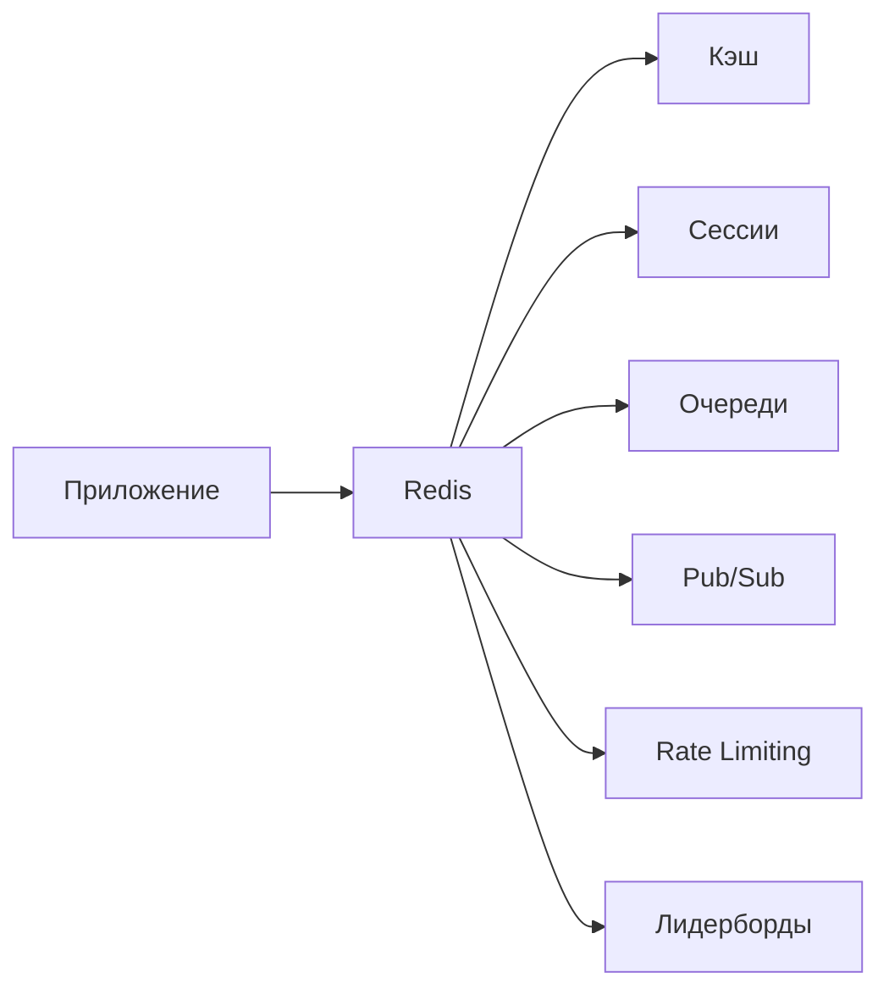

Быстрая проверка через `redis-cli`:

```bash
redis-cli ping
# PONG

redis-cli INFO server | head -5
# redis_version:7.2.4
# redis_mode:standalone
# os:Linux 5.15.0-91-generic x86_64
```


**Почему записи начали падать при свободном диске.** Если клиент получает ошибку `OOM` с упоминанием `maxmemory`, Redis достиг настроенного порога памяти для вытеснения. При `noeviction` команды, которым нужно выделить дополнительную память, могут получить отказ. Обычный `GET` существующего ключа при этом продолжает работать. Политики `volatile-*` тоже могут привести к отказу, если нет ключей с TTL, которые можно вытеснить (Q6).

**Что проверить.** В `INFO memory` сравните `maxmemory`, `maxmemory_policy`, `used_memory` и `mem_not_counted_for_evict`. Часть буферов AOF и репликации исключается из расчёта вытеснения. Отдельно сравните `used_memory_rss` и потребление памяти процесса с лимитом контейнера или узла (Q34). Если контейнер завершился с `OOMKilled`, проверьте события среды исполнения. Это другой симптом, чем ответ `OOM` от работающего Redis.

Для кэша, значения которого можно восстановить из источника, выберите подходящую политику вытеснения и следите за промахами и нагрузкой на источник. Повышайте `maxmemory` только при подтверждённом запасе RAM с учётом буферов и пиков нагрузки.

Источник: [Redis — Key eviction](https://redis.io/docs/latest/develop/reference/eviction/).

## Q2. (!) Лидерборд на сотню тысяч игроков собирают выборкой очков в приложение и сортировкой там же, страница открывается три секунды — что менять?

`Redis` поддерживает 10+ типов данных. Основные:

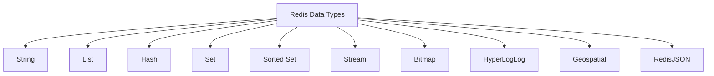

Карта типов данных `Redis`:

```
Redis Data Types
├─ String
├─ List
├─ Hash
├─ Set
├─ Sorted Set
├─ Stream
├─ Bitmap
├─ HyperLogLog
├─ Geospatial
└─ RedisJSON
```

| Тип | Описание | Макс. размер | Пример команд |
|-----|----------|-------------|---------------|
| `String` | Строка / число / бинарные данные | 512 MB | `SET`, `GET`, `INCR` |
| `List` | Двусвязный список строк | 2^32 - 1 элементов | `LPUSH`, `RPOP`, `LRANGE` |
| `Hash` | Map поле-значение | 2^32 - 1 пар | `HSET`, `HGET`, `HGETALL` |
| `Set` | Неупорядоченное множество | 2^32 - 1 элементов | `SADD`, `SMEMBERS`, `SINTER` |
| `Sorted Set` | Множество с score | 2^32 - 1 элементов | `ZADD`, `ZRANGE`, `ZRANK` |
| `Stream` | Append-only log | — | `XADD`, `XREAD`, `XREADGROUP` |
| `Bitmap` | Битовые операции над строками | 512 MB | `SETBIT`, `GETBIT`, `BITCOUNT` |
| `HyperLogLog` | Вероятностный счётчик уникальных | ~12 KB | `PFADD`, `PFCOUNT` |
| `Geo` | Координаты + радиус поиска | — | `GEOADD`, `GEODIST`, `GEORADIUS` |

```bash
# String
redis-cli SET user:1:name "Иван"
redis-cli GET user:1:name
# "Иван"

# Hash
redis-cli HSET user:1 name "Иван" age 30 city "Москва"
redis-cli HGETALL user:1
# 1) "name" 2) "Иван" 3) "age" 4) "30" 5) "city" 6) "Москва"

# Sorted Set
redis-cli ZADD leaderboard 100 "player1" 200 "player2" 150 "player3"
redis-cli ZRANGE leaderboard 0 9 REV WITHSCORES
# 1) "player2" 2) "200" 3) "player3" 4) "150" 5) "player1" 6) "100"
```

**Что менять при медленном лидерборде.** Если рейтинг помещается на один узел, храните его в `Sorted Set`: участник — ID игрока, `score` — очки. `ZADD` обновляет очки существующего участника и сохраняет порядок. В Redis 6.2+ команда `ZRANGE leaderboard 0 9 REV WITHSCORES` возвращает до десяти игроков с наибольшим счётом. Индексы начинаются с нуля, правая граница включается. Для Redis до 6.2 тот же диапазон читает `ZREVRANGE leaderboard 0 9 WITHSCORES`.

Сервер выполняет индексную выборку за `O(log N + M)`, где `N` — размер множества, а `M` — число возвращённых игроков. По сети передаётся только страница. При одинаковых очках `REV` упорядочивает участников по их ID в обратном лексикографическом порядке. Если продукт присваивает одинаковым очкам общее место, это правило нужно реализовать отдельно. Обновление очков и модель участника разобраны в Q11.

Источники: [Redis — ZRANGE](https://redis.io/docs/latest/commands/zrange/) и [Redis — ZADD](https://redis.io/docs/latest/commands/zadd/).

## Q3. Одна команда по большому набору подвесила весь экземпляр на несколько секунд, хотя на узле восемь свободных ядер — почему?

В Redis Open Source обычные команды над данными выполняет основной поток. Пока он обходит крупный хеш для `HGETALL` и формирует ответ, команды других клиентов на том же экземпляре ждут. Даже короткий `GET` может выйти за клиентский таймаут, хотя после начала выполнения отработает быстро. Свободные ядра не сокращают этот обход. Стоимость `HGETALL` растёт линейно с числом полей хеша.

Начиная с Redis 6.0 можно распределить часть сетевой работы между потоками. В Redis 8 сетевые потоки получили асинхронную реализацию, которую настраивают через `io-threads`. Они могут читать сокеты, разбирать запросы и отправлять ответы. Сам обход данных обычной командой остаётся в основном потоке.

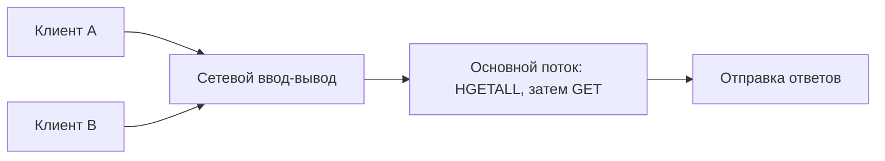

Как проверить и исправить:

1. Сопоставить всплеск клиентской задержки с `SLOWLOG GET 10`. В журнал попадают команды, достигшие настроенного порога времени выполнения. Ожидание своей очереди и передача ответа по сети в это время не входят. Поэтому короткий `GET` может быть медленным для клиента и отсутствовать в журнале.
2. Если нужны конкретные поля, читать их через `HMGET`. Если нужен обход всего хеша без требования единого снимка, использовать несколько вызовов `HSCAN` с курсором. Между вызовами Redis может обслужить другие команды. `COUNT` задаёт подсказку, поэтому жёсткой верхней границы на размер порции он не даёт.

**На интервью важно:** один `INCR` выполняется без вклинивания другой команды, но между отдельными `GET` и `SET` другой клиент может изменить ключ. `MULTI/EXEC` и Lua позволяют выполнить последовательность без такого вмешательства. Долгая последовательность при этом сама задерживает другие команды.

Источники: [Модель задержек Redis](https://redis.io/docs/latest/operate/oss_and_stack/management/optimization/latency/), [сетевой ввод-вывод в Redis 8](https://redis.io/blog/redis-8-ga/), [HGETALL](https://redis.io/docs/latest/commands/hgetall/), [HSCAN](https://redis.io/docs/latest/commands/hscan/), [SLOWLOG GET](https://redis.io/docs/latest/commands/slowlog-get/).

## Q4. (!) Ключи собирают склейкой префикса и идентификатора без разделителя, и записи разных сущностей стали затирать друг друга — почему?

Redis идентифицирует ключ по полной последовательности байтов в выбранной базе. Если приложение склеивает компоненты без разделителя, пары `(user, 123)` и `(user1, 23)` обе дают `user123`. Второй `SET` заменяет значение, записанное первым.

**Конвенция именования ключей** — сегменты через двоеточие:

```text
<entity>:<id>:<field>
```

В примере получатся разные ключи `user:123` и `user1:23`. Двоеточие — часть имени. Если несколько компонентов могут сами содержать `:`, договоритесь об однозначном кодировании каждого сегмента. Например, пары `(a:b, c)` и `(a, b:c)` после простой склейки через двоеточие совпадут.

```bash
SET user:1001:profile '{"name":"Иван"}'
SET order:5432:status "shipped"
SET session:abc123 '{"userId":1001}'
SET cache:product:42 '{"title":"Ноутбук"}'
```

```bash
TYPE user:1001:profile
TTL user:1001:profile
EXISTS user:1001:profile
SCAN 0 MATCH user:* COUNT 100
```

Для полного обхода передавайте возвращённый курсор в следующий `SCAN` до получения нуля. `COUNT` задаёт подсказку по объёму работы. При изменении набора ключей обход может вернуть дубликаты, а результат для ключей, существовавших лишь часть обхода, не определён. Разбор влияния `KEYS` и `SCAN` на задержку — в Q42.

Источники: [Redis Keys and Values](https://redis.io/docs/latest/develop/using-commands/keyspace/), [SCAN](https://redis.io/docs/latest/commands/scan/).

## Q5. (!) Сессиям выставлен срок в час, но память под них освобождается рывками через минуты после истечения срока — почему так выходит?

`TTL` (`Time To Live`) — срок жизни ключа: по его истечении `Redis` сам удалит ключ, без участия приложения. Это основа кэширования (данные «протухают» автоматически) и временных сущностей вроде сессий, одноразовых токенов и rate-limit-счётчиков.

```bash
# Установить ключ с TTL 60 секунд
SET session:abc123 "data" EX 60

# Или через отдельную команду
SET session:abc123 "data"
EXPIRE session:abc123 60

# TTL в миллисекундах
SET session:abc123 "data" PX 5000
PEXPIRE session:abc123 5000

# Проверить оставшееся время
TTL session:abc123
# 45

# Убрать TTL (сделать постоянным)
PERSIST session:abc123

# Установить абсолютное время истечения (Unix timestamp)
EXPIREAT session:abc123 1700000000
```

**Как Redis удаляет просроченные ключи.** После дедлайна обычное чтение на первичном узле считает ключ отсутствующим. Память под запись может оставаться занятой до её удаления.

1. **Пассивное истечение** — при обращении Redis проверяет дедлайн и удаляет просроченный ключ.
2. **Активное истечение** — Redis периодически проверяет ключи с TTL, в том числе те, которые клиенты больше не читают. При массовом истечении очистка может распределиться по нескольким циклам. TTL задаёт срок доступности значения, а момент освобождения памяти зависит от работы этих циклов и, при асинхронном освобождении, от очереди фоновой работы.

Чтобы разобраться в задержке, сопоставьте `expired_keys`, `used_memory` и `used_memory_rss` из `INFO`. Рост счётчика истечений показывает работу удаления. Если `used_memory` падает, а RSS остаётся высоким, аллокатор может удерживать страницы для повторного использования. Если час продлевается при повторной записи сессии, отдельно проверьте, какой TTL выставляет приложение. Обычный `SET` без опции срока или `KEEPTTL` очищает прежний TTL.

```java
// Spring Data Redis — установка TTL
@Autowired
private StringRedisTemplate redisTemplate;

public void cacheWithTtl(String key, String value, Duration ttl) {
    redisTemplate.opsForValue().set(key, value, ttl);
}

public void cacheProduct(Long productId, String json) {
    String key = "cache:product:" + productId;
    redisTemplate.opsForValue().set(key, json, Duration.ofMinutes(30));
}
```

Источники: [EXPIRE](https://redis.io/docs/latest/commands/expire/), [SET](https://redis.io/docs/latest/commands/set/), [INFO](https://redis.io/docs/latest/commands/info/).

## Q6. Политика вытеснения настроена на ключи со сроком, память упёрлась в потолок, и записи начали отказывать вместо вытеснения — почему?

В Redis Open Source политика `volatile-*` выбирает для вытеснения только ключи с установленным сроком действия. Если таких ключей нет, она ведёт себя как `noeviction`. Когда память, учитываемая для вытеснения, выше `maxmemory` и освободить достаточно места не получается, Redis отклоняет команды, способные увеличить расход памяти. Обычное чтение продолжает работать.

**Пример.** На экземпляре с `volatile-lru` хранятся постоянные данные и кэш с TTL. Постоянные ключи выросли настолько, что память осталась выше лимита даже после вытеснения всего кэша. Следующий `SET cache:product:42 value EX 60` получит ошибку `OOM`. Указанный в команде TTL появится лишь после успешной записи. Освободить память до её выполнения может только уже существующий подходящий ключ.

| Политика | Как выбирает ключ |
|----------|-------------------|
| `noeviction` | Вытеснение отключено |
| `allkeys-*` | Кандидатом может стать любой ключ |
| `volatile-*` | Кандидатом может стать только ключ со сроком действия |
| Суффикс `lru` | Приближённый выбор по давности последнего обращения |
| Суффикс `lfu` | Приближённый выбор по частоте обращений с затуханием счётчика |
| Суффикс `random` | Случайный выбор |
| `volatile-ttl` | Предпочтение ключам с наименьшим оставшимся TTL среди проверенных кандидатов |

```bash
redis-cli CONFIG GET maxmemory maxmemory-policy
redis-cli INFO memory
redis-cli INFO keyspace
redis-cli INFO stats
redis-cli TTL cache:product:42
```

Сверьте `used_memory`, `maxmemory` и `mem_not_counted_for_evict`. Часть буферов репликации и AOF исключается из расчёта вытеснения. Затем проверьте число ключей со сроком действия в поле `expires` секции `keyspace` и изменение `evicted_keys` в `stats`. Если у ранее существовавшего ключа `TTL` возвращает `-1`, проверьте путь записи. Например, обычный `SET` снимает прежний срок, если команда не задаёт новый TTL и не использует `KEEPTTL`.

**Выбор политики.** Для кэша, где любое значение можно восстановить, `allkeys-lru` или `allkeys-lfu` позволяют выбирать из всего набора. При смешанной нагрузке `volatile-*` защищает постоянные ключи от вытеснения, но их рост всё равно может остановить запись. Отдельные экземпляры дают кэшу и постоянным данным независимые лимиты. Подробнее — в [вопросах по стратегиям кэширования](../architecture/caching-strategies-interview.md).

Источники: [Redis Key Eviction](https://redis.io/docs/latest/develop/reference/eviction/), [INFO](https://redis.io/docs/latest/commands/info/), [SET](https://redis.io/docs/latest/commands/set/).

## Q7. Миллион счётчиков лежит отдельными ключами, значения — небольшие числа, а память под них выросла до сотен мегабайт — почему?

У отдельного ключа Redis хранит имя, значение и служебные данные для поиска и управления записью. Если ключу задан TTL, добавляются метаданные истечения. Даже когда Redis хранит целочисленное значение в компактном представлении, эти расходы остаются. При миллионе записей размер имён, устройство таблиц и накладные расходы аллокатора могут дать сотни мегабайт. Проверять это нужно на своей версии и данных.

```bash
# Два отдельных ключа. INCR создаёт отсутствующий счётчик со значением 1.
INCR article:42:views
INCR article:42:likes

# Альтернативная модель. Одна запись в пространстве ключей, два поля хеша.
HINCRBY article:42:counters views 1
HINCRBY article:42:counters likes 1
```

Теперь запись в пространстве ключей приходится на один хеш. Каждое поле по-прежнему занимает память. В Redis 7.0+ небольшие хеши могут храниться в компактном `listpack`. Параметры `hash-max-listpack-entries` и `hash-max-listpack-value` ограничивают число полей и размер элементов для такого представления. При превышении границы Redis переходит к обычному представлению хеша. Поэтому складывать миллион счётчиков в один ключ ради `listpack` бессмысленно. Группируйте поля по объекту или по ограниченным по размеру группам.

```bash
MEMORY USAGE article:42:views
MEMORY USAGE article:42:likes
MEMORY USAGE article:42:counters
OBJECT ENCODING article:42:counters
```

Сравните сумму для двух отдельных ключей с расходом сгруппированного ключа. Для решения о миграции повторите измерение на репрезентативном наборе с реальными длинами имён и TTL. Для составных значений `MEMORY USAGE` по умолчанию использует выборку вложенных элементов. На выделенном тестовом экземпляре дополнительно сравните изменение `used_memory` до и после загрузки каждого варианта, чтобы учесть эффект на весь набор.

**Граница применимости.** `EXPIRE` и вытеснение работают на уровне ключа, поэтому могут удалить все счётчики группы разом. Независимый срок для полей доступен с Redis 7.4 через `HEXPIRE` (см. Q8). Если поля записываются с разной нагрузкой, учитывайте, что в Redis Cluster все поля одного хеша обслуживаются одним шардом.

Источники: [Memory Optimization](https://redis.io/docs/latest/operate/oss_and_stack/management/optimization/memory-optimization/), [MEMORY USAGE](https://redis.io/docs/latest/commands/memory-usage/), [HEXPIRE](https://redis.io/docs/latest/commands/hexpire/).

## Q8. Профили лежат хэшами, каждому полю пытались задать собственный срок жизни, но истекает весь объект целиком — почему?

`Hash` — коллекция пар `field-value`, удобная для хранения полей одного объекта.

```bash
# Создание и заполнение
HSET user:1001 name "Иван Петров" email "ivan@example.com" age 30 role "developer"

# Получение полей
HGET user:1001 name
# "Иван Петров"

HMGET user:1001 name email
# 1) "Иван Петров" 2) "ivan@example.com"

HGETALL user:1001
# 1) "name" 2) "Иван Петров" 3) "email" 4) "ivan@example.com" ...

# Инкремент поля
HINCRBY user:1001 age 1
# 31

# Проверить существование поля
HEXISTS user:1001 email
# 1

# Удалить поле
HDEL user:1001 role

# Количество полей
HLEN user:1001
# 3
```

```java
// Spring Data Redis — срок жизни всего профиля
@Autowired
private RedisTemplate<String, Object> redisTemplate;

public void saveUser(User user) {
    String key = "user:" + user.getId();
    Map<String, String> fields = Map.of(
        "name", user.getName(),
        "email", user.getEmail(),
        "age", String.valueOf(user.getAge())
    );
    redisTemplate.opsForHash().putAll(key, fields);
    redisTemplate.expire(key, Duration.ofHours(1));
}

public String getUserName(Long userId) {
    return (String) redisTemplate.opsForHash()
        .get("user:" + userId, "name");
}
```

**Почему исчезает весь профиль.** `EXPIRE user:1001 3600` и вызов `redisTemplate.expire(...)` из примера задают TTL ключу. После его истечения недоступны все поля, даже если у некоторых из них есть более поздний собственный срок жизни. `TTL` показывает срок жизни ключа.

**Как задать срок одному полю.** Начиная с Redis 7.4, `HEXPIRE` задаёт TTL существующим полям хэша, а `HTTL` показывает оставшееся время для каждого указанного поля. В примере используется новый ключ без общего TTL.

```bash
HSET profile:42 name "Иван" status "online"
HEXPIRE profile:42 60 FIELDS 1 status
HTTL profile:42 FIELDS 2 name status
# Для name: -1 (у поля нет TTL). Для status: оставшееся время в секундах.

# После истечения 60 секунд, если ключ и поля больше не меняли:
HMGET profile:42 name status
# 1) "Иван" 2) (nil)
```

Перезапись поля через `HSET` сбрасывает его TTL. Если обновление должно сохранить дедлайн или установить новый, в Redis 8.0+ это можно сделать одной командой `HSETEX` с `KEEPTTL` или `EX` соответственно. В Redis до 7.4 временные данные можно хранить отдельным ключом с собственным TTL.

**Память.** Экономия от хранения полей в одном ключе зависит от числа и размеров полей, внутреннего представления и настроек сервера. Сравнение с отдельными строковыми ключами разбирается в Q7.

[Redis HEXPIRE](https://redis.io/docs/latest/commands/hexpire/) · [Redis HTTL](https://redis.io/docs/latest/commands/httl/) · [Redis HSETEX](https://redis.io/docs/latest/commands/hsetex/)

## Q9. Лента событий лежит списком, первая страница открывается мгновенно, а сотая — за сотни миллисекунд, хотя размер страницы один и тот же — почему?

`List` — упорядоченный список строк, в который дёшево добавлять и забирать элементы с обоих концов (O(1) на элемент при push/pop с конца списка). Именно это делает его готовым строительным блоком для очередей: одна сторона пишет, другая читает. Основные паттерны — очередь (FIFO), стек (LIFO) и ограниченный «хвост» последних N событий.

```bash
# Очередь (FIFO): LPUSH + RPOP
LPUSH queue:emails "email1" "email2" "email3"
RPOP queue:emails
# "email1"

# Блокирующее извлечение (ждёт до 5 сек)
BRPOP queue:emails 5

# Стек (LIFO): LPUSH + LPOP
LPUSH stack:undo "action1" "action2"
LPOP stack:undo
# "action2"

# Ограниченный список (последние 100 событий)
LPUSH events:user:1001 "login:2026-04-11T10:00:00"
LTRIM events:user:1001 0 99

# Диапазон элементов
LRANGE events:user:1001 0 9
# последние 10 событий

# Длина списка
LLEN queue:emails
```

```java
// Spring Data Redis — очередь на List
public void enqueue(String queueName, String message) {
    redisTemplate.opsForList().leftPush(queueName, message);
}

public String dequeue(String queueName) {
    return redisTemplate.opsForList().rightPop(queueName);
}

// Блокирующее извлечение
public String dequeueBlocking(String queueName, Duration timeout) {
    return redisTemplate.opsForList()
        .rightPop(queueName, timeout);
}
```

**Откуда берётся задержка.** У `LRANGE` стоимость `O(S + N)`: `N` — число возвращаемых элементов, `S` — расстояние до начального смещения от головы для небольших списков или от ближайшего конца для больших. При размере страницы 20 команды `LRANGE events 0 19` и `LRANGE events 1980 1999` возвращают одинаковое число элементов, если в списке хватает записей. В длинном списке второй запрос начинает чтение дальше от обоих концов. При добавлении новых событий через `LPUSH` позиции сдвигаются, поэтому между запросами страниц возможны повторы или пропуски.

**Как читать ленту по курсору.** Если события хранятся в Redis Stream, читайте первую страницу через `XRANGE events - + COUNT 20`. Для следующей страницы передайте ID последней записи как исключительную нижнюю границу: `XRANGE events (1700000000000-3 + COUNT 20` (Redis 6.2+). Такой курсор задаёт начало диапазона без числового смещения. В Sorted Set большой `LIMIT offset` тоже может потребовать обхода элементов. Если строите курсор только по score, обеспечьте уникальность score или учтите равные значения, чтобы не пропускать записи на границе страницы.

[Redis LRANGE](https://redis.io/docs/latest/commands/lrange/) · [Redis XRANGE](https://redis.io/docs/latest/commands/xrange/) · [Redis ZRANGE](https://redis.io/docs/latest/commands/zrange/)

## Q10. Множество из миллиона числовых идентификаторов держали в компактном представлении, а после добавления одного нечислового элемента память выросла в разы — почему?

`Set` — неупорядоченная коллекция уникальных строк: дубликаты автоматически отбрасываются, а проверка принадлежности (`SISMEMBER`) работает за O(1). Главная ценность — теоретико-множественные операции (пересечение, объединение, разность) прямо на сервере, без выгрузки данных в приложение.

```bash
# Добавление элементов
SADD tags:article:1 "java" "spring" "redis"
SADD tags:article:2 "java" "kubernetes" "docker"

# Пересечение — общие теги
SINTER tags:article:1 tags:article:2
# 1) "java"

# Объединение — все теги
SUNION tags:article:1 tags:article:2
# 1) "java" 2) "spring" 3) "redis" 4) "kubernetes" 5) "docker"

# Разность — уникальные для article:1
SDIFF tags:article:1 tags:article:2
# 1) "spring" 2) "redis"

# Проверка принадлежности
SISMEMBER tags:article:1 "java"
# 1

# Случайный элемент
SRANDMEMBER tags:article:1

# Количество элементов
SCARD tags:article:1
# 3
```

**Практические применения:** отслеживание уникальных посетителей, теги, онлайн-пользователи, друзья/фолловеры, антиспам (чёрные списки IP).

**Что изменилось при добавлении строки.** `intset` может хранить целые числа, пока число элементов укладывается в `set-max-intset-entries`. Значение по умолчанию — 512. Поэтому для множества из миллиона элементов сценарий предполагает специально увеличенный порог. При добавлении строки, которую Redis не может представить в `intset`, множество меняет внутреннее представление. Начиная с Redis 7.2, небольшие множества строк могут храниться в `listpack` при соблюдении `set-max-listpack-entries` и `set-max-listpack-value`. При стандартном лимите `listpack` для миллиона элементов потребуется хеш-таблица.

**Как подтвердить причину.** Сравните `OBJECT ENCODING` и `MEMORY USAGE` для ключа до и после изменения на тестовых данных с такой же конфигурацией. Размер зависит от значений, версии и настроек. Удаление добавленной строки само по себе не гарантирует возврата к исходной кодировке. Если компактность существенна, проверьте конфигурацию и измерьте результат пересоздания множества из допустимых целых чисел.

[Redis Memory Optimization](https://redis.io/docs/latest/management/optimization/memory-optimization/) · [Redis OBJECT ENCODING](https://redis.io/docs/latest/commands/object-encoding/) · [Redis MEMORY USAGE](https://redis.io/docs/latest/commands/memory-usage/)

## Q11. (!) Очки в лидерборде обновляются верно, но размер структуры застыл на числе игроков и не растёт с каждой новой отправкой очков — почему?

В `Sorted Set` уникален участник (`member`), а его `score` определяет место в порядке сортировки. Если участник — ID игрока, повторный `ZADD` заменяет его score, а `ZINCRBY` прибавляет к текущему score. Поэтому меняется позиция игрока, а `ZCARD` по-прежнему показывает число игроков. Размер в байтах при этом может меняться. Историю отправок храните отдельно, например в Stream с ID события.

По умолчанию `ZADD` возвращает число новых участников. При обновлении существующего игрока ответ `0` совместим с успешной сменой score. Опция `CH` включает в результат участников, чей score изменился. При равных score Redis упорядочивает участников лексикографически, а в обратном диапазоне использует обратный порядок. У небольших Sorted Set возможна компактная кодировка, поэтому детали реализации зависят от размера и настроек.

```bash
# Лидерборд
ZADD leaderboard 1500 "player:alice" 2300 "player:bob" 1800 "player:charlie"

# Топ-3 по убыванию
ZRANGE leaderboard 0 2 REV WITHSCORES
# 1) "player:bob"    2) "2300"
# 3) "player:charlie" 4) "1800"
# 5) "player:alice"  6) "1500"

# Ранг игрока (с нуля, по убыванию)
ZREVRANK leaderboard "player:bob"
# 0

# Увеличить score
ZINCRBY leaderboard 500 "player:alice"
# "2000"
ZCARD leaderboard
# 3

# Диапазон по score
ZRANGE leaderboard 1500 2000 BYSCORE WITHSCORES

# Количество элементов в диапазоне score
ZCOUNT leaderboard 1000 2000
# 2

# Удалить элемент
ZREM leaderboard "player:charlie"
```

```java
// Spring Data Redis — лидерборд на Sorted Set
@Autowired
private StringRedisTemplate redis;

public void updateScore(String playerId, double delta) {
    redis.opsForZSet().incrementScore("leaderboard", playerId, delta);
}

public Set<ZSetOperations.TypedTuple<String>> getTopPlayers(int count) {
    if (count <= 0) {
        return Set.of();
    }
    return redis.opsForZSet()
        .reverseRangeWithScores("leaderboard", 0, count - 1);
}

public Long getPlayerRank(String playerId) {
    return redis.opsForZSet().reverseRank("leaderboard", playerId);
}
```

[Redis ZADD](https://redis.io/docs/latest/commands/zadd/) · [Redis ZRANGE](https://redis.io/docs/latest/commands/zrange/) · [Redis ZREVRANK](https://redis.io/docs/latest/commands/zrevrank/)

## Q12. Поиск точек в радиусе работает быстро, но выбрать точки внутри произвольного полигона района не получается — почему так устроено?

Для поиска по координатам используют геоиндекс Redis. HyperLogLog и bitmap решают другие задачи аналитики.

**HyperLogLog** — считает уникальные элементы (cardinality), не храня их сами: до 12 КБ на структуру при стандартной ошибке около 0,81%. Берут, когда точный `Set` был бы слишком тяжёлым (миллионы уников).

```bash
# Подсчёт уникальных посетителей
PFADD visitors:2026-04-11 "user:1" "user:2" "user:3" "user:1"
PFCOUNT visitors:2026-04-11
# Оценка числа уникальных посетителей

# Объединение счётчиков за несколько дней
PFMERGE visitors:week visitors:2026-04-11 visitors:2026-04-12
PFCOUNT visitors:week
```

**Bitmap** — это обычный `String`, к которому обращаются побитово. Один бит на сущность (бит N = пользователь с id N) даёт сверхкомпактное хранение булевых флагов: миллион последовательных смещений от нуля занимает 125 000 байт данных, а разреженные ID могут потребовать больше. Идеально для задач вида «кто заходил сегодня».

```bash
# Активность пользователей (1 бит = 1 пользователь)
SETBIT active:2026-04-11 1001 1
SETBIT active:2026-04-11 1002 1
SETBIT active:2026-04-11 1003 0

# Подсчёт активных
BITCOUNT active:2026-04-11
# 2

# Пользователи, активные в оба дня
BITOP AND active:both active:2026-04-11 active:2026-04-12
```

**Geospatial** — хранение координат и поиск по радиусу.

```bash
GEOADD stores 37.6156 55.7522 "store:moscow"
GEOADD stores 30.3159 59.9343 "store:spb"

# Расстояние между магазинами
GEODIST stores "store:moscow" "store:spb" km
# Расстояние в километрах

# Поиск в радиусе 50 км от точки
GEOSEARCH stores FROMLONLAT 37.62 55.75 BYRADIUS 50 km ASC
```

**Почему полигон нужно фильтровать отдельно.** `GEOADD` хранит координаты в Sorted Set: участник — ID точки, score — 52-битный код ячейки. Для круга или прямоугольника `GEOSEARCH` читает диапазоны ячеек, покрывающих область, и отбрасывает кандидатов за пределами фигуры. Близкие точки по разные стороны границы ячейки могут попадать в разные диапазоны. Стоимость зависит от области поиска и числа кандидатов.

Для района с произвольной границей можно взять охватывающий прямоугольник через `GEOSEARCH ... BYBOX ... WITHCOORD`, затем проверить попадание каждой точки в полигон. В этой схеме ограничение `COUNT` до фильтрации может исключить подходящие точки. Если поиск по сложным полигонам нужен регулярно или кандидатов много, храните геометрию в системе с пространственным индексом и поддержкой таких предикатов.

[Redis GEOADD](https://redis.io/docs/latest/commands/geoadd/) · [Redis GEOSEARCH](https://redis.io/docs/latest/commands/geosearch/)

## Q13. (!) После аварийного рестарта потеряно 14 минут записей: включён только `RDB` с `save 900 1`, договорный RPO — 60 секунд, а рестарт обязан уложиться в пять минут — что менять в персистентности?

**Сначала сократить окно потери.** `save 900 1` разрешает автоматический снимок после 900 секунд при наличии хотя бы одного изменения. При аварии Redis восстановит последний доступный снимок. Время его создания и возможные сбои записи влияют на фактическое окно потери, поэтому эта настройка не обеспечивает RPO в 60 секунд.

| Механизм | Что загружается при старте | От чего зависит потеря записей |
|---|---|---|
| RDB | Снимок состояния | Возраст последнего успешно сохранённого снимка |
| AOF | База и последующие записи журнала, подробнее в Q14 | Политика `appendfsync`, успешность записи и характер отказа |
| RDB и AOF | Redis использует AOF при штатном запуске с обоими механизмами | RDB можно использовать как отдельный снимок для резервного копирования |

```conf
appendonly yes
appendfsync everysec
aof-use-rdb-preamble yes
```

`everysec` обычно ограничивает потерю примерно секундой при аварии процесса или узла с доступным после перезапуска диском. Это не договорный максимум при зависании I/O или потере тома. `always` повышает стойкость к потере неподтверждённых диском записей ценой задержки. Для отказа с потерей диска нужен отдельный путь восстановления с проверенным RPO. На работающем узле включайте AOF через поддерживаемую смену конфигурации, дождитесь создания начального AOF и проверьте сохранение настройки перед рестартом.

**Подтвердить пять минут восстановления отдельно.** На копии репрезентативного набора данных измерьте время от запуска процесса до готовности обслуживать запросы и проверьте последние восстановленные записи. Включите в сценарий крупный хвост AOF и медленный диск, характерные для выбранного отказа. Если восстановление дольше пяти минут, разберите загрузку базы и применение хвоста по Q14.

[Redis Persistence](https://redis.io/docs/latest/operate/oss_and_stack/management/persistence/)

## Q14. Журнал команд включён и перезапись настроена, но узел на сорок гигабайт поднимается после рестарта двадцать минут — что менять?

**Определить, где ушли двадцать минут.** Сверьте фактическую конфигурацию и лог загрузки. Уточните, что означает «40 ГБ»: размер данных в памяти, размер файлов или оба показателя. Для Redis 7.0+ проверьте AOF-манифест, размер базового файла и инкрементальных файлов. Сопоставьте время загрузки базы и применения команд с пропускной способностью диска, загрузкой CPU и давлением на память.

**Если долго воспроизводится журнал.** Проверьте `aof-use-rdb-preamble yes` и завершение успешного `BGREWRITEAOF`: смена настройки сама по себе не перекодирует уже сохранённую базу. В Redis 4–6 гибридный AOF хранит RDB-префикс и команды в одном файле. Начиная с Redis 7.0 манифест связывает базовый файл (RDB при включённом preamble) с инкрементальными AOF. Redis загружает базу и применяет команды после неё. Проверьте порог и частоту переписывания под фактическую скорость записи. Более частое переписывание сокращает ожидаемый хвост, но расходует I/O и память из-за copy-on-write.

**Если долго грузится сама база.** Измерьте чтение на целевом томе и время восстановления набора ключей. Рассмотрите более быстрый диск или меньший объём на узел, если это подтверждает профиль загрузки. Когда цель — сократить недоступность сервиса, проверьте отдельный сценарий переключения на реплику и возможную потерю записей при нём. После изменения повторите восстановление в сопоставимых условиях. Настройка `appendfsync` прежде всего меняет политику записи на диск, а время запуска нужно измерять отдельно.

[Redis Persistence](https://redis.io/docs/latest/operate/oss_and_stack/management/persistence/)

## Q15. (!) Транзакция из четырёх команд ушла в `EXEC`, вторая команда упала с ошибкой типа, но три остальные применились и данные разъехались — почему изменения не отменились целиком?

`MULTI` ставит команды в очередь. Когда Redis принимает `EXEC`, он выполняет очередь последовательно, без команд других клиентов между её элементами. Ответы идут в порядке команд. Ошибка на этапе постановки в очередь отличается от ошибки уже выполняемой команды.

| Что случилось | Что вернёт Redis | Какие изменения применятся |
| --- | --- | --- |
| До `EXEC` команда отвергнута при постановке в очередь, например из-за неверного числа аргументов | Ошибка сразу, затем `EXECABORT` на `EXEC` | Очередь не выполняется |
| Наблюдаемый через `WATCH` ключ изменился до `EXEC`, ошибок постановки нет | Нулевой ответ на `EXEC` | Очередь не выполняется |
| После начала выполнения команда встретила неподходящий тип данных | Ошибка в соответствующем элементе ответа `EXEC` | Redis продолжает выполнять очередь. Успешные команды сохраняют эффект |

```text
RPUSH jobs:pending job-1
MULTI
SET job:1:state scheduled
INCR jobs:pending
INCR jobs:scheduled
SET job:1:source api
EXEC
# 1) OK
# 2) (error) WRONGTYPE ...
# 3) (integer) 1   # если jobs:scheduled до примера отсутствовал
# 4) OK
```

`DISCARD` очищает очередь до выполнения. При ошибке внутри `EXEC` анализируйте все результаты: повтор всей пачки может второй раз увеличить уже изменившийся счётчик. Изоляция очереди защищает от вмешательства других клиентов во время исполнения, а инварианты между ключами требуют отдельной проверки. См. также [SQL-транзакции](sql-interview.md).

`WATCH` реализует оптимистичную проверку. Например, перед резервированием остатка вызовите `WATCH stock:42`, прочитайте остаток, проверьте, что его достаточно, и поставьте `DECRBY` в очередь. Весь цикл используйте одно соединение. Если `EXEC` вернул null из-за конфликта, повторите чтение с нового `WATCH`. С Redis 6.0.9 истечение TTL наблюдаемого ключа также отменяет выполнение. Если соединение оборвалось после отправки `EXEC`, исход операции может остаться неизвестным клиенту. Для безопасного повтора неидемпотентной операции нужен способ проверить результат или обнаружить дубль.

```java
// Spring Data Redis — транзакция через SessionCallback
List<Object> results = redisTemplate.execute(new SessionCallback<>() {
    @Override
    public List<Object> execute(RedisOperations operations) {
        operations.multi();
        operations.opsForValue().set("key1", "value1");
        operations.opsForValue().set("key2", "value2");
        return operations.exec();
    }
});
```

[Redis Transactions](https://redis.io/docs/latest/develop/using-commands/transactions/)

## Q16. (!) Rate limiter шлёт `INCR` и `EXPIRE` двумя вызовами из Java: под нагрузкой часть ключей остаётся без TTL и живёт вечно, а лимит изредка пропускает вдвое больше запросов — чем это чинится?

Если первый `INCR` создал ключ, а клиент не дошёл до `EXPIRE`, счётчик останется без TTL. Выполните обе команды в коротком Lua-скрипте. Сервер выполняет его без вмешательства других команд, а скрипт может проверить результат `INCR` и поставить TTL только при создании счётчика. В очередь `MULTI` команды добавляют заранее, поэтому ветвление по промежуточному ответу внутри неё недоступно.

```bash
# Rate limiter на Lua — атомарный INCR + EXPIRE
redis-cli EVAL "
  local current = redis.call('INCR', KEYS[1])
  if current == 1 then
    redis.call('EXPIRE', KEYS[1], ARGV[1])
  end
  return current
" 1 ratelimit:user:1001 60
# Возвращает текущий счётчик; TTL устанавливается при первом вызове
```

```lua
-- Скрипт: условная запись с проверкой
-- KEYS[1] = ключ, ARGV[1] = ожидаемое значение, ARGV[2] = новое значение
local current = redis.call('GET', KEYS[1])
if current == ARGV[1] then
    redis.call('SET', KEYS[1], ARGV[2])
    return 1
end
return 0
```

```java
// Spring Data Redis — выполнение Lua-скрипта
@Bean
public RedisScript<Long> rateLimiterScript() {
    String script = """
        local current = redis.call('INCR', KEYS[1])
        if current == 1 then
            redis.call('EXPIRE', KEYS[1], ARGV[1])
        end
        return current
        """;
    return new DefaultRedisScript<>(script, Long.class);
}

@Autowired
private RedisScript<Long> rateLimiterScript;

public boolean isAllowed(String userId, int limit, int windowSeconds) {
    String key = "ratelimit:" + userId;
    Long count = redisTemplate.execute(
        rateLimiterScript,
        List.of(key),
        String.valueOf(windowSeconds)
    );
    return count != null && count <= limit;
}
```

Код рассчитан на свежие ключи с целочисленным счётчиком и положительным `windowSeconds` в допустимом для Redis диапазоне. Проверяйте входные параметры перед записью. Ошибка `redis.call` прерывает скрипт, а выполненные до неё записи сохраняются. Ранее оставленные ключи без TTL нужно исправить отдельно: если счётчик уже больше единицы, ветка `current == 1` на него не подействует.

Lua устраняет разрыв между двумя вызовами, но лимит по отдельным окнам всё равно допускает всплеск на границе. При лимите 100 запросов можно принять 100 перед истечением окна и ещё 100 сразу после него. Если ограничение действует на любые скользящие 60 секунд, смените алгоритм, например на журнал временных отметок со скользящим окном. С Redis 7.0 эту серверную логику можно развернуть как Redis Function вместо `EVAL`.

[Redis INCR и пример rate limiter](https://redis.io/docs/latest/commands/incr/#pattern-rate-limiter) · [Redis Lua API](https://redis.io/docs/latest/develop/programmability/lua-api/)

## Q17. (!) Инвалидацию кэша рассылают через `PUBLISH`, и один под после короткого разрыва сети остался с устаревшими записями, хотя издатель ошибок не видел — почему сообщения его не догнали?

`Pub/Sub` — механизм публикации-подписки: издатели (`PUBLISH`) шлют сообщения в именованный канал, а все, кто на этот канал подписан (`SUBSCRIBE`), получают их в реальном времени. Издатель и подписчики ничего не знают друг о друге — связь идёт только через имя канала, что удобно для слабосвязанных уведомлений «один ко многим».

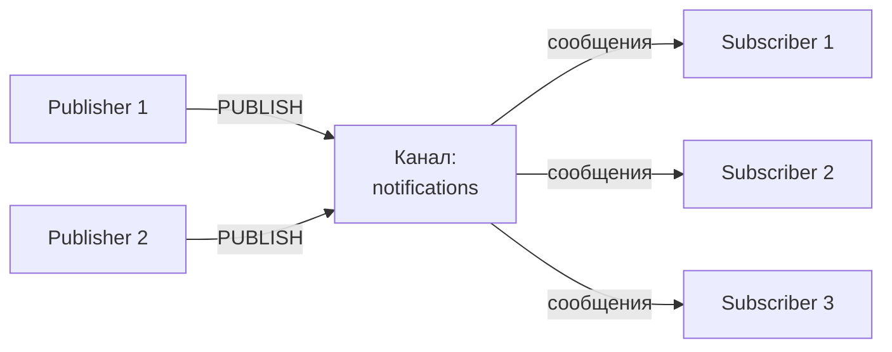

```
                                         сообщения
  ┌─────────────┐   PUBLISH                    ┌──▶ ┌──────────────┐
  │ Publisher 1 │──────────┐                   │    │ Subscriber 1 │
  └─────────────┘          ▼                   │    └──────────────┘
                    ┌──────────────┐ сообщения │    ┌──────────────┐
                    │   Канал:     │───────────┼──▶ │ Subscriber 2 │
                    │ notifications│           │    └──────────────┘
  ┌─────────────┐   └──────────────┘ сообщения │    ┌──────────────┐
  │ Publisher 2 │──────────▲                   └──▶ │ Subscriber 3 │
  └─────────────┘   PUBLISH                         └──────────────┘
```

```bash
# Терминал 1 — подписка
redis-cli SUBSCRIBE notifications
# Reading messages...
# 1) "subscribe" 2) "notifications" 3) (integer) 1

# Терминал 2 — публикация
redis-cli PUBLISH notifications "Новый заказ #1234"
# (integer) 1  — сервер отправил сообщение клиенту из терминала 1

# Подписка по паттерну
redis-cli PSUBSCRIBE "order:*"
# Получит сообщения из order:created, order:shipped, order:cancelled
```

```java
// Spring Data Redis — Pub/Sub
@Configuration
public class RedisPubSubConfig {

    @Bean
    public MessageListenerAdapter listenerAdapter(NotificationHandler handler) {
        return new MessageListenerAdapter(handler, "onMessage");
    }

    @Bean
    public RedisMessageListenerContainer container(
            RedisConnectionFactory factory,
            MessageListenerAdapter listener) {
        RedisMessageListenerContainer container = new RedisMessageListenerContainer();
        container.setConnectionFactory(factory);
        container.addMessageListener(listener, new PatternTopic("notifications.*"));
        return container;
    }
}

@Component
public class NotificationHandler {
    public void onMessage(String message) {
        log.info("Получено уведомление: {}", message);
    }
}

// Публикация
@Service
public class NotificationPublisher {
    @Autowired
    private StringRedisTemplate redisTemplate;

    public void publish(String channel, String message) {
        redisTemplate.convertAndSend(channel, message);
    }
}
```

**Почему под пропустил инвалидацию.** Redis Pub/Sub доставляет сообщения по модели at-most-once. Канал не хранит историю и не воспроизводит её после переподключения. Число от `PUBLISH` показывает, скольким клиентам сервер отправил сообщение. Оно не подтверждает, что обработчик применил инвалидацию. В Redis Cluster ответ учитывает только клиентов на узле публикации.

**Как под возвращается в работу.** После восстановления подписки на инвалидации очистите локальный кэш до возобновления чтений из него. Пока подписка недоступна, можно читать из источника данных, если он выдержит нагрузку. Ограничьте срок жизни кэшированных значений на случай позднего обнаружения обрыва. Если обновление кэша уже выполнялось параллельно, отбросьте результат, начатый до очистки, например с помощью номера поколения кэша. Иначе старый результат может снова заполнить кэш.

Если нужно воспроизводить события после разрыва, используйте журнал с хранением и позицией чтения, например Streams или [Kafka](../messaging/kafka-interview.md). Для локального кэша каждого пода нужна отдельная позиция или группа на получателя. Одна общая consumer group Redis Streams распределяет события между подами, поэтому не заменяет рассылку каждому экземпляру.

[Redis Pub/Sub](https://redis.io/docs/latest/develop/pubsub/) · [PUBLISH](https://redis.io/docs/latest/commands/publish/)

## Q18. (!) Под с потребителем группы упал посреди обработки, вернулся под новым именем и спокойно читает свежие записи, а десяток старых так и не обработан никем — куда они делись?

`Redis Streams` появились в Redis 5.0. `XADD` добавляет запись в журнал. Чтение само по себе её не удаляет. Consumer group распределяет новые записи между потребителями и запоминает выданные, но ещё не подтверждённые записи в PEL (Pending Entries List).

| Характеристика | Pub/Sub | Streams |
|---------------|---------|---------|
| Хранение записей | Нет | До удаления или trimming, сохранность при сбое зависит от настроек Redis |
| Доставка | Подключённым подписчикам | Чтение по ID или распределение в consumer group |
| Подтверждение обработки | Нет | `XACK` убирает ID из PEL группы, сохраняя запись в журнале |
| Повторное чтение | Нет | Возможно, пока доступны данные записи |

```bash
# Добавление записей в стрим
XADD orders:stream * orderId "1234" status "created" amount "5000"
# "1712841600000-0" — автоматический ID (timestamp-sequence)

XADD orders:stream * orderId "1235" status "created" amount "3000"

# Чтение последних записей
XRANGE orders:stream - +
XREVRANGE orders:stream + - COUNT 5

# Длина стрима
XLEN orders:stream

# Consumer Group
XGROUP CREATE orders:stream order-processors 0

# Чтение в consumer group
XREADGROUP GROUP order-processors consumer-1 COUNT 1 BLOCK 5000 STREAMS orders:stream '>'

# После успешной обработки подставьте ID из XREADGROUP
XACK orders:stream order-processors "1712841600000-0"

# Просмотр необработанных (pending) сообщений
XPENDING orders:stream order-processors
```

```java
// Spring Data Redis — чтение из Stream
@Configuration
public class RedisStreamConfig {

    @Bean
    public StreamMessageListenerContainer<String, MapRecord<String, String, String>>
            streamContainer(RedisConnectionFactory factory) {

        var options = StreamMessageListenerContainer
            .StreamMessageListenerContainerOptions.builder()
            .pollTimeout(Duration.ofSeconds(1))
            .build();

        var container = StreamMessageListenerContainer.create(factory, options);

        container.receive(
            Consumer.from("order-processors", "consumer-1"),
            StreamOffset.create("orders:stream", ReadOffset.lastConsumed()),
            message -> {
                log.info("Order: {}", message.getValue());
                // обработка ...
                redisTemplate.opsForStream()
                    .acknowledge("orders:stream", "order-processors", message.getId());
            }
        );

        container.start();
        return container;
    }
}

// Публикация в Stream
public RecordId publishOrder(Map<String, String> order) {
    return redisTemplate.opsForStream()
        .add("orders:stream", order);
}
```

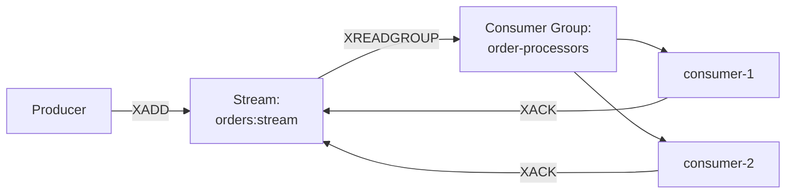

```
                XADD          XREADGROUP        ┌─▶ consumer-1 ─┐
 ┌──────────┐         ┌──────────────┐  ┌──────────────────┐   │
 │ Producer │────────▶│   Stream:    │─▶│  Consumer Group: │   │ XACK
 └──────────┘         │ orders:stream│  │ order-processors │   │
        ▲             └──────────────┘  └──────────────────┘   │
        │                    ▲          └─▶ consumer-2 ─┐       │
        │       XACK         └─────────────────────────┴───────┘
        └────────────────────────────────────────────────────
```


**Куда делись необработанные записи.** Если чтение шло без `NOACK`, IDs остались в PEL группы за старым именем. Обычный `XREADGROUP … >` без `CLAIM` возвращает записи, ещё не выдававшиеся группе. Чтение с ID `0` возвращает собственные pending-записи потребителя, поэтому процесс под новым именем таким способом записи старого владельца не получит.

```bash
# Посмотреть до десяти ID, их владельцев, время простоя и число доставок
XPENDING orders:stream order-processors - + 10

# Redis 6.2+. Забрать записи с достаточным временем простоя
XAUTOCLAIM orders:stream order-processors consumer-2 60000 0-0 COUNT 10
```

При следующем вызове `XAUTOCLAIM` передайте курсор из ответа. `0-0` означает конец текущего прохода, а пустая порция с ненулевым курсором требует продолжения. Для точечного переноса известных ID используйте `XCLAIM`. С Redis 8.4 можно также читать новые записи и забирать достаточно долго ожидающие одним `XREADGROUP … CLAIM <min-idle-time> … STREAMS … >`.

Выберите порог простоя с учётом обычного времени обработки. Он не доказывает, что старый обработчик остановился. Если тот записал результат и упал до `XACK`, новый обработчик может повторить эффект. Используйте идемпотентную операцию или дедупликацию по ID события и подтверждайте запись после успешной фиксации эффекта. Пример Spring выше показывает обработку новых сообщений. Восстановление pending нужно подключить отдельно.

PEL хранит ID, а полезная нагрузка остаётся в самом Stream. Trimming или удаление записи может убрать данные раньше восстановления. С Redis 7.0 `XAUTOCLAIM` очищает найденные ссылки на такие записи из PEL и возвращает их ID отдельно. Настройте удержание журнала с учётом времени восстановления и отслеживайте возраст pending.

[Redis XREADGROUP](https://redis.io/docs/latest/commands/xreadgroup/) · [XAUTOCLAIM](https://redis.io/docs/latest/commands/xautoclaim/)

## Q19. (!) Реплика после каждого секундного разрыва сети грузит с мастера весь набор данных заново, мастер на это время проседает по задержкам, а версии узлов одинаковые — почему частичной синхронизации не выходит?

Репликация — асинхронное копирование данных с одного мастера на одну или несколько реплик. Мастер принимает записи, реплики получают их копию и обслуживают чтение — это решает сразу две задачи: масштабирует чтение (нагрузку размазали по репликам) и повышает отказоустойчивость (реплику можно повысить до мастера, хотя часть последних записей может ещё отсутствовать).

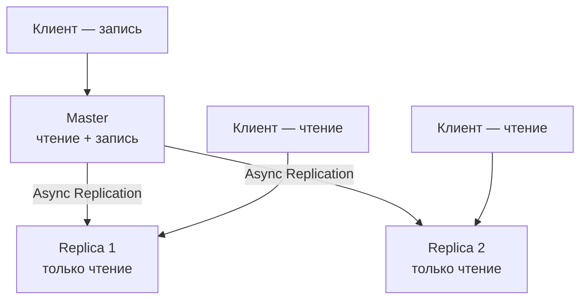

```
 Клиент (запись) ─────┐
                      ▼
              ┌────────────────┐
              │     Master     │
              │ чтение + запись│
              └───────┬────────┘
        Async         │       Async
     Replication      │     Replication
        ┌─────────────┴─────────────┐
        ▼                           ▼
 ┌────────────────┐         ┌────────────────┐
 │   Replica 1    │         │   Replica 2    │
 │ только чтение  │         │ только чтение  │
 └────────────────┘         └────────────────┘
        ▲                           ▲
 Клиент (чтение)             Клиент (чтение)
```

**Что происходит при подключении.** `REPLICAOF host port` настраивает, откуда реплике брать данные. В протоколе подключения реплика отправляет мастеру `PSYNC`. При полной синхронизации мастер передаёт RDB-снимок, а реплика загружает его и применяет накопившийся за это время поток изменений. При дисковой синхронизации снимок сначала записывается в файл. При diskless sync дочерний процесс передаёт его в сеть напрямую. Подходящую уже начатую синхронизацию иногда можно использовать для нескольких реплик.

```bash
# Конфигурация реплики (redis.conf)
replicaof 192.168.1.100 6379
# Если мастер защищён паролем
masterauth my_password

# Запретить запись в реплику (рекомендуется)
replica-read-only yes

# Проверить статус репликации
redis-cli INFO replication
# role:master
# connected_slaves:2
# slave0:ip=192.168.1.101,port=6379,state=online,offset=1234,lag=0
```

**Важно:** репликация асинхронная. Мастер подтверждает запись клиенту, не дожидаясь, пока реплика её получит, — это быстро, но означает, что при внезапном падении мастера последние ещё не реплицированные команды потеряются. Сама по себе репликация не делает и автоматического failover: упавшего мастера нужно кем-то заменить. Для автоматического переключения используйте `Sentinel` (для standalone) или `Cluster` (для шардированного развёртывания).


**Когда возможна частичная синхронизация.** При повторном подключении реплика указывает в `PSYNC` идентификатор истории репликации и смещение, с которого ей нужны данные. Мастер должен принять этот идентификатор для запрошенного смещения и располагать нужным продолжением потока в backlog. После повышения реплики новый мастер может принять предыдущий идентификатор в пределах известной общей истории. Если история не совпадает, backlog уже освобождён или начало пропущенного участка вытеснено, потребуется полная синхронизация. Одинаковые версии Redis этих условий не обеспечивают.

**Как проверить причину.** Сопоставьте сообщения обоих узлов при реконнекте. На мастере проверьте идентификаторы и границу предыдущей истории в `INFO replication`, а также `repl_backlog_active`, `repl_backlog_first_byte_offset` и `repl_backlog_histlen`. В `INFO stats` счётчики `sync_full`, `sync_partial_ok` и `sync_partial_err` помогают увидеть, какие синхронизации происходят. Причину конкретного отказа ищите в логах и состоянии узлов на момент запроса.

**Что менять.** Если нужные байты вытесняются, настройте `repl-backlog-size` по пиковому объёму потока репликации за время отставания и реконнекта. Например, при 6 МиБ/с и пяти секундах разрыва уже нужен запас сверх 30 МиБ, даже если реплика до разрыва успевала за мастером. Скорость можно оценить по изменению `master_repl_offset` за интервал с тем же идентификатором. Если backlog исчезает после ухода последней реплики, проверьте `repl-backlog-ttl`. При несовместимой истории больший backlog не поможет. Полная синхронизация может увеличить задержки из-за создания снимка и передачи данных, в том числе при diskless sync.

[Репликация Redis](https://redis.io/docs/latest/operate/oss_and_stack/management/replication/) · [Поля INFO](https://redis.io/docs/latest/commands/info/) · [Настройки репликации Redis 8.4](https://github.com/redis/redis/blob/8.4/redis.conf)


## Q20. (!) Три `Sentinel` следят за мастером с `quorum 2` и `down-after-milliseconds 1000`; при всплесках сетевой задержки случается failover, и часть подтверждённых записей исчезает — в чём здесь причина?

`Redis Sentinel` — отдельный процесс-«надзиратель», который следит за топологией master-replica и автоматически выполняет failover, когда мастер падает. Он решает проблему из предыдущего вопроса: репликация сама по себе нового мастера не назначает, а Sentinel это делает без участия человека, обеспечивая высокую доступность.

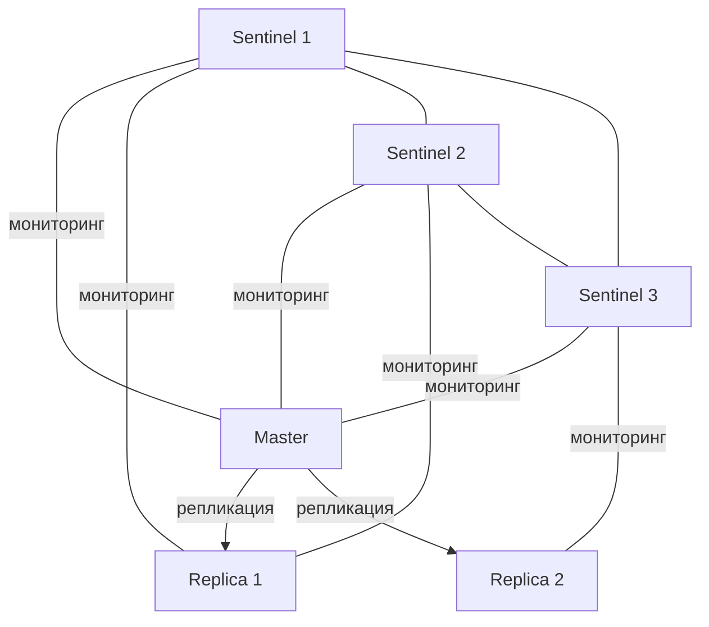

```
   ┌────────────┐   ┌────────────┐   ┌────────────┐
   │ Sentinel 1 │───│ Sentinel 2 │───│ Sentinel 3 │
   └─────┬──────┘   └─────┬──────┘   └─────┬──────┘
         │  мониторинг    │ мониторинг     │ мониторинг
         └────────┬───────┴────────┬───────┘
                  ▼                 ▼
            ┌──────────┐            │ (мониторинг реплик)
            │  Master  │            │
            └────┬─────┘            │
       репликация│ репликация       │
        ┌────────┴────────┐         │
        ▼                 ▼         ▼
   ┌──────────┐      ┌──────────┐
   │ Replica 1│      │ Replica 2│
   └──────────┘      └──────────┘
   (Sentinel 1,2 → Replica 1;  Sentinel 3 → Replica 2)
```

**Функции Sentinel:**
- **Мониторинг** — постоянно проверяет, живы ли мастер и реплики
- **Уведомление** — оповещает администратора о проблемах
- **Автоматический failover** — при падении мастера выбирает подходящую реплику и повышает её до нового мастера
- **Service discovery** — клиенты спрашивают у Sentinel адрес *текущего* мастера, поэтому после failover они переключаются автоматически, без правки конфигов

Чтобы решение о падении мастера было надёжным, нужен **кворум**: failover запускается, только если в недоступности мастера согласны несколько Sentinel. Это защищает от ситуации, когда отдельный Sentinel просто потерял сеть и ошибочно объявил живой мастер мёртвым (split-brain).

```bash
# sentinel.conf
sentinel monitor mymaster 192.168.1.100 6379 2
# "2" — кворум: сколько Sentinel должны согласиться, что мастер недоступен
sentinel down-after-milliseconds mymaster 5000
sentinel failover-timeout mymaster 60000
sentinel auth-pass mymaster my_password

# Запуск Sentinel
redis-sentinel /path/to/sentinel.conf

# Проверка состояния
redis-cli -p 26379 SENTINEL masters
redis-cli -p 26379 SENTINEL get-master-addr-by-name mymaster
```

```yaml
# Spring Boot — подключение через Sentinel
spring:
  data:
    redis:
      sentinel:
        master: mymaster
        nodes:
          - sentinel1:26379
          - sentinel2:26379
          - sentinel3:26379
      password: my_password
```

**Минимальная конфигурация:** 3 Sentinel-процесса (для кворума), 1 мастер + 2 реплики. Sentinel рекомендован для standalone-топологии; для горизонтального масштабирования используйте `Redis Cluster`.


**Почему теряются подтверждённые записи.** Обычный ответ мастера подтверждает выполнение команды на нём. Репликация асинхронная, поэтому при переключении на реплику, которая ещё не получила запись, она может исчезнуть. Слишком низкий `down-after-milliseconds` повышает риск ложных срабатываний при сетевых задержках. Порог выбирают с учётом наблюдаемых задержек и допустимого времени обнаружения отказа.

- `min-replicas-to-write` вместе с `min-replicas-max-lag` ограничивает **приём новых записей** по числу реплик, которые достаточно недавно подтверждали обработку потока. Подтверждение конкретной записи мастер при этом не ждёт. [Redis replication](https://redis.io/docs/latest/operate/oss_and_stack/management/replication/#allow-writes-only-with-n-attached-replicas).
- `WAIT 1 200` после записи на **том же соединении** ждёт до 200 мс, пока хотя бы одна реплика подтвердит нужную позицию потока репликации. Результат `0` означает, что требуемого подтверждения нет. Запись на мастере уже выполнилась, таймаут её не откатывает. Результат `1` также не гарантирует, что Sentinel повысит именно подтвердившую реплику. [Redis WAIT](https://redis.io/docs/latest/commands/wait/).
- `WAITAOF 1 1 200` в Redis 7.2+ на том же соединении дополнительно запрашивает подтверждение `fsync` в AOF мастера и одной реплики. Для указанной команды на мастере должен быть включён AOF. Клиент проверяет оба возвращённых числа, поскольку по таймауту может прийти, например, `[1, 0]`. Это повышает сохранность, но не даёт строгой согласованности при failover. [Redis WAITAOF](https://redis.io/docs/latest/commands/waitaof/).

## Q21. (!) В кластере из шести узлов один мастер остался без реплики и выпал, после чего сервис перестал обслуживать вообще любые ключи, хотя выпавшему принадлежала лишь треть слотов — почему так вышло?

`Redis Cluster` — встроенный режим горизонтального масштабирования: данные автоматически шардируются (распределяются) между несколькими мастерами по 16384 хеш-слотам, а у каждого мастера есть реплики для автоматического failover. В отличие от Sentinel, который лишь обеспечивает доступность одного мастера, Cluster решает другую задачу — когда данные перестают помещаться в память или нагрузка на запись превышает возможности одного узла.

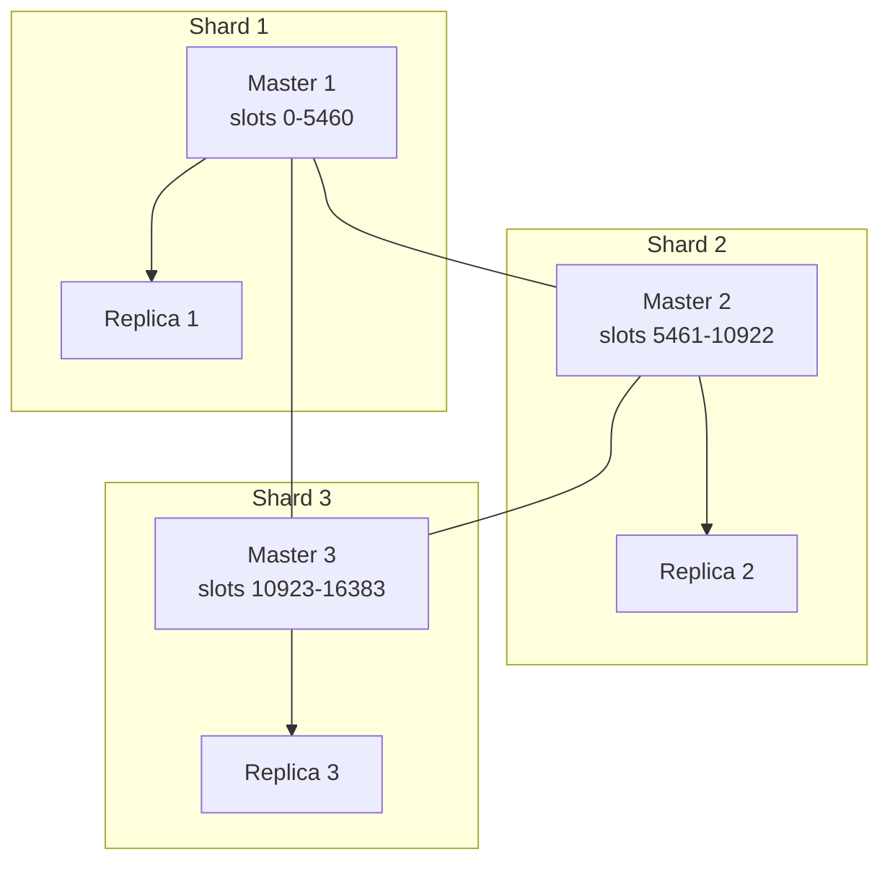

```
   Shard 1                Shard 2                Shard 3
 ┌──────────────┐      ┌──────────────┐      ┌──────────────┐
 │  Master 1    │──────│  Master 2    │──────│  Master 3    │
 │ slots 0-5460 │      │slots 5461-   │      │slots 10923-  │
 │              │      │  10922       │      │  16383       │
 └──────┬───────┘      └──────┬───────┘      └──────┬───────┘
        │ (cluster bus: Master 1 ↔ Master 2 ↔ Master 3 ↔ Master 1)
        ▼                     ▼                     ▼
 ┌──────────────┐      ┌──────────────┐      ┌──────────────┐
 │  Replica 1   │      │  Replica 2   │      │  Replica 3   │
 └──────────────┘      └──────────────┘      └──────────────┘
```

**Маршрутизация.** Для обычного ключа слот вычисляется как `CRC16(key) mod 16384`. При `MOVED` клиент повторяет запрос на указанном узле и обновляет карту слотов. При переносе слота возможен временный ответ `ASK`: клиент отправляет `ASKING` и повторяет конкретный запрос на указанном узле по тому же соединению, сохраняя прежнюю карту до смены владельца. [Спецификация Redis Cluster](https://redis.io/docs/latest/operate/oss_and_stack/reference/cluster-spec/#ask-redirection).

**Hash tags** — для размещения нескольких ключей в одном слоте:

```bash
# Эти ключи попадут в один слот (хэшируется только {order:123})
SET {order:123}:items '["item1","item2"]'
SET {order:123}:total "5000"
SET {order:123}:status "created"

# Создание кластера
redis-cli --cluster create \
  node1:6379 node2:6379 node3:6379 \
  node4:6379 node5:6379 node6:6379 \
  --cluster-replicas 1

# Информация о кластере
redis-cli CLUSTER INFO
redis-cli CLUSTER NODES
redis-cli CLUSTER SLOTS
```

```yaml
# Spring Boot — подключение к Cluster
spring:
  data:
    redis:
      cluster:
        nodes:
          - node1:6379
          - node2:6379
          - node3:6379
      lettuce:
        cluster:
          refresh:
            adaptive: true
            period: 30s
```

**Ограничения Cluster:** multi-key операции (`MGET`, `MSET`, транзакции) работают только если все ключи в одном слоте. `Pub/Sub` сообщения маршрутизируются по всем узлам (sharded pub/sub появился в Redis 7.0).


**Почему перестали работать даже живые слоты.** Когда мастер помечен `FAIL`, а повысить подходящую реплику невозможно, его слоты остаются без доступного владельца. При `cluster-require-full-coverage yes` (по умолчанию) кластер переходит в состояние `fail`. Обычные запросы к ключам на живых мастерах тоже получают `CLUSTERDOWN` при стандартном `cluster-allow-reads-when-down no`. Полный отказ запросов сам по себе ничего не говорит о том, сохранились ли данные упавшего мастера.

В примере с тремя мастерами два оставшихся мастера сохраняют большинство, пока видят друг друга. При `cluster-require-full-coverage no` они могут продолжить обслуживать свои слоты, а запросы в недоступный диапазон будут завершаться ошибкой. Если узел достаточно долго не видит большинства мастеров, отключение проверки полного покрытия не восстановит запись на нём. Реплика на каждом шарде позволяет восстановить покрытие после отказа мастера, если доступна подходящая реплика и есть большинство голосующих мастеров. [Спецификация Redis Cluster](https://redis.io/docs/latest/operate/oss_and_stack/reference/cluster-spec/#availability), [параметры Redis 8.8](https://github.com/redis/redis/blob/8.8/redis.conf).

Для диагностики сопоставьте `CLUSTER INFO` (например, `cluster_state` и `cluster_slots_fail`) с `CLUSTER NODES` на живых узлах. Проверьте, какой мастер помечен `FAIL`, какие диапазоны ему принадлежали и осталась ли у него реплика, способная стать мастером.


## Q22. (!) Карточка товара под Cache-Aside: TTL 30 минут, инвалидация `DEL` после коммита, `Redis` развёрнут одиночным мастером, а чтения базы переведены на асинхронные реплики — после правки цены часть запросов ещё полчаса отдаёт прежнее значение, где здесь разрыв?

Стратегия кэширования отвечает на два вопроса: кто кладёт данные в кэш и кто их туда записывает при изменении. От выбора зависит баланс между согласованностью данных и скоростью. Самая частая в связке с `Redis` — **Cache-Aside**: приложение само проверяет кэш, при промахе читает из БД и кладёт результат обратно. Подробный разбор — в [вопросах по стратегиям кэширования](../architecture/caching-strategies-interview.md).

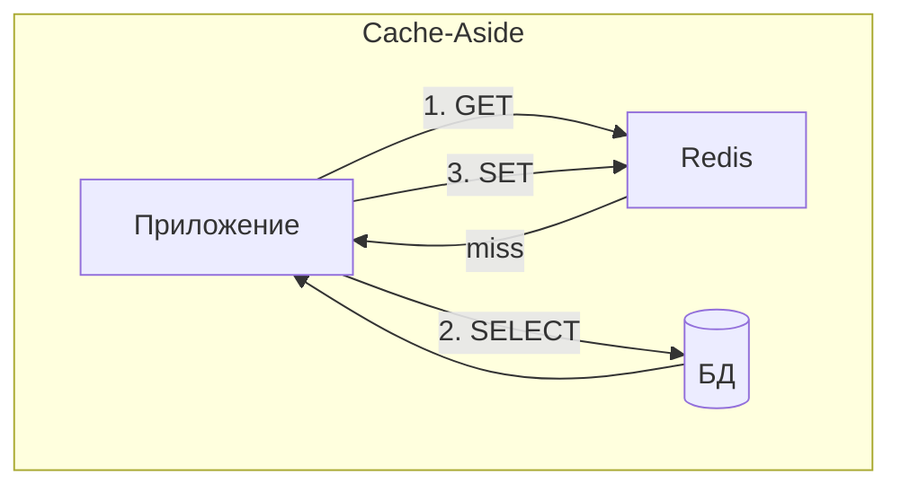

```
 Cache-Aside (при промахе)
                    1. GET
        ┌─────────────────────────▶ ┌─────────┐
        │           miss            │  Redis  │
        │     ◀─────────────────────└─────────┘
 ┌──────────────┐                        ▲
 │  Приложение  │                        │ 3. SET
 └──────────────┘ ──┐                    │
        ▲           │ 2. SELECT          │
        │           ▼                    │
        │     ┌──────────┐               │
        └─────│   (БД)   │───────────────┘
              └──────────┘
              (БД возвращает данные приложению)
```

| Стратегия | Описание | Когда использовать |
|-----------|----------|--------------------|
| **Cache-Aside** | Приложение само управляет кэшем: проверяет, читает из БД при miss, записывает в кэш | Чтение >> записи, допустима кратковременная неконсистентность |
| **Read-Through** | Кэш сам загружает данные из БД при miss | Прозрачный кэш, библиотека управляет загрузкой |
| **Write-Through** | Запись идёт сначала в кэш, кэш записывает в БД | Консистентность важнее скорости записи |
| **Write-Behind** | Запись в кэш, кэш асинхронно сбрасывает в БД | Высокая нагрузка на запись |
| **Write-Around** | Запись идёт напрямую в БД, кэш обновляется при следующем чтении | Данные редко перечитываются после записи |

```java
// Cache-Aside в Spring (ручная реализация)
@Service
public class ProductService {
    @Autowired
    private StringRedisTemplate redis;
    @Autowired
    private ProductRepository repository;
    @Autowired
    private ObjectMapper objectMapper;

    public Product getProduct(Long id) throws JsonProcessingException {
        String key = "cache:product:" + id;
        String cached = redis.opsForValue().get(key);

        if (cached != null) {
            return objectMapper.readValue(cached, Product.class);
        }

        Product product = repository.findById(id)
            .orElseThrow(() -> new NotFoundException("Product not found"));

        redis.opsForValue().set(key, objectMapper.writeValueAsString(product),
            Duration.ofMinutes(30));

        return product;
    }

    // Метод вызывается через Spring-прокси.
    @Transactional
    public void updateProduct(Product product) {
        repository.save(product);
        events.publishEvent(new ProductChanged(product.getId()));
    }

    @Autowired
    private ApplicationEventPublisher events;

    @TransactionalEventListener(phase = TransactionPhase.AFTER_COMMIT)
    public void invalidateProduct(ProductChanged event) {
        redis.delete("cache:product:" + event.id());
    }
}

record ProductChanged(Long id) {}
```


**Где здесь разрыв.** В БД зафиксирована цена версии 42, после чего обработчик удалил ключ. Следующий запрос получает cache miss, читает версию 41 с реплики, которая ещё не применила изменение, и записывает её в Redis с новым TTL в 30 минут. Когда реплика догонит primary, Redis сам об этом не узнает. TTL отсчитывается от последнего заполнения. Если запись снова заполнить из отстающей реплики, устаревшее значение может пережить несколько эпизодов истечения TTL.

- **Источник заполнения.** Для чувствительных к свежести ключей заполняйте кэш с primary либо читайте с реплики только после подтверждения, что она применила нужную запись. Снимок для чтения должен быть получен после достижения этой позиции. Фиксированная задержка перед повторным `DEL` лишь уменьшает окно ошибки, поскольку лаг меняется.
- **Гонка с уже начатым чтением.** Даже чтение с primary не спасает, если запрос получил версию 41 до коммита и выполнил `SET` после `DEL`. Если этот сценарий недопустим, при заполнении проверяйте версию или поколение ключа атомарно. Маркер должен пережить удаление кэшированного значения, иначе устаревший запрос снова увидит пустой ключ.
- **Доставка инвалидации.** В примере `AFTER_COMMIT` исключает вызов `DEL` при откате. Между коммитом и выполнением `DEL` процесс может остановиться. Если инвалидацию нужно доставлять повторно после сбоя, запишите событие в outbox в той же транзакции БД и обрабатывайте его с повторами. Этот механизм закрывает потерю события, а политика заполнения и проверка версии закрывают гонки чтения.

[Redis Cache-Aside](https://redis.io/docs/latest/develop/use-cases/cache-aside/) · [PostgreSQL 19: Read-Your-Writes Consistency](https://www.postgresql.org/docs/19/warm-standby.html) · [Spring: события, привязанные к транзакции](https://docs.spring.io/spring-framework/reference/data-access/transaction/event.html)

## Q23. (!) Горячая витрина живёт в кэше с общим сроком в десять минут, и ровно раз в десять минут база получает несколько тысяч одинаковых запросов за полсекунды, хотя ключ всего один — что происходит?
**В этом кейсе происходит cache stampede.** Когда истекает TTL горячего ключа, несколько запросов почти одновременно видят промах. Пока первый запрос читает БД, остальные запускают такую же загрузку. На графике это всплеск запросов к БД по одному ключу сразу после его истечения. Случайный TTL сдвинет момент всплеска, но сам по себе не объединит эти запросы.

Объединяйте загрузки по ключу. В одном процессе достаточно локального single-flight. Если запросы приходят на разные экземпляры приложения, можно координировать заполнение через краткоживущий ключ Redis. Для одного Redis primary схема выглядит так:

1. При промахе попробуйте `SET lockKey token NX PX leaseMs`, где `token` уникален для каждого захвата. После захвата перечитайте кэш. Другой запрос мог успеть заполнить его между первым `GET` и захватом.
2. Задайте таймаут чтения БД. Ожидающие запросы перечитывают кэш с небольшим случайным интервалом в пределах общего дедлайна. По исчерпании бюджета верните допустимое устаревшее значение или ошибку. Если все ожидающие одновременно пойдут в БД, исходный всплеск повторится.
3. Освобождайте ключ только при совпадении токена. В Redis 8.4+ для этого есть `DELEX lockKey IFEQ token`. На более ранних версиях сравнение и удаление выполняют одним Lua-скриптом.

Если загрузка пережила срок аренды, другой запрос уже может начать свою. Чтобы первый запрос после истечения аренды не перезаписал результат второго, проверяйте владение и записывайте значение одной атомарной операцией в Redis. При Redis Cluster ключ аренды и ключ данных для такого скрипта должны быть в одном слоте. Проверка токена защищает от запоздалого владельца аренды. От записи старой версии после инвалидации нужна проверка версии или поколения ключа, как в Q22.

Когда продукт допускает ограниченную устарелость, можно обновлять горячий ключ до истечения TTL или отдавать последнюю версию во время фонового обновления. Общие варианты разобраны в [стратегиях кэширования](../architecture/caching-strategies-interview.md#q17--что-такое-cache-stampede-thundering-herd-и-как-его-избежать).

**Cache Penetration** — запросы идут по ключам, которых нет *ни в кэше, ни в БД* (часто это перебор несуществующих id ботом). Каждый промах доходит до БД. Короткий TTL для отдельного маркера отсутствия помогает при повторных запросах одного ID. При создании записи этот маркер нужно инвалидировать. Bloom filter может отсеять ID, которых заведомо нет среди внесённых в фильтр, а положительный ответ требует проверки. Разрешайте отсев только при актуальном и полном для этой операции фильтре, иначе новый ID может быть ошибочно отклонён.

```java
// Решение: кэшировать null-значения или использовать Bloom filter
public Product getProductSafe(Long id) {
    String key = "cache:product:" + id;
    String cached = redis.opsForValue().get(key);

    if ("NULL".equals(cached)) return null;  // кэшированный null
    if (cached != null) return deserialize(cached);

    Product product = repository.findById(id).orElse(null);
    if (product == null) {
        redis.opsForValue().set(key, "NULL", Duration.ofMinutes(5)); // короткий TTL
        return null;
    }
    redis.opsForValue().set(key, serialize(product), Duration.ofMinutes(30));
    return product;
}
```

**Cache Avalanche** — в отличие от stampede, тут одновременно истекает TTL у *множества разных* ключей (например, всё прогрели в одну секунду с одинаковым TTL), и БД накрывает волной промахов сразу по всему кэшу. Лечение — **разброс TTL (jitter)**: добавлять к сроку жизни случайную добавку, чтобы ключи протухали вразнобой, а не залпом.

```java
// Решение: рандомизация TTL
private Duration randomTtl(Duration base) {
    long jitter = ThreadLocalRandom.current().nextLong(0, base.toSeconds() / 5);
    return base.plusSeconds(jitter);
}
// TTL от 30:00 до 35:59 включительно
redis.opsForValue().set(key, value, randomTtl(Duration.ofMinutes(30)));
```

Jitter распределяет истечения разных ключей по времени. При общем сбое Redis он бесполезен. Для такого сбоя нужны ограничение параллельных загрузок из БД и политика деградации.

[Redis Cache-Aside](https://redis.io/docs/latest/develop/use-cases/cache-aside/) · [Redis Distributed Locks](https://redis.io/docs/latest/develop/clients/patterns/distributed-locks/) · [Redis Bloom Filter](https://redis.io/docs/latest/develop/data-types/probabilistic/bloom-filter/)

## Q24. Двухуровневый кэш: локальный `Caffeine` на восьми подах и общий `Redis`, инвалидацию рассылают через `Pub/Sub` — после сетевого разрыва один под до конца своего TTL отдаёт устаревшие данные, почему так выходит и чем это закрывают?
**Под пропустил инвалидацию своего L1.** После изменения цены приложение удалило ключ из общего Redis и опубликовало его имя. Семь подключённых подписчиков очистили свои копии в Caffeine. Восьмой под был отключён и продолжил отвечать из памяти. Redis Pub/Sub доставляет сообщения по принципу *at most once*. После повторной подписки под начнёт получать новые сообщения, а пропущенное событие не придёт повторно.

После фиксации записи в БД издатель удаляет ключ из L2 и посылает событие с тем же ключом. Подписчики удаляют запись из **своего** Caffeine. Пример обработчиков, где подписка на канал настраивается отдельно:

```java
void invalidateAfterCommit(String key) {
    redis.delete(key);
    redis.convertAndSend("cache:invalidation", key);
}

void onInvalidation(String key) {
    localCache.invalidate(key);
}
```

- **Ограничить срок жизни L1.** Для горячих ключей используйте `expireAfterWrite`, который отсчитывает время от записи или замены значения. `expireAfterAccess` продлевает жизнь записи при чтениях, поэтому горячий устаревший ключ может сохраняться дольше. Таймер ограничивает жизнь конкретной копии. При заполнении из устаревшего L2 она может появиться снова.
- **Восстановиться после разрыва.** После обнаружения потери подписки временно обходите L1. После подтверждения новой подписки очистите его и только затем возобновите чтение и заполнение. Отключённый или уже начатый загрузчик не должен записать старое значение после сброса. Например, при переподключении можно переключить приложение на новый экземпляр локального кэша, чтобы незавершённые загрузки остались привязаны к старому.
- **Дочитывать пропущенные события, если это необходимо.** Для Redis Streams каждому поду с собственным L1 нужна независимая позиция чтения. Например, можно хранить последний обработанный ID и продолжать с него через `XREAD`. Одна общая consumer group распределяет работу между подами, поэтому часть локальных копий не получит конкретную инвалидацию. Если сохранённая позиция вышла за окно хранения потока, очистите L1 перед возобновлением чтений. Повторное удаление одного ключа безопасно.

Между коммитом БД, удалением из Redis и публикацией остаётся окно отказа. Повторная подписка помогает при разрыве связи с подписчиком. Если событие должно пережить сбой издателя сразу после коммита, запишите его в outbox в транзакции БД и обрабатывайте с повторами. Защита от повторного заполнения устаревшим значением разобрана в Q22.

[Redis Pub/Sub](https://redis.io/docs/latest/develop/pubsub/#delivery-semantics) · [Redis Streams](https://redis.io/docs/latest/develop/data-types/streams/#consumer-groups) · [Caffeine: срок жизни записей](https://github.com/ben-manes/caffeine/wiki/Eviction#time-based)

## Q25. (!) После перехода с `Jedis` на `Lettuce` p99 обычных `GET` вырос с двух до трёхсот миллисекунд, хотя сам `Redis` держит низкую задержку и ровный CPU, а в сервисе работает фоновый потребитель очереди — что происходит на стороне клиента?

**Первый подозреваемый — блокирующее чтение на том же физическом соединении, что и `GET`.** Наличие фонового потребителя само по себе эту причину не доказывает.

Нативное соединение Lettuce потокобезопасно. Несколько вызывающих потоков могут отправить команды в один канал без ожидания ответа на каждую предыдущую команду. Синхронный API ждёт результат в вызывающем потоке, а сетевой ввод-вывод выполняет Netty. Если Redis получил на этом канале `BLPOP`, `BRPOP` или `XREAD BLOCK` и данных пока нет, следующие команды на том же канале ждут завершения блокирующей операции. Например, `GET` за `XREAD BLOCK 300` может ждать почти 300 мс, хотя само чтение ключа дешёвое. Другие соединения продолжают работать, поэтому CPU сервера может оставаться ровным.

| Характеристика | Lettuce | Jedis |
|---------------|---------|-------|
| Типичное использование | Общее нативное соединение для обычных команд | Синхронные команды с заимствованием соединения из пула |
| Блокирующий потребитель | Выделенное соединение на время ожидания | Заимствованное соединение занято до завершения ожидания |
| API | Синхронный, асинхронный и реактивный | Синхронный в типичной конфигурации Spring Data Redis |

**Граница Spring Data Redis.** При стандартном `shareNativeConnection=true` фабрика `LettuceConnectionFactory` разделяет нативное соединение для обычных команд. Для блокирующих и транзакционных операций, которые она обслуживает через `LettuceConnection`, соединение выбирает `LettuceConnectionProvider`. Сама обёртка `LettuceConnection` не потокобезопасна. Если потребитель работает через нативный API или обходит штатную маршрутизацию команд, проверьте, какое физическое соединение он фактически использует.

**Как проверить и исправить.**

1. Под нагрузкой сопоставьте задержку `GET` по соединениям с интервалами блокирующего чтения. Повторите тот же тест с выделенным соединением потребителя. Падение p99 при неизменной нагрузке подтверждает влияние совместного использования канала.
2. Если каналы уже разные, проверьте стеки потоков Netty, сетевые задержки и ожидание получения соединения, когда настроен пул. Блокирующий callback на потоке event loop задерживает обработку ввода-вывода обслуживаемых им каналов. Эту работу выносят на отдельный исполнитель.
3. При подтверждённом общем канале оставьте обычные команды на общем нативном соединении, а потребителю выделите отдельное. Если потребители берут соединения из пула, учтите число одновременных блокирующих чтений. Смена синхронного API на асинхронный на том же канале сохранит очередь за блокирующей командой.

[Асинхронный API Lettuce](https://redis.github.io/lettuce/user-guide/async-api/) · [Диагностика Lettuce](https://redis.github.io/lettuce/faq/) · [Драйверы Spring Data Redis 3.5](https://docs.spring.io/spring-data/data-redis/reference/3.5/redis/drivers.html) · [Метрики команд Lettuce](https://redis.github.io/lettuce/advanced-usage/observability/)


## Q26. (!) Каталог переехал в новый пакет вместе со своими DTO, кэш `Redis` при выкате не чистили — прогретые записи теперь падают при чтении, а записанное после выката читается нормально: в чём причина?

**Проверьте, хранит ли формат кэша имя Java-класса.** Если старая запись содержит `com.example.old.ProductDto`, а на новом classpath есть только `com.example.catalog.ProductDto`, десериализатор может упасть при разрешении старого имени. Запись, сделанная новой версией с тем же форматом, уже ссылается на новый класс. При JSON без идентификатора типа, который читается в явно указанный DTO, одного переноса пакета недостаточно для такого сбоя.

- **Java Serialization.** В Spring Data Redis 3.5 `JdkSerializationRedisSerializer` используется по умолчанию для значений стандартного `RedisCache` и обычного `RedisTemplate`. Сериализованный поток содержит описание класса. Если стандартный механизм загрузки не находит старое имя, возможен `ClassNotFoundException` в цепочке причин.
- **JSON с полиморфными типами.** Jackson может хранить полное имя класса, например с `@JsonTypeInfo(use = JsonTypeInfo.Id.CLASS)`. Имя свойства и форма JSON зависят от конфигурации. Для долгоживущего формата идентификатор подтипа можно задать стабильным логическим именем и сопоставлять его с DTO на стороне приложения.
- **JSON с заданным типом.** Сериализатор, которому задан `ProductDto.class`, может читать объект по его полям без имени Java-класса в записи, если маппер и аннотации не добавляют такие метаданные. Совместимость всё равно зависит от схемы JSON. Десериализация в `Object.class` без данных о типе обычно даст для JSON-объекта `Map`.

**С чего начать диагностику.** Сверьте корневую причину исключения, формат одной старой записи и настройки сериализатора в обоих релизах. Для `@Cacheable` смотрите конфигурацию выбранного `CacheManager`. Настройка `RedisTemplate` применяется к операциям через этот шаблон и сама по себе не меняет формат `RedisCacheManager`. У шаблона отдельно задаются сериализаторы ключей, значений, полей и значений Redis Hash. `StringRedisTemplate` работает со строками, включая готовый JSON, который приложение преобразует отдельно.

**Пример для Spring Data Redis 3.5.** Настройки одного кэша, в котором все значения имеют тип `ProductDto`. Передайте эту конфигурацию в `RedisCacheManager` для соответствующего имени кэша. Метод, использующий этот кэш, должен возвращать ненулевой DTO или исключать `null` через `unless = "#result == null"`.

```java
RedisCacheConfiguration products = RedisCacheConfiguration.defaultCacheConfig()
    .prefixCacheNameWith("v2:")
    .entryTtl(Duration.ofMinutes(30))
    .disableCachingNullValues()
    .serializeValuesWith(RedisSerializationContext.SerializationPair
        .fromSerializer(new Jackson2JsonRedisSerializer<>(ProductDto.class)));
```

В Spring Data Redis 4.x соответствующий сериализатор для Jackson 3 называется `JacksonJsonRedisSerializer`.

При несовместимой смене формата новый префикс даёт каждому релизу свою область во время rolling deploy и упрощает откат. Смена формата на том же ключе может сломать чтение в обе стороны. Для нового префикса учтите холодный старт и нагрузку на БД. Если записи обязаны пережить обновление, нужен проверенный путь чтения или преобразования прежнего формата. Для одноразового кэша старые записи можно оставить до их TTL либо удалить адресно, когда старый релиз больше их не использует.

[Сериализация RedisTemplate](https://docs.spring.io/spring-data/redis/reference/3.5/redis/template.html) · [Spring Data Redis Cache](https://docs.spring.io/spring-data/redis/reference/3.5/redis/redis-cache.html) · [Java ObjectInputStream](https://docs.oracle.com/en/java/javase/25/docs/api/java.base/java/io/ObjectInputStream.html) · [Jackson JsonTypeInfo.Id](https://javadoc.io/static/com.fasterxml.jackson.core/jackson-annotations/2.21/com/fasterxml/jackson/annotation/JsonTypeInfo.Id.html) · [Миграция на Spring Data Redis 4.0](https://docs.spring.io/spring-data/data-redis/reference/upgrading.html)


## Q27. Метод с `@Cacheable` вызывают из соседнего метода того же сервиса: ключ в `Redis` не появляется, база принимает прежний поток запросов, а при обращении снаружи кэш отрабатывает штатно — что здесь происходит?
**В стандартном режиме `proxy` внутренний вызов обходит перехватчик Spring Cache.** Когда внешний код вызывает кэшируемый метод через прокси, Spring проверяет кэш и при попадании возвращает сохранённое значение. При промахе метод читает БД, а Spring сохраняет успешный результат, если условия аннотации это допускают. Когда другой метод целевого объекта вызывает `this.findById(id)`, управление сразу попадает в тело метода. Чтения из кэша и записи в него на этом пути нет. Это верно и для интерфейсного, и для классового прокси.

**Вынесите кэшируемое чтение в отдельный Spring-бин.** Например, фасад зависит от `CachedProductReader` и вызывает его публичный метод через внедрённую ссылку. Для Spring Framework 6.2 и Spring Data Redis 3.5 конфигурация может выглядеть так. Формат для однотипного кэша выбран по принципу из Q26.

```java
@Configuration
@EnableCaching
public class CacheConfig {

    @Bean
    public RedisCacheManager cacheManager(RedisConnectionFactory factory) {
        RedisCacheConfiguration products = RedisCacheConfiguration
            .defaultCacheConfig()
            .entryTtl(Duration.ofHours(1))
            .serializeKeysWith(
                SerializationPair.fromSerializer(new StringRedisSerializer()))
            .serializeValuesWith(
                SerializationPair.fromSerializer(
                    new Jackson2JsonRedisSerializer<>(ProductDto.class)))
            .disableCachingNullValues();

        return RedisCacheManager.builder(factory)
            .withInitialCacheConfigurations(Map.of("products", products))
            .build();
    }
}

@Service
public class CachedProductReader {
    private final ProductRepository repository;

    public CachedProductReader(ProductRepository repository) {
        this.repository = repository;
    }

    @Cacheable(cacheNames = "products")
    public ProductDto findById(Long id) {
        return repository.findById(id)
            .map(ProductDto::from)
            .orElseThrow();
    }
}

@Service
public class ProductService {
    private final CachedProductReader reader;

    public ProductService(CachedProductReader reader) {
        this.reader = reader;
    }

    public ProductDto loadForCatalog(Long id) {
        return reader.findById(id);
    }
}
```

При одном аргументе ключом Spring Cache по умолчанию служит значение `id`. Проверка в Spring-контексте с пустым кэшем: два последовательных вызова `loadForCatalog(42L)` при успешном ответе, без истечения TTL и инвалидации должны дать один вызов репозитория. Когда тест создаёт объекты через `new`, он проверяет обычные вызовы Java.

Та же граница перехвата действует для `@CachePut` и `@CacheEvict`. Первая вызывает метод и обновляет кэш его результатом при выполнении условий записи. Вторая может удалить один ключ или все записи заданного кэша и по умолчанию срабатывает после успешного завершения метода. Если запись в БД и инвалидация должны быть согласованы с commit, см. Q22.

При необходимости сохранить внутренний вызов Spring поддерживает `@EnableCaching(mode = AdviceMode.ASPECTJ)` с модулем `spring-aspects` и weaving при компиляции или загрузке. Тогда перехват встроен в класс. В режиме `proxy` перехват можно получить и через ссылку на собственный прокси, но для этого она должна быть действительно проксированной. Отдельный бин делает эту границу явной.

[Spring Framework 6.2 Cache Annotations](https://docs.spring.io/spring-framework/reference/6.2/integration/cache/annotations.html) · [Spring AOP Proxying](https://docs.spring.io/spring-framework/reference/6.2/core/aop/proxying.html) · [Spring Data Redis 3.5 Cache](https://docs.spring.io/spring-data/redis/reference/3.5/redis/redis-cache.html)


## Q28. Плановый failover в `Redis Cluster` прошёл, сторонние клиенты уже работают, а сервис на Spring Boot ещё несколько минут шлёт команды выбывшему узлу и падает по таймауту соединения — где здесь корень?
**Первый подозреваемый — устаревшая карта слотов в Lettuce.** После смены владельца слота Lettuce может продолжать выбирать прежний узел. Если он доступен и отвечает `MOVED`, клиент может перенаправить конкретную команду даже при выключенном фоновом обновлении. Если по старому адресу соединение не устанавливается, ответ `MOVED` оттуда не придёт. Тогда важны другие способы обновления топологии.

В стандартной автоконфигурации Spring Boot 3.5 адаптивное обновление по умолчанию выключено, а период не задан. `adaptive: true` включает обновление по доступным триггерам Lettuce, в том числе по перенаправлениям и повторным попыткам соединения при достижении порога. Срабатывания ограничены по частоте. `period` включает фоновый опрос даже без подходящего события. `max-redirects` задаёт предел переходов по ответам кластера для команды. Этот параметр не задаёт число повторов при таймауте соединения.

```yaml
# application.yml — Spring Boot 3.5, Redis Cluster
spring:
  data:
    redis:
      cluster:
        nodes: node1:6379,node2:6379,node3:6379
        max-redirects: 3
      lettuce:
        cluster:
          refresh:
            adaptive: true
            period: 30s
```

**Как отличить устаревшую карту от проблемы сети.**

1. Из окружения самого сервиса запросите карту слотов у доступного узла, например через `CLUSTER SHARDS` на Redis 7+. Для ключа, на котором воспроизводится ошибка, сравните текущего владельца слота с адресом из клиентского лога. Если кластер указывает новый узел, а Lettuce продолжает выбирать старый, проверьте, задействованы ли настройки обновления в используемой фабрике. При собственной конфигурации проверьте её `ClusterClientOptions`.
2. Проверьте доступность объявленного адреса и клиентского порта нового владельца из того же pod. Доступ к начальному адресу ещё не означает доступ к адресам, полученным из топологии или перенаправления. Причиной может быть DNS, маршрутизация между сетями, сетевые правила или TLS. `dynamic-refresh-sources=false` ограничивает источники опроса начальными узлами, но клиенту всё равно нужен доступ к фактическим целям команд.
3. На тестовом переключении измерьте время до первой успешной команды и проверьте, что последующие команды идут новому владельцу. Интервал `30s` задаёт частоту опроса. Время восстановления зависит также от доступности источников топологии и таймаутов. Отдельно проверяйте ошибки получения соединения и ожидания ответа на команду.

Этот пример относится к Redis Cluster. В standalone клиент подключается к заданному адресу, а в Sentinel ищет текущий primary по имени через Sentinel. Свойства обновления карты слотов относятся только к Cluster.

[Spring Boot 3.5 Application Properties](https://docs.spring.io/spring-boot/3.5/appendix/application-properties/index.html) · [Lettuce High-Availability and Sharding](https://redis.github.io/lettuce/ha-sharding/) · [Lettuce Client Options](https://redis.github.io/lettuce/advanced-usage/client-options/) · [Redis Cluster Specification](https://redis.io/docs/latest/operate/oss_and_stack/reference/cluster-spec/)


## Q29. (!) Заказ раз в сутки берут в работу два пода сразу, хотя блокировку получают через `SET NX` со сроком жизни и снимают её командой `DEL`, а переключений мастера в эти сутки не было — как так выходит?

Поды могут одновременно выполнять работу, даже если Redis принимал только один захват за раз. TTL ограничивает время владения ключом. Работа приложения может продолжаться после истечения TTL.

1. Под A получает блокировку на 30 секунд и начинает обработку заказа. Из-за паузы JVM или медленного внешнего вызова он не успевает закончить.
2. TTL истекает, и под B успешно захватывает тот же ключ. Если A возобновит работу, A и B смогут обработать один заказ одновременно.
3. Если A завершится и выполнит безусловный `DEL`, он удалит уже блокировку B. Тогда в работу может войти ещё и под C.

Данные для диагностики — время успешного захвата, TTL, идентификатор попытки и время завершения обработки по каждому поду. По ним можно обнаружить выход за срок аренды и запоздалое освобождение.

Распределённая блокировка координирует доступ к общему ресурсу между несколькими инстансами приложения — там, где обычный `synchronized` бесполезен, потому что инстансы это разные JVM. `Redis` подходит для роли единого арбитра: захват лока — это атомарная установка ключа, которую видят все инстансы. Подробнее о распределённых системах — в [вопросах по распределённым системам](../architecture/distributed-systems-interview.md).

**Простая реализация через `SET NX EX`.** Здесь важны обе опции сразу: `NX` означает «создать ключ, только если его ещё нет» (это и есть захват лока, причём атомарный — пока ключ существует, второй захват не пройдёт), а `EX` ставит TTL-страховку: если владелец лока упадёт, не сняв блокировку, она освободится сама и не зависнет навсегда.

```bash
# Захват блокировки (атомарно: SET если не существует + TTL)
SET lock:order:123 "instance-1:uuid" NX EX 30
# OK — блокировка получена
# (nil) — блокировка уже занята

# Освобождение (Lua-скрипт для атомарной проверки владельца)
EVAL "if redis.call('GET',KEYS[1]) == ARGV[1] then return redis.call('DEL',KEYS[1]) else return 0 end" 1 lock:order:123 "instance-1:uuid"
```

```java
// Spring Data Redis — распределённая блокировка
@Service
public class DistributedLockService {
    @Autowired
    private StringRedisTemplate redis;

    private final RedisScript<Long> unlockScript = new DefaultRedisScript<>("""
        if redis.call('GET', KEYS[1]) == ARGV[1] then
            return redis.call('DEL', KEYS[1])
        end
        return 0
        """, Long.class);

    public boolean tryLock(String resource, String owner, Duration ttl) {
        return Boolean.TRUE.equals(
            redis.opsForValue().setIfAbsent(
                "lock:" + resource, owner, ttl));
    }

    public void unlock(String resource, String owner) {
        redis.execute(unlockScript,
            List.of("lock:" + resource), owner);
    }
}

// Использование
String owner = UUID.randomUUID().toString();
if (lockService.tryLock("order:123", owner, Duration.ofSeconds(30))) {
    try {
        // критическая секция
        processOrder(123L);
    } finally {
        lockService.unlock("order:123", owner);
    }
}
```

**Безопасное освобождение.** Для каждого захвата генерируют уникальный токен. Освобождение атомарно сравнивает токен с текущим значением и удаляет ключ при совпадении. Начиная с Redis 8.4 это делает `DELEX lock:order:123 IFEQ <token>`. На более ранних версиях подходит Lua из примера. Две отдельные команды `GET` и `DEL` оставляют окно, в котором ключ может перейти другому владельцу. [Документация DELEX](https://redis.io/docs/latest/commands/delex/)

**Границы гарантии.** Проверка токена защищает аренду B от запоздалого освобождения со стороны A. Даже с этой проверкой A может продолжить обработку после истечения собственной аренды. Продление TTL уменьшает риск, пока владелец успевает продлевать аренду. Для единственного перехода заказа из `NEW` в `PROCESSING` можно атомарно обновлять строку с условием `WHERE id = ? AND status = 'NEW'` и начинать работу только при изменении одной строки. Для внешнего эффекта, например списания, нужна отдельная идемпотентность на стороне получателя с одним ключом на бизнес-операцию.

**Redlock** координирует захват на нескольких независимых узлах Redis с учётом срока аренды. Даже при таком захвате приложение должно учитывать истечение TTL посреди работы. [Документация Redis о распределённых блокировках](https://redis.io/docs/latest/develop/clients/patterns/distributed-locks/)


## Q30. Лимит стоит сто запросов в минуту, счётчик считает верно, но клиент раз в час укладывает двести запросов в две секунды и проходит — почему?

Так происходит на границе фиксированных окон. Если квота ещё свободна, клиент может отправить 100 запросов в 12:59:59 и ещё 100 в 13:00:00. Счётчики покажут по 100 в каждом окне, хотя все 200 запросов пришли за две секунды. Час здесь ничего не меняет. Тот же эффект возможен на любой минутной границе.

**Fixed Window (фиксированное окно)** — простой счётчик с TTL: ключ содержит номер текущего окна, `INCR` считает запросы, при первом запросе ставится TTL для уборки ключа. Границу окна задаёт номер в ключе, поэтому новый счётчик начинает работать даже тогда, когда ключ предыдущего окна ещё существует. Все инстансы должны одинаково вычислять номер окна и использовать согласованные часы. [Redis — шаблон rate limiter](https://redis.io/docs/latest/commands/incr/)

```bash
# Lua-скрипт: атомарный инкремент + установка TTL
EVAL "
  local current = redis.call('INCR', KEYS[1])
  if current == 1 then
    redis.call('EXPIRE', KEYS[1], ARGV[1])
  end
  return current
" 1 ratelimit:user:1001:1712841600 60
```

**Sliding Window Log (журнал скользящего окна).** Для ограничения «до 100 принятых запросов за любые последние 60 секунд» храните время каждого принятого запроса в sorted set. Один Lua-скрипт удаляет записи с отметкой времени до границы включительно, считает оставшиеся и добавляет новую запись только при наличии квоты. Если эти шаги разнести по командам клиента, два параллельных запроса могут увидеть одно свободное место и оба пройти.

```bash
# KEYS[1] — ключ клиента, ARGV[1] — текущее время в мс общего источника,
# ARGV[2] — уникальный идентификатор данной попытки.
EVAL "
  local now = tonumber(ARGV[1])
  redis.call('ZREMRANGEBYSCORE', KEYS[1], '-inf', now - 60000)
  if redis.call('ZCARD', KEYS[1]) >= 100 then
    return 0
  end
  redis.call('ZADD', KEYS[1], now, ARGV[2])
  redis.call('PEXPIRE', KEYS[1], 60000)
  return 1
" 1 ratelimit:log:user:1001 1712841600123 req:uuid1
```

Уникальный идентификатор сохраняет отдельные записи, даже когда время нескольких запросов совпадает. Журнал точнее на границе минут и требует памяти на каждый принятый запрос в окне. Даже точный журнал допускает 100 запросов подряд при пустом окне. Если важна плавность нагрузки, задайте отдельное ограничение на всплеск. Например, у token bucket скорость пополнения задаёт долгосрочный темп, а ёмкость корзины определяет допустимый накопленный всплеск. [Redis — сравнение алгоритмов](https://redis.io/learn/howtos/ratelimiting/)

Пример Spring использует первый скрипт и реализует фиксированное окно.

```java
// Spring — Rate Limiter
@Service
public class RateLimiter {
    @Autowired
    private StringRedisTemplate redis;
    @Autowired
    private RedisScript<Long> rateLimitScript;

    public boolean isAllowed(String userId, int limit, int windowSec) {
        String key = String.format("ratelimit:%s:%d",
            userId, System.currentTimeMillis() / 1000 / windowSec);
        Long count = redis.execute(rateLimitScript,
            List.of(key), String.valueOf(windowSec));
        return count != null && count <= limit;
    }
}
```

## Q31. После переезда сессий в общий кэш пользователей случайным образом разлогинивает среди рабочего дня, хотя срок жизни сессии тридцать минут, а активность у них постоянная — почему?

Когда приложение работает в несколько инстансов за балансировщиком, хранить HTTP-сессию в памяти конкретного инстанса нельзя: следующий запрос может попасть на другой инстанс, который этой сессии не видит. Решений два — либо привязывать клиента к одному инстансу (sticky sessions, хрупко), либо вынести сессии в общее хранилище. `Spring Session` + `Redis` — стандартный способ сделать второе:

```xml
<dependency>
    <groupId>org.springframework.session</groupId>
    <artifactId>spring-session-data-redis</artifactId>
</dependency>
```

Пример для стандартной автоконфигурации Spring Boot 3.5 с Redis в качестве хранилища Spring Session. [Свойства Spring Boot 3.5](https://docs.spring.io/spring-boot/3.5/appendix/application-properties/)

```yaml
spring:
  session:
    timeout: 30m
    redis:
      namespace: spring:session
  data:
    redis:
      host: redis-host
      port: 6379
```

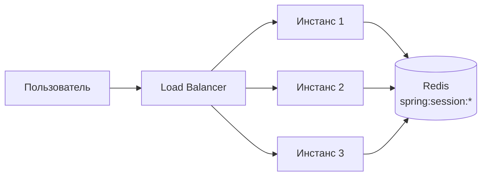

```
                                  ┌─▶ ┌────────────┐ ─┐
 ┌─────────────┐  ┌────────────┐  │   │ Инстанс 1  │  │
 │Пользователь │─▶│   Load     │──┼─▶ │ Инстанс 2  │ ─┼─▶ ┌──────────────────┐
 └─────────────┘  │  Balancer  │  │   │ Инстанс 3  │  │   │      Redis       │
                  └────────────┘  └─▶ └────────────┘ ─┘   │ spring:session:* │
                                                          └──────────────────┘
```

Сессия хранится в `Redis` как `Hash` с ключом `spring:session:sessions:<id>`. Любой инстанс может обслужить любой запрос — sticky sessions не нужны. Подробнее о [Spring Security](../frameworks/spring/spring-security-interview.md).

**Почему активность может не продлевать сессию.** Таймаут считается от последнего доступа к HTTP-сессии. Действия пользователя в интерфейсе, запросы к CDN и вызовы API, которые не обращаются к сессии, могут оставить время последнего доступа прежним. В Servlet-приложении проверьте, что запрос передаёт cookie нужной сессии, проходит через Spring Session и использует эту сессию. В режиме `ON_SAVE` изменения сохраняются при вызове репозитория из фильтра, обычно перед фиксацией ответа или при завершении обработки. Проверьте ошибки записи по всем инстансам. [Spring Session API](https://docs.spring.io/spring-session/reference/api.html)

**Почему ключ может исчезнуть раньше срока.** При достижении `maxmemory` политики `allkeys-*` могут вытеснить любую сессию. Политики `volatile-*` тоже допускают её вытеснение, поскольку у ключа сессии есть TTL. Для сессий можно выделить отдельный инстанс Redis с `noeviction` и запасом памяти. При исчерпании памяти команды, требующие её выделения, могут вернуть ошибку. Другой номер базы или префикс ключей в том же инстансе не изолирует сессии от общей политики вытеснения. [Redis — политики вытеснения](https://redis.io/docs/latest/develop/reference/eviction/)

**Как различить причины.** Сопоставьте проблемный запрос со временем `lastAccessedTime` и динамикой `PTTL` ключа на нужном узле. Если доступ к сессии фиксируется, но изменений в Redis нет, проверьте запись и совпадение namespace и подключения на всех инстансах. Если ключ исчез при положительном TTL, проверьте рост `evicted_keys` и давление на память в этот момент. `expired_keys` и `evicted_keys` — общие счётчики узла, по ним нельзя установить судьбу конкретного ключа. У `RedisIndexedSessionRepository` хеш сессии может сохраняться ещё пять минут после логического истечения для обработки события, поэтому положительный TTL хеша сам по себе не подтверждает действующую сессию. [Spring Session — истечение сессий](https://docs.spring.io/spring-session/docs/current/api/org/springframework/session/data/redis/RedisIndexedSessionRepository.html), [Redis INFO](https://redis.io/docs/latest/commands/info/)


## Q32. Воркер берёт задачу из списка через `BRPOP`, и при аварийном перезапуске пода одна-две задачи пропадают бесследно, хотя сам `Redis` не перезапускался и память не переполнялась — почему?

`BRPOP` одновременно возвращает и удаляет элемент из списка. Если воркер аварийно завершится после удаления, но до завершения обработки, следующий воркер уже не увидит задачу. Redis может всё это время работать штатно. У списка с `BRPOP` нет отдельного подтверждения и автоматической повторной доставки.

```bash
LPUSH queue:tasks '{"id":"task-123","type":"email"}'
BRPOP queue:tasks 30
```

**Список с учётом задач в работе.** Начиная с Redis 6.2, `BLMOVE` может атомарно забрать задачу из очереди и переместить её в список обработки. После успешного выполнения воркер удаляет запись из списка обработки. Приложение должно отслеживать срок обработки и возвращать зависшие задачи в исходную очередь. Используйте уникальный ID задачи, чтобы подтверждение не удалило другую запись с тем же содержимым. В Redis Cluster оба ключа операции должны быть в одном слоте. [Документация Redis о надёжной очереди на списках](https://redis.io/docs/latest/commands/lmove/)

```bash
BLMOVE queue:{tasks}:ready queue:{tasks}:processing RIGHT LEFT 30
# Только после успешного выполнения. Значение берём из ответа BLMOVE.
LREM queue:{tasks}:processing 1 '{"id":"task-123","type":"email"}'
```

**Streams с группой потребителей.** Чтение через `XREADGROUP` без `NOACK` регистрирует выдачу в Pending Entries List (PEL). `XACK` удаляет запись из PEL после успешной обработки. Само сообщение остаётся в потоке до удаления или обрезки. Другой воркер может забрать оставшиеся без подтверждения записи через `XAUTOCLAIM` (Redis 6.2+) или `XPENDING` и `XCLAIM`. `XREADGROUP ... >` сам по себе читает новые записи группы: для просроченных нужен отдельный цикл восстановления. [Документация Redis о XAUTOCLAIM](https://redis.io/docs/latest/commands/xautoclaim/)

```bash
XGROUP CREATE stream:tasks workers 0 MKSTREAM
XADD stream:tasks '*' id task-123 type email
XREADGROUP GROUP workers worker-1 COUNT 1 BLOCK 5000 STREAMS stream:tasks '>'
# Подтверждение после успешной обработки, ID берём из XREADGROUP или XAUTOCLAIM.
# XACK stream:tasks workers <stream-entry-id>

# Воркер восстановления забирает задачи без подтверждения с простоявшей выдачей.
# 60000 мс — пример порога. Продолжайте обход с курсора из ответа.
XAUTOCLAIM stream:tasks workers worker-2 60000 0-0 COUNT 10
```

**Границы гарантий.** Streams дают повторную доставку при сбое воркера, если записи сохранены, их не обрезали до обработки и приложение забирает просроченные выдачи. Настройки персистентности и репликации отдельно определяют, какие данные переживут сбой самого Redis. Если воркер выполнил внешний эффект и упал перед `XACK`, другой воркер может выполнить задачу повторно. Слишком короткий порог восстановления также допускает одновременную обработку медленным и новым воркером. Защитите внешний эффект идемпотентностью по стабильному ID задачи.

`Pub/Sub` подходит для рассылки подключённым подписчикам. При разрыве соединения событие можно пропустить, и механизма повторной выдачи нет. Для журнала с собственной моделью хранения и чтения см. [Kafka](../messaging/kafka-interview.md).


## Q33. (!) Ночная заливка каталога уходит одним `Pipeline` на сотни тысяч команд, и на это время p99 у всех соседних сервисов растёт до секунд, хотя `SLOWLOG` при этом пуст — в чём причина?

При массовой загрузке множество быстрых команд конкурирует с запросами соседних сервисов за время исполнения на одном Redis. Клиентский p99 включает ожидание и сетевой обмен. `SLOWLOG` записывает время исполнения каждой команды, превысившей порог, без ожидания в очереди и клиентского I/O. Поэтому пустой журнал совместим с высоким p99. Сначала проверьте, что журнал включён и его порог подходит для расследования. [Документация SLOWLOG](https://redis.io/docs/latest/commands/slowlog/)

`Pipeline` позволяет отправлять следующие команды, пока ответы на предыдущие ещё в пути. Это сокращает последовательные ожидания RTT и часто уменьшает число системных вызовов. Размер сетевых записей и время получения пачки зависят от объёма данных и реализации клиента. [Документация Redis о pipelining](https://redis.io/docs/latest/develop/using-commands/pipelining/)

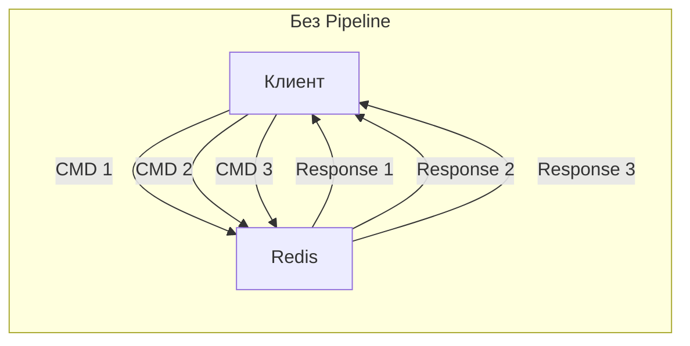

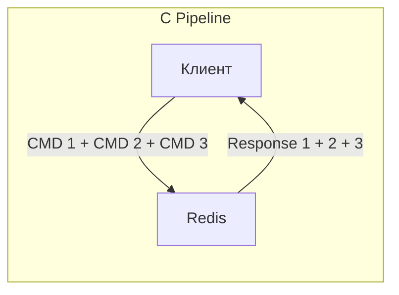

```
 С Pipeline (без ожидания каждого ответа)
 ┌────────┐  CMD 1 + CMD 2 + CMD 3  ┌───────┐
 │ Клиент │ ──────────────────────▶ │ Redis │
 │        │ ◀────────────────────── │       │
 └────────┘  Response 1 + 2 + 3     └───────┘
```

```java
// Spring Data Redis — Pipeline
List<Object> results = redisTemplate.executePipelined(
    (RedisCallback<Object>) connection -> {
        StringRedisConnection conn = (StringRedisConnection) connection;
        for (int i = 0; i < 1000; i++) {
            conn.set("key:" + i, "value:" + i);
        }
        return null; // результат через список
    }
);

// Чтение одной заранее ограниченной порции ключей
List<Object> values = redisTemplate.executePipelined(
    (RedisCallback<Object>) connection -> {
        StringRedisConnection conn = (StringRedisConnection) connection;
        for (String key : keys) {
            conn.get(key);
        }
        return null;
    }
);
```

**Что происходит на сервере.** Команды pipeline выполняются по отдельности, без атомарности всей пачки. Redis может обработать подряд много команд из входного буфера одного клиента. Чем больше очередь работы на том же узле, тем дольше могут ждать короткие запросы других клиентов. Если загрузчик медленно читает ответы, они также могут накапливаться в его выходном буфере на сервере. В приведённом примере Spring `executePipelined` возвращает результаты списком, поэтому на стороне приложения память тоже зависит от размера порции и ответов.

**Как проверить и снизить влияние.** Сопоставьте время загрузки с p99 Redis-вызовов у соседей, CPU узла, количеством команд в секунду и размером выходного буфера загрузчика (`CLIENT LIST`, поле `omem`). Сравните одинаковые загрузки с крупными и меньшими пачками, контролируя объём данных и число параллельных клиентов. Ограничьте порцию по числу команд и ожидаемому объёму данных. Читайте ответы перед отправкой следующей порции и ограничивайте скорость загрузки по p99 соседей. `redis-cli --pipe` помогает быстрее отправить данные и читать ответы, но сам по себе не изолирует ресурсы загружаемого узла. [CLIENT LIST](https://redis.io/docs/latest/commands/client-list/), [Redis bulk loading](https://redis.io/docs/latest/develop/use/patterns/bulk-loading/)


## Q34. Массовое удаление ключей увело `used_memory` с 60 до 40 ГБ, а процесс по `RSS` как занимал 60 ГБ, так и занимает третьи сутки подряд, персистентность при этом выключена — что здесь происходит?

Удаление освободило около 20 ГБ по учёту Redis, но страницы процесса остались резидентными. Redis отдаёт освобождённые блоки аллокатору. Часть блоков лежит на страницах, где остаются живые объекты. Их можно переиспользовать для подходящих аллокаций, а вернуть такую страницу целиком ОС пока нельзя. Другие страницы уже не заняты объектами, но аллокатор может ещё держать их в памяти. Отключение RDB и AOF не меняет этот механизм.

```bash
redis-cli INFO memory
redis-cli MEMORY STATS
```

В примере `mem_fragmentation_ratio` составляет около 1,5. Это отношение RSS процесса к `used_memory`, поэтому по нему одному нельзя назвать причину всех 20 ГБ. В `INFO memory` проверьте, где образовалась разница.

| Разница | Что показывает |
|---|---|
| `allocator_frag_bytes` = `allocator_active - allocator_allocated` | Неиспользуемое место на активных страницах аллокатора. Рост после удаления указывает на внешнюю фрагментацию. |
| `allocator_rss_bytes` = `allocator_resident - allocator_active` | Резидентная память аллокатора сверх активных страниц. Здесь могут быть освобождённые страницы, которые ещё можно вернуть ОС. |
| `rss_overhead_bytes` = `used_memory_rss - allocator_resident` | Разница за пределами учёта аллокатора, включая код, библиотеки и стеки процесса. |

Если основная разница в `allocator_frag_bytes`, Redis в сборке со встроенным jemalloc может постепенно перемещать живые объекты при `activedefrag yes`. Эффект зависит от распределения объектов и настроек. Сравнивайте фрагментацию, CPU и задержки под нагрузкой. Если разница преимущественно в `allocator_rss_bytes`, `MEMORY PURGE` просит jemalloc вернуть доступные страницы ОС. Команда может выполняться долго и не перемещает живые объекты.

Сравните метрики до и после удаления и при следующем росте набора. Если `used_memory` растёт, а RSS остаётся близок к прежнему уровню, это согласуется с переиспользованием памяти. Три дня высокого RSS сами по себе не доказывают утечку. Перезапуск прекращает удержание страниц старым процессом, но без персистентности нужно заранее понимать, откуда восстановится набор данных.

Снижение объёма самих данных — отдельная задача. Размер ключа можно оценить через `MEMORY USAGE`. Для небольших хешей современные версии Redis могут использовать компактный listpack. Настройка `maxmemory` ограничивает память по правилам вытеснения Redis и не задаёт жёсткого потолка RSS.

Источники: [INFO memory](https://redis.io/docs/latest/commands/info/#memory), [MEMORY STATS](https://redis.io/docs/latest/commands/memory-stats/), [MEMORY PURGE](https://redis.io/docs/latest/commands/memory-purge/), [оптимизация памяти](https://redis.io/docs/latest/operate/oss_and_stack/management/optimization/memory-optimization/), [redis.conf 8.8](https://github.com/redis/redis/blob/8.8/redis.conf).

## Q35. (!) После рефакторинга сервис обновляет карточку товара обычной командой `SET`, и через сутки в кэше копятся бессрочные ключи, хотя при создании записи срок жизни по-прежнему выставляется — в чём здесь причина?

Успешный `SET key value` заменяет значение и сбрасывает прежний срок жизни. Поэтому ключ, созданный с `EX 1800`, после обычного `SET` остаётся в кэше без срока действия. `TTL` вернёт `-1` для существующего бессрочного ключа и `-2` для отсутствующего.

```text
SET product:42 v1 EX 1800
TTL product:42
# Оставшиеся секунды
SET product:42 v2
TTL product:42
# -1
```

Команду обновления выбирают по контракту кэша.

- **Сохранить исходное время истечения.** `SET product:42 v2 XX KEEPTTL` (Redis 6.0+) обновляет существующий ключ и сохраняет его текущий срок. Если ключ уже истёк, `XX` отклонит запись. Без `XX` команда создаст отсутствующий ключ без TTL. Если существующий ключ уже бессрочный, `KEEPTTL` оставит его бессрочным.
- **Отсчитывать срок заново от каждой записи.** `SET product:42 v2 EX 1800` устанавливает значение и новый срок одной командой. Если обновлять можно только существующие ключи, добавьте `XX`.

Раздельные `SET` и `EXPIRE` оставляют окно, в котором запись уже прошла, а срок ещё не задан. При сбое клиента в этом окне ключ может остаться бессрочным. Если такие ключи уже накопились, одной замены на `KEEPTTL` недостаточно. Для них нужен новый срок или удаление с последующим заполнением кэша по штатному пути.

Источники: [SET](https://redis.io/docs/latest/commands/set/), [TTL](https://redis.io/docs/latest/commands/ttl/), [EXPIRE](https://redis.io/docs/latest/commands/expire/).

## Q36. На мастере включили `requirepass`, клиентов перенастроили, и репликация встала: реплики бесконечно пытаются синхронизироваться и получают отказ, хотя пароль в конфигурации везде один и тот же — что упустили?

Реплика сама подключается к основному узлу. `requirepass` на реплике задаёт пароль для входящих подключений к ней. Для исходящего подключения реплике нужен `masterauth` с паролем основного узла. Одинаковый `requirepass` на обоих узлах эту настройку не заменяет.

**Если основной узел использует `requirepass`.** На каждой реплике в конфигурации задают `masterauth <пароль основного узла>`. В Redis 6+ `requirepass` задаёт пароль пользователя `default` для совместимости. Если ранее был настроен `masteruser`, проверьте, под каким пользователем реплика теперь пытается войти.

**Если используется отдельный ACL-пользователь (Redis 6+).** На основном узле создают выделенного пользователя репликации. Для протокола ему нужны `PING`, `REPLCONF` и `PSYNC`. Правила доступа к ключам для этого соединения не требуются. На реплике указывают имя пользователя в `masteruser` и его пароль в `masterauth`.

```text
# Правило пользователя в конфигурации ACL основного узла
user replica-user on >REPLACE_WITH_REPLICATION_SECRET +ping +replconf +psync

# Конфигурация реплики
masteruser replica-user
masterauth REPLACE_WITH_REPLICATION_SECRET
```

Заглушку в примере заменяет секрет, подставляемый системой развёртывания. Если реплика подключается к TLS-порту, для этого соединения требуется `tls-replication yes` и подходящая конфигурация TLS. Пароль и TLS решают разные задачи.

Чтобы подтвердить причину, посмотрите журнал реплики и `INFO replication`. `NOAUTH` указывает на отсутствие аутентификации. Ошибка `WRONGPASS` требует проверить имя, пароль и состояние ACL-пользователя. При `NOPERM` проверьте разрешение на отклонённую команду. После исправления ожидайте `master_link_status:up` и убедитесь, что синхронизация завершилась. Для проверки потока данных можно записать тестовый ключ на основном узле и дождаться его появления на реплике.

Источники: [аутентификация реплики](https://redis.io/docs/latest/operate/oss_and_stack/management/replication/#setting-a-replica-to-authenticate-to-a-master), [ACL для реплик](https://redis.io/docs/latest/operate/oss_and_stack/management/security/acl/#acl-rules-for-sentinel-and-replicas), [redis.conf 8.8](https://github.com/redis/redis/blob/8.8/redis.conf), [INFO](https://redis.io/docs/latest/commands/info/).

## Q37. На дашборде доля попаданий в кэш держится на 96 % и почти не шевелится, хотя база последний час принимает вал запросов именно из-за промахов — почему метрика этого не показывает?

Доля попаданий отвечает на вопрос, какая часть обращений нашла ключ. Если нагрузка выросла с 10 000 до 100 000 обращений в секунду, при тех же 96 % попаданий поток промахов растёт с 400 до 4 000 в секунду. Если каждый промах запускает чтение из базы, она получает в десять раз больше таких запросов.

Начни с запроса панели. `INFO stats` отдаёт накопительные счётчики `keyspace_hits` и `keyspace_misses` для поисков ключей в экземпляре Redis. Отношение сырых значений смешивает свежий трафик с историей до последнего сброса статистики. Длинное окно тоже сглаживает короткие всплески. При пересчёте на недавнее окно процент всё равно может остаться прежним, если скорость попаданий и промахов выросла пропорционально.

В Prometheus рассчитай `rate(...[5m])` для каждой серии попаданий и промахов отдельно. Так Prometheus учитывает наблюдаемые сбросы счётчиков до того, как скорости суммируются по узлам. Для общей доли раздели сумму скоростей попаданий на сумму скоростей попаданий и промахов за то же окно. Среднее процентов узлов даст одинаковый вес узлам с разным трафиком. Если обращений за окно не было, оставь долю неопределённой. Для оценки количества промахов за час используй `increase(...[1h])` для каждой серии и затем сложи результаты.

Рядом с долей покажи **промахи в секунду** по узлам и частоту **запросов к БД по причине промаха** по сервисам. Общий процент может скрыть ухудшение на одном шарде или в одном сценарии. Счётчики Redis описывают поиски ключей на сервере. Сервису нужна своя метрика, чтобы отличить промах от ошибки Redis и увидеть, сколько чтений БД произошло после объединения параллельных запросов или повторных попыток.

См. [Redis INFO](https://redis.io/docs/latest/commands/info/), [Prometheus — функции rate и increase](https://prometheus.io/docs/prometheus/latest/querying/functions/) и [метрики и трейсинг](../monitoring/metrics-tracing-interview.md).

## Q38. (!) Чистый кэш строк объёмом 200 ГБ на 32-ядерных узлах, 1,2 млн `GET` в секунду, значения до 8 КБ, ни персистентность, ни структуры данных не нужны — что здесь выбрать и чем за выбор платят?

**Memcached — первый кандидат на нагрузочный тест**, если данные можно восстановить, а источник выдержит всплеск промахов при потере узла. Его рабочие потоки обрабатывают клиентские соединения параллельно. Узлы хранят независимые части кэша, а ключ к узлу направляет клиент или прокси. При отказе сервера часть ключей придётся загрузить заново. Цена простой схемы — управление маршрутизацией, прогревом и нагрузкой на источник при изменении состава узлов. [Memcached — архитектура](https://docs.memcached.org/) · [Memcached — рабочие потоки](https://docs.memcached.org/serverguide/configuring/#threading)

**Redis Cluster с репликами** стоит проверить, если холодный шард создаёт неприемлемую нагрузку на базу. Кластер распределяет ключи по слотам, а при выполнении условий failover может повысить реплику до primary. Это требует памяти под копии и клиента с поддержкой кластерной маршрутизации. Репликация асинхронна, поэтому новый primary может не содержать часть недавних изменений. Сравнивать нужно стоимость всей конфигурации с учётом поведения при отказе. [Спецификация Redis Cluster](https://redis.io/docs/latest/operate/oss_and_stack/reference/cluster-spec/)

1. **Сеть.** При почти 100 % попаданий и среднем ответе в 1 КиБ полезные данные займут около 9,8 Гбит/с суммарно. Если бы каждый ответ содержал 8 КиБ, получилось бы около 78,6 Гбит/с до накладных расходов протокола. Значения «до 8 КБ» недостаточно для оценки. Нужны средний размер возвращаемого значения, доля попаданий и распределение запросов между узлами.
2. **Память.** Если 200 ГБ — объём значений, прибавь ключи, метаданные, потери при выделении памяти и запас под пиковое заполнение. В Memcached остаток места внутри элемента выделенного размера зависит от его slab-класса. Измерь RSS и вытеснения на реальном распределении размеров, включая долю мелких объектов. Для Redis Cluster с репликами учти память каждой копии. [Memcached — выделение памяти](https://docs.memcached.org/serverguide/performance/#how-memory-gets-allocated-for-items)
3. **Нагрузка и отказ.** На одинаковом железе воспроизведи размеры и популярность ключей, TTL, записи для пополнения кэша и клиентские настройки. Сравни достигнутый throughput при целевом p99, память и загрузку CPU и сети. Повтори тест с потерей одного узла и измерь таймауты, промахи и нагрузку на БД во время восстановления. Для прогрева полезны ограничение параллельных чтений из БД и объединение одновременных загрузок одного ключа. [Redis — условия нагрузочного теста](https://redis.io/docs/latest/operate/oss_and_stack/management/optimization/benchmarks/)

Количество узлов определяет самая жёсткая граница из памяти, сети, целевой задержки и допустимой нагрузки на БД при отказе. Число ядер — один из входов для замера.

## Q39. (!) После переезда с одиночного `Redis` на кластер часть чтений падает с `CROSSSLOT`, хотя все ключи относятся к одному пользователю и раньше забирались единственным `MGET` — как это чинят?

**Одна серверная команда `MGET` в Redis Cluster требует, чтобы все ключи были в одном слоте.** Даже два разных слота на одном primary дают `CROSSSLOT`. Redis отображает ключи в 16 384 слота по формуле `CRC16(ключ) mod 16384`. При переносе слота меняется его владелец, а номер слота ключа сохраняется.

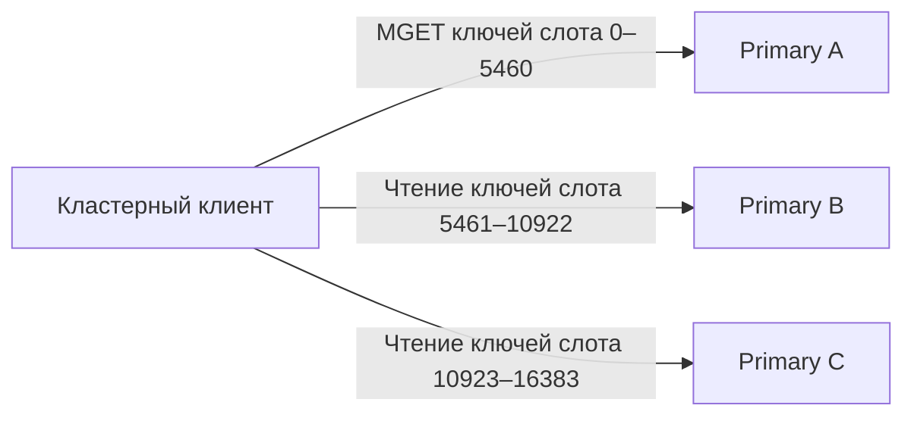

Если поля читаются вместе и нужна атомарность одной команды, используй **hash tag на пользователя**. При наличии непустого фрагмента между первой открывающей фигурной скобкой и первой закрывающей после неё Redis хеширует этот фрагмент. Иначе хешируется весь ключ.

```redis
CLUSTER KEYSLOT user:{42}:profile
CLUSTER KEYSLOT user:{42}:settings
MGET user:{42}:profile user:{42}:settings
```

Оба вызова `CLUSTER KEYSLOT` вернут один номер. Новый шаблон следует согласованно внедрить во всех читающих и пишущих клиентах. Для восстанавливаемого кэша можно заполнять новые ключи из источника по мере промахов и дать старым истечь. Ключи с общим тегом сосредоточены на одном слоте, поэтому тег на крупного арендатора может создать горячий шард.

Если чтения независимы и ключи требуется сохранить в разных слотах, сгруппируй их **по слотам** и параллельно отправь по `MGET` для каждой группы. Некоторые клиенты делают такое разбиение сами. При объединении результатов восстанови исходный порядок и обработай ошибки отдельных групп отдельно от отсутствующих ключей. У набора команд нет общей атомарности. Если поля образуют единый объект, ещё один вариант — хранить их в одном hash и читать через `HMGET`.

`MOVED` сообщает, куда перенаправить команду для слота. При переносе слота `ASK` указывает на временный маршрут для команды. Если ключи одного слота во время переноса оказались на разных узлах, многоключевая команда может получить `TRYAGAIN`. Кластерный клиент может повторить такое чтение в пределах бюджета запроса. Для `CROSSSLOT` нужно изменить ключи или разбиение запроса.

См. [спецификацию Redis Cluster](https://redis.io/docs/latest/operate/oss_and_stack/reference/cluster-spec/), [CLUSTER KEYSLOT](https://redis.io/docs/latest/commands/cluster-keyslot/) и [MGET](https://redis.io/docs/latest/commands/mget/).

## Q40. (!) Уникальных посетителей за сутки считают через `SADD` и `SCARD`: 90 млн идентификаторов-UUID занимают около 6 ГБ, а продукт просит ещё и недельный охват — как перестроить счётчик и что при этом теряется?
**Если продукту нужна оценка охвата, храните один HyperLogLog (HLL) на день.** Redis обновляет статистику по хешам идентификаторов. Повторный UUID не добавляет нового участника. Представление одного HLL занимает до примерно 12 КиБ без учёта накладных расходов Redis, а разреженное представление может быть меньше. Стандартная ошибка оценки составляет около 0,81%. Это характеристика разброса, а не гарантированная граница ошибки отдельного результата.

```bash
PFADD reach:{site}:2026-11-16 user:1 user:2
PFADD reach:{site}:2026-11-17 user:1 user:3
PFCOUNT reach:{site}:2026-11-16
PFCOUNT reach:{site}:2026-11-16 reach:{site}:2026-11-17 reach:{site}:2026-11-18 reach:{site}:2026-11-19 reach:{site}:2026-11-20 reach:{site}:2026-11-21 reach:{site}:2026-11-22
```

Последняя команда оценивает мощность объединения семи дневных множеств. Пользователь, который пришёл в оба дня, учитывается в объединении один раз. Сумма суточных оценок посчитала бы его дважды. Если объединённый HLL нужен для повторного использования, его можно записать через `PFMERGE`. Содержимое существующего ключа назначения тоже участвует в слиянии. Для скользящего окна используйте многоключевой `PFCOUNT` или новое назначение, чтобы истёкший день не остался в результате. В Redis Cluster все ключи такой команды должны попасть в один слот. Здесь это задаёт общий hash tag `{site}`, поэтому нагрузка одного сайта на эти счётчики приходится на один шард.

Границы суток определяют в часовом поясе отчёта, а события относят к дню по времени посещения. Срок хранения дневных ключей должен покрывать окно расчёта, допустимое опоздание событий и период, за который продукт пересчитывает отчёт. Redis считает отсутствующий ключ пустым HLL. Если дневной ключ потерян или удалён раньше срока, недельная оценка может оказаться заниженной без ошибки команды.

**Что теряется.** Из HLL нельзя получить список UUID, проверить принадлежность конкретного пользователя или удалить его вклад. Если нужна точная сверка, сохраняйте исходные события или точные множества. Bitmap даёт точный подсчёт при стабильном отображении идентификаторов в целые позиции. Память зависит от наибольшей позиции, поэтому разреженные UUID нельзя напрямую использовать как индексы битов.

[HyperLogLog в Redis](https://redis.io/docs/latest/develop/data-types/probabilistic/hyperloglogs/) · [PFCOUNT](https://redis.io/docs/latest/commands/pfcount/) · [PFMERGE](https://redis.io/docs/latest/commands/pfmerge/)

## Q41. Перед походом в базу запросы отсекают фильтром `RedisBloom`, но после удаления товара из каталога фильтр продолжает пропускать запросы по нему, а вычесть элемент нечем — что здесь делают?

**Удаляйте товар в каталоге, а фильтр Блума периодически пересобирайте.** Его биты могут быть общими у нескольких товаров. Если очистить биты удалённого товара, фильтр может перестать пропускать запросы по другим товарам. Пока фильтр содержит след удалённого ID, запрос доходит до БД, где отсутствие строки даёт 404. Это лишнее чтение, а достоверность ответа определяет каталог.

```bash
BF.RESERVE catalog:filter:v2 0.01 1000000
BF.MADD catalog:filter:v2 product:123 product:456
BF.EXISTS catalog:filter:v2 product:123
```

`BF.EXISTS=1` означает возможное присутствие. Даже после пересборки удалённый ID может попасть в эту ветку из-за совпадения битов. `BF.EXISTS=0` означает, что ID отсутствует в наборе, представленном фильтром. Возвращать 404 по этому сигналу безопасно, только если фильтр покрывает все видимые записи каталога.

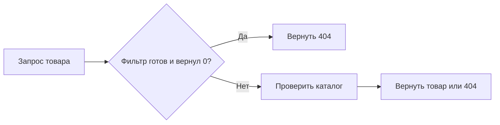

**Пересборка без пропуска новых товаров.** Создайте новый ключ по согласованному снимку каталога и добавьте ID, опубликованные после точки снимка. Перед переключением читателей согласуйте обработку текущих вставок так, чтобы ни одна видимая запись не осталась только в старом фильтре. Если запись в фильтр запаздывает, ключ потерян или сборка ещё идёт, проверяйте отрицательный результат по каталогу. Отдельно инвалидируйте кеш карточек при удалении товара.

**Если удалений много.** Cuckoo-фильтр поддерживает `CF.DEL`. Вызывайте его только для подтверждённой вставки в этот экземпляр фильтра. Положительный `CF.EXISTS` сам по себе не подтверждает вставку: удаление по совпавшему отпечатку может дать ложное отрицание для другого товара. Одна команда удаляет одну вставку, поэтому повторы событий добавления и удаления требуют учёта. Если нужен точный ответ о членстве, подойдёт синхронизированное множество с `SADD`, `SREM` и `SISMEMBER`, ценой хранения самих ID.

[Фильтр Блума в Redis](https://redis.io/docs/latest/develop/data-types/probabilistic/bloom-filter/) · [CF.DEL](https://redis.io/docs/latest/commands/cf.del/)

## Q42. Ночная чистка ищет ключи по маске прямо на боевом инстансе, и во время её работы p99 всех сервисов уходит в секунды, а в журнале медленных запросов лежит одна команда — что здесь меняют?

**Замените `KEYS` на курсорный обход `SCAN` и ограничьте скорость удаления.** Для обычной маски `KEYS` просматривает пространство ключей за одну команду. Пока основной поток выполняет эту команду, другие запросы ждут. `SLOWLOG` измеряет время выполнения команды на сервере. Чтобы связать запись с ростом клиентского p99, сопоставьте её время с метриками сервиса.

```bash
SCAN 0 MATCH cache:catalog:v17:* COUNT 200
```

Начните с курсора `0`, затем передавайте полученный курсор в следующий вызов. Обход завершён, когда Redis снова вернул `0`, даже если до этого были пустые порции. `COUNT 200` задаёт ориентир по объёму работы, размер ответа может отличаться. `MATCH` фильтрует найденные имена, поэтому редкие совпадения сами по себе не делают полный обход дешёвым. Преимущество `SCAN` в том, что между вызовами Redis может обслуживать другие команды.

**Удаляйте только выведенное из обращения поколение ключей.** В примере приложение уже пишет в `v18`, а `v17` больше не создаётся. Удаляйте найденные ключи небольшими порциями через `UNLINK`: ключ исчезает из пространства имён сразу, а дорогое освобождение памяти переносится в фон. `SCAN` может вернуть ключ повторно, а для ключей, появившихся или исчезнувших во время обхода, результат не гарантирован. Повтор `UNLINK` безопасен для уже отсутствующего ключа. Если то же имя может получить новое значение, между поиском и удалением можно потерять свежую запись. Ограничивайте размер порций и темп по p99 и нагрузке на узел.

В Redis Cluster обход с произвольной маской ведут по primary-узлам с отдельным курсором на узел. При изменении топологии повторно проверяют охват. Для многоключевого `UNLINK` группируйте ключи по слоту или отправляйте одноключевые команды ограниченным конвейером. Начиная с Redis 8.0 подходящая маска с фиксированным hash tag может сузить обход до одного слота на его владельце.

Если ключи можно сразу создавать с TTL, устаревшее поколение может исчезнуть без отдельного обхода. Для больших коллекций действует похожий принцип дробления работы: `HSCAN` для hash, `SSCAN` для set, `ZSCAN` для sorted set. У списка своего `SCAN` нет. Небольшие диапазоны `LRANGE` ограничивают размер ответа, но глубокое смещение и изменения списка во время чтения нужно учитывать отдельно.

[KEYS](https://redis.io/docs/latest/commands/keys/) · [SCAN](https://redis.io/docs/latest/commands/scan/) · [UNLINK](https://redis.io/docs/latest/commands/unlink/) · [SLOWLOG GET](https://redis.io/docs/latest/commands/slowlog-get/) · [Redis Cluster](https://redis.io/docs/latest/operate/oss_and_stack/reference/cluster-spec/)

## Q43. После включения третьей версии протокола разбор ответа `HGETALL` в клиенте начал падать на приведении типа, хотя ни команда, ни данные в ключе при этом не менялись — что произошло?

**Изменился тип ответа в протоколе.** В RESP2 `HGETALL` возвращает плоский массив с чередующимися именами полей и значениями. В RESP3 та же команда возвращает map «поле → значение». Если низкоуровневый клиент декодирует эту карту в объект словаря, старое приведение к списку завершится ошибкой.

Например, для хеша с единственным полем `name` и значением `Ada` ответ выглядит так. Здесь `\r\n` обозначает два байта-разделителя CRLF.

```text
RESP2: *2\r\n$4\r\nname\r\n$3\r\nAda\r\n
RESP3: %1\r\n$4\r\nname\r\n$3\r\nAda\r\n
```

В RESP2 `*2` считает элементы массива, а в RESP3 `%1` считает пары. Отсутствующий ключ даёт пустой массив в RESP2 и пустую карту в RESP3. Ошибку для ключа другого типа обрабатывают отдельно.

**Где исправлять.** Если библиотека предоставляет типизированный `hgetall`, используйте его контракт. Драйвер может возвращать словарь в обоих режимах, сам преобразуя массив RESP2. В собственном декодере разберите тип протокольного ответа до приведения и нормализуйте обе формы в одну карту. В тестах проверьте одну пару, несколько пар без предположений об их порядке, отсутствующий ключ и ошибку типа.

RESP3 доступен с Redis 6.0. `HELLO 3` выбирает протокол для конкретного соединения. Для пула учитывайте настройки каждого нового соединения и повторное подключение. RESP3 также добавляет типы вроде Set и Push, но тип ответа по-прежнему задаёт контракт команды. Например, `EXISTS` возвращает целое число найденных ключей.

[HGETALL](https://redis.io/docs/latest/commands/hgetall/) · [Спецификация RESP](https://redis.io/docs/latest/develop/reference/protocol-spec/)

---

## See also

- [SQL](sql-interview.md) — реляционные БД, сравнение с in-memory подходами
- [MongoDB](mongodb-interview.md) — документоориентированная NoSQL БД
- [Cassandra](cassandra-interview.md) — распределённая NoSQL БД для high-throughput записи
- [Стратегии кэширования](../architecture/caching-strategies-interview.md) — cache-aside, write-through, write-behind
- [Распределённые системы](../architecture/distributed-systems-interview.md) — консистентность, репликация, отказоустойчивость
- [CAP-теорема](../architecture/cap-theorem-interview.md) — Redis как CP/AP-система в зависимости от конфигурации
- [Apache Kafka](../messaging/kafka-interview.md) — потоковая обработка, сравнение с Redis Streams
- [Spring Boot](../frameworks/spring/spring-boot-interview.md) — интеграция с Spring Data Redis

- [Apache Cassandra](cassandra-interview.md)
- [ClickHouse](clickhouse-interview.md)
- [CockroachDB](cockroachdb-interview.md)
- [Database Architecture](database-architecture-interview.md)
- [Транзакции и уровни изоляции](database-transactions-interview.md)
- [DynamoDB](dynamodb-interview.md)
- [Шпаргалка: Redis — Полное руководство по in-memory](../../databases/nosql/redis/redis.md) — теория
