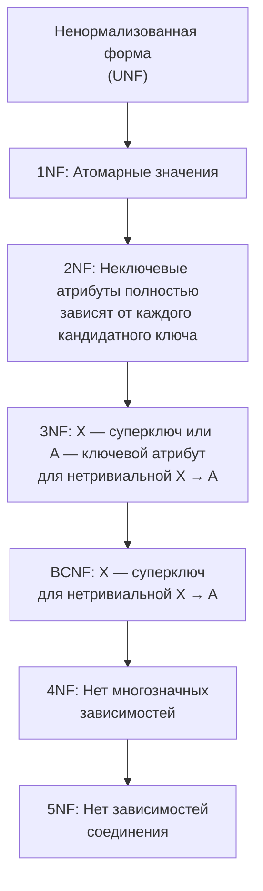
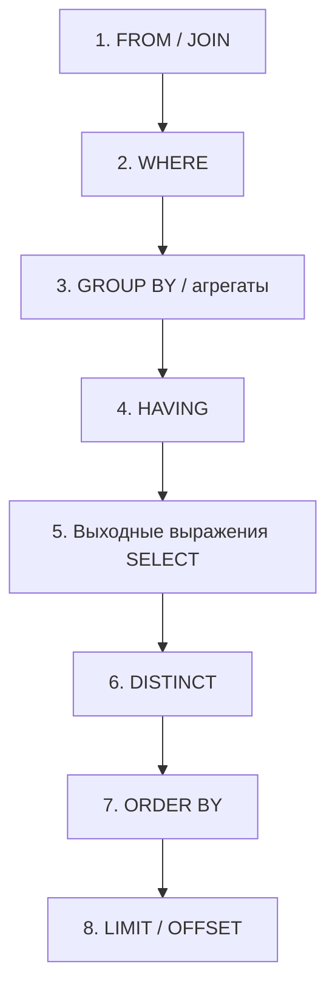
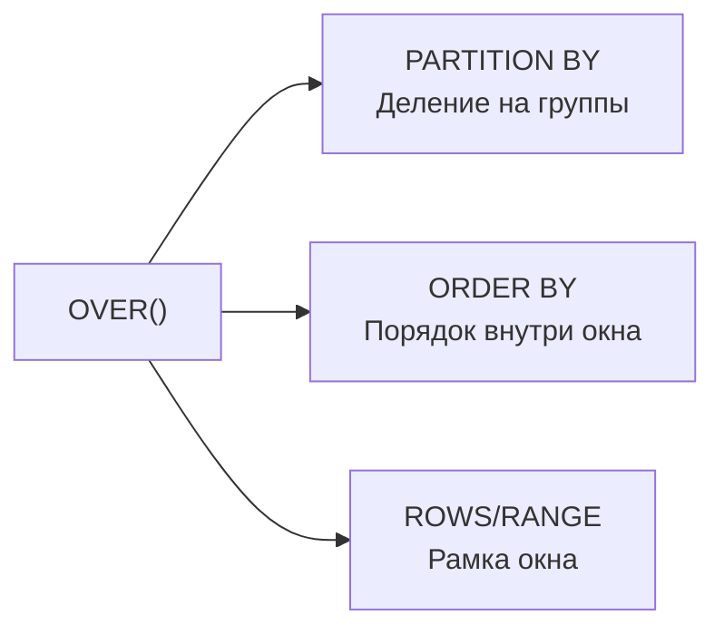
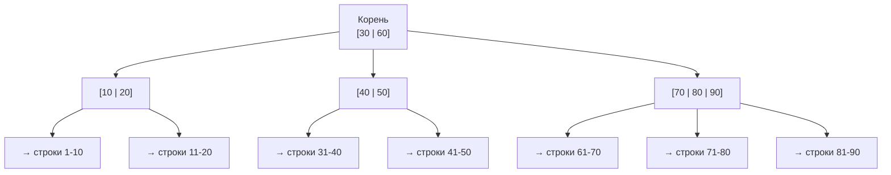
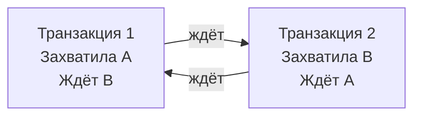

# Вопросы на собеседовании: `SQL`

Краткие ответы по `SQL`: `DDL`/`DML`, ограничения, индексы, `JOIN`, оконные функции, транзакции, нормализация, оптимизация запросов, `JDBC`/`JPA`.

Краткое введение: **SQL** — основа работы с реляционными БД. На собеседовании проверяют знание `DDL`/`DML`, индексов, транзакций, оконных функций, нормализации, оптимизации запросов и отличий диалектов (`PostgreSQL`, `MySQL` и др.). Также часто спрашивают про взаимодействие из Java через `JDBC`, `JPA` и `Spring Data`.

## Полезные ссылки

### Официальная документация

- [SQL Tutorial (PostgreSQL)](https://www.postgresql.org/docs/current/tutorial.html) — официальный туториал PostgreSQL
- [SQL Standard (Wikipedia)](https://en.wikipedia.org/wiki/SQL) — стандарт SQL
- [PostgreSQL Window Functions](https://www.postgresql.org/docs/current/tutorial-window.html) — оконные функции в PostgreSQL
- [PostgreSQL CTEs](https://www.postgresql.org/docs/current/queries-with.html) — Common Table Expressions

### Статьи Baeldung

- [Types of SQL Joins with Java Examples](https://www.baeldung.com/sql-joins) — типы JOIN с примерами
- [Transaction Propagation and Isolation in Spring @Transactional](https://www.baeldung.com/spring-transactional-propagation-isolation) — транзакции в Spring
- [Defining Indexes in JPA](https://www.baeldung.com/jpa-indexes) — индексы в JPA
- [A Comparison Between JPA and JDBC](https://www.baeldung.com/jpa-vs-jdbc) — сравнение JPA и JDBC
- [Why Window Functions Cannot Be Used in WHERE Clause](https://www.baeldung.com/sql/window-functions-condition-where-clauses) — ограничения оконных функций
- [Database Sharding vs. Partitioning](https://www.baeldung.com/cs/database-sharding-vs-partitioning) — шардирование vs партиционирование

## Содержание

- [Полезные ссылки](#полезные-ссылки)
- [See also](#see-also)

**Основы SQL и типы операторов**
- [Q1. Что такое `SQL` и какие подмножества языка существуют?](#q1-что-такое-sql-и-какие-подмножества-языка-существуют)
- [Q2. (!) Какие ограничения на целостность данных существуют в `SQL`?](#q2--какие-ограничения-на-целостность-данных-существуют-в-sql)
- [Q3. (!) В чём разница `PRIMARY KEY` и `UNIQUE`?](#q3--в-чём-разница-primary-key-и-unique)
- [Q4. (!) Может ли `FOREIGN KEY` равняться `NULL`?](#q4--может-ли-foreign-key-равняться-null)
- [Q5. Что означает `NULL` в `SQL` и как с ним работать?](#q5-что-означает-null-в-sql-и-как-с-ним-работать)
- [Q6. В чём разница между `DATETIME` и `TIMESTAMP`?](#q6-в-чём-разница-между-datetime-и-timestamp)

**Нормализация и проектирование**
- [Q7. (!) Что такое нормализация и какие нормальные формы существуют?](#q7--что-такое-нормализация-и-какие-нормальные-формы-существуют)
- [Q8. Что такое денормализация и когда она оправдана?](#q8-что-такое-денормализация-и-когда-она-оправдана)

**Объекты БД**
- [Q9. Что такое `View` и `Materialized View`?](#q9-что-такое-view-и-materialized-view)
- [Q10. Что такое `Stored Procedure` и `Function`?](#q10-что-такое-stored-procedure-и-function)
- [Q11. Что такое `Trigger`?](#q11-что-такое-trigger)
- [Q12. Что такое `Temporary` table?](#q12-что-такое-temporary-table)
- [Q13. Что такое `Sequence`?](#q13-что-такое-sequence)

**SELECT и операции с данными**
- [Q14. Порядок выполнения `SELECT`-запроса](#q14-порядок-выполнения-select-запроса)
- [Q15. (!) В чём разница между `DELETE`, `TRUNCATE` и `DROP`?](#q15--в-чём-разница-между-delete-truncate-и-drop)
- [Q16. (!) Что такое `MERGE` (`UPSERT`)?](#q16--что-такое-merge-upsert)
- [Q17. В чём разница между `IN`, `EXISTS` и `JOIN` для фильтрации?](#q17-в-чём-разница-между-in-exists-и-join-для-фильтрации)
- [Q18. Что такое `CASE`-выражение?](#q18-что-такое-case-выражение)
- [Q19. (!) Что такое `CTE` (`Common Table Expression`)?](#q19--что-такое-cte-common-table-expression)
- [Q20. Что такое `RETURNING`?](#q20-что-такое-returning)

**JOIN**
- [Q21. (!) Какие существуют типы `JOIN`?](#q21--какие-существуют-типы-join)
- [Q22. В чём разница между `WHERE` и `ON` в `JOIN`?](#q22-в-чём-разница-между-where-и-on-в-join)
- [Q23. (!) Что лучше — `JOIN` или подзапросы?](#q23--что-лучше--join-или-подзапросы)
- [Q24. Что такое `UNION` и `UNION ALL`?](#q24-что-такое-union-и-union-all)
- [Q25. Что такое `CROSS JOIN` и когда он нужен?](#q25-что-такое-cross-join-и-когда-он-нужен)
- [Q26. Что такое `SELF JOIN`?](#q26-что-такое-self-join)

**GROUP BY и агрегация**
- [Q27. Что такое `GROUP BY` и `HAVING`?](#q27-что-такое-group-by-и-having)
- [Q28. В чём разница между `GROUP BY` и `DISTINCT`?](#q28-в-чём-разница-между-group-by-и-distinct)
- [Q29. В чём разница между `COUNT(*)`, `COUNT(column)` и `COUNT(DISTINCT column)`?](#q29-в-чём-разница-между-count-countcolumn-и-countdistinct-column)

**Оконные функции**
- [Q30. (!) Что такое оконные функции (`Window Functions`)?](#q30--что-такое-оконные-функции-window-functions)
- [Q31. (!) В чём разница между `ROW_NUMBER`, `RANK` и `DENSE_RANK`?](#q31--в-чём-разница-между-row_number-rank-и-dense_rank)
- [Q32. Что такое `LAG`, `LEAD` и другие навигационные функции?](#q32-что-такое-lag-lead-и-другие-навигационные-функции)
- [Q33. Почему оконные функции нельзя использовать в `WHERE`?](#q33-почему-оконные-функции-нельзя-использовать-в-where)

**Индексы**
- [Q34. (!) Что такое индекс и как он устроен?](#q34--что-такое-индекс-и-как-он-устроен)
- [Q35. (!) В чём разница между `Clustered` и `Non-clustered` индексами?](#q35--в-чём-разница-между-clustered-и-non-clustered-индексами)
- [Q36. Что такое `Covering Index` и `Partial Index`?](#q36-что-такое-covering-index-и-partial-index)
- [Q37. Когда индекс НЕ помогает?](#q37-когда-индекс-не-помогает)

**Транзакции и конкурентный доступ**
- [Q38. (!) Что такое `ACID`?](#q38--что-такое-acid)
- [Q39. (!) Какие уровни изоляции транзакций существуют?](#q39--какие-уровни-изоляции-транзакций-существуют)
- [Q40. Что такое `deadlock` и как его избежать?](#q40-что-такое-deadlock-и-как-его-избежать)
- [Q41. В чём разница между оптимистичной и пессимистичной блокировкой?](#q41-в-чём-разница-между-оптимистичной-и-пессимистичной-блокировкой)

**Оптимизация запросов**
- [Q42. (!) Что такое `EXPLAIN` и как читать план выполнения?](#q42--что-такое-explain-и-как-читать-план-выполнения)
- [Q43. Какие основные стратегии оптимизации SQL-запросов существуют?](#q43-какие-основные-стратегии-оптимизации-sql-запросов-существуют)
- [Q44. Что такое `N+1` проблема?](#q44-что-такое-n1-проблема)

**SQL в Java (JDBC, JPA, Spring Data)**
- [Q45. (!) В чём разница между `JDBC` и `JPA`?](#q45--в-чём-разница-между-jdbc-и-jpa)
- [Q46. Как определить индексы в `JPA`?](#q46-как-определить-индексы-в-jpa)
- [Q47. Как управлять транзакциями в `Spring`?](#q47-как-управлять-транзакциями-в-spring)

**Продвинутые темы**
- [Q48. (!) Что такое рекурсивные `CTE` и когда их применять?](#q48--что-такое-рекурсивные-cte-и-когда-их-применять)
- [Q49. (!) Как читать и интерпретировать план выполнения (`EXPLAIN`)?](#q49--как-читать-и-интерпретировать-план-выполнения-explain)
- [Q50. Что такое партиционирование таблиц и зачем оно нужно?](#q50-что-такое-партиционирование-таблиц-и-зачем-оно-нужно)
- [Q51. (!) Какие виды индексов существуют в `PostgreSQL`?](#q51--какие-виды-индексов-существуют-в-postgresql)
- [Q52. Что такое `VACUUM` и `ANALYZE` в `PostgreSQL`?](#q52-что-такое-vacuum-и-analyze-в-postgresql)
- [Q53. Как работает `MVCC` (`Multi-Version Concurrency Control`)?](#q53-как-работает-mvcc-multi-version-concurrency-control)

---

## Q1. Что такое `SQL` и какие подмножества языка существуют?

`SQL` (`Structured Query Language`) — декларативный язык для работы с реляционными БД: вы описываете *какой* результат нужен, а оптимизатор сам решает *как* его получить. Язык делят на четыре подмножества по типу задачи — это деление важно, потому что для разных подмножеств действуют разные правила транзакционности (например, `DDL` во многих СУБД нельзя откатить).

| Подмножество | Назначение | Основные операторы |
|---|---|---|
| `DDL` (Data Definition Language) | Определение структуры | `CREATE`, `ALTER`, `DROP`, `TRUNCATE` |
| `DML` (Data Manipulation Language) | Манипуляция данными | `SELECT`, `INSERT`, `UPDATE`, `DELETE` |
| `DCL` (Data Control Language) | Управление доступом | `GRANT`, `REVOKE` |
| `TCL` (Transaction Control Language) | Управление транзакциями | `COMMIT`, `ROLLBACK`, `SAVEPOINT` |

```sql
-- DDL: создание таблицы
CREATE TABLE employees (
    id SERIAL PRIMARY KEY,
    name VARCHAR(100) NOT NULL,
    department_id INT REFERENCES departments(id),
    salary NUMERIC(10, 2) CHECK (salary > 0),
    created_at TIMESTAMP DEFAULT CURRENT_TIMESTAMP
);

-- DML: вставка данных
INSERT INTO employees (name, department_id, salary)
VALUES ('Иванов', 1, 150000.00);

-- DCL: выдача прав
GRANT SELECT, INSERT ON employees TO app_user;

-- TCL: управление транзакцией
BEGIN;
UPDATE employees SET salary = salary * 1.1 WHERE department_id = 1;
SAVEPOINT after_raise;
-- если что-то пошло не так:
ROLLBACK TO after_raise;
COMMIT;
```

## Q2. (!) Какие ограничения на целостность данных существуют в `SQL`?

Ограничения (`constraints`) — это правила, которые СУБД проверяет на уровне самой базы, поэтому данные остаются корректными независимо от того, какое приложение их пишет. Это надёжнее, чем валидация в коде: ни баг в сервисе, ни прямой `INSERT` из консоли не смогут нарушить инвариант. Основные ограничения:

| Ограничение | Назначение |
|---|---|
| `PRIMARY KEY` | Уникальный идентификатор строки. Не допускает `NULL` и дубликатов |
| `FOREIGN KEY` | Ссылочная целостность — ссылка на подходящий уникальный ключ |
| `UNIQUE` | Уникальность значений (допускает `NULL`) |
| `NOT NULL` | Запрет пустых значений |
| `CHECK` | Произвольное условие на значение |

| `EXCLUDE` | Запрет пересекающихся диапазонов (PostgreSQL) |

```sql
CREATE TABLE orders (
    id SERIAL PRIMARY KEY,                         -- PK
    customer_id INT NOT NULL                       -- NOT NULL
        REFERENCES customers(id)                   -- FK
        ON DELETE CASCADE,
    status VARCHAR(20) DEFAULT 'NEW'               -- DEFAULT
        CHECK (status IN ('NEW','PAID','SHIPPED')),-- CHECK
    order_number VARCHAR(50) UNIQUE,               -- UNIQUE
    valid_from TSRANGE,
    EXCLUDE USING GIST (valid_from WITH &&)        -- EXCLUDE (PostgreSQL)
);
```

**Что происходит при удалении/обновлении родительской строки** — задаётся через `ON DELETE` / `ON UPDATE`:

- `CASCADE` — удалить/обновить и дочерние строки вслед за родительской
- `SET NULL` — обнулить ссылку в дочерних строках
- `SET DEFAULT` — подставить значение по умолчанию
- `RESTRICT` / `NO ACTION` — запретить операцию, если есть зависимые строки (`RESTRICT` проверяет сразу, `NO ACTION` — в конце оператора, что важно для отложенных ограничений)

В PostgreSQL внешний ключ может ссылаться на первичный ключ, подходящее уникальное ограничение или столбцы подходящего непарциального уникального индекса. DEFAULT подставляет значение и не заменяет NOT NULL. [Документация](https://www.postgresql.org/docs/19/ddl-constraints).

## Q3. (!) В чём разница `PRIMARY KEY` и `UNIQUE`?

Оба обеспечивают уникальность значений, но `PRIMARY KEY` — это «главный» идентификатор строки (один на таблицу, без `NULL`), а `UNIQUE` — дополнительное ограничение бизнес-уникальности, которых может быть много и которые допускают `NULL`. По сути `PRIMARY KEY` = `UNIQUE` + `NOT NULL` + роль «по умолчанию для `FOREIGN KEY`».

| Характеристика | `PRIMARY KEY` | `UNIQUE` |
|---|---|---|
| Количество на таблицу | Один | Неограничено |
| `NULL` | Не допускает | Зависит от СУБД и настройки |

| Ссылка `FK` | Может быть целью `FOREIGN KEY` | Тоже может быть целью `FK` |
| Назначение | Идентификация строки | Бизнес-уникальность (email, ИНН) |

> **Замечание**: в `PostgreSQL` ограничение `UNIQUE` допускает несколько `NULL`-значений (они считаются различными).

PostgreSQL 15+ поддерживает UNIQUE NULLS NOT DISTINCT: NULL считаются одинаковыми для проверки уникальности. Физическое хранение зависит от СУБД (Q35). [Документация](https://www.postgresql.org/docs/19/ddl-constraints).

## Q4. (!) Может ли `FOREIGN KEY` равняться `NULL`?

Да, столбец с ограничением `FOREIGN KEY` может содержать `NULL`, если на нём не задано `NOT NULL`. Значение `NULL` означает «связь не установлена» — строка не ссылается ни на одну запись в родительской таблице.

```sql
CREATE TABLE employees (
    id SERIAL PRIMARY KEY,
    name VARCHAR(100) NOT NULL,
    manager_id INT REFERENCES employees(id) -- может быть NULL (CEO)
);

INSERT INTO employees (name, manager_id) VALUES ('CEO', NULL);     -- OK
INSERT INTO employees (name, manager_id) VALUES ('Manager', 1);   -- OK
INSERT INTO employees (name, manager_id) VALUES ('Dev', 999);     -- ОШИБКА: нет id=999
```

## Q5. Что означает `NULL` в `SQL` и как с ним работать?

`NULL` — это маркер «значение неизвестно или отсутствует», а не ноль и не пустая строка. Ключевая идея: `NULL` нельзя сравнивать обычными операторами, потому что «неизвестное» не равно и не не-равно чему-либо — отсюда трёхзначная логика. Основные правила:

- Любое сравнение с `NULL` даёт `UNKNOWN` (не `TRUE` и не `FALSE`) — поэтому `WHERE col = NULL` никогда не вернёт строк
- Для проверки используются `IS NULL` / `IS NOT NULL`
- Арифметика с `NULL` даёт `NULL`: `5 + NULL = NULL`
- Агрегатные функции (`SUM`, `AVG`, `COUNT(column)`) игнорируют `NULL` — это часто источник сюрпризов: `AVG` считает среднее только по непустым значениям

```sql
-- Неправильно:
SELECT * FROM users WHERE email = NULL;       -- всегда пусто!

-- Правильно:
SELECT * FROM users WHERE email IS NULL;

-- Обработка NULL:
SELECT
    name,
    COALESCE(phone, 'не указан') AS phone,   -- замена NULL
    NULLIF(discount, 0) AS discount            -- 0 → NULL
FROM customers;
```

Трёхзначная логика `NULL`:

| `A` | `B` | `A AND B` | `A OR B` |
|---|---|---|---|
| TRUE | NULL | UNKNOWN | TRUE |
| FALSE | NULL | FALSE | UNKNOWN |
| NULL | NULL | UNKNOWN | UNKNOWN |

## Q6. В чём разница между `DATETIME` и `TIMESTAMP`?

Главное различие — отношение к часовым поясам: `DATETIME` хранит «настенное» время как есть, а `TIMESTAMP` приводит его к UTC при записи и обратно при чтении (поэтому одно и то же значение «выглядит» по-разному в разных зонах). Плюс у `TIMESTAMP` в MySQL узкий диапазон (до 2038 года — наследие 32-битного хранения).

| Характеристика | `DATETIME` (MySQL) | `TIMESTAMP` (MySQL) | `TIMESTAMPTZ` (PostgreSQL) |
|---|---|---|---|
| Диапазон | 1000-01-01 — 9999-12-31 | 1970-01-01 — 2038-01-19 | 4713 BC — 294276 AD |
| Хранение | Как есть (без зоны) | Конвертируется в UTC | Конвертируется в UTC |
| Размер | 5 байт + 0–3 на дробную часть | 4 байта + 0–3 на дробную часть | 8 байт |
| Часовой пояс | Не учитывает | Автоматически конвертирует | Автоматически конвертирует |

Размеры MySQL указаны для 8.4. [MySQL 8.4 Storage Requirements](https://dev.mysql.com/doc/refman/8.4/en/storage-requirements.html).

> **Рекомендация**: в `PostgreSQL` используйте `TIMESTAMPTZ` для корректной работы с часовыми поясами. Подробнее о работе с датами в Java — в [вопросах по Hibernate](hibernate-interview.md).

## Q7. (!) Что такое нормализация и какие нормальные формы существуют?

**Нормализация** — разбиение данных на таблицы так, чтобы каждый факт хранился ровно в одном месте. Это убирает избыточность и три класса аномалий: при **вставке** (нельзя добавить факт без не относящихся к нему данных), **обновлении** (один факт продублирован — придётся менять во многих строках, легко рассинхронизировать) и **удалении** (удаляя строку, теряешь заодно нужный факт). Нормальные формы — это лестница: каждая следующая форма включает требования предыдущей и устраняет ещё один тип зависимости.



| Нормальная форма | Требование | Пример нарушения |
|---|---|---|
| **1NF** | Атомарные значения, нет повторяющихся групп | `phones = '111,222'` в одном столбце |
| **2NF** | 1NF + каждый неключевой атрибут полностью зависит от каждого кандидатного ключа | Имя студента зависит от `student_id`, части кандидатного ключа `(student_id, course_id)` |
| **3NF** | Для каждой нетривиальной зависимости `X → A`: `X` — суперключ или `A` входит хотя бы в один кандидатный ключ | В таблице заказов `customer_id → customer_name`, хотя клиент может иметь несколько заказов и имя не входит ни в один кандидатный ключ |
| **BCNF** | Для каждой нетривиальной зависимости `X → A`: `X` — суперключ | `teacher → course`, если преподаватель ведёт один курс, но обучает многих студентов |

Суперключ однозначно определяет строку и может содержать лишние столбцы. Кандидатный ключ — минимальный суперключ. Ключевой атрибут входит хотя бы в один кандидатный ключ. [Database System Concepts, глава 7](https://www.db-book.com/slides-dir/PDF-dir/ch7.pdf).

## Q8. Что такое денормализация и когда она оправдана?

**Денормализация** — осознанный возврат избыточности ради скорости чтения: данные дублируются, чтобы избавиться от дорогих `JOIN` и агрегаций на горячем пути. Это обратная сторона нормализации — вы платите усложнением записи за дешёвое чтение. Типичные приёмы:

- **Дублирование столбцов** — добавление `customer_name` в таблицу `orders`, чтобы избежать `JOIN`
- **Предвычисленные агрегаты** — столбец `total_orders` в таблице `customers`
- **Материализованные представления** — денормализованные снимки данных

**Когда оправдана:**
- В **OLAP/DWH** (аналитические хранилища, схемы «звезда» и «снежинка»), где пишут пакетами, а читают много и сложно
- Когда `JOIN` по большому числу таблиц стал доказанным узким местом (подтверждено профилированием, а не «на всякий случай»)
- При необходимости крайне низкой задержки на чтение

**Цена:** при каждой записи нужно обновлять все копии факта, иначе данные разойдутся. Поэтому денормализацию обычно дополняют триггерами, фоновыми пересчётами или материализованными представлениями, чтобы синхронизацию не приходилось держать в голове у разработчика.

## Q9. Что такое `View` и `Materialized View`?

**View** (представление) — это сохранённый запрос под именем таблицы. Физических данных за ним нет: при каждом обращении запрос выполняется заново, поэтому результат определяется снимком, а стоимость — планом. Удобен, чтобы спрятать сложную логику и переиспользовать её.

```sql
CREATE VIEW active_employees AS
SELECT e.id, e.name, d.name AS department
FROM employees e
JOIN departments d ON e.department_id = d.id
WHERE e.status = 'ACTIVE';

-- Использование как обычная таблица:
SELECT * FROM active_employees WHERE department = 'IT';
```

**Materialized View** — представление, результат которого один раз посчитан и физически сохранён. Чтение может быть дешевле повторного расчёта (данные уже готовы), но за это платишь устареванием: чтобы освежить данные, нужен явный `REFRESH`. По сути это кэш тяжёлого запроса.

```sql
-- PostgreSQL
CREATE MATERIALIZED VIEW monthly_sales AS
SELECT date_trunc('month', order_date) AS month,
       SUM(total) AS revenue,
       COUNT(*) AS order_count
FROM orders
GROUP BY 1;

CREATE UNIQUE INDEX monthly_sales_month_uq ON monthly_sales (month);

-- Обновление:
REFRESH MATERIALIZED VIEW CONCURRENTLY monthly_sales;
```

| | `View` | `Materialized View` |
|---|---|---|
| Хранит данные | Нет | Да |
| Скорость чтения | Зависит от запроса | Быстро (данные готовы) |
| Актуальность | По снимку запроса | Нужен `REFRESH` |
| Поддержка индексов | Нет | Да |

CONCURRENTLY требует заполненного представления и уникального индекса по столбцам, без выражений и предиката, который охватывает все строки. Доступность результата определяется снимком. [Документация](https://www.postgresql.org/docs/19/sql-refreshmaterializedview).

## Q10. Что такое `Stored Procedure` и `Function`?

И то, и другое — код, который хранится и выполняется на сервере БД (логика рядом с данными, без сетевых round-trip'ов). Разница в роли: **Function** имеет объявленный тип результата и вызывается *внутри* запроса (`SELECT get_x(...)`), поэтому ей нельзя управлять транзакцией. **Stored Procedure** вызывается отдельно через `CALL`, может ничего не возвращать и при допустимом контексте вызова умеет делать `COMMIT`/`ROLLBACK` — это нужно для пакетной обработки, где результат фиксируют порциями.

```sql
-- PostgreSQL: функция
CREATE OR REPLACE FUNCTION get_employee_count(dept_id INT)
RETURNS INT AS $$
BEGIN
    RETURN (SELECT COUNT(*) FROM employees WHERE department_id = dept_id);
END;
$$ LANGUAGE plpgsql;

SELECT get_employee_count(1);

-- PostgreSQL: процедура (с COMMIT/ROLLBACK)
CREATE OR REPLACE PROCEDURE transfer_employee(emp_id INT, new_dept INT)
LANGUAGE plpgsql AS $$
BEGIN
    UPDATE employees SET department_id = new_dept WHERE id = emp_id;
    INSERT INTO audit_log (action, employee_id) VALUES ('TRANSFER', emp_id);
    COMMIT;
END;
$$;

-- Вне явного блока транзакции
CALL transfer_employee(42, 3);
```

| | Procedure | Function |
|---|---|---|
| Возвращает значение | Не обязательно | Объявляет тип, возможен void |
| Использование в `SELECT` | Нет | Да |
| `COMMIT`/`ROLLBACK` внутри | Зависит от контекста CALL | Нет |

Функция может объявить RETURNS void. Если CALL запущен внутри явного блока транзакции, процедура не может выполнять COMMIT или ROLLBACK. [Документация](https://www.postgresql.org/docs/19/sql-call).

## Q11. Что такое `Trigger`?

**Триггер** — код, который СУБД сама вызывает в ответ на `INSERT`, `UPDATE` или `DELETE`. Он действует и для SQL, выполненного в обход приложения, если совпадают событие и условие триггера. Поэтому триггеры хороши для аудита, поддержания инвариантов и заполнения служебных полей.

```sql
-- Аудит изменений зарплаты
CREATE OR REPLACE FUNCTION log_salary_change()
RETURNS TRIGGER AS $$
BEGIN
    INSERT INTO salary_audit (employee_id, old_salary, new_salary, changed_at)
    VALUES (OLD.id, OLD.salary, NEW.salary, NOW());
    RETURN NEW;
END;
$$ LANGUAGE plpgsql;

CREATE TRIGGER salary_change_trigger
    BEFORE UPDATE OF salary ON employees
    FOR EACH ROW
    WHEN (OLD.salary IS DISTINCT FROM NEW.salary)
    EXECUTE FUNCTION log_salary_change();
```

**Виды триггеров** (две независимые оси):
- по моменту: `BEFORE` (можно изменить или отклонить строку до записи), `AFTER` (данные уже записаны — удобно для аудита), `INSTEAD OF` (подмена операции, нужна для записи через `View`)
- по охвату: `FOR EACH ROW` (срабатывает на каждую затронутую строку) или `FOR EACH STATEMENT` (один раз на весь оператор)

> **Совет**: избегайте сложной бизнес-логики в триггерах — это усложняет отладку и может вызвать каскадные проблемы. Подробнее о событийном подходе — в [вопросах по архитектуре БД](database-architecture-interview.md).

Триггер срабатывает на заданное событие, а при наличии WHEN — только если условие истинно. [Документация](https://www.postgresql.org/docs/19/sql-createtrigger).

## Q12. Что такое `Temporary` table?

**Временная таблица** видна только создавшей её сессии и автоматически исчезает при её завершении (или при `COMMIT`, если создана с `ON COMMIT DROP`). Нужна как «черновик» для промежуточных результатов сложной обработки: разные сессии не мешают друг другу, а чистить за собой не приходится.

```sql
-- PostgreSQL
CREATE TEMP TABLE temp_report (
    department VARCHAR(100),
    total_salary NUMERIC
);

INSERT INTO temp_report
SELECT d.name, SUM(e.salary)
FROM employees e JOIN departments d ON e.department_id = d.id
GROUP BY d.name;

-- После отключения сессии таблица исчезнет
```

В `PostgreSQL` используется `CREATE TEMP TABLE`, в `MySQL` — `CREATE TEMPORARY TABLE`, в `SQL Server` — префикс `#` (локальная) или `##` (глобальная).

## Q13. Что такое `Sequence`?

**Sequence** — отдельный объект-генератор чисел, не привязанный к конкретной таблице (в отличие от «свёрнутых» вокруг него `SERIAL`, `IDENTITY`, `AUTO_INCREMENT`). Один `sequence` можно делить между несколькими таблицами, а значение получать заранее, до `INSERT`.

```sql
CREATE SEQUENCE order_seq START 1000 INCREMENT 1;

-- Получение следующего значения:
SELECT nextval('order_seq');  -- 1000, 1001, 1002...

-- Использование в INSERT:
INSERT INTO orders (id, customer_id) VALUES (nextval('order_seq'), 42);
```

**Важный нюанс:** `nextval` не откатывается при `ROLLBACK`. Это сделано намеренно — иначе параллельные транзакции выстраивались бы в очередь за номером. Платой становятся «дырки» в нумерации (если транзакция откатилась, её номер пропадает), поэтому на значения `sequence` нельзя полагаться как на непрерывный счётчик «без пропусков».

При CACHE > 1 сеансы резервируют наборы значений, поэтому общий порядок выдачи между ними может отличаться от числового. CYCLE и setval() могут привести к повторам; уникальность обеспечивает ограничение столбца. [Документация](https://www.postgresql.org/docs/19/sql-createsequence).

## Q14. Порядок выполнения `SELECT`-запроса

`SELECT` пишется не в том порядке, в котором СУБД его *логически* обрабатывает. Понимание реального порядка снимает половину «странностей» SQL — почему алиас не виден в `WHERE`, почему `WHERE` нельзя фильтровать по агрегату, почему `LIMIT` применяется последним. Логический порядок:



```sql
SELECT department, COUNT(*) AS cnt    -- 5. Вычисление выражений
FROM employees                         -- 1. Источник данных
JOIN departments ON ...                -- 1. Соединение
WHERE salary > 50000                   -- 2. Фильтрация строк
GROUP BY department                    -- 3. Группировка
HAVING COUNT(*) > 5                   -- 4. Фильтрация групп
ORDER BY cnt DESC                      -- 7. Сортировка
LIMIT 10;                              -- 8. Ограничение
```

Понимание этого порядка объясняет, почему нельзя использовать алиас из `SELECT` в `WHERE`, но можно в `ORDER BY`.

Агрегаты вычисляются по группам до проверки HAVING. Выходные выражения SELECT вычисляются отдельно. Это логический порядок, физический план может отличаться. [Документация](https://www.postgresql.org/docs/19/sql-select).

## Q15. (!) В чём разница между `DELETE`, `TRUNCATE` и `DROP`?

Все три удаляют данные, но на разном уровне: `DELETE` (это `DML`) убирает выбранные строки построчно и логируется, `TRUNCATE` (это `DDL`) удаляет всё содержимое таблицы целиком, оставляя её структуру, а `DROP` (`DDL`) удаляет саму таблицу вместе с данными. Ключевой практический критерий выбора — нужен ли `WHERE`, должны ли сработать триггеры и можно ли откатить.

| | `DELETE` | `TRUNCATE` | `DROP` |
|---|---|---|---|
| Что делает | Удаляет строки | Удаляет все строки | Удаляет таблицу целиком |
| `WHERE` | Да | Нет | Нет |
| Откат (`ROLLBACK`) | Да | Зависит от СУБД | Зависит от СУБД |
| Триггеры | ON DELETE | ON TRUNCATE в PostgreSQL | Отдельные DDL-механизмы |
| Сброс `IDENTITY` | Нет | С RESTART IDENTITY в PostgreSQL | — |
| Скорость | Медленнее (построчно) | Быстрее | Быстрее |
| Подмножество | `DML` | `DDL` | `DDL` |

```sql
DELETE FROM orders WHERE status = 'CANCELLED';  -- удаляет часть строк
TRUNCATE TABLE temp_data;                        -- быстрая очистка
DROP TABLE IF EXISTS old_archive;                -- удаляет таблицу
```

> В `PostgreSQL` `TRUNCATE` можно откатить внутри транзакции, в `MySQL` (InnoDB) — нельзя.

В PostgreSQL по умолчанию действует CONTINUE IDENTITY. RESTART IDENTITY сбрасывает принадлежащие таблице последовательности. TRUNCATE берёт ACCESS EXCLUSIVE и запускает ON TRUNCATE, а не ON DELETE. [Документация](https://www.postgresql.org/docs/19/sql-truncate).

## Q16. (!) Что такое `MERGE` (`UPSERT`)?

UPSERT — сценарий «вставить строку или обновить существующую». В PostgreSQL для него используют `INSERT ... ON CONFLICT DO UPDATE` с уникальным ключом. В `READ COMMITTED` без дополнительного фильтра и при отсутствии других ошибок строка будет вставлена или обновлена. `MERGE` (PostgreSQL 15+) выбирает действия по результату сопоставления источника с целевой таблицей. При конкурентной вставке он может получить ошибку уникальности, поэтому гарантии этих операторов различаются. [Изоляция транзакций PostgreSQL 19](https://www.postgresql.org/docs/19/transaction-iso.html).

```sql
-- PostgreSQL 15+: MERGE
MERGE INTO target_table t
USING source_table s ON (t.id = s.id)
WHEN MATCHED THEN
    UPDATE SET name = s.name, updated_at = NOW()
WHEN NOT MATCHED THEN
    INSERT (id, name) VALUES (s.id, s.name);

-- PostgreSQL (UPSERT):
INSERT INTO products (sku, name, price)
VALUES ('ABC-123', 'Widget', 29.99)
ON CONFLICT (sku) DO UPDATE
SET name = EXCLUDED.name,
    price = EXCLUDED.price,
    updated_at = NOW();
```

Для сценария «получить или создать» в PostgreSQL 19 есть `INSERT ... ON CONFLICT (ключ) DO SELECT ... RETURNING`. Например, на уровне `READ COMMITTED` при двух одновременных запросах с одним уникальным `sku` и без других ошибок один запрос вставляет строку, а другой возвращает её `id` после фиксации вставки. На конфликте существующая строка сохраняет свои значения. Здесь арбитром служит уникальный индекс по `sku`, а `RETURNING` обязателен:

```sql
INSERT INTO products (sku, name, price)
VALUES ('ABC-123', 'Widget', 29.99)
ON CONFLICT (sku) DO SELECT
RETURNING id;
```

У `DO SELECT` можно добавить `WHERE`: если условие для конфликтующей строки ложно или даёт `NULL`, `RETURNING` её пропустит. Если последующим действиям в той же транзакции нужна блокировка найденной строки, её можно запросить через `DO SELECT FOR UPDATE`.

В PostgreSQL 18 этого синтаксиса нет. При конфликте `DO NOTHING RETURNING` не возвращает существующую строку. Для чтения её нужно запросить отдельно и учесть возможные конкурентные изменения. [INSERT в PostgreSQL 19](https://www.postgresql.org/docs/19/sql-insert.html) · [Изоляция транзакций](https://www.postgresql.org/docs/19/transaction-iso.html#XACT-READ-COMMITTED).

В Spring Data JPA для такого UPSERT используют нативный запрос. `saveAndFlush()` сохраняет сущность и выполняет flush, но сам по себе не даёт семантики `ON CONFLICT` по уникальному ключу.

```java
@Modifying
@Query(value = """
    INSERT INTO products (sku, name, price)
    VALUES (:sku, :name, :price)
    ON CONFLICT (sku) DO UPDATE SET name = :name, price = :price
    """, nativeQuery = true)
void upsertProduct(@Param("sku") String sku,
                    @Param("name") String name,
                    @Param("price") BigDecimal price);
```

## Q17. В чём разница между `IN`, `EXISTS` и `JOIN` для фильтрации?

Для проверки наличия связи используйте `IN` или `EXISTS`. При сравнении по равенству в `WHERE` оба оставляют строку с совпадением. Они сохраняют повторы из левого набора, но повторяющиеся совпадения справа не добавляют строк. `INNER JOIN` выдаёт строку для каждой совпавшей пары, даже если в `SELECT` указаны только столбцы слева.

```sql
-- IN: простой список или подзапрос
SELECT * FROM orders WHERE customer_id IN (1, 2, 3);
SELECT * FROM orders WHERE customer_id IN (SELECT id FROM vip_customers);

-- EXISTS: проверка существования
SELECT * FROM orders o
WHERE EXISTS (SELECT 1 FROM vip_customers v WHERE v.id = o.customer_id);

-- JOIN: объединение
SELECT o.* FROM orders o
JOIN vip_customers v ON v.id = o.customer_id;
```

**Что меняется при отрицании.** Если совпадения нет, но подзапрос вернул `NULL`, выражение `NOT IN` даёт `UNKNOWN`, и `WHERE` отбрасывает строку. Если же подзапрос лишь *может* вернуть `NULL`, результат зависит от фактических значений. У `NOT EXISTS` с условием равенства другая семантика: строка справа с `NULL` не считается совпадением. Поэтому внешний `customer_id IS NULL` пройдёт через такой `NOT EXISTS`, если отдельно его не исключить.

```sql
-- Заказы с известным клиентом, которого нет в VIP-списке
SELECT o.*
FROM orders o
WHERE o.customer_id IS NOT NULL
  AND NOT EXISTS (
      SELECT 1 FROM vip_customers v WHERE v.id = o.customer_id
  );
```

Сначала выбирайте форму по семантике. Планировщик может строить похожие планы для `IN` и `EXISTS`, а производительность зависит от данных и конкретного плана. [Подзапросы PostgreSQL 19](https://www.postgresql.org/docs/19/functions-subquery.html).

**План PostgreSQL 19.** Для простого сравнения целочисленных ID оптимизатор может преобразовать `NOT IN` в anti join, если докажет, что сравниваемые значения с обеих сторон исключают `NULL`. Например, это возможно для `orders.customer_id NOT NULL` и `vip_customers.id PRIMARY KEY`, когда подзапрос читает ключ напрямую. То, что в данных сейчас нет `NULL`, само по себе такого доказательства не даёт. После обновления с PostgreSQL 18 сравните планы через `EXPLAIN`. Преобразование сохраняет результат запроса, а конкретный план зависит от формы запроса и оценок стоимости. [Изменения оптимизатора PostgreSQL 19](https://www.postgresql.org/docs/19/release-19.html#RELEASE-19-OPTIMIZER).

## Q18. Что такое `CASE`-выражение?

`CASE` — условное выражение, аналог `if-else`, который возвращает значение прямо внутри `SELECT`, `ORDER BY` или агрегата. Возвращает первую ветку, чьё условие истинно (порядок важен). Есть две формы: **поисковая** (`CASE WHEN <условие> THEN ...`) для произвольных условий и **простая** (`CASE <выражение> WHEN <значение> THEN ...`) для сравнения одного выражения с набором значений.

```sql
SELECT name, salary,
    CASE
        WHEN salary >= 200000 THEN 'Senior'
        WHEN salary >= 100000 THEN 'Middle'
        ELSE 'Junior'
    END AS grade
FROM employees;

-- Простая форма:
SELECT order_id,
    CASE status
        WHEN 'NEW'     THEN 'Новый'
        WHEN 'PAID'    THEN 'Оплачен'
        WHEN 'SHIPPED' THEN 'Отправлен'
    END AS status_name
FROM orders;
```

Если ни одно условие не даёт `TRUE`, выбирается `ELSE`. Без него результатом будет `NULL`, как для неизвестного статуса во втором примере. Условие со значением `UNKNOWN` пропускает ветвь. Чтобы проверить отсутствие значения, используйте поисковую форму `CASE WHEN status IS NULL THEN ...`. Простая форма `CASE status WHEN NULL THEN ...` сравнивает значения через равенство, поэтому не найдёт совпадения. Результаты всех ветвей должны приводиться к общему типу, даже если часть ветвей не выполняется.

PostgreSQL обычно вычисляет только нужную ветвь, но планировщик может вычислить константное выражение заранее. Например, `1/0` в недостижимой ветви может вызвать ошибку ещё при планировании. Если нужно защитить деление на переменный знаменатель, можно использовать `amount / NULLIF(quantity, 0)`: при нуле выражение вернёт `NULL`. [Условные выражения PostgreSQL 19](https://www.postgresql.org/docs/19/functions-conditional.html).

## Q19. (!) Что такое `CTE` (`Common Table Expression`)?

`CTE` — именованный подзапрос, объявленный через `WITH` и доступный по имени в основном запросе. По сути это способ разбить громоздкий запрос на читаемые «шаги», как локальные переменные в коде. Два главных применения: сделать сложный запрос понятным сверху вниз и реализовать рекурсию (`WITH RECURSIVE`), невозможную в обычном подзапросе.

```sql
-- Обычный CTE:
WITH department_stats AS (
    SELECT department_id,
           AVG(salary) AS avg_salary,
           COUNT(*) AS emp_count
    FROM employees
    GROUP BY department_id
)
SELECT d.name, ds.avg_salary, ds.emp_count
FROM departments d
JOIN department_stats ds ON d.id = ds.department_id
WHERE ds.emp_count > 5;

-- Рекурсивный CTE (иерархия):
WITH RECURSIVE org_tree AS (
    SELECT id, name, manager_id, 1 AS level
    FROM employees WHERE manager_id IS NULL
    UNION ALL
    SELECT e.id, e.name, e.manager_id, ot.level + 1
    FROM employees e
    JOIN org_tree ot ON e.manager_id = ot.id
)
SELECT * FROM org_tree ORDER BY level, name;
```

**Нюанс:** в старых версиях PostgreSQL (до 12) `CTE` всегда материализовался как барьер оптимизации — оптимизатор не «протаскивал» условия внутрь. С PostgreSQL 12 нерекурсивный `SELECT` без побочных эффектов встраивается по умолчанию при одной ссылке. При нескольких ссылках он по умолчанию вычисляется отдельно. Для такого `SELECT` можно явно выбрать поведение через `MATERIALIZED` или `NOT MATERIALIZED`. Для рекурсивного запроса или запроса с volatile-функцией `NOT MATERIALIZED` игнорируется. [Материализация CTE в PostgreSQL 19](https://www.postgresql.org/docs/19/queries-with.html#QUERIES-WITH-CTE-MATERIALIZATION).

## Q20. Что такое `RETURNING`?

В PostgreSQL `RETURNING` возвращает значения строк из той же команды, которая их вставила, обновила или удалила. Например, так можно получить сгенерированный идентификатор без дополнительного `SELECT`. У `UPDATE` неквалифицированное имя столбца означает новое значение, у `DELETE` — значение удалённой строки. Получение результата команды внутри транзакции ещё не означает успешного `COMMIT`.

```sql
-- Получить id вставленной записи:
INSERT INTO users (name, email)
VALUES ('Иванов', 'ivanov@mail.ru')
RETURNING id, created_at;

-- PostgreSQL 18+: получить старую и новую цену
UPDATE products SET price = price * 1.1
WHERE category = 'electronics'
RETURNING id, name, old.price AS old_price, new.price AS new_price;

-- Удаление с возвратом:
DELETE FROM sessions WHERE expires_at < NOW()
RETURNING user_id;
```

До PostgreSQL 18 обычный `UPDATE ... RETURNING price` возвращает новую цену, а показанного синтаксиса `OLD` и `NEW` ещё нет. Примеры относятся к диалекту PostgreSQL. [PostgreSQL 18](https://www.postgresql.org/docs/18/dml-returning.html), [PostgreSQL 19](https://www.postgresql.org/docs/19/dml-returning.html).

## Q21. (!) Какие существуют типы `JOIN`?

`JOIN` соединяет строки двух таблиц по условию. Тип `JOIN` отвечает на один вопрос: **что делать со строками, у которых нет пары?** Если у строки есть несколько совпадений, результат содержит по строке на каждую пару. `INNER` оставляет только совпадения; `LEFT`/`RIGHT` дополняют их всеми строками одной из таблиц (несовпавшим столбцам подставляется `NULL`); `FULL OUTER` берёт всё из обеих; `CROSS` вообще не проверяет условие и даёт декартово произведение.

Если A1 соответствует B1 и B2, результат INNER JOIN содержит (A1, B1) и (A1, B2). LEFT JOIN также вернёт (A2, NULL), если у A2 нет пары.

```sql
-- Пример данных:
-- employees: (1, 'Иванов', department_id=1), (2, 'Петров', department_id=2), (3, 'Сидоров', department_id=NULL)
-- departments: (1, 'IT'), (2, 'HR'), (4, 'Finance')

-- INNER JOIN: только совпадения (2 строки: Иванов+IT, Петров+HR)
SELECT e.name, d.name FROM employees e
INNER JOIN departments d ON e.department_id = d.id;

-- LEFT JOIN: все из левой + совпадения (3 строки, Сидоров с NULL)
SELECT e.name, d.name FROM employees e
LEFT JOIN departments d ON e.department_id = d.id;

-- RIGHT JOIN: все из правой + совпадения (3 строки, Finance с NULL)
SELECT e.name, d.name FROM employees e
RIGHT JOIN departments d ON e.department_id = d.id;

-- FULL OUTER JOIN: всё из обеих таблиц (4 строки)
SELECT e.name, d.name FROM employees e
FULL OUTER JOIN departments d ON e.department_id = d.id;

-- CROSS JOIN: декартово произведение (3×3 = 9 строк)
SELECT e.name, d.name FROM employees e
CROSS JOIN departments d;
```

## Q22. В чём разница между `WHERE` и `ON` в `JOIN`?

В логике запроса `ON` определяет, какие пары считаются совпадениями, а `WHERE` фильтрует результат соединения. При `LEFT JOIN` условие `WHERE d.active = true` отбрасывает строки без совпадения: для них `d.active` равно `NULL`, и условие не истинно. Условие `WHERE d.id IS NULL` действует иначе: если `d.id` гарантированно не бывает `NULL` в исходной таблице, оно оставит именно строки без пары. Для `RIGHT JOIN` рассуждение симметрично. [Соединения в PostgreSQL 19](https://www.postgresql.org/docs/19/queries-table-expressions.html#QUERIES-JOIN).

```sql
-- ON: фильтрация при соединении (NULL-строки остаются)
SELECT e.name, d.name
FROM employees e
LEFT JOIN departments d ON d.id = e.department_id AND d.active = true;
-- Сотрудники без отдела или с неактивным отделом → d.name = NULL

-- WHERE: фильтрация после соединения (превращает LEFT JOIN в INNER)
SELECT e.name, d.name
FROM employees e
LEFT JOIN departments d ON d.id = e.department_id
WHERE d.active = true;
-- Остаются только сотрудники с активным отделом
```

## Q23. (!) Что лучше — `JOIN` или подзапросы?

Сначала проверьте, совпадает ли результат. Скалярный подзапрос возвращает одно значение. При отсутствии строк результатом будет `NULL`, а при двух и более строках PostgreSQL выдаст ошибку. `LEFT JOIN` вместо ошибки вернёт по строке на каждое совпадение. Поэтому в примере ниже замена сохраняет результат, если `departments.id` уникален. Для проверки наличия совпадения используйте семантику `EXISTS` из Q17.

```sql
-- Коррелированный подзапрос (потенциально медленный):
SELECT e.name,
    (SELECT d.name FROM departments d WHERE d.id = e.department_id) AS dept
FROM employees e;

-- Эквивалентный вариант, если departments.id уникален:
SELECT e.name, d.name AS dept
FROM employees e
LEFT JOIN departments d ON d.id = e.department_id;
```
Коррелированный подзапрос может выполняться много раз. Проверьте внутренний узел и его `loops` в `EXPLAIN (ANALYZE)`. При малом числе внешних строк и дешёвом поиске по индексу повторные обращения могут быть подходящим планом. Сравнивайте замеры на одинаковых данных, сохраняя кратность строк и поведение при отсутствии совпадения. [Скалярные подзапросы](https://www.postgresql.org/docs/19/sql-expressions.html#SQL-SYNTAX-SCALAR-SUBQUERIES) · [Чтение плана](https://www.postgresql.org/docs/19/using-explain.html).


## Q24. Что такое `UNION` и `UNION ALL`?

Оба «склеивают» результаты нескольких `SELECT` в один набор (по вертикали, в отличие от `JOIN`). Разница одна, но важная для производительности: `UNION` дополнительно удаляет дубликаты, по всем выходным столбцам. `UNION ALL` сохраняет повторы.

```sql
-- UNION: удаляет дубликаты (порядок строк не задан)
SELECT name, email FROM employees
UNION
SELECT name, email FROM contractors;

-- UNION ALL: сохраняет дубликаты
SELECT name, 'employee' AS type FROM employees
UNION ALL
SELECT name, 'contractor' AS type FROM contractors;
```

Требования: одинаковое количество столбцов, совместимые типы. Выбирайте `UNION ALL`, когда повторы допустимы или их отсутствие гарантировано.

Порядок результата определяет внешний ORDER BY. Конкретный план и разница во времени зависят от запроса. [Документация](https://www.postgresql.org/docs/19/queries-union).

## Q25. Что такое `CROSS JOIN` и когда он нужен?

`CROSS JOIN` соединяет таблицы без условия: каждая строка A комбинируется с каждой строкой B, давая декартово произведение (|A| × |B| строк). При нескольких совпадениях INNER и OUTER JOIN тоже возвращают несколько пар. CROSS JOIN явно строит все пары.

```sql
-- Генерация всех комбинаций (матрица размеров × цветов):
SELECT s.size_name, c.color_name
FROM sizes s CROSS JOIN colors c;

-- Генерация календаря:
SELECT d.date, h.hour
FROM generate_series('2026-01-01'::date, '2026-12-31'::date, '1 day') d(date)
CROSS JOIN generate_series(0, 23) h(hour);
```

Используется для генерации комбинаций, заполнения пропусков в данных, построения матриц.

В PostgreSQL обычный INNER JOIN требует ON или USING; отсутствие ON само по себе не превращает его в CROSS JOIN. [Документация](https://www.postgresql.org/docs/19/queries-table-expressions).

## Q26. Что такое `SELF JOIN`?

`SELF JOIN` — это обычный `JOIN` таблицы с самой собой; «особого» синтаксиса нет, нужны лишь два разных алиаса, чтобы различать «копии». Применяется, когда строки нужно сопоставлять с другими строками той же таблицы: разворачивать иерархию (`manager_id` → строка-руководитель) или искать пары по условию (одинаковая зарплата, дубликаты).

```sql
-- Иерархия сотрудников:
SELECT e.name AS employee, m.name AS manager
FROM employees e
LEFT JOIN employees m ON e.manager_id = m.id;

-- Найти сотрудников с одинаковой зарплатой:
SELECT a.name, b.name, a.salary
FROM employees a
JOIN employees b ON a.salary = b.salary AND a.id < b.id;
```

## Q27. Что такое `GROUP BY` и `HAVING`?

`GROUP BY` схлопывает строки в группы по значениям указанных столбцов, а агрегаты (`COUNT`, `SUM`, `AVG`...) считают по одной величине на группу. `WHERE` и `HAVING` фильтруют на разных этапах: `WHERE` отсеивает строки **до** группировки (и не видит агрегатов), `HAVING` отсеивает уже готовые группы **после** неё (и работает по агрегатам). Это прямое следствие порядка выполнения из Q14.

```sql
SELECT department,
       COUNT(*) AS emp_count,
       AVG(salary) AS avg_salary,
       MAX(salary) AS max_salary
FROM employees
WHERE status = 'ACTIVE'          -- фильтрация строк (до GROUP BY)
GROUP BY department
HAVING COUNT(*) > 3              -- фильтрация групп (после GROUP BY)
ORDER BY avg_salary DESC;
```

`GROUP BY` объединяет `NULL`-значения в одну группу. Неагрегированные столбцы должны участвовать в группировке или функционально зависеть от неё.

PostgreSQL позволяет выбрать неагрегированный столбец, если в GROUP BY входит первичный ключ той же таблицы и столбец функционально от него зависит. [Документация](https://www.postgresql.org/docs/19/sql-select).

## Q28. В чём разница между `GROUP BY` и `DISTINCT`?

Для простого устранения дубликатов они эквивалентны. Разница в назначении: `DISTINCT` умеет только убрать повторы, а `GROUP BY` — это полноценная группировка, которая вдобавок позволяет считать агрегаты по каждой группе. Правило: нужны просто уникальные значения — `DISTINCT` выразительнее; нужны агрегаты — `GROUP BY`.

| | `GROUP BY` | `DISTINCT` |
|---|---|---|
| Назначение | Группировка + агрегация | Удаление дубликатов |
| Агрегатные функции | Задаёт группы для агрегатов | Удаляет повторы из готового результата |
| Производительность | Зависит от реализации | Зависит от плана |

```sql
-- Эквивалентные запросы:
SELECT DISTINCT department FROM employees;
SELECT department FROM employees GROUP BY department;

-- Но GROUP BY может больше:
SELECT department, COUNT(*) FROM employees GROUP BY department;
```

DISTINCT может применяться к результату, который уже содержит агрегаты. Сам DISTINCT группы не образует. [Документация](https://www.postgresql.org/docs/19/sql-select).

## Q29. В чём разница между `COUNT(*)`, `COUNT(column)` и `COUNT(DISTINCT column)`?

Все три считают строки, но по-разному обходятся с `NULL` и дубликатами:

- `COUNT(*)` — считает **все** строки, включая те, где значения `NULL`
- `COUNT(column)` — считает строки, где `column` **не** `NULL` (агрегаты игнорируют `NULL`, см. Q5)
- `COUNT(DISTINCT column)` — считает **уникальные** не-`NULL` значения

На практике это частый источник расхождений в отчётах: `COUNT(*)` и `COUNT(col)` дадут разные числа, если в столбце есть пропуски.

```sql
-- Пример: orders (id, customer_id, discount)
-- Строки: (1,10,5), (2,10,NULL), (3,20,10), (4,20,5)

SELECT
    COUNT(*) AS all_rows,                 -- 4 (все строки)
    COUNT(discount) AS non_null,          -- 3 (без NULL)
    COUNT(DISTINCT customer_id) AS unique_customers,  -- 2
    COUNT(DISTINCT discount) AS unique_discounts       -- 2 (5 и 10)
FROM orders;
```

## Q30. (!) Что такое оконные функции (`Window Functions`)?

Оконная функция считает агрегат или ранг по «окну» соседних строк, но при этом **не схлопывает** строки, как `GROUP BY` — каждая исходная строка остаётся в результате и получает дополнительное вычисленное значение. Это решает задачи, недоступные обычной агрегации: показать строку рядом со средним по её группе, нарастающий итог, ранг, сравнение с соседом. Окно задаётся в `OVER(...)` тремя частями: `PARTITION BY` (на какие группы делить), `ORDER BY` (порядок внутри окна) и рамка `ROWS`/`RANGE` (сколько соседних строк брать).

Три составляющие `OVER()`:

```
            ┌──────────┐
            │  OVER()  │
            └──────────┘
                 │
     ┌───────────┼───────────────────────┐
     ▼           ▼                        ▼
┌──────────┐ ┌──────────┐          ┌────────────┐
│PARTITION │ │ ORDER BY │          │ ROWS/RANGE │
│   BY     │ │          │          │            │
│ Деление  │ │ Порядок  │          │ Рамка окна │
│ на группы│ │ в окне   │          │            │
└──────────┘ └──────────┘          └────────────┘
```

```sql
SELECT
    name,
    department,
    salary,
    -- Ранжирование внутри отдела:
    ROW_NUMBER() OVER (PARTITION BY department ORDER BY salary DESC) AS rank_in_dept,
    -- Средняя зарплата по отделу (без GROUP BY!):
    AVG(salary) OVER (PARTITION BY department) AS dept_avg,
    -- Нарастающий итог:
    SUM(salary) OVER (ORDER BY hire_date) AS running_total,
    -- Скользящее среднее (3 строки):
    AVG(salary) OVER (ORDER BY hire_date ROWS BETWEEN 1 PRECEDING AND 1 FOLLOWING) AS moving_avg
FROM employees;
```



Оконные функции не уменьшают количество строк — каждая строка сохраняется в результате, но получает вычисленное значение по «окну».

## Q31. (!) В чём разница между `ROW_NUMBER`, `RANK` и `DENSE_RANK`?

Все три нумеруют строки по `ORDER BY`, но по-разному обрабатывают **равные значения** (ties): `ROW_NUMBER` всегда даёт уникальный номер (равным значениям — произвольный порядок), `RANK` даёт одинаковый ранг и **пропускает** следующие номера (1, 1, 3), а `DENSE_RANK` тоже даёт одинаковый ранг, но **без пропусков** (1, 1, 2). Запомнить легко по примеру с зарплатами 100, 100, 90, 80:

```sql
-- Данные: зарплаты 100, 100, 90, 80
SELECT name, salary,
    ROW_NUMBER() OVER (ORDER BY salary DESC) AS row_num,   -- 1, 2, 3, 4
    RANK()       OVER (ORDER BY salary DESC) AS rank,      -- 1, 1, 3, 4
    DENSE_RANK() OVER (ORDER BY salary DESC) AS dense_rank -- 1, 1, 2, 3
FROM employees;
```

| Функция | Дубликаты | Пропуски | Типичный use-case |
|---|---|---|---|
| `ROW_NUMBER()` | Уникальный номер каждой строке | Нет | Пагинация, дедупликация |
| `RANK()` | Одинаковый ранг для одинаковых значений | Да (пропуск) | Рейтинги, top-N |
| `DENSE_RANK()` | Одинаковый ранг для одинаковых значений | Нет | Группировка по позициям |

Практический пример — дедупликация (оставить последнюю запись для каждого пользователя):

```sql
DELETE FROM user_events
WHERE id IN (
    SELECT id FROM (
        SELECT id, ROW_NUMBER() OVER (PARTITION BY user_id ORDER BY created_at DESC, id DESC) AS rn
        FROM user_events
    ) sub WHERE rn > 1
);
```

При равных created_at дополнительная сортировка по уникальному id делает выбор строки воспроизводимым. [Документация](https://www.postgresql.org/docs/19/tutorial-window).

## Q32. Что такое `LAG`, `LEAD` и другие навигационные функции?

Навигационные оконные функции достают значение из **другой строки** окна, не выходя из текущей. Это снимает необходимость в `SELF JOIN` для сравнения «строка с соседом». Главные:

- `LAG(col, n)` — значение из строки на `n` позиций **назад**
- `LEAD(col, n)` — на `n` позиций **вперёд**
- `FIRST_VALUE` / `LAST_VALUE` — значение из первой/последней строки текущей рамки
- `NTH_VALUE(col, n)` — значение из `n`-й строки текущей рамки

`LAG` и `LEAD` ищут соседей во всём разделе в порядке оконного `ORDER BY`. `FIRST_VALUE`, `LAST_VALUE` и `NTH_VALUE` ограничены рамкой. При `ORDER BY` рамка по умолчанию заканчивается на последней строке с тем же ключом сортировки, что у текущей. Поэтому `LAST_VALUE` по умолчанию может вернуть значение текущей строки или её соседа с тем же ключом сортировки. Чтобы получить последнее значение всего раздела, явно задайте рамку на весь раздел. [Оконные функции PostgreSQL 19](https://www.postgresql.org/docs/19/functions-window.html).

Третий аргумент `LAG` и `LEAD` задаёт результат при отсутствии строки на нужном смещении. При стандартном поведении строка со значением `NULL` занимает обычную позицию. С PostgreSQL 19 опция `IGNORE NULLS` пропускает такие значения, а `RESPECT NULLS` сохраняет стандартное поведение. Например, для выручки `100, NULL, 130` по возрастанию даты выражение `LAG(revenue) IGNORE NULLS OVER (ORDER BY order_date)` вернёт `100` на третьей строке, обычный `LAG(revenue)` вернёт `NULL`. Для `FIRST_VALUE`, `LAST_VALUE` и `NTH_VALUE` пропуск действует внутри рамки. В PostgreSQL 18 явного синтаксиса этих опций ещё нет. [Оконные функции PostgreSQL 18](https://www.postgresql.org/docs/18/functions-window.html).

В примере сравниваются соседние строки по дате. Чтобы сравнение было именно с предыдущим календарным днём, в наборе должна быть строка на каждый день.

```sql
-- daily_sales содержит одну строку на дату
SELECT
    order_date,
    revenue,
    LAG(revenue, 1) OVER (ORDER BY order_date)  AS prev_row_revenue,  -- предыдущая строка
    LEAD(revenue, 1) OVER (ORDER BY order_date) AS next_row_revenue,  -- следующая строка
    FIRST_VALUE(revenue) OVER (ORDER BY order_date) AS first_revenue, -- первое значение
    NTH_VALUE(revenue, 3) OVER (
        ORDER BY order_date
        ROWS BETWEEN UNBOUNDED PRECEDING AND UNBOUNDED FOLLOWING
    ) AS third_revenue -- третья строка раздела, NULL если её нет
FROM daily_sales;

-- Процент изменения относительно предыдущей строки:
SELECT order_date, revenue,
    ROUND((revenue - LAG(revenue) OVER (ORDER BY order_date)) * 100.0
        / NULLIF(LAG(revenue) OVER (ORDER BY order_date), 0), 2) AS pct_change
FROM daily_sales;
```

## Q33. Почему оконные функции нельзя использовать в `WHERE`?

Потому что оконные функции вычисляются на этапе `SELECT`, а `WHERE` отрабатывает раньше (см. порядок выполнения в Q14) — на момент фильтрации ранги и нумерация ещё не посчитаны, фильтровать просто нечего. По той же причине нельзя ссылаться на оконную функцию в `GROUP BY` или `HAVING`. Решение стандартное: посчитать окно во вложенном запросе или `CTE`, а фильтровать уже снаружи:

```sql
-- Ошибка:
SELECT * FROM employees
WHERE ROW_NUMBER() OVER (ORDER BY salary DESC) <= 10;  -- НЕ РАБОТАЕТ

-- Правильно (через CTE):
WITH ranked AS (
    SELECT *, ROW_NUMBER() OVER (ORDER BY salary DESC) AS rn
    FROM employees
)
SELECT * FROM ranked WHERE rn <= 10;
```

## Q34. (!) Что такое индекс и как он устроен?

**Индекс** — вспомогательная структура, которая позволяет находить строки, не сканируя всю таблицу (как алфавитный указатель в книге). Навигация к началу диапазона в B-tree логарифмическая по размеру дерева. Чтение совпадений и обращения к таблице добавляют свою стоимость. Стандартная реализация — **B+tree**: сбалансированное дерево, где все реальные ключи лежат в листьях, а листья связаны в список — поэтому B+tree одинаково хорош и для точного поиска (`=`), и для диапазонов (`BETWEEN`, `>`), и для `ORDER BY` (данные в индексе уже отсортированы).



Тот же индекс как дерево с ветвлением -- корень делит диапазон, листья указывают на строки таблицы:

```
                          ┌────────────┐
                          │  [30 | 60] │  корень
                          └────────────┘
              ┌──────────────────┼──────────────────┐
              ▼                  ▼                   ▼
       ┌───────────┐      ┌───────────┐      ┌────────────────┐
       │ [10 | 20] │      │ [40 | 50] │      │ [70 | 80 | 90] │
       └───────────┘      └───────────┘      └────────────────┘
          │    │             │    │            │     │     │
          ▼    ▼             ▼    ▼            ▼     ▼     ▼
       строки строки      строки строки     строки строки строки
       1-10  11-20        31-40 41-50       61-70 71-80 81-90
```

```sql
-- Создание индекса:
CREATE INDEX idx_emp_department ON employees (department_id);

-- Составной индекс (порядок столбцов важен!):
CREATE INDEX idx_emp_dept_salary ON employees (department_id, salary);

-- Уникальный индекс:
CREATE UNIQUE INDEX idx_users_email ON users (email);
```

**Правило левого префикса.** В B-tree `(A, B, C)` равенства по ведущим столбцам и диапазон по первому столбцу без равенства обычно ограничивают читаемый участок. Без ограничения `A` индекс всё равно может использоваться, но иногда придётся просмотреть значительную часть индекса. В PostgreSQL 18+ планировщик может выбрать skip scan: например, при `WHERE B = 42` выполнить отдельные поиски для разных значений `A`. Это выгоднее, когда различных `A` мало и можно пропустить большую часть страниц. При большом числе значений `A` планировщик может предпочесть другой индекс или последовательное чтение. [Многоколоночные индексы PostgreSQL 19](https://www.postgresql.org/docs/19/indexes-multicolumn.html).

Типы индексов в `PostgreSQL`: `B-tree` (по умолчанию), `Hash`, `GiST`, `GIN` (полнотекстовый, JSONB), `BRIN` (для больших таблиц с монотонными данными).

## Q35. (!) В чём разница между `Clustered` и `Non-clustered` индексами?

Главное различие — где хранятся данные строки и как индекс находит их. В **MySQL InnoDB** листья кластерного индекса содержат строки, упорядоченные по его ключу. Если таблица имеет `PRIMARY KEY`, он служит кластерным ключом; без него InnoDB выбирает подходящий `UNIQUE NOT NULL` или создаёт скрытый ключ. Кластерный индекс у таблицы один. Вторичные индексы хранят индексируемые столбцы и значение кластерного ключа, по которому при необходимости находят полную строку. Это не универсальный физический адрес строки: устройство ссылки зависит от СУБД.

В **PostgreSQL** таблица хранится отдельно от индексов в heap, а обычный индекс ссылается на строку в heap. `PRIMARY KEY` создаёт уникальный индекс, но не превращает таблицу в кластерное дерево InnoDB. `CLUSTER` один раз физически перегруппировывает таблицу по индексу; последующие изменения не поддерживают этот порядок автоматически. Диапазонный поиск может выиграть от локальности строк, но преимущество зависит от плана и данных, а не только от ярлыка «clustered». [InnoDB indexes](https://dev.mysql.com/doc/refman/8.4/en/innodb-index-types.html), [PostgreSQL index-only scans](https://www.postgresql.org/docs/18/indexes-index-only-scans.html), [CLUSTER](https://www.postgresql.org/docs/18/sql-cluster.html).

```sql
-- PostgreSQL: физическая перегруппировка по индексу (разовая операция):
CLUSTER employees USING idx_emp_department;

-- MySQL InnoDB: при объявленном PK вторичные индексы хранят его значение.
-- Широкий PK увеличивает их размер; выбор ключа зависит от модели данных.
```

> Подробнее о хранении данных — в [архитектуре БД](database-architecture-interview.md) и [индексах InnoDB](mysql-interview.md).

## Q36. Что такое `Covering Index` и `Partial Index`?

**Covering Index** (покрывающий) содержит все столбцы, нужные конкретному запросу: для условий и результата. Это делает чтение только из индекса **возможным**, но не гарантирует его для каждого плана и каждой строки. В PostgreSQL 18 узел `Index Only Scan` всё равно может читать heap для проверки MVCC-видимости, если у страницы нет бита all-visible; это видно по `Heap Fetches` в `EXPLAIN (ANALYZE)`. В MySQL 8.4 `Extra: Using index` означает покрывающий план, но InnoDB иногда обращается к кластерному индексу для проверки видимости записи вторичного индекса. [PostgreSQL index-only scans](https://www.postgresql.org/docs/18/indexes-index-only-scans.html), [EXPLAIN](https://www.postgresql.org/docs/18/using-explain.html), [MySQL EXPLAIN output](https://dev.mysql.com/doc/refman/8.4/en/explain-output.html), [InnoDB MVCC](https://dev.mysql.com/doc/refman/8.4/en/innodb-multi-versioning.html).

```sql
-- Покрывающий индекс:
CREATE INDEX idx_orders_covering
    ON orders (customer_id, status)
    INCLUDE (total, created_at);  -- PostgreSQL INCLUDE

-- Все нужные столбцы есть в индексе; чтение heap всё ещё зависит от видимости:
SELECT status, total, created_at FROM orders WHERE customer_id = 42;
```

**Partial Index** (частичный) в PostgreSQL индексирует только строки, подходящие под `WHERE`-условие индекса. Если запросы часто касаются небольшого подмножества строк, такой индекс может быть компактнее полного. Оптимизатор использует его, когда условие запроса позволяет вывести предикат индекса; эффект проверяют по плану и нагрузке:

```sql
-- Индексировать только активные заказы:
CREATE INDEX idx_active_orders ON orders (customer_id)
    WHERE status = 'ACTIVE';
-- Условие запроса должно позволять использовать этот индекс.
```

## Q37. Когда индекс НЕ помогает?

Индекс может не помочь конкретному запросу: планировщик сравнивает стоимость полного чтения с поиском по индексу и возможными переходами к строкам. Фиксированного порога доли найденных строк нет. Учитываются распределение значений, размер и расположение данных, нужные столбцы, сортировка и `LIMIT`. Типичные причины проверить план:

1. **Частое значение** — поиск по `status = 'DONE'`, если таких строк большинство, может обойтись дешевле полным сканом. Но у того же столбца редкое значение может использовать индекс: число различных статусов само по себе ничего не решает.
2. **Выражение вместо столбца** — обычный индекс на `name` не даёт поиска по результату `UPPER(name)`. Для такого условия может помочь индекс по соответствующему выражению.
3. **`LIKE '%text'`** — ведущий `%` не позволяет построить диапазон поиска по обычному B-tree для этого условия. Индекс всё ещё может участвовать в плане ради другого условия, сортировки или покрытия; для поиска подстроки в PostgreSQL подходит `pg_trgm` с GIN/GiST.
4. **Малая таблица или большая доля строк** — последовательное чтение нередко дешевле отдельных обращений к строкам. Покрывающий индекс и `ORDER BY ... LIMIT` меняют расчёт, поэтому правило «свыше 10–15% всегда скан» неверно.
5. **Неточные оценки** — в PostgreSQL сравните предполагаемые и фактические строки через `EXPLAIN (ANALYZE, BUFFERS)`, в MySQL 8.4 — через `EXPLAIN ANALYZE`. При проблеме со статистикой обновите её: `ANALYZE users` в PostgreSQL или `ANALYZE TABLE users` в MySQL. Расхождение может иметь и другие причины.

```sql
-- PostgreSQL: обычный индекс на name не задаёт порядок значений UPPER(name):
SELECT * FROM users WHERE UPPER(name) = 'ИВАНОВ';

-- Индекс по выражению делает такой план возможным, но не обязательным:
CREATE INDEX idx_users_name_upper ON users (UPPER(name));
```

В MySQL 8.4 для функциональной части ключа нужны двойные скобки: `CREATE INDEX idx_users_name_upper ON users ((UPPER(name)))`. Сверяйте выражение и collation с условием. Дополнительные индексы занимают место и увеличивают стоимость операций записи, когда затронуты их ключи; добавляйте их по измеренному профилю запросов. [PostgreSQL: использование индекса](https://www.postgresql.org/docs/18/indexes-examine.html), [индексы по выражениям](https://www.postgresql.org/docs/18/indexes-expressional.html), [типы индексов](https://www.postgresql.org/docs/18/indexes-types.html), [pg_trgm](https://www.postgresql.org/docs/18/pgtrgm.html); [MySQL: range optimization](https://dev.mysql.com/doc/refman/8.4/en/range-optimization.html), [functional key parts](https://dev.mysql.com/doc/refman/8.4/en/create-index.html).

## Q38. (!) Что такое `ACID`?

`ACID` — четыре гарантии, благодаря которым на транзакцию можно полагаться даже при сбоях и конкурентном доступе. Идея: группа операций ведёт себя как одна неделимая «атомарная» единица, долговечность коммита зависит от настроек, а взаимодействие параллельных операций — от уровня изоляции.

| Свойство | Описание | Пример нарушения |
|---|---|---|
| **A**tomicity (Атомарность) | Все операции транзакции выполняются или ни одна | Деньги списались, но не зачислились |
| **C**onsistency (Согласованность) | БД переходит из одного валидного состояния в другое | Нарушение `CHECK`-ограничения |
| **I**solation (Изоляция) | Параллельные транзакции не видят промежуточных состояний друг друга | Чтение «грязных» данных |
| **D**urability (Долговечность) | После `COMMIT` данные сохранены даже при сбое | Потеря данных после перезагрузки |

```sql
BEGIN;
    UPDATE accounts SET balance = balance - 1000 WHERE id = 1;
    UPDATE accounts SET balance = balance + 1000 WHERE id = 2;

    -- Если здесь произойдёт сбой — обе операции откатятся (Atomicity)
COMMIT;
```

> Подробнее о `ACID` в распределённых системах — в [вопросах по архитектуре БД](database-architecture-interview.md).

При synchronous_commit = off PostgreSQL может потерять недавние подтверждённые транзакции при сбое, сохраняя согласованность восстановленной базы. [Документация](https://www.postgresql.org/docs/19/wal-async-commit).

## Q39. (!) Какие уровни изоляции транзакций существуют?

Уровень изоляции — это компромисс между корректностью и параллелизмом: более строгий уровень исключает часть аномалий, а цена зависит от реализации и нагрузки. Стандарт SQL определяет четыре уровня по тому, какие три аномалии они допускают (от самого слабого к самому строгому):

| Уровень | Dirty Read | Non-repeatable Read | Phantom Read |
|---|---|---|---|
| `READ UNCOMMITTED` | Да | Да | Да |
| `READ COMMITTED` | Нет | Да | Да |
| `REPEATABLE READ` | Нет | Нет | Да* |
| `SERIALIZABLE` | Нет | Нет | Нет |

> *В `PostgreSQL` `REPEATABLE READ` также предотвращает phantom reads.

**Аномалии** (каждый следующий уровень устраняет ещё одну):
- **Dirty Read** — видишь незакоммиченные данные другой транзакции, которые потом могут откатиться
- **Non-repeatable Read** — повторное чтение **той же строки** даёт другой результат (кто-то её изменил и закоммитил между чтениями)
- **Phantom Read** — повторный запрос **по тому же условию** возвращает новые строки (кто-то их вставил)

```sql
-- Установка уровня изоляции для текущей транзакции:
BEGIN;
    SET TRANSACTION ISOLATION LEVEL REPEATABLE READ;
    SELECT balance FROM accounts WHERE id = 1;  -- 1000
    -- Другая транзакция: UPDATE accounts SET balance = 500 WHERE id = 1; COMMIT;
    SELECT balance FROM accounts WHERE id = 1;  -- всё ещё 1000 (REPEATABLE READ)
COMMIT;
```

В PostgreSQL тот же уровень можно указать сразу через `BEGIN ISOLATION LEVEL REPEATABLE READ`. `SET TRANSACTION` выполняют после `BEGIN` и до первого запроса или изменения данных. [SET TRANSACTION в PostgreSQL 19](https://www.postgresql.org/docs/19/sql-set-transaction.html).

В Java/Spring:

```java
@Transactional(isolation = Isolation.REPEATABLE_READ)
public void processPayment(Long accountId, BigDecimal amount) {
    Account account = accountRepository.findById(accountId).orElseThrow();
    account.setBalance(account.getBalance().subtract(amount));
    accountRepository.save(account);
}
```

По умолчанию: `PostgreSQL` = `READ COMMITTED`, `MySQL InnoDB` = `REPEATABLE READ`.

В PostgreSQL REPEATABLE READ использует снимок MVCC, а SSI применяется в SERIALIZABLE. Более строгая изоляция не всегда означает больше блокировок: учитывайте также ошибки сериализации и повтор операций. [Документация](https://www.postgresql.org/docs/19/transaction-iso).

## Q40. Что такое `deadlock` и как его избежать?

**Deadlock** — ситуация, когда две (или больше) транзакции зашли в тупик: каждая держит ресурс, нужный другой, и ждёт встречного освобождения, которого не будет. Сами по себе они не разрешатся, поэтому СУБД обнаруживает цикл ожидания и принудительно откатывает одну из транзакций («жертву»), чтобы разорвать его.



```sql
-- Транзакция 1:
BEGIN; UPDATE accounts SET balance = 100 WHERE id = 1;  -- блокирует строку 1
       UPDATE accounts SET balance = 200 WHERE id = 2;  -- ждёт строку 2

-- Транзакция 2 (параллельно):
BEGIN; UPDATE accounts SET balance = 300 WHERE id = 2;  -- блокирует строку 2
       UPDATE accounts SET balance = 400 WHERE id = 1;  -- ждёт строку 1 → DEADLOCK!
```

**Стратегии предотвращения**:
1. **Единый порядок блокировки** — всегда блокировать ресурсы в одном порядке (по ID)
2. **Короткие транзакции** — минимизировать время удержания блокировок
3. **`SELECT ... FOR UPDATE NOWAIT`** — немедленная ошибка вместо ожидания
4. **Retry-логика** — СУБД автоматически откатывает одну из транзакций, приложение повторяет

## Q41. В чём разница между оптимистичной и пессимистичной блокировкой?

Разница в том, *когда* согласуются конкурентные изменения. **Пессимистичная** блокировка запрашивает блокировку строки заранее, например через `SELECT ... FOR UPDATE`, до её изменения. В PostgreSQL несовместимые записи и блокировки ждут, а обычный MVCC `SELECT` не обязан ждать. **Оптимистичная** схема читает строку без заранее удерживаемой блокировки и при изменении сравнивает ожидаемую версию с текущей. В JPA `@Version` проверка может произойти при `merge`, `flush` или коммите; сама SQL-запись всё равно использует обычные блокировки БД.

| | Пессимистичная | Оптимистичная |
|---|---|---|
| Механизм | Ранний lock строки, например `SELECT ... FOR UPDATE` | Сравнение версии при `UPDATE`/`DELETE`, например `@Version` в JPA |
| Конфликт | Ожидание несовместимой операции; возможны timeout или deadlock | Устаревшая версия отклоняет запись; SQL `UPDATE` может ожидать обычную блокировку |
| Риск deadlock | Возможен при нескольких блокировках | Тоже возможен от обычных `UPDATE` нескольких строк в разном порядке |
| Цена | Время удержания блокировки и ожидания | Проверка версии и повтор всей операции после конфликта |

```sql
-- Пессимистичная блокировка:
BEGIN;
SELECT * FROM products WHERE id = 42 FOR UPDATE;
UPDATE products SET stock = stock - 1 WHERE id = 42;
COMMIT;
```

```sql
-- Оптимистичное сравнение версии в короткой транзакции:
UPDATE products
SET stock = ?, version = version + 1
WHERE id = ? AND version = ?;
-- 0 изменённых строк: проверить, существует ли запись и не устарела ли версия.
```

```java
// JPA: оптимистичная блокировка
@Entity
public class Product {
    @Id private Long id;
    @Version private Integer version;  // автоматический контроль версий
    private Integer stock;
}

// Если версия устарела, JPA сообщает об OptimisticLockException.
```

Выбирайте стратегию по частоте конфликтов, цене повтора и времени удержания блокировки на своей нагрузке; универсального победителя по throughput нет. После `OptimisticLockException` повторяйте всю операцию в новой транзакции с повторным чтением и проверкой бизнес-условий. Пессимистичная блокировка тоже может завершиться ошибкой и не гарантирует успешного коммита. `@Version` защищает изменение конкретной сущности, но не заменяет проверку инварианта между несколькими строками. Deadlock обычных `UPDATE` показан в Q40; подробности ORM — в [вопросах по Hibernate](hibernate-interview.md) и [Database Transactions Q14/Q40](database-transactions-interview.md).

## Q42. (!) Что такое `EXPLAIN` и как читать план выполнения?

`EXPLAIN` показывает **план выполнения**, то есть какие операции и в каком порядке выберет оптимизатор. В PostgreSQL он даёт оценки планировщика; `EXPLAIN ANALYZE` дополнительно *выполняет* запрос и показывает фактические строки и время. Сильное расхождение оценки с фактом требует разбора статистики и условий запроса, но само по себе не доказывает, что статистика устарела. Для изменяющих запросов `ANALYZE` означает реальные побочные эффекты; если нужен откат изменений данных, запустите проверку внутри явной транзакции с `ROLLBACK`.

```sql
EXPLAIN ANALYZE
SELECT e.name, d.name
FROM employees e
JOIN departments d ON e.department_id = d.id
WHERE e.salary > 100000;

-- Пример вывода (PostgreSQL):
-- Hash Join  (cost=1.09..2.19 rows=3 width=64) (actual time=0.025..0.027 rows=3 loops=1)
--   Hash Cond: (e.department_id = d.id)
--   -> Seq Scan on employees e (cost=0.00..1.05 rows=3 width=40)
--         Filter: (salary > 100000)
--         Rows Removed by Filter: 7
--   -> Hash  (cost=1.04..1.04 rows=4 width=36)
--         -> Seq Scan on departments d (cost=0.00..1.04 rows=4 width=36)
```

Ключевые операции в плане:

| Операция | Значение |
|---|---|
| `Seq Scan` | Последовательное чтение таблицы; бывает дешевле индекса даже при его наличии |
| `Index Scan` | Поиск по индексу + обращение к таблице |
| `Index Only Scan` | Нужные столбцы доступны из индекса; возможны чтения heap для проверки видимости (`Heap Fetches`) |
| `Bitmap Index Scan` | Построение битовой карты по индексу |
| `Nested Loop` | Вложенный цикл; может быть выгоден при малом внешнем наборе и дешёвом внутреннем поиске |
| `Hash Join` | Хеш-соединение; затраты на построение хэша сопоставляют с альтернативами |
| `Merge Join` | Соединение отсортированных входов; сортировка тоже имеет цену |
| `Sort` | Сортировка (может быть узким местом) |

`cost` — условная стоимость; `actual time` — реальное время в мс; `rows` — оценка или факт в зависимости от части плана. [PostgreSQL: Using EXPLAIN](https://www.postgresql.org/docs/18/using-explain.html), [EXPLAIN](https://www.postgresql.org/docs/18/sql-explain.html), [Index-Only Scans](https://www.postgresql.org/docs/18/indexes-index-only-scans.html).

## Q43. Какие основные стратегии оптимизации SQL-запросов существуют?

Базовое правило оптимизации — сначала измерить (`EXPLAIN ANALYZE`), потом чинить узкое место, а не угадывать. Цель почти всегда одна: заставить СУБД трогать как можно меньше данных. Основные рычаги:

1. **Индексы** — создавайте индексы для столбцов в `WHERE`, `JOIN`, `ORDER BY`
2. **Покрывающие индексы** — `INCLUDE` дополнительных столбцов для Index-Only Scan
3. **Избегайте `SELECT *`** — запрашивайте только нужные столбцы
4. **Пагинация через keyset** — вместо `OFFSET` используйте `WHERE id > last_id`
5. **Batch-операции** — `INSERT ... VALUES (...), (...), (...)` вместо цикла
6. **Подзапросы** — сначала проверьте семантику IN и EXISTS, затем сравните планы
7. **Анализ планов** — `EXPLAIN ANALYZE` + `pg_stat_statements`
8. **Статистика** — регулярный `ANALYZE` для актуальных планов
9. **Партиционирование** — разделение больших таблиц по дате/ключу
10. **Connection pooling** — `HikariCP`, `PgBouncer` для переиспользования соединений

```sql
-- Плохо: OFFSET для глубокой пагинации
SELECT * FROM orders ORDER BY id LIMIT 20 OFFSET 100000;  -- пропускает 100000 строк результата

-- Хорошо: keyset pagination
SELECT * FROM orders WHERE id > 100000 ORDER BY id LIMIT 20;  -- индекс может начать чтение с границы id
```

При OFFSET сервер всё равно должен получить строки, которые пропускает. Keyset может использовать индекс, но число прочитанных строк зависит от плана и фильтров. [Документация](https://www.postgresql.org/docs/19/queries-limit).

## Q44. Что такое `N+1` проблема?

`N+1` — антипаттерн ORM: вы делаете 1 запрос за список из N записей, а затем по одному запросу на связанную сущность каждой из них — до N дополнительных обращений. Чаще всего возникает незаметно при ленивой загрузке (`LAZY`): код в цикле дёргает связь, и Hibernate может выполнять дополнительные запросы. На малых данных это незаметно, но под нагрузкой обрушивает производительность.

```java
// N+1 проблема в JPA:
List<Order> orders = orderRepository.findAll();  // 1 запрос
for (Order order : orders) {
    order.getCustomer().getName();  // до N дополнительных запросов
}
```

Решения:

```java
// 1. JOIN FETCH (JPQL):
@Query("SELECT o FROM Order o JOIN FETCH o.customer")
List<Order> findAllWithCustomers();

// 2. @EntityGraph:
@EntityGraph(attributePaths = {"customer"})
List<Order> findAll();

// 3. @BatchSize (Hibernate):
@BatchSize(size = 50)
@ManyToOne(fetch = FetchType.LAZY)
private Customer customer;
```

Подробнее о решении `N+1` — в [вопросах по Hibernate](hibernate-interview.md).

EAGER тоже может дать N+1, если Hibernate загружает связи вторичными SELECT. Число запросов зависит от повторов ссылок, содержимого контекста и кэша. [Hibernate Fetching](https://docs.hibernate.org/orm/7.4/userguide/html_single/Hibernate_User_Guide.html#fetching).

## Q45. (!) В чём разница между `JDBC` и `JPA`?

`JDBC` — низкоуровневый стандарт доступа к БД из Java: вы сами пишете SQL и вручную раскладываете `ResultSet` по объектам. `JPA` (с реализацией вроде Hibernate) — это ORM поверх `JDBC`: он сам генерирует SQL и маппит строки в сущности, добавляя кэширование и управление состоянием. Компромисс прямой: `JDBC` даёт прямой контроль над SQL ценой рутины, `JPA` экономит код, но прячет SQL — отсюда сюрпризы вроде N+1 и неожиданных запросов.

| | `JDBC` | `JPA` / `Hibernate` |
|---|---|---|
| Уровень абстракции | Низкий (SQL напрямую) | Высокий (ORM, объекты) |
| SQL | Пишется вручную | Возможны ORM-запросы и native SQL |
| Маппинг | Ручной (`ResultSet` → объект) | Автоматический (аннотации) |
| Кэширование | Нет | Контекст Persistence, L2 необязателен |
| Производительность | Зависит от запроса и маппинга | Может быть overhead (N+1, lazy) |
| Миграции | Вручную | `ddl-auto` + Flyway/Liquibase |

```java
// JDBC: низкоуровневый доступ
try (Connection conn = dataSource.getConnection();
     PreparedStatement ps = conn.prepareStatement(
         "SELECT id, name, salary FROM employees WHERE department_id = ?")) {
    ps.setInt(1, departmentId);
    try (ResultSet rs = ps.executeQuery()) {
        while (rs.next()) {
            Employee emp = new Employee(
                rs.getLong("id"),
                rs.getString("name"),
                rs.getBigDecimal("salary")
            );
            employees.add(emp);
        }
    }
}

// JPA: высокоуровневый доступ
@Entity
@Table(name = "employees")
public class Employee {
    @Id @GeneratedValue(strategy = GenerationType.IDENTITY)
    private Long id;
    private String name;
    private BigDecimal salary;

    @ManyToOne(fetch = FetchType.LAZY)
    @JoinColumn(name = "department_id")
    private Department department;
}

// Spring Data JPA: ещё проще
public interface EmployeeRepository extends JpaRepository<Employee, Long> {
    List<Employee> findByDepartmentId(Long departmentId);

    @Query("SELECT e FROM Employee e WHERE e.salary > :minSalary")
    List<Employee> findHighEarners(@Param("minSalary") BigDecimal minSalary);
}
```

> `Spring Data JDBC` — альтернатива JPA без lazy loading, кэшей и proxy-объектов. Проще и предсказуемее для простых сценариев.

JPA поддерживает native SQL. Кэш второго уровня необязателен. Выигрыш JDBC зависит от нагрузки, запросов и маппинга. [Jakarta Persistence 3.2](https://jakarta.ee/specifications/persistence/3.2/jakarta-persistence-spec-3.2).

## Q46. Как определить индексы в `JPA`?

Индексы объявляются в атрибуте `indexes` аннотации `@Table` — отдельными `@Index` с именем и списком столбцов (для составного индекса столбцы перечисляют через запятую, порядок важен):

```java
@Entity
@Table(name = "employees", indexes = {
    @Index(name = "idx_emp_department", columnList = "department_id"),
    @Index(name = "idx_emp_email", columnList = "email", unique = true),
    @Index(name = "idx_emp_dept_salary", columnList = "department_id, salary")
})
public class Employee {
    @Id @GeneratedValue(strategy = GenerationType.IDENTITY)
    private Long id;

    @Column(nullable = false)
    private String email;

    @Column(name = "department_id")
    private Long departmentId;

    private BigDecimal salary;
}
```

> **Важно**: JPA-аннотации создают индексы только при `ddl-auto = create/update`. В продакшене индексы управляются через миграции (`Flyway` / `Liquibase`):

```sql
-- Flyway-миграция:
CREATE INDEX CONCURRENTLY idx_emp_department ON employees (department_id);
```
PostgreSQL запрещает запускать `CREATE INDEX CONCURRENTLY` внутри транзакционного блока. Во Flyway для отдельного SQL-скрипта можно задать `executeInTransaction=false` в файле с тем же именем и суффиксом `.conf`, например `V12__employee_department.sql.conf`. Если мешает транзакционная блокировка Flyway для PostgreSQL, документация Redgate рекомендует отдельно переключить её на уровень сеанса через `flyway.postgresql.transactional.lock=false`. Эта настройка блокировки не заменяет выбор режима выполнения миграции. [CREATE INDEX в PostgreSQL 19](https://www.postgresql.org/docs/19/sql-createindex.html) · [Flyway Script Configuration](https://documentation.red-gate.com/flyway/reference/script-configuration) · [Настройки Flyway для PostgreSQL](https://documentation.red-gate.com/flyway/reference/database-driver-reference/postgresql-database).


## Q47. Как управлять транзакциями в `Spring`?

Spring предлагает два подхода. **Декларативный** (`@Transactional`) — основной: вы помечаете метод аннотацией, а Spring через AOP-proxy применяет настройки propagation и открывает транзакцию или присоединяется к уже существующей. **Программный** (`TransactionTemplate`) нужен, когда границы транзакции должны быть уже метода или зависят от логики во время выполнения.

**Декларативный** подход (рекомендуется):

```java
@Service
public class OrderService {

    @Transactional  // Isolation.DEFAULT: уровень ресурса по умолчанию
    public void placeOrder(OrderDto dto) {
        Order order = orderRepository.save(new Order(dto));
        inventoryService.reserve(dto.getItems());  // общая при REQUIRED и том же ресурсе и менеджере
        // Уведомление отправляют после коммита или через outbox.
    }

    @Transactional(readOnly = true)  // оптимизация для read-only
    public List<Order> getOrders(Long customerId) {
        return orderRepository.findByCustomerId(customerId);
    }

    @Transactional(
        isolation = Isolation.REPEATABLE_READ,
        propagation = Propagation.REQUIRES_NEW,
        timeout = 5,
        rollbackFor = BusinessException.class
    )
    public void processPayment(Long orderId) {
        // ...
    }
}
```

**Программный** подход:

```java
@Autowired
private TransactionTemplate transactionTemplate;

public void complexOperation() {
    transactionTemplate.execute(status -> {
        // операции в транзакции
        if (somethingWrong) {
            status.setRollbackOnly();
        }
        return result;
    });
}
```

Ключевые параметры `@Transactional`: `propagation` (REQUIRED, REQUIRES_NEW, NESTED...), `isolation`, `readOnly`, `timeout`, `rollbackFor`.

> **Ловушка**: `@Transactional` не работает при вызове метода внутри того же класса (self-invocation), потому что Spring AOP работает через proxy. Решение — вынести метод в отдельный бин или использовать `TransactionTemplate`.

Внешний вызов в стандартном режиме proxy запускает обработку аннотации. При self-invocation параметры вызываемого метода отдельно не применяются; уже открытая транзакция при этом сохраняется. [Spring: использование Transactional](https://docs.spring.io/spring-framework/reference/data-access/transaction/declarative/annotations.html).

## Q48. (!) Что такое рекурсивные `CTE` и когда их применять?

Рекурсивный `CTE` (`WITH RECURSIVE`) — единственный штатный способ обойти структуру неизвестной заранее глубины (дерево, граф) одним SQL-запросом. Он работает как цикл: считает начальный набор строк (якорь), затем повторно применяет рекурсивную часть к результату предыдущего шага, пока та не перестанет возвращать новые строки. `UNION ALL` накапливает все шаги, `UNION` дополнительно отсекает дубликаты.

**Структура рекурсивного CTE:**

```sql
WITH RECURSIVE cte_name AS (
    -- Базовый случай (якорь) — начальные строки
    SELECT ... FROM table WHERE condition

    UNION ALL  -- или UNION (с дедупликацией)

    -- Рекурсивная часть — ссылается на cte_name
    SELECT ... FROM table JOIN cte_name ON ...
)
SELECT * FROM cte_name;
```

**Пример 1: Иерархия сотрудников (дерево менеджеров)**

```sql
-- Структура: employees(id, name, manager_id)
WITH RECURSIVE org_chart AS (
    -- Якорь: топ-менеджер без руководителя
    SELECT id, name, manager_id, 1 AS level, ARRAY[id] AS path
    FROM employees
    WHERE manager_id IS NULL

    UNION ALL

    -- Рекурсия: подчинённые
    SELECT e.id, e.name, e.manager_id, oc.level + 1, oc.path || e.id
    FROM employees e
    JOIN org_chart oc ON e.manager_id = oc.id
    WHERE NOT e.id = ANY(oc.path)  -- защита от циклов
)
SELECT
    REPEAT('  ', level - 1) || name AS hierarchy,
    level,
    path
FROM org_chart
ORDER BY path;
```

**Пример 2: Все категории дерева (e-commerce)**

```sql
WITH RECURSIVE category_tree AS (
    -- Корневые категории
    SELECT id, name, parent_id, name::TEXT AS full_path
    FROM categories
    WHERE parent_id IS NULL

    UNION ALL

    SELECT c.id, c.name, c.parent_id,
           ct.full_path || ' > ' || c.name
    FROM categories c
    JOIN category_tree ct ON c.parent_id = ct.id
)
SELECT id, name, full_path FROM category_tree ORDER BY full_path;
```

**Пример 3: Числовые последовательности (генерация дат)**

```sql
-- Генерация всех дат за квартал
WITH RECURSIVE date_series AS (
    SELECT DATE '2026-01-01' AS dt
    UNION ALL
    SELECT dt + 1
    FROM date_series
    WHERE dt < DATE '2026-03-31'
)
SELECT ds.dt, COALESCE(SUM(o.amount), 0) AS daily_revenue
FROM date_series ds
LEFT JOIN orders o ON DATE(o.created_at) = ds.dt
GROUP BY ds.dt
ORDER BY ds.dt;
```

**Когда применять:**
- Деревья и иерархии (категории, оргструктура, комментарии)
- Поиск путей в графах (маршруты, зависимости)
- Генерация последовательностей (серии дат, чисел)
- Обход связанных списков

Строки результата имеют гарантированный порядок только при внешнем `ORDER BY`. В PostgreSQL 14+ `SEARCH` вычисляет ключ сортировки, а сам порядок вычисления рекурсии не задаёт.

**Защита от бесконечных циклов.** `UNION` отбрасывает дубликаты по всей строке. Если в строке есть растущая глубина или меняющийся путь, повторный визит не обязательно даст дубликат. Ограничение глубины обрывает обход и может отрезать допустимые узлы. Для обнаружения цикла сравнивайте ключ следующего узла с текущим путём или используйте `CYCLE` в PostgreSQL 14+. [Рекурсивные CTE в PostgreSQL 19](https://www.postgresql.org/docs/19/queries-with.html#QUERIES-WITH-RECURSIVE).

```sql
-- Ограничение глубины
WHERE level < 10

-- Или через массив пути
WHERE NOT (next_node_id = ANY(path))
```

## Q49. (!) Как читать и интерпретировать план выполнения (`EXPLAIN`)?

Читайте план как дерево. Родительский узел получает строки от дочерних, но способ их чтения зависит от операции: `Nested Loop` может запускать внутренний узел для каждой внешней строки, а сортировка обычно читает вход перед выдачей результата. Сравните оценки с фактическими строками и посмотрите, какая работа повторяется. Время родительского узла включает работу дочерних, поэтому складывать время всех узлов нельзя.

**Базовые команды:**

```sql
-- Только план (без выполнения)
EXPLAIN SELECT * FROM orders WHERE user_id = 42;

-- План + реальное время + строки
EXPLAIN ANALYZE SELECT * FROM orders WHERE user_id = 42;

-- Максимально подробный вывод
EXPLAIN (ANALYZE, BUFFERS, FORMAT JSON) SELECT * FROM orders WHERE user_id = 42;
```

**Чтение плана (PostgreSQL):**

```
Nested Loop  (cost=0.43..85.23 rows=12 width=142) (actual time=0.082..1.234 rows=8 loops=1)
  ->  Index Scan using idx_orders_user on orders  (cost=0.43..28.10 rows=12 width=142) (actual time=0.041..0.112 rows=8 loops=1)
           Index Cond: (user_id = 42)
  ->  Index Scan using products_pkey on products  (cost=0.43..4.76 rows=1 width=67) (actual time=0.018..0.019 rows=1 loops=8)
           Index Cond: (id = orders.product_id)
Planning Time: 0.523 ms
Execution Time: 1.456 ms
```

**Что означают числа:**

| Поле | Значение |
|------|----------|
| `cost=0.43..85.23` | Оценочная стоимость: старт..финиш (в относительных единицах) |
| `rows=12` | Оценка строк (от планировщика, может сильно отличаться от факта) |
| `width=142` | Средний размер строки в байтах |
| `actual time=0.082..1.234` | Среднее время до первой строки и до завершения прохода (мс) |
| `rows=8` | Среднее число выданных строк за один проход |
| `loops=1` | Сколько раз выполнялся этот узел |

**Ключевые операции в плане:**

```sql
-- Seq Scan — последовательное чтение таблицы; оценивать по стоимости и факту
Seq Scan on orders (cost=0.00..15234.00 rows=500000 width=72)
  Filter: (status = 'PENDING')

-- Index Scan — чтение индекса с переходами к строкам
Index Scan using idx_orders_user on orders
  Index Cond: (user_id = 42)

-- Index Only Scan — нужные столбцы в индексе; видимость иногда требует heap
Index Only Scan using idx_orders_user_status on orders
  Index Cond: ((user_id = 42) AND (status = 'PENDING'))
  Heap Fetches: 0  -- в этом примере обращений к heap для проверки видимости нет

-- Bitmap Heap Scan — для IN/range запросов
Bitmap Heap Scan on orders
  Recheck Cond: (user_id = ANY ('{1,2,3}'::integer[]))
  ->  Bitmap Index Scan on idx_orders_user
        Index Cond: (user_id = ANY ('{1,2,3}'::integer[]))

-- Hash Join — соединение через хэш (хорошо для больших таблиц)
Hash Join  (cost=...)
  Hash Cond: (orders.user_id = users.id)
  ->  Seq Scan on orders
  ->  Hash
       ->  Seq Scan on users

-- Nested Loop — хорошо когда внешний цикл мал
-- Merge Join — хорошо когда оба набора отсортированы
```

**Диагностика проблем:**

```sql
-- Если rows estimate сильно расходится с actual rows, проверьте статистику:
ANALYZE orders;
-- Затем проверьте план ещё раз: причина расхождения может быть иной.

-- Если Seq Scan оказался дорогим, проверьте:
-- 1. Индекса нет
-- 2. Таблица мала или условие возвращает много строк — scan может быть оптимален
-- 3. WHERE LOWER(email) = '...' не ищет по обычному индексу на email
-- 4. LIKE '%suffix%' не задаёт диапазон поиска по обычному B-tree

-- Принудительный анализ с Buffers:
EXPLAIN (ANALYZE, BUFFERS)
SELECT * FROM orders WHERE created_at > NOW() - INTERVAL '7 days';
-- shared hit=X — блоки найдены в общих буферах PostgreSQL
-- shared read=X — блоков не было в общих буферах; их мог отдать кеш ОС
```

`EXPLAIN ANALYZE` выполняет оператор. Начинайте с обычного `EXPLAIN`, если повторное выполнение дорого или может изменить состояние. Для оценки общего числа строк узла умножайте фактическое среднее на `loops`. [Чтение плана в PostgreSQL 19](https://www.postgresql.org/docs/19/using-explain.html), [EXPLAIN](https://www.postgresql.org/docs/19/sql-explain.html).

**Полезные инструменты:** [explain.depesz.com](https://explain.depesz.com) и [explain.dalibo.com](https://explain.dalibo.com) — визуализация плана выполнения.

## Q50. Что такое партиционирование таблиц и зачем оно нужно?

**Партиционирование** — разбиение одной большой таблицы на физически отдельные куски (партиции) по значению ключа, при том что для приложения это по-прежнему одна таблица. Выигрыш в том, что СУБД, зная границы партиций, может обращаться только к нужным из них (**partition pruning**), а старые данные можно удалить целой партицией без построчного `DELETE`. PostgreSQL поддерживает декларативное партиционирование с версии 10.

**Типы партиционирования:**

```sql
-- 1. RANGE — по диапазону значений (чаще всего по дате)
CREATE TABLE orders (
    id         BIGINT,
    created_at DATE NOT NULL,
    amount     DECIMAL,
    user_id    BIGINT
) PARTITION BY RANGE (created_at);

-- Создание партиций
CREATE TABLE orders_2025 PARTITION OF orders
    FOR VALUES FROM ('2025-01-01') TO ('2026-01-01');

CREATE TABLE orders_2026 PARTITION OF orders
    FOR VALUES FROM ('2026-01-01') TO ('2027-01-01');

-- Default partition — для значений вне всех диапазонов
CREATE TABLE orders_default PARTITION OF orders DEFAULT;
```

```sql
-- 2. LIST — по дискретному набору значений
CREATE TABLE events (
    id     BIGINT,
    region TEXT NOT NULL,
    data   JSONB
) PARTITION BY LIST (region);

CREATE TABLE events_ru PARTITION OF events FOR VALUES IN ('ru', 'ru_KZ', 'ru_BY');
CREATE TABLE events_en PARTITION OF events FOR VALUES IN ('en', 'en_US', 'en_GB');
```

```sql
-- 3. HASH — по хэшу (равномерное распределение)
CREATE TABLE users (
    id   BIGINT,
    name TEXT
) PARTITION BY HASH (id);

CREATE TABLE users_0 PARTITION OF users FOR VALUES WITH (modulus 4, remainder 0);
CREATE TABLE users_1 PARTITION OF users FOR VALUES WITH (modulus 4, remainder 1);
CREATE TABLE users_2 PARTITION OF users FOR VALUES WITH (modulus 4, remainder 2);
CREATE TABLE users_3 PARTITION OF users FOR VALUES WITH (modulus 4, remainder 3);
```

**Преимущества партиционирования:**

1. **Partition Pruning** — планировщик исключает неподходящие партиции:
   ```sql
   -- Запрос только за 2026 год — сканируется только партиция orders_2026
   SELECT * FROM orders
   WHERE created_at >= DATE '2026-01-01'
     AND created_at <  DATE '2027-01-01';
   -- EXPLAIN проверяет набор партиций; конкретный узел доступа зависит от плана
   ```

2. **Быстрое удаление старых данных**:
   ```sql
   -- Удалить созданную выше партицию за 2025 год целиком
   DROP TABLE orders_2025;
   ```

   `DROP TABLE` требует `ACCESS EXCLUSIVE` на родительской таблице и может ждать другие транзакции.

3. **Возможность параллельного сканирования** партиций

4. **Локальные индексы** — каждая партиция имеет собственные индексы меньшего размера

**Когда партиционировать:**
- Таблица велика для текущей нагрузки, а запросы и обслуживание выигрывают от работы с отдельными диапазонами
- Чёткая логика по дате/региону/типу
- Регулярное удаление старых данных (retention policy)
- Нужно архивировать исторические данные

Отсечение опирается на границы партиций и может происходить при планировании или выполнении. Индекс внутри партиции выбирается отдельно. Для `orders PARTITION BY RANGE (created_at)` первичный ключ родителя должен включать `created_at`. Ключ `(id, created_at)` обеспечивает уникальность пары, поэтому сам по себе не гарантирует уникальность `id` между годами. [Партиционирование PostgreSQL 19](https://www.postgresql.org/docs/19/ddl-partitioning.html).


## Q51. (!) Какие виды индексов существуют в `PostgreSQL`?

В PostgreSQL 18 метод индекса выбирают по **оператору и классу операторов**, а затем проверяют план на реальных данных. `CREATE INDEX` по умолчанию создаёт B-tree. Другие встроенные методы — `Hash`, `GiST`, `SP-GiST`, `GIN` и `BRIN`; расширение `bloom` устанавливают отдельно. Подходящий метод сам по себе не обещает индексный план или выигрыш по времени.

| Метод | Для какого поиска подходит | Важная граница |
|---|---|---|
| `B-tree` | Равенство, диапазон, `ORDER BY` | `LIKE 'prefix%'` может использовать B-tree; вне локали `C` для текста может понадобиться `text_pattern_ops` или соответствующий класс для типа. Ведущий `%` не задаёт диапазон. |
| `Hash` | Равенство `=` по одному столбцу | Не поддерживает диапазоны, уникальность и сортировку; не обязан быть быстрее B-tree. В PostgreSQL 18 восстанавливается после сбоя. |
| `GIN` | Поиск компонентов `jsonb`, массива, `tsvector`; подстроки через `pg_trgm` | Операторы зависят от класса операторов; не заменяет B-tree для обычной сортировки. |
| `GiST` | Геометрия, диапазонные типы, поиск ближайших значений | Поддерживаемые операторы определяет класс операторов. Для полнотекстового поиска обычно предпочитают GIN, хотя GiST тоже возможен. |
| `SP-GiST` | Пространственные и другие разбивающие структуры, например точки | Применимость зависит от типа данных и класса операторов. |
| `BRIN` | Сводки по диапазонам блоков в больших таблицах | Особенно полезен, когда значения коррелируют с физическим порядком строк; может возвращать блоки на повторную проверку. |

Примеры показывают связь оператора с методом. Для `jsonb` и массивов `GIN` может ускорить проверку вхождения; для полнотекстового поиска обычно выбирают GIN-индекс по тому же выражению, что и в запросе:

```sql
CREATE INDEX idx_products_attrs ON products USING GIN (attributes);
SELECT * FROM products WHERE attributes @> '{"color": "red"}'::jsonb;

CREATE INDEX idx_tags ON posts USING GIN (tags);
SELECT * FROM posts WHERE tags @> ARRAY['postgres', 'sql'];

CREATE INDEX idx_articles_fts ON articles
    USING GIN (to_tsvector('russian', body));
SELECT * FROM articles
WHERE to_tsvector('russian', body) @@ plainto_tsquery('russian', 'поиск');
```

Для `GiST` примером служит поиск ближайших точек встроенного типа `point` через `ORDER BY <-> LIMIT`. Индекс на столбце типа `daterange` может помогать запросу на пересечение `&&`:

```sql
CREATE INDEX idx_places_location ON places USING GIST (location);
SELECT * FROM places ORDER BY location <-> point '(55.75,37.62)' LIMIT 10;

CREATE INDEX idx_events_period ON events USING GIST (period);
SELECT * FROM events
WHERE period && daterange(DATE '2026-01-01', DATE '2027-01-01', '[)');
```

`BRIN` хранит краткие сведения по диапазонам физических блоков, а не отдельную запись для каждой строки. Индекс `USING BRIN (created_at)` имеет смысл рассмотреть для большой таблицы событий, если `created_at` близок к порядку размещения строк; при перемешанных значениях он может отсеивать мало блоков. `Hash` можно рассмотреть для частого равенства по длинному ключу, но B-tree тоже умеет равенство. Сравнивайте `EXPLAIN (ANALYZE, BUFFERS)` с профилем записи и размером индексов, а не предполагайте «Hash быстрее» заранее.

**Partial**, **expression** и **covering** описывают конструкцию индекса, а не отдельные методы доступа. Например, частичный B-tree может хранить только `status = 'ACTIVE'`, индекс по выражению — `LOWER(email)`, а `INCLUDE (status, amount)` добавляет столбцы для возможного `Index Only Scan`. Для частичного индекса условие запроса должно подразумевать предикат индекса, а при `Index Only Scan` возможны `Heap Fetches` для проверки видимости. Подробности — в [Q36](#q36-что-такое-covering-index-и-partial-index) и [Q37](#q37-когда-индекс-не-помогает).

**Цена записи.** Перед добавлением `INCLUDE (status)` проверьте, как часто меняется `status`. Если этот столбец раньше не участвовал в индексах, покрывающий B-tree может лишить такие обновления возможности HOT. HOT позволяет обойтись без новых записей в обычных индексах, когда обновление не затрагивает их столбцы и новая версия строки помещается на той же странице. Для суммарных индексов, таких как BRIN, действует исключение: изменение их столбца само по себе не исключает HOT, но сводку может потребоваться обновить. Сравнивайте выигрыш чтения с расходом места и стоимостью записи. [Heap-Only Tuples в PostgreSQL 19](https://www.postgresql.org/docs/19/storage-hot.html).

Источники: [PostgreSQL 18 Index Types](https://www.postgresql.org/docs/18/indexes-types.html), [Indexes and ORDER BY](https://www.postgresql.org/docs/18/indexes-ordering.html), [Hash Indexes](https://www.postgresql.org/docs/18/hash-index.html), [GIN Indexes](https://www.postgresql.org/docs/18/gin.html), [GiST Indexes](https://www.postgresql.org/docs/18/gist.html), [BRIN Indexes](https://www.postgresql.org/docs/18/brin.html), [Preferred Index Types for Text Search](https://www.postgresql.org/docs/18/textsearch-indexes.html), [Index-Only Scans](https://www.postgresql.org/docs/18/indexes-index-only-scans.html).

## Q52. Что такое `VACUUM` и `ANALYZE` в `PostgreSQL`?

В PostgreSQL 18 `VACUUM` удаляет версии строк, которые больше не нужны снимкам MVCC, освобождает место для повторного использования, обновляет карту видимости и замораживает старые XID. `ANALYZE` собирает статистику распределения данных для планировщика. `VACUUM ANALYZE` последовательно делает обе операции. Долгоживущий снимок или слот, удерживающий `xmin`, может помешать удалению старых версий строк. Отставание слота по `restart_lsn` само по себе показывает удержание WAL и не доказывает, что этот слот мешает очистке строк. Диагностика удерживаемого горизонта разобрана в [PostgreSQL Q31](postgresql-interview.md#q31--зачем-нужен-vacuum-и-что-такое-dead-tuples). [pg_replication_slots](https://www.postgresql.org/docs/19/view-pg-replication-slots.html).

Обычный `VACUUM` обычно работает параллельно с чтением и записью и чаще сохраняет свободное место внутри таблицы. Если свободны страницы в конце файла, он может вернуть этот хвост ОС, кратко взяв `ACCESS EXCLUSIVE`. `VACUUM FULL` переписывает таблицу, требует дополнительного диска и держит `ACCESS EXCLUSIVE` всё время работы; autovacuum его не запускает. Для обычного обслуживания выбирают стандартный `VACUUM`, а `FULL` рассматривают, когда нужен возврат значительного объёма диска и допустима блокировка.

```sql
VACUUM orders;
ANALYZE orders;
VACUUM ANALYZE orders;

-- Оценки, а не точные счётчики мёртвых версий:
SELECT relname, n_dead_tup, last_autovacuum, last_autoanalyze
FROM pg_stat_user_tables WHERE relname = 'orders';
```

Если показатели не меняются при повторном чтении, выполните запрос мониторинга в новой короткой транзакции. При настройках по умолчанию PostgreSQL может кешировать уже прочитанные накопительные показатели до конца транзакции. Текущую фазу обычного `VACUUM`, включая autovacuum, смотрите в `pg_stat_progress_vacuum`. Если запущен `VACUUM FULL`, в PostgreSQL 19 его прогресс виден в `pg_stat_progress_repack` и в совместимом представлении `pg_stat_progress_cluster`. Фаза `ANALYZE` отображается отдельно в `pg_stat_progress_analyze`, в том числе при запуске через `VACUUM ANALYZE`. [Накопительная статистика](https://www.postgresql.org/docs/19/monitoring-stats.html), [Прогресс VACUUM](https://www.postgresql.org/docs/19/progress-reporting.html).

`Autovacuum` проверяет таблицы периодически и отдельно решает, нужны ли `VACUUM` и `ANALYZE`. В конфигурации PostgreSQL 18 по умолчанию порог очистки после `UPDATE`/`DELETE` — `min(100000000, 50 + 0.2 × reltuples)`, автоанализа после `INSERT`/`UPDATE`/`DELETE` — `50 + 0.1 × reltuples`. Есть также отдельный порог очистки после вставок и принудительная очистка против переполнения XID, даже если обычный autovacuum отключён. Это не мгновенный запуск при достижении порога и не ежедневный проход по всем таблицам. Настройку для конкретной таблицы сверяйте с её нагрузкой; подробнее — в [PostgreSQL Q33](postgresql-interview.md#q33-как-работает-autovacuum-и-как-его-настроить).

После `ANALYZE` представление `pg_stats` показывает оценку `n_distinct` и `correlation` между логическим порядком значений и физическим порядком строк. Отрицательное `n_distinct` — минус отношения числа различных значений к числу строк: `-0.5` означает оценку примерно в половину числа строк. Значение `correlation` около `±1` полезно при оценке BRIN и стоимости обычного index scan, но само по себе не гарантирует выбор или эффективность BRIN. Сравнивайте оценки с `EXPLAIN (ANALYZE, BUFFERS)` на нужном запросе.

```sql
SELECT attname, n_distinct, correlation
FROM pg_stats
WHERE tablename = 'orders';

-- Возраст самого старого потенциально незамороженного XID в базе:
SELECT datname, age(datfrozenxid) AS oldest_xid_age
FROM pg_database
ORDER BY oldest_xid_age DESC;
```

XID в версиях строк сравниваются в кольцевом 32-битном пространстве: для защиты от ошибки сравнения старые значения нужно замораживать до горизонта примерно в два миллиарда транзакций. Это **не** порог начала обслуживания. `autovacuum_freeze_max_age` по умолчанию равен 200 миллионам транзакций и принудительно запускает очистку таблицы заранее; `datfrozenxid` показывает минимум по таблицам базы, а не точный дедлайн отдельной таблицы. Универсального сигнала «после 1,5 млрд уже опасно» нет: проверяйте возраст отдельных `relfrozenxid`, настройки и прогресс обслуживания. Подробная диагностика — в [PostgreSQL Q31–Q34](postgresql-interview.md#q31--зачем-нужен-vacuum-и-что-такое-dead-tuples).

Источники: [PostgreSQL 18 Routine Vacuuming](https://www.postgresql.org/docs/18/routine-vacuuming.html), [VACUUM](https://www.postgresql.org/docs/18/sql-vacuum.html), [ANALYZE](https://www.postgresql.org/docs/18/sql-analyze.html), [Vacuuming Configuration](https://www.postgresql.org/docs/18/runtime-config-vacuum.html), [pg_stats](https://www.postgresql.org/docs/18/view-pg-stats.html).

## Q53. Как работает `MVCC` (`Multi-Version Concurrency Control`)?

**MVCC** позволяет обычному `SELECT` читать согласованное состояние без ожидания параллельного `UPDATE`: PostgreSQL создаёт новую версию строки, а видимость версий определяет снимок запроса. Поэтому **обычные читатели не блокируют писателей, а писатели — читателей**. Явные блокировки и операции с `ACCESS EXCLUSIVE` — отдельные случаи. Расплата — старые версии строк, которые после потери видимости можно очистить (см. Q52 и [PostgreSQL Q27–Q28](postgresql-interview.md#q27--как-работает-mvcc-в-postgresql)).

**Принцип работы:**

У каждой **версии** строки в PostgreSQL есть системные колонки. `xmin` хранит XID создавшей её транзакции. `xmax` может отражать удаление, замену версии или блокировку строки. Ноль означает, что удаление или блокировка в этом поле не записаны. Ненулевой `xmax` сам по себе не делает версию невидимой: операция могла ещё не завершиться или откатиться; значение также может относиться к блокировке строки. Нулевой `xmax` не делает версию видимой до подтверждения создавшей её транзакции. Проверка `xmin <= current_xid < xmax` неверна даже для обычной версии с `xmax = 0`: видимость зависит от снимка, состояния транзакций и собственных изменений текущей транзакции.

**Визуализация UPDATE:**

```sql
-- Исходное состояние:
-- (id=1, name='Иван', xmin=100, xmax=0)

UPDATE users SET name = 'Ivan' WHERE id = 1;
-- Транзакция txid=200:
-- (id=1, name='Иван', xmin=100, xmax=200)  ← старая версия
-- (id=1, name='Ivan', xmin=200, xmax=0)    ← новая версия

-- После COMMIT: старый снимок может видеть 'Иван', новый — 'Ivan'.
-- Изменившая строку транзакция видит новую версию ещё до COMMIT.
-- Когда старую версию не видит ни один снимок, её место можно очистить.
```

**Снимок (Snapshot) и уровни изоляции:**

```sql
-- READ COMMITTED: новый snapshot на каждый оператор
BEGIN;
SET TRANSACTION ISOLATION LEVEL READ COMMITTED;
SELECT name FROM users WHERE id = 1;  -- видит 'Иван'
-- другая транзакция делает UPDATE и COMMIT
SELECT name FROM users WHERE id = 1;  -- видит 'Ivan' (новый snapshot!)
COMMIT;

-- Отдельный прогон: исходное имя снова «Иван».
-- REPEATABLE READ: снимок фиксируется первым оператором,
-- который не относится к управлению транзакцией.
BEGIN;
SET TRANSACTION ISOLATION LEVEL REPEATABLE READ;
SELECT name FROM users WHERE id = 1;  -- видит 'Иван', snapshot зафиксирован
-- другая транзакция делает UPDATE и COMMIT
SELECT name FROM users WHERE id = 1;  -- всё равно видит 'Иван'!
COMMIT;

-- SERIALIZABLE: полная изоляция через SSI (Serializable Snapshot Isolation)
```

В `READ COMMITTED` обычный `SELECT` видит снимок начала команды, а конкурирующие изменения одной строки всё равно могут ждать друг друга. Например, `UPDATE`, дождавшись коммита другой транзакции, повторно проверит свой `WHERE` на обновлённой версии строки. В `REPEATABLE READ`, если найденную по снимку строку успели изменить и зафиксировать, такой конфликт приводит к ошибке сериализации. [Изоляция транзакций PostgreSQL 19](https://www.postgresql.org/docs/19/transaction-iso.html).

**Практический пример.** В `inventory` для `id = 1` осталась одна единица товара. Два сеанса пытаются зарезервировать её одной командой:

```sql
UPDATE inventory
SET stock = stock - 1
WHERE id = 1 AND stock > 0
RETURNING stock;
```

Первый сеанс получает `0` и пока держит транзакцию открытой. Второй сеанс запускает команду до её фиксации и ждёт освобождения строки. Если первый сеанс фиксирует транзакцию, в `READ COMMITTED` условие `stock > 0` проверяется на обновлённой версии. Второй `UPDATE` возвращает ноль строк, то есть резерв не создан. В отдельном прогоне с тем же порядком действий при `REPEATABLE READ` PostgreSQL вернёт второму сеансу ошибку `40001`. Если операция всё ещё нужна, её повторяют в новой транзакции.

**Преимущества MVCC:**
- Читатели не блокируют писателей — высокий параллелизм
- Писатели не блокируют читателей
- Обычный запрос читает согласованный снимок; срок его действия зависит от уровня изоляции

**Недостатки:**
- **Table bloat** — ненужные версии занимают место → нужна очистка
- **XID wraparound** — старые XID нужно замораживать заранее (см. Q52)
- Overhead на хранение дополнительных версий строк

`DELETE` и `TRUNCATE` сравниваются в Q15: `TRUNCATE` берёт `ACCESS EXCLUSIVE` и в PostgreSQL не сохраняет MVCC-видимость для параллельных снимков.

Источники: [PostgreSQL 18 MVCC](https://www.postgresql.org/docs/18/mvcc-intro.html), [System Columns](https://www.postgresql.org/docs/18/ddl-system-columns.html), [Transaction Isolation](https://www.postgresql.org/docs/18/transaction-iso.html), [Explicit Locking](https://www.postgresql.org/docs/18/explicit-locking.html), [TRUNCATE](https://www.postgresql.org/docs/18/sql-truncate.html).

---

## See also

- [MongoDB](mongodb-interview.md) — вопросы по NoSQL базе MongoDB
- [Hibernate](hibernate-interview.md) — ORM-фреймворк для работы с SQL из Java
- [Архитектура БД](database-architecture-interview.md) — вопросы по архитектуре баз данных
- [Redis](redis-interview.md) — кэширование и in-memory хранилища
- [Elasticsearch](elasticsearch-interview.md) — полнотекстовый поиск
- [Транзакции и уровни изоляции](database-transactions-interview.md) — ACID, MVCC, блокировки

- [Apache Cassandra](cassandra-interview.md)
- [ClickHouse](clickhouse-interview.md)
- [CockroachDB](cockroachdb-interview.md)
- [Database Architecture](database-architecture-interview.md)
- [Транзакции и уровни изоляции](database-transactions-interview.md)
- [DynamoDB](dynamodb-interview.md)
- [jOOQ](jooq-interview.md) — типобезопасный SQL-DSL на Java/Kotlin поверх обычного SQL
