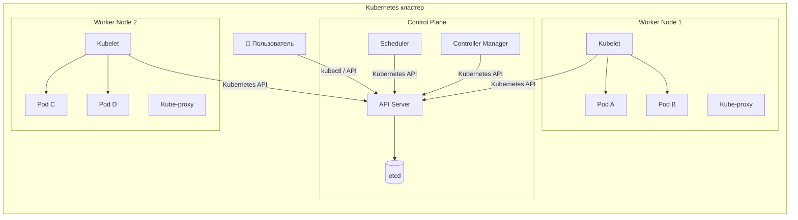
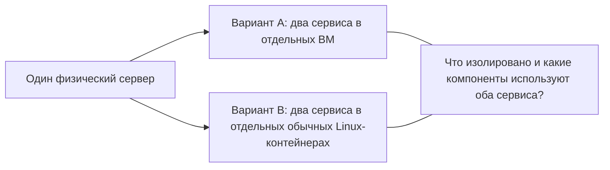
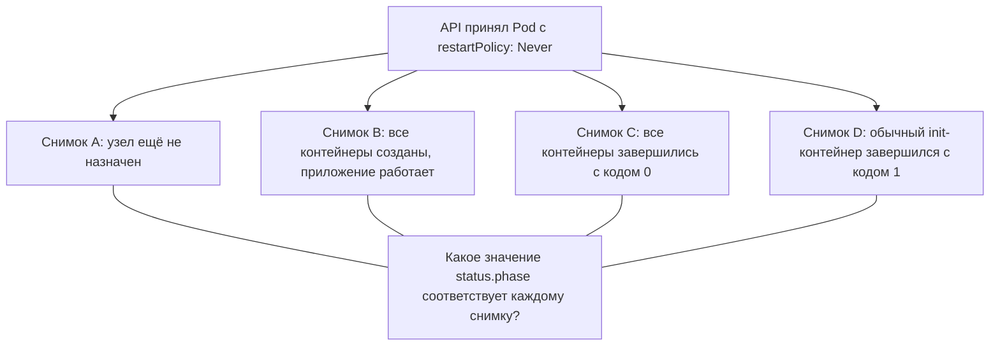
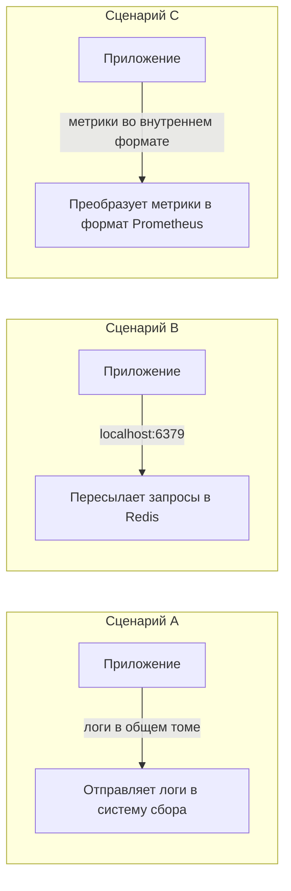
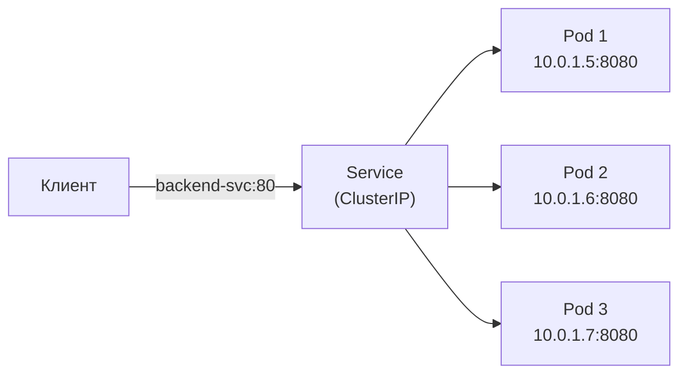
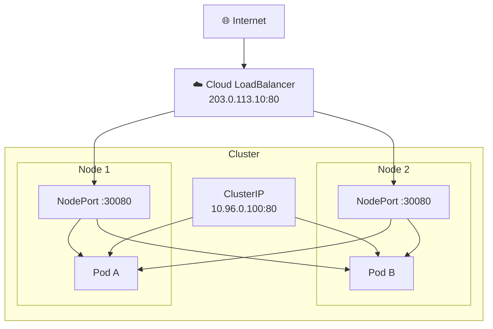
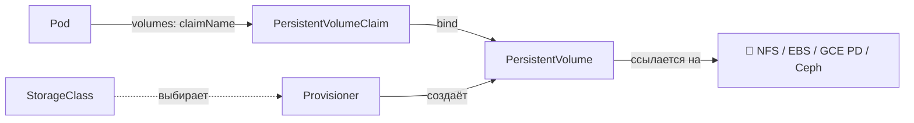
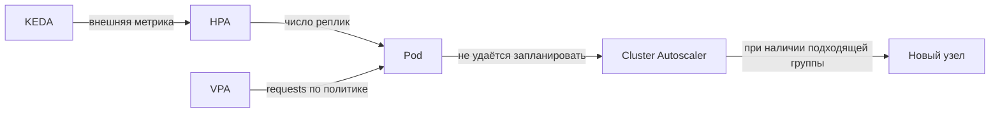
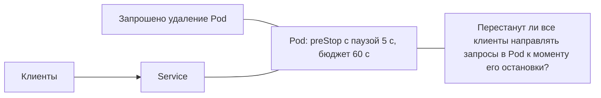
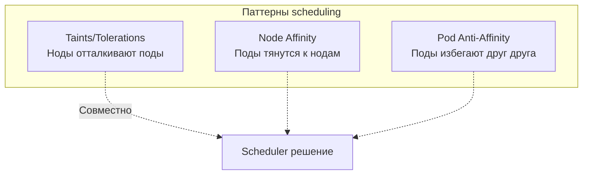

# Вопросы на собеседовании: `Kubernetes`

Полное покрытие `Kubernetes` для подготовки к собеседованию: архитектура кластера, `Pod`, `Deployment`, `Service`, `Ingress`, `StatefulSet`, `DaemonSet`, `Job`/`CronJob`, `RBAC`, `NetworkPolicy`, `Helm`, health probes, масштабирование и интеграция со `Spring Boot`.

**`Kubernetes`** (K8s) — оркестратор контейнеров, де-факто стандарт для запуска микросервисов в продакшене. На собеседованиях проверяют знание основных абстракций (`Pod`, `Deployment`, `Service`, `Ingress`), механизмов обеспечения надёжности (probes, `ReplicaSet`, `HPA`), безопасности (`RBAC`, `NetworkPolicy`, `Secret`) и практический опыт работы с `kubectl` и `Helm`.

## Полезные ссылки

### Официальная документация

- [Kubernetes Documentation](https://kubernetes.io/docs/) — официальная документация
- [Kubernetes API Reference](https://kubernetes.io/docs/reference/kubernetes-api/) — справочник API
- [kubectl Cheat Sheet](https://kubernetes.io/docs/reference/kubectl/cheatsheet/) — шпаргалка по `kubectl`
- [Kubernetes the Hard Way](https://github.com/kelseyhightower/kubernetes-the-hard-way) — установка кластера вручную
- [Running Spring Boot Applications With Minikube](https://www.baeldung.com/spring-boot-minikube) — деплой Spring Boot в Kubernetes
- [Liveness and Readiness Probes in Spring Boot](https://www.baeldung.com/spring-liveness-readiness-probes) — health probes для Kubernetes
- [Guide to Spring Cloud Kubernetes](https://www.baeldung.com/spring-cloud-kubernetes) — Spring Cloud Kubernetes
- [Using Helm and Kubernetes](https://www.baeldung.com/ops/kubernetes-helm) — Helm для управления Kubernetes-приложениями

## Содержание

- [Полезные ссылки](#полезные-ссылки)
- [See also](#see-also)

**Основы Kubernetes**
- [Q1. (!) Что такое `Kubernetes` и какие задачи он решает?](#q1--что-такое-kubernetes-и-какие-задачи-он-решает)
- [Q2. (!) Какие основные компоненты входят в архитектуру `Kubernetes`?](#q2--какие-основные-компоненты-входят-в-архитектуру-kubernetes)
- [Q3. Что такое `etcd` и какова его роль?](#q3-что-такое-etcd-и-какова-его-роль)
- [Q4. (!) Чем виртуализация отличается от контейнеризации?](#q4--чем-виртуализация-отличается-от-контейнеризации)
- [Q5. В чём разница между `Kubernetes` и `Docker Swarm`?](#q5-в-чём-разница-между-kubernetes-и-docker-swarm)

**Pod и жизненный цикл**
- [Q6. (!) Что такое `Pod`?](#q6--что-такое-pod)
- [Q7. (!) Какие фазы жизненного цикла проходит `Pod`?](#q7--какие-фазы-жизненного-цикла-проходит-pod)
- [Q8. (!) Что такое Init-контейнеры?](#q8--что-такое-init-контейнеры)
- [Q9. (!) Что такое `Liveness`, `Readiness` и `Startup Probes`?](#q9--что-такое-liveness-readiness-и-startup-probes)
- [Q10. Какие паттерны multi-container `Pod` существуют?](#q10-какие-паттерны-multi-container-pod-существуют)
- [Q11. Что такое `QoS`-классы `Pod`?](#q11-что-такое-qos-классы-pod)

**Контроллеры: ReplicaSet, Deployment, StatefulSet**
- [Q12. (!) Что такое `ReplicaSet`?](#q12--что-такое-replicaset)
- [Q13. (!) Что такое `Deployment` и чем он отличается от `ReplicaSet`?](#q13--что-такое-deployment-и-чем-он-отличается-от-replicaset)
- [Q14. (!) Какие стратегии обновления поддерживает `Deployment`?](#q14--какие-стратегии-обновления-поддерживает-deployment)
- [Q15. Как выполнить откат `Deployment`?](#q15-как-выполнить-откат-deployment)
- [Q16. (!) Что такое `StatefulSet` и когда его использовать?](#q16--что-такое-statefulset-и-когда-его-использовать)
- [Q17. В чём разница между `Deployment` и `StatefulSet`?](#q17-в-чём-разница-между-deployment-и-statefulset)

**DaemonSet, Job, CronJob**
- [Q18. Что такое `DaemonSet`?](#q18-что-такое-daemonset)
- [Q19. Что такое `Job` и `CronJob`?](#q19-что-такое-job-и-cronjob)

**Service и сетевая модель**
- [Q20. (!) Что такое `Service` и какие типы существуют?](#q20--что-такое-service-и-какие-типы-существуют)
- [Q21. (!) В чём разница между `ClusterIP`, `NodePort` и `LoadBalancer`?](#q21--в-чём-разница-между-clusterip-nodeport-и-loadbalancer)
- [Q22. (!) Что такое `Ingress`?](#q22--что-такое-ingress)
- [Q23. В чём разница между `targetPort`, `port` и `nodePort`?](#q23-в-чём-разница-между-targetport-port-и-nodeport)
- [Q24. Как работает DNS в `Kubernetes`?](#q24-как-работает-dns-в-kubernetes)
- [Q25. (!) Что такое `NetworkPolicy`?](#q25--что-такое-networkpolicy)

**Конфигурация и секреты**
- [Q26. (!) Что такое `ConfigMap`?](#q26--что-такое-configmap)
- [Q27. (!) Что такое `Secret`?](#q27--что-такое-secret)
- [Q28. Как передать конфигурацию в контейнер?](#q28-как-передать-конфигурацию-в-контейнер)

**Хранилища**
- [Q29. (!) Что такое `PersistentVolume` и `PersistentVolumeClaim`?](#q29--что-такое-persistentvolume-и-persistentvolumeclaim)
- [Q30. Какие типы томов поддерживает `Kubernetes`?](#q30-какие-типы-томов-поддерживает-kubernetes)

**Масштабирование**
- [Q31. (!) Как работает `Horizontal Pod Autoscaler`?](#q31--как-работает-horizontal-pod-autoscaler)
- [Q32. Что такое `Vertical Pod Autoscaler` и `Cluster Autoscaler`?](#q32-что-такое-vertical-pod-autoscaler-и-cluster-autoscaler)

**Безопасность и RBAC**
- [Q33. (!) Что такое `RBAC` в `Kubernetes`?](#q33--что-такое-rbac-в-kubernetes)
- [Q34. Что такое `Namespace` и `Resource Quota`?](#q34-что-такое-namespace-и-resource-quota)
- [Q35. Что такое `SecurityContext` и `Pod Security Standards`?](#q35-что-такое-securitycontext-и-pod-security-standards)

**Helm и kubectl**
- [Q36. (!) Что такое `Helm`?](#q36--что-такое-helm)
- [Q37. (!) Основные команды `kubectl`](#q37--основные-команды-kubectl)

**Мониторинг и логирование**
- [Q38. Как реализовать мониторинг и логирование в `Kubernetes`?](#q38-как-реализовать-мониторинг-и-логирование-в-kubernetes)

**Высокая доступность и production**
- [Q39. (!) Какие механизмы обеспечения высокой доступности предоставляет `Kubernetes`?](#q39--какие-механизмы-обеспечения-высокой-доступности-предоставляет-kubernetes)
- [Q40. Что такое `OpenShift`?](#q40-что-такое-openshift)

**Интеграция со Spring Boot**
- [Q41. (!) Как настроить `Spring Boot` приложение для работы в `Kubernetes`?](#q41--как-настроить-spring-boot-приложение-для-работы-в-kubernetes)
- [Q42. Как настроить `Graceful Shutdown` в `Kubernetes`?](#q42-как-настроить-graceful-shutdown-в-kubernetes)

**Планирование и управление ресурсами**
- [Q43. Что такое `Taints`, `Tolerations` и `Node Affinity`?](#q43-что-такое-taints-tolerations-и-node-affinity)
- [Q44. Что такое `LimitRange` и чем он отличается от `ResourceQuota`?](#q44-что-такое-limitrange-и-чем-он-отличается-от-resourcequota)
- [Q45. Что такое `Kustomize` и как он соотносится с `Helm`?](#q45-что-такое-kustomize-и-как-он-соотносится-с-helm)

**Обслуживание кластера**
- [Q46. Как PodDisruptionBudget влияет на kubectl drain и чего он не гарантирует?](#q46-как-poddisruptionbudget-влияет-на-kubectl-drain-и-чего-он-не-гарантирует)

**Сетевой API**
- [Q47. Когда выбрать Gateway API вместо Ingress и как связаны GatewayClass, Gateway и HTTPRoute?](#q47-когда-выбрать-gateway-api-вместо-ingress-и-как-связаны-gatewayclass-gateway-и-httproute)

---

## Q1. (!) Что такое `Kubernetes` и какие задачи он решает?

`Kubernetes` (K8s) — платформа оркестрации контейнеров с открытым исходным кодом: вы декларативно описываете, как должно выглядеть приложение в кластере, а K8s сам поддерживает это состояние — запускает контейнеры, перезапускает упавшие, балансирует трафик. Google открыл проект в 2014 году, опираясь в том числе на опыт эксплуатации Borg. О передаче проекта в CNCF объявили при выпуске Kubernetes 1.0 в 2015 году. [История Kubernetes](https://kubernetes.io/blog/2024/06/06/10-years-of-kubernetes/)

Главная задача, которую он решает, — снять с человека ручное управление десятками контейнеров на множестве машин:

- **Оркестрация** — управляет жизненным циклом контейнеров на кластере машин: на какой узел назначить новый Pod и как восстановить число реплик при отказе узла
- **Декларативная конфигурация** — вы описываете *желаемое состояние* в YAML, а K8s сам приводит кластер к нему (вместо императивных команд «запусти контейнер X на ноде Y»)
- **Самовосстановление** — при сбое контейнера kubelet может перезапустить его в том же Pod согласно политике перезапуска. При потере узла контроллер рабочей нагрузки может создать новый Pod на доступном узле.
- **Масштабирование** — HPA меняет число реплик по метрикам. Отдельно установленный VPA рекомендует или меняет запросы ресурсов Pod в зависимости от режима
- **Service discovery** — встроенный `DNS` и балансировка нагрузки между репликами
- **Rolling updates** — постепенная замена реплик. Контроллер также может раскатать сохранённую ревизию при откате.



**Что подчеркнуть на собеседовании:** `Kubernetes` — не просто инструмент запуска контейнеров, а *платформа*, реализующая паттерн **Desired State Management**. Вы описываете, что хотите, а контроллеры в цикле сверяют фактическое состояние с желаемым и сами устраняют расхождение. Отсюда и самовосстановление: если у ReplicaSet с тремя желаемыми репликами удалить один Pod, контроллер создаст новый, а scheduler назначит ему узел. Сбой процесса внутри существующего Pod обрабатывает kubelet по политике перезапуска.

## Q2. (!) Какие основные компоненты входят в архитектуру `Kubernetes`?

Архитектура `Kubernetes` разделена на два слоя: **Control Plane** (управляющий слой — «мозг» кластера, принимает решения) и **Worker Nodes** (рабочие узлы, где реально крутятся ваши контейнеры). Control Plane хранит желаемое состояние и приводит к нему кластер; ноды исполняют решения.

### Control Plane

| Компонент | Назначение |
|-----------|-----------|
| `kube-apiserver` | Предоставляет Kubernetes API, обрабатывает запросы к ресурсам и сохраняет состояние API в etcd |
| `etcd` | Распределённое key-value хранилище состояния кластера |
| `kube-scheduler` | Назначает поды на ноды на основе ресурсов, affinity, taints |
| `kube-controller-manager` | Запускает контроллеры: `ReplicaSet`, `Deployment`, `Node`, `Job` и др. |
| `cloud-controller-manager` | Интеграция с облачным провайдером через контроллеры узлов, маршрутов и Service (внешний балансировщик) |

### Worker Node

| Компонент | Назначение |
|-----------|-----------|
| `kubelet` | Агент на каждой ноде, управляет жизненным циклом подов |
| `kube-proxy` | Следит за Service и EndpointSlice и программирует перенаправление трафика Service. Может отсутствовать, если эту функцию выполняет другой компонент сетевого решения |
| Container Runtime | `containerd`, `CRI-O` — запускает контейнеры |

Подробнее о распределённых системах — в [вопросах по распределённым системам](../architecture/distributed-systems-interview.md).

Интеграция хранилищ обычно выполняется отдельными CSI-драйверами. [Cloud Controller Manager](https://kubernetes.io/docs/concepts/architecture/cloud-controller/) · [Persistent Volumes](https://kubernetes.io/docs/concepts/storage/persistent-volumes/).

Документация Kubernetes — [компоненты кластера](https://kubernetes.io/docs/concepts/overview/components/) и [виртуальные IP и прокси Service](https://kubernetes.io/docs/reference/networking/virtual-ips/).

## Q3. Что такое `etcd` и какова его роль?

В типичной установке Kubernetes API server использует `etcd` для хранения объектов API, в том числе спецификаций и статусов Pod, Secret, ConfigMap и Lease. `etcd` — распределённое хранилище «ключ — значение». Его реплики используют Raft для согласования записей. Снимок etcd возвращает сохранённые объекты API. Данные приложений на томах и во внешних базах требуют собственного резервного копирования.

- **Согласованность.** Линейризуемое чтение etcd учитывает завершившиеся записи. Контроллеры Kubernetes работают с API server, обычно через list/watch и локальный кэш. Состояние кэша может отставать.
- **Изменения.** Revision в etcd упорядочивает изменения хранилища. На уровне Kubernetes `resourceVersion` используется по контракту API и обрабатывается как непрозрачное значение.
- **Восстановление.** Snapshot сохраняет данные на момент снимка. После восстановления старого снимка клиенты Kubernetes могут помнить более свежие ревизии. В etcd 3.6 при восстановлении через `etcdutl snapshot restore` параметр `--bump-revision` поднимает ревизию выше уже наблюдавшихся значений, если выбран достаточный запас. Параметр `--mark-compacted` помечает историю до поднятой ревизии как уплотнённую, чтобы подписки со старых ревизий завершились и клиенты перечитали объекты. Подъём ревизии не восстанавливает записи, сделанные после снимка. [etcd 3.6 — восстановление после сбоя](https://etcd.io/docs/v3.6/op-guide/recovery/#restoring-with-revision-bump) · [Kubernetes — эксплуатация etcd](https://kubernetes.io/docs/tasks/administer-cluster/configure-upgrade-etcd/).

```bash
# Проверка доступности etcd с настроенными TLS-реквизитами
etcdctl endpoint health --cluster

# Создать снимок etcd для бэкапа
ETCDCTL_API=3 etcdctl snapshot save /backup/etcd-snapshot.db \
  --endpoints=https://127.0.0.1:2379 \
  --cacert=/etc/etcd/ca.crt \
  --cert=/etc/etcd/server.crt \
  --key=/etc/etcd/server.key
```

Для проверки etcd используйте `etcdctl endpoint health` с адресами и TLS-реквизитами своего кластера. Kubernetes API `ComponentStatus` устарел. [etcd API guarantees](https://etcd.io/docs/v3.6/learning/api_guarantees/) · [Kubernetes API concepts](https://kubernetes.io/docs/reference/using-api/api-concepts/).

**Подводный камень:** `etcd` чувствителен к задержкам диска и сети — медленные диски на нодах Control Plane напрямую бьют по латентности всего API. В production его держат на быстрых SSD и кластеризуют нечётным числом реплик (3 или 5) для кворума.

Подробнее о консенсусе — в [CAP-теореме](../architecture/cap-theorem-interview.md) и [паттернах согласованности](../architecture/consistency-patterns-interview.md).

## Q4. (!) Чем виртуализация отличается от контейнеризации?

**Уровень изоляции отличается.** Гипервизор предоставляет виртуальной машине виртуальное оборудование, на котором работает собственное гостевое ядро. Обычный Linux-контейнер запускает процессы на общем ядре хоста. Namespaces определяют, какие объекты видит процесс, а cgroups учитывают и ограничивают потребление ресурсов. Ограничения доступа также задают, например, через capabilities и seccomp.

| Критерий | Виртуальная машина | Обычный Linux-контейнер |
|----------|--------------------|------------------------|
| Что запускается | Гостевая ОС и приложение | Процессы приложения |
| Граница изоляции | Гипервизор и отдельное гостевое ядро | Изоляция процессов средствами общего ядра |
| Размер и время старта | Зависят от гостевой ОС, способа загрузки и приложения | Зависят от образа, наличия слоёв в кеше и инициализации приложения |

**Пример.** Если сервису нужны возможности конкретного ядра, запуск контейнера с другим пользовательским окружением сам по себе версию ядра не меняет. ВМ позволяет загрузить отдельное ядро. В Kubernetes также можно выбрать поддерживаемый кластером runtime через `RuntimeClass`, например для запуска с дополнительной изоляцией.



**Уровень изоляции отличается.** Гипервизор предоставляет виртуальной машине виртуальное оборудование, на котором работает собственное гостевое ядро. Обычный Linux-контейнер запускает процессы на общем ядре хоста. Namespaces определяют, какие объекты видит процесс, а cgroups учитывают и ограничивают потребление ресурсов. Ограничения доступа также задают, например, через capabilities и seccomp.

| Критерий | Виртуальная машина | Обычный Linux-контейнер |
|----------|--------------------|------------------------|
| Что запускается | Гостевая ОС и приложение | Процессы приложения |
| Граница изоляции | Гипервизор и отдельное гостевое ядро | Изоляция процессов средствами общего ядра |
| Размер и время старта | Зависят от гостевой ОС, способа загрузки и приложения | Зависят от образа, наличия слоёв в кеше и инициализации приложения |

**Пример.** Если сервису нужны возможности конкретного ядра, запуск контейнера с другим пользовательским окружением сам по себе версию ядра не меняет. ВМ позволяет загрузить отдельное ядро. В Kubernetes также можно выбрать поддерживаемый кластером runtime через `RuntimeClass`, например для запуска с дополнительной изоляцией.


Подробнее о контейнеризации — в [вопросах по Docker](docker-interview.md).

## Q5. В чём разница между `Kubernetes` и `Docker Swarm`?

Оба оркестратора поддерживают желаемое число реплик сервиса, обнаружение сервисов и поэтапное обновление. Разница видна в API и способе расширения платформы.

| Критерий | `Kubernetes` | `Docker Swarm` |
|----------|-------------|----------------|
| Единица развёртывания | `Deployment` управляет репликами Pod через ReplicaSet | `service` задаёт желаемое состояние, менеджеры запускают задачи |
| Обнаружение и публикация | DNS для Service. Внешняя HTTP-маршрутизация через настроенный Ingress или Gateway | Встроенный DNS для сервисов. Опубликованные порты по умолчанию обслуживает routing mesh |
| Обновление и откат | Для Deployment задают `maxSurge` и `maxUnavailable`, откат использует сохранённую ревизию | Можно настроить параллелизм, задержку, порядок замены задач и действие при сбое. Поддерживается откат |
| Масштабирование | HPA меняет число реплик по метрикам при наличии соответствующего источника | Число реплик меняют командой или через API. Автомасштабирование по метрикам требует внешней логики |

**Пример.** Для небольшой команды с уже настроенным Docker Engine и ручным масштабированием Swarm может закрыть требования к репликам и раскатке. Если нужны масштабирование по метрикам и расширение API операторами, эти требования стоит сопоставить со средствами Kubernetes и стоимостью эксплуатации.

Источники — [Docker Swarm mode](https://docs.docker.com/engine/swarm/), [настройки сервисов Docker](https://docs.docker.com/reference/cli/docker/service/update/), [Kubernetes Deployment](https://kubernetes.io/docs/concepts/workloads/controllers/deployment/) и [RuntimeClass](https://kubernetes.io/docs/concepts/containers/runtime-class/).


## Q6. (!) Что такое `Pod`?

`Pod` — минимальная единица развёртывания в `Kubernetes`: K8s планирует и масштабирует не отдельные контейнеры, а именно поды. Под — это группа из одного или нескольких контейнеров, которые всегда живут на одной ноде и делят общий контекст:

- разделяют **сетевое пространство**: контейнеры в Pod используют общие адреса и порты и могут обращаться друг к другу через `localhost`. В dual-stack у Pod могут быть адреса IPv4 и IPv6.
- могут разделять **тома** (volumes) для обмена файлами
- планируются на один узел и удаляются вместе с Pod. Контейнеры внутри Pod могут перезапускаться по отдельности

Чаще всего в поде один контейнер — приложение. Несколько контейнеров кладут в один под только когда им нужно делить сеть или диск и жить-умирать вместе (см. sidecar-паттерны в Q10).

```yaml
apiVersion: v1
kind: Pod
metadata:
  name: my-app
  labels:
    app: backend
spec:
  containers:
    - name: app
      image: my-app:1.2.3
      ports:
        - containerPort: 8080
      resources:
        requests:
          cpu: "250m"
          memory: "256Mi"
        limits:
          cpu: "500m"
          memory: "512Mi"
```

**Что важно помнить:**
- Назначенный Pod остаётся привязан к своему узлу. При сбое отдельного контейнера kubelet может перезапустить контейнер внутри того же Pod. При потере узла контроллер может создать новый Pod с новым UID. Для стабильного адреса обычно используют `Service` (Q20). [Pod lifecycle](https://kubernetes.io/docs/concepts/workloads/pods/pod-lifecycle/).
- Создавать поды напрямую **не рекомендуется** — без контроллера при удалении Pod или потере узла замена автоматически не появится. Используйте контроллеры (`Deployment`, `StatefulSet`), которые следят за нужным числом реплик.
- У обычных Pod отдельные адреса в сети кластера. Pod с `hostNetwork: true` использует сетевое пространство узла.

## Q7. (!) Какие фазы жизненного цикла проходит `Pod`?



| Фаза | Описание |
|------|----------|
| `Pending` | Pod принят кластером, но один или несколько контейнеров ещё не готовы к запуску. Сюда входят ожидание назначения на узел и загрузка образов |
| `Running` | Pod назначен узлу, все контейнеры созданы и хотя бы один работает, запускается или перезапускается |
| `Succeeded` | Все контейнеры завершились успешно (exit code 0), перезапуск не планируется |
| `Failed` | Все контейнеры завершились, хотя бы один — неуспешно, перезапуск не следует |
| `Unknown` | Состояние не удаётся определить (потеря связи с нодой) |

В сценарии A соответствует `Pending`, B соответствует `Running`, C соответствует `Succeeded`. При ошибке обычного init-контейнера и `restartPolicy: Never` Pod может перейти в `Failed` ещё из `Pending`, как в D. После запуска неуспешное завершение без перезапуска также ведёт к `Failed`.

`phase` — сводное состояние Pod. `ImagePullBackOff` — причина ожидания контейнера, при которой Pod может оставаться в `Pending`. Ошибка отдельного контейнера может привести к его перезапуску без перехода Pod в `Failed`. При диагностике смотри также `conditions` и состояния отдельных контейнеров.

**Порядок инициализации Pod:**
1. Выполняются обычные **init-контейнеры** — строго по одному, каждый до успешного завершения
2. После инициализации kubelet запускает **основные контейнеры**. Порядок их старта не следует использовать как зависимость
3. Хук `postStart` относится к запуску конкретного контейнера и может выполняться одновременно с его entrypoint.
4. Если для контейнера задана **startup probe**, его liveness и readiness ждут её успеха. Без startup probe применяются настройки самих проверок (Q9).

[Pod lifecycle](https://kubernetes.io/docs/concepts/workloads/pods/pod-lifecycle/).

## Q8. (!) Что такое Init-контейнеры?

Обычный init-контейнер запускается **до** основных контейнеров Pod и должен завершиться **успешно**, чтобы kubelet продолжил инициализацию. Их может быть несколько, и выполняются они **строго последовательно**: следующий ждёт успешного завершения предыдущего. Идея — вынести подготовительную работу из основного приложения в отдельный одноразовый шаг.

**Типичные сценарии:**
- ожидание готовности зависимости (например, дождаться доступности TCP-порта БД. Эта проверка не подтверждает готовность схемы или успешную аутентификацию)
- скачивание конфигурации или данных перед стартом
- миграция базы данных, если она допускает повтор и защищена от одновременного выполнения несколькими репликами
- подготовка файловой системы (права, структура каталогов в общем томе)

```yaml
apiVersion: v1
kind: Pod
metadata:
  name: app-with-init
spec:
  initContainers:
    - name: wait-for-db
      image: busybox:1.36
      command: ['sh', '-c', 'until nc -z postgres-svc 5432; do echo waiting; sleep 2; done']
    - name: run-migrations
      image: my-app:1.2.3
      command: ['./migrate', '--apply']
  containers:
    - name: app
      image: my-app:1.2.3
      ports:
        - containerPort: 8080
```

**Обычные init-контейнеры:**
- Выполняются последовательно до успешного завершения. Обычные init-контейнеры не поддерживают probes.
- При сбое kubelet обычно повторяет этот init-контейнер. Если у Pod задано `restartPolicy: Never`, сбой init-контейнера завершает Pod неуспешно.

Native sidecar задают в `initContainers` с `restartPolicy: Always`. Kubelet продолжает инициализацию после запуска процесса sidecar либо после успеха его startup probe, если она настроена. Sidecar работает вместе с основными контейнерами и может иметь probes. [Init containers](https://kubernetes.io/docs/concepts/workloads/pods/init-containers/) · [Sidecar containers](https://kubernetes.io/docs/concepts/workloads/pods/sidecar-containers/).

## Q9. (!) Что такое `Liveness`, `Readiness` и `Startup Probes`?

Probes — это проверки здоровья, которые `kubelet` периодически выполняет над контейнером, чтобы понять его состояние и решить, что делать. Три типа отвечают на три разных вопроса, и путать их — классическая ошибка:

| Probe | Назначение | Действие при неудаче |
|-------|-----------|---------------------|
| `startupProbe` | Проверка завершения инициализации | До успеха откладывает liveness и readiness. После порога kubelet завершает контейнер с учётом политики перезапуска |
| `livenessProbe` | Контейнер жив и работает? | После порога kubelet завершает контейнер с учётом политики перезапуска |
| `readinessProbe` | Контейнер готов принимать трафик? | Pod становится неготовым. Для обычного Service это исключает его endpoint из маршрутизации |

`startupProbe` даёт контейнеру время на запуск. После её успеха начинают действовать liveness и readiness. Неуспешная readiness сама по себе не перезапускает контейнер.

**Способы проверки:** `httpGet`, `tcpSocket`, `exec`, `grpc`

HTTP-проверка считает успешными коды 200–399. TCP-проверка проверяет, открывается ли соединение, а `exec` — возвращает ли команда код 0. Для `grpc` сервер должен поддерживать gRPC Health Checking Protocol и отвечать `SERVING`.

В примере используется Spring Boot 3.5 с Actuator, группами liveness и readiness и стандартным путём `/actuator` на порту приложения. Если Actuator вынесен на отдельный порт, проверка этого порта может пройти при отказе основного HTTP-сервера. В этом случае можно опубликовать пути `/livez` и `/readyz` на основном порту через `management.endpoint.health.probes.add-additional-paths=true`.

```yaml
apiVersion: apps/v1
kind: Deployment
metadata:
  name: backend
spec:
  replicas: 3
  selector:
    matchLabels:
      app: backend
  template:
    metadata:
      labels:
        app: backend
    spec:
      containers:
        - name: app
          image: my-app:1.2.3
          ports:
            - containerPort: 8080
          startupProbe:
            httpGet:
              path: /actuator/health/liveness
              port: 8080
            failureThreshold: 30
            periodSeconds: 2
          livenessProbe:
            httpGet:
              path: /actuator/health/liveness
              port: 8080
            periodSeconds: 10
            failureThreshold: 3
          readinessProbe:
            httpGet:
              path: /actuator/health/readiness
              port: 8080
            periodSeconds: 5
            failureThreshold: 3
```

**Как читать параметры примера.** Для startup задан ориентир в 60 секунд (`30 × 2`). Это бюджет по настройкам проверки, а не гарантия точного времени до перезапуска. Порог означает число последовательных неудач. Для startup и liveness достижение порога инициирует остановку контейнера. Для readiness та же серия меняет готовность, а kubelet продолжает проверять контейнер.

**Куда включать зависимости.** В liveness проверяйте сбои самого приложения, которые может устранить перезапуск. Если добавить туда общую БД, её отказ может запустить перезапуски всех реплик. В Spring Boot 3.5 группы проб по умолчанию не включают проверки внешних зависимостей. Включайте зависимость в readiness, когда этот экземпляр без неё не должен обслуживать запросы. Если БД общая для всех реплик, её отказ тогда сделает неготовыми их все. Если часть запросов можно обработать без БД, оставьте Pod готовым и обработайте отказ в затронутых маршрутах.

Документация — [Kubernetes probes](https://kubernetes.io/docs/concepts/workloads/pods/probes/) и [Actuator Kubernetes Probes](https://docs.spring.io/spring-boot/3.5/reference/actuator/endpoints.html#actuator.endpoints.kubernetes-probes).


## Q10. Какие паттерны multi-container `Pod` существуют?

Контейнеры одного Pod используют общую сеть и могут обращаться друг к другу через `localhost`. Для обмена файлами один и тот же том монтируют в каждый контейнер, которому нужен доступ. На схеме три сценария. Определи роль вспомогательного контейнера в каждом из них.



| Паттерн | Описание | Пример |
|---------|----------|--------|
| **Sidecar** | Расширяет функциональность основного контейнера | `Fluentd` рядом с приложением для сбора логов |
| **Ambassador** | Проксирует сетевые соединения | `Envoy` как прокси к внешнему сервису |
| **Adapter** | Трансформирует выходные данные | Экспортёр метрик в формат `Prometheus` |
| **Init Container** | Выполняет подготовительные задачи | Проверка доступности обязательной зависимости перед запуском приложения |

В сценарии A контейнер выполняет роль sidecar, в B роль ambassador, в C роль adapter. Sidecar, ambassador и adapter описывают роль контейнера. В Kubernetes native sidecar объявляют в `initContainers` с `restartPolicy: Always`. Когда kubelet отмечает такой контейнер как запущенный, он переходит к следующему init-контейнеру или, если список исчерпан, запускает контейнеры приложения. Если задана startup probe, kubelet ждёт её успеха. Сам sidecar продолжает работать параллельно с приложением. Обычный init-контейнер должен успешно завершиться до запуска приложения. Например, приложение пишет лог в общий `emptyDir`, а native sidecar читает его и отправляет в систему сбора логов. [Pods](https://kubernetes.io/docs/concepts/workloads/pods/) · [Sidecar Containers](https://kubernetes.io/docs/concepts/workloads/pods/sidecar-containers/).

## Q11. Что такое `QoS`-классы `Pod`?

Класс QoS зависит от заданных CPU и memory requests и limits. Для обычной настройки ресурсов на уровне контейнеров действуют такие правила:

| QoS-класс | Условие |
|-----------|---------|
| **Guaranteed** | У каждого контейнера положительные CPU и memory requests и limits. Для каждого ресурса request равен limit |
| **Burstable** | Есть хотя бы один CPU или memory request либо limit, при этом Pod не соответствует `Guaranteed` |
| **BestEffort** | Нет CPU и memory requests или limits |

```yaml
# Ресурсы одного контейнера, удовлетворяющие условию Guaranteed
resources:
  requests:
    cpu: "500m"
    memory: "512Mi"
  limits:
    cpu: "500m"
    memory: "512Mi"
```

В Pod с несколькими контейнерами этот пример даёт `Guaranteed`, если условие выполнено для каждого контейнера. Проверяйте итоговую спецификацию после применения умолчаний. Например, если задан только limit и admission не подставил request, Kubernetes копирует limit в request для этого ресурса. [Управление ресурсами контейнеров](https://kubernetes.io/docs/concepts/configuration/manage-resources-containers/).

При использовании `spec.resources` на уровне Pod действует отдельное правило. Начиная с Kubernetes 1.34, `PodLevelResources` находится в beta и включён по умолчанию. Pod с такими настройками получает `Guaranteed`, если на уровне Pod заданы положительные CPU и memory requests и limits и для каждого ресурса они равны. [Классы QoS](https://kubernetes.io/docs/concepts/workloads/pods/pod-qos/#guaranteed).

При давлении на узел kubelet учитывает, превышает ли потребление requests, приоритет Pod и относительное потребление ресурса. Класс QoS связан с этими условиями, но строгой очереди по классам нет. [Node-pressure eviction](https://kubernetes.io/docs/concepts/scheduling-eviction/node-pressure-eviction/).

## Q12. (!) Что такое `ReplicaSet`?

ReplicaSet поддерживает желаемое число активных Pod. Если их меньше, он создаёт Pod из `spec.template`. При избытке удаляет лишние. Падение контейнера с последующим перезапуском внутри того же Pod само по себе не требует создания нового Pod.

```yaml
apiVersion: apps/v1
kind: ReplicaSet
metadata:
  name: backend-rs
spec:
  replicas: 3
  selector:
    matchLabels:
      app: backend
  template:
    metadata:
      labels:
        app: backend
    spec:
      containers:
        - name: app
          image: my-app:1.2.3
```

Отношение владения отражается в `metadata.ownerReferences`. Если создать самостоятельный Pod с подходящими метками и без управляющего владельца, ReplicaSet может принять его в управление и учесть в числе реплик, даже если конфигурация Pod отличается от шаблона. Для декларативного обновления версии обычно используют Deployment (Q13). [ReplicaSet](https://kubernetes.io/docs/concepts/workloads/controllers/replicaset/).

## Q13. (!) Что такое `Deployment` и чем он отличается от `ReplicaSet`?

`Deployment` управляет ReplicaSet и раскатывает изменения шаблона Pod (`.spec.template`). Контроллер создаёт ReplicaSet для нового шаблона или использует существующий с совпадающим шаблоном. Затем он меняет число реплик по стратегии развёртывания. Изменение `.spec.replicas` масштабирует Deployment без новой ревизии.

Deployment добавляет стратегии обновления, историю ревизий и откат к сохранённому шаблону. При RollingUpdate доступность зависит от готовности реплик, ёмкости и параметров стратегии.

```yaml
apiVersion: apps/v1
kind: Deployment
metadata:
  name: backend
spec:
  replicas: 3
  revisionHistoryLimit: 5
  selector:
    matchLabels:
      app: backend
  strategy:
    type: RollingUpdate
    rollingUpdate:
      maxSurge: 1
      maxUnavailable: 0
  template:
    metadata:
      labels:
        app: backend
    spec:
      containers:
        - name: app
          image: my-app:1.2.3
          ports:
            - containerPort: 8080
```

| Критерий | `Deployment` | `ReplicaSet` |
|----------|-------------|--------------|
| Rolling update | Да | Нет |
| Rollback | Да (`kubectl rollout undo`) | Нет |
| История ревизий | Да | Нет |
| Рекомендуется | Да, для stateless | Управляется через Deployment |

[Deployments](https://kubernetes.io/docs/concepts/workloads/controllers/deployment/).

## Q14. (!) Какие стратегии обновления поддерживает `Deployment`?

У `Deployment` есть **две встроенные** стратегии. Для canary и blue/green можно использовать отдельные Deployment для версий и управлять маршрутизацией отдельно.

### Встроенные стратегии

**1. `RollingUpdate`** (по умолчанию) постепенно заменяет Pod. `maxSurge` ограничивает дополнительные реплики при обновлении, а `maxUnavailable` задаёт допустимое число недоступных реплик. При `maxSurge: 1` и `maxUnavailable: 0` контроллер стремится сохранять заданное число доступных реплик. Для этого нужны свободные ресурсы и корректные readiness-проверки. При заданном `minReadySeconds` новый Pod должен оставаться готовым указанное время, прежде чем Deployment посчитает его доступным. Завершающиеся Pod могут ещё занимать ресурсы, поэтому фактическое число Pod во время раскатки может превышать `replicas + maxSurge`. [Rolling Update](https://kubernetes.io/docs/concepts/workloads/controllers/deployment/#rolling-update-deployment).

```yaml
strategy:
  type: RollingUpdate
  rollingUpdate:
    maxSurge: 1        # запас реплик для раскатки сверх replicas
    maxUnavailable: 0   # при раскатке контроллер сохраняет число доступных реплик
```

**2. `Recreate`** — при обновлении Deployment контроллер дожидается завершения старых Pod и запускает новые. Возможен простой. При ручном удалении отдельного Pod его ReplicaSet может создать замену, пока удаляемый Pod ещё завершается.

```yaml
strategy:
  type: Recreate  # последовательная замена версий при обновлении Deployment
```

### Паттерны с несколькими Deployment

| Стратегия | Описание | Инструменты |
|-----------|----------|------------|
| **Blue/Green** | Две версии, переключение трафика, например изменением селектора Service | `Argo Rollouts`, `Istio` |
| **Canary** | Постепенная подача трафика новой версии. Для заданного процента нужен механизм взвешенной маршрутизации | `Argo Rollouts`, `Flagger`, `Istio` |
| **A/B Testing** | Маршрутизация по заголовкам/cookies | `Istio`, `Nginx Ingress` |

Подробнее — в [стратегиях деплоя](../cicd/deployment-strategies-interview.md).

## Q15. Как выполнить откат `Deployment`?

```bash
# История backend содержит ревизию 3. Как восстановить именно её?
kubectl rollout history deployment/backend
```

Команды отката и проверки раскатки приведены ниже.

```bash
# Откатиться к предыдущей версии
kubectl rollout undo deployment/backend

# Откатиться к конкретной ревизии
kubectl rollout undo deployment/backend --to-revision=3

# Проверить статус раскатки
kubectl rollout status deployment/backend

# Приостановить/возобновить раскатку
kubectl rollout pause deployment/backend
kubectl rollout resume deployment/backend
```

`kubectl rollout undo` восстанавливает шаблон Pod из сохранённой ревизии. Контроллер затем раскатывает этот шаблон. Подам может понадобиться загрузить образ и пройти readiness. Перед откатом приостановленного Deployment сначала выполните `kubectl rollout resume`.

`spec.revisionHistoryLimit` (по умолчанию 10) ограничивает число старых ReplicaSet, сохраняемых после завершения раскатки. Если ReplicaSet ревизии удалён, откат к ней через `rollout undo` недоступен. [Deployment](https://kubernetes.io/docs/concepts/workloads/controllers/deployment/).

## Q16. (!) Что такое `StatefulSet` и когда его использовать?

`StatefulSet` — контроллер для приложений с **состоянием**, где у каждого пода своя идентичность и свои данные (в отличие от `Deployment`, где поды взаимозаменяемы). Нужен там, где разница «какой именно это под» имеет значение: реплики БД, узлы кластера. Он даёт четыре гарантии, которых нет у `Deployment`:

- **Стабильные сетевые идентификаторы** — порядковые имена Pod сохраняются при пересоздании. Стабильные DNS-имена опираются на управляющий headless Service, указанный в `serviceName`.
- **Стабильное хранилище** — каждому поду через `volumeClaimTemplates` выделяется собственный `PersistentVolumeClaim`, который переживает перезапуск и привязан именно к этому индексу
- **Упорядоченное развёртывание** — при политике `OrderedReady` Pod запускаются от младшего индекса к старшему после готовности предыдущих, а при масштабировании вниз удаляются в обратном порядке. `Parallel` снимает это ожидание при масштабировании.
- **Обновление** зависит от стратегии. При стандартном `RollingUpdate` контроллер обновляет Pod от старших индексов к младшим, а при `OnDelete` новый шаблон применяется после удаления Pod.

Упорядоченность полезна, если приложению важна последовательность запуска. Настройка ролей и репликации остаётся задачей приложения или оператора.

**Пример раскатки.** У StatefulSet пять Pod с индексами от 0 до 4. При `RollingUpdate` и `rollingUpdate.partition: 3` изменение шаблона затронет только Pod 4 и 3. Pod с меньшими индексами сохранят прежнюю ревизию даже при пересоздании. Это позволяет сначала проверить новую версию на части реплик.

В Kubernetes 1.37 `spec.updateStrategy.rollingUpdate.maxUnavailable` остаётся в beta и снова включён по умолчанию. Значение по умолчанию — 1. При `podManagementPolicy: Parallel` и значении 2 контроллер может обновлять несколько Pod, а новые Pod могут стать готовыми в разном порядке. Уже недоступная реплика расходует часть этого бюджета, даже если её индекс ниже `partition`. Перед увеличением бюджета проверьте, выдержит ли приложение одновременную потерю нескольких реплик: готовность Pod сама по себе не подтверждает наличие кворума БД. [StatefulSet Rolling Updates](https://kubernetes.io/docs/concepts/workloads/controllers/statefulset/#rolling-updates), [изменения Kubernetes 1.37](https://kubernetes.io/blog/2026/08/26/kubernetes-v1-37-release/#maxunavailable-for-statefulsets-back-on-by-default).

```yaml
apiVersion: apps/v1
kind: StatefulSet
metadata:
  name: postgres
spec:
  serviceName: "postgres-headless"
  replicas: 3
  selector:
    matchLabels:
      app: postgres
  template:
    metadata:
      labels:
        app: postgres
    spec:
      containers:
        - name: postgres
          image: postgres:16
          ports:
            - containerPort: 5432
          volumeMounts:
            - name: data
              mountPath: /var/lib/postgresql/data
  volumeClaimTemplates:
    - metadata:
        name: data
      spec:
        accessModes: ["ReadWriteOnce"]
        resources:
          requests:
            storage: 10Gi
```

**Примеры использования:** базы данных (`PostgreSQL`, `MySQL`), брокеры сообщений (`Kafka`, `RabbitMQ`), кеши (`Redis Cluster`), `Elasticsearch`, `ZooKeeper`.

Для примера нужно отдельно создать управляющий Service `postgres-headless` с `clusterIP: None` и подходящим selector. [StatefulSets](https://kubernetes.io/docs/concepts/workloads/controllers/statefulset/).

## Q17. В чём разница между `Deployment` и `StatefulSet`?

`Deployment` подходит для взаимозаменяемых реплик, в том числе для API, которое хранит данные во внешней БД. `StatefulSet` выбирают, когда реплике нужна устойчивая идентичность. Например, после пересоздания `postgres-1` получит тот же порядковый номер, имя и PVC из `volumeClaimTemplates`, если PVC сохранён. Репликацию данных и выбор лидера обеспечивает сама СУБД или управляющий ею оператор. [StatefulSets](https://kubernetes.io/docs/concepts/workloads/controllers/statefulset/).

| Критерий | `Deployment` | `StatefulSet` |
|----------|-------------|---------------|
| Идентичность подов | Случайные суффиксы (`abc-xyz12`) | Порядковые индексы (`pod-0`, `pod-1`) |
| DNS-имена | Стабильное имя Service для группы Pod | Стабильные имена отдельных Pod через управляющий headless Service |
| Хранилище | Может подключать PVC | `volumeClaimTemplates` создаёт отдельный PVC на Pod |
| Порядок запуска | Независимо для реплик | Последовательный при `OrderedReady` |
| Масштабирование вниз | Без гарантии порядка по идентификаторам | В обратном порядке при `OrderedReady` |
| Применение | Stateless (REST API, frontend) | Stateful (БД, кеши, очереди) |

## Q18. Что такое `DaemonSet`?

`DaemonSet` поддерживает по одной копии Pod на каждом подходящем узле. У `Deployment` задают число реплик, а у `DaemonSet` оно следует за набором подходящих узлов. Контроллер учитывает `nodeSelector`, обязательную `nodeAffinity` и taints с соответствующими tolerations. Затем планировщик пытается разместить Pod на выбранном узле. Если ресурсов не хватает, Pod может остаться в `Pending`.

**Типичные применения:**
- Сбор логов (`Fluentd`, `Filebeat`)
- Мониторинг нод (`Prometheus Node Exporter`, `Datadog Agent`)
- Сетевые плагины (`Calico`, `Cilium`, `kube-proxy`)
- Системы безопасности (`Falco`)

```yaml
apiVersion: apps/v1
kind: DaemonSet
metadata:
  name: fluentd
spec:
  selector:
    matchLabels:
      app: fluentd
  template:
    metadata:
      labels:
        app: fluentd
    spec:
      tolerations:
        - key: node-role.kubernetes.io/control-plane
          effect: NoSchedule
      containers:
        - name: fluentd
          image: fluentd:v1.17
          volumeMounts:
            - name: varlog
              mountPath: /var/log
      volumes:
        - name: varlog
          hostPath:
            path: /var/log
```

**Пример диагностики.** Сборщик логов отсутствует на управляющем узле с taint `node-role.kubernetes.io/control-plane:NoSchedule`. Toleration в примере допускает размещение на этом узле при выполнении остальных условий. Чтобы запустить агент только на управляющих узлах, дополнительно нужен селектор или обязательная affinity. Если целевой Pod уже создан и остаётся в `Pending`, проверьте события планировщика, например нехватку CPU или памяти.

При `RollingUpdate` с `maxSurge` больше нуля старый и новый Pod могут временно работать на одном узле. Это важно для агента с эксклюзивным ресурсом, например фиксированным `hostPort`. Если новый Pod не может стартовать рядом со старым, используйте обновление без surge и предусмотрите окно недоступности агента на этом узле. [DaemonSet](https://kubernetes.io/docs/concepts/workloads/controllers/daemonset/), [RollingUpdate DaemonSet](https://kubernetes.io/docs/tasks/manage-daemon/update-daemon-set/).

## Q19. Что такое `Job` и `CronJob`?

Это контроллеры для **разовых и периодических** задач, в отличие от `Deployment`/`DaemonSet`, которые держат под запущенным постоянно.

**`Job`** запускает Pod для конечной задачи и отслеживает успешные завершения. С `restartPolicy: OnFailure` kubelet может повторно запустить упавший контейнер в том же Pod. Если Pod завершился неуспешно, контроллер Job может создать заменяющий Pod. `backoffLimit` ограничивает повторы. [Job](https://kubernetes.io/docs/concepts/workloads/controllers/job/).

```yaml
apiVersion: batch/v1
kind: Job
metadata:
  name: db-migration
spec:
  backoffLimit: 3
  template:
    spec:
      restartPolicy: Never
      containers:
        - name: migrate
          image: my-app:1.2.3
          command: ["./migrate", "--apply"]
```

Даже у Job с одной требуемой успешной попыткой и `restartPolicy: Never` программа иногда запускается повторно. В примере миграции процесс может зафиксировать изменения в БД, а Pod — завершиться до того, как контроллер увидит успешный результат. При повторном запуске приложение проверяет уже применённые миграции по их идентификаторам. [Обработка сбоев Job](https://kubernetes.io/docs/concepts/workloads/controllers/job/#handling-pod-and-container-failures).

**`CronJob`** создаёт Job по расписанию. `concurrencyPolicy` регулирует только пересечения заданий одного CronJob. В некоторых ситуациях запуск может быть пропущен или создан дважды, поэтому задача должна быть идемпотентной. [CronJob](https://kubernetes.io/docs/concepts/workloads/controllers/cron-jobs/).

```yaml
apiVersion: batch/v1
kind: CronJob
metadata:
  name: daily-report
spec:
  schedule: "0 2 * * *"
  timeZone: "Etc/UTC"
  startingDeadlineSeconds: 900
  concurrencyPolicy: Forbid
  jobTemplate:
    spec:
      template:
        spec:
          restartPolicy: OnFailure
          containers:
            - name: report
              image: report-generator:1.0
```

| Параметр `concurrencyPolicy` | Поведение |
|-------------------------------|-----------|
| `Allow` | Параллельное выполнение задач |
| `Forbid` | Не создавать Job параллельно с активным Job этого CronJob |
| `Replace` | Остановить текущую и запустить новую |

**Пример с опозданием.** Отчёт запланирован на 02:00 UTC. Если предыдущий Job всё ещё работает, `Forbid` откладывает создание нового. Если предыдущий Job завершится в 02:10, контроллер ещё может создать новый. После 02:15 окно создания для этого запуска закрывается. `startingDeadlineSeconds` ограничивает опоздание при создании Job, а длительность его работы задаётся отдельно через `jobTemplate.spec.activeDeadlineSeconds`.

С Kubernetes 1.32 созданный Job получает аннотацию `batch.kubernetes.io/cronjob-scheduled-timestamp` с исходным временем по расписанию. Если приложению нужен ключ идемпотентности, оно может использовать идентификатор расписания и это время, получив аннотацию из объекта Job. Сам контроллер CronJob публикацию отчёта не дедуплицирует. [Дедлайн и правила пересечения](https://kubernetes.io/docs/concepts/workloads/controllers/cron-jobs/#deadline-for-delayed-job-start), [создание Job](https://kubernetes.io/docs/concepts/workloads/controllers/cron-jobs/#job-creation), [ограничение длительности Job](https://kubernetes.io/docs/concepts/workloads/controllers/job/#job-termination-and-cleanup).

## Q20. (!) Что такое `Service` и какие типы существуют?

IP Pod может измениться после его замены. Обычный `Service` даёт клиентам стабильное DNS-имя и виртуальный IP (`ClusterIP`). Для Service с селектором контроллер Kubernetes поддерживает список конечных точек в объектах `EndpointSlice`. Сетевой компонент, например kube-proxy, использует этот список для маршрутизации трафика.



**Типы `Service`:**

| Тип | Доступность | Применение |
|-----|------------|-----------|
| `ClusterIP` | Только внутри кластера | Межсервисное взаимодействие |
| `NodePort` | Внешний доступ через порт узла (диапазон по умолчанию 30000–32767) | Прямой доступ или внешний балансировщик |
| `LoadBalancer` | Внешний балансировщик (облачный) | Production — внешний трафик |
| `ExternalName` | DNS CNAME на внешний сервис | Интеграция с внешними системами |

Headless Service задаётся через `clusterIP: None`. У такого Service нет виртуального ClusterIP. Для Service с selector контроллер формирует `EndpointSlice` по подходящим Pod. Kubernetes и клиенты используют эти сведения о конечных точках, в том числе о готовности.

## Q21. (!) В чём разница между `ClusterIP`, `NodePort` и `LoadBalancer`?



```yaml
# ClusterIP (по умолчанию)
apiVersion: v1
kind: Service
metadata:
  name: backend-svc
spec:
  type: ClusterIP
  selector:
    app: backend
  ports:
    - port: 80
      targetPort: 8080
---
# NodePort
apiVersion: v1
kind: Service
metadata:
  name: backend-nodeport
spec:
  type: NodePort
  selector:
    app: backend
  ports:
    - port: 80
      targetPort: 8080
      nodePort: 30080
---
# LoadBalancer
apiVersion: v1
kind: Service
metadata:
  name: backend-lb
spec:
  type: LoadBalancer
  selector:
    app: backend
  ports:
    - port: 80
      targetPort: 8080
```

`ClusterIP` выделяет внутренний виртуальный IP. `NodePort` добавляет порт на узлах. Для `LoadBalancer` Kubernetes обычно выделяет NodePort, но реализация балансировщика может маршрутизировать напрямую. Если она это поддерживает, можно указать `spec.allocateLoadBalancerNodePorts: false`. [Service](https://kubernetes.io/docs/concepts/services-networking/service/).

На практике в production одиночный `LoadBalancer` на сервис дорог (каждый — отдельный облачный балансировщик), поэтому внешний HTTP-трафик обычно заводят через один `Ingress` (Q22), а сервисы оставляют `ClusterIP`.

Схема показывает балансировщик с NodePort и стандартной политикой `externalTrafficPolicy: Cluster`. Узел может передать пакет подходящему endpoint на другом узле. При таком переходе адрес источника может быть заменён через SNAT.

**Сценарий на собеседовании.** Pod приложения работает только на узле A. Внешний пакет поступает на NodePort узла B. При `Cluster` kube-proxy может передать его на A. При `externalTrafficPolicy: Local` узел B обслуживает внешний трафик только через свои endpoint и без них отбрасывает пакет. Узел A может передать пакет своему Pod с сохранением полученного адреса источника. Если внешний балансировщик сам терминирует соединение, приложение может увидеть IP балансировщика. Поэтому для `LoadBalancer` отдельно проверяют способ доставки пакетов и проверку здоровья узлов. [Политики трафика Service](https://kubernetes.io/docs/reference/networking/virtual-ips/#traffic-policies) · [Сохранение IP источника](https://kubernetes.io/docs/tutorials/services/source-ip/).


## Q22. (!) Что такое `Ingress`?

`Ingress` задаёт входящие HTTP(S)-маршруты по имени хоста и пути. `spec.ingressClassName` ссылается на `IngressClass`, который указывает реализацию контроллера. Контроллер применяет правила. В зависимости от реализации он может обслуживать запросы собственным прокси или настраивать внешний балансировщик. Один внешний адрес может обслуживать несколько сервисов.

В примере класс `public-http` уже создан и обслуживается контроллером. Для TLS он использует `tls-secret`, а backend указан по имени и порту Service. Сервисы и Secret находятся в том же namespace, что и Ingress.

```yaml
apiVersion: networking.k8s.io/v1
kind: Ingress
metadata:
  name: app-ingress
spec:
  ingressClassName: public-http
  tls:
    - hosts:
        - api.example.com
      secretName: tls-secret
  rules:
    - host: api.example.com
      http:
        paths:
          - path: /api/v1
            pathType: Prefix
            backend:
              service:
                name: backend-svc
                port:
                  number: 80
          - path: /
            pathType: Prefix
            backend:
              service:
                name: frontend-svc
                port:
                  number: 80
```

**Как выбирается маршрут.** Для хоста `api.example.com` запрос `/api/v1/orders` подходит под оба правила. Побеждает самый длинный подходящий путь, поэтому запрос идёт в `backend-svc`. Совпадение `Prefix` проверяется по сегментам пути, поэтому `/api/v10` попадёт в `frontend-svc`. Для одного и того же пути `Exact` имеет приоритет перед `Prefix`. Переписывание пути, ограничение частоты запросов и аутентификация зависят от возможностей контроллера.

**Выбор API и контроллера.** API Ingress стабилен, его развитие заморожено. Для новых конфигураций Kubernetes рекомендует Gateway API. Проект Kubernetes Ingress NGINX (`ingress-nginx`) завершил поддержку в марте 2026 года. Это жизненный цикл одной реализации. Выбор между Ingress и Gateway API разобран в Q47. [Ingress](https://kubernetes.io/docs/concepts/services-networking/ingress/) · [Ingress NGINX Retirement](https://kubernetes.io/blog/2025/11/11/ingress-nginx-retirement/)

## Q23. В чём разница между `targetPort`, `port` и `nodePort`?

У NodePort Service есть две точки входа. Клиент внутри кластера обычно использует ClusterIP и `port`. Клиент с доступом к адресу узла может использовать `nodePort`. В обоих случаях сетевой компонент Service направляет трафик на IP подходящего endpoint и его порт.

```text
ClusterIP:80     ─┐
                  ├─→ Pod IP:8080
IP узла:30080    ─┘
```

| Параметр | Описание | Пример |
|----------|----------|--------|
| `targetPort` | Номер или имя порта приложения в целевом Pod. Если опущен, берётся значение `port` | `8080` или `http` |
| `port` | Порт, по которому клиент обращается к ClusterIP | `80` |
| `nodePort` | Порт на доступных для NodePort адресах узлов. Выделяется для `NodePort` и для `LoadBalancer`, если включено выделение NodePort | `30080` |

```yaml
spec:
  type: NodePort
  ports:
    - port: 80
      targetPort: 8080
      nodePort: 30080
```

Если при обновлении часть Pod слушает на 8080, а часть на 8081, можно объявить порт с одним именем `http` в обеих версиях Pod. Тогда `targetPort: http` связывается с фактическим номером порта каждого Pod, а клиенты продолжают обращаться к Service на 80. [Порты Service](https://kubernetes.io/docs/concepts/services-networking/service/#field-spec-ports) · [Виртуальные IP и прокси Service](https://kubernetes.io/docs/reference/networking/virtual-ips/)

## Q24. Как работает DNS в `Kubernetes`?

DNS кластера (обычно CoreDNS) публикует записи для Service. Для обычного Service запись A или AAAA указывает на ClusterIP. Для headless Service DNS возвращает адреса endpoint. Для Pod за headless Service с селектором адрес обычно публикуется после готовности Pod. `publishNotReadyAddresses: true` позволяет опубликовать адрес раньше, например для обнаружения соседей при запуске кластера БД. `ExternalName` возвращает CNAME. Настройки DNS в контейнере зависят от политики Pod.

`search`-домены в `resolv.conf` позволяют внутри одного namespace обращаться по короткому имени (`backend-svc`), а в другой namespace — по более длинному (`backend-svc.production`).

**Полный формат DNS-имени `Service`:**

```
<service-name>.<namespace>.svc.<cluster-domain>
```

Домен кластера настраивается. Ниже примеры для `cluster.local`. [DNS for Services and Pods](https://kubernetes.io/docs/concepts/services-networking/dns-pod-service/).

```bash
# В том же namespace — короткое имя
curl http://backend-svc:80/api

# Из другого namespace — полное имя
curl http://backend-svc.production.svc.cluster.local:80/api

# Headless Service для StatefulSet — DNS-имя конкретного Pod
nslookup postgres-0.postgres-headless.default.svc.cluster.local
```

## Q25. (!) Что такое `NetworkPolicy`?

`NetworkPolicy` ограничивает сетевые соединения Pod. Политика выбирает Pod в своём namespace и задаёт разрешения для входящего трафика (`Ingress`), исходящего (`Egress`) или обоих направлений. Правила действуют, если сетевой плагин поддерживает их исполнение. Стандартные правила работают на уровне IP и портов для TCP, UDP и, при поддержке плагина, SCTP. Для ICMP поведение зависит от плагина, поэтому одного `ping` недостаточно для проверки доступности TCP-порта.

Изоляция определяется отдельно для каждого направления. Если Pod в этом направлении не выбран ни одной политикой, NetworkPolicy его трафик в этом направлении не ограничивает. При наличии нескольких применимых политик разрешения объединяются. Для нового соединения между Pod должны разрешать трафик обе стороны: egress источника и ingress назначения. Ответный трафик разрешённого соединения проходит автоматически. Для ingress отдельно учитывается исключение для трафика с узла, на котором работает Pod.

**Пример.** Backend в namespace `production` принимает TCP-соединения на порту 8080 от Pod с меткой `app=frontend` в namespace с меткой `env=production`. Оба селектора в одном элементе `from` должны совпасть. Если записать их отдельными элементами списка, совпадения с любым из них будет достаточно. Исходящее правило разрешает backend подключаться к Pod PostgreSQL в своём namespace на TCP-порту 5432.

```yaml
apiVersion: networking.k8s.io/v1
kind: NetworkPolicy
metadata:
  name: backend-policy
  namespace: production
spec:
  podSelector:
    matchLabels:
      app: backend
  policyTypes:
    - Ingress
    - Egress
  ingress:
    - from:
        - namespaceSelector:
            matchLabels:
              env: production
          podSelector:
            matchLabels:
              app: frontend
      ports:
        - port: 8080
          protocol: TCP
  egress:
    - to:
        - podSelector:
            matchLabels:
              app: postgres
      ports:
        - port: 5432
```

Если после применения политики подключение к PostgreSQL по DNS-имени перестало работать, проверьте разрешение DNS отдельно от доступа к порту 5432. Для такого приложения понадобится разрешение до используемого DNS-резолвера с учётом сетевой реализации кластера. Если Pod PostgreSQL изолирован по ingress, его политика также должна разрешать соединения от backend. [Документация Kubernetes по NetworkPolicy](https://kubernetes.io/docs/concepts/services-networking/network-policies/).


## Q26. (!) Что такое `ConfigMap`?

`ConfigMap` хранит **нечувствительную** конфигурацию в виде пар ключ-значение. Его смысл — вынести настройки из образа: один и тот же образ контейнера запускается в dev/stage/prod, а различия (URL БД, уровень логирования, фиче-флаги) подкладываются через `ConfigMap`. Это и есть принцип «один артефакт, разные окружения» из 12-факторного приложения.

```yaml
apiVersion: v1
kind: ConfigMap
metadata:
  name: app-config
data:
  APP_ENV: "production"
  LOG_LEVEL: "info"
  application.yml: |
    server:
      port: 8080
    spring:
      datasource:
        url: jdbc:postgresql://postgres-svc:5432/mydb
```

**Три способа подсунуть `ConfigMap` в контейнер:**
1. Переменные окружения (`envFrom`/`env`) — для простых значений
2. Аргументы командной строки
3. Файлы, смонтированные как том — для целых конфиг-файлов (`application.yml`)

```yaml
spec:
  containers:
    - name: app
      env:
        - name: LOG_LEVEL
          valueFrom:
            configMapKeyRef:
              name: app-config
              key: LOG_LEVEL
      volumeMounts:
        - name: config-vol
          mountPath: /config
  volumes:
    - name: config-vol
      configMap:
        name: app-config
        items:
          - key: application.yml
            path: application.yml
```

**Что происходит после изменения конфигурации.** В примере kubelet со временем обновит `/config/application.yml`. Задержка зависит от периода синхронизации kubelet и способа получения свежей версии ConfigMap. Приложение увидит изменение, если перечитает файл и применит настройки. При монтировании файла через `subPath` автоматического обновления нет. Значение `LOG_LEVEL` в окружении запущенного контейнера останется прежним. [Обновление ConfigMap](https://kubernetes.io/docs/concepts/configuration/configmap/#mounted-configmaps-are-updated-automatically).

Если приложение читает параметры только при старте, удобно доставлять их через rollout. Kustomize с `configMapGenerator` по умолчанию добавляет к имени ConfigMap хеш содержимого и обновляет поддерживаемые ссылки в сгенерированных манифестах. Когда ссылка в шаблоне Pod у Deployment меняется и манифест применён, Deployment запускает новую раскатку по своей стратегии. Если имя осталось прежним и шаблон Pod не изменился, обновление объекта ConfigMap само по себе раскатку не запускает. [Генерация ConfigMap в Kustomize](https://kubernetes.io/docs/tasks/manage-kubernetes-objects/kustomization/#generating-resources).


## Q27. (!) Что такое `Secret`?

`Secret` — ресурс Kubernetes для конфиденциальных данных, например паролей, ключей и токенов. Под может получить их через переменные окружения, файлы тома или специальную ссылку. Например, `imagePullSecrets` передаёт учётные данные для скачивания образа.

Поле `data` содержит значения в Base64. Из этого представления легко восстановить исходные байты. Шифрование при хранении настраивается в API server отдельно. По умолчанию Kubernetes хранит Secret в etcd без такого шифрования. После его включения существующие объекты нужно перезаписать, чтобы зашифровать ранее сохранённые данные.

```yaml
apiVersion: v1
kind: Secret
metadata:
  name: db-credentials
type: Opaque
data:
  username: ZXhhbXBsZQ==  # учебное значение
  password: ZXhhbXBsZQ==  # учебное значение
```

**Использование в поде:**

```yaml
spec:
  containers:
    - name: app
      env:
        - name: DB_USERNAME
          valueFrom:
            secretKeyRef:
              name: db-credentials
              key: username
        - name: DB_PASSWORD
          valueFrom:
            secretKeyRef:
              name: db-credentials
              key: password
```

**Типы секретов:**

| Тип | Назначение |
|-----|-----------|
| `Opaque` | Произвольные данные (по умолчанию) |
| `kubernetes.io/tls` | TLS сертификат + ключ |
| `kubernetes.io/dockerconfigjson` | Credentials для docker registry |
| `kubernetes.io/service-account-token` | Долгоживущий токен ServiceAccount. Для Pod обычно используют короткоживущий токен через projected volume (Q33) |

**Граница доступа.** У разработчика нет права `get` на Secret, но он может создать Deployment в том же namespace. Если политика кластера допускает такой Pod, он сможет подключить Secret к контейнеру. Поэтому при выдаче доступа учитывайте и права на чтение Secret, и право создавать рабочие нагрузки. Шифрование etcd защищает данные в хранилище. Разрешённое чтение через API по-прежнему возвращает значения.

**Ротация.** После изменения `db-credentials` запущенный контейнер сохранит прежние переменные окружения. Пересоздание контейнера с обновлённым Secret передаст новые значения. При подключении обычным томом kubelet обновляет файлы с задержкой, а приложение должно их перечитать. Монтирование через `subPath` не получает таких обновлений.

[Secrets](https://kubernetes.io/docs/concepts/configuration/secret/) · [Good practices for Kubernetes Secrets](https://kubernetes.io/docs/concepts/security/secrets-good-practices/) · [Encrypting Confidential Data at Rest](https://kubernetes.io/docs/tasks/administer-cluster/encrypt-data/).

## Q28. Как передать конфигурацию в контейнер?

Выберите источник и способ доставки отдельно. `ConfigMap` и `Secret` передают настройки приложения. Downward API передаёт сведения о самом Pod и ресурсах его контейнеров. Оба источника могут использовать переменные окружения или файлы.

| Способ доставки | Когда подходит |
|-----------------|----------------|
| Переменные окружения | Простые параметры, которые приложение читает при старте |
| Аргументы процесса | Параметры командной строки. Значение из env можно подставить в `args` через `$(VAR_NAME)` |
| Файлы в томе | Конфигурационные файлы и сертификаты. Downward API также может публиковать метаданные и сведения о ресурсах |

```yaml
spec:
  containers:
    - name: app
      env:
        # Из ConfigMap
        - name: APP_ENV
          valueFrom:
            configMapKeyRef:
              name: app-config
              key: APP_ENV
        # Из Secret
        - name: DB_PASSWORD
          valueFrom:
            secretKeyRef:
              name: db-credentials
              key: password
        # Из Downward API
        - name: POD_NAME
          valueFrom:
            fieldRef:
              fieldPath: metadata.name
        - name: CPU_LIMIT_MILLICORES
          valueFrom:
            resourceFieldRef:
              containerName: app
              resource: limits.cpu
              divisor: 1m
```

В примере `fieldRef` берёт имя Pod, а `resourceFieldRef` — лимит CPU контейнера `app`. С `divisor: 1m` лимит `250m` передаётся строкой `"250"`. С делителем по умолчанию `1` Kubernetes делит значение на одно ядро и округляет вверх, поэтому тот же лимит даст `"1"`. [Преобразование значений CPU в Kubernetes 1.37](https://github.com/kubernetes/kubernetes/blob/v1.37.0/pkg/api/v1/resource/helpers.go#L94-L136). Доступность поля зависит от способа доставки. Например, `status.podIP` можно передать через env, а полный набор меток Pod — файлом через `downwardAPI` volume. Если лимит CPU не задан, для `limits.cpu` kubelet подставляет allocatable CPU узла.

**Сценарий.** Приложение выбирает размер пула при старте на основе `CPU_LIMIT_MILLICORES`. Если Kubernetes изменит лимит на месте при работающем контейнере, переменная сохранит исходное значение. В Kubernetes 1.35 изменение CPU и памяти на месте стало стабильным. Чтобы приложение могло реагировать на такой resize без перезапуска, передайте значение через `downwardAPI` volume и предусмотрите перечитывание файла и изменение размера пула. [Downward API](https://kubernetes.io/docs/concepts/workloads/pods/downward-api/).


## Q29. (!) Что такое `PersistentVolume` и `PersistentVolumeClaim`?

Это две стороны механизма постоянного хранилища, разделённые ради **развязки** приложения от инфраструктуры. `PersistentVolume` (`PV`) — конкретный кусок хранилища (диск EBS, том NFS), который администратор может подготовить заранее. При динамическом выделении provisioner, указанный в `StorageClass`, создаёт хранилище и соответствующий PV для заявки. `PersistentVolumeClaim` (`PVC`) — заявка от приложения: «мне нужно 5Gi с режимом ReadWriteOnce». K8s сам подбирает подходящий `PV` под заявку и связывает их (binding).

Pod указывает имя PVC в своём namespace. Драйвер и конкретное хранилище выбираются отдельно от шаблона Pod. Это упрощает развёртывание приложения в разных кластерах, если там подготовлены одноимённые заявки с подходящими свойствами. У уже привязанной заявки смена класса по умолчанию не переключает том и не переносит данные. Для миграции можно создать PVC в целевом классе, согласованно перенести данные и переключить workload на новую заявку. Перед удалением старой заявки проверьте политику освобождения PV. При `Retain` хранилище остаётся для ручного обслуживания, а при `Delete` поддерживающий драйвер удаляет его.



```yaml
# PersistentVolumeClaim (динамическое создание PV)
apiVersion: v1
kind: PersistentVolumeClaim
metadata:
  name: app-data
spec:
  accessModes:
    - ReadWriteOnce
  storageClassName: standard
  resources:
    requests:
      storage: 5Gi
---
# Использование в поде
apiVersion: v1
kind: Pod
metadata:
  name: app
spec:
  containers:
    - name: app
      image: my-app:1.2.3
      volumeMounts:
        - name: data
          mountPath: /data
  volumes:
    - name: data
      persistentVolumeClaim:
        claimName: app-data
```

**Привязка с учётом топологии.** Если в `StorageClass` не задан `volumeBindingMode`, применяется `Immediate`. Зональный том может появиться раньше Pod и оказаться в зоне, в которой для него нет подходящего узла. С `WaitForFirstConsumer` при поддержке выбранного драйвера привязка или выделение тома ждёт первого Pod и учитывает ограничения его планирования. Например, при требовании зоны B планировщик и provisioner могут согласовать узел и том в B. PVC в состоянии `Pending` до появления потребителя в этом режиме ожидаем. Для выбора узла используйте `nodeSelector` или affinity. Указанный вручную `nodeName` обходит планировщик и может оставить PVC в `Pending`. [Storage Classes](https://kubernetes.io/docs/concepts/storage/storage-classes/#volume-binding-mode).

**Access Modes** (режим определяется возможностями бэкенда — не всякое хранилище умеет RWX):
- `ReadWriteOnce` (RWO) — чтение/запись с одной ноды (типично для блочных дисков EBS/GCE PD)
- `ReadOnlyMany` (ROX) — том поддерживает монтирование для чтения с нескольких узлов
- `ReadWriteMany` (RWX) — чтение и запись с нескольких узлов, если режим поддерживает драйвер хранилища.
- `ReadWriteOncePod` (RWOP) — чтение и запись из одного Pod в кластере для поддерживаемых CSI-томов. `ReadWriteOnce` ограничивает доступ одним узлом, на котором том могут использовать несколько Pod.

Режимы доступа участвуют в подборе PV для заявки и могут ограничивать размещение тома. Для защиты от записи после монтирования задайте режим только для чтения в конфигурации монтирования и учитывайте настройки самого хранилища. Одна отметка `ReadOnlyMany` у PV такой защиты не даёт. [Persistent Volumes](https://kubernetes.io/docs/concepts/storage/persistent-volumes/).

## Q30. Какие типы томов поддерживает `Kubernetes`?

Тип тома определяет источник данных и то, что происходит при замене Pod. После перезапуска контейнера внутри того же Pod он снова может открыть подключённый том. При создании нового Pod результат зависит от источника.

| Источник в `spec.volumes` | Жизненный цикл | Применение |
|-----|----------------|-----------|
| `emptyDir` | Сохраняется между перезапусками контейнера. Новый Pod получает пустой том | Временные данные и обмен файлами между контейнерами одного Pod |
| `hostPath` | Монтирует путь на конкретном узле. Удаление Pod не удаляет этот путь, а на другом узле содержимое может отличаться | Доступ агента к файлам узла |
| `persistentVolumeClaim` | Ссылается на существующую заявку. Удаление отдельного Pod само по себе не удаляет обычную PVC. После удаления заявки судьбу хранилища определяет reclaim policy PV | Данные БД и файлы приложения |
| `configMap` / `secret` | Монтирование относится к Pod, исходный объект существует отдельно | Конфигурация и секреты в файлах |
| `downwardAPI` | Монтирование относится к Pod | Метаданные Pod и ресурсы контейнера |
| `projected` | Монтирование относится к Pod | Несколько источников в одном каталоге |
| `ephemeral` | Контроллер создаёт PVC для Pod. При удалении Pod Kubernetes удаляет заявку. Судьба тома зависит от reclaim policy | Временное хранилище с возможностями выбранного класса |
| `csi` | Запись непосредственно в Pod задаёт эфемерный том, если драйвер поддерживает этот режим. Для постоянного CSI-тома Pod обращается к PVC | Хранилище, предоставляемое CSI-драйвером |

**Сценарий.** Обработчик записывает промежуточный файл в `emptyDir`. После падения процесса новый контейнер того же Pod может продолжить с этого файла. После замены Pod при раскатке файл придётся создать заново. Если файл должен пережить замену Pod, его можно хранить на томе через обычную PVC и подключать ту же заявку в новом Pod с учётом топологии и режима доступа из Q29.

[Volumes](https://kubernetes.io/docs/concepts/storage/volumes/) · [Ephemeral Volumes](https://kubernetes.io/docs/concepts/storage/ephemeral-volumes/) · [Persistent Volumes](https://kubernetes.io/docs/concepts/storage/persistent-volumes/).

## Q31. (!) Как работает `Horizontal Pod Autoscaler`?

`HPA` в цикле сравнивает текущие метрики с целевыми. Базовая формула округляет вверх `текущие реплики × текущая метрика / цель`. Показатель вдвое выше цели даёт предварительную рекомендацию удвоить число реплик. Затем учитываются границы, tolerance, пропуски метрик, готовность Pod и правила масштабирования.

```yaml
apiVersion: autoscaling/v2
kind: HorizontalPodAutoscaler
metadata:
  name: backend-hpa
spec:
  scaleTargetRef:
    apiVersion: apps/v1
    kind: Deployment
    name: backend
  minReplicas: 2
  maxReplicas: 10
  metrics:
    - type: Resource
      resource:
        name: cpu
        target:
          type: Utilization
          averageUtilization: 70
    - type: Resource
      resource:
        name: memory
        target:
          type: Utilization
          averageUtilization: 80
  behavior:
    scaleUp:
      tolerance: 0.05
      stabilizationWindowSeconds: 60
    scaleDown:
      stabilizationWindowSeconds: 300
```

```bash
# Быстрое создание HPA
kubectl autoscale deployment backend --min=2 --max=10 --cpu-percent=70

# Проверить состояние HPA
kubectl get hpa
kubectl describe hpa backend-hpa
```

**Несколько метрик.** Для каждой метрики HPA рассчитывает своё число реплик и берёт максимум. Например, если из четырёх реплик CPU предлагает перейти на шесть, а память на пять, рекомендация до применения ограничений составляет шесть. Если метрику памяти получить не удалось, успешная рекомендация CPU на увеличение всё равно может сработать. Если CPU предлагает уменьшение, ошибка метрики памяти удержит текущее число реплик. [Алгоритм HPA](https://kubernetes.io/docs/concepts/workloads/autoscaling/horizontal-pod-autoscale/#algorithm-details).

**Чувствительность к небольшому росту нагрузки.** При цели CPU 70% и текущем значении 75% отношение равно примерно 1,071. Если рассматривать только CPU и все нужные метрики получены, это отклонение попадает в стандартный кластерный допуск 10%. С `scaleUp.tolerance: 0.05` CPU уже может дать рекомендацию увеличить число реплик. Точное число зависит от округления, остальных метрик и правил HPA. Допуск задаёт порог отклонения метрики от цели, окно стабилизации учитывает историю рекомендаций, а политики ограничивают скорость изменения числа реплик.

В Kubernetes 1.35–1.36 настройка допуска для отдельного HPA была beta и включалась по умолчанию. В 1.37 она стала стабильной. Без явного значения для выбранного направления действует кластерная настройка `kube-controller-manager`, по умолчанию 10%. В примере настройка меняет только порог увеличения числа реплик. [Допуск HPA в Kubernetes 1.36](https://v1-36.docs.kubernetes.io/docs/concepts/workloads/autoscaling/horizontal-pod-autoscale/#tolerance), [релиз Kubernetes 1.37](https://kubernetes.io/blog/2026/08/26/kubernetes-v1-37-release/), [алгоритм HPA](https://kubernetes.io/docs/concepts/workloads/autoscaling/horizontal-pod-autoscale/#algorithm-details).

**Подводные камни:**
- Для resource metrics нужен поставщик `metrics.k8s.io`, обычно Metrics Server. Для custom или external metrics используются соответствующие API и адаптеры.
- При цели `Utilization` потребление сравнивают с соответствующим request. Цель `AverageValue` задаёт абсолютное значение метрики на Pod. [Horizontal Pod Autoscaling](https://kubernetes.io/docs/concepts/workloads/autoscaling/horizontal-pod-autoscale/).
- `stabilizationWindowSeconds` сглаживает «дёрганье»: scale-down обычно делают медленнее (длинное окно), чтобы не убирать поды на краткой передышке нагрузки и не флапать.

## Q32. Что такое `Vertical Pod Autoscaler` и `Cluster Autoscaler`?

VPA меняет объём ресурсов на Pod, HPA меняет число реплик, а Cluster Autoscaler меняет число узлов.

**VPA** рекомендует CPU и memory requests по наблюдаемому потреблению. Политика ресурсов определяет, применять ли изменения к requests и limits или только к requests. Режим задаёт, когда применяются рекомендации:

- `Off` оставляет рекомендации в статусе VPA.
- `Initial` применяет их при создании Pod.
- `Recreate` может вытеснить Pod. Контроллер нагрузки создаёт замену, а VPA задаёт ей новые ресурсы.
- `InPlaceOrRecreate` сначала пытается изменить ресурсы на месте при поддержке resize. Когда такой способ неприменим, режим допускает вытеснение.
- `InPlace` появился как alpha в VPA 1.7.0. Для него нужны Kubernetes 1.33+ с включённым in-place resize и соответствующий feature gate у VPA. Если обновление нельзя выполнить, VPA откладывает его и повторяет попытку без перехода к вытеснению.

При совместной настройке VPA и HPA учитывайте знаменатель utilization. Если контейнер потребляет 200m CPU, изменение request с 250m на 500m уменьшает utilization с 80% до 40% при той же нагрузке. Значит, HPA может изменить число реплик из-за пересмотра request. Для разделения этих сигналов HPA можно настроить на прикладную метрику, например возраст старейшего сообщения в очереди. [Vertical Pod Autoscaling](https://kubernetes.io/docs/concepts/workloads/autoscaling/vertical-pod-autoscale/) · [Horizontal Pod Autoscaling](https://kubernetes.io/docs/concepts/workloads/autoscaling/horizontal-pod-autoscale/).

**Cluster Autoscaler** добавляет узлы в настроенные группы, если новый узел подходящей группы позволит запланировать ожидающие Pod. При выборе учитываются requests, ограничения планирования и доступный размер группы. Рост фактической загрузки CPU сам по себе не вызывает добавление узла. При уменьшении группы учитывается возможность перенести нагрузку и ограничения на вытеснение. [Node Autoscaling](https://kubernetes.io/docs/concepts/cluster-administration/node-autoscaling/).

**KEDA** передаёт HPA внешние метрики для масштабирования реплик, например отставание потребителя Kafka. При разрешённом масштабировании до нуля KEDA управляет активацией нагрузки из нуля. [KEDA Scaling Deployments](https://keda.sh/docs/latest/concepts/scaling-deployments/).



## Q33. (!) Что такое `RBAC` в `Kubernetes`?

`RBAC` (Role-Based Access Control) — механизм авторизации в API Server, отвечающий на вопрос: **кто** (subject) может выполнять **какие** действия (verbs: `get`, `list`, `create`, `delete`…) над **какими** ресурсами. Идея — разнести на два объекта *что разрешено* (роль) и *кому это выдано* (binding), чтобы одну роль переиспользовать для многих субъектов.

**Четыре объекта и как они комбинируются:** роль (`Role`/`ClusterRole`) задаёт набор прав, а binding (`RoleBinding`/`ClusterRoleBinding`) привязывает эту роль к пользователю, группе или `ServiceAccount`. Различие пар — в области действия (namespace или весь кластер):

| Объект | Scope | Описание |
|--------|-------|----------|
| `Role` | Namespace | Набор правил (verbs + resources) |
| `ClusterRole` | Cluster | Набор правил вне namespace. Область предоставленных прав зависит от binding |
| `RoleBinding` | Namespace | Предоставляет субъекту права `Role` или `ClusterRole` на namespaced-ресурсы в namespace привязки |
| `ClusterRoleBinding` | Cluster | Предоставляет права `ClusterRole` указанным пользователям, группам или ServiceAccount в масштабе кластера |

```yaml
# Role — разрешает читать поды в namespace
apiVersion: rbac.authorization.k8s.io/v1
kind: Role
metadata:
  namespace: production
  name: pod-reader
rules:
  - apiGroups: [""]
    resources: ["pods", "pods/log"]
    verbs: ["get", "list", "watch"]
---
# RoleBinding — привязывает роль к пользователю
apiVersion: rbac.authorization.k8s.io/v1
kind: RoleBinding
metadata:
  name: read-pods
  namespace: production
subjects:
  - kind: User
    name: developer@example.com
    apiGroup: rbac.authorization.k8s.io
roleRef:
  kind: Role
  name: pod-reader
  apiGroup: rbac.authorization.k8s.io
```

**Сценарий с ServiceAccount.** Pod в namespace `monitoring` использует `spec.serviceAccountName: collector`. Чтобы дать ему право читать Pod только в `production`, оставьте `Role` и `RoleBinding` из примера в `production`, а в `subjects` замените пользователя на:

```yaml
subjects:
  - kind: ServiceAccount
    name: collector
    namespace: monitoring
```

Поле `subjects[].namespace` указывает, где находится учётная запись. Права из этой привязки действуют в namespace самого `RoleBinding`, то есть в `production`. Для чтения Pod в другом namespace нужна отдельная привязка или другой источник прав.

В Kubernetes 1.22+ стандартный механизм использует короткоживущий токен из `TokenRequest`, который kubelet монтирует через projected volume и обновляет. Токен подтверждает личность клиента, а разрешение операции определяется отдельно, в том числе через RBAC. Если Pod не обращается к Kubernetes API, `spec.automountServiceAccountToken: false` отключает автоматическое монтирование токена. [Service Accounts](https://kubernetes.io/docs/concepts/security/service-accounts/).

**Рекомендации:**
- Следуйте **принципу наименьших привилегий** — выдавайте ровно те verbs и ресурсы, что нужны, и не шире
- Не раздавайте `cluster-admin` без крайней необходимости: это фактически root на весь кластер
- Избегайте wildcard (`*`) в правилах — он незаметно открывает доступ и к ресурсам, которых ещё нет
- Регулярно аудируйте `RoleBinding` / `ClusterRoleBinding`: права имеют свойство накапливаться

Подробнее — в [безопасности приложений](../security/application-security-interview.md).

[Документация Kubernetes RBAC](https://kubernetes.io/docs/reference/access-authn-authz/rbac/).

## Q34. Что такое `Namespace` и `Resource Quota`?

**`Namespace`** группирует namespaced-объекты внутри кластера. Например, в `dev` и `prod` могут быть отдельные Deployment с именем `backend`. У объектов уровня кластера, таких как `Node` и `PersistentVolume`, namespace отсутствует. Права на API задаёт RBAC. Сетевой обмен ограничивают отдельно через `NetworkPolicy`, если сетевой плагин поддерживает её применение.

```bash
kubectl get namespaces
# default, kube-system, kube-public, kube-node-lease
```

**`ResourceQuota`** ограничивает суммарные значения в namespace по заданным ключам. `requests.cpu` и `limits.memory` учитывают объявленные запросы и лимиты подходящих Pod. Текущее потребление из метрик в этот расчёт не входит. Квота также может ограничивать число объектов. При создании или обновлении, нарушающем квоту, API возвращает `403 Forbidden`.

```yaml
apiVersion: v1
kind: ResourceQuota
metadata:
  name: production-quota
  namespace: production
spec:
  hard:
    requests.cpu: "10"
    requests.memory: "20Gi"
    limits.cpu: "20"
    limits.memory: "40Gi"
    pods: "50"
    services: "20"
    persistentvolumeclaims: "10"
```

**`LimitRange`** — устанавливает значения по умолчанию и границы для отдельных контейнеров:

```yaml
apiVersion: v1
kind: LimitRange
metadata:
  name: default-limits
  namespace: production
spec:
  limits:
    - type: Container
      default:
        cpu: "500m"
        memory: "256Mi"
      defaultRequest:
        cpu: "200m"
        memory: "128Mi"
      max:
        cpu: "2"
        memory: "2Gi"
```

**Пример.** В namespace уже 49 учитываемых Pod при квоте `pods: "50"`. API может принять Deployment на две реплики, а его ReplicaSet создаст только один Pod, если остальные ограничения выполнены и число Pod параллельно не меняется. При создании второго Pod API вернёт `403 Forbidden`. Ищите причину в событиях ReplicaSet через `kubectl describe replicaset` и сверяйте расход квоты через `kubectl describe resourcequota -n production`.

См. [Namespaces](https://kubernetes.io/docs/concepts/overview/working-with-objects/namespaces/), [Multi-tenancy](https://kubernetes.io/docs/concepts/security/multi-tenancy/) и [Resource Quotas](https://kubernetes.io/docs/concepts/policy/resource-quotas/). Отличия от `LimitRange` разобраны в Q44.

## Q35. Что такое `SecurityContext` и `Pod Security Standards`?

`SecurityContext` задаёт параметры безопасности процесса на уровне пода или контейнера: под каким UID/GID он работает, может ли повышать привилегии, доступна ли файловая система на запись, какие Linux-capabilities оставить. Цель — сузить права контейнера, чтобы скомпрометированное приложение не получило лишнего на ноде. Пример ниже показывает настройки для Linux-контейнера с непривилегированным UID, ограничением повышения привилегий и профилем seccomp среды выполнения.

```yaml
spec:
  securityContext:
    runAsUser: 1000
    runAsGroup: 3000
    fsGroup: 2000
    runAsNonRoot: true
    seccompProfile:
      type: RuntimeDefault
  containers:
    - name: app
      image: my-app:1.2.3
      securityContext:
        allowPrivilegeEscalation: false
        readOnlyRootFilesystem: true
        capabilities:
          drop: ["ALL"]
```

**Pod Security Standards (PSS)** описывает три профиля. **Pod Security Admission** применяет профили на уровне namespace. Режим `enforce` запрещает нарушения, `warn` возвращает предупреждение, а `audit` добавляет данные об этом в аудит. [Pod Security Standards](https://kubernetes.io/docs/concepts/security/pod-security-standards/) · [Pod Security Admission](https://kubernetes.io/docs/concepts/security/pod-security-admission/).

| Уровень | Описание |
|---------|----------|
| `Privileged` | Без ограничений |
| `Baseline` | Минимальные ограничения (запрет привилегированных контейнеров) |
| `Restricted` | Строгий профиль. Для Linux, среди прочего, требует non-root и сброс `ALL` capabilities, разрешая добавить `NET_BIND_SERVICE` |

**Пример проверки.** В namespace с меткой `pod-security.kubernetes.io/enforce: restricted` Admission отклонит создание Linux Pod, если убрать из примера `seccompProfile` и оставить его незаданным у контейнера. Профиль требует явно выбрать `RuntimeDefault` или `Localhost`. Удаление только `readOnlyRootFilesystem: true` само по себе не нарушает `Restricted`. [Требования профиля Restricted](https://kubernetes.io/docs/concepts/security/pod-security-standards/#restricted).

## Q36. (!) Что такое `Helm`?

**Helm** устанавливает приложения в Kubernetes из пакетов, которые называются чартами. Чарт содержит метаданные, шаблоны ресурсов, значения по умолчанию и при необходимости зависимости. **Release** — отдельная установка чарта с конкретными значениями и историей ревизий. Один чарт можно установить несколько раз под разными именами.

**Структура Helm chart:**

```
my-chart/
├── Chart.yaml        # Метаданные чарта
├── values.yaml       # Значения по умолчанию
├── templates/
│   ├── deployment.yaml
│   ├── service.yaml
│   ├── ingress.yaml
│   ├── configmap.yaml
│   ├── _helpers.tpl  # Вспомогательные шаблоны
│   └── NOTES.txt     # Сообщение после установки
└── charts/           # Зависимости
```

**Основные команды:**

```bash
# Установить чарт
helm install my-release my-chart/ -f custom-values.yaml

# Обновить release
helm upgrade my-release my-chart/ -f custom-values.yaml

# Откатить
helm rollback my-release 1

# Посмотреть установленные релизы
helm list

# Удалить релиз
helm uninstall my-release

# Поиск чартов в репозитории
helm search repo nginx

# Сформировать манифесты локально
helm template my-release my-chart/ -f custom-values.yaml
```

**Шаблонизация:**

```yaml
# templates/deployment.yaml
apiVersion: apps/v1
kind: Deployment
metadata:
  name: {{ .Release.Name }}-{{ .Chart.Name }}
spec:
  replicas: {{ .Values.replicaCount }}
  selector:
    matchLabels:
      app.kubernetes.io/instance: {{ .Release.Name | quote }}
      app.kubernetes.io/name: {{ .Chart.Name | quote }}
  template:
    metadata:
      labels:
        app.kubernetes.io/instance: {{ .Release.Name | quote }}
        app.kubernetes.io/name: {{ .Chart.Name | quote }}
    spec:
      containers:
        - name: {{ .Chart.Name }}
          image: "{{ .Values.image.repository }}:{{ .Values.image.tag }}"
          resources:
            {{- toYaml .Values.resources | nindent 12 }}
```
`helm template` помогает проверить результат подстановки. В шаблоне Deployment метки Pod должны соответствовать `spec.selector`, а в `apps/v1` изменить селектор существующего Deployment нельзя. Успешный локальный рендеринг не гарантирует, что API примет манифесты или что Pod станут Ready.

**Пример.** Если после обновления образа новая версия не проходит readiness, можно выбрать предыдущую ревизию из `helm history my-release` и выполнить `helm rollback`. Helm применит манифесты выбранной ревизии, после чего контроллер Deployment раскатает восстановленный шаблон. Откат базы, например уже выполненной SQL-миграции, требует отдельного решения. Для CRD из каталога `crds/` Helm также не выполняет обновление или удаление.

См. [Helm rollback](https://helm.sh/docs/helm/helm_rollback/), [управление CRD](https://helm.sh/docs/chart_best_practices/custom_resource_definitions/) и [селектор Deployment](https://kubernetes.io/docs/concepts/workloads/controllers/deployment/#selector).

## Q37. (!) Основные команды `kubectl`

```text
Deployment: backend в текущем namespace
Ситуация: после раскатки обнаружилась регрессия.
Предыдущая ревизия сохранена. Как вернуть её и проверить состояние раскатки?
```

`kubectl` — CLI-клиент, который шлёт запросы к `kube-apiserver`. Команды удобно держать в голове по группам: посмотреть состояние (`get`/`describe`), отладить (`logs`/`exec`/`port-forward`), изменить (`apply`/`scale`/`edit`), управлять раскаткой (`rollout`) и переключать контекст. Для диагностики сначала проверь текущий контекст и namespace. В примерах без `-n` используется namespace текущего контекста.

```bash
# === Информация о ресурсах ===
kubectl get pods -n production              # Список подов в namespace
kubectl get pods -o wide                    # Расширенный вывод (IP, Node)
kubectl get all -n production               # Объекты типов из категории all
kubectl api-resources --namespaced=true     # Типы ресурсов, доступные в API
kubectl describe pod my-pod                 # Детальная информация

# === Логи и отладка ===
kubectl logs my-pod -c app                 # Текущие логи контейнера app
kubectl logs my-pod -c sidecar              # Логи конкретного контейнера
kubectl logs my-pod -c app --previous      # Логи предыдущего экземпляра app в этом Pod
kubectl logs -f my-pod                      # Follow (как tail -f)
kubectl exec -it my-pod -c app -- /bin/sh  # Shell, если он есть в образе
kubectl port-forward svc/my-svc 8080:80     # Проброс порта

# === Управление ресурсами ===
kubectl apply -f deployment.yaml            # Создать/обновить из файла
kubectl delete -f deployment.yaml           # Удалить ресурсы из файла
kubectl scale deployment/backend --replicas=5  # Масштабировать
kubectl edit deployment/backend             # Редактировать на лету

# === Информация о кластере ===
kubectl cluster-info                        # Информация о кластере
kubectl get nodes                           # Список нод
kubectl top pods                            # Потребление ресурсов подами
kubectl top nodes                           # Потребление ресурсов нодами

# === Rollout ===
kubectl rollout status deployment/backend   # Статус раскатки
kubectl rollout history deployment/backend  # История
kubectl rollout undo deployment/backend     # Откат

# === Контекст и namespace ===
kubectl config current-context              # Текущий контекст
kubectl config get-contexts                 # Список контекстов
kubectl config use-context prod-cluster     # Переключить контекст
kubectl config set-context --current --namespace=production  # Задать namespace
```

**Пример.** Контейнер `app` в `production/my-pod` перезапускается. Выполни `kubectl -n production describe pod my-pod`, чтобы увидеть причину последнего завершения и события. Затем запроси `kubectl -n production logs my-pod -c app --previous`. Команда читает предыдущий экземпляр контейнера в этом же Pod, если его логи доступны. Если контроллер уже заменил Pod, ищи историю в централизованном хранилище логов (Q38).

`kubectl port-forward svc/my-svc 8080:80` выбирает один Pod за Service и перенаправляет порт на него. Если выбранный Pod завершится, сеанс придётся запустить заново. Успешный запрос через такой туннель проверяет выбранный Pod. Для проверки маршрутизации и балансировки Service нужен запрос через сам Service.

См. [kubectl api-resources](https://kubernetes.io/docs/reference/kubectl/generated/kubectl_api-resources/), [kubectl logs](https://kubernetes.io/docs/reference/kubectl/generated/kubectl_logs/) и [kubectl port-forward](https://kubernetes.io/docs/reference/kubectl/generated/kubectl_port-forward/).

## Q38. Как реализовать мониторинг и логирование в `Kubernetes`?

Kubernetes и приложения дают разные сигналы. Компоненты кластера публикуют собственные метрики, API хранит состояние объектов, а kubelet предоставляет доступ к логам контейнеров. Хранение истории, поиск по логам и сквозную трассировку приложений настраивают отдельно.

### Метрики

- **Потребление ресурсов.** Metrics Server собирает данные CPU и памяти с kubelet и публикует их через `metrics.k8s.io` для `kubectl top` и ресурсных метрик HPA. Для истории и алертов подключают отдельную систему мониторинга.
- **Состояние объектов.** `kube-state-metrics` читает объекты Kubernetes из API и экспортирует их состояние, например желаемое и доступное число реплик Deployment.
- **Метрики компонентов и приложений.** Prometheus может опрашивать их HTTP-эндпоинты. Например, метрики HTTP приложения показывают частоту ошибок и длительность запросов. Правила Prometheus оценивают условия алертов, а Alertmanager маршрутизирует уведомления. Grafana строит дашборды по подключённым источникам.

### Логирование

Приложение пишет в `stdout` и `stderr`, а runtime сохраняет вывод на узле. `kubectl logs` подходит для оперативной диагностики, но показывает только текущий файл лога выбранного экземпляра контейнера. Чтобы искать по истории нескольких Pod и сохранять логи после их удаления, агент на каждом узле, например Fluent Bit в `DaemonSet`, отправляет записи в общее хранилище вроде Loki или Elasticsearch.

### Трейсинг

Инструментация приложения создаёт spans и передаёт контекст между сервисами. Например, SDK OpenTelemetry отправляет spans через Collector в Jaeger. Если контекст теряется на вызове downstream, Collector сам не восстановит связь между частями запроса.

**Пример.** После раскатки выросла доля HTTP 5xx. Сначала сверь метрики приложения с числом доступных реплик и событиями Deployment. Затем найди медленный или неуспешный вызов по трейсу и посмотри связанные логи по `trace_id`, если приложение записывает его в логи.

См. [ресурсные метрики Kubernetes](https://kubernetes.io/docs/tasks/debug/debug-cluster/resource-metrics-pipeline/), [метрики состояния объектов](https://kubernetes.io/docs/concepts/cluster-administration/kube-state-metrics/) и [архитектуру логирования Kubernetes](https://kubernetes.io/docs/concepts/cluster-administration/logging/). Подробнее — в [Observability](../monitoring/observability-interview.md) и [метриках и трейсинге](../monitoring/metrics-tracing-interview.md).

## Q39. (!) Какие механизмы обеспечения высокой доступности предоставляет `Kubernetes`?

Высокая доступность зависит от того, какой отказ должен пережить сервис. Реплики дают запас, размещение определяет, сколько реплик потеряется при одном отказе, а проверки готовности управляют тем, куда пойдёт трафик.

| Механизм | Что обеспечивает |
|----------|-----------------|
| **Deployment / ReplicaSet** | Контроллер поддерживает заданное число реплик и создаёт замену утраченному Pod. |
| **Liveness / readiness probes** | При устойчивом сбое liveness kubelet завершает контейнер и применяет политику перезапуска. Readiness сообщает, готов ли Pod принимать трафик. |
| **Service** | Направляет трафик на подходящие endpoints. В типовой конфигурации трафик идёт на готовые Pod. |
| **Pod anti-affinity / topology spread constraints** | Раскладывают реплики по доменам отказа, например по узлам или зонам. Результат зависит от правила и доступных узлов. |
| **PodDisruptionBudget** | Ограничивает допустимые добровольные вытеснения через Eviction API, например при `kubectl drain`. |
| **HPA / Cluster Autoscaler** | HPA меняет число реплик по метрикам. Cluster Autoscaler может добавить узлы, если Pod невозможно разместить и подходящая группа узлов может вырасти. |
| **Резервирование control plane** | Несколько экземпляров API server за балансировщиком и кластер etcd с кворумом позволяют пережить часть отказов управляющего контура. |

**Пример.** У Deployment три готовые реплики. При `minAvailable: 2` бюджет позволяет вытеснить одну здоровую реплику через Eviction API. Если одна реплика уже потеряна при отказе узла, бюджет учитывает эту потерю и может задержать вытеснение следующей здоровой реплики. Прямое удаление Pod обходит PDB. При rollout число недоступных реплик регулирует стратегия Deployment. Сценарий обслуживания узла подробнее разобран в Q46.

```yaml
# PodDisruptionBudget для приложения с тремя репликами
apiVersion: policy/v1
kind: PodDisruptionBudget
metadata:
  name: backend-pdb
spec:
  minAvailable: 2
  selector:
    matchLabels:
      app: backend
---
# Фрагмент шаблона Pod: предпочтение разных узлов
spec:
  affinity:
    podAntiAffinity:
      preferredDuringSchedulingIgnoredDuringExecution:
        - weight: 100
          podAffinityTerm:
            labelSelector:
              matchExpressions:
                - key: app
                  operator: In
                  values: ["backend"]
            topologyKey: kubernetes.io/hostname
```

В примере `preferredDuringSchedulingIgnoredDuringExecution` даёт планировщику предпочтение разных узлов. При нехватке ёмкости реплики могут оказаться на одном узле. Обязательная anti-affinity жёстче, но при отсутствии подходящего узла Pod останется без назначения.

См. [Pod Lifecycle](https://kubernetes.io/docs/concepts/workloads/pods/pod-lifecycle/), [Disruptions](https://kubernetes.io/docs/concepts/workloads/pods/disruptions/), [Assigning Pods to Nodes](https://kubernetes.io/docs/concepts/scheduling-eviction/assign-pod-node/) и [Control Plane HA](https://kubernetes.io/docs/setup/production-environment/tools/kubeadm/ha-topology/).

Подробнее — в [паттернах масштабируемости](../architecture/scalability-patterns-interview.md) и [балансировке нагрузки](../architecture/load-balancing-interview.md).

## Q40. Что такое `OpenShift`?

**OpenShift Container Platform (OCP)** — платформа Red Hat на базе Kubernetes. Привычные ресурсы `Deployment`, `Service` и `ConfigMap` остаются основой приложения. В OCP 4.20 узлы control plane работают на Red Hat Enterprise Linux CoreOS (RHCOS), а операторы платформы управляют обновлениями кластера и конфигурацией узлов.

| Возможность | Что важно разработчику |
|------------|------------------------|
| **Route** | Ресурс OpenShift для публикации `Service` через маршрутизатор платформы. Для переноса манифеста в другой Kubernetes-кластер понадобится поддерживаемый там API маршрутизации. |
| **ImageStream** | Хранит ссылки на версии образов. Переразвёртывание при изменении тега требует настроенного триггера. |
| **SCC (Security Context Constraints)** | При допуске Pod ограничивает его контекст безопасности и может подставлять значения по умолчанию, например UID из диапазона namespace. |
| **OpenShift Pipelines и S2I** | OpenShift Pipelines на базе Tekton устанавливается отдельным оператором. Source-to-Image (S2I) собирает образ из исходного кода и образа сборщика. |

**Пример.** Приложение переносится в OCP 4.20 и пытается писать временные файлы в каталог образа, доступный на запись только UID 1000. При допуске по `restricted-v2` Pod без явно заданного UID может получить другой UID из диапазона проекта. Тогда запись завершится ошибкой `Permission denied`. Проверьте доступ на запись для произвольного UID в нужном каталоге или вынесите временные файлы в подходящий том с проверенными правами.

Источники Red Hat — [архитектура OCP 4.20](https://docs.redhat.com/en/documentation/openshift_container_platform/4.20/html/architecture/architecture), [SCC](https://docs.redhat.com/en/documentation/openshift_container_platform/4.20/html-single/authentication_and_authorization/index), [требования к образам](https://docs.redhat.com/en/documentation/openshift_container_platform/4.20/html-single/images/index).


## Q41. (!) Как настроить `Spring Boot` приложение для работы в `Kubernetes`?

Чтобы [Spring Boot](../frameworks/spring/spring-boot-interview.md)-приложение корректно жило в `Kubernetes`, его нужно подружить с механизмами кластера по четырём направлениям: health probes (чтобы K8s знал состояние приложения), конфигурация через env/ConfigMap, корректный Dockerfile и graceful shutdown. Ключевой момент — `Spring Boot Actuator` отдаёт **раздельные** эндпоинты liveness и readiness, которые точно ложатся на соответствующие probes K8s.

### 1. Зависимости (build.gradle)

```groovy
implementation 'org.springframework.boot:spring-boot-starter-actuator'
```

В том же `build.gradle` задаём имя исполняемого архива, чтобы Dockerfile копировал конкретный результат `bootJar`. Обычный JAR, который Gradle может собрать рядом, имеет другое назначение. [Упаковка архивов Spring Boot 3.5](https://docs.spring.io/spring-boot/3.5/gradle-plugin/packaging.html).

```groovy
tasks.named('bootJar') {
    archiveFileName = 'app.jar'
}
```

### 2. Конфигурация Actuator (application.yml)

```yaml
management:
  endpoints:
    web:
      exposure:
        include: health
  endpoint:
    health:
      show-details: when_authorized
      probes:
        enabled: true  # Создаёт health groups liveness и readiness
        add-additional-paths: true  # /livez и /readyz на основном порту

# Graceful shutdown
server:
  shutdown: graceful

spring:
  lifecycle:
    timeout-per-shutdown-phase: 30s
```

### 3. Dockerfile (multi-stage)

```dockerfile
FROM eclipse-temurin:21-jdk AS build
WORKDIR /app
COPY . .
RUN ./gradlew bootJar -x test

FROM eclipse-temurin:21-jre
WORKDIR /app
COPY --from=build /app/build/libs/app.jar app.jar
RUN addgroup --system app && adduser --system --ingroup app app
USER app
EXPOSE 8080
ENTRYPOINT ["java", "-jar", "app.jar"]
```

### 4. Kubernetes Deployment

```yaml
apiVersion: apps/v1
kind: Deployment
metadata:
  name: spring-app
spec:
  replicas: 3
  selector:
    matchLabels:
      app: spring-app
  template:
    metadata:
      labels:
        app: spring-app
    spec:
      terminationGracePeriodSeconds: 60
      containers:
        - name: app
          image: registry.example.com/spring-app:1.2.3
          ports:
            - containerPort: 8080
          env:
            - name: SPRING_PROFILES_ACTIVE
              value: "kubernetes"
            - name: JAVA_TOOL_OPTIONS
              value: "-XX:MaxRAMPercentage=75.0"
          resources:
            requests:
              cpu: "500m"
              memory: "512Mi"
            limits:
              cpu: "1000m"
              memory: "768Mi"
          startupProbe:
            httpGet:
              path: /livez
              port: 8080
            initialDelaySeconds: 10
            periodSeconds: 2
            failureThreshold: 30
          livenessProbe:
            httpGet:
              path: /livez
              port: 8080
            periodSeconds: 10
            failureThreshold: 3
          readinessProbe:
            httpGet:
              path: /readyz
              port: 8080
            periodSeconds: 5
            failureThreshold: 3
          lifecycle:
            preStop:
              exec:
                command: ["sh", "-c", "sleep 5"]
```

По умолчанию readiness и liveness Spring Boot Actuator показывают состояние приложения без автоматического включения проверок БД или кеша. При необходимости добавь конкретный индикатор в `management.endpoint.health.group.readiness.include` вместе с `readinessState`. Liveness оставь независимой от внешних систем. JVM читает `JAVA_TOOL_OPTIONS` при старте, поэтому опция применяется и с exec-form `ENTRYPOINT`.

В примере для Spring Boot 3.5 kubelet проверяет `/livez` и `/readyz` на порту приложения. Эти пути остаются на основном порту и при настройке отдельного `management.server.port`. Проверка на отдельном management-порту может пройти при недоступном основном HTTP-сервере. При собственной конфигурации Spring Security разрешите kubelet доступ к выбранным путям. [Spring Boot 3.5 Actuator probes](https://docs.spring.io/spring-boot/3.5/reference/actuator/endpoints.html#actuator.endpoints.kubernetes-probes).

## Q42. Как настроить `Graceful Shutdown` в `Kubernetes`?

```yaml
# Pod удаляют. Гарантирует ли пауза, что к моменту остановки
# все клиенты перестанут направлять запросы в этот Pod?
spec:
  terminationGracePeriodSeconds: 60
  containers:
    - name: app
      lifecycle:
        preStop:
          exec:
            command: ["sh", "-c", "sleep 5"]
```

При удалении Pod kubelet начинает отсчёт `terminationGracePeriodSeconds` (по умолчанию 30 секунд). Если настроен `preStop`, kubelet выполняет его перед отправкой сигнала остановки контейнеру, обычно `SIGTERM`. Время хука входит в общий бюджет. После истечения срока оставшиеся процессы могут получить принудительное завершение.

Обновление `EndpointSlice` идёт параллельно с остановкой контейнера. Для обычного Service завершающийся endpoint получает `terminating=true` и `ready=false`. Поле `serving` показывает, способен ли он ещё обслуживать запросы. При `publishNotReadyAddresses: true` поле `ready` всегда истинно. Если все доступные endpoint завершаются, прокси Service может продолжить маршрутизацию на те из них, у которых `serving=true`. Обновление маршрутов распространяется с задержкой.

Короткий `preStop` иногда помогает дать маршрутизации время обновиться. Фиксированная пауза не гарантирует, что трафик перестанет поступать до завершения процесса.

В `Spring Boot 3.5` graceful shutdown встроенного веб-сервера происходит при закрытии контекста. Способ прекращения приёма новых запросов зависит от сервера и поведения открытых соединений.

```yaml
server:
  shutdown: graceful

spring:
  lifecycle:
    timeout-per-shutdown-phase: 30s
```



Согласуй бюджет Kubernetes с длительностью `preStop`, временем graceful shutdown Spring Boot и запасом для других фаз остановки. `timeout-per-shutdown-phase` задаёт бюджет отдельной фазы Spring, а не всего Pod.

См. [Pod termination](https://kubernetes.io/docs/concepts/workloads/pods/pod-lifecycle/#pod-termination), [условия EndpointSlice](https://kubernetes.io/docs/concepts/services-networking/endpoint-slices/#conditions) и [Spring Boot 3.5 Graceful Shutdown](https://docs.spring.io/spring-boot/3.5/reference/web/graceful-shutdown.html).

## Q43. Что такое `Taints`, `Tolerations` и `Node Affinity`?

Это два дополняющих механизма управления тем, **на каких нодах** окажутся поды, но работают они с разных сторон. Удобно держать в голове направление «притяжения»: taints/tolerations исходят **от ноды** (нода отталкивает поды), node affinity — **от пода** (под тянется к нодам).

### Taints и Tolerations

**`Taint`** вешается **на ноду** и влияет на размещение подов, у которых нет соответствующего `Toleration`. Действие зависит от эффекта taint.

```bash
# Добавить taint на ноду
kubectl taint nodes gpu-node type=gpu:NoSchedule

# Удалить taint
kubectl taint nodes gpu-node type=gpu:NoSchedule-
```

**Эффекты taint:**
- `NoSchedule` — новые поды без toleration не планируются на ноду
- `PreferNoSchedule` — мягкое предпочтение (scheduler попробует избежать)
- `NoExecute` — новые поды без подходящего toleration не размещаются, а уже запущенные подлежат выселению. Под с подходящим toleration может остаться. Если задано `tolerationSeconds`, он подлежит выселению после истечения указанного времени, пока taint действует

**`Toleration`** вешается **на под** и снимает запрет конкретного taint — это «пропуск» на помеченную ноду. Важно: toleration лишь *разрешает* попасть на такую ноду, но не *притягивает* туда — для притяжения нужен node affinity.

```yaml
spec:
  tolerations:
    - key: "type"
      operator: "Equal"
      value: "gpu"
      effect: "NoSchedule"
```

### Node Affinity

`Node Affinity` задаётся **на поде** и притягивает его к нодам по их labels. Бывает двух жёсткостей: `required…` — строгое требование (нет подходящей ноды — под не запланируется), `preferred…` — мягкое предпочтение (scheduler учитывает предпочтение при ранжировании нод, прошедших обязательные фильтры):

Оба режима `IgnoredDuringExecution` учитываются при размещении. Изменение метки после назначения само по себе не выселяет под.

```yaml
spec:
  affinity:
    nodeAffinity:
      # Жёсткое требование
      requiredDuringSchedulingIgnoredDuringExecution:
        nodeSelectorTerms:
          - matchExpressions:
              - key: kubernetes.io/arch
                operator: In
                values: ["amd64"]
      # Мягкое предпочтение
      preferredDuringSchedulingIgnoredDuringExecution:
        - weight: 100
          preference:
            matchExpressions:
              - key: topology.kubernetes.io/zone
                operator: In
                values: ["eu-west-1a"]
```



**Пример с выделенным пулом.** Добавьте нодам пула метку `dedicated=gpu` и taint `type=gpu:NoSchedule`. Подам этой нагрузки задайте соответствующий toleration и обязательный node affinity по метке. Обычные поды без toleration не пройдут фильтр taint. Под выделенной нагрузки останется в `Pending`, если нет подходящей ноды. Если контейнеру нужен сам GPU, укажите в `resources.limits` ресурс, который публикует device plugin, например `nvidia.com/gpu: 1`. Toleration и affinity управляют размещением, а указание ресурса запрашивает устройство.

См. [Taints and Tolerations](https://kubernetes.io/docs/concepts/scheduling-eviction/taint-and-toleration/), [Assigning Pods to Nodes](https://kubernetes.io/docs/concepts/scheduling-eviction/assign-pod-node/) и [Schedule GPUs](https://kubernetes.io/docs/tasks/manage-gpus/scheduling-gpus/).

## Q44. Что такое `LimitRange` и чем он отличается от `ResourceQuota`?

**`LimitRange`** проверяет ресурсы отдельного объекта при допуске в API. В зависимости от типа правила он задаёт значения по умолчанию для контейнера и проверяет границы для контейнера, Pod или PVC. **`ResourceQuota`** ограничивает суммарные значения или число объектов по заданным ключам в namespace. Например, `requests.cpu` учитывает объявленные запросы CPU, а не текущее потребление.

```yaml
apiVersion: v1
kind: LimitRange
metadata:
  name: default-limits
  namespace: production
spec:
  limits:
    - type: Container
      default:           # дефолт, если не указано в Pod spec
        cpu: "500m"
        memory: "256Mi"
      defaultRequest:    # дефолт для requests
        cpu: "100m"
        memory: "128Mi"
      max:               # контейнер не может превышать
        cpu: "2"
        memory: "2Gi"
      min:               # контейнер должен запросить минимум
        cpu: "50m"
        memory: "64Mi"
    - type: Pod
      max:               # суммарно по всем контейнерам пода
        cpu: "4"
        memory: "4Gi"
    - type: PersistentVolumeClaim
      max:
        storage: "10Gi"
```

**Пример.** Если у нового контейнера отсутствует CPU request, приведённый `LimitRange` подставит `100m`. Квота `requests.cpu` учтёт этот запрос. Если по квоте осталось только `50m`, API отклонит создание Pod с `403 Forbidden`. Если сам контейнер запросит больше `2` CPU, запрос нарушит ограничение `LimitRange` независимо от свободной квоты. Размер PVC в этом примере ограничен отдельно значением `10Gi`.

Добавление или изменение `LimitRange` не меняет ресурсы уже созданных Pod. Если в namespace несколько `LimitRange` задают разные значения по умолчанию, выбор конкретного значения не гарантирован. При давлении на узел действуют отдельные правила вытеснения (Q11).

См. [Limit Ranges](https://kubernetes.io/docs/concepts/policy/limit-range/) и [Resource Quotas](https://kubernetes.io/docs/concepts/policy/resource-quotas/).

## Q45. Что такое `Kustomize` и как он соотносится с `Helm`?

`Kustomize` — встроенный в `kubectl` инструмент настройки манифестов через **overlay** (наложение патчей) без шаблонизатора. Идея противоположна `Helm`: вы храните валидные, готовые к применению базовые YAML (`base`), а различия окружений описываете отдельными патчами (`overlays/dev`, `overlays/prod`), которые накладываются поверх базы. Никаких `{{ }}` и плейсхолдеров — base остаётся обычным манифестом, который можно применить и напрямую.

**Структура проекта:**

```
k8s/
├── base/
│   ├── deployment.yaml
│   ├── service.yaml
│   └── kustomization.yaml
└── overlays/
    ├── dev/
    │   ├── kustomization.yaml
    │   └── patch-replicas.yaml
    └── prod/
        ├── kustomization.yaml
        └── patch-resources.yaml
```

```yaml
# base/kustomization.yaml
apiVersion: kustomize.config.k8s.io/v1beta1
kind: Kustomization
resources:
  - deployment.yaml
  - service.yaml
```

```yaml
# overlays/prod/kustomization.yaml
apiVersion: kustomize.config.k8s.io/v1beta1
kind: Kustomization
resources:
  - ../../base
namespace: production
namePrefix: prod-
images:
  - name: my-app
    newTag: "1.5.0"
patches:
  - path: patch-resources.yaml
```

```yaml
# overlays/prod/patch-resources.yaml
apiVersion: apps/v1
kind: Deployment
metadata:
  name: backend
spec:
  replicas: 5
  template:
    spec:
      containers:
        - name: app
          resources:
            requests:
              cpu: "500m"
              memory: "512Mi"
            limits:
              cpu: "1000m"
              memory: "1Gi"
```

```bash
# Применить overlay prod
kubectl apply -k k8s/overlays/prod

# Просмотреть итоговый YAML без применения
kubectl kustomize k8s/overlays/prod
```

**Kustomize vs Helm:**

| Критерий | `Kustomize` | `Helm` |
|----------|------------|--------|
| Встроен в kubectl | Да (`-k` flag) | Нет (отдельный бинарь) |
| Шаблонизация | Композиция YAML, патчи и трансформации | Шаблоны Go и values |
| История развёртывания | В репозитории или GitOps-системе | Ревизии Helm release |
| Возврат конфигурации | Восстановить прежний overlay и снова применить или синхронизировать | `helm rollback` к ревизии release |
| Кривая обучения | Низкая | Средняя |
| Переиспользование | Общая база в `resources` нескольких overlays | Один chart с разными values |
| Лучше для | GitOps, простые overlay | Сложные, переиспользуемые пакеты |

В примере предполагается, что namespace `production` уже существует, а базовый Deployment называется `backend` и содержит контейнер `app` с образом `my-app`. Рендеринг overlay даёт Deployment `prod-backend` с пятью репликами и образом `my-app:1.5.0`. Поле `resources` в Kustomization подключает общий каталог, а `patches` применяет изменения к объекту из базы. [Документация Kubernetes](https://kubernetes.io/docs/tasks/manage-kubernetes-objects/kustomization/)

**На практике их часто комбинируют:** `Helm` — для сторонних зависимостей (`nginx-ingress`, `cert-manager`, `postgres`), которые приходят чужими чартами, а `Kustomize` — для собственных приложений, где важна прозрачность. `ArgoCD` нативно поддерживает оба, так что выбирать «или-или» необязательно.

---

## Q46. Как PodDisruptionBudget влияет на kubectl drain и чего он не гарантирует?

При плановом обслуживании `kubectl drain` помечает ноду недоступной для обычного планирования и пытается вытеснить её Pod через **Eviction API**. Для Pod, выбранных `PodDisruptionBudget` (PDB), API проверяет бюджет доступности; если очередное вытеснение нарушит `minAvailable` или `maxUnavailable`, API может вернуть `429 Too Many Requests` с объяснением причины. Сам статус 429 также возможен при ограничении частоты запросов. `drain` повторяет такие запросы и может ждать готовности замены или закончиться по таймауту.

Например, у Deployment три готовые реплики и PDB `minAvailable: 2`. Первую реплику можно вытеснить; следующую здоровую реплику можно вытеснить после восстановления бюджета, например когда замена станет Ready. Удаление через Eviction API соблюдает `terminationGracePeriodSeconds` (см. Q42).

**Границы PDB:**

- PDB ограничивает именно добровольные вытеснения через Eviction API. Прямое удаление Pod или Deployment его обходит.
- Падение ноды и вытеснение из-за нехватки ресурсов PDB предотвратить не может, хотя уже недоступные Pod учитываются при расчёте бюджета.
- Rolling update контролируется стратегией Deployment (Q14), а не блокируется PDB; недоступные во время него Pod влияют на оставшийся бюджет eviction.
- PDB не создаёт запас ресурсов и не распределяет реплики по нодам. Если замене негде запуститься или она не проходит readiness, `drain` может застрять. Для устойчивости нужны достаточная ёмкость, распределение реплик и корректные probes.

**Если drain ждёт.** Посмотрите `kubectl get pdb -n <namespace>` и сравните `ALLOWED DISRUPTIONS` с состоянием реплик. При нулевом бюджете проверьте события Pod и readiness замены. Для запущенного, но неготового Pod действует отдельная политика. По умолчанию `IfHealthyBudget` разрешает вытеснить такой Pod, когда число здоровых реплик не ниже требуемого. `AlwaysAllow` разрешает вытеснить неготовый Pod в фазе `Running` даже при исчерпанном бюджете. Здоровые Pod по-прежнему проходят проверку PDB.

Флаг `--force` позволяет продолжить при наличии Pod без контроллера. Флаг `--disable-eviction` переключает drain на прямое удаление, которое обходит PDB.

См. [Disruptions](https://kubernetes.io/docs/concepts/workloads/pods/disruptions/), [Configure a PDB](https://kubernetes.io/docs/tasks/run-application/configure-pdb/), [API-initiated Eviction](https://kubernetes.io/docs/concepts/scheduling-eviction/api-eviction/) и [kubectl drain](https://kubernetes.io/docs/reference/kubectl/generated/kubectl_drain/).

## Q47. Когда выбрать Gateway API вместо Ingress и как связаны GatewayClass, Gateway и HTTPRoute?

`Ingress` подходит, когда нужны обычные HTTP/HTTPS host/path-правила и существующий контроллер покрывает требования. `Gateway API` полезен, когда платформенная команда управляет точкой входа, а команды приложений независимо публикуют маршруты; также он стандартизует более выразительные HTTP-правила, например совпадение по заголовку и взвешенное распределение трафика. Переход не обязателен для каждого сервиса.

| Ресурс | Кто обычно отвечает | Что задаёт |
|---|---|---|
| `GatewayClass` | Поставщик инфраструктуры / оператор | Класс и `controllerName` реализации. |
| `Gateway` | Оператор кластера | Конкретную точку входа, listeners, протоколы, порты, TLS и какие Route можно присоединять. |
| `HTTPRoute` | Команда приложения | `parentRefs` на Gateway, условия HTTP-запроса и `backendRefs` на Service. |

Связь: `GatewayClass → Gateway → HTTPRoute → Service`. Например, оператор создаёт Gateway с HTTPS-listener, а команда приложения присоединяет HTTPRoute с host/path и backend Service. По умолчанию Gateway принимает Route из своего namespace; межпространственное присоединение разрешают явно через `allowedRoutes`.

**Две ссылки через границу namespace.** Пусть HTTPRoute из `apps` указывает в `parentRefs` на Gateway из `infra`. Для присоединения подходящий listener должен разрешать маршруты из `apps` через `allowedRoutes`. Если тот же маршрут направляет запросы в Service из `payments`, требуется отдельный `ReferenceGrant` в `payments`. Он разрешает ссылку от HTTPRoute из `apps` на Service. Правило listener даёт доступ к точке входа, а grant даёт право сослаться на backend.

**Диагностика.** В `HTTPRoute.status.parents` найдите запись нужного родителя и контроллера. `Accepted=True` показывает, что маршрут принят этим родителем. `ResolvedRefs=False` с причиной `RefNotPermitted` при ссылке на Service из другого namespace указывает на отсутствие подходящего grant. У Gateway отдельно проверьте `Programmed=True` и актуальность условий по `observedGeneration`. Для проверки доступности приложения сделайте запрос через нужный listener.

См. [Cross-Namespace routing](https://gateway-api.sigs.k8s.io/guides/user-guides/multiple-ns/) и [Gateway API Reference](https://gateway-api.sigs.k8s.io/reference/api-spec/main/spec/).

Gateway API поставляется как набор CRD: для работы нужно установить их и реализацию контроллера. Перед миграцией проверьте поддерживаемую версию Gateway API, conformance/`GatewayClass.status.supportedFeatures` и условия принятия Gateway/Route у выбранного контроллера. `HTTPRoute` и `GRPCRoute` перечислены в документации Kubernetes среди стабильных видов; возможности TCP/UDP и расширенные фильтры нельзя переносить между контроллерами без проверки. См. [Kubernetes Gateway API](https://kubernetes.io/docs/concepts/services-networking/gateway/) и [Gateway API Implementer's Guide](https://gateway-api.sigs.k8s.io/guides/implementers-guide/).

## See also

- [Docker](docker-interview.md) — контейнеризация, основа для K8s: образы, слои, Dockerfile best practices
- [Микросервисы](../architecture/microservices-interview.md) — архитектурный паттерн, для которого создан K8s: service mesh, sidecar
- [Стратегии деплоя](../cicd/deployment-strategies-interview.md) — blue/green, canary и другие подходы в Kubernetes
- [Observability](../monitoring/observability-interview.md) — мониторинг и трейсинг в K8s: Prometheus Operator, Fluentd, Jaeger
- [Spring Boot](../frameworks/spring/spring-boot-interview.md) — интеграция Java-приложений с K8s: liveness/readiness probes, graceful shutdown
- [Дизайн CI/CD пайплайнов](../cicd/pipeline-design-interview.md) — GitOps и ArgoCD: деплой через Kubernetes манифесты
- [Ansible](ansible-interview.md)
- [ArgoCD и GitOps](argocd-interview.md)
- [HashiCorp Consul](consul-interview.md)
- [Git](git-interview.md)
- [Gradle и Maven](gradle-maven-interview.md)
- [Linux и Bash](linux-interview.md) — файловая система, права, пользователи, процессы и сигналы, shell scripting,…
