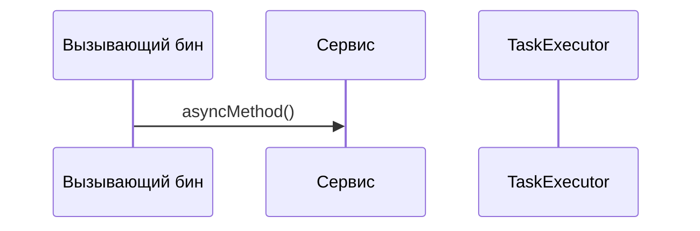

# Вопросы на собеседовании: `Spring @Async`

`Spring @Async` — механизм декларативного асинхронного выполнения методов через AOP proxy. Отделяет запуск операции от её ожидания, используя пул потоков (`TaskExecutor`). Часто спрашивается в контексте улучшения latency и fire-and-forget операций.

Дата последнего обновления: 2026-04-20

## Полезные ссылки

### Официальная документация

- [Spring Framework: Async](https://docs.spring.io/spring-framework/docs/current/reference/html/integration.html#scheduling-annotation-support-async) — официальная документация
- [Baeldung: Spring Async](https://www.baeldung.com/spring-async) — практическое введение

## Содержание

- [Полезные ссылки](#полезные-ссылки)
- [See also](#see-also)

**Основы**
- [Q1. (!) Что такое @Async и как его включить?](#q1--что-такое-async-и-как-его-включить)
- [Q2. (!) Какие типы возврата поддерживает @Async?](#q2--какие-типы-возврата-поддерживает-async)
- [Q3. Как работает @Async под капотом?](#q3-как-работает-async-под-капотом)

**Конфигурация TaskExecutor**
- [Q4. (!) Какой executor используется по умолчанию?](#q4--какой-executor-используется-по-умолчанию)
- [Q5. Как сконфигурировать кастомный TaskExecutor?](#q5-как-сконфигурировать-кастомный-taskexecutor)
- [Q6. Что такое AsyncConfigurer?](#q6-что-такое-asyncconfigurer)

**Обработка ошибок**
- [Q7. (!) Как обрабатывать исключения в @Async методах?](#q7--как-обрабатывать-исключения-в-async-методах)
- [Q8. Что такое AsyncUncaughtExceptionHandler?](#q8-что-такое-asyncuncaughtexceptionhandler)

**Ограничения и подводные камни**
- [Q9. (!) Почему @Async не работает при self-invocation?](#q9--почему-async-не-работает-при-self-invocation)
- [Q10. (!) Как @Async взаимодействует с @Transactional?](#q10--как-async-взаимодействует-с-transactional)
- [Q11. Какие есть требования к @Async методам?](#q11-какие-есть-требования-к-async-методам)

**Использование**
- [Q12. Как комбинировать несколько @Async вызовов?](#q12-как-комбинировать-несколько-async-вызовов)
- [Q13. Как передать контекст (SecurityContext, MDC) в @Async?](#q13-как-передать-контекст-securitycontext-mdc-в-async)
- [Q14. Как тестировать @Async методы?](#q14-как-тестировать-async-методы)
- [Q15. Чем @Async отличается от CompletableFuture.supplyAsync?](#q15-чем-async-отличается-от-completablefuturesupplyasync)

## Q1. (!) Что такое @Async и как его включить?

`@Async` — аннотация, которая заставляет Spring выполнять метод в отдельном потоке вместо текущего. Вызывающий код получает управление **сразу**, не дожидаясь завершения метода, а сам метод работает асинхронно на пуле потоков Spring.

Смысл: вынести в фон операцию, которая не нужна вызывающему прямо сейчас (отправка письма, запись в лог, прогрев кэша), и не блокировать на ней основной поток. Это улучшает latency: HTTP-запрос отвечает пользователю, не дожидаясь, пока уйдёт письмо.

Чтобы `@Async` заработал, нужно два шага: включить поддержку аннотацией `@EnableAsync` и пометить методы `@Async`.

**Включение:**
```java
@Configuration
@EnableAsync
public class AsyncConfig {}
```

**Использование:**
```java
@Service
public class NotificationService {

    @Async
    public void sendEmail(String to, String subject) {
        // выполняется в другом потоке
        emailClient.send(to, subject);
    }
}

// Вызов
notificationService.sendEmail("user@example.com", "Hello");
// Возврат сразу, email отправляется в фоне
```

**Итог:** `@Async` — это fire-and-forget через AOP. Вызывающий код не блокируется, работа уходит на пул потоков. За магией стоит прокси: Spring оборачивает бин, перехватывает вызов помеченного метода и отправляет его в `TaskExecutor` — поэтому `@Async` работает только на public-методах бина и не срабатывает при вызове внутри того же класса (см. Q9).

## Q2. (!) Какие типы возврата поддерживает @Async?

Метод может либо ничего не возвращать (`void`), либо возвращать «обещание» результата — `Future`-подобный тип, через который вызывающий код потом заберёт значение. Третьего не дано: начиная со Spring Framework 6.0 проверка активная, и на любом другом типе возврата вызов падает с `IllegalArgumentException: Invalid return type for async method (only Future and void supported)`. Раньше такой метод молча возвращал `null`, и ошибку замечали не сразу.

| Тип возврата | Поведение | Рекомендация |
|---|---|---|
| `void` | Fire-and-forget | OK, но исключения теряются |
| `Future<T>` | Старый JDK API | Legacy, не использовать |
| `CompletableFuture<T>` | Рекомендуется (Java 8+) | **Предпочтительно** |
| `ListenableFuture<T>` | Spring-специфичный; deprecated с 6.0, удалён в 7.0 | Не использовать |
| Любой другой | `IllegalArgumentException` при вызове | Ошибка разработчика |

`CompletableFuture<T>` — выбор по умолчанию: его можно строить в цепочки (`thenApply`, `thenCompose`), комбинировать (`allOf`) и обрабатывать ошибки (`exceptionally`). `void` берут для чистого fire-and-forget, но тогда исключения не вернутся к вызывающему — их перехватит только глобальный handler (см. Q7).

**Правильно:**
```java
@Async
public CompletableFuture<User> findUserAsync(Long id) {
    User user = userRepository.findById(id);
    return CompletableFuture.completedFuture(user);
}

// Использование
userService.findUserAsync(1L)
    .thenApply(User::getName)
    .thenAccept(name -> log.info("Got: {}", name));
```

**Важно:** результат нужно самому обернуть в `CompletableFuture.completedFuture()` — внутри метода вы возвращаете уже готовый объект, а Spring лишь исполняет метод на другом потоке и не оборачивает значение за вас.

## Q3. Как работает @Async под капотом?

В приложении включён режим `PROXY`. Один Spring-бин вызывает метод другого бина. Метод помечен `@Async` и возвращает `CompletableFuture`.



При `@EnableAsync` постпроцессор `AsyncAnnotationBeanPostProcessor` добавляет async-перехватчик к существующему прокси или создаёт прокси для подходящего бина. Вызов через прокси попадает в этот перехватчик. Он передаёт оставшуюся часть цепочки исполнителю. При работе с пулом тело метода исполняется в рабочем потоке, а вызывающий получает `CompletableFuture`, по которому можно дождаться результата или узнать об ошибке. Для метода с типом возврата `void` вызывающий не получает future.

Для JDK-прокси вызов должен проходить через метод интерфейса. Прокси на основе подкласса перехватывает доступные переопределяемые методы. Прямой вызов `this.asyncMethod()` обходит перехватчик (см. Q9). Для асинхронного запуска при инициализации используйте отдельный Spring-бин, который из своего lifecycle-метода вызывает async-метод через прокси.

## Q4. (!) Какой executor используется по умолчанию?

Зависит от того, есть ли в контексте бин `TaskExecutor`, — и здесь кроется типичный сюрприз на проде.

**Чистый Spring Framework, без Boot:** если подходящего бина `TaskExecutor` в контексте нет, `AsyncExecutionInterceptor` подставляет `SimpleAsyncTaskExecutor`. Пула у него нет: он **создаёт новый поток на каждый вызов**. Под нагрузкой это легко порождает тысячи потоков, исчерпывает память и кладёт приложение — поэтому полагаться на такой дефолт в production опасно.

**Spring Boot:** автоконфигурация сама создаёт бин `applicationTaskExecutor`, и до фолбэка дело не доходит. По умолчанию это настоящий пул — `ThreadPoolTaskExecutor` с параметрами:
- `core-pool-size = 8`
- `max-pool-size = Integer.MAX_VALUE`
- `queue-capacity = Integer.MAX_VALUE`

Но и здесь есть ловушка: безлимитная очередь означает, что при всплеске задачи копятся в памяти, а число «горячих» потоков не растёт выше 8, пока очередь не переполнится (а она почти бесконечна). То есть задачи будут стоять в очереди вместо распараллеливания.

Отдельный случай — виртуальные потоки: при `spring.threads.virtual.enabled=true` на Java 21+ Boot отдаёт под `@Async` `SimpleAsyncTaskExecutor`, но уже на виртуальных потоках, где «поток на задачу» перестаёт быть проблемой.

```yaml
# Явная конфигурация через application.yml (Spring Boot)
spring:
  task:
    execution:
      pool:
        core-size: 8
        max-size: 50
        queue-capacity: 100
        keep-alive: 60s
      thread-name-prefix: app-async-
```

**Рекомендация:** в production всегда задавайте executor явно — с конечным `max-size`, конечной `queue-capacity` и осознанной политикой отклонения (см. Q5). Дефолты любой версии под нагрузкой ведут себя плохо: старый создаёт неограниченно потоков, новый — неограниченно копит очередь.

## Q5. Как сконфигурировать кастомный TaskExecutor?

Объявите бин `ThreadPoolTaskExecutor` и настройте размеры пула и очередь. Дав бину имя, можно держать несколько изолированных пулов (например, отдельный для email и отдельный для отчётов) и выбирать их через `@Async("имя")`.

Про `initialize()`: у бина его вызывать не обязательно — `ThreadPoolTaskExecutor` реализует `InitializingBean`, и контейнер сам дёргает `afterPropertiesSet()`, который и создаёт внутренний `ThreadPoolExecutor`. Явный вызов нужен там, где объект бином не становится: например внутри `AsyncConfigurer.getAsyncExecutor()` (см. Q6) — без него пул останется несозданным.

```java
@Configuration
@EnableAsync
public class AsyncConfig {

    @Bean(name = "emailExecutor")
    public Executor emailExecutor() {
        ThreadPoolTaskExecutor executor = new ThreadPoolTaskExecutor();
        executor.setCorePoolSize(5);
        executor.setMaxPoolSize(10);
        executor.setQueueCapacity(100);
        executor.setThreadNamePrefix("email-");
        executor.setRejectedExecutionHandler(new ThreadPoolExecutor.CallerRunsPolicy());
        executor.initialize();
        return executor;
    }
}
```

**Использование именованного executor:**
```java
@Async("emailExecutor")
public void sendEmail(...) { ... }
```

**Важные параметры `ThreadPoolTaskExecutor`:**
- `corePoolSize` — потоки, которые держатся постоянно, даже без нагрузки.
- `maxPoolSize` — потолок числа потоков. Новые потоки сверх `corePoolSize` создаются **только когда очередь уже заполнена**.
- `queueCapacity` — размер очереди (`LinkedBlockingQueue`), где задачи ждут свободного потока.
- `RejectedExecutionHandler` — что делать, когда переполнены и пул, и очередь: `AbortPolicy` (по умолчанию — бросить исключение), `CallerRunsPolicy` (выполнить в потоке вызывающего, естественный backpressure), `DiscardPolicy` (молча отбросить).

**Эмпирическое правило про порядок заполнения:** сначала загружается `corePoolSize`, затем задачи копятся в очереди, и лишь после её переполнения пул растёт до `maxPoolSize`. Поэтому при большой `queueCapacity` `maxPoolSize` почти никогда не достигается — об этом часто спрашивают.

## Q6. Что такое AsyncConfigurer?

`AsyncConfigurer` — интерфейс конфигурации, который задаёт сразу две вещи для всего приложения: **executor по умолчанию** (используется для `@Async` без явного имени) и **обработчик необработанных исключений** для `void`-методов. Реализуйте его в `@Configuration`-классе и переопределите два метода.

```java
@Configuration
@EnableAsync
public class AsyncConfig implements AsyncConfigurer {

    @Override
    public Executor getAsyncExecutor() {
        ThreadPoolTaskExecutor executor = new ThreadPoolTaskExecutor();
        executor.setCorePoolSize(10);
        executor.setMaxPoolSize(50);
        executor.setQueueCapacity(200);
        executor.setThreadNamePrefix("app-async-");
        executor.initialize();
        return executor;
    }

    @Override
    public AsyncUncaughtExceptionHandler getAsyncUncaughtExceptionHandler() {
        return (throwable, method, params) -> 
            log.error("Async error in {}: {}", method.getName(), throwable.getMessage());
    }
}
```

**Разница с `@Bean` (когда что):**
- `AsyncConfigurer` задаёт **executor по умолчанию** — его получают все `@Async` без аргумента. Удобно, когда нужен один общий пул на приложение.
- Именованный `@Bean` (см. Q5) даёт **несколько executor'ов** на выбор через `@Async("name")` — когда разным задачам нужны отдельные пулы.

На практике их часто комбинируют: один дефолтный пул через `AsyncConfigurer` плюс пара специализированных именованных бинов.

## Q7. (!) Как обрабатывать исключения в @Async методах?

Способ зависит от типа возврата, потому что метод выполняется на другом потоке — обычный `try/catch` вокруг вызова бесполезен: к моменту его выхода async-метод ещё даже не начал работать, исключение возникнет позже и в чужом потоке.

- **Метод возвращает `CompletableFuture`** — исключение «упаковывается» в future, и его ловят на стороне вызывающего через `.exceptionally()` / `.handle()` (или оно вылетит при `.get()`).
- **Метод возвращает `void`** — вернуть исключение некуда, поэтому Spring отдаёт его глобальному `AsyncUncaughtExceptionHandler` (см. Q8). Если handler не зарегистрирован — исключение просто залогируется и потеряется.

**Для `CompletableFuture` — через `.exceptionally()` / `.handle()`:**
```java
@Async
public CompletableFuture<Data> fetchData() {
    return CompletableFuture.supplyAsync(() -> externalApi.call());
}

// Caller
fetchData()
    .exceptionally(ex -> {
        log.error("Failed", ex);
        return Data.empty();
    })
    .thenAccept(this::processData);
```

**Для `void` методов — через `AsyncUncaughtExceptionHandler`:**
`try/catch` вокруг вызова не поможет — исключение возникает в другом потоке и до вызывающего не доходит. Единственная точка перехвата — глобальный handler (см. Q8).

**Таблица поведения:**

| Return type | Исключение |
|---|---|
| `CompletableFuture<T>` | Передаётся в `.exceptionally()` / `.get()` |
| `Future<T>` | Оборачивается в `ExecutionException` при `.get()` |
| `void` | Проглатывается, идёт в `AsyncUncaughtExceptionHandler` |

## Q8. Что такое AsyncUncaughtExceptionHandler?

`AsyncUncaughtExceptionHandler` — глобальный обработчик исключений, вылетевших из `void @Async`-методов. Это единственное место, где можно их перехватить: у такого метода нет future, через который ошибка вернулась бы вызывающему. В `handleUncaughtException` приходят само исключение, отражённый `Method` и аргументы вызова — то есть всё, чтобы залогировать, отправить алерт или метрику.

```java
@Component
public class CustomAsyncExceptionHandler implements AsyncUncaughtExceptionHandler {
    @Override
    public void handleUncaughtException(Throwable ex, Method method, Object... params) {
        log.error("Exception in async method {}: {}, params: {}",
            method.getName(), ex.getMessage(), Arrays.toString(params));
        
        // Опционально — отправить alert
        alertService.notifyError(method.getName(), ex);
    }
}
```

Регистрируется через `AsyncConfigurer.getAsyncUncaughtExceptionHandler()` (см. Q6).

**Важно:** handler срабатывает **только для `void`-методов**. Для методов, возвращающих `CompletableFuture`, он не вызывается вообще — ошибка уходит в сам future, и обрабатывать её надо через `.exceptionally()` на стороне вызывающего (см. Q7).

## Q9. (!) Почему @Async не работает при self-invocation?

**Исходный вызов в режиме `PROXY`**
```java
@Service
public class OrderService {

    public void processOrder(Order order) {
        validateOrder(order);
        this.sendEmailAsync(order);
    }

    @Async
    public void sendEmailAsync(Order order) {
        emailClient.send(order);
    }
}
```

Потому что `@Async` живёт в прокси, а не в самом объекте. Spring внедряет другим бинам не ваш объект, а прокси-обёртку вокруг него; именно прокси отправляет вызов на пул потоков. Когда метод того же класса зовёт `@Async`-метод как `this.method()`, вызов идёт напрямую к объекту `this`, минуя прокси, — async-логика не подключается, и метод выполняется синхронно в текущем потоке.

То есть проблема не в `@Async` как таковом, а в общем свойстве Spring AOP: любые прокси-аннотации (`@Async`, `@Transactional`, `@Cacheable`) не работают при self-invocation по одной и той же причине.

**Решения** (суть одна — пройти через прокси, а не через `this`):

1. **Вынести метод в отдельный bean (рекомендуется):** вызов другого бина всегда идёт через его прокси. Это самый чистый вариант и заодно лучше разделяет ответственность.
```java
@Service
public class EmailService {
    @Async
    public void sendEmailAsync(Order order) { ... }
}

@Service
public class OrderService {
    @Autowired
    private EmailService emailService;

    public void processOrder(Order order) {
        emailService.sendEmailAsync(order); // через proxy
    }
}
```

2. **Self-injection через `@Lazy`:** внедрить в бин ссылку на собственный прокси и звать метод через неё. `@Lazy` нужен, чтобы разорвать циклическую зависимость бина на самого себя при создании.
```java
@Service
public class OrderService {
    @Autowired @Lazy
    private OrderService self;

    public void processOrder(Order order) {
        self.sendEmailAsync(order); // через proxy
    }
}
```

Это та же проблема и те же решения, что у `@Transactional` — см. [Spring AOP](spring-aop-interview.md).

## Q10. (!) Как @Async взаимодействует с @Transactional?

В примере включены `@Async` и управление императивными транзакциями в режиме `PROXY`. Внешний вызов `processOrder` проходит через прокси, а исполнитель для async-задач использует отдельные рабочие потоки. Действуют стандартный порядок перехватчиков и настройки `@Transactional`.

```java
// Режим PROXY. Внешний вызов processOrder проходит через прокси.
// Async-исполнитель использует отдельные рабочие потоки.
// Порядок перехватчиков и propagation оставлены по умолчанию.
@Service
public class OrderService {
    @Autowired
    private OrderRepository orderRepository;
    @Autowired
    private NotificationService notificationService;

    @Transactional
    public void processOrder(Order order) {
        orderRepository.save(order);
        notificationService.sendNotification(order);
    }
}

@Service
public class NotificationService {
    @Autowired
    private NotificationRepository notificationRepository;

    @Async
    @Transactional
    public void sendNotification(Order order) {
        notificationRepository.save(new Notification(order));
    }
}
```

Spring привязывает императивную транзакцию вызывающего к его потоку. При стандартном порядке перехватчиков async-перехватчик передаёт работу исполнителю до входа в транзакционный перехватчик `sendNotification`. В рабочем потоке транзакция вызывающего недоступна. При стандартном `REQUIRED` и отсутствии активной транзакции в этом потоке Spring открывает отдельную транзакцию. Откат в `processOrder` сам по себе её не отменит.

До фиксации заказа асинхронная операция может попытаться прочитать ещё не видимые ей данные. Если обработку нужно запускать только после успешного коммита, опубликуйте событие внутри транзакции заказа и привяжите слушателя к фазе `AFTER_COMMIT`.

```java
@TransactionalEventListener(phase = TransactionPhase.AFTER_COMMIT)
@Async
public void onOrderPlaced(OrderPlacedEvent event) {
    notificationService.send(event.getOrderId());
}
```

## Q11. Какие есть требования к @Async методам?

Все требования — следствие одного факта: `@Async` реализован через CGLIB-прокси (подкласс вашего класса). Метод должен быть таким, чтобы прокси мог его переопределить и перехватить вызов извне.

1. **Метод `public`** — прокси видит и перехватывает только публичные методы; `private`/`protected` остаются «внутренними» (для `protected` нужны `proxyTargetClass = true` + CGLIB).
2. **Метод не `final`** — CGLIB наследуется от класса и переопределяет методы; `final` переопределить нельзя.
3. **Метод не `static`** — AOP перехватывает вызовы на экземпляре, а статические методы к экземпляру не привязаны.
4. **Без self-invocation** — внутренний вызов идёт мимо прокси (см. Q9).
5. **Класс — это Spring bean** — прокси создаётся только для бинов контейнера; на `new MyService()` AOP не действует.

**Типовая ошибка:**
```java
@Service
public class DataProcessor {
    
    // ❌ private — не будет async
    @Async
    private void processInternal() { ... }
    
    public void process() {
        processInternal();  // даже при self-invocation — всё равно private
    }
}
```

## Q12. Как комбинировать несколько @Async вызовов?

Сервис собирает профиль, заказы и основные данные пользователя из трёх независимых источников. В примере `userLookup` внедрён как отдельный Spring-бин. Обработка `@Async` включена в режиме `PROXY`.

```java
// UserAggregateService получает UserLookup через конструктор.
// У исполнителя @Async три свободных рабочих потока.
// Вызовы независимы и завершаются успешно за 200, 400 и 600 мс соответственно.
void requestParts(Long id) {
    CompletableFuture<User> user = userLookup.fetchUser(id);
    CompletableFuture<List<Order>> orders = userLookup.fetchOrders(id);
    CompletableFuture<Profile> profile = userLookup.fetchProfile(id);
}
```

Объедините три future через `CompletableFuture.allOf(...)`. При доступных рабочих потоках операции могут перекрываться по времени. В этом примере суммарное ожидание при пренебрежимо малых накладных расходах близко к 600 мс. Реальное время зависит от запуска задач и доступности внешних ресурсов.

`allOf` завершается после всех переданных future. Если хотя бы одна завершается с ошибкой, общая стадия также завершается с ошибкой. После успешного завершения `thenApply` забирает готовые результаты через `join()`. Внешний `join()` нужен, если метод должен вернуть сам агрегат и вызывающий готов ждать. Для дальнейшей асинхронной обработки можно вернуть объединённую future.

```java
@Service
public class UserLookup {
    @Autowired
    private UserApi userApi;
    @Autowired
    private OrderApi orderApi;
    @Autowired
    private ProfileApi profileApi;

    @Async
    public CompletableFuture<User> fetchUser(Long id) {
        return CompletableFuture.completedFuture(userApi.get(id));
    }

    @Async
    public CompletableFuture<List<Order>> fetchOrders(Long id) {
        return CompletableFuture.completedFuture(orderApi.getByUser(id));
    }

    @Async
    public CompletableFuture<Profile> fetchProfile(Long id) {
        return CompletableFuture.completedFuture(profileApi.get(id));
    }
}

@Service
public class UserAggregateService {
    private final UserLookup userLookup;

    public UserAggregateService(UserLookup userLookup) {
        this.userLookup = userLookup;
    }

    public UserAggregate aggregate(Long id) {
        CompletableFuture<User> user = userLookup.fetchUser(id);
        CompletableFuture<List<Order>> orders = userLookup.fetchOrders(id);
        CompletableFuture<Profile> profile = userLookup.fetchProfile(id);

        return CompletableFuture.allOf(user, orders, profile)
            .thenApply(ignored -> new UserAggregate(user.join(), orders.join(), profile.join()))
            .join();
    }
}
```

Подробнее в [Java CompletableFuture](../../programming-languages/java/java-completable-future-interview.md).

## Q13. Как передать контекст (SecurityContext, MDC) в @Async?

`SecurityContext` (текущий пользователь) и `MDC` (контекст логирования, например `traceId`) хранятся в `ThreadLocal`, то есть живут на потоке вызывающего. На worker-потоке пула этот `ThreadLocal` **пуст** — поэтому в async-методе теряются и аутентификация, и сквозные поля логов. Чтобы их не терять, контекст нужно явно скопировать в задачу перед запуском на другом потоке.

Для `SecurityContext` есть готовая обёртка executor'а; для `MDC` (и любого другого `ThreadLocal`) — `TaskDecorator`, который оборачивает каждую задачу, копируя контекст «на входе» и очищая «на выходе».

**SecurityContext через `DelegatingSecurityContextAsyncTaskExecutor`:**
```java
@Bean
public Executor asyncExecutor() {
    ThreadPoolTaskExecutor executor = new ThreadPoolTaskExecutor();
    executor.initialize();
    return new DelegatingSecurityContextAsyncTaskExecutor(executor);
}
```

**MDC через `TaskDecorator`** — декоратор снимает копию MDC в потоке вызывающего, восстанавливает её в worker-потоке перед `run()` и обязательно чистит в `finally`, чтобы контекст не «протёк» на следующую задачу того же потока:
```java
@Bean
public Executor asyncExecutor() {
    ThreadPoolTaskExecutor executor = new ThreadPoolTaskExecutor();
    executor.setTaskDecorator(runnable -> {
        Map<String, String> mdc = MDC.getCopyOfContextMap();
        return () -> {
            try {
                if (mdc != null) MDC.setContextMap(mdc);
                runnable.run();
            } finally {
                MDC.clear();
            }
        };
    });
    executor.initialize();
    return executor;
}
```

## Q14. Как тестировать @Async методы?

**Проблема:** async-метод выполняется на другом потоке, поэтому в момент проверки (`verify`/`assert`) результат может быть ещё не готов — тест становится «плавающим» (то проходит, то нет). Есть три устойчивых подхода: убрать асинхронность, дождаться её или забрать результат через future.

**Решение 1 — синхронный executor в тестах.** Подменяем пул на `SyncTaskExecutor`, который выполняет задачу прямо в текущем потоке. Асинхронность исчезает, тест становится детерминированным. Лучший вариант, когда сама многопоточность не является предметом проверки.
```java
@TestConfiguration
public class TestAsyncConfig {
    @Bean @Primary
    public Executor taskExecutor() {
        return new SyncTaskExecutor();  // выполняет в текущем потоке
    }
}

@SpringBootTest
@Import(TestAsyncConfig.class)
class AsyncServiceTest {
    @Autowired AsyncService service;

    @Test
    void shouldProcessSync() {
        service.asyncMethod();  // выполняется синхронно
        verify(repository).save(any());
    }
}
```

**Решение 2 — `Awaitility` для ожидания результата.** Оставляем реальную асинхронность, но опрашиваем условие с таймаутом, пока оно не выполнится. Подходит для `void`-методов и побочных эффектов, где забрать значение через future нельзя:
```java
@Test
void shouldEventuallyProcess() {
    service.asyncMethod();
    
    await().atMost(5, SECONDS)
        .untilAsserted(() -> verify(repository).save(any()));
}
```

**Решение 3 — `CompletableFuture.get()` с таймаутом.** Если метод возвращает future, просто дождитесь результата с ограничением по времени и проверьте его. Таймаут обязателен, чтобы зависший метод не повесил тест:
```java
@Test
void shouldReturnResult() throws Exception {
    CompletableFuture<Data> future = service.fetchAsync();
    Data result = future.get(5, SECONDS);
    assertThat(result).isNotNull();
}
```

## Q15. Чем @Async отличается от CompletableFuture.supplyAsync?

Это два способа сделать одно и то же — выполнить код на другом потоке, — но на разных уровнях. `@Async` декларативен: вешаете аннотацию, а всю обвязку (выбор пула, прокси, обработку ошибок для `void`) берёт на себя Spring. `CompletableFuture.supplyAsync` императивен: вы сами вызываете API, сами передаёте executor и сами строите цепочку — больше контроля, но и больше кода.

| Критерий | `@Async` | `CompletableFuture.supplyAsync` |
|---|---|---|
| Способ | Декларативный (аннотация) | Программный (API) |
| Executor | Spring TaskExecutor | ForkJoinPool или custom |
| Spring integration | Полная | Нет |
| SecurityContext propagation | Через `DelegatingSecurityContextAsyncTaskExecutor` | Вручную |
| Exception handling | `AsyncUncaughtExceptionHandler` (для void) | Встроенный в CF |
| AOP ограничения | Self-invocation, proxy | Нет |
| Читаемость | Декларативная | Императивная |

**Когда что (эмпирическое правило):**
- `@Async` — когда нужно «одним махом» сделать целый метод сервиса асинхронным и встроить его в инфраструктуру Spring (общий пул, security/MDC-пропагация, единый exception handler).
- `CompletableFuture.supplyAsync` — когда нужен точечный контроль над конкретным pipeline: явно выбрать executor, собрать сложную цепочку преобразований, смешать async- и sync-шаги внутри одного метода.

Важно: это не «или-или». `@Async`-метод обычно сам возвращает `CompletableFuture`, так что чаще их используют вместе — `@Async` запускает работу, а `CompletableFuture` склеивает результаты (см. Q12).

```java
// @Async — декларативно
@Async
public CompletableFuture<Order> fetchOrder(Long id) {
    return CompletableFuture.completedFuture(orderRepo.findById(id));
}

// CompletableFuture — программно
public CompletableFuture<Order> fetchOrderProgrammatic(Long id) {
    return CompletableFuture.supplyAsync(
        () -> orderRepo.findById(id),
        customExecutor
    );
}
```

---

## See also

- [Java CompletableFuture](../../programming-languages/java/java-completable-future-interview.md) — API для асинхронной композиции, thenApply/thenCompose/allOf
- [Spring Scheduling](spring-scheduling-interview.md) — @Scheduled, часто используется вместе с @Async
- [Spring AOP](spring-aop-interview.md) — механизм proxy, self-invocation, ограничения
- [Spring @Transactional](spring-transaction-interview.md) — взаимодействие с @Async: новый поток = новая транзакция
- [Spring Events](spring-events-interview.md) — @TransactionalEventListener + @Async комбинация
- [Java Concurrency](../../programming-languages/java/java-concurrency-interview.md) — ThreadPoolExecutor, основа для TaskExecutor
- [Spring Testing](spring-testing-interview.md) — тестирование @Async с SyncTaskExecutor и Awaitility
- [Virtual Threads](../../programming-languages/java/java-virtual-threads-interview.md) — Virtual Threads как альтернатива TaskExecutor для IO-bound задач
- [Spring WebFlux](spring-webflux-interview.md) — реактивный стек как альтернатива @Async
