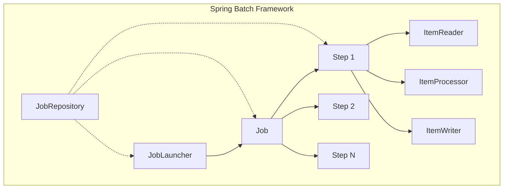

# Вопросы на собеседовании: `Spring Batch`

Глубокие ответы по `Spring Batch`: архитектура `Job`/`Step`, chunk-oriented processing, `Tasklet`, партиционирование, skip/retry, параллельные шаги, интеграция со `Spring Boot`.

**`Spring Batch`** — мощный фреймворк для пакетной обработки данных, входящий в экосистему `Spring`. Он предоставляет повторно используемые компоненты для чтения, обработки и записи больших объёмов данных, а также инструменты для управления транзакциями, параллелизмом, мониторингом и перезапуском заданий. Основные примеры ниже показывают Spring Batch 5 / Spring Boot 3; выбор `JobRepository` в Spring Batch 6 / Spring Boot 4.1 отмечен отдельно. Вопросы по `Spring Batch` часто встречаются на собеседованиях на позиции `Senior Java Developer` и `Data Engineer`, особенно в enterprise-проектах с ETL-процессами и интеграциями.

## Полезные ссылки

### Официальная документация

- [Spring Batch Reference](https://docs.spring.io/spring-batch/reference/) — актуальная документация
- [Spring Batch — Chunk-oriented Processing](https://docs.spring.io/spring-batch/reference/step/chunk-oriented-processing.html) — chunk-обработка
- [Spring Batch — Configuring a Step](https://docs.spring.io/spring-batch/reference/step/chunk-oriented-processing/configuring.html) — конфигурация шагов
- [Spring Batch — Intercepting Step Execution](https://docs.spring.io/spring-batch/reference/step/chunk-oriented-processing/intercepting-execution.html) — слушатели шагов

### Baeldung

- [Introduction to Spring Batch](https://www.baeldung.com/introduction-to-spring-batch) — вводный туториал: Job, Step, ItemReader/Writer
- [Spring Boot With Spring Batch](https://www.baeldung.com/spring-boot-spring-batch) — интеграция с Spring Boot, автоконфигурация
- [Spring Batch — Tasklets vs Chunks](https://www.baeldung.com/spring-batch-tasklet-chunk) — сравнение двух подходов обработки
- [Spring Batch using Partitioner](https://www.baeldung.com/spring-batch-partitioner) — параллельная обработка через партиционирование
- [Configuring Skip Logic in Spring Batch](https://www.baeldung.com/spring-batch-skip-logic) — пропуск записей при ошибках
- [Configuring Retry Logic in Spring Batch](https://www.baeldung.com/spring-batch-retry-logic) — повторная обработка при сбоях
- [Testing a Spring Batch Job](https://www.baeldung.com/spring-batch-testing-job) — тестирование с @SpringBatchTest
- [Conditional Flow in Spring Batch](https://www.baeldung.com/spring-batch-conditional-flow) — условные переходы между Step
- [How to Run Multiple Jobs in Spring Batch](https://www.baeldung.com/spring-batch-run-multiple-jobs) — запуск нескольких заданий
- [Restart a Job on Failure in Spring Batch](https://www.baeldung.com/spring-batch-restart-job-failure-continue) — перезапуск после сбоя

## Содержание

- [Полезные ссылки](#полезные-ссылки)
- [See also](#see-also)

**Основы пакетной обработки**
- [Q1. (!) Что такое пакетная обработка данных и когда она применяется?](#q1--что-такое-пакетная-обработка-данных-и-когда-она-применяется)
- [Q2. (!) Что такое Spring Batch и какие задачи он решает?](#q2--что-такое-spring-batch-и-какие-задачи-он-решает)
- [Q3. Какие ключевые компоненты входят в архитектуру Spring Batch?](#q3-какие-ключевые-компоненты-входят-в-архитектуру-spring-batch)

**Job и его жизненный цикл**
- [Q4. (!) Что такое Job, JobInstance и JobExecution?](#q4--что-такое-job-jobinstance-и-jobexecution)
- [Q5. Что такое JobParameters и как они влияют на JobInstance?](#q5-что-такое-jobparameters-и-как-они-влияют-на-jobinstance)
- [Q6. (!) Что такое JobRepository и какую роль он играет?](#q6--что-такое-jobrepository-и-какую-роль-он-играет)
- [Q7. Что такое JobLauncher и как запускать задания?](#q7-что-такое-joblauncher-и-как-запускать-задания)
- [Q8. Что такое ExecutionContext и зачем он нужен?](#q8-что-такое-executioncontext-и-зачем-он-нужен)

**Step и модели обработки**
- [Q9. (!) Что такое Step и какие модели обработки поддерживает Spring Batch?](#q9--что-такое-step-и-какие-модели-обработки-поддерживает-spring-batch)
- [Q10. (!) Как работает chunk-oriented processing?](#q10--как-работает-chunk-oriented-processing)
- [Q11. Что такое Tasklet и когда его использовать?](#q11-что-такое-tasklet-и-когда-его-использовать)
- [Q12. (!) В чём разница между Chunk и Tasklet?](#q12--в-чём-разница-между-chunk-и-tasklet)

**ItemReader, ItemProcessor, ItemWriter**
- [Q13. (!) Какие стандартные ItemReader предоставляет Spring Batch?](#q13--какие-стандартные-itemreader-предоставляет-spring-batch)
- [Q14. Как работают JdbcCursorItemReader и JdbcPagingItemReader?](#q14-как-работают-jdbccursoritemreader-и-jdbcpagingitemreader)
- [Q15. Как использовать JpaPagingItemReader для чтения из БД?](#q15-как-использовать-jpapagingitemreader-для-чтения-из-бд)
- [Q16. Как читать и писать плоские файлы (CSV, TSV)?](#q16-как-читать-и-писать-плоские-файлы-csv-tsv)
- [Q17. (!) Какие стандартные ItemWriter предоставляет Spring Batch?](#q17--какие-стандартные-itemwriter-предоставляет-spring-batch)
- [Q18. Как работает ItemProcessor и можно ли иметь несколько процессоров?](#q18-как-работает-itemprocessor-и-можно-ли-иметь-несколько-процессоров)

**Listeners (слушатели)**
- [Q19. (!) Какие типы слушателей существуют в Spring Batch?](#q19--какие-типы-слушателей-существуют-в-spring-batch)
- [Q20. Как реализовать JobExecutionListener и StepExecutionListener?](#q20-как-реализовать-jobexecutionlistener-и-stepexecutionlistener)

**Обработка ошибок: Skip и Retry**
- [Q21. (!) Как настроить skip-логику в Spring Batch?](#q21--как-настроить-skip-логику-в-spring-batch)
- [Q22. (!) Как настроить retry-логику в Spring Batch?](#q22--как-настроить-retry-логику-в-spring-batch)

**Масштабирование и параллелизм**
- [Q23. (!) Какие стратегии масштабирования поддерживает Spring Batch?](#q23--какие-стратегии-масштабирования-поддерживает-spring-batch)
- [Q24. Как настроить многопоточный Step?](#q24-как-настроить-многопоточный-step)
- [Q25. (!) Как работает партиционирование (Partitioning)?](#q25--как-работает-партиционирование-partitioning)
- [Q26. Как настроить параллельные шаги через Split/Flow?](#q26-как-настроить-параллельные-шаги-через-splitflow)

**Conditional Flow и управление потоком**
- [Q27. Как настроить условный переход между шагами?](#q27-как-настроить-условный-переход-между-шагами)

**Интеграция со Spring Boot и планирование**
- [Q28. (!) Как интегрировать Spring Batch со Spring Boot?](#q28--как-интегрировать-spring-batch-со-spring-boot)
- [Q29. Как запускать batch-задания по расписанию?](#q29-как-запускать-batch-задания-по-расписанию)

**Тестирование и мониторинг**
- [Q30. (!) Как тестировать Spring Batch задания?](#q30--как-тестировать-spring-batch-задания)
- [Q31. Как мониторить batch-задания и что такое Spring Cloud Task?](#q31-как-мониторить-batch-задания-и-что-такое-spring-cloud-task)

**Продвинутые темы**
- [Q32. (!) Как настроить `JobParameters` и обеспечить уникальность запуска?](#q32--как-настроить-jobparameters-и-обеспечить-уникальность-запуска)
- [Q33. (!) Как работает `JobLauncher` и как запускать `Job` через `REST API`?](#q33--как-работает-joblauncher-и-как-запускать-job-через-rest-api)
- [Q34. (!) Как настроить `CompositeItemProcessor` и цепочку процессоров?](#q34--как-настроить-compositeitemprocessor-и-цепочку-процессоров)
- [Q35. Как реализовать `ChunkListener` и `ItemWriteListener` для аудита?](#q35-как-реализовать-chunklistener-и-itemwritelistener-для-аудита)
- [Q36. (!) Как настроить `Partitioning` с `RemotePartitioning` через `Kafka`?](#q36--как-настроить-partitioning-с-remotepartitioning-через-kafka)
- [Q37. Как управлять транзакциями и `isolation level` в chunk-обработке?](#q37-как-управлять-транзакциями-и-isolation-level-в-chunk-обработке)

**Spring Batch 5 и продвинутые темы**
- [Q38. (!) Что изменилось в Spring Batch 5 — JobRepository и менеджер транзакций?](#q38--что-изменилось-в-spring-batch-5--jobrepository-и-менеджер-транзакций)
- [Q39. (!) Как работает Partitioning через PartitionHandler и GridSize?](#q39--как-работает-partitioning-через-partitionhandler-и-gridsize)
- [Q40. (!) Что такое Remote Chunking и как реализовать Master-Worker через Kafka?](#q40--что-такое-remote-chunking-и-как-реализовать-master-worker-через-kafka)
- [Q41. Как работают JobParameters и инкрементальные задания?](#q41-как-работают-jobparameters-и-инкрементальные-задания)
- [Q42. (!) Как тестировать Spring Batch задания с JobLauncherTestUtils и AssertJ?](#q42--как-тестировать-spring-batch-задания-с-joblaunchertestutils-и-assertj)
- [Q43. Как мониторить Spring Batch через метрики и Spring Boot Actuator?](#q43-как-мониторить-spring-batch-через-метрики-и-spring-boot-actuator)

---

## Q1. (!) Что такое пакетная обработка данных и когда она применяется?

**Пакетная обработка (batch processing)** — обработка больших объёмов данных порциями, без участия пользователя в реальном времени. Задание запускается по расписанию или по событию, прогоняет весь набор данных и завершается — никто не ждёт ответа на каждую запись.

Главное отличие от онлайн-обработки: здесь оптимизируют **пропускную способность** (обработать миллионы записей за ночное окно), а не **задержку** ответа на конкретный запрос. Порции помогают снизить накладные расходы на запись. Их размер выбирают с учётом памяти, времени удержания блокировок и объёма работы, который придётся повторить при сбое.

**Типичные сценарии применения:**

| Сценарий | Пример |
|----------|--------|
| ETL-процессы | Извлечение данных из одной БД, трансформация и загрузка в хранилище |
| Генерация отчётов | Ежедневные/еженедельные отчёты по продажам |
| Миграция данных | Перенос данных между системами |
| Импорт/экспорт файлов | Обработка CSV/XML файлов от партнёров |
| Массовые обновления | Пересчёт цен, начисление бонусов |
| Рассылки | Отправка email/SMS по большому списку получателей |

**Характерные черты batch-обработки** (и почему они важны):
- **Большой объём данных** — от тысяч до миллиардов записей; обрабатывать их по одной в онлайне нереально
- **Неинтерактивность** — нет пользователя, который ждёт ответ, поэтому можно работать долго и порциями
- **Граница транзакции** — в chunk-ориентированном шаге изменения ресурсов, участвующих в транзакции, фиксируются по порциям
- **Восстановление** — если один chunk содержит 100 записей и сбой произошёл внутри следующего chunk после 900 000 успешно зафиксированных записей, при перезапуске чтение может продолжиться с записи 900 001. Для этого нужен сохранённый checkpoint, совместимый reader и прежний вход. Подробнее в Q8 и Q42
- **Планирование** — запуск по cron, событию или вручную, обычно в окно низкой нагрузки

## Q2. (!) Что такое Spring Batch и какие задачи он решает?

**`Spring Batch`** — фреймворк для пакетной обработки данных в экосистеме `Spring`. Он даёт готовые компоненты для чтения, обработки и записи данных плюс инфраструктуру для управления заданиями: транзакции, перезапуск, обработку ошибок, параллелизм.

Зачем он нужен, если можно написать обычный цикл «прочитал — обработал — записал»? Потому что в реальном batch появляется множество требований, которые в самописном решении приходится изобретать заново: коммитить порциями, не падать на одной кривой записи из миллиона, возобновлять работу с сохранённой позиции, распределять нагрузку по потокам и наблюдать за прогрессом. Spring Batch предоставляет компоненты для этих сценариев. Приложение задаёт допустимые ошибки, правила перезапуска и границы транзакций.

**Ключевые возможности:**
- **Chunk-oriented processing** — обработка данных порциями (chunk) с автоматическим управлением транзакциями
- **Готовые читатели/писатели** — `FlatFileItemReader`, `JdbcCursorItemReader`, `JpaPagingItemReader`, `JsonItemReader` и др.
- **Retry/Skip** — встроенные политики обработки ошибок
- **Параллелизм** — многопоточные шаги, партиционирование, параллельные flow
- **Restart** — новый запуск того же `JobInstance` с учётом истории шагов в `JobRepository`. Возобновление чтения с сохранённой позиции требует, чтобы reader записывал состояние в `ExecutionContext` и восстанавливал его при открытии. [Spring Batch 5.2 — ItemStream](https://docs.spring.io/spring-batch/reference/5.2/readers-and-writers/item-stream.html)
- **Слушатели** — перехват событий на каждом уровне (Job, Step, Item)
- **Интеграция** — со `Spring Boot`, `Spring Data`, `Spring Cloud Task`



## Q3. Какие ключевые компоненты входят в архитектуру Spring Batch?

Архитектура `Spring Batch` можно описать через три уровня ответственности:

**1. Application Layer** — конфигурация заданий и шагов, прикладные правила обработки и настройки источников и приёмников данных.

**2. Batch Core** — ядро фреймворка: `Job`, `Step`, `JobLauncher`, `JobRepository`.

**3. Batch Infrastructure** — инфраструктура: контракты и готовые реализации компонентов чтения, обработки и записи. Правила retry и skip выбираются в конфигурации шага.

```text
Импорт заказов нужно запустить вручную. Он читает CSV, проверяет записи и сохраняет их в БД. После запуска оператору нужен статус выполнения.
Даны Job, Step, JobLauncher, JobRepository, ItemReader, ItemProcessor и ItemWriter.
Как распределить обязанности между этими компонентами?
```

**Ключевые компоненты:**

| Компонент | Ответственность |
|-----------|----------------|
| `Job` | Контейнер для шагов, единица запуска |
| `Step` | Одна фаза обработки (chunk или tasklet) |
| `ItemReader` | Чтение данных из источника |
| `ItemProcessor` | Необязательная обработка элемента. Может преобразовать или отфильтровать его |
| `ItemWriter` | Запись обработанных данных |
| `JobRepository` | Хранение метаданных о запусках |
| `JobLauncher` | Запуск заданий |
| `JobParameters` | Параметры конкретного запуска |
| `ExecutionContext` | Состояние конкретного выполнения Job или Step. Контекст шага используют, например, для сохранения позиции чтения при перезапуске |

Например, после импорта первый шаг может передать следующему путь к отчёту. Для этого он сохраняет путь в своём контексте, а зарегистрированный `ExecutionContextPromotionListener` копирует выбранный ключ в контекст задания при подходящем статусе завершения. Следующий шаг читает ключ из контекста задания. Подробнее о сохранении состояния в Q8. [Spring Batch 5.2, передача данных между шагами](https://docs.spring.io/spring-batch/reference/5.2/common-patterns.html#passing-data-to-future-steps)

## Q4. (!) Что такое Job, JobInstance и JobExecution?

Это три уровня абстракции, описывающие жизненный цикл задания: определение → логический прогон → физическая попытка. Понимать их разницу важно, потому что именно на них держится семантика перезапуска.

**`Job`** — логическое определение задания (blueprint): какие шаги, в каком порядке, с какой конфигурацией. Сам по себе ничего не запускает — это шаблон, который описывают один раз.

**`JobInstance`** — логический прогон `Job`, однозначно определяемый именем задания и набором его identifying-параметров. Каждая новая комбинация этих параметров — это новый `JobInstance`. Например, отчёт `dailyReport` за `date=2026-04-12` и за `date=2026-04-13` — два разных `JobInstance`. Именно так Batch понимает «этот прогон я уже делал, а этот — нет».

**`JobExecution`** — конкретная физическая попытка выполнить `JobInstance`. Один `JobInstance` может иметь несколько `JobExecution`: если первая попытка упала и задание перезапустили, появляется второй `JobExecution` для того же `JobInstance`.

```text
Задание dailyReport, параметр date идентифицирующий.
12 апреля: запуск с date=2026-04-12 завершился FAILED, повтор с теми же параметрами — COMPLETED.
13 апреля: запуск с date=2026-04-13 завершился COMPLETED.
Сколько Job, JobInstance и JobExecution соответствует этим событиям?
```

**Правила перезапуска в Spring Batch 5.2 с JDBC-репозиторием:**
- Если для экземпляра с непустым набором identifying-параметров уже сохранена попытка со статусом `COMPLETED` или `ABANDONED`, `SimpleJobRepository` отклоняет создание новой попытки с `JobInstanceAlreadyCompleteException`. Разные экземпляры могут обработать одни и те же данные, если так настроено чтение.
- Если правила перезапуска разрешают повторную попытку, Batch создаёт новый `JobExecution` для прежнего экземпляра. Восстановление позиции зависит от сохранённого состояния компонентов шага.
- Для пустого набора identifying-параметров проверка `COMPLETED` и `ABANDONED` в `SimpleJobRepository` 5.2 пропускается. Поэтому для отчёта за день задайте дату как обязательный identifying-параметр. Подробности проверки видны в [исходнике SimpleJobRepository 5.2](https://raw.githubusercontent.com/spring-projects/spring-batch/5.2.x/spring-batch-core/src/main/java/org/springframework/batch/core/repository/support/SimpleJobRepository.java).

**Этим поведением можно управлять настройками перезапуска:**
- `preventRestart()` на уровне `Job` — запрещает перезапуск даже после `FAILED`: повторная попытка бросит `JobRestartException`. Используют, когда полуобработанное состояние безопаснее разбирать вручную.
- `startLimit(n)` на уровне `Step` — ограничивает число запусков шага в рамках одного `JobInstance`; при превышении — `StartLimitExceededException`. Защита от бесконечных перезапусков заведомо ломающегося шага.
- `allowStartIfComplete(true)` на уровне `Step` — разрешает повторный запуск завершённого шага, если поток задания снова дошёл до него и лимит запусков ещё не исчерпан. Например, при сбое `loadStep` завершённый `extractStep` по умолчанию пропускается. Включайте повторное извлечение, если к моменту перезапуска его промежуточный результат мог исчезнуть и его можно безопасно построить заново. [Spring Batch 5.2 — перезапуск шага](https://docs.spring.io/spring-batch/reference/5.2/step/chunk-oriented-processing/restart.html)

```java
@Bean
public Job dailyReportJob(JobRepository jobRepository, Step extractStep, Step loadStep) {
    return new JobBuilder("dailyReportJob", jobRepository)
            .start(extractStep)
            .next(loadStep)
            .build();
}
```

## Q5. Что такое JobParameters и как они влияют на JobInstance?

**`JobParameters`** — типизированный набор параметров запуска `Job` (например, дата отчёта, путь к файлу). У них две роли: передать вход в задание и **определить уникальность `JobInstance`** — имя задания вместе с identifying-параметрами образует ключ экземпляра. Non-identifying-параметры доступны при выполнении и позволяют, например, менять детализацию логирования без смены ключа.

В Spring Batch 5.2 флаг `identifying` по умолчанию равен `true`. Встроенные методы builder поддерживают, например, `String`, `Long`, `Double`, `Date`, `LocalDate` и `LocalDateTime`. [Spring Batch 5.2 — JobParametersBuilder](https://docs.spring.io/spring-batch/docs/5.2.2/api/org/springframework/batch/core/JobParametersBuilder.html)

```java
JobParameters params = new JobParametersBuilder()
        .addString("inputFile", "/data/report-2026-04-12.csv")
        .addLocalDate("reportDate", LocalDate.of(2026, 4, 12))
        .addString("logLevel", "DEBUG", false) // non-identifying
        .toJobParameters();

jobLauncher.run(job, params);
```

В примере ключ включает дату и путь к файлу. После сбоя повтор с той же датой и тем же путём, но с другим `logLevel` обращается к прежнему экземпляру. Изменение пути создаёт другой экземпляр. Если файл заменили по прежнему пути, ключ останется прежним, хотя сохранённая позиция reader может уже не соответствовать входным данным. Для возобновления сохраняйте исходный файл или передавайте неизменяемую версию входа в составе ключа. Подробнее в Q32.

**Доступ к параметрам внутри компонентов** — через late binding с `@Value`:

```java
@Bean
@StepScope
public FlatFileItemReader<Transaction> reader(
        @Value("#{jobParameters['inputFile']}") String inputFile) {
    return new FlatFileItemReaderBuilder<Transaction>()
            .name("transactionReader")
            .resource(new FileSystemResource(inputFile))
            .delimited()
            .names("id", "amount", "date")
            .targetType(Transaction.class)
            .build();
}
```

> **Важно:** для reader в примере `@StepScope` откладывает создание целевого бина и разрешение параметров до выполнения шага. Для компонентов уровня задания Spring Batch также предоставляет `@JobScope`.

## Q6. (!) Что такое JobRepository и какую роль он играет?

**`JobRepository`** — интерфейс для хранения метаданных `Spring Batch`: статуса, параметров, времени запуска, счётчиков шагов и сообщений о завершении. Персистентные реализации сохраняют эту «память» между запусками; resourceless-реализация предназначена для одноразовых заданий без перезапуска. [Spring Batch, схема метаданных](https://docs.spring.io/spring-batch/reference/schema-appendix.html).

Для задания с требованием перезапуска нужен персистентный `JobRepository`: без сохранённого состояния между процессами нельзя проверить прежний успешный запуск или восстановить состояние шага. Но одного репозитория недостаточно, чтобы продолжить чтение с нужной записи: `ItemReader` или `ItemWriter` со своим состоянием должен сохранять позицию в `ExecutionContext` через `ItemStream`, а источник данных и запись результата должны выдерживать повторное выполнение. Например, у `FlatFileItemReader` настройка `saveState(false)` отключает сохранение позиции для перезапуска. Resourceless-вариант подходит для одноразового задания без таких требований. [Spring Batch, ItemStream](https://docs.spring.io/spring-batch/reference/readers-and-writers/item-stream.html); [FlatFileItemReaderBuilder 6.0](https://docs.spring.io/spring-batch/reference/api/org/springframework/batch/infrastructure/item/file/builder/FlatFileItemReaderBuilder.html).

**Таблицы метаданных JDBC-реализации:**

| Таблица | Содержимое |
|---------|-----------|
| `BATCH_JOB_INSTANCE` | Экземпляры заданий |
| `BATCH_JOB_EXECUTION` | Попытки выполнения |
| `BATCH_JOB_EXECUTION_PARAMS` | Параметры запуска |
| `BATCH_STEP_EXECUTION` | Выполнение шагов |
| `BATCH_JOB_EXECUTION_CONTEXT` | Контекст Job |
| `BATCH_STEP_EXECUTION_CONTEXT` | Контекст Step |

**Зачем нужен персистентный `JobRepository`:**
- **Перезапуск** — хранит выполнение шага и его `ExecutionContext`; точность восстановления позиции зависит от reader/writer и сохранённого состояния
- **Мониторинг** — хранит статистику каждого запуска
- **Контроль повторных запусков** — в Spring Batch 5.2 `SimpleJobRepository.createJobExecution` отклоняет новую попытку, если для того же `JobInstance` уже есть выполняющийся запуск. Для сохранённого запуска со статусом `COMPLETED` или `ABANDONED` проверка дополнительно требует хотя бы один идентифицирующий параметр. JDBC-репозиторий по умолчанию использует `SERIALIZABLE` для создания запуска. Например, два планировщика с одним общим репозиторием и одинаковым идентифицирующим `businessDate` не должны создать две успешные попытки запуска одновременно. Если даты различаются, это разные экземпляры задания, а дедупликация записей по-прежнему зависит от бизнес-ключей и логики writer. [Spring Batch 5.2, исходник SimpleJobRepository](https://github.com/spring-projects/spring-batch/blob/5.2.x/spring-batch-core/src/main/java/org/springframework/batch/core/repository/support/SimpleJobRepository.java) · [Транзакции JobRepository](https://docs.spring.io/spring-batch/reference/5.2/job/configuring-repository.html#tx-config-for-job-repository)
- **Разбор запусков** — история сохранённых попыток и шагов в пределах доступных метаданных; для обязательного аудита проверьте срок хранения и состав записей отдельно

**Выбор хранилища и граница версий:** в Spring Batch 5.0–5.1 ручная конфигурация `@EnableBatchProcessing` использовала JDBC-репозиторий. В Batch 5.2 появились MongoDB-репозиторий и `ResourcelessJobRepository`; последний уже тогда не сохранял метаданные. В Batch 6 изменилось **поведение по умолчанию**: `@EnableBatchProcessing` или `DefaultBatchConfiguration` без отдельного выбора хранилища даёт resourceless-репозиторий, который не подходит для перезапуска, конкурентного исполнения и обмена состоянием через `ExecutionContext`. Для ручной настройки персистентного хранилища в Batch 6 используют `@EnableJdbcJobRepository` или `@EnableMongoJobRepository`. Spring Boot 4.1 умеет автоконфигурировать in-memory, JDBC или MongoDB store; явный `@EnableBatchProcessing` либо наследование `DefaultBatchConfiguration` отключает эту автоконфигурацию.

MongoDB-репозиторий хранит **метаданные задания**, а не входные или выходные записи: например, читать CSV и писать в PostgreSQL можно при `JobRepository` в MongoDB. Для его транзакций нужны `MongoTransactionManager` и серверная конфигурация с поддержкой многодокументных транзакций (например, replica set); коллекции и индексы должны существовать до выполнения задания (в Boot 4.1 их создание можно включить свойством `spring.batch.data.mongodb.schema.initialize=true`). Транзакция метаданных MongoDB сама по себе не делает запись в отдельный PostgreSQL атомарной вместе с ней: после сбоя повторная обработка требует идемпотентной записи или другого явно спроектированного механизма согласования. Сверяй [Spring Batch 5.2: новые реализации](https://docs.spring.io/spring-batch/reference/5.2/whatsnew.html), [Spring Batch 6 JobRepository](https://docs.spring.io/spring-batch/reference/job/configuring-repository.html), [Spring Boot 4.1 Batch](https://docs.spring.io/spring-boot/reference/io/spring-batch.html) и [MongoDB transactions](https://docs.spring.io/spring-data/mongodb/reference/mongodb/client-session-transactions.html).

При ручной настройке `MongoTemplate`, который использует репозиторий, задайте на его `MappingMongoConverter` замену точки в ключах `Map`, например `setMapKeyDotReplacement("_")`. Это нужно для сохранения ключей `ExecutionContext` вроде `batch.version`. При выборе замены проверьте, что разные ключи, например `batch.version` и `batch_version`, не превращаются в одно и то же имя поля. [Spring Batch: настройка MongoDB JobRepository](https://docs.spring.io/spring-batch/reference/job/configuring-repository.html#configuring-a-mongodb-jobrepository)

```java
@Configuration
@EnableBatchProcessing
@EnableMongoJobRepository // Batch 6; нужны MongoTemplate и MongoTransactionManager
public class BatchMetadataConfig { }
```

## Q7. Что такое JobLauncher и как запускать задания?

В Spring Batch 5.2 `JobLauncher.run(job, params)` запускает задание с переданными параметрами. `TaskExecutorJobLauncher` проверяет возможность запуска, валидирует параметры и создаёт `JobExecution` через `JobRepository`. Затем выполнение передаётся настроенному `TaskExecutor`. Без явно заданного исполнителя launcher использует синхронный `SyncTaskExecutor`. [Spring Batch 5.2 — TaskExecutorJobLauncher](https://github.com/spring-projects/spring-batch/blob/5.2.x/spring-batch-core/src/main/java/org/springframework/batch/core/launch/support/TaskExecutorJobLauncher.java)

```java
public interface JobLauncher {
    JobExecution run(Job job, JobParameters jobParameters)
            throws JobExecutionAlreadyRunningException,
                   JobRestartException,
                   JobInstanceAlreadyCompleteException,
                   JobParametersInvalidException;
}
```

**Два режима работы:**

| Режим | Поведение | Когда использовать |
|-------|-----------|-------------------|
| Синхронный | `run()` ждёт завершения выполнения | CLI, которому нужен итоговый результат |
| Асинхронный | После проверок и передачи задачи исполнителю `run()` может вернуться до завершения задания | HTTP-эндпоинт, который отдаёт ID попытки для запроса статуса |

```java
// Spring Batch 5.2: отдельный исполнитель для Job
@Bean
public JobLauncher asyncJobLauncher(
        JobRepository jobRepository,
        @Qualifier("batchJobExecutor") TaskExecutor batchJobExecutor) {
    TaskExecutorJobLauncher launcher = new TaskExecutorJobLauncher();
    launcher.setJobRepository(jobRepository);
    launcher.setTaskExecutor(batchJobExecutor);
    return launcher;
}
```

Бин `batchJobExecutor` в этом примере — отдельный асинхронный пул с ограниченной очередью и явным отказом при насыщении (пример настройки в Q33). Выбор исполнителя определяет поведение при перегрузке. Например, политика `CallerRunsPolicy` у работающего пула может запустить задачу в потоке вызывающего кода. [ThreadPoolExecutor, политика отказа](https://docs.oracle.com/en/java/javase/21/docs/api/java.base/java/util/concurrent/ThreadPoolExecutor.html)

**Запуск через REST-эндпоинт.** В примере пару `importId` и `fileName` сохраняют для повторного запуска. При перезапуске файл должен содержать те же входные данные. Фрагмент показывает передачу параметров и возврат ID попытки. Обработку отказа очереди и исключений запуска см. в Q33.

```java
@RestController
@RequiredArgsConstructor
public class JobController {

    private final JobLauncher jobLauncher; // Внедрён асинхронный launcher из примера выше
    private final Job importJob;

    @PostMapping("/api/jobs/import")
    public ResponseEntity<Long> runImport(
            @RequestParam String importId, @RequestParam String fileName) throws Exception {
        JobParameters params = new JobParametersBuilder()
                .addString("importId", importId)
                .addString("fileName", fileName)
                .toJobParameters();

        JobExecution execution = jobLauncher.run(importJob, params);
        return ResponseEntity.accepted().body(execution.getId());
    }
}
```

Для повтора нужно сохранить оба identifying-параметра. Если экземпляр уже выполняется или завершён, launcher может отклонить запуск. Если исполнитель выбрасывает `TaskRejectedException`, `TaskExecutorJobLauncher` в 5.2 фиксирует `FAILED` в репозитории и возвращает созданную попытку. Наличие ID поэтому само по себе не подтверждает приём задачи исполнителем. При успешной передаче в пул клиент проверяет итог отдельно по ID попытки.

В Spring Batch 6.0 `JobOperator` расширяет `JobLauncher`. Отдельный бин `JobLauncher` для стандартной инфраструктуры 6.0 больше не нужен. [Spring Batch 6.0 — изменения инфраструктуры](https://docs.spring.io/spring-batch/reference/6.0/whatsnew.html#batch-infrastructure-configuration-simplification)

## Q8. Что такое ExecutionContext и зачем он нужен?

**`ExecutionContext`** хранит состояние выполнения в виде пар ключ–значение. С персистентным `JobRepository` сохранённое состояние доступно после падения JVM.

- **Контекст `StepExecution`** относится к конкретному выполнению шага. В chunk-шаге он сохраняется в точках фиксации. Например, reader записывает позицию в `ItemStream.update()` и восстанавливает её в `open()` при перезапуске. Компоненты одного шага делят пространство ключей, поэтому ключи reader и writer должны различаться.
- **Контекст `JobExecution`** доступен всем шагам одного выполнения задания. В Spring Batch 5.2 он сохраняется на границе шагов. Если JVM упадёт в середине шага, запись в этот контекст в памяти может пропасть, даже если предыдущий chunk уже зафиксирован. [Spring Batch 5.2 — ExecutionContext](https://docs.spring.io/spring-batch/reference/5.2/domain.html#executioncontext)

Например, шаг экспорта сохраняет путь к готовому файлу в своём контексте. Зарегистрированный на шаге `ExecutionContextPromotionListener` переносит указанный ключ в контекст задания при выходном коде `COMPLETED` по умолчанию. Следующий шаг может получить путь через late binding. [Spring Batch 5.2 — Passing Data to Future Steps](https://docs.spring.io/spring-batch/reference/5.2/common-patterns.html#passingDataToFutureSteps)

```java
@Bean
Step exportStep(JobRepository repository,
                PlatformTransactionManager transactionManager,
                Tasklet exportTasklet) {
    var promotion = new ExecutionContextPromotionListener();
    promotion.setKeys(new String[] {"export.outputFile"});

    return new StepBuilder("exportStep", repository)
            .tasklet(exportTasklet, transactionManager)
            .listener(promotion)
            .build();
}
```

После записи файла `exportTasklet` сохраняет его путь через `stepExecution.getExecutionContext().putString("export.outputFile", outputFile)`. В компоненте следующего шага с `@StepScope` путь доступен через `@Value("#{jobExecutionContext['export.outputFile']}")`.

> **Для перезапуска:** reader продолжает с последней сохранённой позиции, если он поддерживает восстановление и входные данные подходят для повторного чтения. Действия незавершённого chunk могут выполниться повторно. Для эффектов вне транзакции отдельно проверьте идемпотентность. JDBC-репозиторий хранит контексты в `BATCH_STEP_EXECUTION_CONTEXT` и `BATCH_JOB_EXECUTION_CONTEXT`. Значения должны поддерживаться настроенным сериализатором. Простые числа и строки подходят для счётчиков и путей.

## Q9. (!) Что такое Step и какие модели обработки поддерживает Spring Batch?

**`Step`** — фаза работы внутри `Job`. У каждой попытки шага есть свой `StepExecution` со статусом и счётчиками в `JobRepository`. Один шаг может включать много транзакций. При перезапуске задания Batch выбирает шаги по их состоянию и настройкам.

`Spring Batch` поддерживает **две модели обработки** шага — выбор между ними определяет, как шаг устроен внутри:

```text
Шаг A должен один раз удалить временный файл.
Шаг B должен прочитать 1 000 строк, преобразовать их и записать порциями по 100.
Какую модель Step выбрать для каждой задачи?
```

Контейнер вызывает `Tasklet.execute()` и проверяет возвращённый статус. При `FINISHED` шаг завершает цикл. При `CONTINUABLE` контейнер снова вызывает tasklet.

| Модель | Описание | Пример |
|--------|----------|--------|
| **Chunk-oriented** | Чтение по одному элементу, обработка, запись порциями | Импорт CSV в БД |
| **Tasklet** | Работа в одном или нескольких вызовах execute | Очистка временных файлов |

```java
@Bean
public Step chunkStep(JobRepository jobRepository,
                      PlatformTransactionManager txManager) {
    return new StepBuilder("chunkStep", jobRepository)
            .<InputType, OutputType>chunk(100, txManager) // размер chunk = 100
            .reader(reader())
            .processor(processor())
            .writer(writer())
            .build();
}

@Bean
public Step taskletStep(JobRepository jobRepository,
                        PlatformTransactionManager txManager) {
    return new StepBuilder("taskletStep", jobRepository)
            .tasklet(cleanupTasklet(), txManager)
            .build();
}
```

## Q10. (!) Как работает chunk-oriented processing?

В Spring Batch 5.2 при фиксированном commit interval фреймворк собирает порцию входных элементов. Затем он применяет настроенный `ItemProcessor` и передаёт результаты в `ItemWriter` в пределах транзакции порции. [Spring Batch 5.2 — Chunk-oriented Processing](https://docs.spring.io/spring-batch/reference/5.2/step/chunk-oriented-processing.html)

Пакетная запись может снизить накладные расходы. Элементы порции удерживаются в памяти, а объём работы зависит от стоимости обработки и записи.

**Алгоритм работы:**

```text
Spring Batch 5.2. Размер чанка — 2, вход — A и B, оба элемента проходят обработку.
Reader, processor и writer работают синхронно. Writer использует ресурс транзакции шага.
В каком порядке выполняются вызовы чтения, обработки, записи и фиксация порции?
```

**Ключевые моменты:**
1. `ItemReader.read()` вызывается по одному элементу, пока не вернёт `null` (конец данных) или пока не наберётся chunk
2. Каждый прочитанный элемент передаётся в `ItemProcessor.process()` — если вернёт `null`, результат отфильтровывается без увеличения счётчика skip
3. `ItemWriter.write(Chunk<? extends T>)` получает результаты. Последняя порция может быть неполной, а фильтрация уменьшает число результатов
4. При успешной обработке транзакция фиксируется. Поведение при ошибке зависит от правил rollback, skip и retry

```java
@Bean
public Step importStep(JobRepository jobRepository,
                       PlatformTransactionManager txManager) {
    return new StepBuilder("importStep", jobRepository)
            .<Person, Person>chunk(500, txManager)   // лимит 500 входных элементов на порцию
            .reader(csvReader())
            .processor(validatingProcessor())
            .writer(jdbcWriter())
            .faultTolerant()
            .skipLimit(10)                           // пропустить до 10 ошибок
            .skip(ValidationException.class)
            .build();
}
```

> **Выбор размера chunk** — это баланс: слишком маленький размер увеличивает количество транзакций (оверхед), слишком большой — увеличивает объём работы для повтора при ошибке. Подбирайте размер по измерениям на своей нагрузке.

## Q11. Что такое Tasklet и когда его использовать?

**`Tasklet`** задаёт работу шага через метод `execute()`. В Spring Batch 5.2 `TaskletStep` выполняет каждый вызов в транзакции и может вызывать метод повторно. Откат охватывает участвующие ресурсы. Например, удалённый файл транзакция БД не восстановит. [Spring Batch 5.2 — TaskletStep](https://docs.spring.io/spring-batch/reference/5.2/step/tasklet.html)

```java
@FunctionalInterface
public interface Tasklet {
    RepeatStatus execute(StepContribution contribution,
                         ChunkContext chunkContext) throws Exception;
}
```

**`RepeatStatus`:**
- `FINISHED` — повторы завершены, дальнейший переход определяет flow
- `CONTINUABLE` — вызвать `execute()` повторно (для циклической обработки)

**Типичные сценарии для `Tasklet`:**
- Очистка временных файлов/таблиц
- Вызов хранимой процедуры
- Архивация файлов после обработки
- Отправка уведомления по завершении
- Выполнение DDL-операций

```java
@Component
public class CleanupTasklet implements Tasklet {

    @Override
    public RepeatStatus execute(StepContribution contribution,
                                ChunkContext chunkContext) throws Exception {
        Path tempDir = Path.of("/data/temp");
        try (var files = Files.list(tempDir)) {
            for (Path file : files.filter(p -> p.toString().endsWith(".tmp")).toList()) {
                Files.deleteIfExists(file);
            }
        }
        return RepeatStatus.FINISHED;
    }
}
```

Ошибка удаления прерывает шаг. При повторе ранее удалённые файлы уже отсутствуют, поэтому повторный вызов может продолжить очистку оставшихся.


## Q12. (!) В чём разница между Chunk и Tasklet?

Chunk-модель задаёт чтение, необязательную обработку и запись набора данных порциями. `Tasklet` позволяет описать работу вызова целиком, например запустить хранимую процедуру или очистить каталог.

| Критерий | Chunk | Tasklet |
|----------|-------|---------|
| **Модель** | Read → Process → Write порциями | Один или несколько вызовов execute |
| **Транзакции** | Транзакция на порцию | Одна транзакция на вызов |
| **Подходит для** | Большие объёмы данных (ETL) | Операции со своим сценарием |
| **Компоненты** | `ItemReader`, опциональный `ItemProcessor`, `ItemWriter` | Один `Tasklet` |
| **Restart** | С сохранённой позиции при поддержке со стороны компонентов | С новым вызовом execute, состояние для продолжения ведёт реализация |
| **Потребление памяти** | Зависит от размера порции и компонентов | Зависит от задачи |

**Правило выбора:**
- Если задача — обработка набора данных (чтение, трансформация, запись) → **chunk**
- Если задача — действие со своим сценарием (очистка, вызов API, DDL) → **tasklet**
- Если tasklet выполняет работу несколькими вызовами, сохраняйте состояние завершённых частей в контексте шага и используйте его при перезапуске. См. Q8.

## Q13. (!) Какие стандартные ItemReader предоставляет Spring Batch?

В Spring Batch 5.2 reader выбирают по источнику данных и способу обхода. Для БД курсорный reader последовательно читает один результат запроса, а страничный reader выполняет отдельный запрос для каждой страницы. Возможность совместного чтения зависит от класса. Например, `JpaCursorItemReader` рассчитан на один поток, а для совместного чтения через `JdbcPagingItemReader` документация требует `saveState(false)`. При этом reader не сохраняет позицию для перезапуска. [JpaCursorItemReader](https://docs.spring.io/spring-batch/docs/5.2.x/api/org/springframework/batch/item/database/JpaCursorItemReader.html) · [JdbcPagingItemReader](https://docs.spring.io/spring-batch/docs/5.2.x/api/org/springframework/batch/item/database/JdbcPagingItemReader.html)

**Файлы:**

| Reader | Источник | Особенности |
|--------|----------|-------------|
| `FlatFileItemReader` | CSV, TSV, fixed-width | `LineMapper`, `FieldSetMapper` |
| `JsonItemReader` | JSON | Поддержка `Jackson` / `Gson` |
| `StaxEventItemReader` | XML | Потоковое чтение через StAX |
| `MultiResourceItemReader` | Несколько файлов | Делегирует к другому `ItemReader` |

**Базы данных:**

| Reader | Источник | Особенности |
|--------|----------|-------------|
| `JdbcCursorItemReader` | JDBC-курсор | Последовательный обход одного JDBC ResultSet |
| `JdbcPagingItemReader` | JDBC с пагинацией | Страничное чтение через SQL |
| `JpaPagingItemReader` | JPA | Страничное чтение через `EntityManager` |
| `JpaCursorItemReader` | JPA-курсор | Обход `Query.getResultStream()` с версии 4.3 |
| `StoredProcedureItemReader` | Хранимая процедура | Чтение из результата процедуры |

**Другие:**

| Reader | Источник |
|--------|----------|
| `KafkaItemReader` | `Kafka` топик |
| `AmqpItemReader` | `RabbitMQ` очередь |
| `MongoPagingItemReader`, `MongoCursorItemReader` | Коллекция MongoDB |

В ветке 5.2 для постраничного чтения MongoDB используйте `MongoPagingItemReader`: прежний `MongoItemReader` объявлен устаревшим. [Устаревшие API Spring Batch 5.2](https://docs.spring.io/spring-batch/docs/5.2.x/api/deprecated-list.html)

## Q14. Как работают JdbcCursorItemReader и JdbcPagingItemReader?

**`JdbcCursorItemReader`** — открывает один JDBC-курсор и читает строки последовательно из одного `ResultSet`. Он удерживает соединение на время чтения и не рассчитан на совместное использование несколькими потоками. В Spring Batch 5.2 по умолчанию reader открывает отдельное соединение, поэтому commit или rollback чанка не закрывает его `ResultSet`. При перезапуске запрос выполняется заново, а reader восстанавливает позицию по сохранённому номеру строки. Если состав выборки изменился, тот же номер может указывать на другую запись даже при `ORDER BY id`. Для воспроизводимого перезапуска можно заранее сохранить набор ID запуска. [Spring Batch 5.2, AbstractCursorItemReader](https://docs.spring.io/spring-batch/docs/5.2.x/api/org/springframework/batch/item/database/AbstractCursorItemReader.html).

```java
@Bean
public JdbcCursorItemReader<Customer> cursorReader(DataSource dataSource) {
    return new JdbcCursorItemReaderBuilder<Customer>()
            .name("customerCursorReader")
            .dataSource(dataSource)
            .sql("SELECT id, name, email FROM customers WHERE status = ? ORDER BY id")
            .preparedStatementSetter(ps -> ps.setString(1, "ACTIVE"))
            .rowMapper((rs, rowNum) -> new Customer(
                    rs.getLong("id"),
                    rs.getString("name"),
                    rs.getString("email")))
            .build();
}
```

Последовательные вызовы `ResultSet.next()` сами по себе не показывают, как драйвер получает данные по сети. Например, pgJDBC по умолчанию забирает результат целиком. Для порционной выборки через серверный курсор нужны положительный `fetchSize`, отключённый autocommit на соединении reader, `TYPE_FORWARD_ONLY` и один SQL-оператор. Положительный `fetchSize` без остальных условий не ограничивает объём буферизации. [pgJDBC, чтение через курсор](https://jdbc.postgresql.org/documentation/query/#getting-results-based-on-a-cursor).

**`JdbcPagingItemReader`** — запрашивает данные страницами. `PagingQueryProvider` строит SQL с учётом СУБД; считать каждый запрос `LIMIT/OFFSET` нельзя. Для стабильной пагинации задайте уникальный ключ сортировки: при перезапуске reader ориентируется на последний сохранённый ключ. Реализация потокобезопасна между вызовами `open(ExecutionContext)`, но при многопоточном использовании документация требует `saveState(false)`, поэтому обычный перезапуск с сохранённой позицией недоступен. На каждую новую страницу выполняется запрос, а владение физическим соединением зависит от транзакции и `DataSource`.

```java
@Bean
public JdbcPagingItemReader<Customer> pagingReader(DataSource dataSource) {
    Map<String, Order> sortKeys = Map.of("id", Order.ASCENDING);

    return new JdbcPagingItemReaderBuilder<Customer>()
            .name("customerPagingReader")
            .dataSource(dataSource)
            .selectClause("SELECT id, name, email")
            .fromClause("FROM customers")
            .whereClause("WHERE status = :status")
            .parameterValues(Map.of("status", "ACTIVE"))
            .sortKeys(sortKeys)
            .pageSize(100)
            .rowMapper((rs, rowNum) -> new Customer(
                    rs.getLong("id"),
                    rs.getString("name"),
                    rs.getString("email")))
            .build();
}
```

| Критерий | CursorReader | PagingReader |
|----------|-------------|-------------|
| Совместное чтение | Один поток на экземпляр | Между `open()` потокобезопасен; для многопоточности `saveState(false)` |
| Доступ к БД | Курсор и соединение удерживаются при чтении | Отдельный запрос на страницу; соединение зависит от транзакции |
| Сортировка | `ORDER BY` нужен, если важен детерминированный порядок | Уникальный ключ сортировки обязателен для корректного перезапуска |
| Компромисс | Долгое удержание соединения | Повторные запросы; без сохранения состояния нет обычного restart |

Проверяйте поведение на своём драйвере и БД: количество запросов, время удержания соединения и устойчивость к изменению данных между страницами. [Spring Batch, database readers](https://docs.spring.io/spring-batch/reference/readers-and-writers/database.html), [JdbcPagingItemReader API](https://docs.spring.io/spring-batch/reference/api/org/springframework/batch/infrastructure/item/database/JdbcPagingItemReader.html).

## Q15. Как использовать JpaPagingItemReader для чтения из БД?

**`JpaPagingItemReader`** — читает данные страницами через `JPA`. В Spring Batch 5.2 он выполняет JPQL через собственный `EntityManager` и задаёт смещение страницы через `setFirstResult(page * pageSize)`. Это отличается от чтения по ключу сортировки в JDBC-примере из Q14.

```java
// Spring Batch 5.2.6, размер чанка — 2. Сначала ID 1–6 имеют статус PENDING.
// Writer переводит первую порцию в PROCESSED и фиксирует её до второго чтения.
// Других изменений нет. Какие ID вернёт второй запрос страницы?
@Bean
public JpaPagingItemReader<Order> jpaReader(EntityManagerFactory emf) {
    return new JpaPagingItemReaderBuilder<Order>()
            .name("orderReader")
            .entityManagerFactory(emf)
            .queryString("SELECT o FROM Order o WHERE o.status = :status ORDER BY o.id")
            .parameterValues(Map.of("status", OrderStatus.PENDING))
            .pageSize(2)
            .build();
}
```

Запрос задают на JPQL с именованным параметром `:status`, а значение передают отдельно через `parameterValues`. `pageSize` задаёт число сущностей в одной выборке, и влияет на частоту запросов к БД.

При восстановлении из checkpoint reader вычисляет номер страницы и позицию внутри неё по сохранённому счётчику прочитанных элементов. Для повторяемого обхода нужны стабильные состав и порядок выборки, например сохранённый список ID для конкретного запуска, из которого writer не удаляет строки до окончания задания. Другой вариант для обхода вперёд — чтение по условию `id > lastId` со стабильным уникальным ключом и сохранением его в checkpoint. Если во время обработки появляются новые строки или меняется их принадлежность к выборке, отдельно определите, к какому запуску они относятся. [Исходник JpaPagingItemReader 5.2.x](https://github.com/spring-projects/spring-batch/blob/5.2.x/spring-batch-infrastructure/src/main/java/org/springframework/batch/item/database/JpaPagingItemReader.java) · [Восстановление позиции в AbstractPagingItemReader](https://github.com/spring-projects/spring-batch/blob/5.2.x/spring-batch-infrastructure/src/main/java/org/springframework/batch/item/database/AbstractPagingItemReader.java)

Начиная с **Spring Batch 4.3**, доступен также `JpaCursorItemReader`: он итерирует результат `Query.getResultStream()` без постраничных запросов. Экономия памяти и фактическое потоковое чтение зависят от JPA-провайдера и JDBC-драйвера; экземпляр reader не потокобезопасен.

```java
@Bean
public JpaCursorItemReader<Order> jpaCursorReader(EntityManagerFactory emf) {
    return new JpaCursorItemReaderBuilder<Order>()
            .name("orderCursorReader")
            .entityManagerFactory(emf)
            .queryString("SELECT o FROM Order o WHERE o.status = :status ORDER BY o.id")
            .parameterValues(Map.of("status", OrderStatus.PENDING))
            .build();
}
```

При рестарте `JpaCursorItemReader` выполняет запрос заново и пропускает число элементов из сохранённого checkpoint. Например, если после фиксации первых двух заказов writer перевёл их из `PENDING` в `PROCESSED`, новый курсор начнётся с ID 3 и 4. Reader пропустит их как первые два элемента нового результата. Уникальная сортировка фиксирует порядок, а для восстановления позиции нужен ещё и стабильный состав выборки. В Batch 5.2 reader очищает свой контекст JPA при `ItemStream.update()`, когда шаг готовит checkpoint к сохранению. [Исходник JpaCursorItemReader 5.2.x](https://github.com/spring-projects/spring-batch/blob/5.2.x/spring-batch-infrastructure/src/main/java/org/springframework/batch/item/database/JpaCursorItemReader.java) · [Контракт восстановления по счётчику](https://docs.spring.io/spring-batch/docs/5.2.x/api/org/springframework/batch/item/support/AbstractItemCountingItemStreamItemReader.html).

`JpaPagingItemReader` по умолчанию выполняет каждую страницу в собственной транзакции. В реализации 5.2.x `flush()` и `clear()` вызываются перед запросом очередной страницы. Поэтому текущие сущности могут ещё находиться в контексте reader до следующей страницы. При `transacted=false` reader явно отсоединяет сущности при чтении. Запись изменений поручают writer, который сохраняет их в транзакции чанка. Внешний `@Transactional(readOnly = true)` не меняет автоматически транзакцию reader. Для тяжёлых сущностей оцените проекцию, размер страницы и возможности провайдера. [JpaPagingItemReader API](https://docs.spring.io/spring-batch/reference/api/org/springframework/batch/infrastructure/item/database/JpaPagingItemReader.html), [JpaCursorItemReader API](https://docs.spring.io/spring-batch/reference/api/org/springframework/batch/infrastructure/item/database/JpaCursorItemReader.html). Подробнее о JPA — в [Spring Data JPA](spring-data-jpa-interview.md).

**Смещение страницы при изменении выборки.** В Batch 5.2.6 `JpaPagingItemReader` запрашивает очередную страницу с `setFirstResult(page * pageSize)`. Пусть запрос выбирает `PENDING` с `ORDER BY id`, размер страницы и чанка равен 2, а сначала подходят ID 1–6. Первая страница вернёт 1 и 2. Если writer зафиксирует для них статус `PROCESSED`, перед вторым запросом в выборке останутся 3–6. Смещение 2 теперь пропустит ID 3 и 4, поэтому вторая страница вернёт 5 и 6. Это возможно в одном запуске даже при уникальной сортировке. Для такого импорта можно заранее зафиксировать набор ID и читать его по страницам. Другой вариант — reader с продвижением по уникальному неизменяемому ключу и сохранением последней подтверждённой позиции для рестарта (см. Q14). Если набор должен соответствовать началу запуска, отдельно зафиксируйте его границы. [Исходник JpaPagingItemReader 5.2.6](https://github.com/spring-projects/spring-batch/blob/v5.2.6/spring-batch-infrastructure/src/main/java/org/springframework/batch/item/database/JpaPagingItemReader.java#L187-L225).

## Q16. Как читать и писать плоские файлы (CSV, TSV)?

**Чтение CSV** через `FlatFileItemReader`:

```java
// Product — JavaBean со свойствами id, name, price и category.
// products.csv:
// id,name,price,category
// 7,Notebook,12.50,office
// Какие данные получит первый вызов read() после открытия reader?
@Bean
public FlatFileItemReader<Product> csvReader() {
    return new FlatFileItemReaderBuilder<Product>()
            .name("productCsvReader")
            .resource(new ClassPathResource("products.csv"))
            .linesToSkip(1)
            .delimited()
            .delimiter(",")
            .names("id", "name", "price", "category")
            .targetType(Product.class)
            .build();
}
```

Reader начинает со второй строки. При совместимых типах свойств он вернёт один `Product` с ID `7`, именем `Notebook`, ценой `12.50` и категорией `office`. Для TSV задают разделитель `"\t"`.

**Запись CSV** через `FlatFileItemWriter`:

```java
@Bean
public FlatFileItemWriter<Product> csvWriter() {
    return new FlatFileItemWriterBuilder<Product>()
            .name("productCsvWriter")
            .resource(new FileSystemResource("output/products-export.csv"))
            .delimited()
            .delimiter(",")
            .names("id", "name", "price", "category")
            .headerCallback(writer -> writer.write("ID,Name,Price,Category"))
            .build();
}
```

**Чтение fixed-width файлов:**

```java
@Bean
public FlatFileItemReader<LegacyRecord> fixedWidthReader() {
    return new FlatFileItemReaderBuilder<LegacyRecord>()
            .name("fixedWidthReader")
            .resource(new FileSystemResource("legacy-data.dat"))
            .fixedLength()
            .columns(new Range(1, 10), new Range(11, 30), new Range(31, 40))
            .names("code", "description", "amount")
            .targetType(LegacyRecord.class)
            .build();
}
```

`linesToSkip(1)` явно пропускает заголовок при чтении; имена полей направляют маппинг, но сами не распознают строку заголовка. Для TSV меняется разделитель на `"\t"`; fixed-width использует диапазоны колонок вместо разделителя. В примере записи значения полей не содержат запятых, кавычек и переводов строки. `quoteCharacter` в Spring Batch 5.1+ оборачивает поля, но не экранирует кавычки внутри значений. Для произвольного текста нужен CSV-кодировщик, который экранирует внутренние кавычки. При чтении многострочных записей настройте `RecordSeparatorPolicy` так, чтобы reader передал токенизатору целую запись. Проверьте, что обратное чтение сохраняет исходные значения. [Исходник DelimitedLineAggregator 5.2](https://github.com/spring-projects/spring-batch/blob/5.2.x/spring-batch-infrastructure/src/main/java/org/springframework/batch/item/file/transform/DelimitedLineAggregator.java). [FlatFileItemReader](https://docs.spring.io/spring-batch/reference/readers-and-writers/flat-files/file-item-reader.html), [FlatFileItemWriter](https://docs.spring.io/spring-batch/reference/readers-and-writers/flat-files/file-item-writer.html), [DelimitedBuilder API](https://docs.spring.io/spring-batch/reference/api/org/springframework/batch/infrastructure/item/file/builder/FlatFileItemWriterBuilder.DelimitedBuilder.html).

## Q17. (!) Какие стандартные ItemWriter предоставляет Spring Batch?

В Spring Batch 5.2 метод `ItemWriter.write` принимает `Chunk<? extends T>`. JDBC writer может отправить элементы чанка пакетной операцией, а файловый writer формирует записи для файла. Транзакцией управляет шаг. Возможность отката зависит от ресурса и его участия в транзакции.

| Writer | Назначение | Особенности |
|--------|-----------|-------------|
| `FlatFileItemWriter` | CSV, TSV, fixed-width | `headerCallback`, `footerCallback`, `append` |
| `JsonFileItemWriter` | JSON-файлы | `Jackson` / `Gson` |
| `StaxEventItemWriter` | XML | Потоковая запись через StAX |
| `JdbcBatchItemWriter` | JDBC batch insert/update | Использует `NamedParameterJdbcTemplate` |
| `JpaItemWriter` | JPA persist/merge | Через `EntityManager` |
| `KafkaItemWriter` | `Kafka` топик | Отправка сообщений |
| `MongoItemWriter` | `MongoDB` | Сохранение документов |
| `CompositeItemWriter` | Несколько writer | Делегирует к списку writer-ов |
| `ClassifierCompositeItemWriter` | Роутинг | Выбор writer по правилу классификатора |

**Пример `JdbcBatchItemWriter`:**

```java
@Bean
public JdbcBatchItemWriter<Product> productJdbcWriter(DataSource dataSource) {
    return new JdbcBatchItemWriterBuilder<Product>()
            .dataSource(dataSource)
            .sql("INSERT INTO products (id, name, price, category) VALUES (:id, :name, :price, :category)")
            .beanMapped()    // маппинг полей объекта на параметры SQL
            .build();
}
```

**Пример `CompositeItemWriter` — запись сразу в БД и файл:**

```java
@Bean
public CompositeItemWriter<Product> compositeWriter(
        JdbcBatchItemWriter<Product> productJdbcWriter,
        FlatFileItemWriter<Product> csvWriter) {
    return new CompositeItemWriter<>(List.of(productJdbcWriter, csvWriter));
}
```

Композит вызывает делегатов по порядку с одним чанком. Отложенная запись файлового буфера при активной транзакции не даёт общей атомарности между БД и файлом. Если выгрузка должна отражать только зафиксированные данные, выделите для неё отдельный шаг, который читает сохранённые записи после завершения шага записи в БД. [CompositeItemWriter](https://docs.spring.io/spring-batch/docs/5.2.x/api/org/springframework/batch/item/support/CompositeItemWriter.html) · [FlatFileItemWriterBuilder](https://docs.spring.io/spring-batch/docs/5.2.x/api/org/springframework/batch/item/file/builder/FlatFileItemWriterBuilder.html).

## Q18. Как работает ItemProcessor и можно ли иметь несколько процессоров?

**`ItemProcessor<I, O>`** — необязательный компонент между reader и writer для трансформации и фильтрации. Получает один элемент типа `I`, возвращает преобразованный элемент типа `O` либо `null`. Возврат `null` — это фильтрация: элемент не попадёт в writer и не будет записан (это не ошибка и не skip, а штатное исключение из обработки).

```java
@Component
public class CustomerProcessor implements ItemProcessor<RawCustomer, Customer> {

    @Override
    public Customer process(RawCustomer raw) throws Exception {
        if (raw.getEmail() == null || raw.getEmail().isBlank()) {
            return null;
        }
        // Трансформация
        return Customer.builder()
                .name(raw.getName().trim().toUpperCase(Locale.ROOT))
                .email(raw.getEmail().toLowerCase(Locale.ROOT))
                .build();
    }
}
```

**Цепочка процессоров** через `CompositeItemProcessor`:

```java
@Bean
public CompositeItemProcessor<RawCustomer, Customer> compositeProcessor() {
    CompositeItemProcessor<RawCustomer, Customer> composite = new CompositeItemProcessor<>();
    composite.setDelegates(List.of(
            validationProcessor(),   // валидация
            enrichmentProcessor(),   // обогащение данных
            transformProcessor()     // трансформация
    ));
    return composite;
}
```

> **Важно:** в цепочке `CompositeItemProcessor` выходной тип одного процессора должен быть совместим с входным типом следующего. Возврат `null` завершает цепочку для этого элемента. При rollback обработка того же входа может повториться, поэтому в примере процессор преобразует данные без внешних побочных эффектов. [Item processing в Spring Batch 5.2](https://docs.spring.io/spring-batch/reference/5.2/processor.html)

## Q19. (!) Какие типы слушателей существуют в Spring Batch?

Слушатели (listeners) — это точки перехвата (хуки) на каждом уровне обработки: Job, Step, chunk и отдельный item. Через них в обработку встраивают сквозную логику — логирование, метрики, аудит, уведомления, обработку ошибок — не загрязняя бизнес-код reader/processor/writer. `Spring Batch` даёт слушатель на каждый уровень:

| Слушатель | Уровень | Методы |
|-----------|---------|--------|
| `JobExecutionListener` | Job | `beforeJob()`, `afterJob()` |
| `StepExecutionListener` | Step | `beforeStep()`, `afterStep()` |
| `ChunkListener` | Chunk | `beforeChunk()`, `afterChunk()`, `afterChunkError()` |
| `ItemReadListener` | Read | `beforeRead()`, `afterRead()`, `onReadError()` |
| `ItemProcessListener` | Process | `beforeProcess()`, `afterProcess()`, `onProcessError()` |
| `ItemWriteListener` | Write | `beforeWrite()`, `afterWrite()`, `onWriteError()` |
| `SkipListener` | Skip | `onSkipInRead()`, `onSkipInProcess()`, `onSkipInWrite()` |
| `RetryListener` | Retry | `open()`, `close()`, `onError()` |

**Два способа реализации:**

1. **Интерфейс:**

```java
@Component
public class JobCompletionListener implements JobExecutionListener {

    @Override
    public void beforeJob(JobExecution jobExecution) {
        log.info("Job {} started", jobExecution.getJobInstance().getJobName());
    }

    @Override
    public void afterJob(JobExecution jobExecution) {
        if (jobExecution.getStatus() == BatchStatus.COMPLETED) {
            log.info("Job completed. Read: {}, Written: {}",
                    jobExecution.getStepExecutions().stream()
                            .mapToLong(StepExecution::getReadCount).sum(),
                    jobExecution.getStepExecutions().stream()
                            .mapToLong(StepExecution::getWriteCount).sum());
        }
    }
}
```

2. **Аннотации** (не нужно реализовывать интерфейс):

```java
@Component
public class ItemReadErrorListener {

    @OnReadError
    public void onReadError(Exception ex) {
        log.error("Error reading item: {}", ex.getMessage());
    }

    @AfterRead
    public void afterRead(Object item) {
        log.debug("Read item: {}", item);
    }
}
```

**Регистрация слушателей в Spring Batch 5.2.** Слушатель job регистрируется на `JobBuilder`, а аннотированный слушатель чтения — на шаге.

```java
@Bean
public Step step(JobRepository jobRepository, PlatformTransactionManager txManager,
                 ItemReadErrorListener itemReadErrorListener) {
    return new StepBuilder("step", jobRepository)
            .<Input, Output>chunk(100, txManager)
            .reader(reader())
            .processor(processor())
            .writer(writer())
            .listener(itemReadErrorListener)
            .build();
}

@Bean
public Job importJob(JobRepository jobRepository, Step step,
                     JobCompletionListener jobCompletionListener) {
    return new JobBuilder("importJob", jobRepository)
            .listener(jobCompletionListener)
            .start(step)
            .build();
}
```

В Spring Batch 5.2 `afterWrite()` выполняется после вызова writer и до commit чанка. Ошибка записи может привести к повтору, поэтому `onWriteError()` сообщает о неудачной попытке. Для сообщения о принятом решении пропустить элемент используется `SkipListener`. [Слушатели шага в Spring Batch 5.2](https://docs.spring.io/spring-batch/reference/5.2/step/chunk-oriented-processing/intercepting-execution.html)

## Q20. Как реализовать JobExecutionListener и StepExecutionListener?

Оба слушателя реализуют через одноимённый интерфейс и подключают к `Job`/`Step` методом `.listener(...)`.

**`JobExecutionListener`** — перехватывает начало (`beforeJob`) и завершение (`afterJob`) задания. Типичное применение: в `beforeJob` — подготовка ресурсов, в `afterJob` — отправка уведомления об успехе/провале, финальное логирование, очистка. `afterJob` вызывается при успешном и неуспешном завершении задания, если процесс дошёл до завершения обработки. При аварийной остановке JVM для оповещения нужен внешний мониторинг.

```java
@Component
@Slf4j
public class NotificationListener implements JobExecutionListener {

    private final NotificationService notificationService;

    @Override
    public void afterJob(JobExecution jobExecution) {
        String jobName = jobExecution.getJobInstance().getJobName();
        BatchStatus status = jobExecution.getStatus();

        if (status == BatchStatus.FAILED) {
            String errors = jobExecution.getAllFailureExceptions().stream()
                    .map(Throwable::getMessage)
                    .collect(Collectors.joining("; "));
            notificationService.sendAlert("Job %s FAILED: %s".formatted(jobName, errors));
        }
    }
}
```

**`StepExecutionListener`** — перехватывает начало и завершение `Step`. Spring Batch 5.2 объединяет результат `afterStep()` с текущим `ExitStatus` через `ExitStatus.and()`. Возврат `null` оставляет текущий код и описание. Переходы `.on(...)` используют итоговый код выхода, а `BatchStatus` хранит состояние выполнения. У кода `COMPLETED_WITH_SKIPS` тот же приоритет, что у `COMPLETED`, и он выигрывает у него по алфавитному порядку. У `FAILED` приоритет выше. Произвольный код без стандартного префикса может иметь приоритет выше `FAILED`.

```java
@Component
public class ValidationStepListener implements StepExecutionListener {

    @Override
    public ExitStatus afterStep(StepExecution stepExecution) {
        long skipCount = stepExecution.getSkipCount();
        if (stepExecution.getStatus() == BatchStatus.COMPLETED
                && ExitStatus.COMPLETED.getExitCode().equals(stepExecution.getExitStatus().getExitCode())
                && skipCount > 0) {
            log.warn("Step {} skipped {} items", stepExecution.getStepName(), skipCount);
            // Кастомный ExitStatus для условного перехода
            return new ExitStatus("COMPLETED_WITH_SKIPS");
        }
        return null;
    }
}
```

В примере переход на проверку пропусков из Q27 применяется только к успешно завершившемуся шагу с исходным кодом `COMPLETED`. Если шаг успел пропустить несколько записей, а затем упал, слушатель оставляет исходный код выхода. Ветвление по `FAILED` сохраняется.

[StepExecutionListener 5.2.2](https://docs.spring.io/spring-batch/docs/5.2.2/api/org/springframework/batch/core/StepExecutionListener.html) · [ExitStatus 5.2.2](https://docs.spring.io/spring-batch/docs/5.2.2/api/org/springframework/batch/core/ExitStatus.html) · [JobExecutionListener 5.2.2](https://docs.spring.io/spring-batch/docs/5.2.2/api/org/springframework/batch/core/JobExecutionListener.html)

## Q21. (!) Как настроить skip-логику в Spring Batch?

**Skip-логика** позволяет пропускать отдельные ошибочные элементы, не прерывая всё задание. Это критично при обработке больших файлов с «грязными» данными: одна битая строка из миллиона не должна валить весь импорт.

В примере на Spring Batch 5.2 skip настраивается в fault-tolerant chunk-шаге (`.faultTolerant()`) и задаётся явным списком исключений: что пропускать (`skip`), чего не пропускать (`noSkip`) и сколько пропусков допустимо (`skipLimit`). Лимит общий для чтения, обработки и записи в рамках одного выполнения шага. При лимите 50 первые 50 подходящих ошибок можно пропустить. Следующая такая ошибка завершит шаг с ошибкой.

```java
// Spring Batch 5.2. Уже пропущено 50 записей в сумме по чтению, обработке и записи.
// Следующая строка снова вызывает FlatFileParseException.
// Как завершится шаг при этой конфигурации?
@Bean
public Step importStep(JobRepository jobRepository,
                       PlatformTransactionManager txManager,
                       SkipTracker skipTracker) {
    return new StepBuilder("importStep", jobRepository)
            .<RawRecord, ProcessedRecord>chunk(100, txManager)
            .reader(reader())
            .processor(processor())
            .writer(writer())
            .faultTolerant()
            .skipLimit(50)
            .skip(FlatFileParseException.class)
            .skip(ValidationException.class)
            .noSkip(DatabaseException.class)
            .listener(skipTracker)
            .build();
}
```

Очередная ошибка превысит общий лимит. Шаг завершится с ошибкой, а строка не станет 51-м пропуском.

**Кастомная `SkipPolicy`** позволяет учитывать свойства самой ошибки. Например, процессор может помечать ошибки необязательных полей как `OptionalFieldValidationException`. Следующая политика допускает пропуск только таких записей и применяет собственный лимит:

```java
SkipPolicy optionalFieldPolicy = (error, skipCount) -> {
    if (!(error instanceof OptionalFieldValidationException)) {
        return false;
    }
    if (skipCount >= 5) {
        throw new SkipLimitExceededException(5, error);
    }
    return true;
};

// Альтернатива настройке skip/noSkip/skipLimit из предыдущего примера:
.faultTolerant()
.skipPolicy(optionalFieldPolicy)
```

При `skipCount < 0` фреймворк может проверять только допустимость типа исключения. Поэтому политика возвращает `true` для разрешённого типа при таком вызове. Если пять записей уже пропущены, следующая ошибка необязательного поля завершит шаг с ошибкой. Ошибка БД не подходит под политику и завершит шаг. [Spring Batch 5.2 — настройка пропусков](https://docs.spring.io/spring-batch/reference/5.2/step/chunk-oriented-processing/configuring-skip.html), [контракт SkipPolicy](https://github.com/spring-projects/spring-batch/blob/5.2.x/spring-batch-core/src/main/java/org/springframework/batch/core/step/skip/SkipPolicy.java).

**Отслеживание пропущенных элементов.** Зарегистрируйте отдельный бин `SkipTracker` через `.listener(skipTracker)` в конфигурации шага, как в первом примере. В Spring Batch 5.2 уведомления о пропусках вызываются перед фиксацией транзакции чанка. Запись в обычный лог не участвует в транзакции и может сохраниться даже при неуспешном commit. Если карантинная запись должна фиксироваться вместе с результатом чанка, используйте ресурс той же транзакции. [Spring Batch 5.2, SkipListener](https://docs.spring.io/spring-batch/reference/5.2/step/chunk-oriented-processing/intercepting-execution.html).

```java
@Component
public class SkipTracker implements SkipListener<RawRecord, ProcessedRecord> {

    @Override
    public void onSkipInRead(Throwable t) {
        log.warn("Skipped on read: {}", t.getMessage());
    }

    @Override
    public void onSkipInProcess(RawRecord item, Throwable t) {
        log.warn("Skipped on process: item={}, error={}", item, t.getMessage());
    }

    @Override
    public void onSkipInWrite(ProcessedRecord item, Throwable t) {
        log.warn("Skipped on write: item={}, error={}", item, t.getMessage());
    }
}
```

## Q22. (!) Как настроить retry-логику в Spring Batch?

**Retry-логика** позволяет повторить обработку элемента при **транзиентных** (временных) ошибках — таймаутах, дедлоках, кратковременной недоступности внешнего сервиса. Логика проста: ошибка, скорее всего, разовая, поэтому повтор через мгновение, вероятно, пройдёт успешно.

Ретраить имеет смысл только то, что реально может «само починиться»: дедлок, таймаут БД, сетевой сбой. Ошибки валидации (`noRetry`) повторять бессмысленно — данные не изменятся, и каждый повтор лишь зря тратит попытки. Примеры конфигурации ниже относятся к Spring Batch 5.2; в Batch 6.0 используется новый builder `chunk(int).transactionManager(...)`; официальный пример повторов показывает `retryPolicy(...)`.

```java
// Spring Batch 5.2. Processor для одной записи всегда выбрасывает
// PessimisticLockingFailureException. Сколько будет вызовов processor
// для этой записи и что произойдёт после исчерпания лимита?
@Bean
public Step step(JobRepository jobRepository,
                 PlatformTransactionManager txManager) {
    return new StepBuilder("step", jobRepository)
            .<Input, Output>chunk(100, txManager)
            .reader(reader())
            .processor(processor())
            .writer(writer())
            .faultTolerant()
            .retryLimit(3)
            .retry(PessimisticLockingFailureException.class)
            .retry(TimeoutException.class)
            .noRetry(ValidationException.class)
            .build();
}
```

Для указанной ошибки процессор вызывается трижды, включая первоначальную попытку. Политика skip в этом фрагменте отсутствует, поэтому после исчерпания попыток шаг завершится с ошибкой.

В примере writer получает исключения через Spring JDBC. В Spring Framework 6.2 при переводе PostgreSQL SQLSTATE `40P01` через `SQLStateSQLExceptionTranslator` возможен базовый `PessimisticLockingFailureException`. При переводе по таблице кодов PostgreSQL этот же SQLSTATE соответствует его устаревшему подклассу `DeadlockLoserDataAccessException`. Поэтому правило для базового типа покрывает оба результата, а также другие сбои пессимистической блокировки. Если требуется повторять только дедлоки, настройте более узкую классификацию и проверьте, какое исключение фактически выходит из writer. [Перевод по SQLSTATE в Spring Framework 6.2.19](https://github.com/spring-projects/spring-framework/blob/v6.2.19/spring-jdbc/src/main/java/org/springframework/jdbc/support/SQLStateSQLExceptionTranslator.java), [таблица кодов ошибок](https://github.com/spring-projects/spring-framework/blob/v6.2.19/spring-jdbc/src/main/resources/org/springframework/jdbc/support/sql-error-codes.xml).

В Spring Batch 5.2 `retryLimit(3)` включает первоначальную попытку и допускает до двух повторов. Значения 0 и 1 дают одну попытку. Если задана собственная `retryPolicy(...)`, число попыток и классификацию ошибок определяет она. Эти правила относятся к показанному builder в 5.2. [Исходник FaultTolerantStepBuilder](https://github.com/spring-projects/spring-batch/blob/5.2.x/spring-batch-core/src/main/java/org/springframework/batch/core/step/builder/FaultTolerantStepBuilder.java).

**Комбинация retry + skip.** При стандартной настройке отката в Batch 5.2 после исчерпания попыток обработки `ItemProcessor` шаг проверяет политику skip. Он пропустит запись, если исключение разрешено и лимит пропусков ещё не исчерпан. Иначе шаг завершится с ошибкой. При ошибке пакетной записи восстановление может включать запись отдельных элементов, чтобы найти проблемный. Поэтому лимит повторов не задаёт общее число вызовов `ItemWriter`. [Исходник FaultTolerantChunkProcessor](https://github.com/spring-projects/spring-batch/blob/5.2.x/spring-batch-core/src/main/java/org/springframework/batch/core/step/item/FaultTolerantChunkProcessor.java).

Пример ниже подходит для импорта, в котором допустим пропуск записи после временной ошибки. Если сбой общей БД должен останавливать импорт, оставьте этот тип только в `retry`:

```java
.faultTolerant()
.retryLimit(3)
.retry(TransientDataAccessException.class)
.skipLimit(10)
.skip(TransientDataAccessException.class)
```

**Пауза между повторами** через `BackOffPolicy`:

```java
@Bean
public Step stepWithBackoff(JobRepository jobRepository,
                            PlatformTransactionManager txManager) {
    return new StepBuilder("step", jobRepository)
            .<Input, Output>chunk(100, txManager)
            .reader(reader())
            .writer(writer())
            .faultTolerant()
            .retryLimit(3)
            .retry(RemoteServiceException.class)
            .backOffPolicy(new ExponentialBackOffPolicy()) // растущие паузы между повторами
            .build();
}
```

Повтор может заново вызвать код, который уже успел выполнить внешний побочный эффект. Например, если запрос завершился таймаутом после фиксации операции на стороне сервиса, повтор безопасен при идемпотентном контракте, например с тем же ключом операции.

**Повтор чтения требует отдельной проверки.** В Batch 6 после ошибки `read()` шаг может вызвать тот же reader снова, но это не гарантирует повтор того же элемента. Если reader сдвинул позицию до исключения, следующая попытка может молча перейти к следующей записи. Paging reader, который сдвигает позицию только после успешной выборки страницы, допускает повтор временного сбоя; живой курсор после потери соединения восстановить тем же вызовом нельзя. Проверяйте контракт конкретного reader и идемпотентность записи. [Spring Batch 6, retry и ItemReader](https://docs.spring.io/spring-batch/reference/step/chunk-oriented-processing/retry-logic.html).

## Q23. (!) Какие стратегии масштабирования поддерживает Spring Batch?

Сначала измерьте обычный однопоточный Job и найдите узкое место. В Spring Batch 5.2 доступны многопоточный Step, параллельные Step, remote chunking и **локальное или удалённое** партиционирование. Первые два варианта работают в одной JVM; локальное партиционирование тоже работает без брокера. Remote chunking переносит обработку чанков в другие процессы через сообщения. Для удалённого партиционирования и remote chunking нужны соответствующий транспорт и координация, а не для любой формы масштабирования.

Spring Batch 6.0 добавил **local chunking**: чтение остаётся у manager, а обработка чанков выполняется локальными worker через `TaskExecutor`. Делегат `ChunkProcessor` отвечает за транзакцию чанка и обработку ошибок, включая retry и skip. В этой версии есть и remote step, который запускает целый Step в другом процессе. Выбирайте вариант по тому, где находится узкое место — чтение, обработка или запись — и по требованиям к повторному запуску.

| Стратегия | Где выполняется работа | Что разделяется |
|-----------|------------------------|-----------------|
| Multi-threaded Step | Одна JVM | В Batch 5.2 — чанки; в 6.0 — обработка элементов |
| Parallel Steps (`split`) | Одна JVM | Независимые Step |
| Local chunking (с 6.0) | Одна JVM | Чанки через локальный `TaskExecutor` |
| Partitioning | Локальные потоки или удалённые worker | Непересекающиеся разделы данных с отдельными `StepExecution` |
| Remote chunking | Несколько процессов | Чтение у manager, обработка/запись у worker |
| Remote step (с 6.0) | Несколько процессов | Целый Step |

При удалённом партиционировании worker получает задание выполнить отдельный Step для раздела, а состояние раздела хранится в `JobRepository`. При remote chunking worker получает сами данные чанка. Для remote chunking Spring Batch 5.2 требует надёжной доставки сообщений и одного потребителя на сообщение при каждой доставке. Если worker записал результат, а подтверждение доставки потерялось, повторная доставка может повторить запись. Для такого сценария нужен идемпотентный writer или атомарная дедупликация. [Spring Batch 5.2, Scaling](https://docs.spring.io/spring-batch/reference/5.2/scalability.html), [Spring Batch 6, Scaling](https://docs.spring.io/spring-batch/reference/6.0/scalability.html).

## Q24. Как настроить многопоточный Step?

Подключите `TaskExecutor` к Step и подберите число потоков и размер очереди по нагрузке на общие ресурсы. **Семантика зависит от версии:** в Batch 5.2 отдельные потоки читают, обрабатывают и пишут целые чанки, поэтому все совместно используемые `ItemReader`, `ItemProcessor` и `ItemWriter` должны выдерживать конкурентный доступ. Порядок элементов не гарантирован; для общего stateful reader выберите стратегию восстановления. `saveState(false)` отключает сохранение позиции у поддерживающих этот флаг reader-ов. Для перезапуска тогда нужен другой механизм, например отметка обработанной строки в той же транзакции, что и запись результата. В 5.2 помимо настроек пула действует лимит `TaskExecutorRepeatTemplate`, по умолчанию 4. Метод `throttleLimit()` устарел с 5.0. Для замены механизма ограничения можно передать собственные `RepeatOperations` через `stepOperations(...)`.

В Batch 6.0 `taskExecutor(...)` распараллеливает вызовы `ItemProcessor`, а чтение и запись остаются последовательными в основном потоке. Поэтому потокобезопасность критична прежде всего для processor. Его вызов в worker не участвует автоматически в привязанной к основному потоку chunk-транзакции. Например, вызов сервиса с `@Transactional(REQUIRED)` через Spring-прокси при отсутствии транзакции в worker откроет отдельную транзакцию. Если сервис уже зафиксировал изменения, последующий сбой writer и откат чанка их не отменят. Если нужно распараллелить **целый чанк**, используйте local chunking или партиционирование (Q23/Q25).

```java
// Spring Batch 6.0
@Bean
public Step multiThreadedStep(JobRepository jobRepository,
                              PlatformTransactionManager txManager,
                              ThreadPoolTaskExecutor taskExecutor) {
    return new StepBuilder("multiThreadedStep", jobRepository)
            .<Customer, Customer>chunk(100)
            .transactionManager(txManager)
            .reader(reader())
            .processor(processor())
            .writer(writer())
            .taskExecutor(taskExecutor)
            .build();
}

@Bean
public ThreadPoolTaskExecutor taskExecutor() {
    ThreadPoolTaskExecutor executor = new ThreadPoolTaskExecutor();
    executor.setCorePoolSize(4);
    executor.setMaxPoolSize(8);
    executor.setQueueCapacity(25);
    executor.setThreadNamePrefix("batch-");
    return executor;
}
```

В примере пул сначала использует до четырёх основных потоков, затем ставит задачи в очередь ёмкостью 25. Дополнительные потоки, вплоть до восьми суммарно, создаются, когда очередь заполнена. Если очередь и пул исчерпаны, стандартная политика отклоняет новые задачи. При подборе параметров следите за размером очереди, временем обработки и отклонениями задач. [ThreadPoolTaskExecutor](https://docs.spring.io/spring-framework/docs/7.0.x/javadoc-api/org/springframework/scheduling/concurrent/ThreadPoolTaskExecutor.html) · [ThreadPoolExecutor](https://docs.oracle.com/en/java/javase/26/docs/api/java.base/java/util/concurrent/ThreadPoolExecutor.html)

Для Batch 5.2 `.chunk(100, txManager).taskExecutor(taskExecutor)` сохраняет старую семантику параллельного чанка. `SynchronizedItemStreamReader` может сериализовать `read()` у reader, который сам не потокобезопасен, но это не делает остальные компоненты безопасными и может нарушить точный перезапуск при повторной обработке элемента. Проверяйте число одновременных запросов к БД и ёмкость пула соединений. [Spring Batch 5.2, Scaling](https://docs.spring.io/spring-batch/reference/5.2/scalability.html), [Spring Batch 6, Scaling](https://docs.spring.io/spring-batch/reference/6.0/scalability.html), [SynchronizedItemStreamReader API](https://docs.spring.io/spring-batch/reference/api/org/springframework/batch/infrastructure/item/support/SynchronizedItemStreamReader.html).

## Q25. (!) Как работает партиционирование (Partitioning)?

**Partitioning** — стратегия масштабирования, при которой данные заранее делятся на непересекающиеся разделы (partitions), и каждый раздел обрабатывается отдельным экземпляром `Step` (slave/worker) параллельно. У каждого раздела есть свой `StepExecution` и `ExecutionContext`, что позволяет отдельно сохранять прогресс. Корректный restart всё равно требует стабильных границ разделов, сохранения состояния reader и безопасной повторной записи. Master-шаг только нарезает разделы и раздаёт их — сам данные не обрабатывает.

```text
Заказы с ID 1–4000. Заданы четыре непересекающихся диапазона:
1–1000, 1001–2000, 2001–3000, 3001–4000.
Как передать границы каждому worker-шагу и дать ему прочитать только свой диапазон?
```

**Шаг 1.** `Partitioner` делит фиксированный набор входных данных по положительному целочисленному ID. Один запрос получает обе границы из одного снимка данных. Если вход меняется между запусками, границы следует брать из сохранённого манифеста запуска.

```java
@Component
public class CustomerPartitioner implements Partitioner {

    private final JdbcTemplate jdbcTemplate;

    public CustomerPartitioner(JdbcTemplate jdbcTemplate) {
        this.jdbcTemplate = jdbcTemplate;
    }

    @Override
    public Map<String, ExecutionContext> partition(int gridSize) {
        if (gridSize <= 0) {
            throw new IllegalArgumentException("gridSize must be positive");
        }
        Map<String, Object> bounds = jdbcTemplate.queryForMap(
                "SELECT MIN(id) AS min_id, MAX(id) AS max_id FROM customers");
        Number minId = (Number) bounds.get("min_id");
        Number maxId = (Number) bounds.get("max_id");
        if (minId == null || maxId == null) {
            return Map.of(); // пустой источник
        }
        long min = minId.longValue();
        long max = maxId.longValue();
        long range = (max - min) / gridSize + 1;

        Map<String, ExecutionContext> partitions = new HashMap<>();
        long start = min;
        for (int i = 0; i < gridSize; i++) {
            long end = start + Math.min(range - 1, max - start);
            ExecutionContext ctx = new ExecutionContext();
            ctx.putLong("minId", start);
            ctx.putLong("maxId", end);
            partitions.put("partition" + i, ctx);
            if (end == max) {
                break;
            }
            start = end + 1;
        }
        return partitions;
    }
}
```

**Шаг 2.** Reader создаётся в области каждого worker StepExecution и получает его границы. В примере `customers.id` — первичный ключ. Уникальный ключ сортировки нужен для однозначного перехода между страницами и восстановления позиции. Границы диапазона сами по себе не фиксируют набор строк: вставка в уже пройденную часть диапазона может остаться незамеченной. Если запуск должен обработать строго определённый набор, зафиксируйте состав входа, например в таблице отобранных ID для данного запуска. [Spring Batch 5.2, JdbcPagingItemReader](https://docs.spring.io/spring-batch/reference/5.2/readers-and-writers/database.html).

```java
@Bean
@StepScope
public JdbcPagingItemReader<Customer> partitionedReader(
        DataSource dataSource,
        @Value("#{stepExecutionContext['minId']}") Long minId,
        @Value("#{stepExecutionContext['maxId']}") Long maxId) {
    return new JdbcPagingItemReaderBuilder<Customer>()
            .name("partitionedReader")
            .dataSource(dataSource)
            .selectClause("SELECT id, name, email")
            .fromClause("FROM customers")
            .whereClause("WHERE id BETWEEN :minId AND :maxId")
            .parameterValues(Map.of("minId", minId, "maxId", maxId))
            .sortKeys(Map.of("id", Order.ASCENDING))
            .pageSize(100)
            .rowMapper(customerRowMapper())
            .build();
}
```

**Шаг 3: Конфигурация Master Step:**

```java
@Bean
public Step masterStep(JobRepository jobRepository, Step slaveStep,
                       Partitioner partitioner) {
    return new StepBuilder("masterStep", jobRepository)
            .partitioner("slaveStep", partitioner)
            .step(slaveStep)
            .gridSize(4)                     // запрашиваемое число разделов
            .taskExecutor(taskExecutor())     // пул потоков
            .build();
}
```

**Перезапуск.** В Spring Batch 5.2 splitter сопоставляет партиции по стабильным именам. Например, если `slaveStep:partition0` завершился, а `slaveStep:partition1` упал, при перезапуске того же `JobInstance` с настройками по умолчанию первый раздел пропускается. Второму передаётся предыдущий `ExecutionContext` с его границами и сохранённым состоянием reader. Поэтому нельзя заново раздать те же имена другим диапазонам. При необходимости `PartitionNameProvider` позволяет получить на перезапуске только исходные имена. Сохранённый контекст помогает возобновить чтение, а идемпотентная запись защищает от повторного применения эффекта после сбоя. [Партиционирование в Spring Batch 5.2](https://docs.spring.io/spring-batch/reference/5.2/scalability.html#partitioning), [исходник SimpleStepExecutionSplitter](https://github.com/spring-projects/spring-batch/blob/5.2.x/spring-batch-core/src/main/java/org/springframework/batch/core/partition/support/SimpleStepExecutionSplitter.java).

## Q26. Как настроить параллельные шаги через Split/Flow?

**Split/Flow** запускает несколько веток одного задания через `TaskExecutor`. Шаги внутри каждой ветки идут по её переходам. При асинхронном исполнителе ветки могут идти одновременно в одном процессе. Например, три ветки импортируют независимые наборы клиентов, товаров и регионов, а отчёт использует результаты всех трёх.

```text
importCustomers, importProducts и importRegions независимы.
generateReport может запуститься только после успешного завершения всех трёх импортов.
Как построить потоки и где поставить шаг отчёта?
```

```java
@Bean
public Job parallelJob(JobRepository jobRepository,
                       Step importCustomers,
                       Step importProducts,
                       Step importRegions,
                       Step generateReport) {
    Flow customersFlow = new FlowBuilder<SimpleFlow>("customersFlow")
            .start(importCustomers).build();
    Flow productsFlow = new FlowBuilder<SimpleFlow>("productsFlow")
            .start(importProducts).build();
    Flow regionsFlow = new FlowBuilder<SimpleFlow>("regionsFlow")
            .start(importRegions).build();

    Flow splitFlow = new FlowBuilder<SimpleFlow>("splitFlow")
            .split(new SimpleAsyncTaskExecutor())
            .add(customersFlow, productsFlow, regionsFlow)
            .build();

    return new JobBuilder("parallelJob", jobRepository)
            .start(splitFlow)
            .next(generateReport)
            .end()
            .build();
}
```

Когда исполнитель принял все ветки, `SplitState` ожидает их результаты и агрегирует статусы. В этом примере `.next(generateReport)` задаёт переход при успешном завершении объединённого flow. Если нужна отдельная ветка обработки сбоя, задайте её переходом по статусу (Q27).

Если исполнитель отклонит очередную ветку, `SplitState` прервёт запуск с ошибкой. Уже принятые задачи могут продолжить выполнение. Коммиты отдельных шагов сохраняются, поэтому запись каждой ветки должна учитывать повторные запуски и частично выполненное задание.

Размещайте в разных ветках шаги без зависимости по порядку. Если импорт заказов проверяет наличие клиентов и товаров, запустите его после соответствующих импортов. При общем пуле подключений учитывайте суммарное число одновременно работающих шагов.

[Параллельные шаги Spring Batch 5.2](https://docs.spring.io/spring-batch/reference/5.2/scalability.html#parallelSteps) · [Реализация SplitState в 5.2.2](https://github.com/spring-projects/spring-batch/blob/v5.2.2/spring-batch-core/src/main/java/org/springframework/batch/core/job/flow/support/state/SplitState.java)

## Q27. Как настроить условный переход между шагами?

**Conditional flow** позволяет ветвить выполнение: следующий шаг выбирается по `ExitStatus` предыдущего. Это превращает линейную цепочку шагов в граф — например, при ошибке валидации уйти на уведомление, а при наличии пропусков — на шаг ручного ревью. Переход `.on("КОД").to(step)` сопоставляет код выхода шага с шаблоном. Слушатель из Q20 добавляет код `COMPLETED_WITH_SKIPS`. Чтобы эта ветка сработала, зарегистрируйте `ValidationStepListener` через `.listener(...)` при построении `importStep`.

```text
Шаги: validateStep, importStep, notifyStep, reviewStep, reportStep.
Возможные ExitStatus: COMPLETED, FAILED, COMPLETED_WITH_SKIPS.
Ошибки валидации требуют уведомления и завершения задания с ошибкой.
Импорт с пропусками требует проверки перед отчётом. Обычный успешный импорт сразу допускает отчёт.
Какие переходы задать по кодам выхода?
```

```java
@Bean
public Job conditionalJob(JobRepository jobRepository,
                          Step validateStep, Step importStep,
                          Step notifyStep, Step reportStep, Step reviewStep) {
    return new JobBuilder("conditionalJob", jobRepository)
            .start(validateStep)
                .on("COMPLETED").to(importStep)           // при успехе → импорт
                .from(validateStep)
                .on("FAILED").to(notifyStep)              // при ошибке → уведомление
                .from(validateStep).on("*").fail()
            .from(notifyStep)
                .on("*").fail()                         // итог задания остаётся FAILED
            .from(importStep)
                .on("COMPLETED").to(reportStep)           // при успехе → отчёт
                .from(importStep)
                .on("COMPLETED_WITH_SKIPS").to(reviewStep) // после импорта с пропусками
                .from(importStep).on("*").fail()
            .from(reviewStep)
                .on("COMPLETED").to(reportStep)
                .from(reviewStep).on("*").fail()
            .from(reportStep)
                .on("COMPLETED").end()
                .from(reportStep).on("*").fail()
            .end()
            .build();
}
```

После ошибки валидации `notifyStep` отправляет уведомление. Даже если уведомление успешно отправлено, переход `.on("*").fail()` завершает всё задание с `BatchStatus.FAILED`. При следующем запуске с теми же идентифицирующими параметрами задание можно возобновить, если это допускает его конфигурация. Вызов `.on("*").end()` вместо `fail()` завершил бы задание со статусом `COMPLETED`, и тот же экземпляр нельзя было бы перезапустить. Завершающий `.end()` после цепочки переходов закрывает описание flow. [Spring Batch 5.2 — Controlling Step Flow](https://docs.spring.io/spring-batch/reference/5.2/step/controlling-flow.html#failing-a-step).

`on(...)` сопоставляется с кодом `ExitStatus` шага. Если ни один переход для полученного кода не подходит, задание завершается ошибкой. При пересечении шаблонов Spring Batch проверяет более конкретный раньше. В примере сбой `reviewStep` переводит задание в `FAILED` через запасной переход `*`. Отчёт запускается только после успешного импорта без пропусков или успешного ревью. Политика примера завершает задание ошибкой для прочих кодов, включая `STOPPED`. Для управляемой остановки с заданной точкой возобновления используют отдельный переход `stopAndRestart(...)`.

**Паттерны `ExitStatus`:**
- `*` — ноль или больше символов в коде выхода
- `?` — ровно один символ
- `FAILED` — ошибка
- `COMPLETED` — успех
- Кастомные статусы (возвращаются из `StepExecutionListener.afterStep()`)

**`JobExecutionDecider`** возвращает `FlowExecutionStatus` для отдельного узла flow. Если добавить этот узел в граф, его переходы `.on(...)` сопоставят коды `WEEKDAY_MONDAY` и `WEEKDAY_OTHER`. Код выхода предыдущего шага при этом сохраняется.

```java
public class WeekdayDecider implements JobExecutionDecider {

    @Override
    public FlowExecutionStatus decide(JobExecution jobExecution,
                                       StepExecution stepExecution) {
        if (LocalDate.now().getDayOfWeek() == DayOfWeek.MONDAY) {
            return new FlowExecutionStatus("WEEKDAY_MONDAY");
        }
        return new FlowExecutionStatus("WEEKDAY_OTHER");
    }
}
```

## Q28. (!) Как интегрировать Spring Batch со Spring Boot?

При выполнении условий автоконфигурации `Spring Boot` создаёт инфраструктуру Batch, включая `JobRepository` и `JobLauncher`. Для JDBC-репозитория Boot может инициализировать таблицы `BATCH_*`; для MongoDB используются коллекции и индексы. `Job` и `Step` с бизнес-логикой описывает разработчик. Подробнее об автоконфигурации — в [Spring Boot](spring-boot-interview.md).

Пример ниже относится к **Spring Boot 3.5 / Spring Batch 5.2 с JDBC**. В Boot 4.1 тип хранилища метаданных выбирается между in-memory, JDBC и MongoDB; MongoDB использует коллекции/индексы вместо таблиц. Явный `@EnableBatchProcessing` отключает Boot-автоконфигурацию, включая инициализацию схемы, поэтому для ручной конфигурации инфраструктуру надо задать отдельно (см. Q6).

**Шаг 1: Зависимость**

```groovy
// build.gradle
dependencies {
    implementation 'org.springframework.boot:spring-boot-starter-batch'
    runtimeOnly 'org.postgresql:postgresql'
}
```

**Шаг 2: Конфигурация `application.yml`:**

```yaml
spring:
  batch:
    job:
      enabled: false          # НЕ запускать Job при старте приложения
    jdbc:
      initialize-schema: always  # запустить штатный DDL для локальной БД
  datasource:
    url: jdbc:postgresql://localhost:5432/batchdb
    username: batch
    password: ${BATCH_DB_PASSWORD}
```

При `embedded` (значение по умолчанию) Boot запускает скрипт только для встроенной БД. В примере `always` позволяет выполнить штатный PostgreSQL-скрипт на локальной базе. Для базы под управлением Flyway или Liquibase задайте `never` и включите DDL метаданных Batch в миграции. `spring.batch.jdbc.table-prefix` меняет имена, которые использует Batch в SQL-запросах. Если задать `IMPORT_`, а штатный скрипт создаст `BATCH_JOB_INSTANCE`, первый запуск будет искать `IMPORT_JOB_INSTANCE`. Согласуйте префикс с DDL таблиц и последовательностей. [Свойства Spring Boot 3.5](https://docs.spring.io/spring-boot/3.5/appendix/application-properties/index.html) · [Инициализатор Batch в Boot 3.5](https://raw.githubusercontent.com/spring-projects/spring-boot/3.5.x/spring-boot-project/spring-boot-autoconfigure/src/main/java/org/springframework/boot/autoconfigure/batch/BatchDataSourceScriptDatabaseInitializer.java)

**Шаг 3. Конфигурация Job**

Пример предполагает один менеджер транзакций и уже объявленные бины reader, processor, writer и слушателя задания. При нескольких менеджерах укажите менеджер, который должен открывать транзакцию чанка.

```java
@Configuration(proxyBeanMethods = false)
public class ImportJobConfig {

    @Bean
    public Job importJob(JobRepository jobRepository,
                         @Qualifier("importStep") Step importStep,
                         JobExecutionListener jobCompletionListener) {
        return new JobBuilder("importJob", jobRepository)
                .listener(jobCompletionListener)
                .start(importStep)
                .build();
    }

    @Bean
    public Step importStep(JobRepository jobRepository,
                           PlatformTransactionManager txManager,
                           ItemReader<RawData> reader,
                           ItemProcessor<RawData, ProcessedData> processor,
                           ItemWriter<ProcessedData> writer) {
        return new StepBuilder("importStep", jobRepository)
                .<RawData, ProcessedData>chunk(500, txManager)
                .reader(reader)
                .processor(processor)
                .writer(writer)
                .build();
    }
}
```

При включённом автозапуске Boot 3.5 обрабатывает аргументы вида `name=value` через `JobLauncherApplicationRunner`. Если переданный identifying-набор соответствует существующему экземпляру, runner работает с этим экземпляром. Для нового набора runner может вызвать настроенный инкрементатор и объединить результат с переданными аргументами. При совпадении имени параметра приоритет у аргумента запуска. Прямой вызов `JobLauncher.run` из приложения не проходит через runner (см. Q41). [Spring Boot 3.5 — запуск Batch-заданий](https://docs.spring.io/spring-boot/3.5/how-to/batch.html#howto.batch.running-from-the-command-line) · [JobLauncherApplicationRunner — исходник 3.5.x](https://github.com/spring-projects/spring-boot/blob/3.5.x/spring-boot-project/spring-boot-autoconfigure/src/main/java/org/springframework/boot/autoconfigure/batch/JobLauncherApplicationRunner.java)

**Ключевые свойства автоконфигурации `Spring Boot`:**
- Автоматически создаёт `JobRepository`, `JobLauncher`, `JobExplorer`
- `spring.batch.job.enabled=true` (по умолчанию) — запускает единственный `Job` при старте; если бинов `Job` несколько, укажите нужный через `spring.batch.job.name`. `false` отключает автозапуск, но не создание инфраструктуры
- `spring.batch.jdbc.initialize-schema` — `always` / `embedded` / `never`

Автозапуск действует только при Boot-автоконфигурации; добавление `@EnableBatchProcessing` или наследование `DefaultBatchConfiguration` передаёт настройку Batch приложению. [Spring Boot 3.5, Batch Applications](https://docs.spring.io/spring-boot/3.5/how-to/batch.html); [Spring Boot 4.1, Spring Batch](https://docs.spring.io/spring-boot/reference/io/spring-batch.html).

> **Важно:** в `Spring Boot 3.x` / `Spring Batch 5.x` конфигурация Job изменилась: `JobBuilderFactory` и `StepBuilderFactory` deprecated — используйте `JobBuilder` и `StepBuilder` с явным `JobRepository`.

## Q29. Как запускать batch-задания по расписанию?

**Способ 1: `@Scheduled` + `JobLauncher`:**

```java
@Component
@RequiredArgsConstructor
@Slf4j
public class BatchScheduler {

    private final JobLauncher jobLauncher;
    private final Job dailyImportJob;

    @Scheduled(cron = "0 0 2 * * *", zone = "UTC")
    public void runDailyImport() {
        try {
            JobParameters params = new JobParametersBuilder()
                    .addLocalDate("businessDate", LocalDate.now(ZoneOffset.UTC).minusDays(1))
                    .toJobParameters();
            JobExecution execution = jobLauncher.run(dailyImportJob, params);
            log.info("Daily import execution status: {}", execution.getStatus());
        } catch (Exception e) {
            log.error("Failed to run daily import", e);
        }
    }
}
```

Пример на Spring Batch 5.2 обрабатывает предыдущий календарный день по UTC. Планировщик работает в каждом контексте приложения, где включён scheduling и зарегистрирован этот бин. Если импорт должен стартовать только по расписанию, в Boot 3.5 задайте `spring.batch.job.enabled=false`, чтобы отключить автоматический запуск при старте приложения. [Запуск Batch Job при старте Boot 3.5](https://docs.spring.io/spring-boot/3.5/how-to/batch.html). Если две реплики запускают импорт за один день с одинаковым идентифицирующим `businessDate` и общей JDBC-метабазой Batch, они обращаются к одному `JobInstance`. При штатной изоляции `JobRepository` конкурентный старт того же экземпляра отклоняется, а после сбоя повтор с той же датой позволяет продолжить экземпляр, если задание допускает restart. Для ручного повтора передавайте исходную дату явно. Идентифицирующий timestamp текущей попытки создал бы другой экземпляр и позволил бы повторно обработать этот день. Для внешних эффектов всё равно нужна идемпотентность. [Spring Scheduling](https://docs.spring.io/spring-framework/reference/6.2/integration/scheduling.html), [Spring Batch JobInstance](https://docs.spring.io/spring-batch/reference/5.2/domain.html#jobinstance).

**Не забыть включить scheduling:**

```java
@SpringBootApplication
@EnableScheduling
public class BatchApplication { }
```

**Способ 2: Spring Cloud Data Flow.** Если приложение уже запускают через SCDF, расписание создают для зарегистрированного определения задачи. В SCDF 2.11.5 сервер передаёт расписание планировщику выбранной платформы. Свойство `spring.cloud.scheduler.cron.expression` задают при создании расписания, а синтаксис cron выбирают по правилам этой платформы. [API SchedulerService в SCDF 2.11.5](https://docs.spring.io/spring-cloud-dataflow/docs/current/api/org/springframework/cloud/dataflow/server/service/SchedulerService.html).

**Способ 3: Внешний планировщик** (Jenkins, Kubernetes CronJob, crontab):

```yaml
# Kubernetes CronJob: показан только шаблон расписания, без передачи бизнес-даты
apiVersion: batch/v1
kind: CronJob
metadata:
  name: daily-import
spec:
  schedule: "0 2 * * *"
  timeZone: Etc/UTC
  concurrencyPolicy: Forbid
  jobTemplate:
    spec:
      template:
        spec:
          containers:
            - name: batch
              image: myapp:latest
              command: ["java", "-jar", "app.jar",
                        "--spring.batch.job.name=dailyImportJob"]
          restartPolicy: OnFailure
```

В Kubernetes 1.27+ поле `timeZone` явно задаёт часовой пояс. `Forbid` запрещает перекрывающиеся запуски, созданные одним CronJob. При занятом предыдущем запуске очередное время может быть пропущено, а контроллер в отдельных случаях может создать два Job или пропустить запуск. Настройте мониторинг пропущенных запусков и повторов отдельно. [Kubernetes CronJob](https://kubernetes.io/docs/concepts/workloads/controllers/cron-jobs/#cronjob-limitations).

Для импорта нужен отдельный шаг передачи даты. Планировщик или обёртка вычисляет `businessDate` из **запланированного** времени запуска. С Kubernetes 1.32 контроллер CronJob записывает это время в аннотацию `batch.kubernetes.io/cronjob-scheduled-timestamp` объекта Job. Чтобы использовать её в контейнере, обёртка должна получить метаданные родительского Job. Downward API Pod не передаёт эту аннотацию автоматически. [Kubernetes CronJob](https://kubernetes.io/docs/concepts/workloads/controllers/cron-jobs/#job-creation).

Например, запуск на 22 ноября в 02:00 UTC обрабатывает 21 ноября даже после задержки до следующего дня. Для автоматического запуска задания при старте Spring Boot 3.5 со стандартным конвертером Spring Batch 5.2 команда выглядит так:

```bash
java -jar app.jar --spring.batch.job.name=dailyImportJob \
  businessDate=2026-11-21,java.time.LocalDate
```

`--spring.batch.job.name` выбирает задание, а `businessDate=...` без `--` передаётся как идентифицирующий параметр типа `LocalDate`. При повторе передайте ту же дату. В этом примере дата служит единственным идентифицирующим параметром, а инкрементатор параметров не используется. [Исходник Spring Boot 3.5](https://github.com/spring-projects/spring-boot/blob/v3.5.0/spring-boot-project/spring-boot-autoconfigure/src/main/java/org/springframework/boot/autoconfigure/batch/JobLauncherApplicationRunner.java#L151-L164), [конвертер Spring Batch 5.2](https://docs.spring.io/spring-batch/docs/5.2.x/api/org/springframework/batch/core/converter/DefaultJobParametersConverter.html).

## Q30. (!) Как тестировать Spring Batch задания?

`Spring Batch` тестируют на трёх уровнях: целиком `Job`, отдельный `Step` и каждый компонент (reader/processor/writer) изолированно. Для первых двух есть модуль `spring-batch-test`, для последнего достаточно обычного JUnit — компоненты это просто бины.

```groovy
testImplementation 'org.springframework.batch:spring-batch-test'
```

Пример рассчитан на Spring Boot 3.5 и Spring Batch 5.2. В тестовом контексте есть один `Job`, синхронный `JobLauncher` и `JobRepository` в выделенной тестовой БД. Файл `test-data.csv` содержит 100 корректных записей. Шаг импорта принимает параметр `inputFile` и может работать отдельно.

`@SpringBatchTest` регистрирует `JobLauncherTestUtils`, `JobRepositoryTestUtils` и слушатели для `@StepScope` и `@JobScope`. Если в контексте несколько заданий, передайте нужное утилите через `setJob(...)`. Очистка метаданных Batch не удаляет данные, записанные writer. Для повторяемости тестов отдельно подготовьте бизнес-таблицы. В Batch 6 для новых тестов используется `JobOperatorTestUtils` (Q42).

```java
@SpringBatchTest
@SpringBootTest(properties = "spring.batch.job.enabled=false")
@ActiveProfiles("test")
class ImportJobTest {

    @Autowired
    private JobLauncherTestUtils jobLauncherTestUtils;

    @Autowired
    private JobRepositoryTestUtils jobRepositoryTestUtils;

    @AfterEach
    void cleanup() {
        jobRepositoryTestUtils.removeJobExecutions();
    }

    @Test
    void shouldCompleteImportJob() throws Exception {
        // Given
        JobParameters params = jobLauncherTestUtils.getUniqueJobParametersBuilder()
                .addString("inputFile", "classpath:test-data.csv")
                .toJobParameters();

        // When
        JobExecution execution = jobLauncherTestUtils.launchJob(params);

        // Then
        assertThat(execution.getStatus()).isEqualTo(BatchStatus.COMPLETED);
        assertThat(execution.getStepExecutions()).hasSize(2);

        StepExecution importStep = execution.getStepExecutions().stream()
                .filter(s -> s.getStepName().equals("importStep"))
                .findFirst().orElseThrow();
        assertThat(importStep.getReadCount()).isEqualTo(100);
        assertThat(importStep.getWriteCount()).isEqualTo(100);
        assertThat(importStep.getSkipCount()).isZero();
    }

    @Test
    void shouldTestSingleStep() throws Exception {
        JobParameters params = jobLauncherTestUtils.getUniqueJobParametersBuilder()
                .addString("inputFile", "classpath:test-data.csv")
                .toJobParameters();
        JobExecution execution = jobLauncherTestUtils.launchStep("importStep", params);
        assertThat(execution.getStatus()).isEqualTo(BatchStatus.COMPLETED);
    }
}
```

`launchStep` выполняет шаг внутри вспомогательного одношагового задания. Если шагу нужны значения из `JobExecutionContext`, передайте их через соответствующую перегрузку. Переходы между шагами и подготовку контекста предыдущим шагом проверяйте запуском всего задания.

[SpringBatchTest 5.2](https://docs.spring.io/spring-batch/docs/5.2.x/api/org/springframework/batch/test/context/SpringBatchTest.html) · [JobLauncherTestUtils 5.2](https://docs.spring.io/spring-batch/docs/5.2.x/api/org/springframework/batch/test/JobLauncherTestUtils.html)

**Тестирование отдельных компонентов:**

```java
@Test
void shouldFilterInvalidRecords() {
    // Тестирование ItemProcessor без запуска Job
    CustomerProcessor processor = new CustomerProcessor();

    Customer valid = processor.process(new RawCustomer("John", "john@mail.com"));
    assertThat(valid).isNotNull();
    assertThat(valid.getEmail()).isEqualTo("john@mail.com");

    Customer filtered = processor.process(new RawCustomer("Jane", null));
    assertThat(filtered).isNull(); // отфильтрован
}
```

**End-to-end тест с Testcontainers** (подробнее про Testcontainers — в [Spring Data JPA](spring-data-jpa-interview.md)):

В этом примере Boot 3.5 автоматически настраивает JDBC-инфраструктуру Batch. Контейнер запускается с пустой БД, миграция приложения создаёт пустую таблицу `customers`, а writer добавляет в неё одну строку на запись CSV. Batch-скрипты создают свои таблицы метаданных даже для внешнего PostgreSQL.

```java
@SpringBatchTest
@SpringBootTest(properties = {
        "spring.batch.job.enabled=false",
        "spring.batch.jdbc.initialize-schema=always"
})
@Testcontainers
class ImportJobIntegrationTest {

    @Container
    static PostgreSQLContainer<?> postgres = new PostgreSQLContainer<>("postgres:16");

    @DynamicPropertySource
    static void configureProperties(DynamicPropertyRegistry registry) {
        registry.add("spring.datasource.url", postgres::getJdbcUrl);
        registry.add("spring.datasource.username", postgres::getUsername);
        registry.add("spring.datasource.password", postgres::getPassword);
    }

    @Autowired
    private JobLauncherTestUtils jobLauncherTestUtils;

    @Autowired
    private JdbcTemplate jdbcTemplate;

    @Test
    void importsCustomersIntoPostgres() throws Exception {
        JobParameters params = jobLauncherTestUtils.getUniqueJobParametersBuilder()
                .addString("inputFile", "classpath:test-data.csv")
                .toJobParameters();

        JobExecution execution = jobLauncherTestUtils.launchJob(params);

        assertThat(execution.getStatus()).isEqualTo(BatchStatus.COMPLETED);
        assertThat(jdbcTemplate.queryForObject("select count(*) from customers", Long.class))
                .isEqualTo(100L);
    }
}
```
Если миграции приложения уже создают таблицы Batch, задайте `spring.batch.jdbc.initialize-schema=never`. При ручной конфигурации Batch через `@EnableBatchProcessing` Boot отключает свою Batch-автоконфигурацию, включая инициализацию таблиц. В таком контексте подготовьте схему через миграции или собственный инициализатор.

[Spring Boot 3.5 — Batch Applications](https://docs.spring.io/spring-boot/3.5/how-to/batch.html) · [Свойства Spring Boot 3.5](https://docs.spring.io/spring-boot/3.5/appendix/application-properties/index.html)


## Q31. Как мониторить batch-задания и что такое Spring Cloud Task?

Историю запусков Batch ищут в `JobRepository`, а метрики для графиков и алертов получают через Micrometer. Если приложение оформлено как короткоживущая задача Spring Cloud Task, можно дополнительно связать запуск приложения с запусками его Batch Job.

**Мониторинг через `JobRepository`** — история доступна, если выбран персистентный репозиторий и метаданные сохраняются между запусками. В Batch 5.2 для чтения используют `JobExplorer`. В Batch 6.0 `JobRepository` сам расширяет этот интерфейс и отдельный бин `JobExplorer` не требуется. [Изменения Batch 6.0](https://docs.spring.io/spring-batch/reference/6.0/whatsnew.html#batch-infrastructure-configuration-simplification).

Пример для Batch 5.2 показывает последний запуск **последнего по ID экземпляра**. Если повторно запустить более старый экземпляр, этот метод его запуск не покажет. [API JobExplorer 5.2](https://docs.spring.io/spring-batch/docs/5.2.x/api/org/springframework/batch/core/explore/JobExplorer.html).

```java
@Component
@RequiredArgsConstructor
public class BatchMonitoringService {

    private final JobExplorer jobExplorer;

    public BatchJobInfo getLastExecutionOfLatestInstance(String jobName) {
        JobInstance lastInstance = jobExplorer.getLastJobInstance(jobName);
        if (lastInstance == null) return null;

        JobExecution execution = jobExplorer.getLastJobExecution(lastInstance);
        if (execution == null) return null;
        return BatchJobInfo.builder()
                .jobName(jobName)
                .status(execution.getStatus())
                .startTime(execution.getStartTime())
                .endTime(execution.getEndTime())
                .readCount(execution.getStepExecutions().stream()
                        .mapToLong(StepExecution::getReadCount).sum())
                .writeCount(execution.getStepExecutions().stream()
                        .mapToLong(StepExecution::getWriteCount).sum())
                .build();
    }
}
```

Суммы в примере подходят для задания без партиционирования. В партиционированном задании счётчики менеджера могут уже включать статистику воркеров. Для отчёта выберите один уровень агрегации, как в Q43.

**Метрики через `Micrometer`** — в Batch 5.2 часть встроенных измерений пишется напрямую в `MeterRegistry`. В 5.2 таймеры завершённых Job и Step используют `ObservationRegistry`; в Batch 6 он нужен для встроенной инструментации. Условия настройки см. в Q43.

| Метрика | Описание |
|---------|----------|
| `spring.batch.job.active` | Активные Job |
| `spring.batch.job` (timer) | Длительность Job |
| `spring.batch.step` (timer) | Длительность Step |
| `spring.batch.item.read` | Длительность чтения элемента |
| `spring.batch.item.process` | Длительность обработки элемента |
| `spring.batch.chunk.write` | Длительность записи chunk |

При подключённом Actuator и HTTP-экспозиции endpoint их можно изучить через `/actuator/metrics`. Количество прочитанных и записанных элементов конкретного запуска берите из `StepExecution` через `JobExplorer`, а не из этих таймеров. Подробнее — в Q43 и [Spring Boot Actuator](spring-boot-actuator-interview.md).

**Spring Cloud Task** записывает начало, окончание и код выхода короткоживущего приложения в `TaskRepository`. Приложение может выполнять обычный `ApplicationRunner` или запускать Batch Job. Для просмотра истории после завершения приложения нужно хранилище, которое сохраняет данные между запусками. [Spring Cloud Task Getting Started](https://docs.spring.io/spring-cloud-task/reference/getting-started.html)

Связь с Batch создаёт `TaskBatchExecutionListener`. При стандартной автоконфигурации нужны бин `Job` и модуль `spring-cloud-task-batch` в classpath. Listener сохраняет связь между ID запуска задачи и ID исполнения Job. Один запуск задачи может включать несколько Job, поэтому код выхода приложения и статус конкретного `JobExecution` проверяют отдельно. [Spring Cloud Task Batch Integration](https://docs.spring.io/spring-cloud-task/reference/batch.html)

Например, ночное приложение запускает импорт и сверку. По записи в `TaskRepository` оператор находит запуск приложения, по связям открывает оба исполнения Job, а по их `StepExecution` уточняет, на каком шаге возник сбой и сколько записей успели обработать.

## Q32. (!) Как настроить `JobParameters` и обеспечить уникальность запуска?

Ключ `JobInstance` образуют имя задания и его identifying-параметры. Повтор с тем же ключом обращается к прежнему экземпляру, даже если изменились non-identifying-параметры.

**Типы параметров — различаются тем, влияют ли они на идентификацию `JobInstance`:**

| Тип | Участвует в идентификации | Пример |
|-----|--------------------------|--------|
| identifying (по умолчанию) | Да | `date=2026-04-13` |
| non-identifying | Нет | `run.time` — timestamp через `addLong("run.time", ts, false)` |

Третий аргумент `false` в `addLong`/`addString` помечает параметр как non-identifying: он сохранится в метаданных и будет доступен компонентам, но не повлияет на идентификацию `JobInstance` (пример — в Q41).

**Создание `JobParameters` программно:**

```java
@Service
@RequiredArgsConstructor
public class BatchJobService {

    private final JobLauncher jobLauncher;
    private final Job importJob;

    public JobExecution runImportJob(LocalDate date, String source) throws Exception {
        JobParameters params = new JobParametersBuilder()
            .addLocalDate("reportDate", date)           // identifying
            .addString("source", source)                // identifying
            .toJobParameters();

        return jobLauncher.run(importJob, params);
    }
}
```

Для создания следующего экземпляра по последовательности можно настроить `JobParametersIncrementer`. Какие способы запуска его вызывают, см. в [Q41](#q41-как-работают-jobparameters-и-инкрементальные-задания).

В Spring Batch 5.2 с общим сохраняемым `JobRepository` второй запуск с теми же identifying-параметрами отклоняется, пока первое выполнение активно. После успешного завершения тот же ключ также отклоняется. После неуспешного выполнения restartable-задания запуск может создать новый `JobExecution` для того же `JobInstance`. Изменение `reportDate` или `source` создаёт другой ключ. Если файл по прежнему пути заменили, ключ останется прежним. Для возобновления чтения с позиции из `ExecutionContext` сохраняйте неизменный вход либо идентифицируйте его версию.

**Доступ к параметрам в компоненте шага**

В примере `source` — путь к файлу с заказами. `LineMapper<Order>` разбирает строку этого файла. Reader получает путь при запуске шага:

```java
@Bean
@StepScope
public FlatFileItemReader<Order> orderReader(
        @Value("#{jobParameters['source']}") String source,
        LineMapper<Order> orderLineMapper) {
    return new FlatFileItemReaderBuilder<Order>()
            .name("orderReader")
            .resource(new FileSystemResource(source))
            .lineMapper(orderLineMapper)
            .build();
}
```

- `@StepScope` даёт экземпляр компонента на `StepExecution` и позволяет подставлять значения из `jobParameters`, `jobExecutionContext` и `stepExecutionContext`.
- `@JobScope` даёт экземпляр компонента на `JobExecution` и позволяет подставлять значения из `jobParameters` и `jobExecutionContext`. Для многопоточных и партиционированных шагов документация рекомендует избегать job-scoped компонентов.
- Аннотацию ставят на компонент шага. Для reader, реализующего `ItemStream`, тип результата фабричного метода должен сохранять этот интерфейс, чтобы прокси поддерживал `open`, `update` и `close`. Здесь возвращается конкретный `FlatFileItemReader<Order>`.

[Spring Batch 5.2 — Late Binding](https://docs.spring.io/spring-batch/reference/5.2/step/late-binding.html) · [JobLauncher 5.2.2](https://docs.spring.io/spring-batch/docs/5.2.2/api/org/springframework/batch/core/launch/JobLauncher.html)

## Q33. (!) Как работает `JobLauncher` и как запускать `Job` через `REST API`?

В Spring Batch 5.2 `TaskExecutorJobLauncher` использует `JobRepository` для создания записи о попытке запуска. С `SyncTaskExecutor` задание выполняется в вызывающем потоке. С асинхронным исполнителем `run()` возвращает идентификатор попытки, а к моменту ответа выполнение уже может начаться или закончиться. При отказе исполнителя принять задачу реализация 5.2.2 сохраняет эту попытку со статусом `FAILED`. [Исходник TaskExecutorJobLauncher 5.2.2](https://raw.githubusercontent.com/spring-projects/spring-batch/v5.2.2/spring-batch-core/src/main/java/org/springframework/batch/core/launch/support/TaskExecutorJobLauncher.java)

В Spring Boot 3.5 со стандартной автоконфигурацией выделим Batch ограниченный пул через `@BatchTaskExecutor`. Числа ниже задают ёмкость учебного примера. [Конфигурация Batch в Boot 3.5](https://docs.spring.io/spring-boot/3.5/how-to/batch.html)

```java
@Configuration
public class BatchConfig {

    @Bean(defaultCandidate = false)
    @BatchTaskExecutor
    public ThreadPoolTaskExecutor batchExecutor() {
        ThreadPoolTaskExecutor executor = new ThreadPoolTaskExecutor();
        executor.setCorePoolSize(2);
        executor.setMaxPoolSize(2);
        executor.setQueueCapacity(8);
        return executor;
    }
}
```

Для импорта считаем бизнес-дату ключом экземпляра. Повтор с той же датой находит тот же экземпляр. Если задание уже выполняется или успешно завершилось, API отвечает `409`. После ошибки та же дата позволяет создать новую попытку, если рестарт разрешён. `202` сообщает, что запрос на запуск зарегистрирован. Текущее состояние попытки клиент читает по `Location`.

```java
@RestController
@RequestMapping("/api/batch")
public class BatchController {

    private final JobLauncher jobLauncher;
    private final Job importOrdersJob;
    private final JobExplorer jobExplorer;

    public BatchController(JobLauncher jobLauncher,
                           @Qualifier("importOrdersJob") Job importOrdersJob,
                           JobExplorer jobExplorer) {
        this.jobLauncher = jobLauncher;
        this.importOrdersJob = importOrdersJob;
        this.jobExplorer = jobExplorer;
    }

    @PostMapping("/jobs/import-orders")
    public ResponseEntity<Void> startImport(@RequestBody ImportRequest request) {
        try {
            JobParameters params = new JobParametersBuilder()
                .addLocalDate("date", request.date())
                .toJobParameters();
            JobExecution execution = jobLauncher.run(importOrdersJob, params);
            URI statusUri = URI.create("/api/batch/jobs/" + execution.getId());
            return ResponseEntity.accepted().location(statusUri).build();
        } catch (JobExecutionAlreadyRunningException |
                 JobInstanceAlreadyCompleteException | JobRestartException e) {
            return ResponseEntity.status(HttpStatus.CONFLICT).build();
        } catch (JobParametersInvalidException e) {
            return ResponseEntity.badRequest().build();
        }
    }

    @GetMapping("/jobs/{executionId}")
    public ResponseEntity<BatchJobResponse> getStatus(@PathVariable Long executionId) {
        JobExecution execution = jobExplorer.getJobExecution(executionId);
        if (execution == null) {
            return ResponseEntity.notFound().build();
        }
        return ResponseEntity.ok(BatchJobResponse.builder()
            .executionId(execution.getId())
            .status(execution.getStatus().toString())
            .exitCode(execution.getExitStatus().getExitCode())
            .startTime(execution.getStartTime())
            .endTime(execution.getEndTime())
            .build());
    }
}
```

Если импорт должен запускаться только по API, в Boot задайте `spring.batch.job.enabled=false`. При отдельном сценарии запуска на старте можно включить штатный runner Boot или оставить его отключённым и вызвать тот же launcher из своего `CommandLineRunner`, передав явно выбранную бизнес-дату. Пул в примере хранит очередь в памяти процесса. Если принятый запрос должен пережить падение приложения, нужна отдельная долговечная очередь или схема восстановления.

## Q34. (!) Как настроить `CompositeItemProcessor` и цепочку процессоров?

`CompositeItemProcessor` выстраивает цепочку `ItemProcessor`-ов и применяет их к каждому элементу последовательно: выход одного процессора становится входом следующего. Это даёт разделение ответственности — вместо одного «комбайна» получаются мелкие шаги (валидация → обогащение → расчёт), каждый из которых проще тестировать и переиспользовать.

**Отдельные процессоры для Spring Batch 5.2**

```java
// Процессор 1: валидация данных
@Component
public class OrderValidationProcessor implements ItemProcessor<RawOrder, RawOrder> {

    @Override
    public RawOrder process(RawOrder item) {
        if (item.getAmount() == null || item.getAmount().compareTo(BigDecimal.ZERO) <= 0) {
            return null;
        }
        return item;
    }
}

// Процессор 2: обогащение данными из внешнего сервиса
@Component
public class OrderEnrichmentProcessor implements ItemProcessor<RawOrder, EnrichedOrder> {

    private final CustomerService customerService;

    public OrderEnrichmentProcessor(CustomerService customerService) {
        this.customerService = customerService;
    }

    @Override
    public EnrichedOrder process(RawOrder item) {
        Customer customer = customerService.findById(item.getCustomerId());
        return EnrichedOrder.builder()
            .orderId(item.getId())
            .amount(item.getAmount())
            .customerName(customer.getName())
            .customerTier(customer.getTier())
            .build();
    }
}

// Процессор 3: расчёт скидки
@Component
public class DiscountProcessor implements ItemProcessor<EnrichedOrder, EnrichedOrder> {

    @Override
    public EnrichedOrder process(EnrichedOrder item) {
        BigDecimal discount = switch (item.getCustomerTier()) {
            case GOLD     -> item.getAmount().multiply(new BigDecimal("0.10"));
            case PLATINUM -> item.getAmount().multiply(new BigDecimal("0.20"));
            default       -> BigDecimal.ZERO;
        };
        item.setDiscount(discount);
        return item;
    }
}
```

**Сборка `CompositeItemProcessor`:**

```java
@Bean
public CompositeItemProcessor<RawOrder, EnrichedOrder> compositeProcessor(
        OrderValidationProcessor validationProcessor,
        OrderEnrichmentProcessor enrichmentProcessor,
        DiscountProcessor discountProcessor) {
    CompositeItemProcessor<RawOrder, EnrichedOrder> processor = new CompositeItemProcessor<>();
    processor.setDelegates(List.of(
        validationProcessor,    // RawOrder -> RawOrder
        enrichmentProcessor,    // RawOrder -> EnrichedOrder
        discountProcessor       // EnrichedOrder -> EnrichedOrder
    ));
    return processor;
}

@Bean
public Step processOrdersStep(
        JobRepository jobRepository,
        PlatformTransactionManager transactionManager,
        ItemReader<RawOrder> reader,
        CompositeItemProcessor<RawOrder, EnrichedOrder> processor,
        ItemWriter<EnrichedOrder> writer) {
    return new StepBuilder("processOrdersStep", jobRepository)
        .<RawOrder, EnrichedOrder>chunk(100, transactionManager)
        .reader(reader)
        .processor(processor)
        .writer(writer)
        .build();
}
```

Для заказа с нулевой суммой первый делегат возвращает `null`. Композит завершает обработку элемента, поэтому вызова `CustomerService` и записи заказа не будет. Spring Batch учитывает этот случай в `filterCount`. Если сервис обогащения выбросит исключение, показанный шаг завершится ошибкой. Для ожидаемых исключений можно отдельно настроить ограниченный `skip` или `retry` по типу ошибки. [Обработка элементов](https://docs.spring.io/spring-batch/reference/5.2/processor.html) · [Настройка skip](https://docs.spring.io/spring-batch/reference/5.2/step/chunk-oriented-processing/configuring-skip.html)

Тип результата каждого делегата должен подходить следующему. Если шаг обрабатывает чанки параллельно, один экземпляр делегата может обслуживать несколько потоков. `@StepScope` связывает экземпляр с `StepExecution`, поэтому делегаты и их зависимости всё равно должны выдерживать конкурентные вызовы. После отката чанка обработка элемента может повториться. Расчёт скидки присваивает значение, вычисленное из суммы и уровня клиента, поэтому повтор сам по себе не накапливает скидку. [Параллельная обработка](https://docs.spring.io/spring-batch/reference/5.2/scalability.html) · [Область шага](https://docs.spring.io/spring-batch/reference/5.2/step/late-binding.html)

## Q35. Как реализовать `ChunkListener` и `ItemWriteListener` для аудита?

В Spring Batch 5.2 `beforeChunk` вызывается внутри транзакции перед обработкой порции. `afterChunk` выполняется после успешной фиксации, за пределами этой транзакции. `afterChunkError` вызывается после отката. Транзакционные ресурсы в этом обработчике ещё могут быть привязаны к потоку. Если запись об откате должна сохраняться в БД, вынесите её в отдельный Spring-бин с методом `@Transactional(propagation = Propagation.REQUIRES_NEW)` и вызывайте его через прокси. Такая запись фиксирует откат попытки. Шаг ещё может восстановиться при повторе.

`ItemWriteListener` наблюдает попытку записи. `afterWrite` вызывается после возврата `ItemWriter.write()`, до commit. `onWriteError` получает ошибку и всю порцию, переданную writer. По одному этому вызову нельзя определить виновную запись или окончательный статус элементов.

```text
Spring Batch 5.2, TaskletStep. Writer успешно вернулся, но commit порции ещё может завершиться ошибкой.
Доступны ItemWriteListener.afterWrite и ChunkListener.afterChunk(ChunkContext).
Какой хук использовать для наблюдения за успешно зафиксированной порцией?
```

Для наблюдения после успешного commit подходит `afterChunk(ChunkContext)` в `TaskletStep` 5.2. В новом chunk-шаге Spring Batch 6 хук `afterChunk(Chunk)` вызывается перед commit или rollback. [Слушатели 5.2](https://docs.spring.io/spring-batch/reference/5.2/step/chunk-oriented-processing/intercepting-execution.html) · [Слушатели 6.0](https://docs.spring.io/spring-batch/reference/6.0/step/chunk-oriented-processing/intercepting-execution.html)

```java
@Component
public class AuditChunkListener implements ChunkListener {

    private final AuditService auditService;
    private final MeterRegistry meterRegistry;
    
    private final ThreadLocal<Long> chunkStartTime = new ThreadLocal<>();

    @Override
    public void beforeChunk(ChunkContext context) {
        chunkStartTime.set(System.nanoTime());
        log.debug("Starting chunk #{}", 
            context.getStepContext().getStepExecution().getCommitCount() + 1);
    }

    @Override
    public void afterChunk(ChunkContext context) {
        long duration = TimeUnit.NANOSECONDS.toMillis(System.nanoTime() - chunkStartTime.get());
        chunkStartTime.remove();
        StepExecution step = context.getStepContext().getStepExecution();
        
        meterRegistry.timer("batch.chunk.duration",
            "job", step.getJobExecution().getJobInstance().getJobName(),
            "step", step.getStepName()
        ).record(duration, TimeUnit.MILLISECONDS);
        
        log.info("Chunk completed: read={}, write={}, skip={}, durationMs={}",
            step.getReadCount(), step.getWriteCount(), 
            step.getSkipCount(), duration);
    }

    @Override
    public void afterChunkError(ChunkContext context) {
        chunkStartTime.remove();
        Throwable error = (Throwable) context.getAttribute(ChunkListener.ROLLBACK_EXCEPTION_KEY);
        log.error("Chunk rolled back", error);
        auditService.recordChunkFailure(context.getStepContext().getStepName(), error);
    }
}
```

**`ItemWriteListener`:**

```java
@Component
public class OrderWriteAuditListener implements ItemWriteListener<EnrichedOrder> {

    @Override
    public void beforeWrite(Chunk<? extends EnrichedOrder> items) {
        log.debug("Writing {} orders", items.size());
    }

    @Override
    public void afterWrite(Chunk<? extends EnrichedOrder> items) {
        List<Long> orderIds = items.getItems().stream()
            .map(EnrichedOrder::getOrderId)
            .toList();
        log.debug("Writer returned before commit for orders {}", orderIds);
    }

    @Override
    public void onWriteError(Exception exception, Chunk<? extends EnrichedOrder> items) {
        log.warn("Write attempt failed for a chunk of {} orders", items.size(), exception);
    }
}
```

Для атомарного аудита успешных изменений сохраняйте запись аудита вместе с бизнес-данными в writer в той же транзакции. Тогда откат порции отменит обе записи. Если требуется отправить событие во внешнюю систему, в этой транзакции можно сохранить запись outbox для отдельной доставки. Один вызов `afterChunk` оставляет окно между фиксацией данных и внешней отправкой.

[ChunkListener 5.2.2](https://docs.spring.io/spring-batch/docs/5.2.2/api/org/springframework/batch/core/ChunkListener.html) · [ItemWriteListener 5.2.2](https://docs.spring.io/spring-batch/docs/5.2.2/api/org/springframework/batch/core/ItemWriteListener.html)

**Регистрация слушателей в Step:**

```java
@Bean
public Step processStep(..., AuditChunkListener chunkListener,
                            OrderWriteAuditListener writeListener) {
    return new StepBuilder("processStep", jobRepository)
        .<RawOrder, EnrichedOrder>chunk(100, transactionManager)
        .reader(reader)
        .processor(processor)
        .writer(writer)
        .listener(chunkListener)
        .listener(writeListener)
        .build();
}
```

## Q36. (!) Как настроить `Partitioning` с `RemotePartitioning` через `Kafka`?

В Spring Batch 5.2 удалённое партиционирование запускает экземпляры worker-шага в отдельных процессах. Менеджер делит вход по схеме Q25. Splitter создаёт и сохраняет отдельный `StepExecution` для каждой партиции. В Kafka уходит `StepExecutionRequest` с именем worker-шага и идентификаторами выполнения. Worker загружает сохранённый контекст с `minId` и `maxId` из общего JDBC `JobRepository` и сам читает строки своего диапазона. Поэтому объём сообщений о запуске зависит от числа партиций, а нагрузка чтения остаётся на БД.

**Обмен запросами и ответами:**

```text
Manager, два worker-процесса, общий JobRepository.
Kafka topics: batch-requests и batch-replies.
Вход разбит на непересекающиеся диапазоны ID.
Что передаётся через Kafka и где worker получает границы своего раздела?
```

Добавьте `spring-batch-integration` и `spring-integration-kafka`. Включите `@EnableBatchIntegration` в конфигурации менеджера и worker. В примере именованные каналы связываются с Kafka-адаптерами приложения. Исходящие каналы идут в outbound-адаптеры, входящие получают сообщения от inbound-адаптеров.

```java
@Bean
Step managerStep(
        RemotePartitioningManagerStepBuilderFactory managerSteps,
        Partitioner orderPartitioner,
        @Qualifier("outgoingRequests") MessageChannel requests,
        @Qualifier("incomingReplies") MessageChannel replies) {
    return managerSteps.get("managerStep")
            .partitioner("workerStep", orderPartitioner)
            .gridSize(10)
            .outputChannel(requests)
            .inputChannel(replies)
            .build();
}

@Bean
Step workerStep(
        RemotePartitioningWorkerStepBuilderFactory workerSteps,
        PlatformTransactionManager transactionManager,
        @Qualifier("incomingRequests") MessageChannel requests,
        @Qualifier("outgoingReplies") MessageChannel replies,
        ItemReader<Order> workerReader,
        ItemWriter<Order> orderWriter) {
    return workerSteps.get("workerStep")
            .inputChannel(requests)
            .outputChannel(replies)
            .<Order, Order>chunk(100, transactionManager)
            .reader(workerReader)
            .writer(orderWriter)
            .build();
}
```

Для `orderPartitioner` используйте алгоритм из Q25 по фиксированному набору заказов. Например, при ID от 101 до 103 и `gridSize=10` получится три непустых диапазона. У `workerReader` задайте `@StepScope`, подставьте параметры из `stepExecutionContext` в `WHERE id BETWEEN :minId AND :maxId` и используйте уникальный ключ `id` для стабильной сортировки при постраничном чтении.

Для Kafka настройте сериализацию запроса и результата и сохраните заголовки корреляции, которые нужны агрегатору ответов. Если менеджеров несколько, обеспечьте доставку ответов нужному экземпляру. Альтернатива в Spring Batch 5.2 — менеджер без входного канала опрашивает общий репозиторий через `JobExplorer`. В этом режиме можно убрать канал ответов worker и задать интервал опроса и таймаут менеджера. В обоих режимах учитывайте повторную доставку запросов и делайте внешние эффекты безопасными для повтора. [Spring Batch 5.2 — Remote Partitioning](https://docs.spring.io/spring-batch/reference/5.2/spring-batch-integration/sub-elements.html) · [Spring Batch 5.2 — API интеграции](https://docs.spring.io/spring-batch/docs/5.2.x/api/org/springframework/batch/integration/partition/package-summary.html) · [Spring Integration — Kafka](https://docs.spring.io/spring-integration/reference/kafka.html)

## Q37. Как управлять транзакциями и `isolation level` в chunk-обработке?

В обычном однопоточном chunk-шаге Spring Batch 5.2 reader, processor и writer вызываются в границах транзакции порции. После успешной записи фреймворк фиксирует порцию. Участие конкретной операции зависит от ресурса и менеджера транзакций. Например, reader может держать курсор на отдельном соединении.

При повторе после rollback Batch по умолчанию использует буфер прочитанных элементов. Если источник сам возвращает сообщения при откате той же транзакции, как транзакционная JMS-очередь, `readerIsTransactionalQueue()` отключает буферизацию и шаг читает источник заново при повторе. Эта настройка сама по себе не подключает очередь к транзакции.

В многопоточном шаге Spring Batch 6.0 вызовы `ItemProcessor` в потоках исполнителя идут вне транзакции порции. Чтение и запись остаются в потоке шага. Если processor фиксирует собственную транзакцию, последующий rollback порции её не отменит. В режиме local chunking транзакцией порции управляет делегат (см. Q24). [Spring Batch 6.0 — масштабирование](https://docs.spring.io/spring-batch/reference/6.0/scalability.html)

**Настройка `TransactionAttribute` для chunk в Spring Batch 5.2:**

```java
// Spring Batch 5.2. Однопоточный шаг, без внешней транзакции.
// Два SELECT выполняются в одной порции через соединение транзакции шага.
// В PostgreSQL между SELECT другая транзакция фиксирует изменение строки.
// Может ли второй SELECT увидеть это изменение?
@Bean
public Step importStep(JobRepository jobRepository,
                        ItemReader<Order> reader,
                        ItemProcessor<Order, Order> processor,
                        ItemWriter<Order> writer,
                        PlatformTransactionManager transactionManager) {

    DefaultTransactionAttribute txAttr = new DefaultTransactionAttribute();
    txAttr.setPropagationBehavior(TransactionDefinition.PROPAGATION_REQUIRED);
    txAttr.setIsolationLevel(TransactionDefinition.ISOLATION_READ_COMMITTED);
    txAttr.setTimeout(300);

    return new StepBuilder("importStep", jobRepository)
        .<Order, Order>chunk(500, transactionManager)
        .reader(reader)
        .processor(processor)
        .writer(writer)
        .transactionAttribute(txAttr)
        .build();
}
```

Уровень изоляции и таймаут применяются при создании транзакции, если менеджер поддерживает эти настройки. Если `REQUIRED` присоединяется к уже открытой транзакции, её изоляция и таймаут сохраняются. Значение `300` задаёт таймаут транзакции в секундах. Java-код процессора при этом может продолжать работу, например ждать ответа HTTP-сервиса со своим таймаутом. [Контракт TransactionDefinition](https://docs.spring.io/spring-framework/docs/6.2.x/javadoc-api/org/springframework/transaction/TransactionDefinition.html)

**Выбор изоляции на примере PostgreSQL:**

- `READ COMMITTED` даёт обычному `SELECT` снимок на начало запроса. Два запроса в одной порции могут увидеть разные результаты после чужого commit.
- `REPEATABLE READ` фиксирует снимок при первом операторе, которому он нужен, и использует его в последующих запросах транзакции. PostgreSQL защищает на этом уровне и от фантомов, хотя SQL-стандарт их допускает.
- `SERIALIZABLE` гарантирует, что результат успешно завершившихся транзакций соответствует некоторому последовательному порядку. При ошибке сериализации повторяют всю транзакцию.

Снимок одной транзакции порции не переносится в следующую. Если все порции должны обрабатывать один и тот же фиксированный набор входных данных, сохраните его состав отдельно, например запишите список ID на запуск. [PostgreSQL 19 — уровни изоляции](https://www.postgresql.org/docs/19/transaction-iso.html)

**Курсорное чтение через `JdbcCursorItemReader`:**

```java
@Bean
@StepScope
public JdbcCursorItemReader<Order> orderCursorReader(DataSource dataSource) {
    return new JdbcCursorItemReaderBuilder<Order>()
        .name("orderReader")
        .dataSource(dataSource)
        .sql("SELECT * FROM orders WHERE status = 'PENDING' ORDER BY id")
        .rowMapper(new BeanPropertyRowMapper<>(Order.class))
        .build();
}
```

**Пропуск ошибки валидации и повтор временной ошибки БД:**

В примере `validatingProcessor` проверяет заказ до записи и выбрасывает `ValidationException` при ошибке. Skip позволяет пропустить такой элемент до исчерпания лимита. Retry в примере применяется к временной ошибке, которую выбрасывает processor или writer внутри вызова. См. Q21–Q22.

```java
return new StepBuilder("importStep", jobRepository)
    .<Order, Order>chunk(100, transactionManager)
    .reader(reader)
    .processor(validatingProcessor)
    .writer(writer)
    .faultTolerant()
    .skip(ValidationException.class)      // пропустить элемент при валидационной ошибке
    .skipLimit(50)
    .retry(TransientDataAccessException.class)  // повторить при временной ошибке БД
    .retryLimit(3)
    .build();
```

Если PostgreSQL возвращает `40001` только на `COMMIT`, внутренний retry processor или writer уже завершился. В Batch 5.2 граница `TransactionTemplate` в `TaskletStep` охватывает весь вызов обработки порции. Для такого сбоя нужен повтор с новой транзакцией. Один вариант для перезапускаемого шага — перезапустить задание с теми же identifying-параметрами и продолжить с последней сохранённой позиции. Это предполагает, что checkpoint и запись бизнес-данных согласованы, а внешние эффекты выдерживают повтор. [Транзакция порции в TaskletStep](https://github.com/spring-projects/spring-batch/blob/v5.2.2/spring-batch-core/src/main/java/org/springframework/batch/core/step/tasklet/TaskletStep.java) · [Retry в FaultTolerantChunkProcessor](https://github.com/spring-projects/spring-batch/blob/v5.2.2/spring-batch-core/src/main/java/org/springframework/batch/core/step/item/FaultTolerantChunkProcessor.java)

**Важные нюансы транзакций в Batch:**
- По умолчанию курсор открыт на отдельном соединении. Если запись chunk откатилась, шаг с обычной буферизацией берёт уже прочитанные элементы для повторной обработки. Курсор при этом не перематывается. Чтобы использовать соединение шага, задают `useSharedExtendedConnection=true`, оборачивают `DataSource` в `ExtendedConnectionDataSourceProxy` и проверяют поддержку `HOLD_CURSORS_OVER_COMMIT` драйвером и СУБД.
- `verifyCursorPosition` проверяет, не переместил ли курсор `RowMapper`. Для восстановления после остановки задания используется сохранённая позиция в `ExecutionContext`. С `saveState=false` этот reader её не сохраняет. Даже с сохранением состояния позиционное возобновление требует стабильного набора и порядка строк. Если writer меняет `PENDING` у уже прочитанных заказов, при перезапуске тот же запрос может вернуть другой набор и пропустить строки. Для такого импорта можно зафиксировать состав входа на запуск либо использовать чтение по стабильному уникальному ключу с сохранением последнего обработанного ключа.
- Writer, который использует тот же транзакционный ресурс, может участвовать в транзакции шага без отдельной аннотации. Внутренний вызов с `REQUIRES_NEW` создаёт другую границу фиксации. Например, запись в ней может сохраниться, а chunk затем откатится.

[Spring Batch 5.2 — JDBC readers](https://docs.spring.io/spring-batch/reference/5.2/readers-and-writers/database.html) · [Rollback и буферизация](https://docs.spring.io/spring-batch/reference/5.2/step/chunk-oriented-processing/controlling-rollback.html) · [Атрибуты транзакции](https://docs.spring.io/spring-batch/reference/5.2/step/chunk-oriented-processing/transaction-attributes.html)

---

## Q38. (!) Что изменилось в Spring Batch 5 — JobRepository и менеджер транзакций?

**Spring Batch 5.0** поднял минимальную версию Java до 17, удалил map-based `JobRepository`, добавил `DefaultBatchConfiguration` как альтернативу ручной конфигурации через `@EnableBatchProcessing` и изменил формат параметров задания. Для ручной JDBC-конфигурации нужны `DataSource` и `PlatformTransactionManager`. Это изменения самого Batch; **Spring Boot 3** отдельно умеет автоматически настраивать Batch при наличии нужных зависимостей и бинов. Явный `@EnableBatchProcessing` либо наследование `DefaultBatchConfiguration` отключает Boot-автоконфигурацию, включая инициализацию схемы.

**Три практических изменения при миграции:**

1. **Репозиторий и схема.** Map-based repository из Batch 4 удалён; для долговечных метаданных в Batch 5.0 используют JDBC, в том числе со встроенной БД. При миграции обновляют DDL таблиц `BATCH_*` — в частности, схему `BATCH_JOB_EXECUTION_PARAMS`. MongoDB-репозиторий и resourceless-вариант добавлены позднее, в **5.2**, а в Batch 6 resourceless стал значением по умолчанию при ручной конфигурации без выбора хранилища (Q6).
2. **Менеджер транзакций.** `@EnableBatchProcessing` больше не публикует bean менеджера транзакций для приложения. В ручной конфигурации JDBC-репозитория нужны `DataSource` и `PlatformTransactionManager` как бины; для транзакционного tasklet/chunk-шага менеджер передают в builder явно. Им может быть подходящий JDBC-менеджер, но Batch 5.0 не требует поголовно заменять пользовательский `DataSourceTransactionManager` на `JdbcTransactionManager`.
3. **Параметры задания.** `JobParameter<T>` стал generic и поддерживает произвольные типы через конвертеры; тип и значение сохраняются в новой схеме параметров. Проверь конвертацию пользовательских типов и миграцию таблицы до первого запуска обновлённого задания.

**Что делать с запусками Batch 4 перед обновлением.** Если ночной импорт завершился с ошибкой, перезапустите его до успешного завершения на Batch 4 либо явно откажитесь от перезапуска этого экземпляра и переведите его в `ABANDONED`. После перехода на Batch 5 чтение параметров старых запусков через `JobExplorer.getJobExecution(id)` может завершиться ошибкой из-за смены формата. Если отчёт листает экземпляры через `getJobInstances`, начните обход с границы запусков версии 5, чтобы запрос не захватил старые записи. Применение нового DDL и проверка чтения исторических запусков — отдельные шаги миграции. [Руководство по миграции Spring Batch 5.0](https://github.com/spring-projects/spring-batch/wiki/Spring-Batch-5.0-Migration-Guide#historical-data-access-implications).

**Формат checkpoint проверяют отдельно от схемы.** В Batch 4 сериализатор по умолчанию записывал `ExecutionContext` в JSON через Jackson. В Batch 5 по умолчанию используется `DefaultExecutionContextSerializer`, который кодирует результат Java-сериализации в Base64. Если в репозитории уже сохранён JSON, настройте совместимый сериализатор для записи и чтения контекста либо преобразуйте данные при миграции. Проверьте чтение на копии метаданных с реальными значениями контекста. Совместимая сериализация контекста решает только вопрос checkpoint. Формат `JobParameters` проверяют отдельно. [Изменения сериализации в Spring Batch 5.0](https://github.com/spring-projects/spring-batch/wiki/Spring-Batch-5.0-Migration-Guide#execution-context-serialization-updates).

Менеджер транзакций `JobRepository` отвечает за метаданные, а менеджер `Step` — за обработку элементов. Это могут быть разные менеджеры: сам факт их наличия не делает запись в двух хранилищах атомарной. Если данные уже зафиксированы, а обновление метаданных не прошло, перезапуск может обработать их повторно. Для такого сценария нужна идемпотентная запись или отдельно настроенная общая транзакция, например JTA; проверяйте границу на своей конфигурации. [Spring Batch 5.2, Configuring a Step](https://docs.spring.io/spring-batch/reference/5.2/step/chunk-oriented-processing/configuring.html).

**Два способа ручной конфигурации в Batch 5** — `@EnableBatchProcessing` с атрибутами `dataSourceRef`, `transactionManagerRef`, `tablePrefix` либо наследование `DefaultBatchConfiguration` с переопределением нужных методов. Их не комбинируют в одном приложении. В Boot 3 при подходящей автоконфигурации оба способа обычно не нужны; если выбрать один из них, настройка инфраструктуры и схемы переходит к приложению.

Источники: [Spring Batch 5.0: изменения инфраструктуры и параметров](https://docs.spring.io/spring-batch/docs/5.0.1/reference/html/whatsnew.html), [Spring Batch 5.2: Java Configuration](https://docs.spring.io/spring-batch/reference/5.2/job/java-config.html), [Spring Batch 5.2: MongoDB и resourceless](https://docs.spring.io/spring-batch/reference/5.2/whatsnew.html), [Spring Boot 3.5: Batch Applications](https://docs.spring.io/spring-boot/3.5/how-to/batch.html), [Spring Batch 6: изменения инфраструктуры](https://docs.spring.io/spring-batch/reference/whatsnew.html).

## Q39. (!) Как работает Partitioning через PartitionHandler и GridSize?

В партиционировании работают два разных компонента, и их легко перепутать. **`Partitioner`** отвечает за *что делить*: он нарезает данные на разделы, складывая границы каждого (например, `minId`/`maxId`) в отдельный `ExecutionContext`. **`PartitionHandler`** отвечает за *как исполнять*: он берёт эти разделы и запускает worker-шаги — локально в потоках (`TaskExecutorPartitionHandler`) или на других JVM (`MessageChannelPartitionHandler`). **`gridSize`** задаёт запрашиваемое число разделов/`StepExecution`, а не размер chunk или гарантированное число одновременно работающих потоков: фактический параллелизм ограничен `TaskExecutor` и доступными worker-ами. См. [Spring Batch: Partitioning](https://docs.spring.io/spring-batch/reference/scalability.html).

```text
Spring Batch 5.2.6. gridSize = 10, Partitioner вернул 12 разделов.
TaskExecutorPartitionHandler использует пул на 4 рабочих потока и очередь, которая вмещает оставшиеся задачи.
Сколько разделов будет отправлено и сколько worker-шагов может одновременно исполняться?
```

В этом примере handler отправит 12 задач, а одновременно могут выполняться до четырёх. Остальные ждут в очереди исполнителя.

**Реализация с TaskExecutorPartitionHandler (локальный параллелизм):**

```java
@Bean
public Step managerStep(JobRepository jobRepository,
                        Partitioner partitioner,
                        PartitionHandler partitionHandler) {
    return new StepBuilder("managerStep", jobRepository)
        .partitioner("workerStep", partitioner)
        .partitionHandler(partitionHandler)
        .build();
}

@Bean
public PartitionHandler partitionHandler(Step workerStep, TaskExecutor taskExecutor) {
    TaskExecutorPartitionHandler handler = new TaskExecutorPartitionHandler();
    handler.setStep(workerStep);
    handler.setGridSize(10);  // запрашиваемое число разделов
    handler.setTaskExecutor(taskExecutor); // настроенный ограниченный пул
    return handler;
}
```

`Partitioner` и `@StepScope`-reader с диапазонами показаны в Q25. Границы надо строить по фактическим `MIN(id)`/`MAX(id)` или другому устойчивому ключу, а не по `COUNT(*)`: ID могут иметь пропуски и начинаться не с 1. Пустой источник и `gridSize <= 0` обрабатывают отдельно. `gridSize` не заставляет `Partitioner` вернуть ровно столько разделов; число одновременных worker-шагов задаётся ресурсами исполнителя. Подбирайте его по размеру данных, CPU и I/O, измеряя результат.

**Перезапуск в Spring Batch 5.2.6.** Имена разделов должны повторяться в пределах одного `JobInstance`. Например, если `workerStep:partition0` завершился, а `workerStep:partition1` упал, при обычном перезапуске первый раздел пропускается, а второй получает прежний `ExecutionContext`. Если reader сохраняет позицию в этом контексте, он может продолжить с последней точки сохранения. `SimpleStepExecutionSplitter` использует сохранённый размер сетки, поэтому смена `gridSize` между попытками сама по себе не переразбивает работу. Если разбиение вычисляется заново, используйте сохранённые границы или манифест из Q25, чтобы имена продолжали обозначать те же разделы. Если перечислить имена дешевле, чем вычислить границы, реализуйте `PartitionNameProvider` с теми же ключами, что у `Partitioner`. [Исходник SimpleStepExecutionSplitter 5.2.6](https://github.com/spring-projects/spring-batch/blob/v5.2.6/spring-batch-core/src/main/java/org/springframework/batch/core/partition/support/SimpleStepExecutionSplitter.java#L136-L249).

**Насыщение локального пула.** В 5.2.6 `TaskExecutorPartitionHandler` отправляет задачи на все разделы, прежде чем ждать результатов. Если ограниченный пул отклоняет задачу с `TaskRejectedException`, handler включает этот раздел в результат со статусом `FAILED`. Принятые задачи продолжают работу. При настройке учитывайте ёмкость очереди пула и пиковое число разделов, которое фактически возвращает `Partitioner`. [Исходник TaskExecutorPartitionHandler 5.2.6](https://github.com/spring-projects/spring-batch/blob/v5.2.6/spring-batch-core/src/main/java/org/springframework/batch/core/partition/support/TaskExecutorPartitionHandler.java#L81-L111).


## Q40. (!) Что такое Remote Chunking и как реализовать Master-Worker через Kafka?

**Remote Chunking** — распределённая обработка для случая, когда узкое место — это **обработка/запись**, а чтение дешёвое. Master читает данные сам, а тяжёлую работу раздаёт worker-ам через брокер сообщений:
- **Master** читает данные (`ItemReader`) и рассылает chunks worker-ам через брокер (например, `Kafka`)
- **Workers** обрабатывают (`ItemProcessor`) и записывают (`ItemWriter`) полученные chunks
- Manager получает ответы worker-ов и учитывает завершение отправленных chunk-ов

В отличие от партиционирования (где reader живёт на каждом worker), здесь reader **только на master** — поэтому по сети гоняются сами данные, и брокер становится критичной точкой пропускной способности.

```text
Manager и несколько worker-процессов. Kafka topics: requests и replies.
На входе CSV, для каждой записи нужны преобразование и запись в БД.
Где выполняется чтение исходного CSV и что пересылается в запросе worker?
```

**Схема конфигурации через `spring-batch-integration` (Spring Batch 5.2):**

```xml
<!-- pom.xml -->
<dependency>
    <groupId>org.springframework.batch</groupId>
    <artifactId>spring-batch-integration</artifactId>
</dependency>
<dependency>
    <groupId>org.springframework.integration</groupId>
    <artifactId>spring-integration-kafka</artifactId>
</dependency>
```

```java
// Manager: reader остаётся здесь; writer для отправки chunk-ов создаёт builder
@Bean
public Step managerStep(JobRepository jobRepository,
                        PlatformTransactionManager transactionManager,
                        ItemReader<Order> reader,
                        MessageChannel outgoingRequests,
                        PollableChannel incomingReplies) {
    return new RemoteChunkingManagerStepBuilder<Order, Order>("managerStep", jobRepository)
            .chunk(100)
            .transactionManager(transactionManager)
            .reader(reader)
            .outputChannel(outgoingRequests)
            .inputChannel(incomingReplies)
            .build();
}

// Worker: получает сами элементы, обрабатывает, записывает и шлёт ответ
@Bean
public IntegrationFlow workerFlow(MessageChannel incomingRequests,
                                  MessageChannel outgoingReplies,
                                  ItemProcessor<Order, Order> processor,
                                  ItemWriter<Order> writer) {
    return new RemoteChunkingWorkerBuilder<Order, Order>()
            .inputChannel(incomingRequests)
            .outputChannel(outgoingReplies)
            .itemProcessor(processor)
            .itemWriter(writer)
            .build();
}
```

Каналы в примере — граница Batch и транспорта. Для Kafka отдельно подключают исходящий адаптер к requests topic и входящий адаптер от replies topic на manager; на worker направление меняется. Настройка [Kafka-адаптеров](https://docs.spring.io/spring-integration/reference/kafka.html), сериализации `ChunkRequest`/`ChunkResponse`, сохранения заголовков, таймаутов, доставки каждого запроса одному worker-у и идемпотентной записи зависит от транспорта и требует интеграционного теста. Один лишь builder не превращает локальный канал в Kafka. См. [Spring Batch Integration](https://docs.spring.io/spring-batch/reference/spring-batch-integration/externalizing-execution.html), [API manager builder](https://docs.spring.io/spring-batch/docs/5.2.x/api/org/springframework/batch/integration/chunk/RemoteChunkingManagerStepBuilder.html) и [API worker builder](https://docs.spring.io/spring-batch/docs/5.2.x/api/org/springframework/batch/integration/chunk/RemoteChunkingWorkerBuilder.html).

**Маршрутизация ответов.** Если два manager одновременно запускают разные `JobInstance` и читают общий replies topic в одной consumer group, Kafka может доставить ответ экземпляру, который его не ждёт. В Spring Batch 5.2.6 `ChunkMessageChannelItemWriter` проверяет ID экземпляра задания и выбрасывает исключение при несовпадении. Настройте отдельный поток ответов для каждого активного manager или маршрутизируйте ответы в его `PollableChannel` до передачи в Batch. Дедупликация записи в БД защищает бизнес-данные. Повторные ответы нужно учитывать отдельно: writer увеличивает счётчик принятых ответов даже при установленном признаке повторной доставки. [Исходник ChunkMessageChannelItemWriter в Spring Batch 5.2.6](https://github.com/spring-projects/spring-batch/blob/v5.2.6/spring-batch-integration/src/main/java/org/springframework/batch/integration/chunk/ChunkMessageChannelItemWriter.java).

**Граница транзакций и повторная доставка.** Менеджер транзакций в примере управляет шагом на стороне manager. Worker выполняет обработку в другом процессе. Для его записи границу транзакции настраивают отдельно. Одно сообщение для одного участника группы Kafka может быть доставлено повторно. Например, worker успел зафиксировать изменения в БД, но упал до отправки ответа и фиксации offset. Другой worker может получить тот же запрос. Сделайте повтор безопасным, например записывайте результат по устойчивому ключу бизнес-операции и фиксируйте дедупликацию в той же транзакции, что и изменение данных. Таймаут ожидания ответа на manager означает, что результат неизвестен. Перед повтором учитывайте возможность уже зафиксированной записи.

**Remote Chunking vs Partitioning:**
| Аспект | Remote Chunking | Partitioning |
|--------|----------------|-------------|
| Reader | Только на Master | На каждом Worker |
| Writer | На Workers | На каждом Worker |
| Связь | Запросы и ответы для chunk-ов | Задания на разделы и сведения об их завершении |
| Что нужно согласовать | Доставку данных, ответы и повторную обработку chunk | Границы разделов, исполнение шагов и их метаданные |
| Применение | Узкое место — обработка/запись, чтение дешёвое | Узкое место — чтение/I/O, данные делятся на диапазоны |

## Q41. Как работают JobParameters и инкрементальные задания?

В Spring Batch 5.2 экземпляр задания (`JobInstance`) определяется именем задания и набором его **identifying-параметров**, включая их имена и значения. При допустимом повторном запуске после сбоя создаётся новая попытка (`JobExecution`) для того же экземпляра. Сохранённые метаданные и состояние компонентов позволяют продолжить работу по правилам перезапуска задания и его шагов.

Например, ежедневному импорту из Q29 передают `businessDate` — дату, за которую нужно обработать данные. Если ручной запуск передаст ту же дату под именем `processDate` как identifying-параметр, набор для вычисления ключа изменится. Если задание требует `businessDate`, валидатор отклонит запуск до обработки данных. При сбое планировщик повторяет запуск за ту же дату. Изменение уровня логирования оставляет ключ экземпляра прежним. Запуск за другой день создаёт отдельный экземпляр. Если импорт за указанную дату уже завершился со статусом `COMPLETED`, повторный вызов с тем же ключом отклоняется.

```java
JobParameters params = new JobParametersBuilder()
    .addLocalDate("businessDate", businessDate)  // identifying
    .addString("logLevel", "DEBUG", false)    // non-identifying
    .toJobParameters();

jobLauncher.run(dailyImport, params);
```

Чтобы обнаружить опечатку при ручном запуске, добавьте к конфигурации `dailyImport` валидацию параметров:

```java
new JobBuilder("dailyImport", jobRepository)
    .validator(new DefaultJobParametersValidator(
        new String[] {"businessDate"},
        new String[] {"logLevel"}))
    .start(importStep)
    .build();
```

`DefaultJobParametersValidator` проверяет набор имён. В примере он требует `businessDate` и разрешает необязательный `logLevel`. Тип даты, допустимый диапазон и флаг `identifying` относятся к отдельным проверкам контракта. Если задание должно их контролировать, добавьте собственный `JobParametersValidator`. [Spring Batch 5.2 — настройка Job](https://docs.spring.io/spring-batch/reference/5.2/job/configuring.html) · [DefaultJobParametersValidator 5.2](https://docs.spring.io/spring-batch/docs/5.2.2/api/org/springframework/batch/core/job/DefaultJobParametersValidator.html).

**Следующий экземпляр по последовательности.** `JobParametersIncrementer` вычисляет параметры следующего экземпляра. В Spring Batch 5.2 прямой вызов `jobLauncher.run(job, params)` запускает задание с переданными параметрами. Чтобы применить настроенный инкрементатор, используют `jobOperator.startNextInstance(jobName)` или режим `-next` у `CommandLineJobRunner`.

```java
@Bean
public Job snapshotJob(JobRepository jobRepository, Step step) {
    return new JobBuilder("snapshotJob", jobRepository)
        .incrementer(new RunIdIncrementer())
        .start(step)
        .build();
}

// Для зарегистрированного snapshotJob запустить следующий экземпляр:
jobOperator.startNextInstance("snapshotJob");
```

`RunIdIncrementer` начинает с `run.id=1`, если такого параметра ещё нет, и затем увеличивает его. Встроенный инкрементатор добавляет `run.id` как identifying-параметр. Такой запуск подходит для очередного независимого снимка. Для восстановления неудавшейся попытки сохраняют ключ прежнего экземпляра. Добавление нового `run.id` меняет ключ и создаёт другой экземпляр. При двух конкурентных вызовах `startNextInstance` оба могут вычислить один и тот же следующий `run.id`: чтение предыдущих параметров и запуск выполняются отдельными шагами. Общий JDBC `JobRepository` со штатной изоляцией защищает от двух одновременных запусков одного экземпляра. Для выдачи каждому вызову собственного номера нужна отдельная координация. [Исходник SimpleJobOperator 5.2](https://github.com/spring-projects/spring-batch/blob/5.2.x/spring-batch-core/src/main/java/org/springframework/batch/core/launch/support/SimpleJobOperator.java#L272-L297).

[Spring Batch 5.2 — JobInstance и JobParameters](https://docs.spring.io/spring-batch/reference/5.2/domain.html#jobinstance) · [Spring Batch 5.2 — JobParametersIncrementer](https://docs.spring.io/spring-batch/reference/5.2/job/advanced-meta-data.html#jobparametersincrementer) · [CommandLineJobRunner — исходный код 5.2.x](https://github.com/spring-projects/spring-batch/blob/5.2.x/spring-batch-core/src/main/java/org/springframework/batch/core/launch/support/CommandLineJobRunner.java)

## Q42. (!) Как тестировать Spring Batch задания с JobLauncherTestUtils и AssertJ?

В Spring Batch 5.2 аннотация `@SpringBatchTest` подключает `JobLauncherTestUtils` для запуска задания или отдельного шага и `JobRepositoryTestUtils` для работы с метаданными запусков в тестовом репозитории. Утилитам нужны бины `JobLauncher` и `JobRepository` из тестовой конфигурации. Если в контексте несколько заданий, явно выберите проверяемое через `setJob(...)`.

Для проверки компонента с отложенным связыванием без запуска задания аннотация подключает два слушателя. `StepScopeTestExecutionListener` активирует область шага, а `JobScopeTestExecutionListener` — область задания. Например, если reader получает путь из `stepExecutionContext`, верните из фабричного метода теста `StepExecution` с нужным ключом и вызовите reader в тестовом методе. Такой тест проверяет связывание и чтение. Для проверки рестарта и фиксации данных запустите задание через тестовый launcher. [API SpringBatchTest 5.2](https://docs.spring.io/spring-batch/docs/5.2.x/api/org/springframework/batch/test/context/SpringBatchTest.html) · [Тестирование компонентов в области шага](https://docs.spring.io/spring-batch/reference/5.2/testing.html#testing-step-scoped-components).

После запуска проверяйте статус и счётчики шага `readCount`, `writeCount` и `skipCount`, а для writer — сохранённые бизнес-данные. Для этих утверждений можно использовать AssertJ.

**Граница версий:** пример ниже — для Spring Batch 5.2 и синхронного `JobLauncher`. В Batch 6 `JobLauncherTestUtils` помечен устаревшим; его заменяет `JobOperatorTestUtils` с `startJob(...)` и `startStep(...)`. Возможность запускать отдельный шаг и проверять его результат сохраняется. См. [Batch 5.2: тестирование](https://docs.spring.io/spring-batch/reference/5.2/testing.html) и [Batch 6: JobOperatorTestUtils](https://docs.spring.io/spring-batch/reference/api/org/springframework/batch/test/JobOperatorTestUtils.html).

```xml
<!-- pom.xml -->
<dependency>
    <groupId>org.springframework.batch</groupId>
    <artifactId>spring-batch-test</artifactId>
    <scope>test</scope>
</dependency>
```

```java
@SpringBatchTest                        // регистрирует JobLauncherTestUtils, JobRepositoryTestUtils
@SpringBootTest(classes = BatchConfig.class, properties = "spring.batch.job.enabled=false")
class ImportJobTest {

    @Autowired
    private JobLauncherTestUtils jobLauncherTestUtils;

    @Autowired
    private JobRepositoryTestUtils jobRepositoryTestUtils;

    @BeforeEach
    void setUp() {
        jobRepositoryTestUtils.removeJobExecutions();  // очистка метаданных между тестами
    }

    @Test
    void importJob_completesSuccessfully() throws Exception {
        // Запуск всего Job
        JobExecution execution = jobLauncherTestUtils.launchJob(
            new JobParametersBuilder()
                .addString("inputFile", "test-orders.csv")
                .addLong("run.id", 1L)
                .toJobParameters()
        );

        assertThat(execution.getStatus()).isEqualTo(BatchStatus.COMPLETED);
        assertThat(execution.getExitStatus()).isEqualTo(ExitStatus.COMPLETED);
    }

    @Test
    void importStep_readsAndWritesCorrectly() throws Exception {
        // Запуск отдельного Step (изолированно)
        JobExecution execution = jobLauncherTestUtils.launchStep(
            "importStep",
            new JobParametersBuilder().addString("inputFile", "test-orders.csv").toJobParameters()
        );

        StepExecution stepExecution = execution.getStepExecutions().iterator().next();
        assertThat(stepExecution.getReadCount()).isEqualTo(100);
        assertThat(stepExecution.getWriteCount()).isEqualTo(100);
        assertThat(stepExecution.getSkipCount()).isEqualTo(0);
        assertThat(stepExecution.getStatus()).isEqualTo(BatchStatus.COMPLETED);
    }

    @Test
    void importStep_skipsInvalidRecords() throws Exception {
        JobExecution execution = jobLauncherTestUtils.launchStep(
            "importStep",
            new JobParametersBuilder()
                .addString("inputFile", "test-orders-with-one-invalid-row.csv")
                .toJobParameters()
        );

        StepExecution step = execution.getStepExecutions().iterator().next();
        assertThat(step.getSkipCount()).isEqualTo(1);
        assertThat(step.getStatus()).isEqualTo(BatchStatus.COMPLETED);
    }
}

// Тестирование ItemReader отдельно
@SpringBatchTest
@SpringBootTest(properties = "spring.batch.job.enabled=false")
class OrderItemReaderTest {

    @Autowired
    private ItemStreamReader<Order> orderReader;  // @StepScope reader с контрактом ItemStream

    @Test
    @Sql("insert-test-orders.sql")
    void reader_returnsOrdersInOrder() throws Exception {
        orderReader.open(new ExecutionContext());
        try {
            List<Long> ids = new ArrayList<>();
            Order order;
            while ((order = orderReader.read()) != null) {
                ids.add(order.getId());
            }
            assertThat(ids).hasSize(50).isSorted();
        } finally {
            orderReader.close();
        }
    }
}
```

В примере `BatchConfig` предоставляет единственное задание `importJob` и тестовый репозиторий. Свойство `spring.batch.job.enabled=false` отключает автоматический запуск задания при старте Spring Boot 3.5. В тестах работу запускает сам тест. [Spring Boot 3.5 — запуск заданий](https://docs.spring.io/spring-boot/3.5/how-to/batch.html#howto.batch.running-on-startup). Если заданий несколько, явно передайте проверяемое задание в `jobLauncherTestUtils.setJob(...)`. Файл `test-orders.csv` содержит 100 корректных записей. Во втором файле одна запись вызывает исключение, разрешённое политикой skip. Между тестами восстанавливайте исходное состояние бизнес-таблиц отдельно от метаданных Batch.

`launchStep` запускает шаг внутри вспомогательного задания. Он проверяет обработку шага, а переходы и условия основного job flow проверяют запуском всего задания. Параметры для late binding передают явно. При асинхронном launcher перед проверкой итоговых счётчиков дожидаются терминального статуса.

**Проверка перезапуска.** Возьмите отдельную фикстуру из 100 строк с уникальными ID, chunk размером 50 и reader, который сохраняет позицию в `ExecutionContext`. Настройте транзакционную запись в тестовую БД и одноразовый отказ на втором chunk без retry или skip. Запустите весь Job и проверьте `FAILED` и ровно 50 сохранённых ID. Затем в том же тесте повторите запуск с тем же `businessDate` (Q41), сохранив метаданные Batch, вход и записанные строки первой попытки. Проверьте три результата:

- Второй запуск создал новый `JobExecution` для того же `JobInstance`.
- Второй запуск завершился со статусом `COMPLETED`, а шаг записал оставшиеся 50 строк.
- После обеих попыток в бизнес-таблице есть каждый ожидаемый ID ровно один раз.

Этот сценарий проверяет восстановление с сохранённой позиции после rollback второго chunk. Если writer пишет за пределами транзакции, нужна отдельная проверка повторов внешнего эффекта. [Spring Batch 5.2 — модель JobInstance](https://docs.spring.io/spring-batch/reference/5.2/domain.html#jobinstance) · [Spring Batch 5.2 — chunk-oriented processing](https://docs.spring.io/spring-batch/reference/5.2/step/chunk-oriented-processing.html).

`@SpringBatchTest` подключает слушатели step scope и job scope. В примере с reader слушатель активирует scope, а тест сам вызывает `open` и `close`, которые в реальном шаге вызывает Batch. Предполагается, что SQL-фикстура подготавливает ровно 50 заказов, а запрос reader сортирует их по ID. Если reader зависит от параметров задания или контекста шага, подготовьте `StepExecution` с этими данными через `MetaDataInstanceFactory`.

[Spring Batch 5.2 — JobLauncherTestUtils](https://docs.spring.io/spring-batch/docs/5.2.x/api/org/springframework/batch/test/JobLauncherTestUtils.html) · [Spring Batch 6.0 — тестирование](https://docs.spring.io/spring-batch/reference/6.0/testing.html)

## Q43. Как мониторить Spring Batch через метрики и Spring Boot Actuator?

**Spring Batch 5.2** по умолчанию пишет прямые измерения (например, `spring.batch.job.active`) в глобальный реестр Micrometer. Таймер завершённого Job создаётся через Observation. Для него нужен действующий `ObservationRegistry` с обработчиком метрик. В стандартной конфигурации Boot 3.5 с Actuator и Micrometer обработчик связывает Observation с метриками. При наличии бина `ObservationRegistry` автоконфигурация Batch Observation регистрирует `BatchObservabilityBeanPostProcessor`, который подключает registry к Spring-бинам Job и Step. [Spring Boot 3.5 BatchObservationAutoConfiguration](https://docs.spring.io/spring-boot/3.5/api/java/org/springframework/boot/actuate/autoconfigure/observation/batch/BatchObservationAutoConfiguration.html). **Spring Batch 6** по умолчанию отключает сбор: ему нужен `ObservationRegistry` с обработчиком, записывающим измерения в `MeterRegistry`. При ручной конфигурации без `@EnableBatchProcessing` и `DefaultBatchConfiguration` также нужен `BatchObservabilityBeanPostProcessor`, чтобы связать registry с `Job` и `Step`. Spring Boot Actuator предоставляет инфраструктуру наблюдаемости и endpoint, но наличие стартера само по себе не доказывает, что Batch 6 подключил свой registry. Проверяйте конфигурацию и появление метрики после пробного запуска. [Batch 5.2](https://docs.spring.io/spring-batch/reference/5.2/monitoring-and-metrics.html), [Batch 6](https://docs.spring.io/spring-batch/reference/spring-batch-observability/micrometer.html).

`/actuator/metrics` показывает измерения работающего приложения, а историю отдельных выполнений хранит персистентный `JobRepository` (Q31). Краткоживущее batch-приложение может завершиться до очередного опроса Prometheus. Для экспорта в Prometheus нужны `micrometer-registry-prometheus`, HTTP-экспозиция `/actuator/prometheus` и доступ сборщика к endpoint; для иных бэкендов — их registry и настройки. [Spring Boot Actuator endpoints](https://docs.spring.io/spring-boot/reference/actuator/endpoints.html).

**Автоматические метрики:**

```yaml
# Открыть endpoint только в контролируемой сети; Prometheus требует отдельный registry
management:
  endpoints:
    web:
      exposure:
        include: health,metrics,prometheus
```

**Ключевые метрики Spring Batch (Micrometer):**

| Метрика | Описание |
|---------|---------|
| `spring.batch.job` | Timer длительности Job; `COUNT` — число наблюдений, для Batch 5.2 теги `spring.batch.job.name` и `spring.batch.job.status` |
| `spring.batch.job.active` | Long task timer активных Job |
| `spring.batch.step` | Timer длительности Step |
| `spring.batch.item.read` | Timer длительности чтения элемента |
| `spring.batch.item.process` | Timer длительности обработки элемента |
| `spring.batch.chunk.write` | Timer длительности записи chunk |

В Batch 6 есть также `spring.batch.job.launch.count`. Метрики `spring.batch.item.write` в документированном перечне нет. Тег `status` для Job/Step содержит exit status; для чтения, обработки и записи — `SUCCESS` или `FAILURE`. Число записанных элементов конкретного выполнения — `StepExecution.writeCount`, а не значение таймера записи chunk.

**Диагностика на Batch 5.2 / Boot 3.5.** После пробного запуска откройте `/actuator/metrics/spring.batch.job` и проверьте `availableTags`. Селектор `?tag=spring.batch.job.status:FAILED` фильтрует измерения по коду завершения `FAILED`. Для Prometheus сначала проверьте фактическое имя ряда и метку на `/actuator/prometheus`. Со стандартными именами пример запроса выглядит так:

```promql
rate(spring_batch_job_seconds_count{spring_batch_job_status="FAILED"}[1h])
```

Результат — средняя скорость завершений с exit code `FAILED` в секунду за окно в один час. В Spring Batch 5.2.6 стандартная конвенция берёт exit code из `JobExecution` при остановке Observation. `AbstractJob` останавливает её до вызова `afterJob` и до финального обновления `JobRepository`. Если listener меняет exit code в `afterJob`, значение в метке таймера может отличаться от сохранённого кода. Для алерта по коду на момент окончания Observation сопоставьте метки с правилами алерта. Для проверки итогового сохранённого кода используйте историю выполнений из `JobRepository`. [Порядок вызовов в AbstractJob 5.2.6](https://github.com/spring-projects/spring-batch/blob/v5.2.6/spring-batch-core/src/main/java/org/springframework/batch/core/job/AbstractJob.java#L315-L348). [Конвенция Batch 5.2.6](https://github.com/spring-projects/spring-batch/blob/v5.2.6/spring-batch-core/src/main/java/org/springframework/batch/core/observability/DefaultBatchJobObservationConvention.java), [Имена тегов Batch 5.2.6](https://github.com/spring-projects/spring-batch/blob/v5.2.6/spring-batch-core/src/main/java/org/springframework/batch/core/observability/BatchJobObservation.java), [Spring Boot 3.5: метрики](https://docs.spring.io/spring-boot/3.5/reference/actuator/metrics.html).

**Кастомная бизнес-метрика в listener:** стандартную длительность Job повторно измерять не нужно. Чтобы суммировать `writeCount` конкретного шага по исполнениям, дошедшим до `afterJob`, используйте `Counter`. В примере `importStep` — имя обычного шага или менеджера партиций со стандартным агрегатором. Имя Job — тег с ограниченным набором значений, `executionId` в теги добавлять не надо.
Listener нужно зарегистрировать на конкретном `Job` через `.listener(batchBusinessMetricsListener)`; одного bean-компонента недостаточно.

```java
@Component
public class BatchBusinessMetricsListener implements JobExecutionListener {

    private final MeterRegistry registry;

    public BatchBusinessMetricsListener(MeterRegistry registry) {
        this.registry = registry;
    }

    @Override
    public void afterJob(JobExecution jobExecution) {
        long written = jobExecution.getStepExecutions().stream()
            .filter(step -> "importStep".equals(step.getStepName()))
            .mapToLong(StepExecution::getWriteCount)
            .sum();
        registry.counter("batch.records.written",
            "jobName", jobExecution.getJobInstance().getJobName()
        ).increment(written);
    }
}
```

Этот Counter учитывает и частичную запись до сбоя задания, если вызван `afterJob`. В партиционированном шаге стандартный агрегатор складывает счётчики воркеров в статистику менеджера. Фильтр оставляет только исполнение менеджера, если оно называется `importStep`, поэтому записи его воркеров не прибавляются второй раз. При собственной агрегации проверьте, какие исполнения содержат нужные счётчики. [Spring Batch 5.2 DefaultStepExecutionAggregator](https://www.springframework.org/spring-batch/docs/5.2.3/api/org/springframework/batch/core/partition/support/DefaultStepExecutionAggregator.html). При рестарте процесса локальный Counter начинается заново. Для точной истории и повторных запусков обращайтесь к `JobExplorer`. `/actuator/health` по умолчанию сообщает о здоровье приложения, а не о статусе каждого Job; для отдельного `batchJob` нужен собственный `HealthIndicator`. `Spring Cloud Task` хранит жизненный цикл короткоживущей задачи, а не заменяет историю Batch Job (Q31). [Micrometer: Gauge vs Counter](https://docs.micrometer.io/micrometer/reference/concepts/gauges.html).

---

## See also

- [Spring Framework](spring-framework-interview.md) — IoC-контейнер и жизненный цикл бинов Batch
- [Spring Boot](spring-boot-interview.md) — автоконфигурация и запуск batch-заданий
- [Spring MVC](spring-mvc-interview.md) — REST-эндпоинты для запуска и мониторинга заданий
- [Spring WebFlux](spring-webflux-interview.md) — реактивные альтернативы для потоковой обработки
- [Spring Security](spring-security-interview.md) — защита REST-триггеров batch-заданий
- [Spring Data JPA](spring-data-jpa-interview.md) — JpaPagingItemReader и репозитории в Batch
- [Spring Cloud](spring-cloud-interview.md) — оркестрация задач через Spring Cloud Task
- [Spring Boot Actuator](spring-boot-actuator-interview.md) — метрики и мониторинг batch-заданий
- [Архитектура баз данных](../../databases/database-architecture-interview.md) — JobRepository и metadata-схемы
- [Распределённые системы](../../architecture/distributed-systems-interview.md) — партиционирование и параллельная обработка
- [Шпаргалка: Spring Batch для Java](../../../frameworks/java-frameworks/spring/spring-batch.md) — теория
