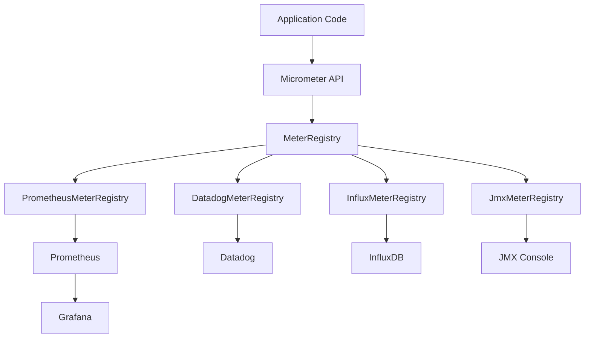
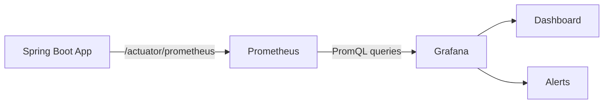
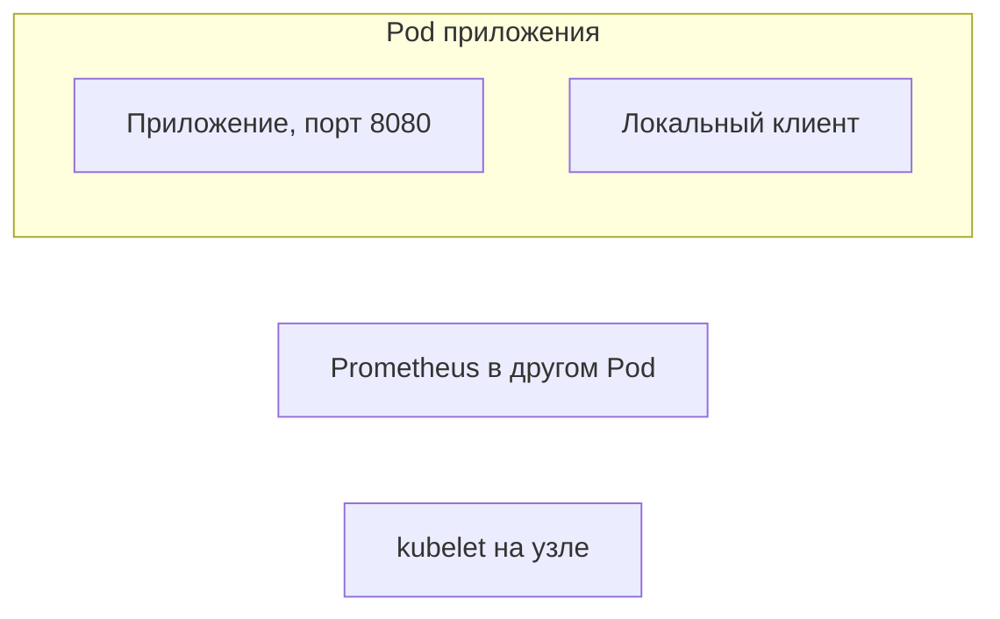

# Вопросы на собеседовании: `Spring Boot Actuator`

Глубокие ответы по `Spring Boot Actuator`: встроенные эндпоинты, `health indicators`, `Micrometer`, `Prometheus`, кастомные метрики, безопасность, production readiness.

**`Spring Boot Actuator`** — модуль `Spring Boot`, предоставляющий production-ready возможности для мониторинга и управления приложением. Вопросы по `Actuator` часто встречаются на собеседованиях уровня `Middle / Senior Java Developer`, потому что показывают понимание кандидатом production-эксплуатации, observability и DevOps-практик. Файл охватывает все ключевые аспекты: от базовых эндпоинтов до интеграции с [Observability](../../monitoring/observability-interview.md)-стеком (`Prometheus`, `Grafana`, `Micrometer`).

## Полезные ссылки

### Официальная документация

- [Spring Boot Actuator Reference](https://docs.spring.io/spring-boot/reference/actuator/) — официальная документация по Actuator
- [Actuator Endpoints](https://docs.spring.io/spring-boot/reference/actuator/endpoints.html) — полный список эндпоинтов
- [Actuator Metrics](https://docs.spring.io/spring-boot/reference/actuator/metrics.html) — метрики и Micrometer
- [Micrometer Docs](https://docs.micrometer.io/micrometer/reference/) — документация Micrometer

### Baeldung

- [Spring Boot Actuator](https://www.baeldung.com/spring-boot-actuators) — подробный туториал по всем эндпоинтам
- [Health Indicators in Spring Boot](https://www.baeldung.com/spring-boot-health-indicators) — создание кастомных HealthIndicator
- [Spring Boot + Prometheus](https://www.baeldung.com/spring-boot-prometheus) — интеграция с Prometheus и scrape-конфигурация
- [Liveness and Readiness Probes in Spring Boot](https://www.baeldung.com/spring-liveness-readiness-probes) — проверки жизнеспособности для Kubernetes
- [Spring Boot Startup Actuator Endpoint](https://www.baeldung.com/spring-boot-actuator-startup) — анализ времени запуска приложения
- [Custom Information in Spring Boot Info Endpoint](https://www.baeldung.com/spring-boot-info-actuator-custom) — кастомизация /info эндпоинта

## Содержание

- [Полезные ссылки](#полезные-ссылки)
- [See also](#see-also)

**Основы Actuator**
- [Q1. (!) Что такое Spring Boot Actuator и зачем он нужен?](#q1--что-такое-spring-boot-actuator-и-зачем-он-нужен)
- [Q2. Как подключить Actuator к проекту?](#q2-как-подключить-actuator-к-проекту)
- [Q3. Какие встроенные эндпоинты предоставляет Actuator?](#q3-какие-встроенные-эндпоинты-предоставляет-actuator)
- [Q4. Что такое discovery endpoint?](#q4-что-такое-discovery-endpoint)

**Конфигурация и экспозиция эндпоинтов**
- [Q5. (!) Как управлять экспозицией эндпоинтов (web/JMX)?](#q5--как-управлять-экспозицией-эндпоинтов-webjmx)
- [Q6. Как изменить базовый путь Actuator?](#q6-как-изменить-базовый-путь-actuator)
- [Q7. Как включить/выключить отдельный эндпоинт?](#q7-как-включитьвыключить-отдельный-эндпоинт)
- [Q8. Что такое уровни доступа (access levels) эндпоинтов?](#q8-что-такое-уровни-доступа-access-levels-эндпоинтов)

**Health endpoint и Health Indicators**
- [Q9. (!) Как работает эндпоинт /health?](#q9--как-работает-эндпоинт-health)
- [Q10. (!) Как создать кастомный Health Indicator?](#q10--как-создать-кастомный-health-indicator)
- [Q11. Что такое Health Groups?](#q11-что-такое-health-groups)
- [Q12. Какие встроенные Health Indicators есть в Spring Boot?](#q12-какие-встроенные-health-indicators-есть-в-spring-boot)

**Info, Env, Beans, Mappings**
- [Q13. Как настроить эндпоинт /info?](#q13-как-настроить-эндпоинт-info)
- [Q14. Как работает эндпоинт /env и sanitization?](#q14-как-работает-эндпоинт-env-и-sanitization)
- [Q15. Что показывают эндпоинты /beans и /mappings?](#q15-что-показывают-эндпоинты-beans-и-mappings)
- [Q16. Как использовать эндпоинт /loggers для динамического изменения уровня логирования?](#q16-как-использовать-эндпоинт-loggers-для-динамического-изменения-уровня-логирования)

**Кастомные эндпоинты**
- [Q17. (!) Как создать кастомный Actuator endpoint?](#q17--как-создать-кастомный-actuator-endpoint)
- [Q18. Чем отличаются @Endpoint, @WebEndpoint и @JmxEndpoint?](#q18-чем-отличаются-endpoint-webendpoint-и-jmxendpoint)
- [Q19. Как расширить существующий эндпоинт?](#q19-как-расширить-существующий-эндпоинт)

**Метрики и Micrometer**
- [Q20. (!) Что такое Micrometer и как он связан с Actuator?](#q20--что-такое-micrometer-и-как-он-связан-с-actuator)
- [Q21. Какие типы метрик поддерживает Micrometer?](#q21-какие-типы-метрик-поддерживает-micrometer)
- [Q22. (!) Как создать кастомные метрики?](#q22--как-создать-кастомные-метрики)
- [Q23. Как работает аннотация @Timed?](#q23-как-работает-аннотация-timed)

**Интеграция с Prometheus и Grafana**
- [Q24. (!) Как интегрировать Spring Boot с Prometheus?](#q24--как-интегрировать-spring-boot-с-prometheus)
- [Q25. Как настроить Grafana-дашборд для Spring Boot?](#q25-как-настроить-grafana-дашборд-для-spring-boot)

**Безопасность Actuator**
- [Q26. (!) Как защитить эндпоинты Actuator с помощью Spring Security?](#q26--как-защитить-эндпоинты-actuator-с-помощью-spring-security)
- [Q27. Как вынести Actuator на отдельный порт?](#q27-как-вынести-actuator-на-отдельный-порт)

**Production Readiness и Spring Boot Admin**
- [Q28. (!) Что такое production readiness и какие практики рекомендуются?](#q28--что-такое-production-readiness-и-какие-практики-рекомендуются)
- [Q29. Что такое Spring Boot Admin и как его настроить?](#q29-что-такое-spring-boot-admin-и-как-его-настроить)
- [Q30. Как настроить CORS для Actuator?](#q30-как-настроить-cors-для-actuator)

**Продвинутые темы**
- [Q31. (!) Как реализовать кастомный `HealthIndicator` с детальной диагностикой?](#q31--как-реализовать-кастомный-healthindicator-с-детальной-диагностикой)
- [Q32. (!) Как настроить `/actuator/info` с версией из `Git` и `Gradle`?](#q32--как-настроить-actuatorinfo-с-версией-из-git-и-gradle)
- [Q33. (!) Как работает `/actuator/prometheus` и что экспортируется?](#q33--как-работает-actuatorprometheus-и-что-экспортируется)
- [Q34. Как создать кастомный `@Endpoint` с операциями чтения и записи?](#q34-как-создать-кастомный-endpoint-с-операциями-чтения-и-записи)
- [Q35. Как настроить `Liveness` и `Readiness` пробы для `Kubernetes`?](#q35-как-настроить-liveness-и-readiness-пробы-для-kubernetes)
- [Q36. Как управлять уровнями логирования через `/actuator/loggers` в production?](#q36-как-управлять-уровнями-логирования-через-actuatorloggers-в-production)

**Observability и дополнительные эндпоинты**
- [Q37. Что нового в Observability Spring Boot 3 — Micrometer Tracing и @Observed?](#q37-что-нового-в-observability-spring-boot-3--micrometer-tracing-и-observed)
- [Q38. Как работают /actuator/heapdump и /actuator/threaddump в production?](#q38-как-работают-actuatorheapdump-и-actuatorthreaddump-в-production)
- [Q39. Как реализовать CompositeHealthContributor для группировки индикаторов?](#q39-как-реализовать-compositehealthcontributor-для-группировки-индикаторов)
- [Q40. Как использовать @Timed и MeterRegistry для экспорта метрик в Prometheus?](#q40-как-использовать-timed-и-meterregistry-для-экспорта-метрик-в-prometheus)
- [Q41. Как настроить безопасность Actuator-эндпоинтов в production (whitelist)?](#q41-как-настроить-безопасность-actuator-эндпоинтов-в-production-whitelist)
- [Q42. Liveness vs Readiness vs Startup проба Kubernetes — в чём разница?](#q42-liveness-vs-readiness-vs-startup-проба-kubernetes--в-чём-разница)
- [Q43. Как настроить OTLP exporter для отправки трейсов и метрик в OpenTelemetry Collector?](#q43-как-настроить-otlp-exporter-для-отправки-трейсов-и-метрик-в-opentelemetry-collector)
- [Q44. Как найти медленный этап запуска через ApplicationStartup и /actuator/startup?](#q44-как-найти-медленный-этап-запуска-через-applicationstartup-и-actuatorstartup)

---

## Q1. (!) Что такое Spring Boot Actuator и зачем он нужен?

```text
Дежурный сопровождает приложение на Spring Boot. Ему нужно проверить
состояние приложения, получить метрики и временно изменить уровень
логирования без пересборки. Какой модуль Spring Boot помогает решить эти задачи?
```

**Spring Boot Actuator** добавляет диагностические и управляющие эндпоинты. Их доступность зависит от настроек доступа и экспозиции по HTTP или JMX. В Spring Boot 3.5 по HTTP по умолчанию экспонируется только `health`.

- **Состояние приложения.** `/actuator/health` показывает состояние приложения и подключённых индикаторов зависимостей. Kubernetes может использовать отдельные группы для liveness и readiness.
- **Метрики.** Micrometer собирает метрики приложения и JVM. `/actuator/metrics` позволяет посмотреть зарегистрированные метрики. Prometheus забирает их с `/actuator/prometheus`, если подключён соответствующий реестр и эндпоинт экспонирован. Grafana может строить графики по данным Prometheus.
- **Диагностика и аудит.** `/actuator/info` показывает сведения о приложении, а `auditevents` предоставляет события аудита при наличии `AuditEventRepository`.
- **Управление.** `loggers` позволяет менять уровни логирования во время работы при разрешённых операциях записи. `shutdown` выключен по умолчанию и позволяет штатно остановить приложение с JAR-упаковкой.

В контексте [микросервисной архитектуры](../../architecture/microservices-interview.md) Actuator предоставляет данные для [наблюдаемости](../../monitoring/observability-interview.md) и оркестрации. [Справочник Spring Boot 3.5](https://docs.spring.io/spring-boot/3.5/reference/actuator/endpoints.html)

---

## Q2. Как подключить Actuator к проекту?

```text
Проект на Spring Boot 3.5 уже использует starter-web.
Actuator в зависимостях отсутствует. Нужен стандартный эндпоинт проверки
состояния приложения. В проектах используются Gradle или Maven.
```

Достаточно добавить одну зависимость:

**Gradle:**
```groovy
dependencies {
    implementation 'org.springframework.boot:spring-boot-starter-actuator'
}
```

**Maven:**
```xml
<dependency>
    <groupId>org.springframework.boot</groupId>
    <artifactId>spring-boot-starter-actuator</artifactId>
</dependency>
```

Стартер подключает Micrometer и автоконфигурацию Actuator. Конкретные эндпоинты зависят от настроек и нужных бинов или зависимостей. В Spring Boot 3.5 по умолчанию экспонируется только `health`: по HTTP и по JMX, если JMX включён. [Spring Boot 3.5 Endpoints](https://docs.spring.io/spring-boot/3.5/reference/actuator/endpoints.html).

---

## Q3. Какие встроенные эндпоинты предоставляет Actuator?

`Actuator` поставляется с богатым набором готовых эндпоинтов. Условно их можно разбить на три группы: **диагностика состояния** (`health`, `info`, `metrics`, `prometheus`), **интроспекция контекста** (`beans`, `mappings`, `configprops`, `conditions`, `env`) и **управление и дампы** (`loggers`, `shutdown`, `heapdump`, `threaddump`, `caches`).

Полная таблица основных эндпоинтов:

| Эндпоинт | Описание |
|---|---|
| `health` | Состояние приложения и зависимостей |
| `info` | Произвольная информация о приложении |
| `metrics` | Метрики (JVM, HTTP, кастомные) |
| `env` | Свойства `ConfigurableEnvironment` |
| `beans` | Список всех Spring-бинов в контексте |
| `mappings` | Все `@RequestMapping` маршруты |
| `configprops` | Все `@ConfigurationProperties` |
| `loggers` | Конфигурация логгеров (чтение и изменение) |
| `conditions` | Результат evaluation автоконфигурации |
| `threaddump` | Дамп потоков |
| `heapdump` | Дамп кучи в формате JVM — только web |
| `scheduledtasks` | Запланированные задачи |
| `caches` | Доступные кэши |
| `flyway` | Применённые Flyway-миграции |
| `liquibase` | Применённые Liquibase-миграции |
| `sessions` | Управление HTTP-сессиями |
| `shutdown` | Graceful shutdown (по умолчанию отключён) |
| `startup` | Данные о шагах запуска, если настроен `BufferingApplicationStartup` (см. Q44) |
| `httpexchanges` | Записи HTTP-обменов при наличии `HttpExchangeRepository`. Репозиторий в памяти по умолчанию хранит 100 записей |
| `prometheus` | Метрики в формате Prometheus — только web |
| `quartz` | Информация о задачах Quartz Scheduler |

По способу доступа эндпоинты делятся на два класса: **technology-agnostic** — доступны и через HTTP, и через JMX (большинство), и **web-only** — имеют смысл только по HTTP, потому что отдают бинарный файл или текст (`heapdump`, `logfile`, `prometheus`).

---

## Q4. Что такое discovery endpoint?

**Discovery endpoint** — это корневой эндпоинт `/actuator`, который возвращает каталог эндпоинтов, экспонированных по HTTP в виде HATEOAS-ссылок. По сути это «оглавление» Actuator: клиент (например, Spring Boot Admin) обращается к `/actuator` и узнаёт, какие эндпоинты экспонированы по HTTP и по каким URL они доступны, не зная их заранее.

```json
{
  "_links": {
    "self": { "href": "http://localhost:8080/actuator" },
    "health": { "href": "http://localhost:8080/actuator/health" },
    "metrics": { "href": "http://localhost:8080/actuator/metrics" },
    "info": { "href": "http://localhost:8080/actuator/info" }
  }
}
```

Пример предполагает явную HTTP-экспозицию `metrics` и `info`. В Spring Boot 3.5 по умолчанию экспонируется только `health`. Discovery-страницу можно отключить:

```yaml
management:
  endpoints:
    web:
      discovery:
        enabled: false
```

---

## Q5. (!) Как управлять экспозицией эндпоинтов (web/JMX)?

Экспозиция (exposure) определяет, через какие транспорты доступен эндпоинт. В Spring Boot 3.5 по умолчанию только `health` экспонируется по HTTP и JMX, если JMX включён. `include` задаёт список экспозиции, а `exclude` имеет приоритет.

```yaml
management:
  endpoints:
    web:
      exposure:
        include: "health,info,metrics,prometheus"  # открыть конкретные
        exclude: "env,beans"                        # исключить
    jmx:
      exposure:
        include: "*"    # открыть все через JMX
```

**Открыть все эндпоинты через HTTP** (не рекомендуется для prod):

```yaml
management:
  endpoints:
    web:
      exposure:
        include: "*"
```

> В `YAML` символ `*` нужно заключать в кавычки, иначе парсер воспримет его как якорь.

Типичная production-конфигурация — открыть минимальный набор, нужный мониторингу и оркестратору, и ничего лишнего:

```yaml
management:
  endpoints:
    web:
      exposure:
        include: "health,info,metrics,prometheus"
```

**Подводный камень:** экспозиция не отменяет защиту — открытый наружу эндпоинт по-прежнему стоит прикрыть Spring Security или вынести на закрытый порт. Подробнее — в [вопросах по Spring Security](spring-security-interview.md) и Q26.

---

## Q6. Как изменить базовый путь Actuator?

```text
GET /actuator/health и GET /actuator/info уже доступны на порту приложения.
Оба эндпоинта нужно перенести под префикс /management с сохранением их ID.
Прочие HTTP-маршруты приложения должны остаться на прежних путях.
```

По умолчанию веб-эндпоинты имеют префикс `/actuator`. В этом сценарии достаточно поменять базовый путь Actuator. При неизменной экспозиции маршруты станут `/management/health` и `/management/info`.

```yaml
management:
  endpoints:
    web:
      base-path: /management   # /management/health, /management/metrics и т.д.
```

Также можно изменить путь отдельного эндпоинта:

```yaml
management:
  endpoints:
    web:
      path-mapping:
        health: healthcheck   # /actuator/healthcheck вместо /actuator/health
```

---

## Q7. Как включить/выключить отдельный эндпоинт?

```yaml
# Spring Boot 3.5. Почему GET /actuator/info недоступен?
management:
  endpoints:
    web:
      exposure:
        include: info
  endpoint:
    info:
      access: none
```

В Spring Boot 3.4+ доступ к операциям управляется через `management.endpoint.<id>.access`. Уровень `none` удаляет эндпоинт из контекста. Поэтому `exposure.include: info` в условии не создаёт маршрут. Экспозиция выбирает транспорт для доступного эндпоинта, а доступ пользователя к маршруту определяется настройками безопасности. Ниже пример с запретом по умолчанию и явным разрешением чтения для трёх эндпоинтов.

```yaml
management:
  endpoints:
    access:
      default: none
    web:
      exposure:
        include: health,info,prometheus
  endpoint:
    health:
      access: read-only
    info:
      access: read-only
    prometheus:
      access: read-only
```

В этом примере для `prometheus` нужна также зависимость для Prometheus registry. `management.endpoint.<id>.enabled` и `management.endpoints.enabled-by-default` относятся к прежнему булеву API. [Spring Boot 3.4 Release Notes](https://github.com/spring-projects/spring-boot/wiki/Spring-Boot-3.4-Release-Notes) · [Spring Boot 3.5 Endpoints](https://docs.spring.io/spring-boot/3.5/reference/actuator/endpoints.html).

---

## Q8. Что такое уровни доступа (access levels) эндпоинтов?

Начиная с `Spring Boot 3.4`, для каждого эндпоинта можно задать **уровень доступа** — какие типы операций он разрешает. Это пришло на замену старому булеву `enabled` и даёт более тонкий контроль: например, разрешить только чтение, запретив запись и удаление.

| Уровень | Описание |
|---|---|
| `none` | Доступ запрещён |
| `read-only` | Только операции чтения (`@ReadOperation`) |
| `unrestricted` | Полный доступ (чтение, запись, удаление) |

```yaml
management:
  endpoints:
    access:
      default: read-only              # по умолчанию только чтение
      max-permitted: read-only        # максимально допустимый уровень
  endpoint:
    shutdown:
      access: unrestricted            # shutdown требует полного доступа
    loggers:
      access: unrestricted            # изменение уровня логирования
```

Уровни доступа — это дополнительный слой защиты поверх [Spring Security](spring-security-interview.md), а не замена ему: они ограничивают, какие операции в принципе разрешены эндпоинту, тогда как Security отвечает за то, кто имеет право их вызывать. `max-permitted` удобно выставить в `read-only` глобально, чтобы гарантированно запретить любые write-операции на весь сервис.

В примере глобальный предел блокирует `shutdown` и изменение уровней через `loggers`, даже при `access: unrestricted` у обоих. Чтение `loggers` остаётся доступным при соответствующей экспозиции и авторизации.

---

## Q9. (!) Как работает эндпоинт /health?

Общий `/actuator/health` агрегирует состояние приложения и зарегистрированных зависимостей. Liveness и readiness в Kubernetes обычно направляют на отдельные группы `/actuator/health/liveness` и `/actuator/health/readiness`.

**Как формируется итоговый статус.** `StatusAggregator` упорядочивает статусы компонентов по настроенному приоритету и выбирает первый известный. По умолчанию `DOWN` выше `OUT_OF_SERVICE` и `UP`. Отображение итогового статуса в HTTP-код настраивается отдельно.

**Уровни детализации** управляют тем, сколько информации видно в ответе. По умолчанию наружу отдаётся только общий статус (`{"status":"UP"}`) — детали компонентов скрыты, чтобы не раскрывать внутреннее устройство неавторизованным:

```yaml
management:
  endpoint:
    health:
      show-details: always       # always | when-authorized | never
      show-components: always    # показать компоненты без деталей
```

**Пример ответа с деталями:**

```json
{
  "status": "UP",
  "components": {
    "db": {
      "status": "UP",
      "details": {
        "database": "PostgreSQL",
        "validationQuery": "isValid()"
      }
    },
    "diskSpace": {
      "status": "UP",
      "details": {
        "total": 499963174912,
        "free": 250000000000,
        "threshold": 10485760
      }
    },
    "redis": {
      "status": "UP"
    }
  }
}
```

**Статусы здоровья и их HTTP-коды:**

| Статус | HTTP-код | Описание |
|---|---|---|
| `UP` | 200 | Компонент работает |
| `DOWN` | 503 | Компонент недоступен |
| `OUT_OF_SERVICE` | 503 | Компонент выведен из обслуживания |
| `UNKNOWN` | 200 | Статус неизвестен |

HTTP-проба Kubernetes считает успехом коды 200–399. После порога неудачных проверок liveness или startup kubelet перезапускает контейнер. Неудачная readiness меняет готовность Pod без перезапуска. [Kubernetes Probes](https://kubernetes.io/docs/concepts/configuration/liveness-readiness-startup-probes/).

**Kubernetes probes** автоматически регистрируются при запуске в `Kubernetes` (Spring обнаруживает среду по переменным окружения) и добавляют группы `liveness`/`readiness`:

```yaml
management:
  endpoint:
    health:
      probes:
        enabled: true
      group:
        liveness:
          include: livenessState
        readiness:
          include: readinessState,db
```

---

## Q10. (!) Как создать кастомный Health Indicator?

```java
// true: ресурс отвечает; false: ресурс недоступен.
// При сбое клиента ping() может выбросить IOException.
// Результат проверки должен входить в общий health-ответ.
interface ExternalServiceClient {
    boolean ping() throws IOException;
}
```

Нужно создать бин, реализующий интерфейс `HealthIndicator` с единственным методом `health()`. Spring сам найдёт его и подмешает результат в общий `/health`. Внутри метода вы проверяете свой ресурс и возвращаете `Health.up()` или `Health.down()`, при необходимости добавляя диагностические детали через `withDetail(...)`.

Преобразуйте ожидаемую ошибку клиента в результат проверки. В примере диагностическая деталь указывает на сбой связи без передачи текста исключения в HTTP-ответ.

```java
@Component
public class ExternalServiceHealthIndicator implements HealthIndicator {

    private final ExternalServiceClient client;

    public ExternalServiceHealthIndicator(ExternalServiceClient client) {
        this.client = client;
    }

    @Override
    public Health health() {
        try {
            long start = System.nanoTime();
            boolean reachable = client.ping();
            if (reachable) {
                return Health.up()
                    .withDetail("service", "external-api")
                    .withDetail("responseTimeMs", Duration.ofNanos(System.nanoTime() - start).toMillis())
                    .build();
            }
            return Health.down()
                .withDetail("service", "external-api")
                .withDetail("error", "Service unreachable")
                .build();
        } catch (IOException e) {
            return Health.down().withDetail("error", "ping failed").build();
        }
    }
}
```

По умолчанию имя компонента получают из имени бина с отброшенным суффиксом `HealthIndicator` (`ExternalServiceHealthIndicator` → `externalService`). Своё имя можно задать через `@Component("myName")`.

```json
{
  "status": "UP",
  "components": {
    "externalService": {
      "status": "UP",
      "details": {
        "service": "external-api",
        "responseTimeMs": 45
      }
    }
  }
}
```

В [WebFlux](spring-webflux-interview.md) для неблокирующей проверки реализуют `ReactiveHealthIndicator`. Spring Boot адаптирует и обычные `HealthIndicator`, запуская их на отдельном планировщике.

---

## Q11. Что такое Health Groups?

```text
Оркестратор проверяет, жив ли процесс. Балансировщик проверяет, можно ли
направлять запросы в экземпляр, которому для работы нужны PostgreSQL и Redis.
Оба потребителя обращаются к одному приложению и должны получать результаты
разных наборов проверок. Как настроить их и какие URL будут доступны?
```

**Health Groups** объединяют выбранные индикаторы под одним именем. Если `health` экспонирован по HTTP, при стандартном префиксе и без дополнительного контекстного пути группа доступна по адресу `/actuator/health/<group>`.

Liveness проверяет, нужен ли процессу перезапуск. Внешние зависимости в эту проверку не включают, чтобы их сбой не вызвал каскад перезапусков. Readiness показывает, готов ли экземпляр принимать запросы. В примере ниже в readiness включены зависимости, обязательные для обработки запросов. Все перечисленные индикаторы должны быть зарегистрированы.

### Пример конфигурации

    management:
      endpoint:
        health:
          group:
            liveness:
              include: livenessState,ping
              show-details: always
            readiness:
              include: readinessState,db,redis
              show-details: always
            critical:
              include: db,redis
              show-details: always

В этом примере HTTP-пути и состав групп такие.

- `/actuator/health/liveness` включает `livenessState` и `ping`.
- `/actuator/health/readiness` включает `readinessState`, `db` и `redis`.
- `/actuator/health/critical` включает `db` и `redis`.

Здесь `show-details: always` раскрывает подробности всем, кому доступен маршрут. Отказ общей БД, включённой в readiness, может одновременно убрать из балансировки все реплики. [Health Groups в Spring Boot 3.5](https://docs.spring.io/spring-boot/3.5/reference/actuator/endpoints.html#actuator.endpoints.health.groups)

---

## Q12. Какие встроенные Health Indicators есть в Spring Boot?

`Spring Boot` не заставляет писать health-проверки вручную для стандартных зависимостей — он подключает готовые индикаторы автоматически по принципу автоконфигурации: **есть бин-клиент к ресурсу в контексте — появляется и его индикатор**. Например, добавили `spring-boot-starter-data-redis` — и `RedisHealthIndicator` сам начнёт пинговать Redis в `/health`.

| Индикатор | Условие активации |
|---|---|
| `DataSourceHealthIndicator` | Есть `DataSource` в контексте |
| `DiskSpaceHealthIndicator` | Всегда активен |
| `RedisHealthIndicator` | Есть `RedisConnectionFactory` |
| `MongoHealthIndicator` | Есть `MongoTemplate` |
| `RabbitHealthIndicator` | Есть `RabbitTemplate` |

| `ElasticsearchRestClientHealthIndicator` | Есть `RestClient` (Elasticsearch) |
| `MailHealthIndicator` | Есть `JavaMailSender` |
| `LdapHealthIndicator` | Есть `LdapTemplate` |
| `CassandraHealthIndicator` | Есть `CassandraTemplate` |
| `Neo4jHealthIndicator` | Есть `Driver` (Neo4j) |

Любой автоматический индикатор можно отключить — это полезно, когда зависимость некритична и её сбой не должен ронять `/health` всего сервиса:

```yaml
management:
  health:
    redis:
      enabled: false
```

Spring Boot 3.5 не поставляет встроенный `KafkaHealthIndicator`. Для Kafka нужна отдельная проверка, если она требуется приложению.

---

## Q13. Как настроить эндпоинт /info?

`/info` отдаёт произвольные метаданные о приложении — чаще всего версию, git-коммит и информацию о сборке. Главная польза в production: по нему быстро понять, **какая именно сборка крутится на инстансе**, не залезая в pod.

Данные собираются из нескольких независимых источников через механизм `InfoContributor` — каждый контрибьютор добавляет свой кусок в общий JSON:

**1. Файл `application.yml`.** Для публикации свойств `info.*` включите `management.info.env.enabled=true`:

```yaml
management:
  info:
    env:
      enabled: true
info:
  app:
    name: "My Service"
    version: "2.1.0"
    description: "Сервис обработки заказов"
    team: "Backend Team"
```

**2. Build information (Gradle):**

```groovy
springBoot {
    buildInfo()
}
```

Генерирует `META-INF/build-info.properties`, и `BuildInfoContributor` автоматически добавляет данные.

**3. Git information:**

Плагин `gradle-git-properties` или `git-commit-id-maven-plugin` создаёт `git.properties`:

```groovy
plugins {
    id 'com.gorylenko.gradle-git-properties' version '2.4.1'
}
```

```yaml
management:
  info:
    git:
      mode: full   # показать полную информацию о git-коммите
```

**4. Кастомный `InfoContributor`:**

```java
@Component
public class CustomInfoContributor implements InfoContributor {

    @Override
    public void contribute(Info.Builder builder) {
        builder.withDetail("uptime", ManagementFactory.getRuntimeMXBean().getUptime());
        builder.withDetail("activeProfiles",
            List.of("prod", "metrics"));
    }
}
```

В Spring Boot 3.5 contributors для build и Git включены по умолчанию при наличии соответствующих ресурсов. Для HTTP отдельно проверьте экспозицию `info`.

---

## Q14. Как работает эндпоинт /env и sanitization?

`/env` показывает всю иерархию property-sources из `ConfigurableEnvironment`: системные переменные, переменные окружения, `application.yml`, активные профили — с указанием, откуда взято каждое значение. Удобно для отладки конфигурации, но именно поэтому **потенциально опасно**: там лежат пароли, токены и ключи.

**Sanitization** — встроенный механизм маскирования чувствительных значений, который решает эту проблему. Управляется свойством `show-values`:

```yaml
management:
  endpoint:
    env:
      show-values: when-authorized   # never | when-authorized | always
      roles: ADMIN                   # роль для просмотра значений
```

| Режим | Поведение |
|---|---|
| `never` | Все значения скрыты (`******`) |
| `when-authorized` | Видны только авторизованным пользователям с нужной ролью |
| `always` | Все значения видны (опасно для prod!) |

В Spring Boot 3.5 режим `always` разрешает показывать значения, если их не маскирует применимая `SanitizingFunction`. На автоматическую фильтрацию по словам `password` или `token` полагаться нельзя. [Spring Boot 3.5 Sanitization](https://docs.spring.io/spring-boot/3.5/reference/actuator/endpoints.html#actuator.endpoints.sanitizing).

---

## Q15. Что показывают эндпоинты /beans и /mappings?

Оба эндпоинта — инструменты интроспекции контекста для отладки: они показывают, что Spring собрал на старте. На production их обычно держат закрытыми (раскрывают внутреннюю структуру), а используют локально или в dev.

**`/beans`** — полный список всех бинов в `ApplicationContext` с их scope, типом и зависимостями. Помогает ответить на вопросы «а создался ли этот бин?» и «почему он подтянул именно эту реализацию?»:

```json
{
  "contexts": {
    "application": {
      "beans": {
        "userController": {
          "aliases": [],
          "scope": "singleton",
          "type": "com.example.UserController",
          "resource": "file:UserController.class",
          "dependencies": ["userService"]
        }
      }
    }
  }
}
```

Тесно связан с механизмом автоконфигурации (см. [Spring Boot](spring-boot-interview.md)): через `/beans` видно, какие именно auto-configuration бины реально попали в контекст.

**`/mappings`** — карта всех зарегистрированных `@RequestMapping`-маршрутов (включая маршруты из [Spring MVC](spring-mvc-interview.md)) с указанием HTTP-метода, шаблона URL и метода-обработчика. Удобно, чтобы за секунду увидеть полный список ручек приложения или найти конфликт двух маппингов на один путь. Структура ответа:

```json
{
  "contexts": {
    "application": {
      "mappings": {
        "dispatcherServlets": {
          "dispatcherServlet": [
            {
              "handler": "com.example.UserController#getUser(Long)",
              "predicate": "{GET [/api/users/{id}]}",
              "details": {
                "requestMappingConditions": {
                  "methods": ["GET"],
                  "patterns": ["/api/users/{id}"]
                }
              }
            }
          ]
        }
      }
    }
  }
}
```

---

## Q16. Как использовать эндпоинт /loggers для динамического изменения уровня логирования?

`/loggers` позволяет читать и **менять уровень логирования на лету** — без перезапуска и редеплоя. Это его главная ценность: в production нельзя постоянно держать `DEBUG` (заваливает диск и бьёт по производительности), но в момент инцидента он остро нужен. Эндпоинт даёт включить `DEBUG` точечно для нужного пакета, собрать логи и тут же выключить обратно.

В ответе два уровня: `configuredLevel` — явно заданный для логгера (может быть `null`), и `effectiveLevel` — фактический, унаследованный от родителя, если свой не задан.

**Получить текущий уровень:**

```bash
GET /actuator/loggers/com.example.service
```

```json
{
  "configuredLevel": null,
  "effectiveLevel": "INFO"
}
```

**Изменить уровень на DEBUG:**

```bash
POST /actuator/loggers/com.example.service
Content-Type: application/json

{
  "configuredLevel": "DEBUG"
}
```

**Сбросить к уровню по умолчанию:**

```bash
POST /actuator/loggers/com.example.service
Content-Type: application/json

{}
```

**Подводный камень:** изменения живут только в памяти и сбрасываются при перезапуске — после рестарта уровни вернутся к значениям из конфигурации. Поэтому это инструмент диагностики, а не способ постоянной настройки. И обязательно закрывайте `POST /loggers` авторизацией: возможность менять логирование в чужих руках — это и DoS (включить `TRACE` всему), и утечка чувствительных данных в логи.

---

## Q17. (!) Как создать кастомный Actuator endpoint?

```text
Хранилище флагов: Map<String, Boolean> на основе ConcurrentHashMap.
Операции: Map<String, Boolean> getAllFeatures(), boolean getFeature(String name),
void setFeature(String name, boolean enabled), void deleteFeature(String name).
Нужно опубликовать управление флагами через Actuator под ID features.
```

Кастомный эндпоинт — это бин, помеченный `@Endpoint(id = "...")`, методы которого описаны операциями `@ReadOperation`, `@WriteOperation`, `@DeleteOperation`. Один бин описывает операции для HTTP и JMX. Boot публикует их с учётом access и настроек экспозиции для каждого транспорта. Экспонированные HTTP-эндпоинты могут попасть на страницу обнаружения Actuator.

Типичный сценарий — управляющая ручка: фиче-флаги, ручной сброс кэша, переключение режима. Пример эндпоинта фиче-флагов:

```java
@Component
@Endpoint(id = "features")
public class FeaturesEndpoint {

    private final Map<String, Boolean> features = new ConcurrentHashMap<>();

    @ReadOperation
    public Map<String, Boolean> getAllFeatures() {
        return Collections.unmodifiableMap(features);
    }

    @ReadOperation
    public boolean getFeature(@Selector String name) {
        return features.getOrDefault(name, false);
    }

    @WriteOperation
    public void setFeature(@Selector String name, boolean enabled) {
        features.put(name, enabled);
    }

    @DeleteOperation
    public void deleteFeature(@Selector String name) {
        features.remove(name);
    }
}
```

**Маппинг на HTTP:**

| Аннотация | HTTP-метод | Пример |
|---|---|---|
| `@ReadOperation` | `GET` | `GET /actuator/features` |
| `@WriteOperation` | `POST` | `POST /actuator/features/dark-mode` |
| `@DeleteOperation` | `DELETE` | `DELETE /actuator/features/dark-mode` |

`@Selector` превращает параметр в path-переменную: `/actuator/features/{name}`.

Аннотация `@Endpoint` определяет операции. Доступность по HTTP и JMX дополнительно зависит от access и exposure.

---

## Q18. Чем отличаются @Endpoint, @WebEndpoint и @JmxEndpoint?

Все три аннотации создают Actuator-эндпоинт — разница только в том, по каким транспортам он доступен. `@Endpoint` универсален (и HTTP, и JMX); специализированные `@WebEndpoint`/`@JmxEndpoint` нужны, когда эндпоинт имеет смысл только в одном транспорте.

| Аннотация | HTTP | JMX | Когда использовать |
|---|---|---|---|
| `@Endpoint` | Да | Да | Универсальный эндпоинт — выбор по умолчанию |
| `@WebEndpoint` | Да | Нет | Только HTTP: например, отдача файла или ответ с HTTP-статусом |
| `@JmxEndpoint` | Нет | Да | Только JMX: системное управление через JMX-консоль |

```java
@Component
@WebEndpoint(id = "web-status")
public class WebStatusEndpoint {

    @ReadOperation
    public Map<String, Object> getStatus() {
        return Map.of(
            "timestamp", Instant.now(),
            "activeConnections", getActiveConnections()
        );
    }
}
```

Также есть `@EndpointWebExtension` для расширения существующих эндпоинтов web-специфичными данными.

«Да» в таблице означает, что транспорт поддерживается. Для конкретного эндпоинта нужны подходящие access, exposure и, для JMX, включённый JMX.

---

## Q19. Как расширить существующий эндпоинт?

```text
GET /actuator/info возвращает {"app":{"name":"orders"}}.
Нужно сохранить исходные поля и добавить serverTime в ответ HTTP.
Ответ для клиентов JMX должен остаться прежним.
```

Если нужно не создать новый эндпоинт, а **дополнить или изменить ответ существующего** (например, добавить поле в `/info` или подменить HTTP-код у `/health`), используют `@EndpointWebExtension`. Расширение оборачивает оригинальный эндпоинт через делегирование: вы инжектите его бин (`InfoEndpoint`), вызываете его метод и обогащаете результат своими данными, оставаясь web-специфичным.

```java
@Component
@EndpointWebExtension(endpoint = InfoEndpoint.class)
public class InfoWebExtension {

    private final InfoEndpoint delegate;

    public InfoWebExtension(InfoEndpoint delegate) {
        this.delegate = delegate;
    }

    @ReadOperation
    public WebEndpointResponse<Map<String, Object>> info() {
        Map<String, Object> info = new LinkedHashMap<>(this.delegate.info());
        // Добавить дополнительные данные
        info.put("serverTime", Instant.now());
        return new WebEndpointResponse<>(info, 200);
    }
}
```

---

## Q20. (!) Что такое Micrometer и как он связан с Actuator?

**`Micrometer`** — это вендоронезависимый фасад для метрик, по той же идее, что `SLF4J` для логирования. Ваш код пишет метрики через единый API Micrometer и **ничего не знает о конкретной системе мониторинга**; куда они в итоге попадут — в Prometheus, Datadog или InfluxDB — определяет лишь то, какой `MeterRegistry` подключён в classpath.

Зачем это нужно: сменить бэкенд мониторинга (например, мигрировать с Datadog на Prometheus) можно заменой одной зависимости, не трогая код инструментации. Именно через Micrometer `Actuator` собирает все метрики.



`Spring Boot Actuator` автоматически настраивает `Micrometer` и из коробки регистрирует основные метрики приложения — их не нужно писать вручную:
- **JVM** — память, GC, потоки, загрузка классов
- **HTTP** — количество запросов, время ответа, коды ответов
- **DataSource** — активные/idle соединения, время ожидания
- **Cache** — hits, misses, evictions
- **Система** — CPU, файловые дескрипторы, uptime

Подробнее о метриках и трейсинге — в [Observability](../../monitoring/observability-interview.md).

---

## Q21. Какие типы метрик поддерживает Micrometer?

```text
Сервис наблюдает три величины:
- число созданных заказов с момента запуска;
- текущий размер очереди, который меняется в обе стороны;
- длительность завершённых запросов и число таких запросов.
Какие типы измерений Micrometer выбрать?
```

Выбор типа метрики (meter) определяется характером измеряемой величины. Базовое правило: **только растёт — `Counter`; может расти и падать — `Gauge`; нужно и считать события, и мерить их длительность — `Timer`**. Остальные типы — специализации под конкретные задачи.

| Тип | Описание | Пример |
|---|---|---|
| `Counter` | Монотонно растущий счётчик | Количество обработанных заказов |
| `Gauge` | Текущее значение, может расти и падать | Размер очереди, количество активных сессий |
| `Timer` | Время выполнения + количество вызовов | Время ответа API |
| `DistributionSummary` | Распределение значений | Размер тела запроса |
| `LongTaskTimer` | Время выполнения длительных задач | Время импорта данных |
| `FunctionCounter` | Счётчик на основе функции | Метрики из внешней библиотеки |
| `FunctionTimer` | Таймер на основе функции | Метрики из внешней библиотеки |

**Тонкость с `Gauge`:** Micrometer не хранит значение, а опрашивает функцию в момент scrape. Поэтому объект, за которым следит Gauge, держится по слабой ссылке и регистрировать Gauge надо один раз — а не в цикле обработки запроса. Для длительных задач (`LongTaskTimer`) важно, что он показывает время **ещё не завершённых** операций — `Timer` так не умеет.

```java
// Counter — только инкремент
Counter counter = Counter.builder("orders.created")
    .tag("type", "online")
    .description("Number of orders created")
    .register(meterRegistry);
counter.increment();

// Gauge — текущее значение
Gauge.builder("queue.size", queue, Queue::size)
    .description("Current queue size")
    .register(meterRegistry);

// Timer — время выполнения
Timer timer = Timer.builder("api.response.time")
    .tag("endpoint", "/users")
    .publishPercentiles(0.5, 0.95, 0.99)
    .register(meterRegistry);
timer.record(() -> processRequest());
```

---

## Q22. (!) Как создать кастомные метрики?

Есть три способа, и выбор зависит от того, где и как удобнее инструментировать код. Общий принцип для всех: метрику-объект (`Counter`, `Timer`) создают **один раз** — обычно в конструкторе — и переиспользуют, а не создают на каждый вызов.

**Способ 1 — императивно через `MeterRegistry`.** Инжектим `MeterRegistry`, в конструкторе строим нужные метрики и дёргаем их в бизнес-методе. Самый гибкий способ, когда нужен полный контроль:

```java
@Service
public class OrderService {

    private final Counter orderCounter;
    private final Timer orderProcessingTimer;

    public OrderService(MeterRegistry registry) {
        this.orderCounter = Counter.builder("orders.total")
            .tag("status", "created")
            .description("Total orders created")
            .register(registry);

        this.orderProcessingTimer = Timer.builder("orders.processing.time")
            .description("Order processing duration")
            .publishPercentiles(0.5, 0.95, 0.99)
            .register(registry);
    }

    public Order createOrder(OrderRequest request) {
        return orderProcessingTimer.record(() -> {
            Order order = processOrder(request);
            orderCounter.increment();
            return order;
        });
    }
}
```

**Способ 2 — декларативно через `@Timed`** (см. Q23). Просто вешаем аннотацию на метод — Micrometer сам замерит время через AOP. Минимум кода, но только для таймеров.

**Способ 3 — через `MeterBinder`** — когда метрики относятся не к бизнес-логике, а к компоненту (кэш, пул, очередь). `MeterBinder` — это «модуль метрик»: его метод `bindTo` вызывается при регистрации и привязывает все метрики компонента к registry. Так оформлены и встроенные метрики Spring:

```java
@Component
public class CacheMetrics implements MeterBinder {

    private final CacheManager cacheManager;

    public CacheMetrics(CacheManager cacheManager) {
        this.cacheManager = cacheManager;
    }

    @Override
    public void bindTo(MeterRegistry registry) {
        Gauge.builder("cache.entries.count",
                cacheManager, cm -> cm.getCacheNames().size())
            .description("Number of cache regions")
            .register(registry);
    }
}
```

Для `@Timed` на методе Spring-бина нужна инструментация аннотаций, например `TimedAspect` и вызов через AOP-прокси. Метрики, записываемые непосредственно через `MeterRegistry`, такой настройки не требуют.

---

## Q23. Как работает аннотация @Timed?

`@Timed` — декларативный способ замерить время метода: вешаете аннотацию, а Micrometer через AOP сам оборачивает вызов в `Timer` и регистрирует метрику. Код метода при этом не меняется — инструментация вынесена в аннотацию.

```java
@Service
public class UserService {

    @Timed(value = "users.find.time",
           description = "Time to find user",
           percentiles = {0.5, 0.95, 0.99})
    public User findById(Long id) {
        return userRepository.findById(id)
            .orElseThrow(() -> new UserNotFoundException(id));
    }
}
```

**Главный подвох на собеседовании:** `@Timed` сам по себе не работает на обычных бинах — нужен бин `TimedAspect`, который и реализует AOP-обёртку. Без него аннотация просто игнорируется (метрика не появится), и это частая причина «почему метрика пустая»:

```java
@Configuration
public class MetricsConfig {

    @Bean
    public TimedAspect timedAspect(MeterRegistry registry) {
        return new TimedAspect(registry);
    }
}
```

В Spring Boot 3 встроенное измерение HTTP-запросов через Observation даёт `http.server.requests`. Прежний `WebMvcMetricsFilter` удалён. Для отдельного таймера метода контроллера через `@Timed` можно подключить `TimedAspect` и выбрать другое имя метрики. [Spring Boot 3.0 Migration Guide](https://github.com/spring-projects/spring-boot/wiki/Spring-Boot-3.0-Migration-Guide).

Результат доступен через `/actuator/metrics/users.find.time`:

```json
{
  "name": "users.find.time",
  "measurements": [
    { "statistic": "COUNT", "value": 150 },
    { "statistic": "TOTAL_TIME", "value": 12.345 },
    { "statistic": "MAX", "value": 0.523 }
  ],
  "availableTags": [
    { "tag": "class", "values": ["UserService"] },
    { "tag": "method", "values": ["findById"] }
  ]
}
```

---

## Q24. (!) Как интегрировать Spring Boot с Prometheus?

Интеграция строится на **pull-модели**: приложение не отправляет метрики само, а лишь выставляет эндпоинт `/actuator/prometheus`, а сервер Prometheus периодически приходит и забирает (scrape) их сам. Поэтому настройка делится на две стороны — приложение и Prometheus.

**Шаг 1 — добавить зависимость.** Именно `micrometer-registry-prometheus` подключает `PrometheusMeterRegistry` и автоматически активирует эндпоинт `/actuator/prometheus`:

```groovy
dependencies {
    implementation 'org.springframework.boot:spring-boot-starter-actuator'
    runtimeOnly 'io.micrometer:micrometer-registry-prometheus'
}
```

**Шаг 2 — открыть prometheus endpoint:**

```yaml
management:
  endpoints:
    web:
      exposure:
        include: "health,info,metrics,prometheus"
  metrics:
    tags:
      application: ${spring.application.name}
```

Тег `application` здесь критичен: он добавляется ко всем метрикам и потом позволяет в Grafana отличить метрики этого сервиса от других.

**Шаг 3 — настроить scrape на стороне `Prometheus` (prometheus.yml)** — указать, откуда и как часто забирать метрики:

```yaml
scrape_configs:
  - job_name: 'spring-boot-app'
    metrics_path: '/actuator/prometheus'
    scrape_interval: 15s
    static_configs:
      - targets: ['app-host:8080']
```

После этого `/actuator/prometheus` будет возвращать метрики в формате Prometheus:

```
# HELP jvm_memory_used_bytes The amount of used memory
# TYPE jvm_memory_used_bytes gauge
jvm_memory_used_bytes{area="heap",id="G1 Eden Space"} 2.5165824E7
jvm_memory_used_bytes{area="heap",id="G1 Old Gen"} 1.2582912E7

# HELP http_server_requests_seconds Duration of HTTP server request handling
# TYPE http_server_requests_seconds summary
http_server_requests_seconds_count{method="GET",uri="/api/users",status="200"} 150
http_server_requests_seconds_sum{method="GET",uri="/api/users",status="200"} 12.345
```



В Spring Boot 3.5 встроенные HTTP-метрики появляются через Observation. Для PromQL по сериям `_bucket` отдельно включите публикацию гистограммы для нужной метрики.

---

## Q25. Как настроить Grafana-дашборд для Spring Boot?

Дашборд для Spring Boot не обязательно строить с нуля — комьюнити уже подготовило готовые шаблоны под стандартные метрики Micrometer. Их импортируют в Grafana по числовому ID с grafana.com, после чего остаётся лишь указать источник данных (Prometheus).

**Готовые дашборды** — наиболее популярные ID для импорта:
- **4701** — JVM (Micrometer) — метрики JVM, GC, потоки
- **12900** — Spring Boot Statistics — HTTP, Tomcat, DataSource
- **11378** — Spring Boot Observability — комплексный дашборд

**Ключевые PromQL-запросы:**

```promql
# p95 задержки HTTP-запросов
histogram_quantile(0.95,
  rate(http_server_requests_seconds_bucket{application="my-app"}[5m])
)

# Количество запросов в секунду
rate(http_server_requests_seconds_count{application="my-app"}[1m])

# Использование памяти JVM
jvm_memory_used_bytes{area="heap"} / jvm_memory_max_bytes{area="heap"}

# Количество активных потоков
jvm_threads_live_threads{application="my-app"}
```

Для production-сценариев рекомендуется сочетать метрики с трейсингом и логированием — подробнее в [Observability](../../monitoring/observability-interview.md).

Запрос `histogram_quantile` использует серии `_bucket`. Для `http.server.requests` их можно включить через `management.metrics.distribution.percentiles-histogram[http.server.requests]=true`. При объединении классических гистограмм нескольких экземпляров сохраняйте границу бакета `le` в группировке.

---

## Q26. (!) Как защитить эндпоинты Actuator с помощью Spring Security?

В Spring Boot 3.5 при наличии Spring Security и отсутствии собственной `SecurityFilterChain` автоконфигурация защищает Actuator-эндпоинты, кроме `health`. `info`, если экспонирован, по умолчанию тоже защищён. После объявления собственной цепочки автоматические правила уступают место вашим.

Ключевая идея — **специальный matcher `EndpointRequest`**: он адресует эндпоинты по их id, а не по «зашитым» URL. Это устойчиво к смене `base-path` или `path-mapping` (см. Q6): правило `EndpointRequest.to("health")` продолжит работать, даже если health переехал на другой путь.

**Кастомная конфигурация:**

```java
@Configuration
public class ActuatorSecurityConfig {

    @Bean
    public SecurityFilterChain actuatorSecurityFilterChain(HttpSecurity http)
            throws Exception {
        http
            .securityMatcher(EndpointRequest.toAnyEndpoint())
            .authorizeHttpRequests(auth -> auth
                .requestMatchers(EndpointRequest.to("health", "info"))
                    .permitAll()
                .requestMatchers(EndpointRequest.to("prometheus"))
                    .hasRole("MONITORING")
                .requestMatchers(EndpointRequest.to("shutdown"))
                    .hasRole("ADMIN")
                .anyRequest()
                    .hasRole("ACTUATOR")
            )
            .httpBasic(Customizer.withDefaults());
        return http.build();
    }
}
```

**Ключевые классы:**
- `EndpointRequest.toAnyEndpoint()` — matcher для всех Actuator-эндпоинтов
- `EndpointRequest.to("health", "info")` — matcher для конкретных эндпоинтов

> На production нередко используют отдельный порт для Actuator (Q27), что позволяет закрыть его на уровне сети.

Для цепочки с `EndpointRequest.toAnyEndpoint()` задайте приоритет на методе-бине, например `@Order(1)`. Отдельная цепочка должна определять правила для остального приложения. [Spring Boot 3.5 Actuator Security](https://docs.spring.io/spring-boot/3.5/reference/actuator/endpoints.html#actuator.endpoints.security).

---

## Q27. Как вынести Actuator на отдельный порт?

```text
Основное приложение принимает запросы на порту 8080.
Для Actuator выделен порт 9090. Локальный клиент находится в том же
сетевом пространстве, что приложение. В другом сценарии Prometheus
работает в отдельном Pod, а kubelet отправляет HTTP-пробы по IP Pod приложения.
Как настроить management-адрес для каждого случая?
```



Задайте `management.server.port`, отличный от `server.port`. Spring Boot поднимет отдельный встроенный сервер для management-эндпоинтов. Его адрес и TLS можно настроить независимо от основного сервера.

**Локальный доступ.** Клиент из того же сетевого пространства обращается к `127.0.0.1:9090`. В этом примере отдельный management-сервер использует HTTP. Если нужен TLS, настройте сертификат и ключ для management-сервера либо наследуйте действующую SSL-конфигурацию основного сервера.

```yaml
server:
  port: 8080
management:
  server:
    port: 9090
    address: 127.0.0.1
    ssl:
      enabled: false
```

**Доступ из внутренней сети.** Удалённому Prometheus и HTTP-пробам kubelet по IP Pod нужен сервер, слушающий доступный извне адрес. Для Pod с IPv4 можно задать `management.server.address: 0.0.0.0` и направить клиентов на IP Pod и порт 9090. Ограничьте сетевой доступ и настройте авторизацию management-маршрутов. Для Prometheus дополнительно нужны registry и экспозиция соответствующего эндпоинта. [Настройка management-сервера](https://docs.spring.io/spring-boot/3.5/reference/actuator/monitoring.html).

---

## Q28. (!) Что такое production readiness и какие практики рекомендуются?

`Production readiness` — это готовность сервиса к промышленной эксплуатации: его можно мониторить, безопасно деплоить и обновлять, диагностировать инциденты и корректно гасить. `Actuator` — центральный инструмент для большинства этих задач, и на собеседовании ждут, что кандидат назовёт не отдельные свойства, а **связный набор практик** и объяснит, зачем каждая.

**Чеклист production readiness:**

| Аспект | Настройка |
|---|---|
| Health checks | `/health` с кастомными индикаторами для всех зависимостей |
| Kubernetes probes | Health groups: `liveness` и `readiness` |
| Метрики | `Micrometer` + `Prometheus` + `Grafana` |
| Безопасность | Отдельный порт / Spring Security |
| Graceful shutdown | `server.shutdown=graceful` |
| Экспозиция | Минимальный набор: `health`, `info`, `metrics`, `prometheus` |
| Sanitization | `show-values: never` для `/env` и `/configprops` |
| CORS | Настроен или отключён для Actuator |
| Алерты | PromQL-правила в Prometheus/Grafana |

**Минимальная production-конфигурация:**

```yaml
management:
  endpoints:
    web:
      exposure:
        include: "health,info,metrics,prometheus"
  endpoint:
    health:
      show-details: when-authorized
      probes:
        enabled: true
    env:
      show-values: never
  server:
    port: 9090
  metrics:
    tags:
      application: ${spring.application.name}

server:
  shutdown: graceful

spring:
  lifecycle:
    timeout-per-shutdown-phase: 30s
```

В примере порт должен быть доступен kubelet и системе сбора метрик. Loopback подходит только клиенту из того же сетевого пространства.

---

## Q29. Что такое Spring Boot Admin и как его настроить?

**`Spring Boot Admin`** (SBA) — open-source веб-UI для мониторинга и управления `Spring Boot`-приложениями. Сам он метрик не собирает: это просто красивая «морда» поверх уже существующих `Actuator`-эндпоинтов. Архитектура клиент-серверная — есть **сервер** (отдельное приложение с дашбордом) и **клиенты** (ваши сервисы, которые регистрируются у сервера и отдают ему свои Actuator-данные).

**Возможности:**
- Визуализация health-статуса всех сервисов
- Просмотр метрик, логов, environment
- Изменение уровня логирования на лету
- Уведомления (email, Slack, Telegram)
- JMX-операции через UI

**Настройка сервера SBA:**

```groovy
dependencies {
    implementation 'de.codecentric:spring-boot-admin-starter-server:3.3.4'
}
```

```java
@SpringBootApplication
@EnableAdminServer
public class AdminServerApplication {
    public static void main(String[] args) {
        SpringApplication.run(AdminServerApplication.class, args);
    }
}
```

**Настройка клиента (приложения):**

```groovy
dependencies {
    implementation 'de.codecentric:spring-boot-admin-starter-client:3.3.4'
}
```

```yaml
spring:
  boot:
    admin:
      client:
        url: http://admin-server:8080
        instance:
          service-url: http://my-app:8080
```

Также поддерживается обнаружение через `Spring Cloud Discovery` (`Eureka`, `Consul`, `Kubernetes`) — SBA автоматически находит все зарегистрированные сервисы. Подробнее — в [Spring Cloud](spring-cloud-interview.md).

---

## Q30. Как настроить CORS для Actuator?

```text
Браузерная панель https://admin.example.com делает GET и POST
к Actuator на другом origin. Клиент отправляет запросы с credentials
и использует Content-Type: application/json для POST.
```

У Actuator своя, независимая от основного приложения, CORS-конфигурация под префиксом `management.endpoints.web.cors`. Она нужна, когда к management-эндпоинтам обращаются из браузера со стороннего origin — типично для Spring Boot Admin или кастомной панели мониторинга. Без явной настройки CORS браузер заблокирует такие кросс-доменные запросы.

```yaml
management:
  endpoints:
    web:
      cors:
        allowed-origins: "https://admin.example.com"
        allowed-methods: "GET,POST"
        allowed-headers: "*"
        allow-credentials: true
        max-age: 3600
```

Для Actuator CORS включается при заданном `allowed-origins` или `allowed-origin-patterns`. Первое свойство задаёт конкретные origin, второе поддерживает шаблоны. [Spring Boot 3.5 Properties](https://docs.spring.io/spring-boot/3.5/appendix/application-properties/).

## Q31. (!) Как реализовать кастомный `HealthIndicator` с детальной диагностикой?

```text
Проверка делает GET /health платёжного API. Возможны ответы 200 и 503,
ошибка соединения или истечение таймаута. Таймаут подключения 300 мс,
таймаут чтения 500 мс. В диагностике нужны длительность и HTTP-код,
если ответ получен. Тела ответов и секреты публиковать нельзя.
```

Когда у сервиса есть зависимость, для которой нет встроенного индикатора (сторонний платёжный API, специфичная очередь, файловое хранилище), её проверку добавляют через кастомный `HealthIndicator`. Помимо статуса `UP`/`DOWN`, индикатор может добавить через `withDetail` HTTP-код, длительность проверки и категорию сбоя.

**Дисциплина для production-индикатора:**
- Задайте таймауты клиента. Таймауты подключения и чтения ограничивают отдельные этапы, общий дедлайн при необходимости задаётся отдельно.
- Сохраните HTTP-код и при ответах 4xx или 5xx. Стандартный обработчик ошибок `RestTemplate` отдаёт такие ответы через исключение.
- Публикуйте безопасные детали. `show-details: when-authorized` управляет их видимостью.

**Пример с проверкой внешнего API:**

```java
@Component("externalPaymentApi")
public class PaymentApiHealthIndicator implements HealthIndicator {

    private final RestTemplate restTemplate;
    private final String paymentApiUrl;

    public PaymentApiHealthIndicator(
            RestTemplateBuilder builder,
            @Value("${payment.api.base-url}") String paymentApiUrl) {
        this.restTemplate = builder
            .connectTimeout(Duration.ofMillis(300))
            .readTimeout(Duration.ofMillis(500))
            .build();
        this.paymentApiUrl = paymentApiUrl;
    }

    @Override
    public Health health() {
        long start = System.nanoTime();
        try {
            ResponseEntity<Void> response = restTemplate.getForEntity(
                paymentApiUrl + "/health", Void.class);
            Health.Builder health = response.getStatusCode().is2xxSuccessful()
                ? Health.up() : Health.down();
            return health
                .withDetail("status", response.getStatusCode().value())
                .withDetail("latencyMs", Duration.ofNanos(System.nanoTime() - start).toMillis())
                .build();
        } catch (RestClientResponseException e) {
            return Health.down()
                .withDetail("status", e.getStatusCode().value())
                .withDetail("latencyMs", Duration.ofNanos(System.nanoTime() - start).toMillis())
                .build();
        } catch (RestClientException e) {
            return Health.down()
                .withDetail("error", "payment API request failed")
                .withDetail("latencyMs", Duration.ofNanos(System.nanoTime() - start).toMillis())
                .build();
        }
    }
}
```

В WebFlux Spring Boot адаптирует обычный `HealthIndicator` и запускает его на отдельном планировщике. Когда клиент неблокирующий, возвращайте `Mono<Health>` через `ReactiveHealthIndicator` и ограничивайте время цепочки, например оператором `timeout`.

**Результат `/actuator/health` с деталями:**

```json
{
  "status": "UP",
  "components": {
    "externalPaymentApi": {
      "status": "UP",
      "details": {
        "status": 200,
        "latencyMs": 45
      }
    },
    "db": { "status": "UP" },
    "diskSpace": { "status": "UP" }
  }
}
```

**Настройка видимости деталей:**

```yaml
management:
  endpoint:
    health:
      show-details: when-authorized   # never | always | when-authorized
      show-components: always
```

## Q32. (!) Как настроить `/actuator/info` с версией из `Git` и `Gradle`?

Практическая задача: чтобы по `/actuator/info` сразу было видно, **какая сборка и какой коммит** крутятся на инстансе. Для этого нужно собрать данные из трёх источников и включить соответствующие info-контрибьюторы.

Механизм такой: build-плагин на этапе сборки кладёт в jar файлы `build-info.properties` и `git.properties`, а в рантайме `BuildInfoContributor` и `GitInfoContributor` подхватывают их и добавляют в ответ `/info`. То есть половина работы — это конфигурация Gradle/Maven, а не Spring.

**Шаг 1 — настроить `/info`.** В Spring Boot 3.5 build и Git contributors включены по умолчанию при наличии `build-info.properties` и `git.properties`. `env` включите явно, если нужны свойства `info.*`.

```yaml
management:
  info:
    git:
      mode: full        # simple (коммит+ветка) или full (все поля)
    env:
      enabled: true     # включить переменные из Environment
    java:
      enabled: true     # версия JVM
    os:
      enabled: true     # информация об ОС
  endpoints:
    web:
      exposure:
        include: info, health
```

**Для `Gradle` — плагин `spring-boot-gradle-plugin` генерирует `build-info.properties`:**

```groovy
// build.gradle
springBoot {
    buildInfo {
        properties {
            additional = [
                'description': 'My Application',
                'environment': project.property('env') ?: 'local'
            ]
        }
    }
}
```

**Плагин Git-info — `com.gorylenko.gradle-git-properties`:**

```groovy
plugins {
    id 'com.gorylenko.gradle-git-properties' version '2.4.1'
}

gitProperties {
    keys = ['git.branch', 'git.commit.id', 'git.commit.id.abbrev',
            'git.commit.time', 'git.commit.message.short']
}
```

**Кастомный `InfoContributor`:**

```java
@Component
public class AppInfoContributor implements InfoContributor {

    private final Environment environment;

    @Override
    public void contribute(Info.Builder builder) {
        builder.withDetail("app", Map.of(
            "name", "cheat-sheet-quiz",
            "profile", Arrays.toString(environment.getActiveProfiles()),
            "startupTime", Instant.now().toString()
        ));
    }
}
```

**Пример ответа `/actuator/info`:**

```json
{
  "app": {
    "name": "cheat-sheet-quiz",
    "profile": "[prod]"
  },
  "build": {
    "artifact": "quiz-app",
    "version": "1.5.2",
    "time": "2026-04-13T10:00:00Z"
  },
  "git": {
    "branch": "main",
    "commit": {
      "id": "a1b2c3d",
      "time": "2026-04-12T18:30:00Z",
      "message": { "short": "fix: batch job timeout" }
    }
  }
}
```

## Q33. (!) Как работает `/actuator/prometheus` и что экспортируется?

`/actuator/prometheus` отдаёт метрики, зарегистрированные в Prometheus registry. Формат зависит от заголовка `Accept`: например, текстовый Prometheus или OpenMetrics. Сервер Prometheus периодически собирает показатели через scrape.

**Важно понимать про снимок:** эндпоинт возвращает не историю, а **текущий мгновенный снимок** метрик этого registry. Историю и временные ряды строит уже Prometheus из последовательности scrape'ов, поэтому частота scrape (`scrape_interval`) определяет разрешение графиков.

Для эндпоинта нужен Prometheus registry, разрешённый доступ и HTTP-экспозиция.

**Подключение:**

```groovy
implementation 'io.micrometer:micrometer-registry-prometheus'
```

```yaml
management:
  endpoints:
    web:
      exposure:
        include: prometheus, health, info
  metrics:
    tags:
      application: ${spring.application.name}  # глобальный тег для всех метрик
      environment: ${spring.profiles.active:local}
```

**Пример ответа `/actuator/prometheus`:**

```
# HELP jvm_memory_used_bytes The amount of used memory
# TYPE jvm_memory_used_bytes gauge
jvm_memory_used_bytes{application="quiz-app",area="heap",id="G1 Eden Space",...} 5.24288E7

# HELP http_server_requests_seconds Duration of HTTP server request handling
# TYPE http_server_requests_seconds summary
http_server_requests_seconds_count{exception="None",method="GET",outcome="SUCCESS",...} 142.0
http_server_requests_seconds_sum{...} 3.456

# HELP spring_batch_job_seconds_sum Spring Batch Job duration
# TYPE spring_batch_job_seconds_sum gauge
spring_batch_job_seconds_sum{job="importJob",status="COMPLETED"} 45.2
```

**Автоматически экспортируемые метрики:**

| Категория | Метрики |
|-----------|---------|
| JVM | `jvm_memory_*`, `jvm_gc_*`, `jvm_threads_*` |
| HTTP | `http_server_requests_seconds` |
| JDBC | `hikaricp_connections_*`, `jdbc_connections_*` |
| Cache | `cache_gets_total`, `cache_evictions_total` |
| Spring Batch | `spring_batch_job_*`, `spring_batch_step_*` |
| Tomcat | `tomcat_threads_*`, `tomcat_sessions_*` |

**Настройка `prometheus.yml` для scraping:**

```yaml
scrape_configs:
  - job_name: 'quiz-app'
    metrics_path: '/actuator/prometheus'
    static_configs:
      - targets: ['quiz-app:8080']
    scrape_interval: 15s
```

## Q34. Как создать кастомный `@Endpoint` с операциями чтения и записи?

```text
Map<String, Boolean> features = {"newUI": false, "betaSearch": true}
Map<String, Boolean> getAllFeatures()
Boolean getFeature(String featureName)
void toggleFeature(String featureName, boolean enabled)
void removeFeature(String featureName)
Требуется HTTP-управление флагами через Actuator.
```

`@Endpoint` описывает операции, которые Boot может экспонировать по HTTP и JMX. Поведение задаётся тремя видами операций, которые маппятся на HTTP-методы предсказуемо: `@ReadOperation` → `GET`, `@WriteOperation` → `POST`, `@DeleteOperation` → `DELETE`. Параметр, помеченный `@Selector`, становится сегментом пути (`/actuator/features/{name}`), а остальные параметры write-операции читаются из тела запроса.

```java
@Component
@Endpoint(id = "features")  // доступен как /actuator/features
public class FeatureFlagEndpoint {

    private final Map<String, Boolean> features = new ConcurrentHashMap<>(Map.of(
        "newUI", false,
        "betaSearch", true
    ));

    @ReadOperation
    public Map<String, Boolean> getAllFeatures() {
        return Collections.unmodifiableMap(features);
    }

    @ReadOperation
    public Boolean getFeature(@Selector String featureName) {
        return features.get(featureName);
    }

    @WriteOperation
    public void toggleFeature(@Selector String featureName, boolean enabled) {
        if (!features.containsKey(featureName)) {
            throw new IllegalArgumentException("Unknown feature: " + featureName);
        }
        features.put(featureName, enabled);
    }

    @DeleteOperation
    public void removeFeature(@Selector String featureName) {
        features.remove(featureName);
    }
}
```

**Экспозиция для HTTP-примеров:**

```yaml
management:
  endpoints:
    web:
      exposure:
        include: health,features,cache-control
  endpoint:
    features:
      access: unrestricted
    cache-control:
      access: unrestricted
```

**HTTP-запросы к эндпоинту:**

```bash
# GET /actuator/features
curl http://localhost:8080/actuator/features

# GET /actuator/features/newUI
curl http://localhost:8080/actuator/features/newUI

# POST /actuator/features/newUI  (WriteOperation)
curl -X POST http://localhost:8080/actuator/features/newUI \
  -H "Content-Type: application/vnd.spring-boot.actuator.v3+json" \
  -d '{"enabled": true}'

# DELETE /actuator/features/betaSearch
curl -X DELETE http://localhost:8080/actuator/features/betaSearch
```

**`@WebEndpoint` — только для HTTP (без JMX):**

```java
@Component
@WebEndpoint(id = "cache-control")
public class CacheControlEndpoint {

    private final CacheManager cacheManager;

    @ReadOperation(produces = MediaType.APPLICATION_JSON_VALUE)
    public List<String> listCaches() {
        return new ArrayList<>(cacheManager.getCacheNames());
    }

    @DeleteOperation
    public void clearCache(@Selector String cacheName) {
        Cache cache = cacheManager.getCache(cacheName);
        if (cache != null) cache.clear();
    }
}
```

## Q35. Как настроить `Liveness` и `Readiness` пробы для `Kubernetes`?

```text
Spring Boot 3.5 с Actuator слушает порт 8080. Отдельного management-порта нет.
Нужно различить проверку работоспособности процесса и готовности принимать трафик
после прогрева. Те же HTTP-проверки должны работать в Kubernetes и при локальном запуске.
```

`Spring Boot Actuator` из коробки умеет отдавать раздельные эндпоинты для двух проб Kubernetes — `/actuator/health/liveness` и `/actuator/health/readiness` — реализованные как преднастроенные health-группы. Под капотом за них отвечают `ApplicationAvailability` и состояния `LivenessState`/`ReadinessState`, которые приложение может менять в том числе программно (например, переводить readiness в `REFUSING_TRAFFIC` на время прогрева).

**Включение Kubernetes probes:**

```yaml
management:
  endpoint:
    health:
      probes:
        enabled: true
  endpoints:
    web:
      exposure:
        include: health
```

При запуске в распознанной среде Kubernetes Spring Boot включает эти группы автоматически. Флаг в примере включает их и при локальном запуске.

**Обязательный прогрев при старте.** Синхронный `ApplicationRunner` выполняется до автоматического перехода Boot в `ACCEPTING_TRAFFIC`. Если прогрев обязателен, дайте его ошибке прервать запуск. Если прогрев идёт асинхронно, добавьте его состояние отдельным индикатором в readiness-группу, поскольку переход Boot не ждёт фоновой задачи. Для изменения состояния уже работающего приложения предусмотрен `AvailabilityChangeEvent.publish(context, ReadinessState.REFUSING_TRAFFIC)`. [Spring Boot 3.5 Application Availability](https://docs.spring.io/spring-boot/3.5/reference/features/spring-application.html#features.spring-application.application-availability).

```java
@Bean
ApplicationRunner warmup(DataLoader dataLoader) {
    return args -> dataLoader.preloadCache();
}
```

**Kubernetes deployment с пробами:**

```yaml
livenessProbe:
  httpGet:
    path: /actuator/health/liveness
    port: 8080
  initialDelaySeconds: 30
  periodSeconds: 10
  failureThreshold: 3

readinessProbe:
  httpGet:
    path: /actuator/health/readiness
    port: 8080
  initialDelaySeconds: 15
  periodSeconds: 5
  failureThreshold: 3
```

**Разница между пробами:**

| Проба | Endpoint | Значение failure |
|-------|----------|-----------------|
| Liveness | `/health/liveness` | Контейнер перезапускается |
| Readiness | `/health/readiness` | Трафик не направляется на pod |
| Startup | `/health/liveness` | Даёт время на старт |

## Q36. Как управлять уровнями логирования через `/actuator/loggers` в production?

`/actuator/loggers` позволяет читать и динамически менять уровень логирования без перезапуска — незаменимо при диагностике инцидента в production, когда нужно временно поднять детализацию логов конкретного пакета. Это расширенная версия Q16 с акцентом на безопасную эксплуатацию.

**Production-сценарий целиком:** через `POST` точечно включаем `DEBUG`/`TRACE` для проблемного пакета → воспроизводим проблему и собираем логи → сбрасываем явно заданный уровень пустым JSON `{}`. Ниже — полный набор операций и обязательная защита доступа.

**Включение:**

```yaml
management:
  endpoints:
    web:
      exposure:
        include: loggers, health
```

**Просмотр всех логгеров:**

```bash
GET /actuator/loggers
```

```json
{
  "levels": ["TRACE", "DEBUG", "INFO", "WARN", "ERROR", "FATAL", "OFF"],
  "loggers": {
    "ROOT": {
      "configuredLevel": "INFO",
      "effectiveLevel": "INFO"
    },
    "com.cheatsheet.quiz": {
      "configuredLevel": null,
      "effectiveLevel": "INFO"
    },
    "org.springframework.security": {
      "configuredLevel": null,
      "effectiveLevel": "INFO"
    }
  }
}
```

**Просмотр конкретного логгера:**

```bash
GET /actuator/loggers/com.cheatsheet.quiz.service
```

**Изменение уровня логирования (POST):**

```bash
# Включить DEBUG для конкретного пакета
curl -X POST http://localhost:8080/actuator/loggers/com.cheatsheet.quiz.service \
  -H "Content-Type: application/json" \
  -d '{"configuredLevel": "DEBUG"}'

# Включить TRACE для Spring Security
curl -X POST http://localhost:8080/actuator/loggers/org.springframework.security \
  -H "Content-Type: application/json" \
  -d '{"configuredLevel": "TRACE"}'

# Сбросить к настройкам по умолчанию
curl -X POST http://localhost:8080/actuator/loggers/com.cheatsheet.quiz.service \
  -H "Content-Type: application/json" \
  -d '{}'
```

**Защита через Spring Security:**

```java
// Только ADMIN может менять уровни логирования
.requestMatchers(HttpMethod.POST, "/actuator/loggers/**").hasRole("ACTUATOR_ADMIN")
.requestMatchers(HttpMethod.GET,  "/actuator/loggers/**").hasAnyRole("ACTUATOR_ADMIN", "OPS")
```

**Важно:** изменения **не персистируются** — после перезапуска приложения все уровни возвращаются к исходным значениям из конфигурации.

Пустой объект сбрасывает явно заданный уровень, после чего действует наследуемый уровень. [Actuator Loggers API](https://docs.spring.io/spring-boot/3.5/api/rest/actuator/loggers.html).

---

## Q37. Что нового в Observability Spring Boot 3 — Micrometer Tracing и @Observed?

Главное изменение в `Spring Boot 3`: трассировка переехала из `Spring Cloud Sleuth` (deprecated) в **`Micrometer Tracing`**, который стал стандартным механизмом. Вместе с ним появилась концепция `Observation` и аннотация `@Observed`, объединяющая метрики и трейсинг.

**Зачем единый `Observation` API:** раньше метрику и span приходилось писать отдельно. Теперь один `@Observed`-метод порождает сразу обе сигнала — и таймер-метрику, и трейс-span — из одной точки инструментации. Это ключевая идея observability в Spring Boot 3: «измерил один раз — получил и метрику, и трейс».

### Ключевые изменения:

| Spring Boot 2 + Sleuth | Spring Boot 3 + Micrometer Tracing |
|---|---|
| `spring-cloud-starter-sleuth` | `micrometer-tracing-bridge-otel` |
| `spring-cloud-sleuth-zipkin` | `opentelemetry-exporter-zipkin` |
| Ручная инструментация | `@Observed` + AOP |
| `Tracer` из Brave | `Tracer` из Micrometer |

### Зависимости (Gradle):

```groovy
implementation 'org.springframework.boot:spring-boot-starter-actuator'
implementation 'io.micrometer:micrometer-tracing-bridge-otel'         // OTel bridge
implementation 'io.opentelemetry.instrumentation:opentelemetry-spring-boot-starter'
implementation 'io.micrometer:micrometer-registry-prometheus'          // Метрики
```

### @Observed — декларативная инструментация:

```java
// Включить ObservationRegistry в контексте
@Configuration
public class ObservabilityConfig {
    @Bean
    ObservedAspect observedAspect(ObservationRegistry registry) {
        return new ObservedAspect(registry);
    }
}

// Вызов через Spring AOP-прокси создаёт observation
@Service
public class OrderService {

    @Observed(name = "order.create",
              contextualName = "creating-order",
              lowCardinalityKeyValues = {"service", "order"})
    public Order createOrder(CreateOrderRequest request) {
        return orderRepository.save(new Order(request));
    }
}
```

### Программная инструментация:

```java
@Service
@RequiredArgsConstructor
public class PaymentService {

    private final ObservationRegistry registry;

    public PaymentResult processPayment(Payment payment) {
        return Observation.createNotStarted("payment.process", registry)
            .lowCardinalityKeyValue("payment.method", payment.getMethod())
            .highCardinalityKeyValue("payment.id", payment.getId().toString())
            .observe(() -> paymentGateway.charge(payment));
    }
}
```

**Результат:** каждый `@Observed` метод создаёт **и трейс-спан, и метрику** (`{name}.seconds` timer). Данные доступны через `/actuator/metrics` и в Jaeger/Zipkin.

`ObservedAspect` требует Spring AOP и вызова через прокси. Какие данные появятся, зависит от зарегистрированных `ObservationHandler`. Метрики и трейсы требуют своих обработчиков, а экспорт span также зависит от sampling. [Spring Boot 3.5 Observability](https://docs.spring.io/spring-boot/3.5/reference/actuator/observability.html).

---

## Q38. Как работают /actuator/heapdump и /actuator/threaddump в production?

### /actuator/heapdump

Отдаёт бинарный дамп кучи. Формат зависит от JVM: HPROF на HotSpot, PHD на OpenJ9. [Actuator Heap Dump API](https://docs.spring.io/spring-boot/3.5/api/rest/actuator/heapdump.html).

```bash
# Скачать heapdump
curl -O http://localhost:8080/actuator/heapdump
# Результат: heapdump (файл ~размер heap)

# Анализ в Eclipse Memory Analyzer (MAT) или VisualVM
```

**Когда использовать:**
- OOM (OutOfMemoryError) уже произошёл или близко
- Подозрение на memory leak
- При наличии алёрта на heap usage > 85%

**Риски production:**
- Может вызвать паузу JVM. Стоимость зависит от JVM и объёма кучи
- Файл может весить несколько GB
- Содержит чувствительные данные (пароли в памяти, токены)

**Настройка безопасности:**
```java
// Только для ADMIN через отдельный порт
.requestMatchers("/actuator/heapdump").hasRole("ACTUATOR_ADMIN")
```

### /actuator/threaddump

Возвращает снимок состояния всех потоков JVM со стек-трейсами — то же, что даёт `jstack`, но по HTTP. Формат — текст (для чтения человеком) или JSON (для инструментов). Снятие thread dump обычно требует меньше ресурсов, чем дамп кучи.

```bash
# Текстовый формат (для человека)
curl -H "Accept: text/plain" http://localhost:8080/actuator/threaddump

# JSON формат
curl -H "Accept: application/json" http://localhost:8080/actuator/threaddump
```

**Когда использовать:**
- Подозрение на deadlock. Проверьте цикл ожидания блокировок. Само состояние `BLOCKED` показывает ожидание монитора
- Высокое CPU при малом числе запросов (busy spin)
- Зависание приложения (потоки в WAITING/TIMED_WAITING)

Последовательные снимки помогают отличить кратковременное ожидание от устойчивого блокирования. Дамп раскрывает внутренние имена классов, методов и потоков. [Actuator Thread Dump API](https://docs.spring.io/spring-boot/3.5/api/rest/actuator/threaddump.html).


---

## Q39. Как реализовать CompositeHealthContributor для группировки индикаторов?

```text
У платёжного сервиса уже есть проверки PaymentGatewayHealthIndicator,
FraudDetectionHealthIndicator и PaymentDatabaseHealthIndicator.
В общем health-ответе они должны появиться под родителем paymentSystem.
Имена дочерних проверок: gateway, fraud, database.
```

`CompositeHealthContributor` собирает несколько индикаторов под одним родительским именем, создавая в `/health` вложенную структуру (`paymentSystem` → `gateway`, `fraud`, `database`). Это нужно, когда у вас есть логическая подсистема из нескольких зависимостей: вместо плоского списка из десятка компонентов получается осмысленная группировка, а статус подсистемы агрегируется автоматически по порядку статусов `StatusAggregator`.

### Пример — группировка зависимостей Payment-сервиса:

```java
@Component("paymentSystem")
public class PaymentSystemHealthContributor implements CompositeHealthContributor {

    private final Map<String, HealthContributor> contributors;

    public PaymentSystemHealthContributor(
            PaymentGatewayHealthIndicator gateway,
            FraudDetectionHealthIndicator fraud,
            PaymentDatabaseHealthIndicator db) {
        this.contributors = Map.of(
            "gateway",   gateway,
            "fraud",     fraud,
            "database",  db
        );
    }

    @Override
    public HealthContributor getContributor(String name) {
        return contributors.get(name);
    }

    @Override
    public Iterator<NamedContributor<HealthContributor>> iterator() {
        return contributors.entrySet().stream()
            .map(e -> NamedContributor.of(e.getKey(), e.getValue()))
            .iterator();
    }
}
```

### Результат в /actuator/health:

```json
{
  "status": "DOWN",
  "components": {
    "paymentSystem": {
      "status": "DOWN",
      "components": {
        "gateway": {"status": "UP"},
        "fraud":   {"status": "DOWN", "details": {"error": "timeout"}},
        "database":{"status": "UP"}
      }
    }
  }
}
```

Родитель агрегирует дочерние статусы по заданному порядку. Если дочерние индикаторы объявлены отдельными бинами `HealthContributor`, Boot может зарегистрировать их также на верхнем уровне. Пример JSON показывает вложенную часть ответа.

### Кастомная стратегия агрегации:

```java
@Bean
public StatusAggregator statusAggregator() {
    // Порядок приоритетов: DOWN > OUT_OF_SERVICE > UP > UNKNOWN
    return new SimpleStatusAggregator("DOWN", "OUT_OF_SERVICE", "UP", "UNKNOWN");
}
```

---

## Q40. Как использовать @Timed и MeterRegistry для экспорта метрик в Prometheus?

Этот вопрос объединяет два подхода к инструментации (декларативный `@Timed` и программный `MeterRegistry`) и показывает, как результат доезжает до Prometheus. Выбор подхода: `@Timed` — для простого замера времени методов; `MeterRegistry` — когда нужны счётчики, gauge или динамические теги из бизнес-данных.

### @Timed — декларативная запись времени:

```java
@RestController
public class OrderController {

    @GetMapping("/orders/{id}")
    @Timed(value = "order.fetch",
           description = "Time to fetch order",
           percentiles = {0.5, 0.95, 0.99},
           histogram = true,
           extraTags = {"component", "order-controller"})
    public Order getOrder(@PathVariable Long id) {
        return orderService.findById(id);
    }
}
```

Для отдельного таймера метода подключите Spring AOP и бин `TimedAspect`. Инструментация срабатывает при вызове через прокси. Встроенная HTTP-метрика `http.server.requests` собирается средствами Observation.

```java
@Bean
public TimedAspect timedAspect(MeterRegistry registry) {
    return new TimedAspect(registry);
}
```

### Программная запись метрик через MeterRegistry:

```java
@Service
@RequiredArgsConstructor
public class OrderService {

    private final MeterRegistry meterRegistry;

    public Order createOrder(CreateOrderRequest request) {
        // Counter — счётчик событий
        meterRegistry.counter("orders.created",
            "status", "success",
            "payment_method", request.getPaymentMethod()).increment();

        // Timer — измерение времени
        return Timer.builder("order.processing.time")
            .description("Order processing duration")
            .tag("region", request.getRegion())
            .publishPercentiles(0.5, 0.95, 0.99)
            .register(meterRegistry)
            .record(() -> processOrder(request));
    }

    private final AtomicInteger inventoryLevel = new AtomicInteger();

    @PostConstruct
    void bindInventoryGauge() {
        Gauge.builder("inventory.level", inventoryLevel, AtomicInteger::get)
            .register(meterRegistry);
    }

    public void recordInventoryLevel(int quantity) {
        inventoryLevel.set(quantity);
    }
}
```

### Prometheus scrape:

```yaml
# prometheus.yml
scrape_configs:
  - job_name: 'spring-boot-app'
    metrics_path: '/actuator/prometheus'
    static_configs:
      - targets: ['my-app:8080']
```

```yaml
# application.yml
management:
  endpoints:
    web:
      exposure:
        include: prometheus, health, info
  prometheus:
    metrics:
      export:
        enabled: true
  metrics:
    distribution:
      percentiles-histogram:
        "[http.server.requests]": true
      slo:
        "[http.server.requests]": 50ms, 100ms, 200ms, 500ms
```

Зарегистрируйте Gauge один раз при инициализации. Он читает локальное значение без обращения к БД во время scrape. Идентификатор товара создавал бы отдельный временной ряд для каждого значения, поэтому его здесь нет.

---

## Q41. Как настроить безопасность Actuator-эндпоинтов в production (whitelist)?

Защита Actuator в production строится по принципу **эшелонированной обороны (defense-in-depth)** — несколько независимых слоёв, каждый из которых страхует остальные:

1. **Whitelist экспозиции** — наружу выставлены только нужные эндпоинты (`health`, `info`, `prometheus`, `loggers`), а `env`, `beans`, `heapdump`, `shutdown` не открыты в принципе.
2. **Spring Security** — то, что открыто, требует аутентификации и разграничено по ролям.
3. **Сетевой уровень** ограничивает доступ к management-порту. Область допуска зависит от селекторов NetworkPolicy и реализации сети кластера.

Экспозиция, авторизация и сетевые правила применяются независимо.

### Минимальный whitelist для production:

```yaml
management:
  endpoints:
    web:
      exposure:
        # Только необходимые эндпоинты
        include: health, info, prometheus, loggers
        # НЕ открывать: env, beans, mappings, heapdump, shutdown, configprops
  endpoint:
    health:
      show-details: when-authorized
      show-components: when-authorized
    loggers:
      access: unrestricted
  server:
    port: 8081  # Actuator на отдельном порту (закрытом снаружи)
```

### Spring Security конфигурация:

```java
@Configuration
public class ActuatorSecurityConfig {

    @Bean
    @Order(1)
    public SecurityFilterChain actuatorSecurityFilterChain(HttpSecurity http)
            throws Exception {
        http
            .securityMatcher(EndpointRequest.toAnyEndpoint())
            .authorizeHttpRequests(auth -> auth
                // Kubernetes probes — без аутентификации
                .requestMatchers(EndpointRequest.to(
                    HealthEndpoint.class)).permitAll()
                // Prometheus scrape — network-level защита или basic auth
                .requestMatchers(EndpointRequest.to(
                    PrometheusScrapeEndpoint.class)).hasRole("PROMETHEUS")
                // Изменение логгеров — только admin
                .requestMatchers(HttpMethod.POST,
                    "/actuator/loggers/**").hasRole("ACTUATOR_ADMIN")
                // Остальные эндпоинты — только ops-команда
                .anyRequest().hasRole("ACTUATOR_ADMIN")
            )
            .httpBasic(Customizer.withDefaults());
        return http.build();
    }
}
```

### Защита через network policy (Kubernetes):

```yaml
# Actuator-порт 8081 закрыт для ingress-трафика
# Допускает Pod из namespace с нужной меткой
apiVersion: networking.k8s.io/v1
kind: NetworkPolicy
metadata:
  name: my-app-management
spec:
  podSelector:
    matchLabels:
      app: my-app
  ingress:
    - ports: [{port: 8080}]  # App port — открыт всем
    - ports: [{port: 8081}]  # Actuator — от Pod разрешённого namespace
      from:
        - namespaceSelector:
            matchLabels:
              name: monitoring
```

Для остальных URL нужна отдельная цепочка. CSRF остаётся включённым. Для POST к `loggers` учитывайте CSRF-токен или настройте узкое исключение после выбора модели аутентификации. Один `namespaceSelector` разрешает доступ всем подходящим Pod в namespace. Для ограничения конкретными Pod добавьте `podSelector` в тот же элемент `from`.

---

## Q42. Liveness vs Readiness vs Startup проба Kubernetes — в чём разница?

Все три пробы Kubernetes отвечают на разные вопросы и приводят к разным действиям — путать их опасно. Главное различие: **liveness после порога ошибок приводит к перезапуску контейнера, readiness меняет готовность Pod, а startup откладывает две другие пробы до успешного запуска.**

### Три типа проб:

| Проба | Вопрос | Действие при ошибке | Когда проверяется |
|---|---|---|---|
| **Liveness** | Жив ли контейнер? | Перезапуск контейнера после `failureThreshold` | После старта, всё время |
| **Readiness** | Готов ли принимать трафик? | Исключить из Service endpoints | После старта, всё время |
| **Startup** | Запустился ли? | Перезапуск контейнера после `failureThreshold` | Только при старте |

**Типичная ошибка:** включать проверку внешних зависимостей (БД, соседний сервис) в **liveness**. Если БД ненадолго недоступна, liveness начнёт падать и Kubernetes перезапустит все pod'ы — каскадный рестарт вместо ожидания. Внешние зависимости — это про **readiness** (временно не принимаем трафик), а liveness должна проверять только «жив ли сам процесс».

**Зачем startup-проба:** у медленно стартующих приложений liveness с большим `initialDelaySeconds` либо убивает их слишком рано, либо слишком долго не замечает реальные зависания. Startup-проба решает дилемму: она «держит» liveness/readiness до успешного старта, а после — отдаёт управление им с короткими интервалами.

### Spring Boot Actuator и Kubernetes:

`Spring Boot` автоматически активирует `/health/liveness` и `/health/readiness` при запуске в Kubernetes (`KUBERNETES_SERVICE_HOST` env var) или через:

```yaml
management:
  endpoint:
    health:
      probes:
        enabled: true
  health:
    livenessstate:
      enabled: true
    readinessstate:
      enabled: true
```

### Kubernetes deployment конфигурация:

```yaml
spec:
  containers:
    - name: my-app
      ports:
        - containerPort: 8080
        - containerPort: 8081  # Actuator

      startupProbe:             # Даёт время на инициализацию
        httpGet:
          path: /actuator/health/liveness
          port: 8081
        failureThreshold: 30    # 30 * 10s = 5 минут максимум
        periodSeconds: 10

      livenessProbe:            # После старта — проверяем живость
        httpGet:
          path: /actuator/health/liveness
          port: 8081
        initialDelaySeconds: 0  # Startup probe уже убедился что стартовал
        periodSeconds: 10
        failureThreshold: 3

      readinessProbe:           # Готовность принимать трафик
        httpGet:
          path: /actuator/health/readiness
          port: 8081
        initialDelaySeconds: 0
        periodSeconds: 5
        failureThreshold: 3
```

### Управление readiness из кода:

```java
@Service
@RequiredArgsConstructor
public class WarmupService implements ApplicationRunner {

    @Override
    public void run(ApplicationArguments args) throws Exception {
        warmUpCache(); // Boot выставит ACCEPTING_TRAFFIC после завершения runners
    }
}
```

HTTP-проба считает успехом статусы 200–399. Readiness отмечает Pod как неготовый, когда достигнут порог ошибок, без перезапуска контейнера. [Kubernetes Probes](https://kubernetes.io/docs/concepts/configuration/liveness-readiness-startup-probes/).

---

## Q43. Как настроить OTLP exporter для отправки трейсов и метрик в OpenTelemetry Collector?

**OTLP** (OpenTelemetry Protocol) — стандартный протокол для отправки телеметрии (трейсы, метрики, логи) в OpenTelemetry Collector. Принципиальное отличие от Prometheus — это **push-модель**: приложение само активно отправляет данные в коллектор, а не ждёт scrape. Коллектор затем разводит сигналы по бэкендам (трейсы в Jaeger, метрики в Prometheus, логи в Loki), что развязывает приложение от конкретных систем хранения.

### Зависимости:

```groovy
implementation 'org.springframework.boot:spring-boot-starter-actuator'
implementation 'io.micrometer:micrometer-tracing-bridge-otel'
implementation 'io.micrometer:micrometer-registry-otlp'        // Метрики через OTLP
implementation 'io.opentelemetry:opentelemetry-exporter-otlp'
```

### Конфигурация application.yml:

```yaml
management:
  otlp:
    tracing:
      endpoint: http://otel-collector:4318/v1/traces
    metrics:
      export:
        url: http://otel-collector:4318/v1/metrics
        step: 30s                          # Интервал отправки метрик
  tracing:
    sampling:
      probability: 1.0                     # 100% трейсов (dev), 0.1 в prod

spring:
  application:
    name: my-service                       # Используется как service.name в трейсах


```

### Архитектура экспорта:

```
Spring Boot App
  → Micrometer Tracing (spans)
  → OTel SDK Bridge
  → OTLP Exporter
  → OpenTelemetry Collector
      → Jaeger (трейсы)
      → Prometheus (метрики)
      → Loki (логи)
```

### Корреляция логов с трейсами:

```xml
<!-- logback-spring.xml — добавить trace/span ID в логи -->
<pattern>%d{HH:mm:ss.SSS} [%thread] %-5level %logger{36}
  traceId=%X{traceId} spanId=%X{spanId} - %msg%n</pattern>
```

**Что проверяют на собеседовании:** понимание разницы между push (OTLP) и pull (Prometheus scrape) моделями экспорта метрик; знание роли Micrometer Tracing и умение выбрать sampling с учётом нагрузки и требуемой детализации.

Пример использует автоконфигурацию Spring Boot 3.5. Для трассировки и метрик заданы отдельные HTTP-адреса коллектора. [Spring Boot 3.5 Properties](https://docs.spring.io/spring-boot/3.5/appendix/application-properties/).

---

## Q44. Как найти медленный этап запуска через ApplicationStartup и /actuator/startup?

```text
Spring Boot 3.5 запускает сервис 40 секунд. Нужна разбивка по шагам запуска.
Отдельный сценарий диагностики: шаги уже накоплены, startup экспонирован
по HTTP, GET и POST к /actuator/startup разрешены для клиента. Запросы
выполняются последовательно: GET, POST, GET. Других обращений к эндпоинту и новых шагов между запросами нет.
```

`ApplicationStartup` записывает **шаги запуска** (`StartupStep`) с временем и тегами. По умолчанию реализация Spring Framework не сохраняет эти шаги, поэтому одного Actuator недостаточно. Для JSON-диагностики настройте `BufferingApplicationStartup` **до** вызова `run()` и откройте эндпоинт `startup`:

```java
SpringApplication app = new SpringApplication(MyApplication.class);
app.setApplicationStartup(new BufferingApplicationStartup(2048));
app.run(args);
```

```properties
management.endpoints.web.exposure.include=health,startup
management.endpoint.startup.access=unrestricted
```

`GET /actuator/startup` возвращает снимок накопленных шагов, `POST /actuator/startup` возвращает их и **очищает буфер**. Первый GET и следующий POST в условии возвращают один набор шагов, а последний GET возвращает пустой список событий. В примере `unrestricted` разрешает операции чтения и записи, если глобальный `max-permitted` их не ограничивает. При `read-only` доступен GET, а POST отсутствует среди операций. Экспозиция открывает маршрут. Авторизация и, если применяется, CSRF проверяются отдельно. [Уровни доступа Actuator](https://docs.spring.io/spring-boot/3.5/reference/actuator/endpoints.html#actuator.endpoints.access).

В ответе есть длительность шага, его имя, `id`/`parentId` и теги: так можно найти, например, дорогую инициализацию бина или сканирование пакетов. Буфер ограничен ёмкостью: когда она исчерпана, новые шаги не записываются. Эндпоинт по умолчанию не открыт по HTTP (обычно открыт только `health`); доступ к деталям запуска надо защищать как к диагностическим данным. [Spring Boot: Application Startup tracking](https://docs.spring.io/spring-boot/reference/features/spring-application.html), [Actuator startup API](https://docs.spring.io/spring-boot/api/rest/actuator/startup.html).

Для корреляции шагов с событиями JVM (GC, загрузка классов, аллокации) используйте `FlightRecorderApplicationStartup` и запись JFR. Он решает другую задачу и сам по себе не является источником JSON для `/actuator/startup`, которому нужен именно `BufferingApplicationStartup`. Метрики `application.started.time` и `application.ready.time` дают итоговые длительности, но не разбивку по шагам. Не путайте эту диагностику с **Kubernetes startup probe** из Q42: проба определяет, когда приложение готово пройти проверки, а не объясняет, почему старт затянулся. [Spring Boot reference](https://docs.spring.io/spring-boot/reference/features/spring-application.html), [Spring Boot metrics](https://docs.spring.io/spring-boot/reference/actuator/metrics.html).

---

## See also

- [Spring Framework](spring-framework-interview.md) — основа жизненного цикла и бинов Actuator
- [Spring Boot](spring-boot-interview.md) — Actuator как часть Spring Boot экосистемы
- [Spring MVC](spring-mvc-interview.md) — HTTP-эндпоинты для management API
- [Spring WebFlux](spring-webflux-interview.md) — реактивные Actuator-эндпоинты
- [Spring Security](spring-security-interview.md) — защита management-эндпоинтов
- [Spring Data JPA](spring-data-jpa-interview.md) — health indicators для баз данных
- [Spring Cloud](spring-cloud-interview.md) — распределённый мониторинг и трассировка
- [Spring Batch](spring-batch-interview.md) — метрики batch-заданий через Actuator
- [Микросервисы](../../architecture/microservices-interview.md) — observability в распределённых системах
- [Распределённые системы](../../architecture/distributed-systems-interview.md) — мониторинг в production

- [Spring AOP](spring-aop-interview.md)
- [Spring Batch](spring-batch-interview.md)
- [Spring Boot](spring-boot-interview.md)
- [Spring Cloud](spring-cloud-interview.md)
- [Spring Data JPA](spring-data-jpa-interview.md)
- [Spring Framework](spring-framework-interview.md)
