# Вопросы на собеседовании: `Spring Cloud`

Вопросы и ответы по `Spring Cloud`: `Config Server`, `Eureka`, `Gateway`, `Circuit Breaker`, `Resilience4j`, `OpenFeign`, `Micrometer Tracing`, `Spring Cloud Stream`.

**Spring Cloud** — набор проектов для построения микросервисных приложений на базе `Spring Boot`. Покрывает все ключевые аспекты распределённых систем: конфигурация, service discovery, маршрутизация, отказоустойчивость, трассировка, обмен сообщениями. На собеседованиях проверяют понимание архитектурных паттернов и практический опыт настройки компонентов.

**Версии примеров.** Spring Boot 3.5.x и Spring Cloud 2025.0.x с BOM `spring-cloud-dependencies`. Boot 4.0.x соответствует train 2025.1.x. Исторические примеры помечены отдельно. [Матрица совместимости](https://spring.io/projects/spring-cloud/)

## Полезные ссылки

### Официальная документация

- [Spring Cloud Documentation](https://spring.io/projects/spring-cloud) — главная страница проекта
- [Spring Cloud Reference](https://docs.spring.io/spring-cloud/docs/current/reference/html/) — полная документация
- [Spring Cloud Config](https://docs.spring.io/spring-cloud-config/docs/current/reference/html/) — конфигурационный сервер
- [Spring Cloud Gateway](https://docs.spring.io/spring-cloud-gateway/docs/current/reference/html/) — API Gateway
- [Resilience4j](https://resilience4j.readme.io/docs) — документация Circuit Breaker
- [Micrometer Tracing](https://micrometer.io/docs/tracing) — замена Spring Cloud Sleuth

### Baeldung

- [Spring Cloud Series](https://www.baeldung.com/spring-cloud-series) — обзорная серия статей по Spring Cloud
- [Introduction to Spring Cloud Netflix — Eureka](https://www.baeldung.com/spring-cloud-netflix-eureka) — service discovery с Eureka
- [Exploring the New Spring Cloud Gateway](https://www.baeldung.com/spring-cloud-gateway) — маршрутизация и фильтры Gateway
- [Spring Cloud Gateway WebFilter Factories](https://www.baeldung.com/spring-cloud-gateway-webfilter-factories) — встроенные и кастомные фильтры
- [Guide to Resilience4j With Spring Boot](https://www.baeldung.com/spring-boot-resilience4j) — Circuit Breaker, Retry, Bulkhead, RateLimiter
- [Quick Guide to Spring Cloud Circuit Breaker](https://www.baeldung.com/spring-cloud-circuit-breaker) — абстракция Circuit Breaker в Spring Cloud
- [Securing Spring Cloud Services](https://www.baeldung.com/spring-cloud-securing-services) — защита микросервисов через Gateway и OAuth2
- [Spring Cloud — Bootstrapping](https://www.baeldung.com/spring-cloud-bootstrapping) — конфигурация bootstrap-контекста

## Содержание

- [Полезные ссылки](#полезные-ссылки)
- [See also](#see-also)

**Основы Spring Cloud**
- [Q1. (!) Что такое `Spring Cloud` и зачем он нужен?](#q1--что-такое-spring-cloud-и-зачем-он-нужен)
- [Q2. (!) Какие ключевые компоненты входят в `Spring Cloud`?](#q2--какие-ключевые-компоненты-входят-в-spring-cloud)
- [Q3. В чём разница между `Spring Cloud` и `Spring Boot`?](#q3-в-чём-разница-между-spring-cloud-и-spring-boot)
- [Q4. В чём разница между `Spring Cloud` и `Kubernetes`?](#q4-в-чём-разница-между-spring-cloud-и-kubernetes)
- [Q5. Какие наиболее популярные аннотации в `Spring Cloud`?](#q5-какие-наиболее-популярные-аннотации-в-spring-cloud)
- [Q6. (!) Каким рекомендациям следовать при разработке приложений `Spring Cloud`?](#q6--каким-рекомендациям-следовать-при-разработке-приложений-spring-cloud)

**Spring Cloud Config**
- [Q7. (!) Что такое `Spring Cloud Config` и как он работает?](#q7--что-такое-spring-cloud-config-и-как-он-работает)
- [Q8. (!) Как настроить `Config Server` и `Config Client`?](#q8--как-настроить-config-server-и-config-client)
- [Q9. (!) Что такое `Spring Cloud Bus` и как он обновляет конфигурацию?](#q9--что-такое-spring-cloud-bus-и-как-он-обновляет-конфигурацию)

**Service Discovery (Eureka)**
- [Q10. (!) Что такое `Eureka` и как работает service discovery?](#q10--что-такое-eureka-и-как-работает-service-discovery)
- [Q11. (!) Как настроить `Eureka Server` и `Client`?](#q11--как-настроить-eureka-server-и-client)
- [Q12. Каким протоколам следует `Eureka`?](#q12-каким-протоколам-следует-eureka)
- [Q13. (!) В чём преимущества `Eureka` по сравнению с `Consul` и `Zookeeper`?](#q13--в-чём-преимущества-eureka-по-сравнению-с-consul-и-zookeeper)
- [Q14. Сколько экземпляров `Eureka` запускать в production?](#q14-сколько-экземпляров-eureka-запускать-в-production)

**API Gateway**
- [Q15. (!) Что такое `Spring Cloud Gateway`?](#q15--что-такое-spring-cloud-gateway)
- [Q16. (!) Как настроить маршруты и фильтры в `Spring Cloud Gateway`?](#q16--как-настроить-маршруты-и-фильтры-в-spring-cloud-gateway)
- [Q17. Чем Gateway Server WebFlux 4.3 отличается от Zuul 1.x в Spring Cloud Netflix?](#q17-чем-gateway-server-webflux-43-отличается-от-zuul-1x-в-spring-cloud-netflix)

**Балансировка нагрузки**
- [Q18. (!) Как работает балансировка нагрузки в `Spring Cloud`?](#q18--как-работает-балансировка-нагрузки-в-spring-cloud)
- [Q19. (!) Что такое `Spring Cloud Load Balancer`?](#q19--что-такое-spring-cloud-load-balancer)

**Отказоустойчивость (Circuit Breaker)**
- [Q20. (!) Что такое паттерн `Circuit Breaker` и зачем он нужен?](#q20--что-такое-паттерн-circuit-breaker-и-зачем-он-нужен)
- [Q21. (!) Как настроить `Resilience4j` Circuit Breaker в `Spring Cloud`?](#q21--как-настроить-resilience4j-circuit-breaker-в-spring-cloud)
- [Q22. В чём разница между `Hystrix` и `Resilience4j`?](#q22-в-чём-разница-между-hystrix-и-resilience4j)

**Декларативные HTTP-клиенты (OpenFeign)**
- [Q23. (!) Что такое `Spring Cloud OpenFeign`?](#q23--что-такое-spring-cloud-openfeign)
- [Q24. Как настроить `Feign Client` с балансировкой и `Circuit Breaker`?](#q24-как-настроить-feign-client-с-балансировкой-и-circuit-breaker)

**Трассировка и наблюдаемость**
- [Q25. (!) Как организовать distributed tracing в `Spring Cloud`?](#q25--как-организовать-distributed-tracing-в-spring-cloud)
- [Q26. (!) Как настроить `Micrometer Tracing` (замена `Sleuth`)?](#q26--как-настроить-micrometer-tracing-замена-sleuth)

**Spring Cloud Stream**
- [Q27. (!) Что такое `Spring Cloud Stream`?](#q27--что-такое-spring-cloud-stream)
- [Q28. Как настроить `Spring Cloud Stream` с `Kafka`?](#q28-как-настроить-spring-cloud-stream-с-kafka)

**Облачные провайдеры и дополнительные компоненты**
- [Q29. Что такое `Spring Cloud Commons`?](#q29-что-такое-spring-cloud-commons)
- [Q30. Что такое `Spring Cloud Netflix` и какие компоненты устарели?](#q30-что-такое-spring-cloud-netflix-и-какие-компоненты-устарели)

**Дополнительные темы**
- [Q31. (!) Как настроить `Retry` и `Bulkhead` через `Resilience4j` в Spring Cloud?](#q31--как-настроить-retry-и-bulkhead-через-resilience4j-в-spring-cloud)
- [Q32. (!) Как работает `Consul` как Service Discovery в Spring Cloud?](#q32--как-работает-consul-как-service-discovery-в-spring-cloud)
- [Q33. (!) Как настроить rate limiting в `Spring Cloud Gateway`?](#q33--как-настроить-rate-limiting-в-spring-cloud-gateway)
- [Q34. (!) Как передавать заголовки трассировки между сервисами (propagation)?](#q34--как-передавать-заголовки-трассировки-между-сервисами-propagation)
- [Q35. Как защитить межсервисные вызовы через `OAuth2` в Spring Cloud?](#q35-как-защитить-межсервисные-вызовы-через-oauth2-в-spring-cloud)
- [Q36. (!) Как настроить `OpenFeign` с Circuit Breaker и Fallback?](#q36--как-настроить-openfeign-с-circuit-breaker-и-fallback)
- [Q37. Что такое `Spring Cloud Contract` и как он помогает при тестировании микросервисов?](#q37-что-такое-spring-cloud-contract-и-как-он-помогает-при-тестировании-микросервисов)

**Актуальные темы**
- [Q38. (!) Что меняется при миграции с Zuul 1.x в Spring Cloud Netflix на Gateway Server WebFlux 4.3 в Boot 3.5 и Cloud 2025.0?](#q38--что-меняется-при-миграции-с-zuul-1x-в-spring-cloud-netflix-на-gateway-server-webflux-43-в-boot-35-и-cloud-20250)
- [Q39. (!) Что такое Spring Cloud Kubernetes и как он заменяет Eureka?](#q39--что-такое-spring-cloud-kubernetes-и-как-он-заменяет-eureka)
- [Q40. (!) Как обновить конфигурацию без рестарта — @RefreshScope и /actuator/refresh?](#q40--как-обновить-конфигурацию-без-рестарта--refreshscope-и-actuatorrefresh)
- [Q41. (!) Как устроена модель программирования Spring Cloud Stream на основе функций?](#q41--как-устроена-модель-программирования-spring-cloud-stream-на-основе-функций)
- [Q42. (!) Что такое Spring Cloud OpenFeign и как он работает?](#q42--что-такое-spring-cloud-openfeign-и-как-он-работает)
- [Q43. (!) Что такое Spring Cloud Circuit Breaker — абстракция над Resilience4j и Sentinel?](#q43--что-такое-spring-cloud-circuit-breaker--абстракция-над-resilience4j-и-sentinel)

## Q1. (!) Что такое `Spring Cloud` и зачем он нужен?

`Spring Cloud` — набор проектов поверх [Spring Boot](spring-boot-interview.md), который закрывает типовые задачи [распределённых систем](../../architecture/distributed-systems-interview.md) готовыми, проверенными решениями. Идея простая: вместо того чтобы каждый раз изобретать service discovery, централизованную конфигурацию или отказоустойчивость, вы подключаете стартер и получаете рабочий компонент.

Что входит в набор:

- **Service Discovery** — регистрация и обнаружение сервисов, чтобы не хардкодить адреса (`Eureka`, `Consul`)
- **Централизованная конфигурация** — единое хранилище настроек с поддержкой Git и Vault (`Config Server`)
- **API Gateway** — единая точка входа: маршрутизация, фильтрация, rate limiting (`Spring Cloud Gateway`)
- **Отказоустойчивость** — Circuit Breaker, retry, bulkhead против каскадных сбоев (`Resilience4j`)
- **Балансировка нагрузки** — клиентский выбор инстанса из реестра (`Spring Cloud Load Balancer`)
- **Трассировка** — сквозное отслеживание запроса через цепочку сервисов (`Micrometer Tracing` + `Zipkin`/`Jaeger`)
- **Обмен сообщениями** — единая абстракция над брокерами (`Spring Cloud Stream`)

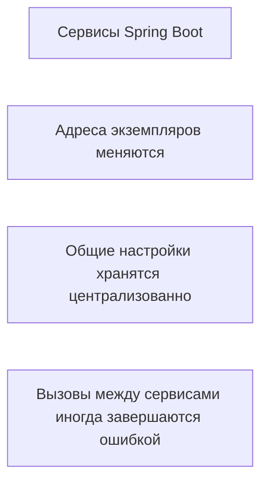

**Схема для разбора**

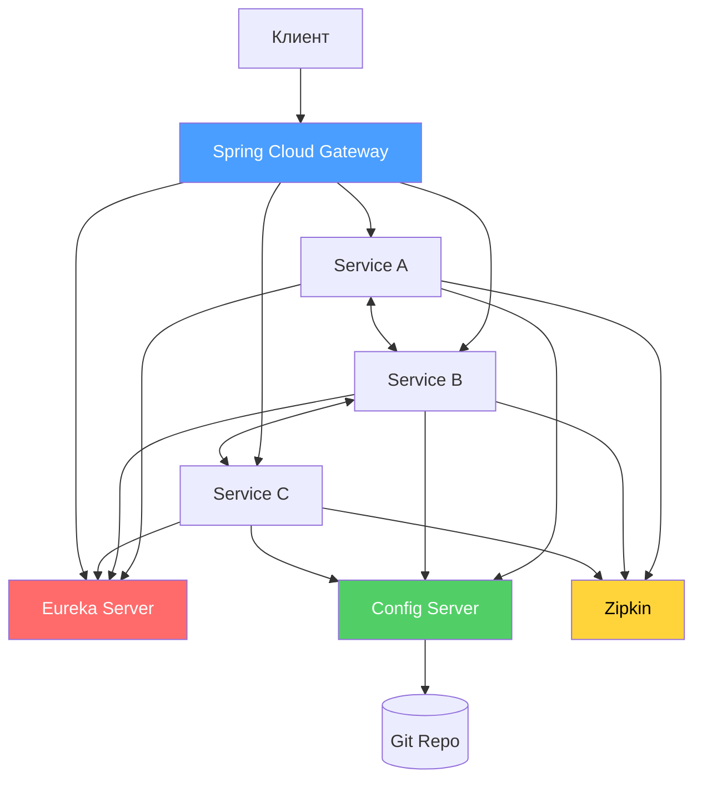

Spring Cloud можно использовать в публичном облаке и on-premise. Конкретную интеграцию выбирают под инфраструктуру, например Kubernetes API или Consul.

## Q2. (!) Какие ключевые компоненты входят в `Spring Cloud`?

`Spring Cloud` — это «зонтичный» проект: под одним именем собрано множество независимых модулей, каждый закрывает свою область распределённой системы. На собеседовании важно знать не весь список наизусть, а понимать, какой модуль за что отвечает и что в каком статусе (часть старых Netflix-компонентов уже выведена из эксплуатации).

| Компонент | Назначение | Статус |
|-----------|-----------|--------|
| `Spring Cloud Config` | Централизованная конфигурация | Активный |
| `Spring Cloud Netflix Eureka` | Service Discovery | Активный (только Eureka) |
| `Spring Cloud Gateway` | API Gateway (Server WebFlux и Server Web MVC) | Активный |
| `Spring Cloud LoadBalancer` | Клиентская балансировка | Активный (замена Ribbon) |
| `Spring Cloud CircuitBreaker` | Абстракция Circuit Breaker | Активный (Resilience4j) |
| `Spring Cloud OpenFeign` | Декларативный блокирующий HTTP-клиент | Feature-complete |
| `Micrometer Tracing` | Distributed tracing | Активный (замена Sleuth) |
| `Spring Cloud Stream` | Event-driven микросервисы | Активный |
| `Spring Cloud Bus` | Распространение событий | Активный |
| `Spring Cloud Consul` | Service Discovery + Config | Активный |
| `Spring Cloud Vault` | Интеграция с Vault для доступа к секретам | Активный |
| `Spring Cloud Kubernetes` | Интеграция с K8s | Активный |

**Исторические компоненты и их замены**

- `Ribbon` → `Spring Cloud LoadBalancer`
- `Hystrix` → `Resilience4j`
- `Zuul` → `Spring Cloud Gateway`
- `Sleuth` → `Micrometer Tracing` (начиная с Spring Cloud 2022.0)

Границы релизов для модулей Netflix приведены в Q30. Для новых декларативных клиентов Spring предлагает рассмотреть HTTP Service Clients. [Spring Cloud OpenFeign](https://spring.io/projects/spring-cloud-openfeign)

## Q3. В чём разница между `Spring Cloud` и `Spring Boot`?

Коротко: `Spring Boot` строит один сервис, `Spring Cloud` связывает много сервисов в систему. Это не конкуренты, а слои — `Spring Cloud` не существует без `Spring Boot` и всегда работает поверх него.

| Аспект | `Spring Boot` | `Spring Cloud` |
|--------|--------------|----------------|
| Назначение | Создание standalone-приложений | Координация микросервисов |
| Уровень | Одно приложение | Распределённая система |
| Зависимость | Самостоятельный фреймворк | Строится поверх `Spring Boot` |
| Примеры задач | REST API, web app, batch jobs | Config Server, Gateway, Eureka |

**Аналогия:** `Spring Boot` — это кирпич (готовый к запуску сервис), `Spring Cloud` — раствор и арматура, которые скрепляют кирпичи в здание (config-сервер, gateway, discovery, трассировка между сервисами). Подробнее в [вопросах по Spring Boot](spring-boot-interview.md).

## Q4. В чём разница между `Spring Cloud` и `Kubernetes`?

Оба решают одни и те же задачи микросервисной архитектуры (discovery, конфигурация, балансировка), но на разных уровнях: `Spring Cloud` решает их **внутри приложения** (библиотеки в коде на Java), `Kubernetes` — **на уровне инфраструктуры/платформы** (вне кода, языконезависимо). Поэтому они не взаимоисключающие: одну и ту же задачу можно закрыть либо тем, либо другим.

| Задача | `Spring Cloud` | `Kubernetes` |
|--------|---------------|-------------|
| Service Discovery | Eureka, Consul | kube-dns, CoreDNS |
| Конфигурация | Config Server | ConfigMaps, Secrets |
| Балансировка | LoadBalancer (клиентская) | Service (распределение трафика через сетевой слой) |
| Health Checks | Actuator | Liveness/Readiness probes |
| Деплой | — | Deployments, Helm |

В Kubernetes часть задач уже решает платформа. Например, приложение может обращаться к Service по DNS и получать конфигурацию из ConfigMap. Spring Cloud Kubernetes даёт Java-приложению доступ к этим механизмам через абстракции Spring. Подробнее в [вопросах по Kubernetes](../../devops/kubernetes-interview.md).

## Q5. Какие наиболее популярные аннотации в `Spring Cloud`?

Аннотации зависят от модуля. Серверы Config и Eureka включают явно. Клиент Eureka и Consul Discovery обычно подключаются автоконфигурацией стартера.

```java
// Отдельные приложения: сервер конфигурации, узел реестра и клиент.
// В приложении-клиенте есть HTTP-вызов order-service и защищаемый метод.
// Какие аннотации применимы к каждому элементу сценария?

@EnableDiscoveryClient
@EnableEurekaServer
@EnableConfigServer
@RefreshScope
@EnableFeignClients
@FeignClient(name = "order-service")
@CircuitBreaker(name = "backendA", fallbackMethod = "fallback")
```

- `@EnableConfigServer` включает Config Server, а `@EnableEurekaServer` включает сервер Eureka.
- `@EnableDiscoveryClient` указывает на участие приложения в discovery. При наличии реализации, например Eureka Client в classpath, отдельная аннотация обычно не нужна.
- `@RefreshScope` задаёт область действия для обновляемых целей бинов. `@EnableFeignClients` включает поиск Feign-клиентов, а `@FeignClient` объявляет конкретный HTTP-клиент.
- `@CircuitBreaker` в Resilience4j задаёт защиту метода именованным предохранителем и может указывать метод fallback.

Gateway Server запускается через стартер выбранного веб-стека. В Cloud Stream 4.3 объявляют функциональные бины и задают `spring.cloud.function.definition`. `@EnableBinding` относится к старому API. `@CircuitBreaker` в примере принадлежит Resilience4j, а программный API Spring Cloud показан в Q43.

## Q6. (!) Каким рекомендациям следовать при разработке приложений `Spring Cloud`?

Базовый принцип: в распределённой системе всё рано или поздно ломается, а компонентов много. Поэтому рекомендации сводятся к двум целям — **вынести всё изменчивое наружу** (конфигурацию, адреса) и **изолировать сбои**, чтобы падение одного сервиса не валило систему.

1. **Externalized Configuration.** Параметры окружения хранятся вне артефакта, например в Config Server или ConfigMap. Секреты можно получать из Vault.
2. **Service Discovery** — никаких hardcoded URL, только имена сервисов. Инстансы появляются и исчезают, адреса меняются — discovery решает это автоматически.
3. **Отказоустойчивость.** Задайте сетевые таймауты, ограничьте параллелизм при необходимости и используйте Circuit Breaker на подходящих границах. Fallback имеет смысл, когда результат деградации сохраняет контракт операции.
4. **Tracing** — Micrometer Tracing на всех сервисах: без сквозного `traceId` отладить путь запроса через 5+ сервисов практически невозможно.
5. **Health Checks.** При включённых группах проб используйте `/actuator/health/readiness` для готовности принимать трафик и `/actuator/health/liveness` для проверки жизнеспособности приложения.
6. **Contract Testing** — Spring Cloud Contract ловит несовместимость API на этапе сборки, а не в проде.
7. **Graceful Shutdown** — `server.shutdown=graceful`: дать активным запросам доработать перед остановкой инстанса.
8. **12-Factor App** — логи в stdout, stateless-сервисы, конфигурация через окружение. Фундамент, на котором держатся остальные пункты.

```yaml
# Пример базовой конфигурации микросервиса
spring:
  application:
    name: order-service
  config:
    import: configserver:http://config-server:8888
  cloud:
    discovery:
      enabled: true

server:
  shutdown: graceful

management:
  endpoints:
    web:
      exposure:
        include: health,info,metrics,prometheus
  endpoint:
    health:
      show-details: when-authorized
      probes:
        enabled: true
```

Для HTTP-экспозиции нужен Actuator, а для `/actuator/prometheus` также реестр `micrometer-registry-prometheus`. Доступ к диагностическим маршрутам настраивается отдельно. [Spring Boot 3.5 Actuator](https://docs.spring.io/spring-boot/3.5/reference/actuator/endpoints.html)

## Q7. (!) Что такое `Spring Cloud Config` и как он работает?

`Spring Cloud Config` — централизованное хранилище конфигурации для всех микросервисов. Решает проблему «у меня 30 сервисов, и в каждом свои `application.yml`»: настройки лежат в одном месте (обычно Git), а сервисы тянут их оттуда при старте. Состоит из двух частей:

- **Config Server** — HTTP-сервер, раздаёт конфигурацию из Git, файловой системы или Vault
- **Config Client** — встроен в каждый микросервис, при старте идёт к серверу и подтягивает свои настройки

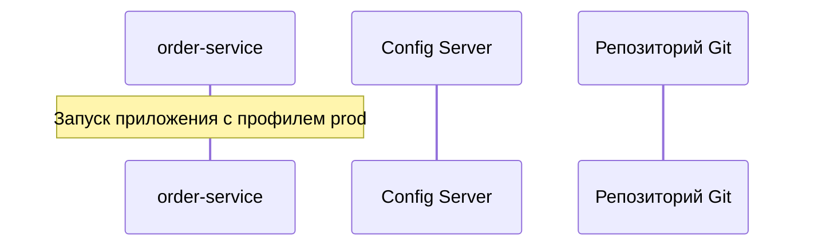

**Разбор.** Config Client обращается к Config Server за настройками приложения и профиля. Сервер читает выбранный источник и возвращает набор свойств клиенту.

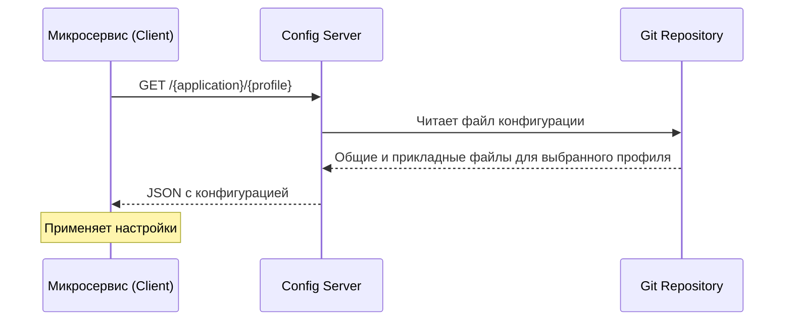

**Ключевые возможности:**
- Профили окружений (`dev`, `staging`, `prod`) — один сервис, разные настройки по профилю
- Шифрование секретов (симметричное/асимметричное) — пароли в Git хранятся в зашифрованном виде
- Обновление без рестарта через `@RefreshScope` + `/actuator/refresh`
- Версионирование конфигурации через Git — история изменений, откат, code review настроек как кода

Основные координаты запроса: `application`, `profile` и опциональный `label` (например, Git-ветка). При Config Data Import возможны отдельные запросы для профиля `default` и затем для активных профилей. [Config Client](https://docs.spring.io/spring-cloud-config/reference/4.3/client.html)

## Q8. (!) Как настроить `Config Server` и `Config Client`?

**Config Server** (`application.yml`):

```text
Настройки order-service с профилем prod хранятся в Git, ветка main.
Сервер конфигурации доступен по адресу http://config-server:8888.
Какие настройки потребуются серверу и клиенту?
```

**Пример для разбора**

```yaml
server:
  port: 8888

spring:
  cloud:
    config:
      server:
        git:
          uri: https://github.com/myorg/config-repo
          default-label: main
          search-paths: '{application}'
          clone-on-start: true
        encrypt:
          enabled: true

encrypt:
  key: ${CONFIG_ENCRYPT_KEY}
```

```java
@SpringBootApplication
@EnableConfigServer
public class ConfigServerApplication {
    public static void main(String[] args) {
        SpringApplication.run(ConfigServerApplication.class, args);
    }
}
```

**Config Client** (`application.yml`):

```yaml
spring:
  application:
    name: order-service
  config:
    import: "configserver:http://config-server:8888"
  cloud:
    config:
      fail-fast: true
      retry:
        max-attempts: 5
        initial-interval: 1000
```

```java
@RestController
@RefreshScope
public class OrderController {

    @Value("${order.max-items:100}")
    private int maxItems;

    @GetMapping("/config")
    public Map<String, Object> getConfig() {
        return Map.of("maxItems", maxItems);
    }
}
```

**Зависимости** (`build.gradle`):

```groovy
// Config Server
implementation 'org.springframework.cloud:spring-cloud-config-server'

// Config Client
implementation 'org.springframework.cloud:spring-cloud-starter-config'
implementation 'org.springframework.retry:spring-retry'
implementation 'org.springframework.boot:spring-boot-starter-aop'
```

В примере импорт обязателен. Префикс `optional:` позволяет продолжить запуск при недоступности Config Server. Для retry в Config 4.3 нужны `fail-fast`, Spring Retry и AOP. `max-attempts: 5` включает первую попытку. При размещении импорта в профильном файле параметры retry указывают в URL импорта. [Config Client 4.3](https://docs.spring.io/spring-cloud-config/reference/4.3/client.html)

## Q9. (!) Что такое `Spring Cloud Bus` и как он обновляет конфигурацию?

`Spring Cloud Bus` связывает узлы распределённой системы через общую шину сообщений (`RabbitMQ` или [Kafka](../../messaging/kafka-interview.md)). Решает проблему масштаба: обновить конфигурацию через `/actuator/refresh` на каждом из сотни инстансов вручную невозможно. Bus позволяет послать одно событие — и оно само разойдётся по всем сервисам через брокер. Основное применение — **массовое обновление конфигурации** без рестарта.

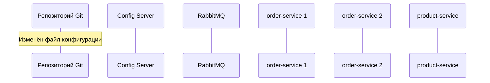

```yaml
# Подключение Spring Cloud Bus через RabbitMQ
spring:
  cloud:
    bus:
      enabled: true
  rabbitmq:
    host: rabbitmq
    port: 5672
    username: ${RABBITMQ_USERNAME}
    password: ${RABBITMQ_PASSWORD}
```

**Ручной запуск.** На узле, который принимает запрос, экспонируйте эндпоинт Actuator по HTTP и разрешите его вызов.

```yaml
management:
  endpoints:
    web:
      exposure:
        include: busrefresh
```

Для ручного запуска отправьте `POST /actuator/busrefresh` на один узел с Actuator и включённым Bus. Получатели события выполняют refresh у себя. Для RabbitMQ добавьте `spring-cloud-starter-bus-amqp` всем участникам шины. Для Kafka используется `spring-cloud-starter-bus-kafka`. [Bus Endpoints 4.3](https://docs.spring.io/spring-cloud-bus/reference/4.3/spring-cloud-bus/bus-endpoints.html)

**Запуск от Git.** Webhook вызывает `POST /monitor` на Config Server с `spring-cloud-config-monitor` и включённым Bus. Monitor определяет затронутые приложения, затем событие идёт подписчикам через брокер. На схеме показан случай, когда изменение затрагивает оба сервиса. [Config Monitor и Bus 4.3](https://docs.spring.io/spring-cloud-config/reference/4.3/server/push-notifications-and-bus.html)

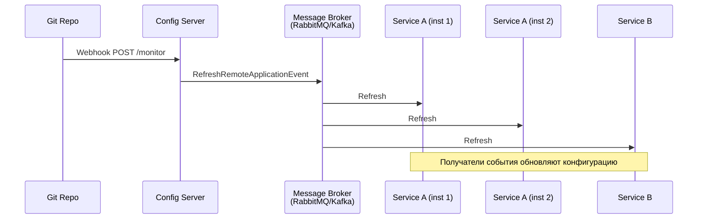

## Q10. (!) Что такое `Eureka` и как работает service discovery?

Eureka реализует Service Registry. Сервисы регистрируют адреса и метаданные, а клиенты периодически загружают реестр. Для выбора адреса приложение использует локальное представление реестра. Из-за кэширования и репликации список может отставать от фактического состояния экземпляров.

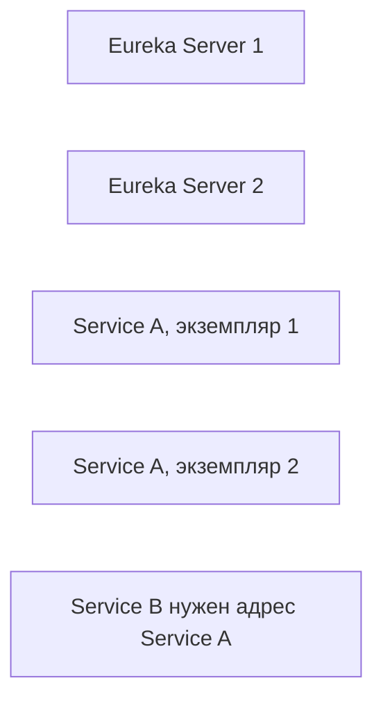

**Разбор.** Сервисы регистрируют экземпляры и продлевают аренду. Клиент Service B читает реестр, выбирает экземпляр и обращается к нему напрямую.

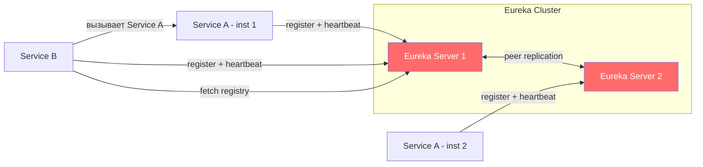

**Механизм работы:**
1. **Register** — сервис при старте отправляет POST в Eureka с метаданными (имя, хост, порт, health URL)
2. **Heartbeat** — каждые 30 секунд сервис отправляет PUT, подтверждая «я ещё жив»
3. **Fetch Registry** — клиенты периодически (каждые 30 сек) скачивают актуальный реестр и кэшируют его локально, поэтому вызовы не ходят в Eureka на каждый запрос
4. **Eviction.** Стандартный срок аренды составляет 90 секунд. После истечения аренды инстанс можно удалить при очередном проходе eviction, если сервер разрешает удаление.
5. **Self-preservation.** Сервер может приостановить eviction, если число получаемых продлений падает относительно расчётного порога. Коэффициент `renewal-percent-threshold` по умолчанию равен 0.85. Это порог частоты продлений. [Spring Cloud Netflix 4.3](https://docs.spring.io/spring-cloud-netflix/reference/4.3/configprops.html)

## Q11. (!) Как настроить `Eureka Server` и `Client`?

**Eureka Server:**

```text
В системе есть отдельный реестр и два сервиса Spring Boot.
Один сервис должен зарегистрировать экземпляр, другой получить его адрес по имени.
Какие изменения нужны в приложениях?
```

**Пример для разбора**

```java
@SpringBootApplication
@EnableEurekaServer
public class EurekaServerApplication {
    public static void main(String[] args) {
        SpringApplication.run(EurekaServerApplication.class, args);
    }
}
```

```yaml
# Eureka Server — application.yml
server:
  port: 8761

spring:
  application:
    name: eureka-server

eureka:
  instance:
    hostname: localhost
  client:
    register-with-eureka: false    # сам с собой не регистрируется
    fetch-registry: false
    service-url:
      defaultZone: http://${eureka.instance.hostname}:${server.port}/eureka/
  server:
    enable-self-preservation: true
```

**Eureka Client (микросервис):**

```yaml
spring:
  application:
    name: order-service

eureka:
  client:
    service-url:
      defaultZone: http://eureka-server:8761/eureka/
    registry-fetch-interval-seconds: 30
  instance:
    prefer-ip-address: true
    lease-renewal-interval-in-seconds: 30
    lease-expiration-duration-in-seconds: 90
    metadata-map:
      version: "1.0.0"
      zone: "zone-a"
```

```groovy
// build.gradle
implementation 'org.springframework.cloud:spring-cloud-starter-netflix-eureka-server'  // для сервера
implementation 'org.springframework.cloud:spring-cloud-starter-netflix-eureka-client'  // для клиента
```

**Кластер Eureka (production):** для HA два или три инстанса реплицируют реестр друг другу:

```yaml
# Eureka Server 1. Отдельный профиль для кластера.
eureka:
  instance:
    hostname: eureka-server-1
  client:
    register-with-eureka: true
    fetch-registry: true
    service-url:
      defaultZone: http://eureka-server-2:8761/eureka/,http://eureka-server-3:8761/eureka/
```

Задайте каждому узлу собственный `hostname` и адреса остальных peers. Ключ карты `defaultZone` регистрозависим. Согласуйте интервалы heartbeat с расчётом порога self-preservation на сервере. [Peer awareness](https://docs.spring.io/spring-cloud-netflix/reference/spring-cloud-netflix.html)

## Q12. Каким протоколам следует `Eureka`?

Операции клиента и репликация peers используют REST поверх HTTP(S). JSON и XML поддерживаются API Eureka. HTTP-клиент может переиспользовать соединения.

- **REST over HTTP** — все операции (register, renew, cancel, fetch) через HTTP REST API
- **JSON** — формат данных для обмена между клиентами и сервером (поддерживается и XML)
- **DNS.** Клиент Eureka может искать адреса серверов Eureka через DNS. Список экземпляров прикладного сервиса он получает из реестра.
- **Peer-to-peer replication** — серверы Eureka синхронизируют реестр между собой тем же REST-протоколом

```text
POST   /eureka/apps/{appId}
PUT    /eureka/apps/{appId}/{id}
DELETE /eureka/apps/{appId}/{id}
GET    /eureka/apps
GET    /eureka/apps/{appId}
```

Методы и пути соответствуют регистрации, продлению аренды, отмене регистрации и чтению реестра. Последние два запроса читают весь реестр или экземпляры одного сервиса соответственно.

## Q13. (!) В чём преимущества `Eureka` по сравнению с `Consul` и `Zookeeper`?

Eureka отдаёт локальное представление реестра и реплицирует изменения между peers. Это даёт доступность discovery ценой возможных устаревших адресов. Consul использует Raft для записи в каталог, а поддерживаемые операции чтения могут выбирать режим консистентности. ZooKeeper требует кворум для записи и допускает устаревшие локальные чтения.

| Критерий | `Eureka` | `Consul` | `ZooKeeper` |
|----------|---------|---------|-------------|
| Реестр | Репликация между peers | Raft для записи, режимы чтения | ZAB для записи, локальные чтения |
| Язык | Java | Go | Java |
| Health Check | Клиентский heartbeat | Серверный health check | Ephemeral nodes |
| Discovery по DNS | DNS для поиска серверов Eureka | Встроенный DNS | Нет |
| KV Store | Нет | Да | Да |
| Self-preservation | Да | Нет | Нет |
| Spring интеграция | Нативная | Spring Cloud Consul | Spring Cloud Zookeeper |

**Когда выбирать Eureka:**
- Приоритет availability (AP-система по CAP) — подробнее в [вопросах по CAP-теореме](../../architecture/cap-theorem-interview.md)
- Чисто Java/Spring стек — минимум внешних зависимостей
- Self-preservation защищает от массового удаления при сетевых проблемах

**Когда выбирать Consul:**
- Нужны строго согласованные чтения там, где API Consul поддерживает режим consistent
- Multi-datacenter из коробки
- Key-Value хранилище для конфигурации
- Не только Java-сервисы (polyglot)

Даже в согласованном реестре статус сервиса отражает последнюю полученную проверку. Клиенту всё равно нужны таймауты и обработка недоступного адреса. [Consul consistency modes](https://developer.hashicorp.com/consul/api-docs/features/consistency) · [ZooKeeper Internals](https://zookeeper.apache.org/doc/r3.9.3/zookeeperInternals.html)

## Q14. Сколько экземпляров `Eureka` запускать в production?

Для production с требованиями HA запускают несколько peer-aware серверов в разных доменах отказа. Три зоны на схеме дают пример размещения. Число узлов зависит от требуемой устойчивости, доступных зон и нагрузки. Протокол Eureka допускает и два узла.

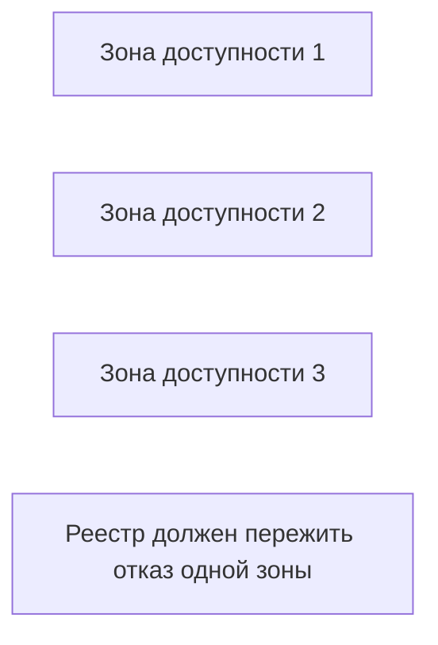

**Схема для разбора**

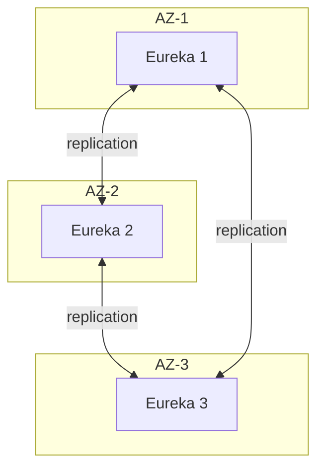

При потере одного инстанса два оставшихся продолжают обслуживать запросы. При сетевом разделении доступный клиенту peer может вернуть локальный, потенциально устаревший список. Для такого чтения Eureka не требует кворума. [Spring Cloud Netflix](https://docs.spring.io/spring-cloud-netflix/reference/spring-cloud-netflix.html)

## Q15. (!) Что такое `Spring Cloud Gateway`?

Spring Cloud Gateway Server маршрутизирует запросы и применяет общие правила, например ограничения частоты и обработку заголовков. Server WebFlux использует Spring WebFlux, Reactor и Reactor Netty. Начиная с Gateway 4.1 есть и Server Web MVC для Servlet-стека. Здесь и в примерах маршрутов используется Server WebFlux 4.3.

Основные возможности:

- **Маршрутизация** — направление запросов к нужным сервисам по path, header, host
- **Фильтры.** Модификация запросов и ответов. Аутентификацию на входе можно настроить через цепочку Spring Security.
- **Балансировка** — интеграция с `Spring Cloud LoadBalancer` и Eureka (синтаксис `lb://имя-сервиса`)
- **WebSocket** — поддержка WebSocket-проксирования
- **Rate Limiting.** Вариант `RequestRateLimiter` с общим хранилищем в Redis показан в Q33.

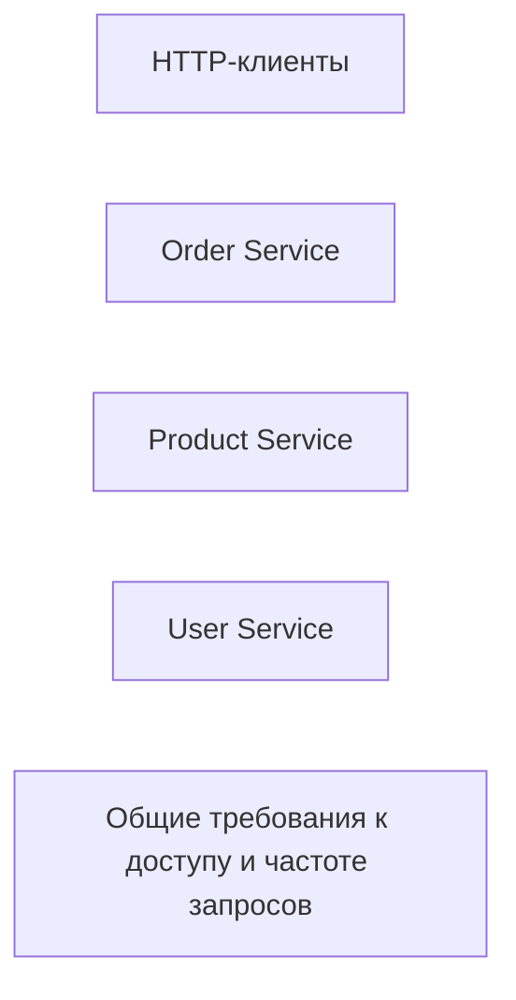

**Схема для разбора**

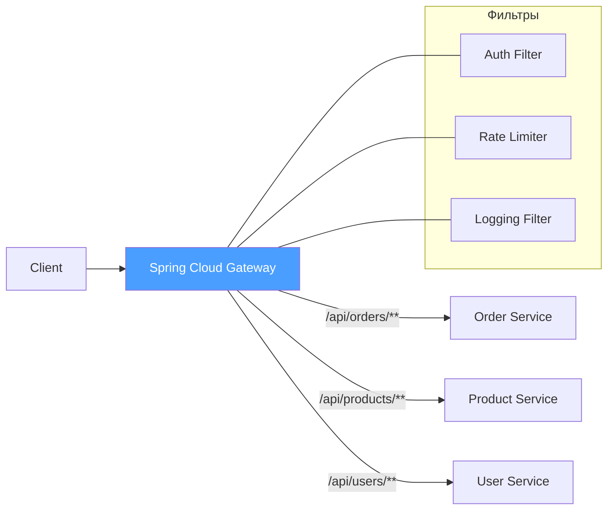

Подробнее о реактивном стеке в [вопросах по Spring WebFlux](spring-webflux-interview.md).

## Q16. (!) Как настроить маршруты и фильтры в `Spring Cloud Gateway`?

Маршрут (route) описывается тремя частями, и важно не путать их роли:

- **`predicates`** задают, при каких признаках запроса (path, method, header) маршрут подходит.
- **`filters`** — *что сделать* с запросом/ответом, когда маршрут выбран: переписать путь, добавить заголовок, навесить Circuit Breaker, ограничить частоту.
- **`uri`** — куда проксировать (`lb://имя` — через балансировщик из реестра).

**Конфигурация через YAML:**

```text
GET и POST /api/orders/** принимает order-service.
До передачи запроса нужно убрать /api и добавить X-Request-Source: gateway.
Адрес экземпляра order-service заранее неизвестен.
```

**Пример для разбора**

```yaml
spring:
  cloud:
    gateway:
      server:
        webflux:
          routes:
            - id: order-service
              uri: lb://order-service        # lb:// через LoadBalancer
              predicates:
                - Path=/api/orders/**
                - Method=GET,POST
              filters:
                - StripPrefix=1              # убирает /api из пути
                - AddRequestHeader=X-Request-Source, gateway
                - name: CircuitBreaker
                  args:
                    name: orderServiceCB
                    fallbackUri: forward:/fallback/orders
                - name: Retry
                  args:
                    retries: 3
                    methods: GET
                    statuses: BAD_GATEWAY,SERVICE_UNAVAILABLE

            - id: product-service
              uri: lb://product-service
              predicates:
                - Path=/api/products/**
              filters:
                - StripPrefix=1
                - name: RequestRateLimiter
                  args:
                    redis-rate-limiter.replenishRate: 10
                    redis-rate-limiter.burstCapacity: 20

          default-filters:
            - AddResponseHeader=X-Gateway, cloud
```

**Кастомный фильтр на Java:**

```java
@Component
public class RequestSourceGatewayFilterFactory
        extends AbstractGatewayFilterFactory<RequestSourceGatewayFilterFactory.Config> {

    public RequestSourceGatewayFilterFactory() {
        super(Config.class);
    }

    @Override
    public GatewayFilter apply(Config config) {
        return (exchange, chain) -> {
            ServerHttpRequest request = exchange.getRequest().mutate()
                    .headers(headers -> headers.set("X-Request-Source", "gateway"))
                    .build();
            return chain.filter(exchange.mutate().request(request).build());
        };
    }

    public static class Config { }
}
```

```groovy
// build.gradle
implementation 'org.springframework.cloud:spring-cloud-starter-gateway-server-webflux'
implementation 'org.springframework.cloud:spring-cloud-starter-loadbalancer'
implementation 'org.springframework.cloud:spring-cloud-starter-circuitbreaker-reactor-resilience4j'
implementation 'org.springframework.boot:spring-boot-starter-data-redis-reactive'
```

Для `lb://` нужен источник экземпляров, например Eureka. Redis-фильтр использует настроенный Redis и по умолчанию разрешает ключ через имя `Principal`. Для маршрута с Circuit Breaker нужен локальный обработчик `/fallback/orders`. Собственную фабрику можно указать как `RequestSource` вместо готового `AddRequestHeader`. Для аутентификации Bearer используйте проверку токена в Spring Security. В Gateway 4.3 стартер и префикс `spring.cloud.gateway.server.webflux` заменили прежние имена. [Spring Cloud 2025.0 Release Notes](https://github.com/spring-cloud/spring-cloud-release/wiki/Spring-Cloud-2025.0-Release-Notes)

## Q17. Чем Gateway Server WebFlux 4.3 отличается от Zuul 1.x в Spring Cloud Netflix?

Zuul 1.x в старой интеграции Spring Cloud Netflix использовал блокирующий Servlet API. Gateway Server WebFlux обрабатывает I/O через реактивный стек и event loop. Spring Cloud Gateway также имеет отдельный вариант Server Web MVC. Сравнение ниже относится к Server WebFlux и Zuul 1.x.

| Критерий | `Spring Cloud Gateway` | `Zuul 1.x` |
|----------|----------------------|------------|
| Модель | Реактивная (Netty + WebFlux) | Блокирующая (Servlet) |
| Потоки | Event loop, мало потоков | Thread per request |
| WebSocket | Да | Нет |
| Поведение под нагрузкой | Зависит от неблокирующих фильтров, клиента и нагрузки | Зависит от пула потоков, клиента и нагрузки |
| Фильтры | `GatewayFilter`, `GlobalFilter` | `ZuulFilter` (pre/route/post) |
| Статус интеграции в Spring Cloud | Поддерживается | Удалена в 2020.0 |

Для миграции учитывайте совместимость с release train, используемый веб-стек и эквивалентность фильтров. Более поздние версии Netflix Zuul имеют свою модель I/O. [Spring Cloud 2020.0 Release Notes](https://github.com/spring-cloud/spring-cloud-release/wiki/Spring-Cloud-2020.0-Release-Notes)

## Q18. (!) Как работает балансировка нагрузки в `Spring Cloud`?

Spring Cloud LoadBalancer выбирает конечный экземпляр на стороне вызывающего приложения. Список даёт `ServiceInstanceListSupplier`, например на основе `DiscoveryClient` и локального реестра Eureka. Стандартная стратегия выбора: Round Robin. При вызове через Kubernetes Service выбор может делать сетевой слой Kubernetes, а при вызове через nginx его делает прокси.

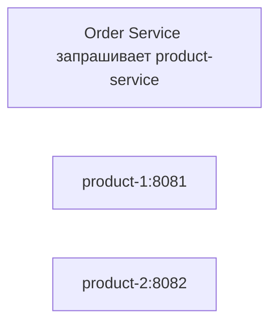

**Разбор.** На схеме ниже клиент получает список экземпляров через discovery, применяет стратегию выбора и отправляет запрос.

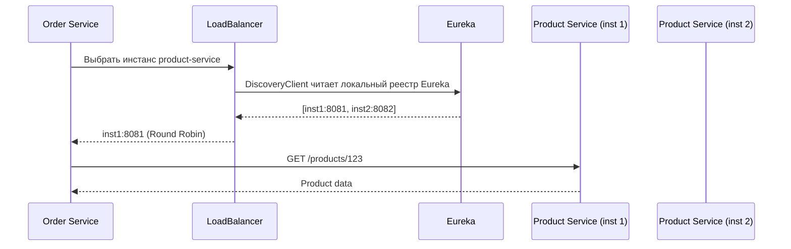

```text
Вызов: GET http://product-service/products/123
Доступные экземпляры: product-1:8081 и product-2:8082
Где выбирается адрес и какая стратегия действует по умолчанию?
```

**Пример настройки клиента:**

```java
@Configuration
public class RestClientConfig {

    @Bean
    @LoadBalanced   // включает клиентскую балансировку
    public RestTemplate restTemplate() {
        return new RestTemplate();
    }
}

@Service
public class ProductClient {

    private final RestTemplate restTemplate;

    public ProductClient(@LoadBalanced RestTemplate restTemplate) {
        this.restTemplate = restTemplate;
    }

    public Product getProduct(Long id) {
        // "product-service" — имя из Eureka, не URL
        return restTemplate.getForObject(
                "http://product-service/products/{id}",
                Product.class, id);
    }
}
```

Пример требует `spring-cloud-starter-loadbalancer` и источник экземпляров. Для блокирующего `RestClient` можно аналогично объявить `@LoadBalanced RestClient.Builder`. Если нужна автоконфигурация трассировки, примените customizer к создаваемому клиенту или его builder. [Spring Cloud Commons](https://docs.spring.io/spring-cloud-commons/reference/spring-cloud-commons/common-abstractions.html)

## Q19. (!) Что такое `Spring Cloud Load Balancer`?

Spring Cloud LoadBalancer заменил Ribbon. Для стратегии выбора экземпляра есть реактивный API, с которым интегрируются как блокирующие, так и реактивные HTTP-клиенты.

- **RoundRobinLoadBalancer** (по умолчанию) последовательно перебирает экземпляры. Это выравнивает число выборов в стабильном списке, а фактическая нагрузка зависит от стоимости запросов и состава списка.
- **RandomLoadBalancer** — случайный выбор инстанса

```text
У order-service и product-service несколько экземпляров.
Для обращений к product-service нужна случайная стратегия выбора.
Для остальных сервисов нужно сохранить стандартную стратегию.
```

**Пример для разбора**

```java
// Кастомная конфигурация Load Balancer для конкретного сервиса
@LoadBalancerClient(
        name = "product-service",
        configuration = ProductServiceLBConfig.class)
@Configuration(proxyBeanMethods = false)
public class LoadBalancerConfig { }

public class ProductServiceLBConfig {

    @Bean
    public ReactorLoadBalancer<ServiceInstance> randomLoadBalancer(
            Environment env,
            LoadBalancerClientFactory factory) {
        String name = env.getProperty(LoadBalancerClientFactory.PROPERTY_NAME);
        return new RandomLoadBalancer(
                factory.getLazyProvider(name, ServiceInstanceListSupplier.class),
                name);
    }
}
```

```yaml
spring:
  cloud:
    loadbalancer:
      configurations: health-check
      cache:
        ttl: 30s          # кэш инстансов
      health-check:
        interval: 10s     # проверка доступности инстансов
```

Один интервал проверки не включает health-check supplier. В примере его выбирает `configurations: health-check`. При использовании Eureka обычно отключают дополнительный кэш LoadBalancer, поскольку клиент Eureka уже кэширует реестр. [Spring Cloud LoadBalancer](https://docs.spring.io/spring-cloud-commons/reference/spring-cloud-commons/loadbalancer.html)

## Q20. (!) Что такое паттерн `Circuit Breaker` и зачем он нужен?

`Circuit Breaker` («предохранитель») — паттерн отказоустойчивости, который не даёт сбою одного сервиса перерасти в каскадный отказ всей [микросервисной системы](../../architecture/microservices-interview.md). Аналогия прямая, как у электрического предохранителя: при перегрузке он размыкает цепь, чтобы не сгорела проводка. Здесь «цепь» размыкается, когда вызываемый сервис начинает массово отвечать ошибками — и пока он не оживёт, запросы к нему мгновенно отклоняются, а не висят в ожидании таймаута.

**Зачем это нужно.** Без предохранителя зависший сервис B забивает все потоки сервиса A ожиданием ответа; A перестаёт отвечать своему вызывающему — и так сбой расползается вверх по цепочке. Circuit Breaker обрывает эту цепную реакцию у источника.

**Условие:**

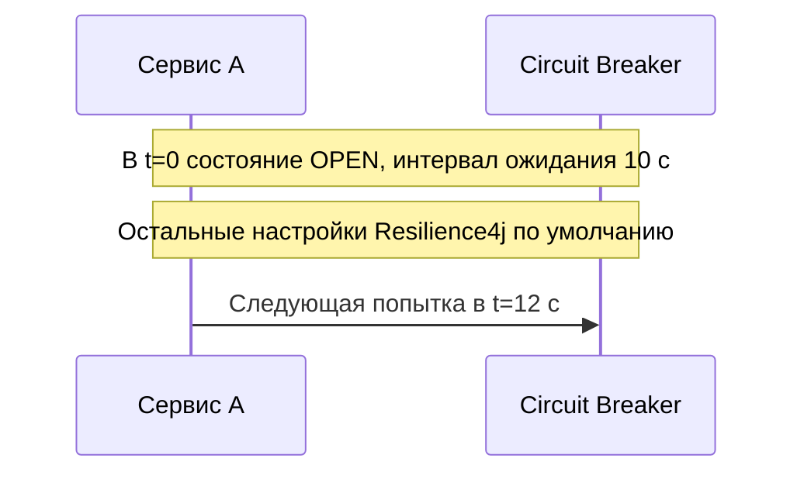

**Состояния автомата Resilience4j:**

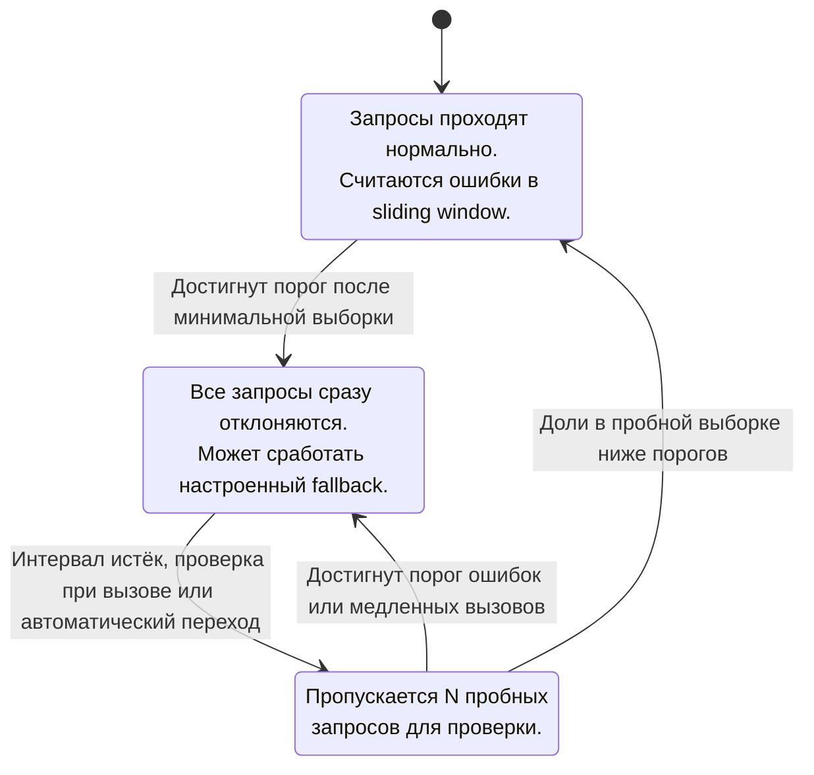

**Что даёт паттерн:**
- **Предотвращение каскадных сбоев** — неработающий сервис не «утаскивает» за собой остальные
- **Fail fast** — мгновенный отказ вместо долгого ожидания таймаута, потоки вызывающего сервиса не копятся
- **Graceful degradation** — fallback возвращает кэшированные или дефолтные данные, и пользователь видит деградацию, а не белый экран
- **Автоматическое восстановление** — состояние HALF_OPEN само пропускает несколько пробных запросов и решает, ожил ли сервис, без ручного вмешательства

У Resilience4j отдельно учитываются доли ошибок и медленных вызовов. По умолчанию переход из OPEN в HALF_OPEN проверяется при следующей попытке вызова после истечения интервала. Автоматический переход без новой попытки включается свойством `automaticTransitionFromOpenToHalfOpenEnabled`. В показанном сценарии при настройках по умолчанию попытка в t=12 с инициирует переход и может стать пробным вызовом. При включённом автоматическом переходе к этому моменту предохранитель уже может находиться в HALF_OPEN. Circuit Breaker учитывает результаты и отказывает новым вызовам, а таймауты и Bulkhead ограничивают ожидание и число параллельных операций. [Resilience4j CircuitBreaker](https://resilience4j.readme.io/docs/circuitbreaker)

## Q21. (!) Как настроить `Resilience4j` Circuit Breaker в `Spring Cloud`?

Настройка декларативная: параметры срабатывания задаются в `application.yml`, а к методу навешивается `@CircuitBreaker` с указанием инстанса и fallback-метода. Ключевые параметры и их смысл:

- **`sliding-window-size`** + **`sliding-window-type`** — на основе скольких последних вызовов (COUNT_BASED) или какого интервала времени считается доля ошибок.
- **`minimum-number-of-calls`** — порог «прогрева»: пока вызовов меньше, предохранитель не размыкается (иначе одна ошибка на старте сразу открыла бы цепь).
- **`failure-rate-threshold`** — процент ошибок, при котором происходит переход в OPEN.
- **`wait-duration-in-open-state`** — сколько держать цепь разомкнутой перед пробным HALF_OPEN.
- **`record-exceptions` / `ignore-exceptions`** — какие исключения считать сбоем, а какие игнорировать (бизнес-ошибки вроде «товара нет» — не повод размыкать цепь).

```text
Вызов productService защищён Circuit Breaker.
Учитываются последние 10 вызовов, минимум для оценки равен 5.
Порог ошибок 50%, пауза после открытия 10 с, пробных вызовов до 3.
```

**Пример для разбора**

```yaml
# application.yml
resilience4j:
  circuitbreaker:
    instances:
      productService:
        register-health-indicator: true
        sliding-window-type: COUNT_BASED
        sliding-window-size: 10
        minimum-number-of-calls: 5
        failure-rate-threshold: 50          # процент ошибок для OPEN
        wait-duration-in-open-state: 10s    # сколько ждать перед HALF_OPEN
        permitted-number-of-calls-in-half-open-state: 3
        record-exceptions:
          - org.springframework.web.client.ResourceAccessException
        ignore-exceptions:
          - com.example.BusinessException

  retry:
    instances:
      productService:
        max-attempts: 3
        wait-duration: 500ms
        retry-exceptions:
          - org.springframework.web.client.ResourceAccessException
```

```java
@Service
public class ProductService {

    private final RestTemplate restTemplate;

    public ProductService(@LoadBalanced RestTemplate restTemplate) {
        this.restTemplate = restTemplate;
    }

    @Retry(name = "productService", fallbackMethod = "getProductFallback")
    @CircuitBreaker(name = "productService")
    public Product getProduct(Long id) {
        return restTemplate.getForObject(
                "http://product-service/products/{id}",
                Product.class, id);
    }

    // Fallback — вызывается при OPEN или при ошибке
    private Product getProductFallback(Long id, ResourceAccessException ex) {
        return unavailable(id, ex);
    }

    private Product getProductFallback(Long id, CallNotPermittedException ex) {
        return unavailable(id, ex);
    }

    private Product unavailable(Long id, RuntimeException ex) {
        LoggerFactory.getLogger(ProductService.class).warn("Fallback for product {}", id, ex);
        return Product.builder()
                .id(id)
                .name("Unavailable")
                .cached(false)
                .build();
    }
}
```

```groovy
// build.gradle
implementation 'io.github.resilience4j:resilience4j-spring-boot3'
implementation 'org.springframework.boot:spring-boot-starter-aop'
implementation 'org.springframework.boot:spring-boot-starter-actuator'
```

Здесь аннотации Resilience4j AOP применяются при внешнем вызове Spring-бина через прокси. Сетевые таймауты задаются на уровне `RestTemplate` и его request factory. Аннотационный `@TimeLimiter` требует асинхронного контракта, например `CompletableFuture`, либо поддерживаемого реактивного типа с соответствующей интеграцией. По умолчанию Retry охватывает CircuitBreaker. Fallback задан на внешнем Retry, поэтому он не превращает ошибки отдельных попыток в успех до обработки Retry. При явном `record-exceptions` прочие исключения считаются успешными для статистики Circuit Breaker, если они не попали в `ignore-exceptions`. Правила учёта и обработка исключения вызывающим кодом задаются независимо. Для блокирующего Cloud API через `CircuitBreakerFactory` см. Q43. [Resilience4j и Spring Boot 3](https://resilience4j.readme.io/docs/getting-started-3)

## Q22. В чём разница между `Hystrix` и `Resilience4j`?

Hystrix по умолчанию исполнял команды в выделенном пуле, который может обслуживать несколько команд по общему ключу. Декораторы Resilience4j совместимы с выполнением в текущем потоке. Приложение подключает нужные модули, например Retry, Bulkhead или RateLimiter.

| Критерий | `Hystrix` | `Resilience4j` |
|----------|----------|----------------|
| Статус | **Deprecated** (maintenance mode) | Активная разработка |
| Архитектура | Thread isolation по умолчанию, пулы настраиваются по ключу | Декораторы (lightweight) |
| Java | Java 6+ | Java 17+ |
| Реактивность | Ограниченная (RxJava 1) | Полная (Reactor, RxJava 2/3) |
| Компоненты | CircuitBreaker, thread isolation | CircuitBreaker, RateLimiter, Retry, Bulkhead, TimeLimiter |
| Конфигурация | Archaius | Spring Boot properties |
| Метрики | Hystrix Dashboard | Micrometer (Prometheus, Grafana) |

При миграции с Hystrix переносите настройки изоляции, таймаутов и fallback раздельно. Семафор Resilience4j сам по себе сохраняет выполнение в потоке вызывающего.

[Изоляция и группы команд Hystrix](https://github.com/netflix/hystrix/wiki/How-To-Use)

## Q23. (!) Что такое `Spring Cloud OpenFeign`?

OpenFeign создаёт прокси для декларативного интерфейса и выполняет синхронные блокирующие HTTP-вызовы. Прокси собирает запрос из сигнатуры и аннотаций, кодирует тело и декодирует ответ. Интеграции с LoadBalancer и Circuit Breaker требуют соответствующих зависимостей и настроек.

```java
@FeignClient(
        name = "product-service",
        fallbackFactory = ProductClientFallbackFactory.class,
        configuration = ProductFeignConfig.class)
public interface ProductClient {

    @GetMapping("/products/{id}")
    Product getProduct(@PathVariable("id") Long id);

    @PostMapping("/products")
    Product createProduct(@RequestBody CreateProductRequest request);

    @GetMapping("/products")
    List<Product> getProducts(@RequestParam("category") String category);
}

@Component
public class ProductClientFallbackFactory
        implements FallbackFactory<ProductClient> {

    @Override
    public ProductClient create(Throwable cause) {
        return new ProductClient() {
            @Override
            public Product getProduct(Long id) {
                LoggerFactory.getLogger(getClass()).warn("Fallback for product {}", id, cause);
                return Product.defaultProduct(id);
            }

            @Override
            public Product createProduct(CreateProductRequest request) {
                throw new ServiceUnavailableException("Product service unavailable", cause);
            }

            @Override
            public List<Product> getProducts(String category) {
                return Collections.emptyList();
            }
        };
    }
}
```

```java
// Кастомная конфигурация Feign
public class ProductFeignConfig {

    @Bean
    public Logger.Level feignLoggerLevel() {
        return Logger.Level.BASIC;   // NONE, BASIC, HEADERS, FULL
    }

    @Bean
    public RequestInterceptor requestInterceptor() {
        return template -> template.header("X-Source", "order-service");
    }

    @Bean
    public Retryer feignRetryer() {
        return Retryer.NEVER_RETRY;
    }
}
```

В этом интерфейсе есть POST. Повторы записи требуют отдельного контракта идемпотентности, поэтому пример сохраняет стандартный для Spring Cloud OpenFeign `Retryer.NEVER_RETRY`. Для `fallbackFactory` требуется включённая интеграция Circuit Breaker из Q24. [OpenFeign 4.3](https://docs.spring.io/spring-cloud-openfeign/reference/4.3/spring-cloud-openfeign.html)

## Q24. Как настроить `Feign Client` с балансировкой и `Circuit Breaker`?

Если клиент объявлен по имени без URL в аннотации и в свойствах, при наличии Spring Cloud LoadBalancer он выбирает экземпляр через настроенный источник. Явный URL используется напрямую. Для Circuit Breaker добавьте стартер реализации и включите `spring.cloud.openfeign.circuitbreaker.enabled`.

```text
ProductClient вызывает product-service по имени, без фиксированного URL.
У product-service несколько экземпляров. Таймауты этого клиента равны 3 с.
Для getProduct(Long) требуется отдельная конфигурация Circuit Breaker.
```

**Пример для разбора**

```yaml
spring:
  cloud:
    openfeign:
      circuitbreaker:
        enabled: true                   # интеграция с Resilience4j
      client:
        config:
          default:
            connectTimeout: 5000
            readTimeout: 5000
            loggerLevel: basic
          product-service:              # настройки для конкретного клиента
            connectTimeout: 3000
            readTimeout: 3000

# Circuit Breaker для ProductClient#getProduct(Long)
resilience4j:
  circuitbreaker:
    instances:
      ProductClientgetProductLong:
        sliding-window-size: 10
        failure-rate-threshold: 50
        wait-duration-in-open-state: 5s
```

```groovy
// build.gradle
implementation 'org.springframework.cloud:spring-cloud-starter-openfeign'
implementation 'org.springframework.cloud:spring-cloud-starter-loadbalancer'
implementation 'org.springframework.cloud:spring-cloud-starter-circuitbreaker-resilience4j'
```

В OpenFeign 4.3 по умолчанию используются буквенно-цифровые ID. Сигнатура `ProductClient#getProduct(Long)` даёт `ProductClientgetProductLong`. При отключении `alphanumeric-ids` используется форма с разделителями. Для своей схемы ID можно объявить `CircuitBreakerNameResolver`. [OpenFeign 4.3](https://docs.spring.io/spring-cloud-openfeign/reference/4.3/spring-cloud-openfeign.html)

## Q25. (!) Как организовать distributed tracing в `Spring Cloud`?

Distributed tracing — это отслеживание пути одного запроса через всю цепочку микросервисов. Решает главную боль микросервисов: когда запрос проходит через 5–10 сервисов, по логам отдельных сервисов невозможно понять, где он замедлился или упал. Идея — присвоить запросу сквозной `traceId`, который пробрасывается во все вызовы, а каждый отдельный шаг (HTTP-вызов, запрос в БД) получает свой `spanId`. Собрав все спаны с одним `traceId` в трассировщике (Zipkin/Jaeger), вы видите полную картину: дерево вызовов и время каждого шага.

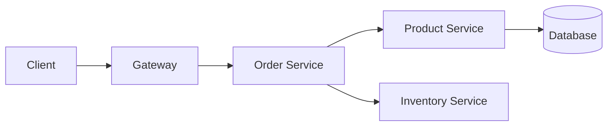

**Разбор.** При настроенной передаче контекста узлы связывают спаны одним `traceId`. Каждый записанный спан получает свой `spanId`. На схеме отмечены отдельные примеры спанов. Инструментированный HTTP-переход может содержать клиентский и серверный спаны.

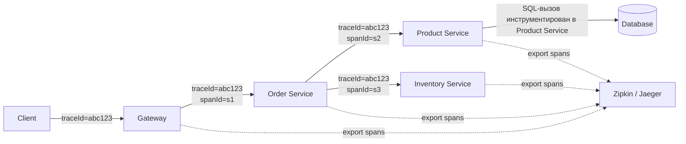

**Ключевые понятия:**
- **Trace** — полный путь запроса (один `traceId` на весь путь)
- **Span** — единица работы (HTTP-вызов, SQL-запрос, обработка сообщения)
- **Baggage.** Дополнительные поля контекста, передаваемые через настроенные границы propagation.
- **Sampling.** Политика отбора трасс для записи и экспорта. Долю выбирают с учётом нагрузки, объёма данных и требований к диагностике.

**Важно:** начиная с Spring Cloud 2022.0 (Spring Boot 3.x), `Spring Cloud Sleuth` заменён на `Micrometer Tracing`. Подробнее в [вопросах по Observability](../../monitoring/observability-interview.md).

## Q26. (!) Как настроить `Micrometer Tracing` (замена `Sleuth`)?

```text
Приложение на Spring Boot 3.5 должно экспортировать spans в Zipkin.
В тестовой среде нужно записывать все трассы и добавлять их ID в журнал.
Соседние клиенты передают контекст в W3C или B3.
```

**Пример для разбора**

```yaml
# application.yml
management:
  tracing:
    sampling:
      probability: 1.0       # 1.0 = 100% запросов (для dev)
    propagation:
      consume: [W3C, B3, B3_MULTI]
      produce: [W3C]
  zipkin:
    tracing:
      endpoint: http://zipkin:9411/api/v2/spans

logging:
  pattern:
    correlation: "[${spring.application.name},%X{traceId:-},%X{spanId:-}] "
```

```groovy
// build.gradle — Spring Boot 3.x
implementation 'org.springframework.boot:spring-boot-starter-actuator'
implementation 'io.micrometer:micrometer-tracing-bridge-brave'
implementation 'io.zipkin.reporter2:zipkin-reporter-brave'        // экспорт в Zipkin
```

```java
// Автоматическая трассировка — span создаётся для каждого HTTP-запроса
// Для кастомных span'ов используйте Observation API
@Service
public class OrderService {

    private final ObservationRegistry observationRegistry;

    public OrderService(ObservationRegistry observationRegistry) {
        this.observationRegistry = observationRegistry;
    }

    public Order processOrder(OrderRequest request) {
        return Observation.createNotStarted("order.processing", observationRegistry)
                .lowCardinalityKeyValue("order.type", request.getType())
                .observe(() -> {
                    // этот блок — отдельный span
                    Order order = createOrder(request);
                    enrichWithProducts(order);
                    return order;
                });
    }
}
```

**Границы автоконфигурации.** Boot инструментирует входящие HTTP-запросы и исходящие вызовы через клиенты на основе автоконфигурированных `RestTemplateBuilder`, `RestClient.Builder` и `WebClient.Builder`. Feign требует `feign-micrometer` и активный `MicrometerObservationCapability`. Наблюдаемость сообщений включается в инструментированном клиенте или binder. Для JDBC нужна дополнительная инструментализация. Observation для `@Scheduled` регистрируется при наличии `ObservationRegistry` у планировщика задач. В логах Boot 3.5 добавляет корреляцию при включённом Tracing. [Трассировка Boot 3.5](https://docs.spring.io/spring-boot/3.5/reference/actuator/tracing.html)

## Q27. (!) Что такое `Spring Cloud Stream`?

Spring Cloud Stream отделяет бизнес-обработчик сообщений от подключения к брокеру. Обработчик объявляют как `Function`, `Consumer` или `Supplier`. За связь с брокером отвечает binder. При переходе с Kafka на RabbitMQ обработчик может остаться прежним, если он использует только общую модель. Топология, подтверждение доставки, порядок, партиционирование и обработка ошибок зависят от binder и требуют проверки.

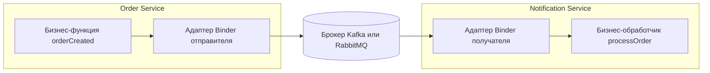

**Ключевые концепции:**
- **Binder** — адаптер к конкретному брокеру (`spring-cloud-stream-binder-kafka`, `...-rabbit`)
- **Binding** — связь между logical destination (topic/queue) и функцией приложения
- **Функциональная модель** использует `java.util.function.Function`, `Consumer` и `Supplier`. Она появилась в Spring Cloud Stream 2.1 и рекомендована с 3.x (см. Q41).

Подробнее о Kafka в [вопросах по Apache Kafka](../../messaging/kafka-interview.md).

## Q28. Как настроить `Spring Cloud Stream` с `Kafka`?

Связь между функцией и топиком задаётся через **соглашение об именах биндингов**: `<имяБина>-in-<index>` для входа и `<имяБина>-out-<index>` для выхода. Например, `Function enrichOrder` автоматически получает вход `enrichOrder-in-0` и выход `enrichOrder-out-0`, которые вы в конфигурации привязываете к конкретным топикам. Активные функции перечисляются в `spring.cloud.function.definition`.

```java
@Configuration
public class StreamConfig {

    private final NotificationService notificationService;

    public StreamConfig(NotificationService notificationService) {
        this.notificationService = notificationService;
    }

    @Bean
    public Supplier<OrderEvent> orderCreated() {
        return () -> new OrderEvent(UUID.randomUUID(), "CREATED", Instant.now());
    }

    @Bean
    public Function<OrderEvent, EnrichedOrderEvent> enrichOrder() {
        return event -> EnrichedOrderEvent.builder()
                .orderId(event.getOrderId())
                .status(event.getStatus())
                .enrichedAt(Instant.now())
                .build();
    }

    @Bean
    public Consumer<EnrichedOrderEvent> processOrder() {
        return event -> {
            LoggerFactory.getLogger(StreamConfig.class).info("Processing order: {}", event.getOrderId());
            notificationService.sendNotification(event);
        };
    }
}
```

```yaml
spring:
  cloud:
    function:
      definition: orderCreated;enrichOrder;processOrder
    stream:
      bindings:
        orderCreated-out-0:
          destination: orders-topic
        enrichOrder-in-0:
          destination: orders-topic
          group: enrichment-group
          content-type: application/json
        enrichOrder-out-0:
          destination: enriched-orders-topic
        processOrder-in-0:
          destination: enriched-orders-topic
          group: notification-group
      kafka:
        binder:
          brokers: kafka:9092
          auto-create-topics: true
          replication-factor: 3
        bindings:
          enrichOrder-in-0:
            consumer:
              start-offset: latest
              enable-dlq: true
              dlq-name: orders-dlq
```

```groovy
// build.gradle
implementation 'org.springframework.cloud:spring-cloud-stream-binder-kafka'
```

`start-offset: latest` применяется при отсутствии пригодного сохранённого offset, если не включён принудительный сброс. DLQ требует именованную группу. При создании топика с `replication-factor: 3` нужны как минимум три доступных брокера. Для одного локального брокера задайте фактор 1. [Свойства Kafka Binder](https://docs.spring.io/spring-cloud-stream/reference/4.3/kafka/kafka-binder/config-options.html)

## Q29. Что такое `Spring Cloud Commons`?

Spring Cloud Commons предоставляет интерфейсы и общие типы для интеграций Spring Cloud. Например, через `DiscoveryClient` приложение получает экземпляры из Eureka, Consul или Kubernetes. При смене реестра можно сохранить код, использующий общий интерфейс, и перенастроить регистрацию, метаданные и проверки.

Ключевые абстракции:

- **`DiscoveryClient`** — общий интерфейс для service discovery (Eureka, Consul, K8s)
- **`ServiceInstance`** — модель инстанса сервиса
- **`LoadBalancerClient`** — абстракция клиентской балансировки
- **`@LoadBalanced`** помечает `RestTemplate`, `RestClient.Builder` или `WebClient.Builder` для интеграции с клиентской балансировкой
- **`@RefreshScope`** из Spring Cloud Context задаёт область действия бинов, цели которых пересоздаются после refresh
- **`CircuitBreaker`** — абстракция для Resilience4j/Sentinel

```java
@Service
public class ServiceLocator {

    private final DiscoveryClient discoveryClient;

    public ServiceLocator(DiscoveryClient discoveryClient) {
        this.discoveryClient = discoveryClient;
    }

    public List<String> getServiceInstances(String serviceId) {
        return discoveryClient.getInstances(serviceId).stream()
                .map(instance -> instance.getHost() + ":" + instance.getPort())
                .toList();
    }

    public List<String> getAllServices() {
        return discoveryClient.getServices();
    }
}
```

## Q30. Что такое `Spring Cloud Netflix` и какие компоненты устарели?

Spring Cloud Netflix исторически интегрировал библиотеки Netflix OSS. В современном train основная интеграция этого проекта связана с Eureka. Поддержку Ribbon, Hystrix, Zuul, Archaius и Turbine из этой интеграции удалили в Spring Cloud 2020.0. Статус отдельных библиотек Netflix и сторонних версий Zuul может различаться.

| Компонент | Статус | Замена |
|-----------|--------|--------|
| `Eureka` | **Поддерживается** | По выбору архитектуры |
| `Ribbon` | Интеграция удалена в 2020.0 | `Spring Cloud LoadBalancer` |
| `Hystrix` | Интеграция удалена в 2020.0 | `Resilience4j` |
| `Zuul` | Интеграция удалена в 2020.0 | `Spring Cloud Gateway` |
| `Feign` | Перенесён | `Spring Cloud OpenFeign` |
| `Archaius` | Удалён | `Spring Boot Configuration` |
| `Turbine` | Удалён | `Micrometer` + Prometheus |

**Типичная миграция legacy-проекта:**

```text
Проект на Spring Cloud Hoxton использует Eureka, Ribbon, Hystrix и Zuul.
Команда переводит его на Spring Cloud 2025.0.
Какие интеграции можно оставить, а для каких потребуется замена?
```

**Пример для разбора**

```groovy
// Было (Spring Cloud Hoxton)
implementation 'org.springframework.cloud:spring-cloud-starter-netflix-ribbon'
implementation 'org.springframework.cloud:spring-cloud-starter-netflix-hystrix'
implementation 'org.springframework.cloud:spring-cloud-starter-netflix-zuul'

// Стало (Spring Cloud 2025.0)
implementation 'org.springframework.cloud:spring-cloud-starter-loadbalancer'
implementation 'org.springframework.cloud:spring-cloud-starter-circuitbreaker-resilience4j'
implementation 'org.springframework.cloud:spring-cloud-starter-gateway-server-webflux'
```

На собеседовании важно знать и старые, и новые компоненты — многие production-системы до сих пор используют Hystrix/Ribbon, и задача разработчика — планировать миграцию.

Список удалённых модулей и дата перехода приведены в [Spring Cloud 2020.0 Release Notes](https://github.com/spring-cloud/spring-cloud-release/wiki/Spring-Cloud-2020.0-Release-Notes). При миграции Gateway WebFlux использует реактивный стартер Circuit Breaker из Q16. Блокирующий стартер в примере нужен приложению, которое использует соответствующую фабрику.

## Q31. (!) Как настроить `Retry` и `Bulkhead` через `Resilience4j` в Spring Cloud?

Помимо Circuit Breaker `Resilience4j` даёт ещё несколько паттернов отказоустойчивости, и важно понимать, *от чего* каждый защищает:

- **Retry** — повтор вызова при временной ошибке (сетевой сбой, кратковременная недоступность). Защищает от единичных глитчей, но опасен при перегрузке — может усилить шторм запросов.
- **Bulkhead** («переборка», по аналогии с отсеками корабля) — ограничивает число одновременных вызовов к ресурсу. Если один медленный сервис начнёт зависать, под него выделена лишь часть «слотов» — остальные потоки приложения остаются свободны для других задач. Так локальная проблема не топит весь сервис.
- **RateLimiter** — ограничивает частоту вызовов (запросов в секунду), защищая downstream от перегрузки с вашей стороны.

Два вида Bulkhead: **SEMAPHORE** (счётчик параллельных вызовов в текущем потоке, дёшево) и **THREADPOOL** (отдельный пул потоков, изолирует полностью, но дороже).

**Зависимости для аспектов Resilience4j в Boot 3.5:**

```groovy
implementation 'io.github.resilience4j:resilience4j-spring-boot3'
implementation 'org.springframework.boot:spring-boot-starter-aop'
implementation 'org.springframework.boot:spring-boot-starter-actuator'
```

**Конфигурация через `application.yml`:**

```yaml
resilience4j:
  retry:
    instances:
      paymentStatus:
        max-attempts: 3
        wait-duration: 500ms
        retry-exceptions:
          - java.net.ConnectException
          - java.util.concurrent.TimeoutException
        ignore-exceptions:
          - com.example.BusinessException  # не повторяем бизнес-ошибки

  bulkhead:
    instances:
      paymentStatus:
        max-concurrent-calls: 10          # максимум параллельных вызовов
        max-wait-duration: 100ms          # ждать ли свободного слота

  thread-pool-bulkhead:
    instances:
      reportService:
        core-thread-pool-size: 5
        max-thread-pool-size: 10
        queue-capacity: 100
```

**Применение через аннотации:**

```java
@Service
public class PaymentService {

    private final ExternalPaymentApi externalPaymentApi;

    public PaymentService(ExternalPaymentApi externalPaymentApi) {
        this.externalPaymentApi = externalPaymentApi;
    }

    @Retry(name = "paymentStatus", fallbackMethod = "paymentFallback")
    @Bulkhead(name = "paymentStatus", type = Bulkhead.Type.SEMAPHORE)
    @CircuitBreaker(name = "paymentStatus")
    public PaymentResult getPaymentStatus(PaymentRequest request)
            throws ConnectException, TimeoutException {
        return externalPaymentApi.getStatus(request.getId());
    }

    private PaymentResult paymentFallback(PaymentRequest request, TimeoutException e) {
        return PaymentResult.unknown(request.getId());
    }

    private PaymentResult paymentFallback(PaymentRequest request, ConnectException e) {
        return PaymentResult.unknown(request.getId());
    }
}
```

По умолчанию вложенность от внешнего аспекта к внутреннему: `Retry(CircuitBreaker(RateLimiter(TimeLimiter(Bulkhead(вызов)))))`. Для изменения порядка используйте свойства порядка аспектов Resilience4j или явную композицию декораторов. В примере повторяется чтение статуса платежа, а HTTP-адаптер должен передавать указанные типы ошибок. `max-attempts: 3` включает первый вызов. При повторе записи нужна идемпотентность на стороне получателя. [Порядок аспектов](https://resilience4j.readme.io/docs/getting-started-3#aspect-order)

## Q32. (!) Как работает `Consul` как Service Discovery в Spring Cloud?

Consul предоставляет каталог сервисов, health checks через агента, DNS, KV и service mesh. Spring Cloud Consul Discovery использует агент и его HTTP API. Запись состояния каталога опирается на Raft, а гарантии чтения зависят от выбранного режима и API.

**Зависимость:**

```groovy
implementation 'org.springframework.cloud:spring-cloud-starter-consul-discovery'
implementation 'org.springframework.cloud:spring-cloud-starter-consul-config'
```

**Конфигурация:**

```yaml
spring:
  application:
    name: order-service
  config:
    import: "consul:consul-agent:8500"
  cloud:
    consul:
      host: consul-agent  # адрес Consul agent
      port: 8500
      discovery:
        register: true
        health-check-path: /actuator/health
        health-check-interval: 10s
        instance-id: ${spring.application.name}-${random.uuid}
      config:
        enabled: true
        prefix: config           # путь в KV-store: config/order-service/data
        default-context: defaults
        format: YAML
```

**Отличия от Eureka:**

| Аспект | Consul | Eureka |
|--------|--------|--------|
| Состояние каталога | Raft для записи, выбор режима чтения | Репликация между peers, локальный кэш клиента |
| Health checks | Агент проверяет сервисы | Сервисы отправляют heartbeat |
| KV-store | Встроен | Нет |
| DNS для разрешения имён сервисов | Встроенный интерфейс | Клиентский API реестра |
| Service Mesh | Consul Connect | Нет |
| ACL | Встроен | Нет |

**Загрузка свойств из Consul KV:**

```
# Структура ключей в Consul KV:
config/order-service/data   → YAML/Properties для order-service
config/defaults/data        → общие настройки всех сервисов
```

Путь `.../data` используется в примере с `format: YAML`. Для HTTP health check агент должен иметь доступ к `/actuator/health` приложения. Для установки с ACL настройте токены discovery и config согласно правилам кластера. [Spring Cloud Consul](https://docs.spring.io/spring-cloud-consul/docs/current/reference/html/index.html)

## Q33. (!) Как настроить rate limiting в `Spring Cloud Gateway`?

В Gateway Server WebFlux фильтр `RequestRateLimiter` делегирует проверку реализации `RateLimiter`. Redis-вариант использует Token Bucket. Реплики Gateway с общим Redis, одинаковыми ID маршрута и ключами клиента используют общий бюджет.

Параметры алгоритма:
- **`replenishRate`** задаёт число токенов, добавляемых в бакет за секунду. Устойчивая частота равна `replenishRate / requestedTokens`.
- **`burstCapacity`** — максимальный размер бакета, то есть допустимый кратковременный всплеск сверх среднего.
- **`requestedTokens`** — сколько токенов «стоит» один запрос (обычно 1).

`KeyResolver` определяет ключ лимита. Для ограничения по клиенту берите имя аутентифицированного principal или идентификатор проверенного API-ключа. При использовании IP учитывайте, чей адрес реально видит Gateway за прокси.

**Зависимости:**

```groovy
implementation 'org.springframework.cloud:spring-cloud-starter-gateway-server-webflux'
implementation 'org.springframework.cloud:spring-cloud-starter-loadbalancer'
implementation 'org.springframework.boot:spring-boot-starter-data-redis-reactive'
```

**Конфигурация в `application.yml`:**

```yaml
spring:
  cloud:
    gateway:
      server:
        webflux:
          routes:
            - id: api-service
              uri: lb://api-service
              predicates:
                - Path=/api/**
              filters:
                - name: RequestRateLimiter
                  args:
                    redis-rate-limiter.replenishRate: 10   # токенов/сек
                    redis-rate-limiter.burstCapacity: 20   # максимум токенов
                    redis-rate-limiter.requestedTokens: 1  # токенов на запрос
                    key-resolver: "#{@userKeyResolver}"    # Spring Bean-ссылка
```

**Кастомный `KeyResolver` для идентификации клиента:**

```java
@Bean
public KeyResolver userKeyResolver() {
    return exchange -> exchange.getPrincipal().map(Principal::getName);
}
```

**Программная конфигурация маршрутов:**

```java
@Bean
public RedisRateLimiter redisRateLimiter() {
    return new RedisRateLimiter(10, 20, 1);
}

@Bean
public RouteLocator routeLocator(RouteLocatorBuilder builder,
                                 RedisRateLimiter redisRateLimiter,
                                 KeyResolver userKeyResolver) {
    return builder.routes()
        .route("rate-limited-api", r -> r
            .path("/api/**")
            .filters(f -> f
                .requestRateLimiter(c -> c
                    .setRateLimiter(redisRateLimiter)
                    .setKeyResolver(userKeyResolver)
                )
                .stripPrefix(1)
            )
            .uri("lb://api-service")
        )
        .build();
}
```

При превышении лимита по умолчанию возвращается `429 Too Many Requests`. RedisRateLimiter может добавить заголовки с остатком и ёмкостью, если их включение настроено. Если ключ пуст, действует отдельная политика. YAML и DSL показывают альтернативные объявления маршрута. В варианте DSL лимиты задаются в Spring-бине `RedisRateLimiter`. Оставьте параметры YAML только при декларативном варианте. [RequestRateLimiter 4.3](https://docs.spring.io/spring-cloud-gateway/reference/4.3/spring-cloud-gateway-server-webflux/gatewayfilter-factories/requestratelimiter-factory.html)

## Q34. (!) Как передавать заголовки трассировки между сервисами (propagation)?

Чтобы `traceId` был сквозным, контекст трассировки (trace ID, span ID) нужно **передавать между сервисами** — иначе каждый сервис начнёт собственную трассу, и единой картины не получится. Передача (propagation) идёт через HTTP-заголовки, и обе стороны должны договориться об их формате.

Инструментированный HTTP-клиент добавляет контекст в исходящий запрос, а инструментированный сервер извлекает его на входе. Для Feign нужен `MicrometerObservationCapability`, для стандартных клиентов Boot используйте автоконфигурированные builder из Q26. Форматы приёма и отправки задаются отдельно.

**Форматы propagation:**

| Формат | Заголовки | Используется |
|--------|-----------|-------------|
| B3 | `b3` или `X-B3-TraceId`, `X-B3-SpanId`, `X-B3-Sampled` | Single или multi-header соответственно |
| W3C Trace Context | `traceparent`, опциональный `tracestate` | Формат отправки по умолчанию в Boot 3.5 |
| W3C Baggage | `baggage` | Дополнительные поля контекста |

**Настройка Micrometer Tracing (Spring Boot 3.x):**

```text
Вызов проходит через Gateway, order-service и вызванный им Feign-клиент.
На входе получен traceparent, а один из соседей ещё использует B3.
Нужно передать контекст дальше и экспортировать spans для диагностики.
```

**Пример для разбора**

```groovy
implementation 'org.springframework.boot:spring-boot-starter-actuator'
implementation 'io.micrometer:micrometer-tracing-bridge-otel'
implementation 'io.github.openfeign:feign-micrometer'
implementation 'io.opentelemetry:opentelemetry-exporter-zipkin'
// или для Jaeger:
implementation 'io.opentelemetry:opentelemetry-exporter-otlp'
```

```yaml
management:
  tracing:
    sampling:
      probability: 1.0
    propagation:
      consume: [W3C, B3, B3_MULTI]
      produce: [W3C]
    baggage:
      remote-fields: [tenant-id]
  zipkin:
    tracing:
      endpoint: http://zipkin:9411/api/v2/spans
```

**Автоматическое propagation через OpenFeign:**

```java
// Feign использует Observation при активном MicrometerObservationCapability
@FeignClient(name = "inventory-service")
public interface InventoryClient {
    @GetMapping("/inventory/{productId}")
    InventoryDto getInventory(@PathVariable("productId") Long productId);
}
```

**Добавление Baggage (пользовательские данные в контексте трассировки):**

```java
void processOrder(Tracer tracer, OrderRequest request, OrderService orderService) {
    Span span = tracer.currentSpan();
    if (span != null) {
        span.tag("order.channel", request.getChannel());
    }

    try (BaggageInScope scope = tracer.createBaggageInScope("tenant-id", request.tenantId())) {
        orderService.create(request);
    }
}
```

В примере используются типы Micrometer Tracing. Tag описывает текущий span, а baggage доступен в контексте вызова и может повлиять на исходящие заголовки. Передавайте только допустимые для получателя поля. Для OTLP вместо Zipkin-экспортера укажите OTLP-экспортер и свойства `management.otlp.tracing.*`. [Tracing Boot 3.5](https://docs.spring.io/spring-boot/3.5/reference/actuator/tracing.html)

## Q35. Как защитить межсервисные вызовы через `OAuth2` в Spring Cloud?

Для вызова от имени сервиса OAuth2 Client Credentials позволяет обменять учётные данные клиента на access token. Пример предполагает, что сервер авторизации выдаёт подписанный JWT с scope `inventory:read` и аудиторией `inventory-service`. Resource Server проверяет токен и применяет правила доступа к маршрутам.

**Настройка Resource Server (принимающий сервис):**

```text
order-service вызывает inventory-service без участия пользователя.
В inventory-service доступны маршруты чтения и изменения остатков.
Есть OAuth2-сервер, который выдаёт JWT с audience и scopes.
```

**Пример для разбора**

```yaml
spring:
  security:
    oauth2:
      resourceserver:
        jwt:
          issuer-uri: https://auth.example.org/realms/my-realm
          audiences: [inventory-service]
```

**Настройка клиента (отправляющий сервис):**

```yaml
spring:
  security:
    oauth2:
      client:
        registration:
          inventory-service:
            client-id: order-service
            client-secret: ${ORDER_CLIENT_SECRET}
            authorization-grant-type: client_credentials
            scope: inventory:read
        provider:
          inventory-service:
            token-uri: https://auth.example.org/realms/my-realm/protocol/openid-connect/token
  cloud:
    openfeign:
      oauth2:
        enabled: true
        client-registration-id: inventory-service
```

**OAuth2-авторизованный Feign Client:**

```java
@FeignClient(name = "inventory-service")
public interface InventoryClient {
    @GetMapping("/inventory/{id}")
    InventoryDto getInventory(@PathVariable("id") Long id);
}
```

У отправителя нужны OAuth2 Client, OpenFeign и LoadBalancer с discovery для вызова по имени. У получателя нужен OAuth2 Resource Server. В Servlet-цепочке защитите маршрут правилом `hasAuthority("SCOPE_inventory:read")` и включите `oauth2ResourceServer(oauth2 -> oauth2.jwt(Customizer.withDefaults()))`. Feign добавит Bearer-токен через `OAuth2AccessTokenInterceptor`. mTLS может дополнительно аутентифицировать стороны на транспортном уровне. [OpenFeign OAuth2](https://docs.spring.io/spring-cloud-openfeign/reference/4.3/spring-cloud-openfeign.html#oauth2-support)

## Q36. (!) Как настроить `OpenFeign` с Circuit Breaker и Fallback?

OpenFeign интегрируется с Resilience4j: каждый метод Feign-клиента оборачивается в Circuit Breaker, а **fallback** задаёт, что вернуть, когда вызов не удался (downstream упал или цепь разомкнута). Есть два способа задать fallback, и на собеседовании любят спросить разницу:

- **`fallback`** — простая реализация интерфейса-заглушки. Подходит, когда причина сбоя не важна — просто вернуть дефолт.
- **`fallbackFactory`** — фабрика, которая получает `Throwable` с причиной сбоя. Нужна, когда хочется залогировать ошибку или вести себя по-разному в зависимости от типа исключения.

**Зависимости:**

```groovy
implementation 'org.springframework.cloud:spring-cloud-starter-openfeign'
implementation 'org.springframework.cloud:spring-cloud-starter-loadbalancer'
implementation 'org.springframework.cloud:spring-cloud-starter-circuitbreaker-resilience4j'
```

**Включение интеграции:**

```yaml
spring:
  cloud:
    openfeign:
      circuitbreaker:
        enabled: true
        alphanumeric-ids:
          enabled: true   # совместимость с Resilience4j именами
```

**Декларативный Feign Client с Fallback:**

```java
@FeignClient(
    name = "product-service",
    fallback = ProductClientFallback.class
)
public interface ProductClient {

    @GetMapping("/products/{id}")
    ProductDto getProduct(@PathVariable("id") Long id);

    @GetMapping("/products")
    List<ProductDto> listProducts(@RequestParam("category") String category);
}

@Component
public class ProductClientFallback implements ProductClient {

    @Override
    public ProductDto getProduct(Long id) {
        return ProductDto.unavailable(id);  // заглушка при сбое
    }

    @Override
    public List<ProductDto> listProducts(String category) {
        return Collections.emptyList();
    }
}
```

**Альтернатива с доступом к причине сбоя (`FallbackFactory`).** Объявите фабрику и замените атрибут `fallback` на `fallbackFactory` в том же интерфейсе.

```java
@Component
public class ProductClientFallbackFactory implements FallbackFactory<ProductClient> {

    @Override
    public ProductClient create(Throwable cause) {
        LoggerFactory.getLogger(getClass()).warn("Product client fallback", cause);
        return new ProductClientFallback();
    }
}

@FeignClient(name = "product-service", fallbackFactory = ProductClientFallbackFactory.class)
public interface ProductClient {
    @GetMapping("/products/{id}")
    ProductDto getProduct(@PathVariable("id") Long id);

    @GetMapping("/products")
    List<ProductDto> listProducts(@RequestParam("category") String category);
}
```

**Тонкая настройка Feign:**

```yaml
spring:
  cloud:
    openfeign:
      client:
        config:
          product-service:
            connectTimeout: 2000
            readTimeout: 5000
            loggerLevel: FULL     # для отладки: NONE, BASIC, HEADERS, FULL
```

Fallback должен быть Spring-бином. При наличии нескольких реализаций интерфейса Feign-прокси по умолчанию помечается primary. Пустой список подходит только там, где бизнес-контракт допускает такой деградированный ответ. [OpenFeign fallback](https://docs.spring.io/spring-cloud-openfeign/reference/4.3/spring-cloud-openfeign.html)

## Q37. Что такое `Spring Cloud Contract` и как он помогает при тестировании микросервисов?

`Spring Cloud Contract` — инструмент для **Consumer-Driven Contract Testing**. Идея в том, чтобы зафиксировать договорённость между двумя сервисами в виде машиночитаемого контракта и проверять её с обеих сторон одновременно. Из одного контракта рождаются два артефакта: **stub** (заглушка) для тестов потребителя и **сгенерированный тест** для провайдера. Если провайдер сломает API, его собственный тест упадёт ещё на сборке — задолго до того, как несовместимость доедет до прода.

**Проблема, которую это решает:**
- Полноценные интеграционные тесты требуют поднимать все сервисы — медленно и хрупко.
- Без контракта изменение API провайдера ломает потребителей незаметно — обнаруживается только при деплое в общее окружение, а не на этапе разработки.

**Контракт (YAML-формат):**

```yaml
# contracts/shouldReturnProduct.yml
description: "Возвращает продукт по ID"
request:
  method: GET
  url: /products/1
response:
  status: 200
  headers:
    Content-Type: application/json
  body:
    id: 1
    name: "Widget"
    price: 9.99
  matchers:
    body:
      - path: $.price
        type: by_regex
        value: "[0-9]+\\.[0-9]{2}"
```

**Как работает Spring Cloud Contract:**

```
1. Потребитель и провайдер согласуют контракт (Groovy/YAML).
2. Сборка провайдера генерирует проверку реализации и WireMock stub.
3. Тест провайдера проверяет контракт, сборка публикует пакет stubs.
4. Потребитель направляет клиент на локальный WireMock и проверяет свою интеграцию.
```

**Тест на стороне потребителя:**

```java
@SpringBootTest(properties = "services.product.url=http://localhost:8100")
@AutoConfigureStubRunner(
    ids = "com.example:product-service:1.2.0:stubs:8100",
    stubsMode = StubRunnerProperties.StubsMode.LOCAL
)
class OrderServiceTest {

    @Autowired
    private ProductClient productClient;

    @Test
    void readsProductFromProviderStub() {
        // WireMock stub автоматически поднят на порту 8100
        ProductDto product = productClient.getProduct(1L);
        assertThat(product.getName()).isEqualTo("Widget");
    }
}
```

**Итог:** контрактное тестирование даёт уверенность в совместимости API, не поднимая всю инфраструктуру — каждый сервис тестируется изолированно, но против общего, согласованного контракта.

---

Клиент теста использует `url = "${services.product.url:}"`, как в Q42. Для `LOCAL` артефакт `product-service:1.2.0:stubs` должен быть заранее установлен в локальный репозиторий. Контракт задаёт только проверяемые сценарии. [Spring Cloud Contract](https://docs.spring.io/spring-cloud-contract/reference/project-features-stubrunner.html)

## Q38. (!) Что меняется при миграции с Zuul 1.x в Spring Cloud Netflix на Gateway Server WebFlux 4.3 в Boot 3.5 и Cloud 2025.0?

Интеграцию Zuul 1.x со Spring Cloud Netflix удалили в train 2020.0. Spring Cloud Gateway остаётся частью современных train. Server WebFlux использует Reactor Netty, а Server Web MVC появился в Gateway 4.1 и работает на Servlet-стеке. Таблица сравнивает именно исторический Zuul 1.x и Gateway Server WebFlux 4.3.

| Критерий | Zuul 1.x | Spring Cloud Gateway |
|---------|---------|---------------------|
| Модель ввода-вывода | Blocking (Servlet API) | Non-blocking (Reactor Netty / WebFlux) |
| Параллельность | Потоки Servlet-контейнера | Event loop и неблокирующий I/O |
| Конфигурация | Java + properties | Java + YAML, Fluent API |
| Фильтры | ZuulFilter (pre/post/route/error) | GatewayFilter + GlobalFilter |
| WebSocket | Нет | Да |
| HTTP/2 | В рамках возможностей выбранной среды | Настраивается на транспортном уровне |
| Статус в Spring Cloud | Интеграция удалена в 2020.0 | Входит в train 2025.0 |
| Spring Boot 3.5 | Старой интеграции нет | Gateway 4.3 |

YAML и DSL ниже показывают два способа объявления маршрута. Для YAML-варианта реализуйте локальный endpoint `/fallback/orders`. Для обеих версий нужны discovery, Cloud LoadBalancer и реактивный стартер Circuit Breaker. [Gateway 4.3](https://docs.spring.io/spring-cloud-gateway/reference/4.3/index.html)

```text
В Zuul 1.x маршрут /api/orders/** направляется к order-service.
При миграции на Gateway Server WebFlux 4.3 адреса экземпляров остаются динамическими.
Нужно сохранить удаление /api из пути и резервный ответ при сбое.
```

**Пример для разбора**

```yaml
# Spring Cloud Gateway — декларативная конфигурация
spring:
  cloud:
    gateway:
      server:
        webflux:
          routes:
            - id: order-service
              uri: lb://order-service          # lb:// через LoadBalancer
              predicates:
                - Path=/api/orders/**
              filters:
                - StripPrefix=1
                - name: CircuitBreaker
                  args:
                    name: orderCB
                    fallbackUri: forward:/fallback/orders
```

```java
// Spring Cloud Gateway — программная конфигурация
@Bean
public RouteLocator routes(RouteLocatorBuilder builder) {
    return builder.routes()
        .route("order-service", r -> r
            .path("/api/orders/**")
            .filters(f -> f
                .stripPrefix(1)
                .addRequestHeader("X-Gateway", "true")
                .circuitBreaker(c -> c.setName("orderCB")))
            .uri("lb://order-service"))
        .build();
}
```

## Q39. (!) Что такое Spring Cloud Kubernetes и как он заменяет Eureka?

Spring Cloud Kubernetes реализует абстракции Spring Cloud на основе Kubernetes. Обычный вызов по DNS-имени Kubernetes Service возможен без дополнительной библиотеки. Если коду нужен `DiscoveryClient` со списком экземпляров, используйте интеграцию с Kubernetes API. Для внешней конфигурации можно загрузить ConfigMap или Secret через Config Data либо смонтировать данные как файлы.

| Spring Cloud | Spring Cloud Kubernetes |
|-------------|------------------------|
| Реестр Eureka и API discovery | Kubernetes Service и API discovery на основе объектов Kubernetes |
| Источник свойств через Config Server | ConfigMap и Secret при явно настроенном импорте |

**Discovery и конфигурация через Fabric8 в одном namespace**

```groovy
implementation 'org.springframework.cloud:spring-cloud-starter-kubernetes-fabric8-all'
```

```yaml
spring:
  application:
    name: my-app
  config:
    import: "kubernetes:"
  cloud:
    kubernetes:
      discovery:
        all-namespaces: false
      config:
        name: my-app-config
```

```java
List<ServiceInstance> instances = discoveryClient.getInstances("order-service");
```

В приложении внедрён `DiscoveryClient`. В используемом примере клиент API находит экземпляры через Service и его Endpoints. Для EndpointSlice предусмотрена настройка `spring.cloud.kubernetes.discovery.use-endpoint-slices` и права на `endpointslices` в группе `discovery.k8s.io`. При прямом обращении к `http://order-service` в том же namespace используется DNS и сетевой слой Service, без этого вызова `DiscoveryClient`.

**ConfigMap как конфигурация:**
```yaml
# Kubernetes ConfigMap
apiVersion: v1
kind: ConfigMap
metadata:
  name: my-app-config
data:
  application.yml: |
    app:
      feature-flag: true
      max-connections: 100
```

```java
// Свойство поступает из импортированного ConfigMap
@Value("${app.feature-flag}")
private boolean featureFlag;  // из ConfigMap
```

**RBAC для доступа к API Kubernetes:**
```yaml
# Role ограничивает чтение текущим namespace
apiVersion: rbac.authorization.k8s.io/v1
kind: Role
metadata:
  name: app-discovery-config
rules:
  - apiGroups: [""]
    resources: ["configmaps", "pods", "services", "endpoints"]
    verbs: ["get", "list", "watch"]
```

Role действует после привязки `RoleBinding` к ServiceAccount приложения. В примере ConfigMap, Role и приложение находятся в одном namespace. Монтирование файлов и API-доступ к Secret имеют разные требования к настройке и правам. [Spring Cloud Kubernetes Config Data](https://docs.spring.io/spring-cloud-kubernetes/reference/property-source-config.html)

## Q40. (!) Как обновить конфигурацию без рестарта — @RefreshScope и /actuator/refresh?

Изменение в Git само по себе не меняет значения в работающем клиенте. При refresh Cloud обновляет источники свойств, переустанавливает значения у подходящих `@ConfigurationProperties` и очищает кэш целей `RefreshScope`.

**Решение**: `@RefreshScope` + эндпоинт `/actuator/refresh`. Механизм такой: бин с `@RefreshScope` оборачивается в прокси, а при вызове `/actuator/refresh` для показанного импорта Config Server перечитываются значения, а целевой экземпляр бина в области refresh создаётся при следующем обращении через прокси.

```java
// Все запросы идут в один экземпляр приложения с Config Data Import.
// 1. GET /feature при feature.new-ui.enabled=false в Config Server.
// 2. В Config Server значение меняется на true.
// 3. POST /actuator/refresh успешно завершается.
// 4. GET /feature. Между этими шагами других обращений к бину нет.
@RestController
@RefreshScope
public class FeatureController {

    @Value("${feature.new-ui.enabled:false}")
    private boolean newUiEnabled;

    @GetMapping("/feature")
    public boolean isNewUiEnabled() {
        return newUiEnabled;
    }
}
```

При успешном refresh старый целевой экземпляр удаляется из кэша scope. Второй `GET /feature` обращается через тот же прокси. При этом создаётся новая цель, в которую внедряется актуальное значение `true`.

**Вариант со связанными свойствами:**

```java
@Configuration
@ConfigurationProperties(prefix = "app")
@RefreshScope
public class AppConfig {
    private int maxConnections;
    private String apiUrl;
    // getters/setters
}
```

**Ручное обновление через Actuator:**

```bash
# Триггер обновления на одном инстансе
curl -X POST http://localhost:8080/actuator/refresh

# Ответ: список обновлённых свойств
["feature.new-ui.enabled", "app.max-connections"]
```

```yaml
# application.yml — открыть /actuator/refresh
management:
  endpoints:
    web:
      exposure:
        include: refresh,health,info
```

**Массовое обновление через Spring Cloud Bus:**

```xml
<!-- Добавить зависимость -->
<dependency>
    <groupId>org.springframework.cloud</groupId>
    <artifactId>spring-cloud-starter-bus-kafka</artifactId>
</dependency>
```

```bash
# Config Server участвует в Bus и экспонирует busrefresh
curl -X POST http://config-server:8888/actuator/busrefresh

# Обновить только конкретный сервис:
curl -X POST http://config-server:8888/actuator/busrefresh/order-service:**
```

**Границы refresh**

- `@RefreshScope` на `@Configuration` не помещает в эту область каждый объявленный в ней `@Bean`. Где нужна отдельная обновляемая цель, scope задают на самом bean definition.
- Прокси сохраняется, а его целевой объект заменяется лениво. Это не даёт общей атомарной смены состояния всех зависимостей и всех инстансов.
- Удаление ключа из источника конфигурации не гарантирует сброс ранее связанного значения. `HikariDataSource` по умолчанию исключён из refresh. Для AOT и native image refresh scope не поддерживается.
- Для ручного HTTP-вызова требуется экспозиция endpoint и разрешение на изменение состояния. Для Bus дополнительно нужны подписка получателей и настроенный брокер.

[Spring Cloud Context и Refresh Scope](https://docs.spring.io/spring-cloud-commons/reference/4.3/spring-cloud-commons/application-context-services.html)

## Q41. (!) Как устроена модель программирования Spring Cloud Stream на основе функций?

В Cloud Stream 4.3 приложение объявляет бины `Supplier`, `Function` и `Consumer`. Binder связывает входы и выходы этих бинов с destination. Поддержка функциональных бинов появилась в 2.1. Начиная с 3.x документация рекомендует функциональный подход. `@StreamListener` и `@EnableBinding` относятся к старому аннотационному API.

Роль бина определяется его типом — это ключевая идея:
- `Supplier<T>` имеет только выход. Императивный supplier вызывается poller по расписанию, по умолчанию раз в секунду. Для непрерывного `Supplier<Flux<T>>` фреймворк получает поток одним вызовом.
- `Function<T, R>` — вход и выход, **трансформатор** (processor): прочитал из одного топика, записал в другой
- `Consumer<T>` — только вход, **потребитель** (терминальная обработка, без выхода)

```java
@Bean
public Supplier<OrderCreatedEvent> orderProducer() {
    return () -> new OrderCreatedEvent(UUID.randomUUID(), LocalDateTime.now());
}

@Bean
public Function<OrderCreatedEvent, OrderConfirmedEvent> orderProcessor() {
    return event -> new OrderConfirmedEvent(event.orderId(), "CONFIRMED");
}

@Bean
public Consumer<OrderConfirmedEvent> orderConsumer(NotificationService notificationService) {
    return notificationService::send;
}
```

```yaml
spring:
  cloud:
    function:
      definition: orderProducer;orderProcessor;orderConsumer
    stream:
      bindings:
        # Naming: <functionName>-in-<index>, <functionName>-out-<index>
        orderProducer-out-0:
          destination: orders.created
          contentType: application/json
        orderProcessor-in-0:
          destination: orders.created
          group: processor-group          # consumer group для Kafka
        orderProcessor-out-0:
          destination: orders.confirmed
        orderConsumer-in-0:
          destination: orders.confirmed
          group: notification-group
      kafka:
        binder:
          brokers: localhost:9092
```

**Chaining функций:**
```yaml
# Композиция через pipe
spring:
  cloud:
    function:
      definition: validateOrder|enrichOrder|routeOrder
```

**Reactive Streams:**
```java
@Bean
public Function<Flux<OrderEvent>, Flux<ProcessedEvent>> reactiveProcessor() {
    return flux -> flux
        .filter(e -> e.amount() > 0)
        .map(e -> new ProcessedEvent(e.id(), "processed"));
}
```

При композиции через `|` результат предыдущего этапа поступает на вход следующего, а binder видит вход и выход всей композиции, а `;` перечисляет независимые определения. У реактивного процессора `Function<Flux<T>, Flux<R>>` операция связывает потоки. Для ошибок внутри потока используйте операторы Reactor согласно политике приложения. Поштучные retry и DLQ для императивного обработчика не переносятся автоматически на произвольную реактивную цепочку. [Функциональная модель 4.3](https://docs.spring.io/spring-cloud-stream/reference/4.3/spring-cloud-stream/producing-and-consuming-messages.html)

## Q42. (!) Что такое Spring Cloud OpenFeign и как он работает?

Spring Cloud OpenFeign регистрирует декларативные блокирующие HTTP-клиенты через `@EnableFeignClients`. При вызове прокси преобразует аннотации интерфейса в запрос. Без явного URL настроенный LoadBalancer может выбрать экземпляр по имени сервиса. Circuit Breaker подключается отдельно.

```java
@FeignClient(
    name = "product-service",
    url = "${services.product.url:}",
    fallback = ProductClientFallback.class
)
public interface ProductClient {

    @GetMapping("/products/{id}")
    ProductDto getProduct(@PathVariable("id") Long id);

    @PostMapping("/products")
    ProductDto createProduct(@RequestBody CreateProductRequest request);

    @GetMapping("/products")
    Page<ProductDto> findAll(@RequestParam("page") int page, @RequestParam("size") int size);
}

@Component
public class ProductClientFallback implements ProductClient {
    @Override
    public ProductDto getProduct(Long id) {
        return ProductDto.empty(id);
    }
    @Override
    public ProductDto createProduct(CreateProductRequest request) {
        throw new IllegalStateException("Product service is unavailable");
    }

    @Override
    public Page<ProductDto> findAll(int page, int size) {
        throw new IllegalStateException("Product service is unavailable");
    }
}
```

```java
// Активация
@SpringBootApplication
@EnableFeignClients(basePackages = "com.example.clients")
public class Application { }

// Использование как обычного Spring Bean
@Service
public class OrderService {
    @Autowired
    private ProductClient productClient;

    public Order createOrder(Long productId) {
        ProductDto product = productClient.getProduct(productId);  // HTTP вызов
        return new Order(product);
    }
}
```

```yaml
spring:
  cloud:
    openfeign:
      client:
        config:
          product-service:             # имя клиента
            connectTimeout: 5000
            readTimeout: 10000
            loggerLevel: basic         # NONE, BASIC, HEADERS, FULL
      circuitbreaker:
        enabled: true                  # Resilience4j Circuit Breaker
```

**Кастомная конфигурация.** Подключите класс через `configuration = FeignConfig.class` у нужного клиента. Сервис `ServiceTokenProvider` здесь обозначает бин приложения, который получает access token. Для стандартной интеграции OAuth2 см. Q35.
```java
public class FeignConfig {
    @Bean
    public RequestInterceptor authInterceptor(ServiceTokenProvider tokens) {
        return template -> template.header("Authorization", "Bearer " + tokens.accessToken());
    }

    @Bean
    public Retryer retryer() {
        return Retryer.NEVER_RETRY;
    }
}
```

Для `Page<T>` в OpenFeign 4.3 нужны Spring Data Commons и Jackson Databind. Fallback применяется при включённом Circuit Breaker и зарегистрированном fallback-бине. Список зависимостей для балансировки и Circuit Breaker приведён в Q24. [OpenFeign 4.3](https://docs.spring.io/spring-cloud-openfeign/reference/4.3/spring-cloud-openfeign.html)

## Q43. (!) Что такое Spring Cloud Circuit Breaker — абстракция над Resilience4j и Sentinel?

Spring Cloud Circuit Breaker задаёт общий API для разных реализаций. Для блокирующего кода используется `CircuitBreakerFactory`, для реактивного `ReactiveCircuitBreakerFactory`. В train 2025.0 проект Spring Cloud CircuitBreaker поставляет адаптеры Resilience4j и Spring Retry. Sentinel подключается через совместимый адаптер экосистемы Spring Cloud Alibaba. Стартер выбирает реализацию, а её настройки, исключения и поведение таймаутов проверяются при миграции отдельно.

```java
@Service
public class ProductService {

    private final CircuitBreakerFactory<?, ?> circuitBreakerFactory;
    private final ProductClient productClient;

    public ProductService(CircuitBreakerFactory<?, ?> circuitBreakerFactory,
                          ProductClient productClient) {
        this.circuitBreakerFactory = circuitBreakerFactory;
        this.productClient = productClient;
    }

    public ProductDto getProduct(Long id) {
        CircuitBreaker cb = circuitBreakerFactory.create("product-service");
        return cb.run(
            () -> productClient.getProduct(id),
            throwable -> ProductDto.empty(id)
        );
    }
}
```

```java
// Конфигурация Resilience4j через CircuitBreakerFactory
@Configuration
public class CircuitBreakerConfig {

    @Bean
    public Customizer<Resilience4JCircuitBreakerFactory> defaultCustomizer() {
        return factory -> factory.configureDefault(id ->
            new Resilience4JConfigBuilder(id)
                .circuitBreakerConfig(io.github.resilience4j.circuitbreaker.CircuitBreakerConfig.custom()
                    .slidingWindowSize(10)
                    .minimumNumberOfCalls(5)
                    .failureRateThreshold(50)
                    .waitDurationInOpenState(Duration.ofSeconds(30))
                    .permittedNumberOfCallsInHalfOpenState(3)
                    .build())
                .timeLimiterConfig(TimeLimiterConfig.custom()
                    .timeoutDuration(Duration.ofSeconds(5))
                    .build())
                .build()
        );
    }

    // Кастомная конфигурация для конкретного клиента
    @Bean
    public Customizer<Resilience4JCircuitBreakerFactory> productCustomizer() {
        return factory -> factory.configure(builder ->
            builder.circuitBreakerConfig(
                io.github.resilience4j.circuitbreaker.CircuitBreakerConfig.custom()
                    .slidingWindowSize(20)
                    .minimumNumberOfCalls(10)
                    .failureRateThreshold(30)
                    .build()
            ).timeLimiterConfig(TimeLimiterConfig.custom()
                .timeoutDuration(Duration.ofSeconds(5))
                .build()), "product-service"
        );
    }
}
```

**Интеграция с Spring Cloud Gateway:**
```yaml
spring:
  cloud:
    gateway:
      server:
        webflux:
          routes:
            - id: product-route
              uri: lb://product-service
              predicates:
                - Path=/products/**
              filters:
                - name: CircuitBreaker
                  args:
                    name: productCB
                    fallbackUri: forward:/fallback/product
                    statusCodes:
                      - 500
                      - 503
```

**Сравнение реализаций:**

| Реализация | Особенности |
|-----------|------------|
| Resilience4j | Lightweight, reactive-friendly, метрики через Micrometer |
| Sentinel | Alibaba, богатый UI, rate limiting, flow control |
| Spring Retry | CircuitBreakerRetryPolicy со stateful retry |

Для блокирующего примера добавьте `spring-cloud-starter-circuitbreaker-resilience4j`. Gateway WebFlux использует `spring-cloud-starter-circuitbreaker-reactor-resilience4j`, а fallback обрабатывается локальным маршрутом `/fallback/product`. Spring Cloud Circuit Breaker делегирует реализацию выбранному стартеру. [Spring Cloud CircuitBreaker 3.3](https://docs.spring.io/spring-cloud-circuitbreaker/reference/3.3/) · [Настройка Spring Retry Circuit Breaker](https://docs.spring.io/spring-cloud-circuitbreaker/reference/3.3/spring-cloud-circuitbreaker-spring-retry.html)

---

## See also

- [Spring Framework](spring-framework-interview.md) — основа IoC и DI для всех Cloud-компонентов
- [Spring Boot](spring-boot-interview.md) — автоконфигурация Cloud-стартеров
- [Spring MVC](spring-mvc-interview.md) — MVC как основа Spring Cloud Gateway (fallback)
- [Spring WebFlux](spring-webflux-interview.md) — реактивная основа Spring Cloud Gateway
- [Spring Security](spring-security-interview.md) — OAuth2 в микросервисах через Spring Cloud
- [Spring Data JPA](spring-data-jpa-interview.md) — репозитории в Cloud-сервисах
- [Spring Boot Actuator](spring-boot-actuator-interview.md) — health и metrics в Cloud-сервисах
- [Spring Batch](spring-batch-interview.md) — Spring Cloud Task для batch-задач в облаке
- [Микросервисная архитектура](../../architecture/microservices-interview.md) — паттерны, реализованные в Spring Cloud
- [Распределённые системы](../../architecture/distributed-systems-interview.md) — консистентность и отказоустойчивость

- [Spring Batch](spring-batch-interview.md)
- [Spring Boot Actuator](spring-boot-actuator-interview.md)
- [Spring Boot](spring-boot-interview.md)
- [Spring Data JPA](spring-data-jpa-interview.md)
- [Spring Framework](spring-framework-interview.md)
- [Шпаргалка: Spring Cloud](../../../frameworks/java-frameworks/spring/spring-cloud.md) — теория
- [Spring Vault](spring-vault-interview.md) — VaultTemplate, dynamic secrets, transit encryption, PKI, интеграция со Spring…
