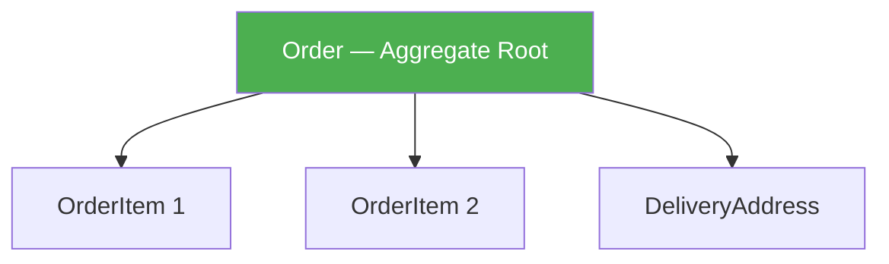

# Вопросы на собеседовании: `Spring Data JDBC`

`Spring Data JDBC` — простой persistence-фреймворк без ORM-магии: нет lazy loading, нет first-level cache, нет dirty checking. Опирается на концепции DDD (aggregate root). На собеседованиях проверяют понимание отличий от JPA, модели агрегатов и работы с кастомными запросами.

Примеры описывают Spring Data JDBC 4.1.3. Для возможностей, появившихся в других версиях, версия указана отдельно.

Дата последнего обновления: 2026-10-05

## Полезные ссылки

### Официальная документация

- [Spring Data JDBC Reference](https://docs.spring.io/spring-data/relational/reference/jdbc.html) — официальная документация
- [Baeldung: Spring Data JDBC Intro](https://www.baeldung.com/spring-data-jdbc-intro) — введение с примерами

## Содержание

- [Полезные ссылки](#полезные-ссылки)
- [See also](#see-also)

**Основы и отличия от JPA**
- [Q1. (!) Что такое Spring Data JDBC и чем отличается от Spring Data JPA?](#q1--что-такое-spring-data-jdbc-и-чем-отличается-от-spring-data-jpa)
- [Q2. Что означает "нет lazy loading" на практике?](#q2-что-означает-нет-lazy-loading-на-практике)
- [Q3. Когда выбирать Spring Data JDBC вместо JPA?](#q3-когда-выбирать-spring-data-jdbc-вместо-jpa)

**Модель агрегатов**
- [Q4. (!) Что такое Aggregate Root в Spring Data JDBC?](#q4--что-такое-aggregate-root-в-spring-data-jdbc)
- [Q5. Как маппировать связь один-к-одному?](#q5-как-маппировать-связь-один-к-одному)
- [Q6. (!) Как маппировать связь один-ко-многим через @MappedCollection?](#q6--как-маппировать-связь-один-ко-многим-через-mappedcollection)
- [Q7. Что такое AggregateReference и когда его использовать?](#q7-что-такое-aggregatereference-и-когда-его-использовать)
- [Q8. Как работает @Embedded?](#q8-как-работает-embedded)

**Маппинг и аннотации**
- [Q9. Какие основные аннотации Spring Data JDBC?](#q9-какие-основные-аннотации-spring-data-jdbc)
- [Q10. Как работает именование таблиц и колонок по умолчанию?](#q10-как-работает-именование-таблиц-и-колонок-по-умолчанию)
- [Q11. Как создать иммутабельную сущность?](#q11-как-создать-иммутабельную-сущность)
- [Q12. Как работает оптимистичная блокировка через @Version?](#q12-как-работает-оптимистичная-блокировка-через-version)

**Репозитории и запросы**
- [Q13. Какие репозитории использует Spring Data JDBC?](#q13-какие-репозитории-использует-spring-data-jdbc)
- [Q14. (!) Как написать кастомный SQL-запрос в Spring Data JDBC?](#q14--как-написать-кастомный-sql-запрос-в-spring-data-jdbc)
- [Q15. Как выполнять modifying-запросы?](#q15-как-выполнять-modifying-запросы)
- [Q16. Как работает транзакционность в Spring Data JDBC?](#q16-как-работает-транзакционность-в-spring-data-jdbc)
- [Q17. Когда использовать JdbcAggregateTemplate.upsert и каковы его ограничения?](#q17-когда-использовать-jdbcaggregatetemplateupsert-и-каковы-его-ограничения)

---

## Q1. (!) Что такое Spring Data JDBC и чем отличается от Spring Data JPA?

`Spring Data JDBC` — persistence-фреймворк, который даёт привычный репозиторный API Spring Data, но работает напрямую через SQL, через JDBC и собственный маппинг агрегатов, без JPA-провайдера. Ту же сущность вы сохраняете тем же `repository.save(entity)`, но за этим вызовом нет ни Session, ни кэша, ни отложенной загрузки.

Ключевое различие в **модели работы с состоянием**. JPA держит сущности в персистентном контексте (Session) и сама решает, что и когда писать в БД: отслеживает изменения (dirty checking), кэширует, грузит связи лениво. Spring Data JDBC ничего этого не делает — изменения объекта сохраняются при явной операции записи, для которой фреймворк может выполнить несколько SQL-команд.

| Аспект | Spring Data JDBC | Spring Data JPA (Hibernate) |
|---|---|---|
| Модель маппинга | Агрегаты и JDBC | Сущности JPA и persistence context |
| Lazy loading | Нет | Есть |
| First-level cache | Нет | Есть (Session) |
| Dirty checking | Нет | Есть |
| JPQL / HQL | Нет — только SQL | Есть |
| Схема БД | Таблицы должны соответствовать маппингу. Схему можно подготовить SQL-скриптами или миграциями | Hibernate может генерировать схему |

Запись изменений начинается с явной операции. При этом чтение и запись одного агрегата могут выполнять несколько SQL-команд. Для сложных выборок можно использовать SQL из Q14.

**Формулировка на собеседовании:** Spring Data JDBC — это «what you see is what you get»: сохранение вызывается явно, а SQL генерируется по маппингу агрегата. Число запросов и стоимость операции зависят от структуры агрегата и способа загрузки.

---

## Q2. Что означает "нет lazy loading" на практике?

При обычном чтении через `findById` Spring Data JDBC загружает корень и принадлежащие ему объекты до возврата из репозитория. При обычной загрузке одиночные связи внутри агрегата могут читаться в запросе корня, а коллекции сущностей загружаются отдельными запросами. Ссылка `AggregateReference` содержит идентификатор другого агрегата. Чтение этого агрегата требует отдельного вызова.

**Что это даёт:**
- Нет `LazyInitializationException` — той самой ошибки JPA при обращении к коллекции вне транзакции, когда Session уже закрыта.
- Обращение к уже загруженной коллекции не запускает SELECT. При стандартной загрузке чтение списка из N заказов с одной коллекцией позиций может выполнить один запрос за корнями и ещё N запросов за позициями. Ищите их в SQL-логе вызова репозитория.
- Начиная с 3.2 можно включить экспериментальный Single Query Loading через `JdbcMappingContext#setSingleQueryLoadingEnabled(true)`. В 4.1 этот режим применим к поддерживаемым методам чтения `CrudRepository` при подходящем диалекте и структуре агрегата. Например, вложенная коллекция, `@Embedded` или `AggregateReference` ведут к обычной загрузке. Методы с выводом запроса из имени и методы с `@Query` используют обычную загрузку. [Spring Data JDBC 4.1 — Loading Aggregates](https://docs.spring.io/spring-data/relational/reference/4.1/jdbc/entity-persistence.html#jdbc.loading-aggregates)

**Подводный камень:** большой агрегат с объёмными коллекциями каждый раз грузится полностью, и это может быть дорого. Отсюда правило: проектируйте агрегаты компактными, не складывая в один корень всё подряд.

```java
Order order = orderRepository.findById(id).orElseThrow();
Set<OrderItem> items = order.getItems();
```

---

## Q3. Когда выбирать Spring Data JDBC вместо JPA?

Коротко: Spring Data JDBC выигрывает, когда модель простая и важна предсказуемость, а JPA — когда модель сложная и нужны её удобства (ленивая загрузка, кэш, генерация схемы). Выбор — это компромисс между простотой и богатством возможностей.

**Берите Spring Data JDBC, если:**
- Доменная модель простая, агрегаты небольшие.
- Нужны предсказуемые SQL-запросы без ORM-магии и скрытых обращений к БД.
- Проект следует DDD с чёткими границами агрегатов — фреймворк ложится на эту модель напрямую.
- В профиле нагрузки приемлемы стоимость чтения целого агрегата и перезапись дочерних строк при обновлении.
- Команда хочет убрать зависимость чтения полей от открытой Hibernate Session. Число запросов при чтении списка агрегатов стоит измерять по схеме из Q2.

**Оставайтесь на JPA, если:**
- Графы сущностей сложные и реально нужна ленивая загрузка, чтобы не тянуть всё разом.
- Нужна генерация схемы или её эволюция средствами Hibernate.
- Используете Criteria API или сложные JPQL-запросы.
- Нужен second-level cache (L2) Hibernate.
- Уже есть большой проект на Hibernate — переписывать дороже, чем продолжать.

**Итог:** проверьте размер агрегатов, частоту изменений дочерних строк и требования к выборкам. Эти свойства определяют, окупится ли простая модель Spring Data JDBC или полезнее возможности JPA.

---

## Q4. (!) Что такое Aggregate Root в Spring Data JDBC?

**Aggregate Root** (корень агрегата) — главная сущность группы связанных объектов и **единственная точка входа** для их сохранения и чтения. Идея пришла из DDD, и Spring Data JDBC встроил её в саму модель работы: репозиторий заводят только для корня, а всё, что внутри агрегата, живёт и обновляется через него.

Агрегат задаёт границу согласованности. Обычный CRUD-репозиторий с транзакциями по умолчанию записывает и удаляет корень и принадлежащие ему строки в одной транзакции. Если вызываете `JdbcAggregateTemplate` напрямую, обеспечьте транзакционную границу в вызывающем коде (Q16).



```java
@Table("orders")
public class Order {        // Aggregate Root
    @Id
    private Long id;
    private String status;
    
    @MappedCollection(idColumn = "order_id")
    private Set<OrderItem> items;  // часть агрегата
    
    @Embedded.Nullable
    private DeliveryAddress address;

    public Set<OrderItem> getItems() {
        return items;
    }
}
```

**Правила агрегата:**
- Весь агрегат сохраняется и удаляется только через корень: `orderRepository.save(order)` запишет и сам заказ, и его `OrderItem`.
- В этой модели позиции управляются через `Order`. Отдельный репозиторий для независимой записи позиций обходил бы границу агрегата.
- При `deleteById` Spring Data JDBC удаляет и вложенные `OrderItem`. Для этого схема может использовать обычный FK без `ON DELETE CASCADE`.
- Ссылка на **другой** агрегат делается через `AggregateReference` (хранит только ID и не загружает чужой объект), чтобы не нарушать его границу.

---

## Q5. Как маппировать связь один-к-одному?

Связь один-к-одному реализуется одним из двух способов: **вложить объект в ту же таблицу** через `@Embedded` или **вынести его в отдельную таблицу** с прямой ссылкой по FK. Выбор зависит от того, хотите ли вы держать данные в одной строке или разнести их по таблицам.

Выбирайте по смыслу: `@Embedded` — когда зависимый объект логически часть владельца и отдельно не нужен (адрес внутри персоны); отдельную таблицу — когда зависимую сущность удобнее хранить в отдельной строке, сохраняя её в границах агрегата. При самостоятельном жизненном цикле выделите отдельный агрегат и храните ссылку по ID (Q7).

**Вариант 1 — @Embedded (в одной таблице):**
```java
@Table("persons")
public class Person {
    @Id Long id;
    String name;

    @Embedded.Nullable(prefix = "address_")
    Address address;  // колонки: address_street, address_city в таблице persons
}

public class Address {
    String street;
    String city;
}
```

**Вариант 2 — отдельная таблица:**
```java
@Table("shipping_info")
public class ShippingInfo {
    String address;
}

@Table("orders")
public class Order {
    @Id Long id;
    @MappedCollection(idColumn = "order_id")
    ShippingInfo shippingInfo;
}
```
В миграции создайте `shipping_info.order_id` как `NOT NULL UNIQUE REFERENCES orders(id)`. Внешний ключ связывает строку с заказом, а `UNIQUE` ограничивает связь одной строкой доставки на заказ. Собственное поле `@Id` у `ShippingInfo` необязательно. Для простого ID и стандартной стратегии в 4.1.3 имя обратной колонки без `idColumn` берётся из имени таблицы владельца (`orders`).

---

## Q6. (!) Как маппировать связь один-ко-многим через @MappedCollection?

Связь один-ко-многим оформляется полем `Set`, `List` или `Map` в агрегате. По умолчанию имена колонок выводятся через `NamingStrategy`. `@MappedCollection` позволяет задать имя обратной колонки `idColumn` и для `List` или `Map` имя колонки `keyColumn`. Обратную ссылку и ключ коллекции маппит родитель.

```java
@Table("orders")
public class Order {
    @Id
    private Long id;
    
    @MappedCollection(idColumn = "order_id", keyColumn = "position")
    private List<OrderItem> items;
}

@Table("order_items")
public class OrderItem {
    @Id Long id;
    String productName;
    int quantity;
}
```

Пример DDL для PostgreSQL. Таблица `orders` уже существует и содержит первичный ключ `id BIGINT`:

```sql
CREATE TABLE order_items (
    id BIGINT GENERATED BY DEFAULT AS IDENTITY PRIMARY KEY,
    order_id BIGINT NOT NULL REFERENCES orders(id),
    position INT NOT NULL,
    product_name VARCHAR,
    quantity INT,
    UNIQUE (order_id, position)
);
```

Для варианта с `Set<OrderItem>` замените поле `items` и оставьте в `@MappedCollection` только `idColumn`. В схеме этого варианта колонка `position` и её ограничение уникальности не нужны. [Spring Data JDBC 4.1: Mapping](https://docs.spring.io/spring-data/relational/reference/4.1/jdbc/mapping.html)

**Ключевые параметры `@MappedCollection`:**
- `idColumn` — имя FK-колонки в дочерней таблице, по которой строки привязываются к родителю.
- `keyColumn` — для `List`/`Map`: колонка, хранящая порядок (индекс `List`) или ключ (`Map`).

**Важный подводный камень — стратегия записи.** При `save(order)` для **существующего** агрегата Spring Data JDBC **удаляет все** `order_items` с данным `order_id` и вставляет коллекцию заново (delete-and-reinsert). Никакого «умного» merge по отдельным строкам, как в JPA, здесь нет. Последствия, о которых стоит знать на собеседовании:
- Удаление и повторная вставка меняют жизненный цикл дочерней строки. Если при вставке передан сохранённый ID, он может остаться прежним. Если ID генерируется заново, он может измениться. Внешний FK на дочернюю строку может помешать удалению.
- Для больших коллекций это дороже точечного UPDATE, что снова подталкивает держать агрегаты компактными.

---

## Q7. Что такое AggregateReference и когда его использовать?

`AggregateReference<T, ID>` — это **типобезопасная ссылка на корень другого агрегата по его ID**, без загрузки самого объекта. Нужна, чтобы выразить связь между агрегатами, не нарушая их границы: `Order` ссылается на `Customer`, но не тянет его в память и не управляет его жизненным циклом.

Ссылку на другой агрегат можно хранить и как скалярный ID. `AggregateReference` дополнительно указывает тип целевого корня в Java. Для объекта внутри агрегата доступны собственные варианты маппинга, показанные в Q5 и Q6.

```java
@Table("orders")
public record Order(
    @Id Long id,
    AggregateReference<Customer, Long> customerId
) {}
```

В БД это просто колонка `customer_id` типа `BIGINT`. При загрузке `Order` данные `Customer` не подгружаются — в поле лежит обёртка над идентификатором. Ссылку создают через `AggregateReference.to(customerId)`. Если БД должна проверять существование клиента, добавьте внешний ключ в миграции.

**Зачем он нужен:**
- Граница агрегата остаётся непересечённой: `Order` не тянет за собой `Customer`.
- Ссылка типобезопасна — `AggregateReference<Customer, Long>` выразительнее и надёжнее, чем «голый» `Long customerId`: из типа видно, на какой агрегат указываем.
- Когда `Customer` всё-таки нужен, его грузят явно через его собственный репозиторий: `customerRepository.findById(order.customerId().getId())`.

**Итог — где что применять:** `@MappedCollection` — для сущностей **внутри** агрегата; `AggregateReference` — для ссылок **между** агрегатами.

---

## Q8. Как работает @Embedded?

`@Embedded` **раскладывает скалярные свойства вложенного объекта в колонки той же таблицы**, что и владелец. Отдельной таблицы и JOIN не возникает — объект существует на уровне Java, но в БД это просто дополнительные колонки родительской строки. Удобно для значимых объектов (value objects) вроде адреса, которые логически часть сущности.

```java
@Table("customers")
public class Customer {
    @Id Long id;
    String name;
    
    @Embedded(onEmpty = Embedded.OnEmpty.USE_NULL)
    HomeAddress homeAddress;
    
    @Embedded(prefix = "billing_", onEmpty = Embedded.OnEmpty.USE_NULL)
    BillingAddress billingAddress;
}

public record HomeAddress(String street, String city, String zip) {}
public record BillingAddress(String street, String city) {}
```

**SQL колонки:**
```
id, name, street, city, zip, billing_street, billing_city
```

**Параметр `prefix`** решает коллизию имён: два embedded-объекта одного типа (например, домашний и платёжный адрес) дали бы одинаковые колонки `street`, `city`. Префикс `billing_` разводит их по разным колонкам, поэтому несколько embedded-объектов уживаются в одной таблице.

**Параметр `onEmpty`** управляет тем, что делать при чтении, когда все колонки простого вложенного объекта содержат SQL `NULL`:
- `USE_NULL` — если все колонки `NULL`, поле станет `null`.
- `USE_EMPTY` — Spring Data пытается создать экземпляр через конструктор без аргументов или конструктор, принимающий считанные значения `null`. Если конструктор требует ненулевое значение, режим сам его не подставит.

Если у встроенного объекта есть `Collection` или `Map`, даже пустая коллекция считается значением. В таком случае `USE_NULL` не превращает весь объект в `null`. [Spring Data JDBC — Embedded entities](https://docs.spring.io/spring-data/relational/reference/jdbc/mapping.html#jdbc.entity-persistence.embedded-entities)

---

## Q9. Какие основные аннотации Spring Data JDBC?

Набор намеренно небольшой — фреймворку нечего настраивать для ORM-поведения, поэтому аннотации описывают только маппинг на таблицу и пару служебных моментов. Важно: пакеты у них **свои** (`org.springframework.data.relational.core.mapping` и `org.springframework.data.annotation`), а не `javax/jakarta.persistence`, как в JPA.

| Аннотация | Назначение |
|---|---|
| `@Table("name")` | Указать имя таблицы |
| `@Id` | Идентификатор сущности. Нужен корню агрегата. Дочерний объект может храниться без отдельного `@Id` |
| `@Column("name")` | Указать имя колонки |
| `@MappedCollection` | Настройка обратной ссылки для 1:1 и 1:N, а для `List` и `Map` также колонки ключа |
| `@Embedded` | Вложенный объект в той же таблице |
| `@Version` | Версия для оптимистичной блокировки |
| `@ReadOnlyProperty` | Поле читается из БД, не пишется |
| `@Transient` | Поле не маппируется |
| `@PersistenceCreator` | Конструктор или фабричный метод для создания сущности |

---

## Q10. Как работает именование таблиц и колонок по умолчанию?

По умолчанию имена выводятся из имён класса и полей с переводом `camelCase` → `snake_case` через `NamingStrategy`:
- Класс `OrderItem` → таблица `order_item`
- Поле `firstName` → колонка `first_name`

Если соглашение не совпадает с вашей схемой (например, нужен общий префикс таблиц), стратегию можно переопределить глобально, унаследовавшись от `DefaultNamingStrategy`:

**Изменение стратегии:**
```java
@Configuration
public class JdbcNamingConfig {
    @Bean
    public NamingStrategy namingStrategy() {
        return new DefaultNamingStrategy() {
            @Override
            public String getTableName(Class<?> type) {
                return "app_" + super.getTableName(type);  // prefix
            }
        };
    }
}
```

Для точечных исключений менять глобальную стратегию не нужно — достаточно указать `@Table` / `@Column` прямо на сущности. В Spring Data JDBC 4.1 режим `forceQuote` включён по умолчанию. Явное имя в `@Column` учитывает регистр при таком режиме в СУБД с регистрозависимыми quoted identifiers. Например, в PostgreSQL колонка `order_code` из DDL без кавычек отличается от `"Order_Code"`. [Spring Data JDBC 4.1 — Mapping](https://docs.spring.io/spring-data/relational/reference/4.1/jdbc/mapping.html)

---

## Q11. Как создать иммутабельную сущность?

Spring Data JDBC может создавать сущности через конструктор и сохранять неизменяемые объекты.

Сделайте сохраняемые поля `final` и передавайте их в конструктор. При чтении Spring Data связывает параметры конструктора с именами свойств. Для обычного Java-класса сохраните имена параметров с помощью `-parameters` либо задайте их через `@ConstructorProperties`.

В показанном `Product` Spring Data использует канонический конструктор record. В обычном классе единственный конструктор выбирается автоматически. Среди нескольких конструкторов можно явно указать один через `@PersistenceCreator`. Этой же аннотацией можно обозначить статический фабричный метод.

```java
@Table("products")
public record Product(
    @Id Long id,
    String name,
    BigDecimal price
) {}
```

Если БД генерирует ID при вставке, используйте результат `Product saved = productRepository.save(product)`. При неизменяемой модели фреймворк может вернуть новый экземпляр с ID. Для копирования используется подходящий конструктор или метод вида `withId(...)`, если он определён. [Spring Data 4.1 — Object Mapping](https://docs.spring.io/spring-data/relational/reference/4.1/object-mapping.html)

---

## Q12. Как работает оптимистичная блокировка через @Version?

Оптимистичная блокировка защищает от потерянных обновлений (lost update), когда два потока читают одну запись и затем по очереди её перезаписывают. Поле с `@Version` хранит номер версии строки; при обновлении корня через `save()` Spring Data JDBC **инкрементирует версию и добавляет в `WHERE` проверку её прежнего значения**. Если за это время кто-то уже изменил строку, версия не совпадёт, UPDATE затронет 0 строк — и фреймворк бросит исключение.

```java
@Table("accounts")
public class Account {
    @Id Long id;
    BigDecimal balance;
    
    @Version
    long version;
}
```

При `save(account)` SQL обновления корня выглядит примерно так. Новое значение версии Spring Data JDBC вычисляет перед записью:
```sql
UPDATE accounts SET balance = ?, version = ?
WHERE id = ? AND version = ?  -- проверяет версию
```

Если другой поток уже обновил запись (версия в `WHERE` не совпала и UPDATE задел 0 строк), бросается `OptimisticLockingFailureException` — приложение узнаёт о конфликте и может повторить операцию на свежих данных.

**Как определяется новый объект.** При стандартном определении состояния `@Version` со значением `0` у примитива (`long`) или `null` у обёртки (`Long`) означает, что `save()` выберет INSERT. При вставке Spring Data JDBC 4.1.3 записывает начальную версию `1` для примитива и `0` для обёртки. Поэтому `Long.valueOf(0)` уже считается версией существующей записи.

**Границы проверки.** При удалении версионированного агрегата по экземпляру проверяется версия, но она не увеличивается. Для собственного SQL через `@Modifying` условие по версии и её изменение задаёт автор запроса. У `upsert()` эта проверка отсутствует (см. Q17).

**Отличие от JPA.** Spring Data JDBC выполняет SQL при вызове `save()`, поэтому конфликт версии виден при самом вызове. JPA может отложить запись до flush.

[Spring Data JDBC — Optimistic Locking](https://docs.spring.io/spring-data/relational/reference/jdbc/entity-persistence.html#optimistic-locking) · [JdbcAggregateTemplate 4.1.3](https://github.com/spring-projects/spring-data-relational/blob/4.1.3/spring-data-jdbc/src/main/java/org/springframework/data/jdbc/core/JdbcAggregateTemplate.java).

---

## Q13. Какие репозитории использует Spring Data JDBC?

Те же базовые интерфейсы Spring Data, что и в JPA: вы наследуете `CrudRepository` (или его варианты), а реализацию генерирует фреймворк. Типичные варианты: готовые CRUD-методы, derived query methods (запрос выводится из имени метода вроде `findByNameContaining`) и SQL из `@Query` или именованного запроса. В примере `name`, `categoryId` и `price` являются свойствами корня `Product`. Для `Optional<Product>` запрос должен находить максимум одну строку.

```java
@Repository
public interface ProductRepository extends CrudRepository<Product, Long> {
    
    // Derived query methods
    List<Product> findByNameContaining(String keyword);
    Optional<Product> findByNameAndCategoryId(String name, Long categoryId);
    
    // Custom SQL
    @Query("SELECT * FROM products WHERE price < :maxPrice ORDER BY price")
    List<Product> findCheaperThan(@Param("maxPrice") BigDecimal maxPrice);
}
```

Базовые интерфейсы и что они добавляют:

| Интерфейс | Методы |
|---|---|
| `CrudRepository<T,ID>` | `save`, `findById`, `findAll`, `delete`, `count` |
| `PagingAndSortingRepository` | `findAll(Sort)`, `findAll(Pageable)` |
| `ListCrudRepository` | Как `CrudRepository`, но возвращает `List` вместо `Iterable` |

Начиная со Spring Data 3.0, интерфейс `PagingAndSortingRepository` не наследует CRUD-методы. Если нужны обе группы операций, репозиторий расширяет оба интерфейса, например `ListCrudRepository<Product, Long>` и `PagingAndSortingRepository<Product, Long>`.

**Что сделает `save()` с заранее назначенным ID?** При стандартной проверке только по `@Id` заполненный идентификатор означает, что Spring Data JDBC выберет UPDATE, даже если строки с таким ID ещё нет. Если у нового объекта, например заказа с UUID, есть поле `@Version Long version` со значением `null`, стандартная проверка по версии выберет INSERT (см. Q12). При реализации `Persistable` решение задаёт `isNew()`. Когда вызывающему коду уже известно, что агрегат новый, можно явно вызвать `JdbcAggregateTemplate.insert()`.

[Определение интерфейсов репозиториев](https://docs.spring.io/spring-data/relational/reference/repositories/definition.html) · [Сохранение агрегатов](https://docs.spring.io/spring-data/relational/reference/jdbc/entity-persistence.html).

---

## Q14. (!) Как написать кастомный SQL-запрос в Spring Data JDBC?

В `org.springframework.data.jdbc.repository.query.Query` пишут SQL с именами таблиц и колонок из схемы. Spring Data JDBC поддерживает только именованные параметры вида `:name`. Имя задаётся через `@Param` или берётся из параметра метода при компиляции с `-parameters`.

```java
@Query("SELECT p.* FROM products p " +
       "JOIN categories c ON p.category_id = c.id " +
       "WHERE c.name = :category AND p.price BETWEEN :min AND :max")
List<Product> findByCategoryAndPriceRange(
    @Param("category") String category,
    @Param("min") BigDecimal min,
    @Param("max") BigDecimal max
);
```

При возврате `Product` стандартный `RowMapper` ожидает колонки для всех свойств, используемых конструктором. Если у корня есть связь один-к-одному, стандартный маппинг ожидает колонки с префиксом свойства связи, например `details_description`. Коллекции дочерних сущностей загружаются отдельными запросами.

**Проекция в DTO.** Для агрегированного результата можно явно задать `RowMapper`. В примере схема дополнена колонкой `order_items.product_id`, которая ссылается на товар. Запрос вернёт одну строку на товар и посчитает его позиции заказов. `COUNT(oi.id)` даёт ноль при отсутствии позиций. Количество разных заказов можно посчитать через `COUNT(DISTINCT oi.order_id)`.

```java
@Query(
    value = """
        SELECT p.name, COUNT(oi.id) AS order_item_count
        FROM products p
        LEFT JOIN order_items oi ON p.id = oi.product_id
        GROUP BY p.id, p.name
        """,
    rowMapperClass = ProductStatsRowMapper.class
)
List<ProductStats> getProductStats();

record ProductStats(String name, long orderItemCount) {}

public static class ProductStatsRowMapper implements RowMapper<ProductStats> {
    @Override
    public ProductStats mapRow(ResultSet rs, int rowNum) throws SQLException {
        return new ProductStats(rs.getString("name"), rs.getLong("order_item_count"));
    }
}
```

**Пагинация.** Spring Data JDBC не дописывает сортировку и пагинацию в строковый `@Query`. Если нужен ограниченный результат, задайте стабильный `ORDER BY` и ограничение в SQL вашего диалекта. Например, для PostgreSQL можно передать именованные параметры в `LIMIT :limit OFFSET :offset`.

[Spring Data JDBC — Query Methods](https://docs.spring.io/spring-data/relational/reference/jdbc/query-methods.html#jdbc.query-methods.at-query).

---

## Q15. Как выполнять modifying-запросы?

`INSERT`/`UPDATE`/`DELETE` через `@Query` нужно дополнительно помечать `@Modifying`. Эта аннотация говорит фреймворку, что запрос **меняет данные и не возвращает результирующий набор**, — иначе Spring Data JDBC попытается прочитать выборку и упадёт.

```java
@Transactional
@Modifying
@Query("UPDATE products SET price = :price WHERE id = :id")
int updatePrice(@Param("id") Long id, @Param("price") BigDecimal price);

@Transactional
@Modifying
@Query("DELETE FROM products WHERE category_id = :categoryId")
void deleteByCategoryId(@Param("categoryId") Long categoryId);
```

**Возвращаемые типы** modifying-метода:
- `void` — результат не важен;
- `int` — количество затронутых строк (удобно проверить, что обновилось ровно то, что ждали);
- `boolean` — было ли затронуто хоть что-то.

Запрос выполняет указанный SQL напрямую. На удаление зависимых строк влияют сам SQL и ограничения БД. Spring Data JDBC не вызывает для такого запроса callbacks агрегата и не обновляет поля аудита. Если запись должна обновлять `updated_at`, задайте это в SQL или на уровне БД. Для проверки версии в таком запросе добавьте условие по ожидаемой версии, её увеличение и обработку нулевого числа обновлённых строк. Объявленный метод запроса не получает транзакцию автоматически от CRUD-реализации. Задайте границу через `@Transactional` на сервисе или на методе репозитория. [Spring Data JDBC: modifying queries](https://docs.spring.io/spring-data/relational/reference/jdbc/query-methods.html#jdbc.query-methods.modifying-query).

---

## Q16. Как работает транзакционность в Spring Data JDBC?

При стандартной конфигурации у унаследованных CRUD-методов есть транзакционные настройки базовой реализации. Чтение помечено `readOnly = true`, запись использует обычную транзакцию. Для собственных объявленных методов запроса границу задают явно (Q15).

Прямой вызов `JdbcAggregateTemplate` проходит мимо репозиторного перехватчика. Если несколько команд шаблона должны фиксироваться и откатываться вместе, задайте общую транзакцию на сервисе.

При сохранении существующего заказа через `save(order)` обновление корня и замена дочерних строк из Q6 входят в одну JDBC-транзакцию. Если вставка позиции нарушит ограничение и транзакция откатится, в базе сохранятся прежние позиции. Конкретный порядок SQL зависит от операций над агрегатом и реализации. [Spring Data JDBC: transactionality](https://docs.spring.io/spring-data/relational/reference/jdbc/transactions.html).

**Объединение нескольких операций в одну транзакцию.** Чтобы несколько вызовов репозиториев прошли атомарно, оборачивают сервисный метод в `@Transactional`. В примере метод вызывается через Spring-прокси, а оба вызова используют тот же JDBC-ресурс и менеджер транзакций с обычным распространением `REQUIRED`:
```java
@Service
@Transactional
public class OrderService {
    private final OrderRepository orderRepository;
    private final InventoryService inventoryService;

    public OrderService(OrderRepository orderRepository, InventoryService inventoryService) {
        this.orderRepository = orderRepository;
        this.inventoryService = inventoryService;
    }

    public void processOrder(Order order) {
        orderRepository.save(order);
        inventoryService.reserveItems(order.getItems());
    }
}
```

**Внешняя граница определяет свойства общей транзакции.** Если сервис уже открыл транзакцию с `REQUIRED`, вызов репозитория с тем же менеджером присоединится к ней. Например, вызов `save()` из сервиса с `@Transactional(readOnly = true)` сам не переключит соединение в режим записи. `readOnly` обычно передаётся JDBC-драйверу как подсказка. Будет ли СУБД отклонять запись, зависит от конфигурации и поддержки этого режима. Для сценария с записью задайте обычную транзакцию на границе сервиса. [Spring Data JDBC — транзакции](https://docs.spring.io/spring-data/relational/reference/jdbc/transactions.html).

**Отличие от JPA.** Spring Data JDBC отправляет SQL в ходе вызова `save()`. Объект, загруженный из репозитория, можно менять в памяти, но автоматического отслеживания изменений и flush здесь нет. Успешный возврат из `save()` внутри сервисной транзакции ещё не подтверждает commit. Если следующая операция вызовет откат всей транзакции, изменение заказа тоже откатится.

---

## Q17. Когда использовать JdbcAggregateTemplate.upsert и каковы его ограничения?

Начиная со **Spring Data JDBC 4.1**, `JdbcAggregateTemplate.upsert(instance)` записывает строку корня одной нативной SQL-командой. Например, в PostgreSQL `ON CONFLICT` по первичному ключу позволяет вставить строку либо обновить существующую. Решение принимает СУБД. Обычный `save()` выбирает INSERT или UPDATE по состоянию объекта (Q12 и Q13).

```java
// template внедрён как Spring bean; product.id уже назначен
Product saved = template.upsert(product);
```

Ограничения важнее краткости вызова:

- **ID должен быть установлен** до вызова. Сценарий с ещё не выданным автоинкрементным ключом сюда не подходит.
- **Диалект должен поддерживать однокомандный upsert.** Reference перечисляет PostgreSQL, H2, MySQL, MariaDB, SQL Server, Oracle, DB2 и HSQLDB. Синтаксис зависит от СУБД, например `MERGE` или `INSERT ... ON CONFLICT`. В MySQL диалект использует `ON DUPLICATE KEY UPDATE`. Там конфликт по другому уникальному ключу может направить обновление в строку с другим ID. Для агрегата с дочерними строками убедитесь, что конфликт при записи корня относится к переданному ID. [Spring Data Relational: UpsertRenderContexts](https://docs.spring.io/spring-data/relational/docs/4.1.x/api/org/springframework/data/relational/core/sql/render/UpsertRenderContexts.html) · [MySQL 8.4: ON DUPLICATE KEY UPDATE](https://dev.mysql.com/doc/refman/8.4/en/insert-on-duplicate.html)
- **Optimistic locking пока не поддерживается.** Если корректность изменения зависит от `@Version` и обнаружения конфликтов, не подменяйте `save` вызовом `upsert`.
- **Один upsert относится к строке корня.** В Spring Data JDBC 4.1.3 фреймворк затем отдельными командами удаляет прежние строки дочерних сущностей и вставляет строки из переданного агрегата. Например, если у существующего заказа две позиции, а в переданном заказе осталась одна, сохранённая коллекция будет состоять из этой одной позиции. Для атомарной записи корня и позиций вызов должен выполняться в общей транзакции.

[Spring Data JDBC reference: Upsert](https://docs.spring.io/spring-data/relational/reference/jdbc/entity-persistence.html#upsert) · [Javadoc JdbcAggregateOperations.upsert](https://docs.spring.io/spring-data/relational/reference/api/java/org/springframework/data/jdbc/core/JdbcAggregateOperations.html#upsert(T)) · [WritingContext в Spring Data Relational 4.1.3](https://github.com/spring-projects/spring-data-relational/blob/4.1.3/spring-data-relational/src/main/java/org/springframework/data/relational/core/conversion/WritingContext.java).

---

## See also

- [Spring Data JPA](spring-data-jpa-interview.md) — сравнение JPA vs JDBC, ORM-концепции
- [Hibernate](../../databases/hibernate-interview.md) — под капотом Spring Data JPA
- [Spring Framework](spring-framework-interview.md) — транзакции, DI
- [Spring Boot](spring-boot-interview.md) — автоконфигурация Spring Data JDBC
- [Транзакции БД](../../databases/database-transactions-interview.md) — изоляция, оптимистичная блокировка
- [SQL](../../databases/sql-interview.md) — plain SQL в @Query Spring Data JDBC
- [Flyway / Liquibase](../../databases/flyway-liquibase-interview.md) · инструменты миграции схемы
- [DDD](../../architecture/ddd-interview.md) — агрегаты, bounded contexts, aggregate root
- [Шпаргалка: Spring Data JDBC: Полное руководство по](../../../frameworks/java-frameworks/spring/spring-data-jdbc.md) — теория
- [jOOQ](../../databases/jooq-interview.md) — type-safe SQL-DSL поверх plain SQL, более мощная альтернатива `@Query` в Spring Data JDBC
