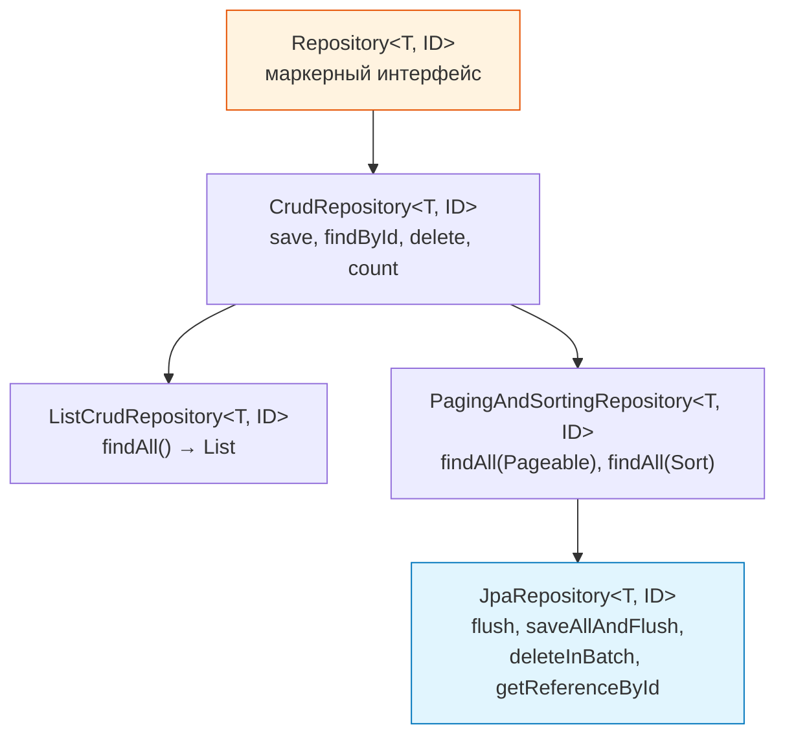
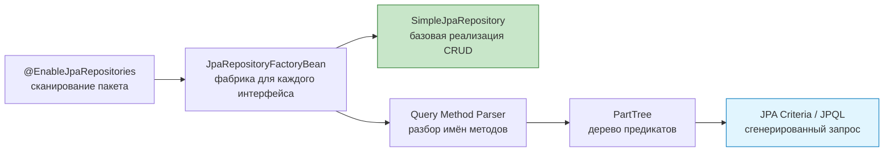
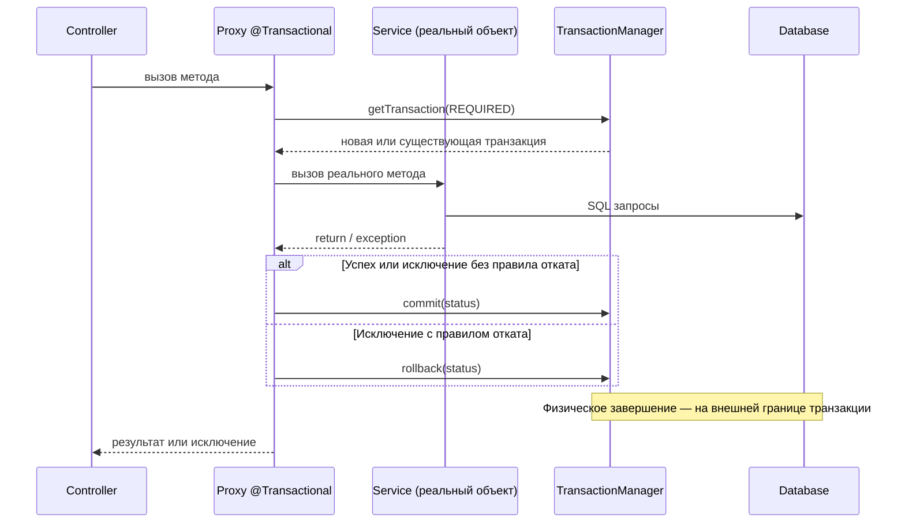
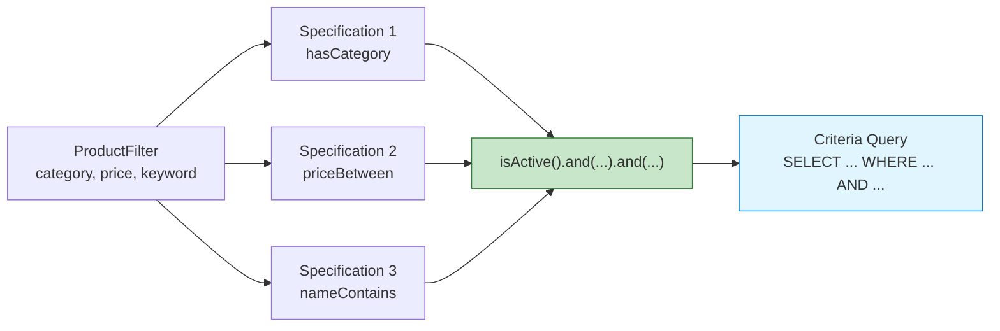
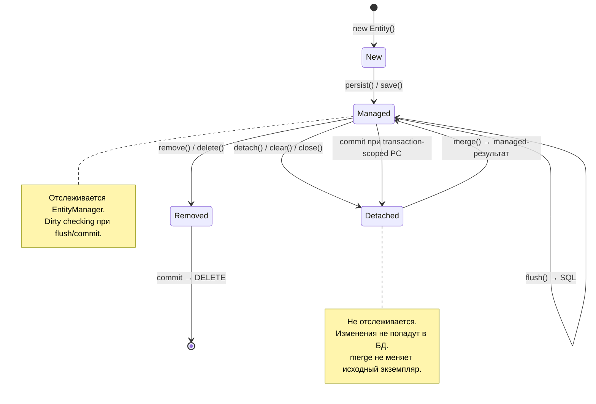
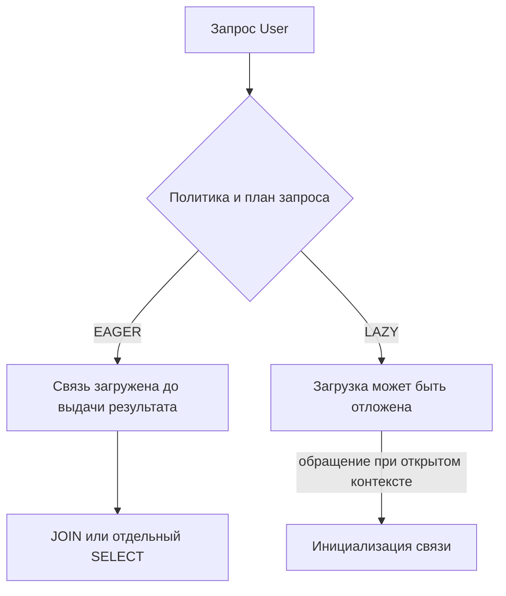
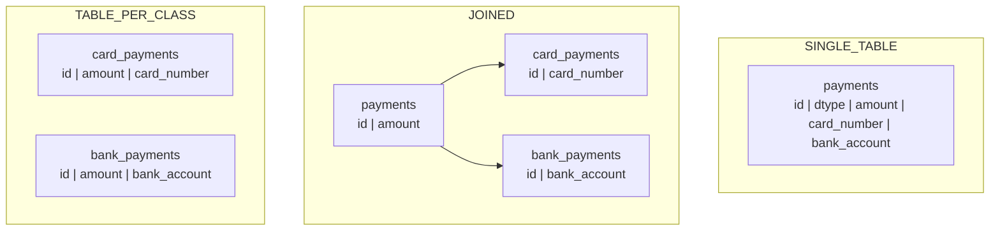
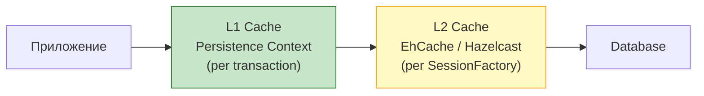

# Вопросы на собеседовании: `Spring Data JPA`

Полное покрытие `Spring Data JPA`: репозитории, `@Query`, `Specifications`, проекции, аудит, пагинация, жизненный цикл сущностей, N+1, производительность.

**`Spring Data JPA`** — подпроект `Spring Data`, который радикально упрощает работу с `JPA`-репозиториями. На собеседованиях это одна из самых частых тем для Java-backend-разработчиков: от базовых вопросов про иерархию репозиториев до глубоких — про N+1, блокировки и оптимизацию запросов. Тесно связан с [Hibernate](../../databases/hibernate-interview.md) как реализацией `JPA`.

## Полезные ссылки

### Официальная документация

- [Spring Data JPA Reference](https://docs.spring.io/spring-data/jpa/reference/) — актуальная документация
- [Jakarta Persistence Specification](https://jakarta.ee/specifications/persistence/) — спецификация JPA
- [Hibernate ORM Documentation](https://hibernate.org/orm/documentation/) — документация Hibernate

### Baeldung

- [Introduction to Spring Data JPA](https://www.baeldung.com/the-persistence-layer-with-spring-data-jpa) — основы: репозитории, иерархия интерфейсов
- [Spring Data JPA @Query](https://www.baeldung.com/spring-data-jpa-query) — JPQL и нативные запросы через @Query
- [Derived Query Methods in Spring Data JPA](https://www.baeldung.com/spring-data-derived-queries) — методы запросов по именованию
- [REST Query Language with Spring Data JPA Specifications](https://www.baeldung.com/rest-api-search-language-spring-data-specifications) — динамические запросы через Specification
- [Joining Tables With Spring Data JPA Specifications](https://www.baeldung.com/spring-jpa-joining-tables) — JOIN через Specification API
- [Spring Data JPA Query by Example](https://www.baeldung.com/spring-data-query-by-example) — запросы через объект-образец
- [Types of JPA Queries](https://www.baeldung.com/jpa-queries) — обзор всех типов JPA-запросов

## Содержание

- [Полезные ссылки](#полезные-ссылки)
- [See also](#see-also)

**Основы Spring Data JPA**
- [Q1. (!) Что такое `Spring Data JPA` и зачем он нужен?](#q1--что-такое-spring-data-jpa-и-зачем-он-нужен)
- [Q2. (!) Какова иерархия репозиториев в `Spring Data`?](#q2--какова-иерархия-репозиториев-в-spring-data)
- [Q3. Что такое `JPQL` и чем он отличается от `SQL`?](#q3-что-такое-jpql-и-чем-он-отличается-от-sql)
- [Q4. Как `Spring Data JPA` создаёт реализацию репозиториев?](#q4-как-spring-data-jpa-создаёт-реализацию-репозиториев)

**Query Methods и @Query**
- [Q5. (!) Что такое `Query Methods` и какие ключевые слова поддерживаются?](#q5--что-такое-query-methods-и-какие-ключевые-слова-поддерживаются)
- [Q6. (!) Как работает аннотация `@Query`?](#q6--как-работает-аннотация-query)
- [Q7. Как выполнять нативные `SQL`-запросы?](#q7-как-выполнять-нативные-sql-запросы)
- [Q8. Что такое `@Modifying` и когда его использовать?](#q8-что-такое-modifying-и-когда-его-использовать)
- [Q9. Как использовать `@Query` с `SpEL`?](#q9-как-использовать-query-с-spel)

**Транзакции и блокировки**
- [Q10. (!) Что такое `@Transactional` и как она работает через прокси?](#q10--что-такое-transactional-и-как-она-работает-через-прокси)
- [Q11. (!) Как работает `propagation` транзакций?](#q11--как-работает-propagation-транзакций)
- [Q12. (!) Что такое `@Lock` и стратегии блокировок?](#q12--что-такое-lock-и-стратегии-блокировок)

**Проекции и DTO**
- [Q13. (!) Что такое `Projections` и какие виды бывают?](#q13--что-такое-projections-и-какие-виды-бывают)
- [Q14. Как использовать динамические проекции?](#q14-как-использовать-динамические-проекции)

**Пагинация и сортировка**
- [Q15. (!) Как работает пагинация в `Spring Data JPA`?](#q15--как-работает-пагинация-в-spring-data-jpa)
- [Q16. В чём разница между `Page`, `Slice` и `List`?](#q16-в-чём-разница-между-page-slice-и-list)

**Specifications и динамические запросы**
- [Q17. (!) Что такое `Specifications` и как их использовать?](#q17--что-такое-specifications-и-как-их-использовать)

**Аудит**
- [Q18. (!) Как работает `Auditing` в `Spring Data JPA`?](#q18--как-работает-auditing-в-spring-data-jpa)

**Жизненный цикл сущностей**
- [Q19. (!) Какие состояния имеет сущность в `JPA`?](#q19--какие-состояния-имеет-сущность-в-jpa)
- [Q20. Что такое `@EntityListeners` и callback-методы жизненного цикла?](#q20-что-такое-entitylisteners-и-callback-методы-жизненного-цикла)
- [Q21. Что такое `FlushMode` и когда его менять?](#q21-что-такое-flushmode-и-когда-его-менять)

**Fetch стратегии и N+1**
- [Q22. (!) Что такое `FetchType LAZY` vs `EAGER`?](#q22--что-такое-fetchtype-lazy-vs-eager)
- [Q23. (!) Что такое N+1 проблема и как её решить?](#q23--что-такое-n1-проблема-и-как-её-решить)
- [Q24. Что такое `@EntityGraph` и как он работает?](#q24-что-такое-entitygraph-и-как-он-работает)

**Связи и каскады**
- [Q25. Что такое `CascadeType` и когда применять каскады?](#q25-что-такое-cascadetype-и-когда-применять-каскады)
- [Q26. Что такое `@Embedded` и `@Embeddable`?](#q26-что-такое-embedded-и-embeddable)

**Наследование**
- [Q27. Как работает наследование сущностей (`JPA Inheritance`)?](#q27-как-работает-наследование-сущностей-jpa-inheritance)

**Batch-обработка и производительность**
- [Q28. (!) Как работает batch-обработка?](#q28--как-работает-batch-обработка)
- [Q29. Как настроить второуровневый кэш (`L2 cache`)?](#q29-как-настроить-второуровневый-кэш-l2-cache)

**Soft Delete и фильтры**
- [Q30. Что такое `Soft Delete` и как реализовать?](#q30-что-такое-soft-delete-и-как-реализовать)
- [Q31. Что такое `Hibernate Filters`?](#q31-что-такое-hibernate-filters)

**Custom Repositories**
- [Q32. Как создать custom repository implementation?](#q32-как-создать-custom-repository-implementation)
- [Q33. Что такое derived delete и `deleteBy`?](#q33-что-такое-derived-delete-и-deleteby)

**Тестирование**
- [Q34. (!) Как тестировать `Spring Data JPA` репозитории?](#q34--как-тестировать-spring-data-jpa-репозитории)

**Best Practices**
- [Q35. Какие best practices для производительности `JPA`?](#q35-какие-best-practices-для-производительности-jpa)

**Продвинутые возможности**
- [Q36. (!) Как работают derived query methods и каков их синтаксис?](#q36--как-работают-derived-query-methods-и-каков-их-синтаксис)
- [Q37. (!) Как использовать `Specification` API для построения динамических запросов?](#q37--как-использовать-specification-api-для-построения-динамических-запросов)
- [Q38. (!) Как работают `Projection`-интерфейсы в Spring Data JPA?](#q38--как-работают-projection-интерфейсы-в-spring-data-jpa)
- [Q39. (!) Где Spring Data JPA Auditing не срабатывает и как учитывать фоновые операции?](#q39--где-spring-data-jpa-auditing-не-срабатывает-и-как-учитывать-фоновые-операции)
- [Q40. (!) Как интегрировать `Flyway` со Spring Data JPA?](#q40--как-интегрировать-flyway-со-spring-data-jpa)
- [Q41. (!) Как работает `@EntityGraph` и когда он предпочтительнее `JOIN FETCH`?](#q41--как-работает-entitygraph-и-когда-он-предпочтительнее-join-fetch)
- [Q42. Как корректно использовать `@Modifying` с `@Query` для bulk-операций?](#q42-как-корректно-использовать-modifying-с-query-для-bulk-операций)
- [Q43. (!) Что такое Scroll API и keyset-пагинация в Spring Data (`ScrollPosition`)?](#q43--что-такое-scroll-api-и-keyset-пагинация-в-spring-data-scrollposition)

---

## Q1. (!) Что такое `Spring Data JPA` и зачем он нужен?

**`Spring Data JPA`** — надстройка над `JPA` (`Jakarta Persistence API`), которая избавляет от boilerplate при работе с репозиториями: вы объявляете интерфейс, а реализацию `Spring` генерирует сам. Это подпроект `Spring Data`, специализированный под реляционные БД через `ORM`.

Главная боль, которую он решает: в «голом» `JPA` для каждого репозитория приходилось писать класс с инжектированным `EntityManager` и вручную собирать запросы. `Spring Data JPA` убирает этот слой целиком.

**Что даёт:**
- Автоматическая реализация репозиториев по интерфейсу — не нужен `@Repository`-класс с `EntityManager`
- Генерация запросов по именам методов (`findByEmail`, `countByStatus`) — без единой строки SQL
- Встроенная поддержка пагинации, сортировки, `Specifications`
- Интеграция с `@Transactional`, аудитом, кэшированием

```java
// Минимальный рабочий пример — ни одной строки реализации
@Entity
@Table(name = "users")
public class User {
    @Id
    @GeneratedValue(strategy = GenerationType.IDENTITY)
    private Long id;

    @Column(nullable = false, unique = true)
    private String email;

    private String firstName;
    private String lastName;

    @Enumerated(EnumType.STRING)
    private UserStatus status;

    @OneToMany(mappedBy = "user", fetch = FetchType.LAZY)
    private List<Order> orders = new ArrayList<>();

    // getters, setters
}

public interface UserRepository extends JpaRepository<User, Long> {
    Optional<User> findByEmail(String email);
    List<User> findByStatusAndLastName(UserStatus status, String lastName);
    boolean existsByEmail(String email);
}
```

```java
@Service
@RequiredArgsConstructor
public class UserService {
    private final UserRepository userRepository;

    @Transactional
    public User createUser(CreateUserRequest request) {
        if (userRepository.existsByEmail(request.email())) {
            throw new DuplicateEmailException(request.email());
        }
        User user = new User();
        user.setEmail(request.email());
        user.setFirstName(request.firstName());
        user.setStatus(UserStatus.ACTIVE);
        return userRepository.save(user);
    }

    @Transactional(readOnly = true)
    public Page<User> findActiveUsers(Pageable pageable) {
        return userRepository.findByStatus(UserStatus.ACTIVE, pageable);
    }
}
```

На собеседовании важно показать, что `Spring Data JPA` — это не замена `JPA`, а надстройка. Под капотом используется [Hibernate](../../databases/hibernate-interview.md) (или другая реализация `JPA`), `Spring Data` лишь генерирует реализацию репозиториев.

## Q2. (!) Какова иерархия репозиториев в `Spring Data`?

Иерархия интерфейсов репозиториев — от общего к конкретному:



```java
// CrudRepository — базовый CRUD
public interface CrudRepository<T, ID> extends Repository<T, ID> {
    <S extends T> S save(S entity);
    Optional<T> findById(ID id);
    Iterable<T> findAll();
    long count();
    void deleteById(ID id);
    boolean existsById(ID id);
}

// JpaRepository — расширяет всё + JPA-специфичные методы
public interface JpaRepository<T, ID> extends
        ListCrudRepository<T, ID>,
        ListPagingAndSortingRepository<T, ID>,
        QueryByExampleExecutor<T> {

    void flush();
    <S extends T> S saveAndFlush(S entity);
    void deleteAllInBatch();
    T getReferenceById(ID id); // lazy proxy, без запроса в БД
}
```

Логика иерархии простая: каждый уровень добавляет возможности. `Repository` — пустой маркер, `CrudRepository` даёт базовый CRUD, `PagingAndSortingRepository` добавляет пагинацию и сортировку, а `JpaRepository` — JPA-специфику (`flush`, batch-удаление, `getReferenceById`). Чем выше по иерархии наследуетесь, тем меньше методов получаете в API репозитория.

**Когда что использовать:**
- `CrudRepository` — когда нужен минимум (микросервис с простыми операциями)
- `JpaRepository` — стандартный выбор для большинства проектов (пагинация, `flush`, batch-удаление)
- `Repository` — маркерный интерфейс, когда хочется объявить только конкретные методы и не тащить весь CRUD в публичный API

## Q3. Что такое `JPQL` и чем он отличается от `SQL`?

**JPQL** (`Java Persistence Query Language`) — язык запросов `JPA`, который оперирует **сущностями и их Java-полями**, а не таблицами и колонками БД. Вы пишете запрос в терминах объектной модели, а провайдер `JPA` транслирует его в `SQL` под конкретный диалект БД.

Стандартный `JPQL` меньше привязан к схеме и диалекту БД, поэтому запрос проще переносить при сохранении той же модели сущностей и поддержке возможностей провайдером. Синтаксис и набор функций ограничены спецификацией. Hibernate HQL расширяет JPQL, в частности поддерживает оконные функции и CTE, но такой запрос уже зависит от провайдера и возможностей целевой БД.

| Аспект | JPQL | SQL |
|--------|------|-----|
| Оперирует | Сущностями (`User`) | Таблицами (`users`) |
| Поля | `u.firstName` | `u.first_name` |
| Наследование | Полиморфные запросы | Нет |
| Переносимость | Выше в пределах стандартного JPQL и возможностей провайдера | Зависит от диалекта БД |
| Функции | Набор стандарта; у провайдера могут быть расширения | Возможности целевой БД |

```java
// JPQL — имена сущностей и полей Java
@Query("SELECT u FROM User u WHERE u.status = :status AND u.lastName LIKE :pattern")
List<User> findActiveByLastName(@Param("status") UserStatus status,
                                 @Param("pattern") String pattern);

// SQL — имена таблиц и колонок БД
@Query(value = "SELECT * FROM users WHERE status = :status AND last_name LIKE :pattern",
       nativeQuery = true)
List<User> findActiveByLastNameNative(@Param("status") String status,
                                      @Param("pattern") String pattern);
```

Для запросов, которые неудобно выразить через `Query Methods`, используйте стандартный `JPQL`, если важна переносимость. Для CTE и оконных функций можно выбрать расширения Hibernate HQL, учитывая зависимость от провайдера и диалекта; для возможностей конкретной БД используйте нативный `SQL`. [Jakarta Persistence 3.2](https://jakarta.ee/specifications/persistence/3.2/jakarta-persistence-spec-3.2); [Hibernate HQL 7.0](https://docs.hibernate.org/orm/7.0/querylanguage/html_single/).

## Q4. Как `Spring Data JPA` создаёт реализацию репозиториев?

В обычном запуске приложения `Spring` сканирует интерфейсы-репозитории и создаёт для каждого **прокси-объект** — вы никогда не пишете реализацию руками. Базовый CRUD при этом делегируется в готовый класс `SimpleJpaRepository`, а query methods превращаются в запросы.

Понимание этого механизма помогает на собеседовании объяснить, почему интерфейс без реализации «волшебным образом» работает: магии нет — есть фабрика прокси и парсер имён методов.



Процесс:
1. `@EnableJpaRepositories` (автоматически включена в `Spring Boot`) запускает сканирование
2. Для каждого интерфейса создаётся `JpaRepositoryFactoryBean`
3. Методы `CrudRepository` делегируются в `SimpleJpaRepository` (которая использует `EntityManager`)
4. Кастомные методы (`findByEmail`) разбираются `PartTree`-парсером и превращаются в `Criteria`-запросы
5. Методы с `@Query` — напрямую в `JPQL` или нативный `SQL`

**AOT-режим в Spring Data JPA 4.1.1** переносит анализ и генерацию реализаций *подходящих query methods* на этап сборки. Он поддерживает derived methods, `@Query`/`@NativeQuery`, named queries и ряд других форм; для них создаются исходники фрагмента репозитория и JSON-метаданные. Базовый CRUD и методы, реализованные пользовательским fragment, этим механизмом не заменяются. AOT может ускорить запуск и обычного JVM-приложения, не только native image, но часть решений (например, диалект БД) фиксируется при сборке. По умолчанию JPA AOT собирает метаданные через in-memory Hibernate без обращения к рабочей БД; при необходимости можно включить использование `EntityManagerFactory` через `spring.aot.jpa.repositories.use-entitymanager=true`. Ограничения 4.1.1: `ScrollPosition`/keyset и dynamic projections не генерируются; для `QueryRewriter` поддерживается класс с конструктором без аргументов, не bean. Сгенерированный класс — внутренняя деталь Spring Data, вызывать его напрямую не следует. [Spring Data JPA AOT reference](https://docs.spring.io/spring-data/jpa/reference/jpa/aot.html).

```java
// Что Spring генерирует "под капотом" для findByEmail
// (упрощённо — реальный код в SimpleJpaRepository + QueryPartTree)
public Optional<User> findByEmail(String email) {
    CriteriaBuilder cb = entityManager.getCriteriaBuilder();
    CriteriaQuery<User> query = cb.createQuery(User.class);
    Root<User> root = query.from(User.class);
    query.where(cb.equal(root.get("email"), email));
    List<User> results = entityManager.createQuery(query).getResultList();
    return results.stream().findFirst();
}
```

## Q5. (!) Что такое `Query Methods` и какие ключевые слова поддерживаются?

Здесь речь о **derived query methods**: `Spring Data JPA` разбирает имя метода и строит запрос по свойствам сущности. Query method можно также задать явно через `@Query` или named query; у него имя уже не обязано описывать условия. Вывод запроса из имени удобен для коротких выборок, проверок существования и подсчёта.

Работает так: парсер `PartTree` делит имя на префикс (`findBy`, `countBy`, `existsBy`, `deleteBy`) и набор условий, соединённых `And`/`Or`. Каждое условие — это поле сущности плюс опциональный оператор (`Between`, `GreaterThan`, `Like` и т.д.).

**Поддерживаемые ключевые слова:**

| Ключевое слово | Пример | Смысл |
|----------------|--------|-----------------|
| `findBy` | `findByEmail(String)` | Поиск по свойству сущности |
| `countBy` | `countByStatus(Status)` | Подсчёт совпадений |
| `existsBy` | `existsByEmail(String)` | Проверка существования |
| `deleteBy` | `deleteByStatus(Status)` | Поиск и удаление найденных сущностей по одной, с lifecycle callbacks; не bulk `DELETE` |
| `And` / `Or` | `findByFirstNameAndLastName` | `WHERE ... AND ...` |
| `Between` | `findByAgeBetween(int, int)` | `WHERE age BETWEEN ?1 AND ?2` |
| `LessThan` / `GreaterThan` | `findByAgeGreaterThan(int)` | `WHERE age > ?1` |
| `Like` / `Containing` | `findByNameContaining(String)` | `WHERE name LIKE %?1%` |
| `In` | `findByStatusIn(Collection)` | `WHERE status IN (?1)` |
| `IsNull` / `IsNotNull` | `findByDeletedAtIsNull()` | Проверка Java-свойства `deletedAt` на `NULL` |
| `OrderBy` | `findByStatusOrderByCreatedAtDesc` | `ORDER BY created_at DESC` |
| `Top` / `First` | `findTop5ByStatus(Status)` | Ограничение числа результатов; конкретный SQL зависит от диалекта |
| `Distinct` | `findDistinctByLastName(String)` | `SELECT DISTINCT ...` |

```java
public interface UserRepository extends JpaRepository<User, Long> {

    // Простой поиск
    Optional<User> findByEmail(String email);

    // Комбинация условий
    List<User> findByStatusAndLastNameContainingIgnoreCase(
            UserStatus status, String lastNamePart);

    // Сортировка и лимит
    List<User> findTop10ByStatusOrderByCreatedAtDesc(UserStatus status);

    // Проверка существования
    boolean existsByEmailAndStatus(String email, UserStatus status);

    // Подсчёт
    long countByStatus(UserStatus status);

    // Поиск по вложенному полю (через _ или camelCase)
    List<User> findByAddress_City(String city);

    // Поток нужно потребить и закрыть в рамках внешней транзакции
    Stream<User> findByStatus(UserStatus status);
}
```

`Stream<T>` может удерживать ресурсы JDBC: потребляйте и закрывайте его через `try`-with-resources **внутри транзакции вызывающего сервиса**. Транзакция только на методе репозитория может завершиться до чтения возвращённого потока. Сам `Stream` не гарантирует, что провайдер и драйвер читают строки порциями. [Spring Data JPA query methods](https://docs.spring.io/spring-data/jpa/reference/jpa/query-methods.html); [return types](https://docs.spring.io/spring-data/jpa/reference/repositories/query-return-types-reference.html); [transactionality](https://docs.spring.io/spring-data/jpa/reference/jpa/transactions.html).

**Подводный камень:** имя метода — это контракт, и при росте числа условий оно становится нечитаемым (`findByStatusAndCityAndAgeGreaterThanAndCreatedAtAfter`). Как только имя перестаёт читаться с первого взгляда — переходите на `@Query` (явный JPQL) или `Specifications` (динамическая сборка условий).

## Q6. (!) Как работает аннотация `@Query`?

`@Query` задаёт JPQL (в Hibernate также поддерживаются его HQL-расширения) или нативный `SQL` при `nativeQuery = true` прямо на методе репозитория — когда запрос удобнее выразить явно, чем выводить из имени. Для нативного SQL есть также `@NativeQuery`.

Запрос привязывается к методу аннотацией, параметры подставляются по `@Param` (именованные) или по позиции (`?1`, `?2`). Именованные предпочтительнее: при рефакторинге сигнатуры позиционные легко перепутать местами.

```java
public interface OrderRepository extends JpaRepository<Order, Long> {

    // JPQL с именованными параметрами
    @Query("SELECT o FROM Order o WHERE o.user.id = :userId AND o.status = :status")
    List<Order> findUserOrders(@Param("userId") Long userId,
                                @Param("status") OrderStatus status);

    // JPQL с позиционными параметрами
    @Query("SELECT o FROM Order o WHERE o.createdAt > ?1 ORDER BY o.total DESC")
    List<Order> findRecentOrders(LocalDateTime after);

    // Агрегация
    @Query("SELECT new com.example.dto.OrderStats(o.status, COUNT(o), SUM(o.total)) " +
           "FROM Order o GROUP BY o.status")
    List<OrderStats> getOrderStatistics();

    // JOIN FETCH для избежания N+1
    @Query("SELECT o FROM Order o JOIN FETCH o.items WHERE o.id = :id")
    Optional<Order> findByIdWithItems(@Param("id") Long id);

    // Пагинация с @Query
    @Query("SELECT o FROM Order o WHERE o.status = :status")
    Page<Order> findByStatus(@Param("status") OrderStatus status, Pageable pageable);

    // @Modifying для UPDATE/DELETE
    @Modifying
    @Query("UPDATE Order o SET o.status = :status WHERE o.createdAt < :before")
    int archiveOldOrders(@Param("status") OrderStatus status,
                         @Param("before") LocalDateTime before);
}
```

**Приоритет разрешения запросов** (от высшего к низшему):
1. `@Query` на методе
2. Named Query (`@NamedQuery` на сущности)
3. Разбор имени метода (`Query Method`)

## Q7. Как выполнять нативные `SQL`-запросы?

Нативный `SQL` задают через `@Query(..., nativeQuery = true)` или `@NativeQuery`. Он полезен, когда нужны таблицы, колонки, операторы и функции конкретной БД. CTE и оконные функции отсутствуют в стандартном JPQL, но доступны в Hibernate HQL как расширения; выбор между HQL и нативным SQL зависит от провайдера, диалекта и требований к запросу.

Цена — зависимость от схемы и диалекта БД. При нативной пагинации Spring Data может вывести `count` для простого SQL; сложный запрос требует подходящего парсера, например JSqlParser, либо явного `countQuery`. Проверяйте полученный count и сортировку на целевой БД. [Spring Data JPA query methods](https://docs.spring.io/spring-data/jpa/reference/jpa/query-methods.html).

```java
public interface ProductRepository extends JpaRepository<Product, Long> {

    // Простой нативный запрос
    @Query(value = "SELECT * FROM products WHERE category = :cat AND price < :maxPrice",
           nativeQuery = true)
    List<Product> findCheapProducts(@Param("cat") String category,
                                     @Param("maxPrice") BigDecimal maxPrice);

    // Нативный с пагинацией и явным count-запросом
    @Query(value = "SELECT * FROM products WHERE active = true ORDER BY rating DESC",
           countQuery = "SELECT COUNT(*) FROM products WHERE active = true",
           nativeQuery = true)
    Page<Product> findTopRated(Pageable pageable);

    // Оконная функция вне стандартного JPQL; у Hibernate есть аналог в HQL
    @Query(value = """
            SELECT p.*, RANK() OVER (PARTITION BY p.category ORDER BY p.rating DESC) as rnk
            FROM products p
            WHERE p.active = true
            """, nativeQuery = true)
    List<Object[]> findProductsWithRank();

    // Проекция с нативным запросом через интерфейс
    @Query(value = "SELECT name, price, rating FROM products WHERE category = :cat",
           nativeQuery = true)
    List<ProductSummary> findSummaryByCategory(@Param("cat") String category);
}

// Интерфейсная проекция — алиасы колонок = имена геттеров
interface ProductSummary {
    String getName();
    BigDecimal getPrice();
    Double getRating();
}
```

**Подводный камень:** автоматическое построение `count` работает для простого нативного SQL, но не покрывает произвольный диалект и сложный запрос. Для сложной пагинации используйте JSqlParser либо задайте явный `countQuery` и проверьте результат на целевой БД.

## Q8. Что такое `@Modifying` и когда его использовать?

`@Modifying` помечает метод с `@Query` как изменяющий данные (`UPDATE`, `DELETE`, нативный `INSERT` или DDL), чтобы Spring Data выполнил его как modifying query. Для derived `deleteBy…` эта аннотация не нужна: такой метод сам определяет операцию по имени. Объявленные query methods не получают транзакцию автоматически; вызывайте bulk-операцию внутри транзакции сервиса либо задайте `@Transactional` на методе репозитория.

Главная ценность — bulk-операции: один `UPDATE`/`DELETE` напрямую в БД вместо загрузки N сущностей в память, их изменения по одной и сброса dirty checking'ом. На больших объёмах это разница в порядки.

```java
public interface UserRepository extends JpaRepository<User, Long> {

    // Bulk UPDATE — один запрос вместо загрузки N сущностей
    @Transactional
    @Modifying(clearAutomatically = true, flushAutomatically = true)
    @Query("UPDATE User u SET u.status = :newStatus WHERE u.lastLoginAt < :before")
    int deactivateInactiveUsers(@Param("newStatus") UserStatus newStatus,
                                 @Param("before") LocalDateTime before);

    // Bulk DELETE
    @Transactional
    @Modifying
    @Query("DELETE FROM User u WHERE u.status = 'DELETED' AND u.deletedAt < :before")
    int purgeDeletedUsers(@Param("before") LocalDateTime before);

    // Нативный INSERT (например, для таблицы связей)
    @Transactional
    @Modifying
    @Query(value = "INSERT INTO user_roles (user_id, role_id) VALUES (:userId, :roleId)",
           nativeQuery = true)
    void assignRole(@Param("userId") Long userId, @Param("roleId") Long roleId);
}
```

**Ключевые параметры** (оба про синхронизацию с кэшем первого уровня):
- `clearAutomatically = true` — очищает persistence context **после** запроса: ранее загруженные сущности устарели, их нужно «забыть»
- `flushAutomatically = true` — сбрасывает накопленные изменения в БД **перед** запросом, чтобы bulk-операция увидела актуальные данные

**Подводный камень:** bulk-запрос идёт напрямую в БД, минуя загруженные сущности и их lifecycle callbacks. Без `clearAutomatically` сущности в persistence context могут остаться со старыми значениями. Очистка удаляет из контекста и несохранённые изменения, поэтому перед ней при необходимости выполните `flush`; показанная комбинация `flushAutomatically` и `clearAutomatically` делает порядок явным. [Spring Data JPA modifying queries](https://docs.spring.io/spring-data/jpa/reference/jpa/query-methods.html); [transactionality](https://docs.spring.io/spring-data/jpa/reference/jpa/transactions.html).

## Q9. Как использовать `@Query` с `SpEL`?

В `@Query` доступны ограниченные шаблонные выражения Spring Data с `SpEL`. Они позволяют использовать метаданные репозитория и аргументы метода в объявленном запросе; это не произвольная подстановка SQL из пользовательской строки.

Главный приём — `#{#entityName}`: Spring Data подставляет JPA-имя сущности конкретного репозитория. Оно берётся из `@Entity(name = ...)` либо из простого имени класса, а не из имени таблицы. Так один метод в базовом интерфейсе можно переиспользовать для нескольких сущностей с общим полем.

```java
@MappedSuperclass
abstract class ActiveEntity {
    @Id Long id;
    boolean active;
}

@NoRepositoryBean
public interface BaseRepository<T extends ActiveEntity> extends JpaRepository<T, Long> {

    // Один запрос для любой сущности с полем "active"
    @Query("SELECT e FROM #{#entityName} e WHERE e.active = true")
    List<T> findAllActive();

    // Подсчёт активных записей
    @Query("SELECT COUNT(e) FROM #{#entityName} e WHERE e.active = true")
    long countActive();
}

@Entity
class User extends ActiveEntity { }

@Entity
class Product extends ActiveEntity { }

// #{#entityName} для этого репозитория = "User"
public interface UserRepository extends BaseRepository<User> {
    // findAllActive() → SELECT e FROM User e WHERE e.active = true
}

// #{#entityName} для этого репозитория = "Product"
public interface ProductRepository extends BaseRepository<Product> {
    // findAllActive() → SELECT e FROM Product e WHERE e.active = true
}
```

`#{#entityName}` привязан к типу конкретного репозитория. Выражения для значений аргументов, например `?#{[0]}` или `:#{#name}`, оцениваются при выполнении запроса; для простой привязки обычно достаточно `@Param`. В обобщённом интерфейсе нужна `@NoRepositoryBean`, чтобы Spring не пытался создать репозиторий для абстрактного `T`. [Spring Data JPA templated queries](https://docs.spring.io/spring-data/jpa/reference/jpa/query-methods.html); [repository interfaces](https://docs.spring.io/spring-data/jpa/reference/repositories/definition.html).

## Q10. (!) Что такое `@Transactional` и как она работает через прокси?

`@Transactional` задаёт правила транзакции для метода или класса. В стандартном proxy-режиме Spring применяет их при вызове **через прокси** бина: JDK-прокси работает через интерфейс, class-based прокси создаётся через CGLIB. Одна аннотация без включённого управления транзакциями и вызова через соответствующий прокси не даёт эффекта.

При вызове извне прокси обращается к `TransactionManager`: с распространением `REQUIRED` он начинает транзакцию, если её нет, или участвует в существующей. После вызова метода применяется правило завершения; физический `COMMIT`/`ROLLBACK` происходит на границе владельца транзакции. По умолчанию откат вызывают `RuntimeException` и `Error`, но не checked-исключения. Для последних укажите `rollbackFor` или, начиная со Spring Framework 6.2, настройте глобальный `rollbackOn = ALL_EXCEPTIONS`.



```java
@Service
@Transactional(readOnly = true) // на уровне класса — все методы read-only
public class OrderService {

    private final OrderRepository orderRepository;
    private final PaymentService paymentService;

    public OrderService(OrderRepository orderRepository, PaymentService paymentService) {
        this.orderRepository = orderRepository;
        this.paymentService = paymentService;
    }

    // read-only наследуется от класса
    public Order findById(Long id) {
        return orderRepository.findById(id)
            .orElseThrow(() -> new OrderNotFoundException(id));
    }

    @Transactional // переопределяем — этот метод пишет
    public Order createOrder(CreateOrderRequest request) {
        Order order = new Order();
        order.setStatus(OrderStatus.CREATED);
        order.setTotal(request.total());
        return orderRepository.save(order);
    }

    @Transactional(
        isolation = Isolation.REPEATABLE_READ,
        timeout = 10,
        rollbackFor = PaymentException.class // откат и для checked exception
    )
    public Order processPayment(Long orderId) throws PaymentException {
        Order order = findById(orderId); // self-вызов: действует внешняя транзакция
        paymentService.charge(order); // если выбросит PaymentException — rollback
        order.setStatus(OrderStatus.PAID);
        return orderRepository.save(order);
    }
}
```

**Критический подводный камень — self-invocation:** внутренний вызов `this.method()` минует прокси. Настройки `@Transactional` вызываемого метода не применяются: если внешней транзакции нет, новая не появится; если она есть, выполнение остаётся внутри неё.

```java
@Service
public class UserService {

    @Transactional
    public void updateUser(Long id) { /* транзакция при внешнем вызове через прокси */ }

    public void doSomething() {
        // doSomething не транзакционный: этот self-вызов новую транзакцию не создаст
        this.updateUser(1L);
    }
}
```

Обычно границу транзакции задают на внешнем методе или выносят отдельную операцию в другой бин. Если перехват именно внутренних вызовов необходим, Spring поддерживает AspectJ mode с weaving вместо прокси. `private`-метод прокси не перехватит; с Spring Framework 6.0 class-based прокси могут перехватывать также `protected` и package-visible методы, но для интерфейсного прокси нужны `public` методы интерфейса. `final`-метод нельзя переопределить class-based прокси. [Spring `@Transactional`](https://docs.spring.io/spring-framework/reference/6.2/data-access/transaction/declarative/annotations.html); [propagation](https://docs.spring.io/spring-framework/reference/6.2/data-access/transaction/declarative/tx-propagation.html); [proxying](https://docs.spring.io/spring-framework/reference/6.2/core/aop/proxying.html).

## Q11. (!) Как работает `propagation` транзакций?

`Propagation` (распространение) определяет, что делать, когда `@Transactional`-метод вызван внутри уже идущей транзакции: присоединиться к ней, открыть новую, приостановить текущую или вообще запретить такой вызов.

По умолчанию — `REQUIRED`: метод участвует в существующей физической транзакции либо создаёт её при отсутствии. `REQUIRES_NEW` приостанавливает внешнюю транзакцию и создаёт независимую; `NESTED` при поддержке менеджера использует savepoint внутри одной физической транзакции.

| Propagation | Есть транзакция | Нет транзакции |
|-------------|-----------------|----------------|
| `REQUIRED` (default) | Присоединяется | Создаёт новую |
| `REQUIRES_NEW` | Приостанавливает, создаёт новую | Создаёт новую |
| `NESTED` | JDBC savepoint, если поддержан менеджером и драйвером | Создаёт новую |
| `MANDATORY` | Присоединяется | Бросает исключение |
| `SUPPORTS` | Присоединяется | Без транзакции |
| `NOT_SUPPORTED` | Приостанавливает | Без транзакции |
| `NEVER` | Бросает исключение | Без транзакции |

```java
@Service
@RequiredArgsConstructor
public class OrderService {

    private final OrderRepository orderRepository;
    private final AuditService auditService;

    @Transactional
    public void placeOrder(OrderRequest request) {
        // Фиксируем попытку независимо от результата основной операции
        auditService.recordAttempt("ORDER_ATTEMPTED");
        orderRepository.save(new Order(request));
    }
}

@Service
@RequiredArgsConstructor
public class AuditService {

    private final AuditRepository auditRepository;

    @Transactional(propagation = Propagation.REQUIRES_NEW)
    public void recordAttempt(String action) {
        // Отдельная транзакция: запись о попытке сохранится при откате заказа
        auditRepository.save(new AuditLog(action));
    }
}
```

**Подводный камень:** если внутренний метод с `REQUIRED` вызван через прокси и из него наружу выходит исключение, подходящее под rollback-правило, его логическая область может пометить общую физическую транзакцию как `rollback-only`. Перехват исключения внешним методом после этого не снимает метку: при попытке коммита будет `UnexpectedRollbackException`. Если исключение обработано внутри внутреннего метода или вызов миновал прокси, такого вывода автоматически делать нельзя. `REQUIRES_NEW` изолирует внутренний результат, но требует отдельного соединения при удержании внешнего и достаточного пула.

`NESTED` — сценарий прежде всего для JDBC. `JpaTransactionManager` допускает JDBC savepoint, но он не откатывает состояние JPA `EntityManager`; в Spring Framework 6.2.19 флаг `nestedTransactionAllowed` по умолчанию `true`, а с 7.0 — `false`. Не рассчитывайте на вложенную JPA-транзакцию только из-за этой настройки. Для сообщения о **состоявшемся** заказе отдельный `REQUIRES_NEW` аудит до коммита не подходит: используйте событие после коммита или transactional outbox. [Spring propagation](https://docs.spring.io/spring-framework/reference/6.2/data-access/transaction/declarative/tx-propagation.html); [`JpaTransactionManager` 6.2.19](https://docs.spring.io/spring-framework/docs/6.2.x/javadoc-api/org/springframework/orm/jpa/JpaTransactionManager.html).

## Q12. (!) Что такое `@Lock` и стратегии блокировок?

`@Lock` в Spring Data JPA задаёт `LockModeType` для запроса репозитория; аннотацию можно поставить и на переобъявленный CRUD-метод. Это один из инструментов защиты от конфликтов, когда транзакции работают с одной сущностью.

Два подхода:
- **Пессимистический** (`PESSIMISTIC_READ`/`PESSIMISTIC_WRITE`) — получает блокировку БД при запросе и удерживает её до конца транзакции. `READ` рассчитан на согласованное чтение, `WRITE` — на сериализацию конкурирующих изменений. Ожидание, таймаут и точный SQL зависят от БД и провайдера; `READ` разрешено реализовать как `WRITE`.
- **Оптимистический** (`@Version`, при необходимости явный `OPTIMISTIC`) — версия автоматически проверяется при обновлении или удалении versioned-сущности. Явный `OPTIMISTIC` защищает также чтение versioned-сущности без последующего изменения. Типичный вариант не удерживает долгую блокировку сразу; спецификация допускает и другую реализацию. При конфликте возникает `OptimisticLockException`, проверка может откладываться до `flush`/`commit`.

```java
public interface AccountRepository extends JpaRepository<Account, Long> {

    // Пессимистическая блокировка для конкурирующих обновлений
    @Lock(LockModeType.PESSIMISTIC_WRITE)
    @Query("SELECT a FROM Account a WHERE a.id = :id")
    Optional<Account> findByIdForUpdate(@Param("id") Long id);

    // Согласованное чтение с блокировкой до конца транзакции
    @Lock(LockModeType.PESSIMISTIC_READ)
    @Query("SELECT a FROM Account a WHERE a.id = :id")
    Optional<Account> findByIdForConsistentRead(@Param("id") Long id);

    // Явный OPTIMISTIC полезен и при чтении без последующего UPDATE
    @Lock(LockModeType.OPTIMISTIC)
    @Query("SELECT a FROM Account a WHERE a.id = :id")
    Optional<Account> findByIdForVersionCheck(@Param("id") Long id);
}
```

```java
// Версия для автоматической проверки при изменении
@Entity
public class Account {
    @Id
    @GeneratedValue(strategy = GenerationType.IDENTITY)
    private Long id;

    @Version
    private Long version;

    private BigDecimal balance;
}

// Для оптимистического обновления достаточно обычного чтения versioned-сущности
@Transactional
public void debitOptimistically(Long accountId, BigDecimal amount) {
    Account account = accountRepository.findById(accountId).orElseThrow();
    account.setBalance(account.getBalance().subtract(amount));
    // UPDATE с проверкой версии при flush/commit; конфликт откатывает транзакцию
}
```

| Стратегия | Гарантия и применение |
|-----------|-----------------------|
| `PESSIMISTIC_WRITE` | Немедленная блокировка до конца транзакции; конкурирующие обновления |
| `PESSIMISTIC_READ` | Немедленная блокировка для согласованного чтения; может быть усилена до `WRITE` |
| `@Version` / `OPTIMISTIC` | Проверка версии при изменении или явном optimistic lock; редкие конфликты |

Для пессимистической стратегии нужен активный транзакционный контекст; блокировки увеличивают риск ожиданий и deadlock. При оптимистическом конфликте повторяйте **всю** бизнес-операцию в новой транзакции после повторного чтения. Синтаксис `FOR UPDATE`/`FOR SHARE` — только возможное отображение, а не контракт JPA. [Spring Data JPA Locking](https://docs.spring.io/spring-data/jpa/reference/jpa/locking.html); [Jakarta Persistence 3.2 §3.5](https://jakarta.ee/specifications/persistence/3.2/jakarta-persistence-spec-3.2#locking-and-concurrency).

## Q13. (!) Что такое `Projections` и какие виды бывают?

**Projections** — способ вернуть из репозитория представление сущности через интерфейс или DTO. Для простых top-level полей это позволяет ограничить выборку, но форма проекции и запрос определяют, сколько данных реально загрузится.

Зачем: если экрану нужны два поля «широкой» сущности, можно не читать остальные колонки. Для вложенных свойств Spring Data JPA создаёт join и может материализовать связанное свойство целиком; проверяйте SQL и план запроса.

### Закрытая интерфейсная проекция

```java
// Spring создаёт интерфейсный прокси и может ограничить top-level SELECT
public interface UserSummary {
    String getFirstName();
    String getLastName();
    String getEmail();
}

public interface UserRepository extends JpaRepository<User, Long> {
    List<UserSummary> findByStatus(UserStatus status);
}
```

### DTO-проекция (class-based)

```java
// Record или класс с подходящим конструктором; DTO не проксируется
public record UserDto(String firstName, String lastName, String email) {}

public interface UserRepository extends JpaRepository<User, Long> {

    // Через @Query с конструктором в JPQL
    @Query("SELECT new com.example.dto.UserDto(u.firstName, u.lastName, u.email) " +
           "FROM User u WHERE u.status = :status")
    List<UserDto> findDtoByStatus(@Param("status") UserStatus status);
}
```

### Открытая проекция (с вычисляемыми полями)

```java
public interface UserFullName {
    String getFirstName();
    String getLastName();

    @Value("#{target.firstName + ' ' + target.lastName}")
    String getFullName(); // SpEL может обратиться к любому свойству target
}
```

### Вложенная проекция

```java
public interface OrderWithUser {
    Long getId();
    BigDecimal getTotal();
    UserSummary getUser(); // вложенная проекция

    interface UserSummary {
        String getFirstName();
        String getEmail();
    }
}
```

**Ключевое для собеседования — границы оптимизации:**
- **Закрытая интерфейсная** (геттеры свойств сущности) — Spring Data знает нужные атрибуты и может оптимизировать выборку top-level полей. Вложенный getter создаёт join; Spring Data JPA может материализовать связанную часть целиком.
- **DTO/class-based** — JPA создаёт объект через конструктор, без интерфейсного прокси и без вложенных проекций. Для JPQL `SELECT new` нужен полный путь к типу и подходящий конструктор; сеттеры не требуются.
- **Открытая интерфейсная** (`@Value`/SpEL) — выражение может читать любое свойство `target`, поэтому оптимизация закрытой проекции недоступна. Для вычисления только из уже выбранных геттеров можно использовать `default`-метод интерфейса и сохранить закрытую проекцию.

Выбирайте минимальное представление под задачу, но не выводите фактический объём данных из названия проекции: проверьте сгенерированный SQL, особенно для вложенных свойств и явных `@Query`. [Spring Data JPA Projections](https://docs.spring.io/spring-data/jpa/reference/repositories/projections.html).

## Q14. Как использовать динамические проекции?

Динамическая проекция — это один метод репозитория, который возвращает разные представления данных в зависимости от переданного `Class<T>`. Тип проекции выбирается уже в рантайме, на стороне вызывающего кода.

Зачем это нужно: для одного и того же условия поиска не приходится заводить отдельные методы `findSummaryByStatus`, `findAdminByStatus`, `findFullByStatus`. Дженерик-метод `<T> List<T> findByStatus(status, Class<T>)` выбирает форму результата при вызове.

```java
public interface UserRepository extends JpaRepository<User, Long> {

    // Тип проекции передаётся как параметр
    <T> List<T> findByStatus(UserStatus status, Class<T> type);

    <T> Optional<T> findByEmail(String email, Class<T> type);
}

// Использование — разные проекции для разных контекстов
interface UserSummary {
    String getFirstName();
    String getEmail();
}

interface UserAdmin {
    String getEmail();
    UserStatus getStatus();
    LocalDateTime getCreatedAt();
    LocalDateTime getLastLoginAt();
}

@Service
@RequiredArgsConstructor
public class UserService {

    private final UserRepository userRepository;

    public List<UserSummary> getPublicList() {
        // Для публичного API — минимум данных
        return userRepository.findByStatus(UserStatus.ACTIVE, UserSummary.class);
    }

    public List<UserAdmin> getAdminList() {
        // Для админки — больше полей
        return userRepository.findByStatus(UserStatus.ACTIVE, UserAdmin.class);
    }

    public List<User> getFullList() {
        // Полная сущность (тоже работает)
        return userRepository.findByStatus(UserStatus.ACTIVE, User.class);
    }
}
```

Параметр `Class<T>`, связанный с типом результата `T`, Spring Data распознаёт как селектор проекции: он **недоступен** как аргумент запроса или SpEL. Если сам класс нужен как обычный параметр запроса, для него используют другой generic-тип, например `Class<?>`. Правила закрытых, открытых и DTO-проекций из Q13 сохраняются; выбор `User.class` возвращает полную сущность. [Spring Data JPA Projections](https://docs.spring.io/spring-data/jpa/reference/repositories/projections.html#dynamic-projections).

## Q15. (!) Как работает пагинация в `Spring Data JPA`?

Пагинация — выдача результата частями. Метод репозитория принимает `Pageable` (`PageRequest.of(page, size, sort)`), а Spring Data JPA применяет offset, лимит и сортировку через JPA-провайдер и SQL-диалект. Номер первой страницы — `0`; конкретный SQL может отличаться от `LIMIT/OFFSET`.

`Page<T>` даёт общее число элементов и страниц; для этого **может** потребоваться отдельный count-запрос. `Slice<T>` сообщает лишь, есть ли следующая часть, и не требует общего count (подробнее в Q16). Для устойчивого порядка добавьте уникальный tie-breaker, например `id`: сортировки только по `createdAt` недостаточно при одинаковом времени. Даже так offset-страницы могут смещаться между запросами при конкурентных вставках и удалениях; для большого смещения рассмотрите keyset scrolling.

```java
public interface OrderRepository extends JpaRepository<Order, Long> {

    Page<Order> findByStatus(OrderStatus status, Pageable pageable);

    Slice<Order> findByUserId(Long userId, Pageable pageable);
}
```

```java
@RestController
@RequestMapping("/api/orders")
@RequiredArgsConstructor
public class OrderController {

    private final OrderRepository orderRepository;

    @GetMapping
    public Page<OrderDto> getOrders(
            @RequestParam(defaultValue = "0") int page,
            @RequestParam(defaultValue = "20") int size) {

        Pageable pageable = PageRequest.of(page, size, Sort.by(
            Sort.Order.desc("createdAt"),
            Sort.Order.asc("id") // стабильная сортировка
        ));

        return orderRepository.findByStatus(OrderStatus.ACTIVE, pageable)
            .map(OrderDto::from);
    }
}
```

**`JOIN FETCH` коллекции + `Pageable` проверяйте отдельно.** В Hibernate 6 и версиях 7 до 7.4 такой запрос мог загрузить все подходящие строки и применить лимит в JVM. С Hibernate 7.4 пагинация с collection fetch join выполняется корректно в БД, если СУБД поддерживает лимит/offset во вложенном запросе; для неподдерживаемого диалекта остаётся дорогой вариант в памяти. Независимо от этого для `Page` проверьте count-запрос и фактический SQL. Если важна переносимая предсказуемость, сначала выберите страницу ID родителей, затем отдельным запросом загрузите их коллекции и восстановите порядок страницы. [Spring Data Paging](https://docs.spring.io/spring-data/jpa/reference/repositories/query-methods-details.html), [Hibernate 7.4 What's New](https://docs.hibernate.org/orm/7.4/whats-new/).

**В `Spring MVC` при включённой Spring Data web support** можно принять `Pageable` напрямую как параметр контроллера: resolver создаст его из query-параметров `page`, `size`, `sort`. Spring Boot включает web support автоконфигурацией при нужных зависимостях:

```java
@GetMapping("/users")
public Page<UserDto> getUsers(Pageable pageable) {
    // GET /users?page=0&size=20&sort=firstName,asc&sort=lastName,asc
    return userRepository.findAll(pageable).map(UserDto::from);
}
```

Для публичного HTTP-контракта лучше явно задать DTO страницы или `PagedModel`: сериализация `PageImpl` напрямую не обещает стабильную JSON-структуру. [Spring Data web support](https://docs.spring.io/spring-data/jpa/reference/repositories/core-extensions.html).

## Q16. В чём разница между `Page`, `Slice` и `List`?

Все три могут возвращать выборку с `Pageable`, но отличаются **метаданными и возможной ценой запросов**. Главный вопрос — нужны ли total и признак следующей части:

- `Page<T>` сообщает число элементов и страниц. Для total обычно нужен дополнительный count-запрос, но Spring Data может его пропустить, когда число элементов выводится из содержимого страницы и `Pageable`.
- `Slice<T>` count не делает: чтобы понять, есть ли следующая страница, он запрашивает `size + 1` запись. Если пришла лишняя — `hasNext() == true`.
- `List<T>` — просто страница данных без всяких метаданных.

| Тип | `COUNT` запрос | Метаданные | Когда использовать |
|-----|---------------|------------|-------------------|
| `Page<T>` | Может потребоваться | Общее число элементов и страниц | Пагинация с номерами страниц |
| `Slice<T>` | Нет | Только `hasNext()` | Бесконечный скролл, "Load more" |
| `List<T>` | Нет | Нет | Когда метаданные не нужны |

```java
public interface UserRepository extends JpaRepository<User, Long> {

    // Page — данные + total; count выполняется, когда он нужен
    Page<User> findByStatus(UserStatus status, Pageable pageable);

    // Slice — один запрос (запрашивает size+1 записей, чтобы определить hasNext)
    Slice<User> findByCity(String city, Pageable pageable);

    // List — один запрос, без метаданных
    List<User> findByLastName(String lastName, Pageable pageable);
}
```

**Рекомендация:** на больших таблицах `COUNT(*)` может быть дорогим. Если клиенту нужен только переход к следующей части — берите `Slice`; если даже `hasNext()` не нужен — `List` с `Pageable`. `List` не даёт total автоматически. [Spring Data Paging](https://docs.spring.io/spring-data/jpa/reference/repositories/query-methods-details.html); [`PageableExecutionUtils`](https://docs.spring.io/spring-data/commons/reference/api/java/org/springframework/data/support/PageableExecutionUtils.html).

## Q17. (!) Что такое `Specifications` и как их использовать?

`Specifications` — способ собирать условия запроса в рантайме, как из кубиков, поверх `JPA Criteria API`. Каждая спецификация — один предикат (`WHERE`-условие); их можно комбинировать через `.and()`/`.or()` и применять только те, что реально заданы.

Идеальный сценарий — фильтрация с опциональными параметрами: поисковые формы и API, где пользователь может задать любое подмножество фильтров. Вместо комбинаторного взрыва методов (`findByCategory`, `findByCategoryAndPrice`, `findByPriceAndKeyword`, ...) у вас один `findAll(spec, pageable)`, в который собирается ровно нужный набор условий.

```java
// Репозиторий расширяет JpaSpecificationExecutor
public interface ProductRepository extends JpaRepository<Product, Long>,
                                            JpaSpecificationExecutor<Product> {
}

// Класс со спецификациями — переиспользуемые предикаты
public class ProductSpecs {

    public static Specification<Product> hasCategory(String category) {
        return (root, query, cb) -> cb.equal(root.get("category"), category);
    }

    public static Specification<Product> priceBetween(BigDecimal min, BigDecimal max) {
        return (root, query, cb) -> cb.between(root.get("price"), min, max);
    }

    public static Specification<Product> nameContains(String keyword) {
        String escaped = EscapeCharacter.DEFAULT.escape(keyword.toLowerCase(Locale.ROOT));
        return (root, query, cb) ->
            cb.like(cb.lower(root.get("name")), "%" + escaped + "%",
                EscapeCharacter.DEFAULT.getEscapeCharacter());
    }

    public static Specification<Product> isActive() {
        return (root, query, cb) -> cb.isTrue(root.get("active"));
    }

    public static Specification<Product> hasMinRating(Double rating) {
        return (root, query, cb) -> cb.greaterThanOrEqualTo(root.get("rating"), rating);
    }
}
```

```java
@Service
@RequiredArgsConstructor
public class ProductSearchService {

    private final ProductRepository productRepository;

    public Page<Product> search(ProductFilter filter, Pageable pageable) {
        Specification<Product> spec = ProductSpecs.isActive();

        // Условия добавляются только если фильтр задан
        if (filter.category() != null) {
            spec = spec.and(ProductSpecs.hasCategory(filter.category()));
        }
        if (filter.minPrice() != null && filter.maxPrice() != null) {
            spec = spec.and(ProductSpecs.priceBetween(filter.minPrice(), filter.maxPrice()));
        }
        if (filter.keyword() != null && !filter.keyword().isBlank()) {
            spec = spec.and(ProductSpecs.nameContains(filter.keyword()));
        }
        if (filter.minRating() != null) {
            spec = spec.and(ProductSpecs.hasMinRating(filter.minRating()));
        }

        return productRepository.findAll(spec, pageable);
    }
}
```



**Преимущество перед множеством `@Query`-методов:** не нужно создавать `findByCategoryAndPriceBetween`, `findByCategory`, `findByPriceBetween` и т.д. — один метод `findAll(spec, pageable)` покрывает все комбинации.

В Spring Data JPA 4.1.1 `Specification.where(nonNullSpec)` существует, но для известного базового условия достаточно начать с самой спецификации. Если условия может не быть вообще, используйте `Specification.unrestricted()`: начиная с 4.0 `where(null)` не принимается. Для пользовательского `LIKE` экранируйте `%`/`_` вместе с указанием escape-символа; `EscapeCharacter` уже есть в Spring Data JPA. [Specifications](https://docs.spring.io/spring-data/jpa/reference/jpa/specifications.html); [`Specification` API](https://docs.spring.io/spring-data/jpa/reference/api/java/org/springframework/data/jpa/domain/Specification.html); [`EscapeCharacter` API](https://docs.spring.io/spring-data/jpa/reference/api/java/org/springframework/data/jpa/repository/query/EscapeCharacter.html).

## Q18. (!) Как работает `Auditing` в `Spring Data JPA`?

Spring Data JPA Auditing заполняет метаданные создания и изменения сущности. `@EnableJpaAuditing` включает инфраструктуру, `AuditingEntityListener` подключается к сущности через `@EntityListeners` (или в `orm.xml`), а поля помечаются `@CreatedDate`, `@LastModifiedDate`, `@CreatedBy`, `@LastModifiedBy`.

Для **одних дат** `AuditorAware` не нужен. Для полей «кто» он возвращает `Optional<T>` текущего пользователя или системного субъекта; тип `T` должен соответствовать типу полей `@CreatedBy`/`@LastModifiedBy`. Источник автора выбирает приложение: Spring Security — лишь один вариант. При единственном бине `AuditorAware` его можно обнаружить автоматически; `auditorAwareRef` явно выбирает нужный бин. Альтернатива аннотациям на полях — реализовать `Auditable`; это сильнее связывает доменную модель со Spring Data.

```java
// 1. Включить аудит и определить источник автора
@Configuration
@EnableJpaAuditing(auditorAwareRef = "auditorProvider")
public class JpaConfig {

    @Bean
    public AuditorAware<String> auditorProvider() {
        AuthenticationTrustResolver trustResolver = new AuthenticationTrustResolverImpl();
        return () -> Optional.ofNullable(SecurityContextHolder.getContext().getAuthentication())
            .filter(trustResolver::isAuthenticated)
            .map(Authentication::getName);
    }
}

// 2. Базовая аудируемая сущность
@MappedSuperclass
@EntityListeners(AuditingEntityListener.class)
@Getter
public abstract class AuditableEntity {

    @CreatedDate
    @Column(name = "created_at", nullable = false, updatable = false)
    private Instant createdAt;

    @LastModifiedDate
    @Column(name = "updated_at")
    private Instant updatedAt;

    @CreatedBy
    @Column(name = "created_by", updatable = false)
    private String createdBy;

    @LastModifiedBy
    @Column(name = "updated_by")
    private String updatedBy;
}

// 3. Сущность наследует аудит-поля
@Entity
@Table(name = "products")
public class Product extends AuditableEntity {

    @Id
    @GeneratedValue(strategy = GenerationType.IDENTITY)
    private Long id;

    private String name;
    private BigDecimal price;
}
```

При JPA `@PrePersist` заполняются поля создания; по умолчанию `@EnableJpaAuditing(modifyOnCreate = true)` также ставит last-modified поля **при создании**. При фактическом обновлении `@PreUpdate` меняет last-modified поля; один вызов `save()` без изменения сущности не обещает `UPDATE` и нового времени. `createdAt`/`createdBy` не должны переписываться при обновлении. `setDates = true` — настройка по умолчанию; для иного источника времени есть `dateTimeProviderRef`.

Для этого механизма нужны включённая инфраструктура и JPA listener; документация Spring Data JPA 4.1.1 также указывает `spring-aspects.jar` в classpath. Следите, чтобы `AuditorAware` не считал анонимный `Authentication` реальным пользователем: `Authentication::isAuthenticated` само по себе недостаточно, поэтому в примере используется `AuthenticationTrustResolver`. Для фоновых задач и bulk-операций см. Q39. [Spring Data JPA Auditing](https://docs.spring.io/spring-data/jpa/reference/auditing.html); [`@EnableJpaAuditing` API](https://docs.spring.io/spring-data/jpa/reference/api/java/org/springframework/data/jpa/repository/config/EnableJpaAuditing.html); [Spring Security `AuthenticationTrustResolver`](https://docs.spring.io/spring-security/reference/api/java/org/springframework/security/authentication/AuthenticationTrustResolver.html).

## Q19. (!) Какие состояния имеет сущность в `JPA`?

Сущность в `JPA` проходит четыре состояния, и от текущего состояния зависит, попадут ли ваши изменения в БД. Понимание этого цикла — ключ к работе с `Persistence Context` (кэшем первого уровня) и к объяснению странных багов вроде «поменял поле, а в БД ничего не изменилось».

Коротко о состояниях:
- **New/Transient** — обычный Java-объект, `EntityManager` о нём не знает.
- **Managed/Persistent** — привязан к `EntityManager`; любое изменение полей будет синхронизировано в БД при flush (dirty checking).
- **Detached** — был managed, но контекст закрылся; изменения больше не отслеживаются.
- **Removed** — помечен на удаление, `DELETE` уйдёт при flush/commit.



| Состояние | Описание | Отслеживается EM | В БД |
|-----------|----------|:----------------:|:----:|
| **New** (Transient) | Создан, ещё не передан под управление JPA; ID может быть назначен приложением | Нет | Назначенный ID сам не вставляет строку |
| **Managed** (Persistent) | Связан с `EntityManager` | Да | Новая запись может ожидать flush |
| **Detached** | Был managed, но больше не связан с текущим контекстом | Нет | Состояние БД не обязано совпадать с объектом |
| **Removed** | Помечен на удаление | Да, до завершения операции | Удаление синхронизируется при flush/commit |

```java
@Transactional
public void entityLifecycleDemo() {
    User user = new User("John");      // NEW — не отслеживается

    entityManager.persist(user);        // MANAGED — теперь в persistence context
    user.setEmail("john@example.com");  // dirty checking — изменение обнаружится

    entityManager.flush();              // синхронизация с БД: возможен один INSERT

    entityManager.detach(user);         // DETACHED — изменения не отслеживаются
    user.setEmail("new@example.com");   // НЕ попадёт в БД!

    User merged = entityManager.merge(user); // MANAGED — результат merge
    // ВНИМАНИЕ: user всё ещё detached; дальнейшие изменения вносите в merged

    entityManager.remove(merged);       // REMOVED — будет DELETE при commit
}
```

**Семантика `save()` поверх этих состояний.** Spring Data JPA выбирает `EntityManager.persist()` для сущности, которую считает новой, и `EntityManager.merge()` для остальных. После `persist()` сам аргумент становится managed. При `merge(detached)` состояние копируется в **возвращённый** managed-экземпляр (он может уже существовать в контексте), а аргумент остаётся detached. При `merge(managed)` возвращается тот же экземпляр. Поэтому при неизвестном состоянии объекта используйте результат `save()`.

«Новая или нет» Spring Data определяет по стратегиям, в порядке приоритета:

- сущность реализует `Persistable` → решает её собственный метод `isNew()`;
- есть поле `@Version` ссылочного (не примитивного) типа → новая, пока version == `null`;
- иначе по `@Id` → новая, пока id == `null`; примитивный `@Version` для такой проверки не подходит.

Подводный камень: новая сущность с присвоенным приложением ID и без ссылочного `@Version` по стандартной стратегии считается «не новой»: `save()` вызовет `merge()`. Провайдеру может понадобиться дополнительное чтение БД, если нужной сущности нет в persistence context; обязательный `SELECT` перед каждым `merge()` контракт JPA не обещает. Для назначаемых ID явно задайте `Persistable.isNew()` с корректным переходом флага после сохранения/загрузки либо используйте ссылочный `@Version`. [Jakarta Persistence 3.2, lifecycle и merge](https://jakarta.ee/specifications/persistence/3.2/jakarta-persistence-spec-3.2); [Spring Data JPA 4.1.1, Persisting Entities](https://docs.spring.io/spring-data/jpa/reference/jpa/entity-persistence.html).

## Q20. Что такое `@EntityListeners` и callback-методы жизненного цикла?

JPA вызывает callback-методы при операциях с сущностью: `persist`, `remove`, фактическом SQL `UPDATE`, загрузке или `refresh`. Эти callbacks привязаны к жизненному циклу управляемой сущности, а не ко всем SQL-запросам (см. Q39).

Два способа объявить callback'и:
- **Прямо в сущности** — методы без аргументов с `@PrePersist`, `@PreUpdate` и т.д.; подходят для простой подготовки собственных полей.
- **В отдельном listener-классе** через `@EntityListeners` — метод получает экземпляр сущности аргументом. Это удобно для общей локальной логики нескольких сущностей; внешние действия требуют отдельного решения по транзакции.

```java
// Callback-аннотации прямо на сущности
@Entity
public class Order {

    @Id
    @GeneratedValue(strategy = GenerationType.IDENTITY)
    private Long id;

    private OrderStatus status;
    private LocalDateTime createdAt;
    private LocalDateTime updatedAt;

    @PrePersist
    void onCreate() {
        this.createdAt = LocalDateTime.now();
        this.updatedAt = LocalDateTime.now();
        if (this.status == null) {
            this.status = OrderStatus.CREATED;
        }
    }

    @PreUpdate
    void onUpdate() {
        this.updatedAt = LocalDateTime.now();
    }

    @PreRemove
    void onRemove() {
        // Валидация: нельзя удалить оплаченный заказ
        if (this.status == OrderStatus.PAID) {
            throw new IllegalStateException("Cannot delete paid order");
        }
    }
}
```

```java
// Альтернатива: callback в отдельном listener-классе
public class OrderDisplayListener {

    @PostLoad
    public void afterLoad(Order order) {
        order.setDisplayLabel("Order #" + order.getId());
    }
}

@Entity
@EntityListeners(OrderDisplayListener.class)
public class Order {
    @Id
    private Long id;

    @Transient
    private String displayLabel;

    public Long getId() { return id; }
    public void setDisplayLabel(String label) { this.displayLabel = label; }
}
```

| Callback | Когда срабатывает |
|----------|-------------------|
| `@PrePersist` | При `persist` до вставки; ID стратегии `IDENTITY` здесь ещё недоступен |
| `@PostPersist` | После SQL `INSERT`, но не обязательно после commit |
| `@PreUpdate` / `@PostUpdate` | До / после фактического SQL `UPDATE`; один `save()` без изменений его не обещает |
| `@PreRemove` | При вызове `remove`, до SQL `DELETE` |
| `@PostRemove` | После SQL `DELETE`, но не обязательно после commit |
| `@PostLoad` | После загрузки или `refresh` сущности |

**Границы:** спецификация допускает изменение собственных нереляционных полей и исключение из callback (runtime exception пометит присоединённую транзакцию на rollback). Для переносимого кода она **не рекомендует** из callback вызывать `EntityManager`/запросы, трогать другие сущности или менять отношения в том же контексте. `@PostPersist`/`@PostRemove` не подтверждают commit: отправка внешнего сообщения в них может пережить последующий rollback. Событие можно публиковать из сервисного слоя и обрабатывать через `@TransactionalEventListener` (по умолчанию `AFTER_COMMIT`); для надёжной доставки нужен журнал публикаций, например transactional outbox или Spring Modulith Event Publication Registry. [Jakarta Persistence 3.2, callbacks](https://jakarta.ee/specifications/persistence/3.2/jakarta-persistence-spec-3.2); [Spring Framework, transaction-bound events](https://docs.spring.io/spring-framework/reference/data-access/transaction/event.html); [Spring Modulith, event publication registry](https://docs.spring.io/spring-modulith/reference/events.html).

## Q21. Что такое `FlushMode` и когда его менять?

`flush` синхронизирует изменения управляемых сущностей с БД (`INSERT`/`UPDATE`/`DELETE`), но не подтверждает транзакцию. Режим flush управляет тем, когда провайдер выполняет эту синхронизацию; вызов `EntityManager.flush()` остаётся явным способом потребовать её сейчас.

Стандарт JPA определяет `FlushModeType.AUTO` (по умолчанию) и `COMMIT`. При `AUTO` внутри присоединённой транзакции изменения, **способные повлиять на результат запроса**, должны быть видны ему; провайдер может выполнить flush или обеспечить видимость иным способом. Hibernate 7.4 перед JPQL/HQL делает flush при пересечении запроса с ожидающими изменениями, а также перед нативным SQL без зарегистрированной синхронизации. Это не означает flush перед каждым `SELECT`.

| FlushMode | Когда flush | Использование |
|-----------|------------|---------------|
| JPA `AUTO` (default) | Перед commit и при необходимости для видимости изменений запросу | Обычная семантика чтения после записи |
| JPA `COMMIT` | При commit; провайдер вправе выполнить flush и раньше | Результат запроса относительно ещё не сброшенных изменений не определён стандартом |
| Hibernate `MANUAL` | Только явный `flush()` | Специфичный режим Hibernate; требует полного контроля приложения |

```java
@Transactional
public void batchInsertWithFlushControl(List<CreateUserRequest> requests) {
    for (int i = 0; i < requests.size(); i++) {
        User user = new User(requests.get(i));
        entityManager.persist(user);

        if ((i + 1) % 50 == 0) {
            entityManager.flush(); // синхронизируем накопленные изменения
            entityManager.clear(); // освобождаем managed-объекты из контекста
        }
    }
    if (requests.size() % 50 != 0) {
        entityManager.flush();
        entityManager.clear();
    }
}
```

Здесь **режим не меняется**: в цикле нет запросов, от которых нужно подавлять auto-flush. `flush()`/`clear()` каждые 50 объектов ограничивают размер persistence context, но сами по себе не включают JDBC batching; для него нужна настройка `hibernate.jdbc.batch_size`, а генерация ID через `IDENTITY` в Hibernate 7.4 отключает insert batching. `COMMIT` выбирайте только если промежуточные запросы не зависят от накопленных изменений и это проверено измерениями; в отличие от `AUTO`, JPA не определяет их видимость. [Jakarta Persistence 3.2, FlushModeType](https://jakarta.ee/specifications/persistence/3.2/apidocs/jakarta.persistence/jakarta/persistence/flushmodetype); [Hibernate ORM 7.4, Flushing и Batching](https://docs.hibernate.org/orm/7.4/userguide/html_single/).

## Q22. (!) Что такое `FetchType LAZY` vs `EAGER`?

`FetchType` задаёт политику загрузки связи. По Jakarta Persistence 3.2 `EAGER` — **обязательство** загрузить её до выдачи результата, `LAZY` — **подсказка** отложить загрузку: провайдер вправе загрузить её раньше. Ни одна из стратегий сама по себе не задаёт форму SQL.

| Связь | FetchType по умолчанию | Важная граница |
|---|---|---|
| `@ManyToOne`, `@OneToOne` | `EAGER` | Может быть JOIN или отдельный SELECT; Hibernate JPQL без `JOIN FETCH` способен дать N+1 вторичных запросов. |
| `@OneToMany`, `@ManyToMany` | `LAZY` | Коллекция обычно загружается при обращении, но явный fetch в запросе или решение провайдера может загрузить её раньше. |

```java
@Entity
public class User {

    @Id
    private Long id;

    // Явно откладываем to-one связь вместо JPA-умолчания EAGER
    @ManyToOne(fetch = FetchType.LAZY)
    @JoinColumn(name = "department_id")
    private Department department;

    // LAZY — умолчание для @OneToMany
    @OneToMany(mappedBy = "user", fetch = FetchType.LAZY)
    private List<Order> orders;
}
```



Для контроля выборки обычно задают `LAZY` связям и явно выбирают нужный fetch-план для конкретного запроса (`JOIN FETCH`, `@EntityGraph`, batch/subselect). Это особенно полезно для to-one связей с умолчанием `EAGER`: при JPQL без fetch join Hibernate может выполнить вторичные SELECT для каждой строки. `LAZY` не означает обязательный proxy или один SELECT при каждом обращении; фактический план проверяйте по SQL и профилю нагрузки.

**`LazyInitializationException`** возникает при доступе к ещё не загруженной связи после закрытия Hibernate `Session`. Сам commit сервисной транзакции не обязательно закрывает session: в web-приложении может действовать OSIV. Чтобы не зависеть от него:

- загрузите требуемую связь внутри сервисной транзакции через подходящий fetch-план;
- обращайтесь к ней, пока persistence context открыт;
- отдавайте наружу DTO с уже подготовленными полями вместо неинициализированной сущности.

**OSIV (`Open EntityManager in View`)** в web-приложении Spring Boot включён по умолчанию и держит `EntityManager` открытым на время обработки запроса, позволяя lazy-загрузку после сервисного метода. Это может скрывать дополнительные SQL в контроллере или сериализаторе; решение об OSIV принимайте явно. Для строгой границы доступа к данным установите `spring.jpa.open-in-view=false` и подготовьте результат в сервисе. [Jakarta Persistence 3.2 `FetchType`](https://jakarta.ee/specifications/persistence/3.2/apidocs/jakarta.persistence/jakarta/persistence/fetchtype); [Hibernate ORM 7.4, fetching](https://docs.hibernate.org/orm/7.4/userguide/html_single/); [Hibernate `LazyInitializationException`](https://docs.hibernate.org/orm/7.4/javadocs/org/hibernate/LazyInitializationException.html); [Spring Boot, Open EntityManager in View](https://docs.spring.io/spring-boot/reference/data/sql.html).

## Q23. (!) Что такое N+1 проблема и как её решить?

**N+1** — это 1 запрос за список из N сущностей плюс до N отдельных запросов за их связями. Классический случай — обращение к lazy-связи в цикле. Но и `EAGER` to-one связь в Hibernate может дать N+1: JPQL без `JOIN FETCH` иногда загружает её вторичными SELECT ещё до возврата списка. Точное число зависит от кэша, повторяющихся связей и fetch-плана.

Способ решения выбирают по нужным данным: `JOIN FETCH` загружает связь с корнем, `@EntityGraph` задаёт требуемый граф загрузки, batch/subselect объединяют дополнительные запросы, а DTO-проекция позволяет вообще не материализовать связи. `@EntityGraph` не гарантирует конкретный JOIN или ровно один SQL — проверяйте реальные запросы.

```java
// ПРОБЛЕМА: N+1
@Transactional(readOnly = true)
public List<UserDto> getAllUsersWithOrders() {
    List<User> users = userRepository.findAll(); // 1 запрос: SELECT * FROM users

    return users.stream()
        .map(user -> new UserDto(
            user.getName(),
            user.getOrders().size() // N запросов: SELECT * FROM orders WHERE user_id = ?
        ))
        .toList();
    // Итого: 1 + N запросов!
}
```

### Решения

**1. `JOIN FETCH` в JPQL:**
```java
@Query("SELECT u FROM User u LEFT JOIN FETCH u.orders WHERE u.status = :status")
List<User> findByStatusWithOrders(@Param("status") UserStatus status);
// Один SQL с JOIN для этой связи; LEFT сохраняет пользователей без заказов
```

**2. `@EntityGraph`:**
```java
@EntityGraph(attributePaths = {"orders", "orders.items"})
List<User> findByStatus(UserStatus status);
// Граф требует загрузить указанные пути; форму SQL выбирает Hibernate
```

**3. `@BatchSize` (Hibernate):**
```java
@Entity
public class User {
    @OneToMany(mappedBy = "user")
    @BatchSize(size = 25) // загружает orders для 25 users за один запрос
    private List<Order> orders;
}
// Вместо N отдельных дозагрузок — обычно около ceil(N/25) пакетных SELECT
```

**4. Глобальный `batch_size` в конфиге:**
```yaml
spring:
  jpa:
    properties:
      hibernate:
        default_batch_fetch_size: 25
```

**5. DTO-проекция (вообще без связей):**
```java
@Query("SELECT new com.example.UserOrderCount(u.id, u.name, COUNT(o)) " +
       "FROM User u LEFT JOIN u.orders o GROUP BY u.id, u.name")
List<UserOrderCount> getUserOrderCounts();
// 1 запрос, без загрузки сущностей
```

Не объединяйте несколько независимых коллекций одним fetch join без проверки: возможны декартово произведение и, для нескольких bag-коллекций Hibernate, `MultipleBagFetchException`. При пагинации по коллекции отдельно проверяйте версию Hibernate и итоговый SQL/план. **Как обнаружить N+1:** включить логирование SQL (`spring.jpa.show-sql=true` или `logging.level.org.hibernate.SQL=DEBUG`) и смотреть количество запросов; в тестах можно считать запросы через [datasource-proxy](https://github.com/ttddyy/datasource-proxy). [Hibernate ORM 7.4, fetching](https://docs.hibernate.org/orm/7.4/userguide/html_single/); [Jakarta Persistence 3.2, entity graphs](https://jakarta.ee/specifications/persistence/3.2/jakarta-persistence-spec-3.2); [Spring Data JPA, query methods](https://docs.spring.io/spring-data/jpa/reference/jpa/query-methods.html).

## Q24. Что такое `@EntityGraph` и как он работает?

`@EntityGraph` — декларативный способ задать граф атрибутов для конкретного метода репозитория, не переписывая JPQL с `JOIN FETCH`. `attributePaths` или именованный граф указывают, что требуется загрузить; Jakarta Persistence не предписывает `LEFT JOIN` или один SQL. Hibernate может использовать JOIN либо дополнительные запросы, поэтому число SQL проверяйте для конкретного запроса.

Граф удобен, когда требуется описать загрузку связей без изменения маппинга сущности; именованный граф можно переиспользовать на нескольких методах.

```java
@Entity
@NamedEntityGraph(
    name = "User.withOrdersAndItems",
    attributeNodes = {
        @NamedAttributeNode(value = "orders", subgraph = "orders-items")
    },
    subgraphs = {
        @NamedSubgraph(name = "orders-items",
                        attributeNodes = @NamedAttributeNode("items"))
    }
)
public class User {
    @Id
    private Long id;
    private String name;

    @OneToMany(mappedBy = "user", fetch = FetchType.LAZY)
    private List<Order> orders;
}

public interface UserRepository extends JpaRepository<User, Long> {

    // Ad-hoc EntityGraph через attributePaths
    @EntityGraph(attributePaths = {"orders"})
    List<User> findByStatus(UserStatus status);

    // Именованный EntityGraph
    @EntityGraph(value = "User.withOrdersAndItems", type = EntityGraphType.LOAD)
    Optional<User> findById(Long id);

    // EntityGraph + @Query
    @EntityGraph(attributePaths = {"orders", "department"})
    @Query("SELECT u FROM User u WHERE u.createdAt > :after")
    List<User> findRecentUsers(@Param("after") LocalDateTime after);
}
```

**`LOAD` vs `FETCH`:**
- `EntityGraphType.LOAD` — указанные атрибуты считаются `EAGER`, остальные сохраняют свои настройки маппинга;
- `EntityGraphType.FETCH` — указанные атрибуты считаются `EAGER`, остальные трактуются как `LAZY`-подсказка. Провайдеру разрешено загрузить и дополнительные данные.

**Подводный камень:** JOIN по коллекции размножает строки **на уровне SQL**. Hibernate 6+ удаляет дубликаты корневых сущностей из результата fetch join в памяти; `DISTINCT` не нужен только ради этого. `Set` вместо `List` не устраняет декартово произведение и не является средством исправления SQL. Для нескольких коллекций и пагинации оценивайте план, объём строк и версию Hibernate. [Jakarta Persistence 3.2, entity graphs](https://jakarta.ee/specifications/persistence/3.2/jakarta-persistence-spec-3.2); [Spring Data JPA, `@EntityGraph`](https://docs.spring.io/spring-data/jpa/reference/jpa/query-methods.html); [Hibernate ORM 7.4, fetch joins и DISTINCT](https://docs.hibernate.org/orm/7.4/userguide/html_single/).

## Q25. Что такое `CascadeType` и когда применять каскады?

`CascadeType` определяет, какие операции с родительской сущностью автоматически «протекают» на дочерние. Сохранили `Order` через `save()` — с каскадом `PERSIST` сохранятся и его `OrderItem`, без отдельного вызова на каждый.

Зачем: для тесно связанных сущностей (родитель не существует без детей) это убирает ручное сохранение/удаление каждого ребёнка. Отдельно стоит `orphanRemoval = true` — он удаляет ребёнка из БД, как только тот выпал из коллекции родителя (это не то же самое, что `CascadeType.REMOVE`, который реагирует только на удаление самого родителя).

```java
@Entity
public class Order {
    @Id
    @GeneratedValue(strategy = GenerationType.IDENTITY)
    private Long id;

    // PERSIST + MERGE: при сохранении/обновлении Order — сохраняются и OrderItem
    // orphanRemoval: удаление item из коллекции → DELETE из БД
    @OneToMany(mappedBy = "order",
               cascade = {CascadeType.PERSIST, CascadeType.MERGE},
               orphanRemoval = true)
    private List<OrderItem> items = new ArrayList<>();

    public void addItem(OrderItem item) {
        items.add(item);
        item.setOrder(this); // синхронизация обеих сторон связи
    }

    public void removeItem(OrderItem item) {
        items.remove(item);
        item.setOrder(null); // orphanRemoval удалит из БД
    }
}

@Entity
public class OrderItem {
    @Id
    @GeneratedValue(strategy = GenerationType.IDENTITY)
    private Long id;

    @ManyToOne(fetch = FetchType.LAZY)
    @JoinColumn(name = "order_id")
    private Order order;

    private String productName;
    private int quantity;
    private BigDecimal price;
}
```

```java
@Transactional
public Order createOrderWithItems(CreateOrderRequest request) {
    Order order = new Order();

    request.items().forEach(itemReq -> {
        OrderItem item = new OrderItem();
        item.setProductName(itemReq.productName());
        item.setQuantity(itemReq.quantity());
        item.setPrice(itemReq.price());
        order.addItem(item); // cascade PERSIST сохранит item вместе с order
    });

    return orderRepository.save(order);
    // Один вызов save() — INSERT order + INSERT для каждого item
}
```

| CascadeType | Что каскадируется | Когда использовать |
|-------------|--------------------|--------------------|
| `PERSIST` | `save()` | Parent-child (`Order` → `OrderItem`) |
| `MERGE` | `merge()` / обновление | Вместе с `PERSIST` |
| `REMOVE` | `delete()` | Осторожно! Удаление parent = удаление children |
| `ALL` | Всё | Только для строго зависимых сущностей |

**Антипаттерн:** `CascadeType.ALL` (а значит и `REMOVE`) на `@ManyToMany` — например `User` → `Role`. Роли разделяются между пользователями, и удаление одного пользователя снесёт роли, которыми пользуются остальные. Каскадное удаление допустимо только для строго владеемых, незаразделяемых детей (`Order` → `OrderItem`).

## Q26. Что такое `@Embedded` и `@Embeddable`?

`@Embeddable` помечает Value Object — объект **без собственного `@Id`**, который не живёт отдельно, а встраивается в сущность-владельца. `@Embedded` ставится на поле сущности, куда такой объект вкладывается. Отдельной таблицы у него нет: его поля становятся колонками таблицы владельца.

Зачем: группировать логически связанные поля (`amount` + `currency` → `Money`; `street` + `city` + `zip` → `Address`) в осмысленный тип с поведением, не плодя для них отдельную таблицу и связь. Это про чистоту модели, а не про маппинг ради маппинга.

```java
@Embeddable
public record Money(
    @Column(name = "amount", nullable = false)
    BigDecimal amount,

    @Column(name = "currency", length = 3, nullable = false)
    String currency
) {
    public Money add(Money other) {
        if (!this.currency.equals(other.currency)) {
            throw new IllegalArgumentException("Currency mismatch");
        }
        return new Money(this.amount.add(other.amount), this.currency);
    }
}

@Embeddable
public record Address(
    String street,
    String city,
    String zipCode,
    String country
) {}

@Entity
@Table(name = "orders")
public class Order {
    @Id
    @GeneratedValue(strategy = GenerationType.IDENTITY)
    private Long id;

    @Embedded
    private Money total; // → колонки amount, currency

    @Embedded
    @AttributeOverrides({
        @AttributeOverride(name = "street", column = @Column(name = "shipping_street")),
        @AttributeOverride(name = "city", column = @Column(name = "shipping_city")),
        @AttributeOverride(name = "zipCode", column = @Column(name = "shipping_zip")),
        @AttributeOverride(name = "country", column = @Column(name = "shipping_country"))
    })
    private Address shippingAddress;

    @Embedded
    @AttributeOverrides({
        @AttributeOverride(name = "street", column = @Column(name = "billing_street")),
        @AttributeOverride(name = "city", column = @Column(name = "billing_city")),
        @AttributeOverride(name = "zipCode", column = @Column(name = "billing_zip")),
        @AttributeOverride(name = "country", column = @Column(name = "billing_country"))
    })
    private Address billingAddress;
}
```

**Зачем `@AttributeOverrides`:** два `@Embedded`-поля одного типа (`shippingAddress` и `billingAddress`) по умолчанию мапятся на одни и те же колонки (`street`, `city`, ...) и конфликтуют. Override переименовывает колонки для каждого вхождения (`shipping_street`, `billing_street`).

`record` с `@Embeddable` (Java 16+) — естественный выбор: Value Object по определению неизменяем, а `record` даёт неизменяемость, `equals`/`hashCode` по значению и компактный синтаксис из коробки.

## Q27. Как работает наследование сущностей (`JPA Inheritance`)?

`JPA` умеет маппить иерархию классов на таблицы тремя способами, и выбор — это компромисс между скоростью запросов и нормализацией схемы:

- **`SINGLE_TABLE`** — вся иерархия в одной таблице, тип строки различает колонка-дискриминатор. Быстро (без JOIN), но колонки подтипов обязаны быть nullable.
- **`JOINED`** — базовая таблица + по таблице на каждый подтип, связанные по `id`. Чистая нормализация и `NOT NULL`-ограничения, но каждый запрос делает JOIN.
- **`TABLE_PER_CLASS`** — отдельная самодостаточная таблица на каждый конкретный класс. Полиморфные запросы превращаются в `UNION ALL` и работают медленно.



```java
// SINGLE_TABLE — одна таблица, дискриминатор DTYPE
@Entity
@Inheritance(strategy = InheritanceType.SINGLE_TABLE)
@DiscriminatorColumn(name = "payment_type")
public abstract class Payment {
    @Id
    @GeneratedValue(strategy = GenerationType.IDENTITY)
    private Long id;
    private BigDecimal amount;
    private LocalDateTime createdAt;
}

@Entity
@DiscriminatorValue("CARD")
public class CardPayment extends Payment {
    private String cardNumber;  // nullable в общей таблице
    private String cardHolder;
}

@Entity
@DiscriminatorValue("BANK")
public class BankPayment extends Payment {
    private String bankAccount; // nullable в общей таблице
    private String bankName;
}

// Полиморфный репозиторий
public interface PaymentRepository extends JpaRepository<Payment, Long> {
    // Возвращает и CardPayment, и BankPayment
    List<Payment> findByAmountGreaterThan(BigDecimal amount);
}
```

| Стратегия | Плюсы | Минусы |
|-----------|-------|--------|
| `SINGLE_TABLE` | Быстрые полиморфные запросы, без JOIN | Nullable колонки подтипов, нет NOT NULL constraints |
| `JOINED` | Нормализация, NOT NULL на колонках подтипов | JOIN при каждом запросе |
| `TABLE_PER_CLASS` | Изоляция таблиц | Полиморфные запросы через UNION ALL (медленно) |

**Рекомендация:** `SINGLE_TABLE` — если подтипов мало и у них мало уникальных полей. `JOINED` — если нужна строгая нормализация. `TABLE_PER_CLASS` — почти никогда.

## Q28. (!) Как работает batch-обработка?

Batch-обработка группирует несколько `INSERT`/`UPDATE` в один сетевой round-trip к БД. Без неё Hibernate шлёт по отдельному запросу на каждую сущность — на массовых операциях сетевая задержка умножается на N и становится главным тормозом.

Включается двумя слагаемыми: настройка Hibernate (`jdbc.batch_size`, `order_inserts`, `order_updates`) плюс правильный код — периодический `flush()` + `clear()`, чтобы отправлять данные пачками и не копить весь объём в памяти. Одного без другого недостаточно.

```yaml
# application.yml
spring:
  jpa:
    properties:
      hibernate:
        jdbc:
          batch_size: 50          # количество операций в одном батче
          batch_versioned_data: true
        order_inserts: true        # группировать INSERT по типу сущности
        order_updates: true        # группировать UPDATE по типу сущности
```

```java
@Service
@RequiredArgsConstructor
public class ProductImportService {

    private final EntityManager entityManager;

    @Transactional
    public int importProducts(List<ProductCsvRow> rows) {
        int batchSize = 50;
        int count = 0;

        for (int i = 0; i < rows.size(); i++) {
            Product product = mapToEntity(rows.get(i));
            entityManager.persist(product);
            count++;

            if (i > 0 && i % batchSize == 0) {
                entityManager.flush();  // отправить batch INSERT в БД
                entityManager.clear();  // очистить persistence context (экономия RAM)
            }
        }

        entityManager.flush();
        entityManager.clear();
        return count;
    }
}
```

**Критический момент с `GenerationType.IDENTITY`:**
```java
// НЕ батчится! IDENTITY требует INSERT для получения id
@Id
@GeneratedValue(strategy = GenerationType.IDENTITY)
private Long id;

// Батчится — SEQUENCE позволяет выделить id заранее
@Id
@GeneratedValue(strategy = GenerationType.SEQUENCE, generator = "product_seq")
@SequenceGenerator(name = "product_seq", sequenceName = "product_seq", allocationSize = 50)
private Long id;
```

Почему `IDENTITY` ломает батчинг: при этой стратегии БД присваивает id только в момент самого `INSERT`, а Hibernate обязан знать id сразу после `persist()`. Значит, отложить и сгруппировать вставки нельзя — каждая идёт отдельным запросом. `SEQUENCE` с `allocationSize = 50` решает это: Hibernate одним обращением к sequence резервирует сразу 50 id вперёд, раздаёт их в памяти и спокойно батчит 50 `INSERT` в один round-trip. Это частая ловушка — настроили `batch_size`, а батчинга нет именно из-за `IDENTITY`.

## Q29. Как настроить второуровневый кэш (`L2 cache`)?

Второуровневый кэш (`L2`) хранит сущности на уровне `SessionFactory` — то есть **между транзакциями и общий для всех сессий**. Это и отличает его от L1 (persistence context), который живёт только внутри одной транзакции и после её завершения исчезает.

Идея: справочные данные (категории, страны, тарифы) читаются постоянно и почти не меняются — гонять за ними в БД при каждом запросе расточительно. L2 держит их в памяти приложения, и повторные чтения по id идут без обращения к БД.



```yaml
# application.yml
spring:
  jpa:
    properties:
      hibernate:
        cache:
          use_second_level_cache: true
          region.factory_class: org.hibernate.cache.jcache.JCacheRegionFactory
      javax:
        cache:
          provider: org.ehcache.jsr107.EhcacheCachingProvider
```

```java
@Entity
@Table(name = "categories")
@Cacheable                    // JPA: включить кэширование
@Cache(usage = CacheConcurrencyStrategy.READ_WRITE) // Hibernate: стратегия
public class Category {
    @Id
    @GeneratedValue(strategy = GenerationType.IDENTITY)
    private Long id;

    private String name;

    @OneToMany(mappedBy = "category")
    @Cache(usage = CacheConcurrencyStrategy.READ_WRITE) // кэш коллекции
    private List<Product> products;
}
```

| Стратегия | Описание | Когда |
|-----------|----------|-------|
| `READ_ONLY` | Неизменяемые данные | Справочники, enum-таблицы |
| `READ_WRITE` | Читаются чаще, чем пишутся | Большинство сценариев |
| `NONSTRICT_READ_WRITE` | Eventual consistency | Данные, где допустимо кратковременное расхождение |
| `TRANSACTIONAL` | Полная транзакционная согласованность | JTA-транзакции |

## Q30. Что такое `Soft Delete` и как реализовать?

**Soft Delete** (мягкое удаление) — запись не удаляется из таблицы физически, а помечается флагом (`deleted_at`, `is_deleted`) и просто перестаёт попадать в обычные выборки. Данные остаются в БД для аудита, восстановления и аналитики.

Реализация в Hibernate 6.4+: аннотация `@SQLRestriction("deleted_at IS NULL")` на сущности автоматически дописывает `WHERE deleted_at IS NULL` ко всем запросам — `findAll()` и derived-методы «не видят» удалённые записи без единой правки в коде репозитория. Само «удаление» — это `UPDATE`, проставляющий `deleted_at`.

```java
@Entity
@Table(name = "users")
@SQLRestriction("deleted_at IS NULL") // Hibernate 6.4+ (заменяет @Where)
public class User {
    @Id
    @GeneratedValue(strategy = GenerationType.IDENTITY)
    private Long id;

    private String email;

    @Column(name = "deleted_at")
    private LocalDateTime deletedAt;

    public void softDelete() {
        this.deletedAt = LocalDateTime.now();
    }

    public boolean isDeleted() {
        return deletedAt != null;
    }
}

public interface UserRepository extends JpaRepository<User, Long> {

    // @SQLRestriction автоматически добавляет WHERE deleted_at IS NULL
    // findAll() → SELECT * FROM users WHERE deleted_at IS NULL

    // Если нужно найти удалённых — нативный запрос без фильтра
    @Query(value = "SELECT * FROM users WHERE deleted_at IS NOT NULL", nativeQuery = true)
    List<User> findDeleted();

    // Soft delete через @Modifying
    @Modifying
    @Query("UPDATE User u SET u.deletedAt = CURRENT_TIMESTAMP WHERE u.id = :id")
    void softDelete(@Param("id") Long id);
}
```

**Подводный камень с уникальными индексами:** запись остаётся в таблице, поэтому обычный `UNIQUE(email)` не даст завести нового пользователя с тем же email, что у «удалённого». Решение — частичный (условный) уникальный индекс, который действует только на живые записи:

```sql
-- PostgreSQL: уникальность только для неудалённых записей
CREATE UNIQUE INDEX idx_users_email_active ON users(email) WHERE deleted_at IS NULL;
```

## Q31. Что такое `Hibernate Filters`?

`Hibernate Filters` — фильтр, который добавляет `WHERE`-условие ко всем запросам к сущности, но, в отличие от `@SQLRestriction`, его можно **включать и выключать в рантайме** и параметризовать. Объявляется через `@FilterDef` + `@Filter`, активируется на сессии вызовом `session.enableFilter(...)`.

Главный сценарий — multi-tenancy: один фильтр `tenant_id = :tenantId` незаметно ограничивает все запросы данными текущего арендатора. Параметр (`tenantId`) задаётся при включении фильтра — обычно в AOP-аспекте на входе в запрос. Именно динамичность и параметризация отличают фильтры от статического `@SQLRestriction`.

```java
@Entity
@Table(name = "documents")
@FilterDef(name = "tenantFilter", parameters = @ParamDef(name = "tenantId", type = String.class))
@Filter(name = "tenantFilter", condition = "tenant_id = :tenantId")
public class Document {
    @Id
    private Long id;

    @Column(name = "tenant_id")
    private String tenantId;

    private String title;
    private String content;
}

@Component
@RequiredArgsConstructor
public class TenantFilterAspect {

    private final EntityManager entityManager;

    @Around("@annotation(TenantAware)")
    public Object applyTenantFilter(ProceedingJoinPoint joinPoint) throws Throwable {
        Session session = entityManager.unwrap(Session.class);
        String tenantId = TenantContext.getCurrentTenant();

        session.enableFilter("tenantFilter")
               .setParameter("tenantId", tenantId);
        try {
            return joinPoint.proceed();
        } finally {
            session.disableFilter("tenantFilter");
        }
    }
}
```

**Важная оговорка:** фильтр действует только на запросы, идущие через `Session` (HQL, criteria, загрузка по id). Прямую загрузку по `find()` он, в зависимости от версии и настроек, может не покрывать — для строгой изоляции арендаторов это нужно учитывать.

## Q32. Как создать custom repository implementation?

Когда не хватает ни derived-методов, ни `@Query` (нужна сложная динамическая логика или прямой доступ к `EntityManager`/Criteria API), реализацию можно дописать руками — `Spring Data` встроит её в тот же репозиторий по конвенции имён.

Схема из трёх шагов: интерфейс с кастомными методами → класс-реализация с суффиксом `Impl` → основной репозиторий, наследующий и `JpaRepository`, и кастомный интерфейс. По имени `<ИнтерфейсCustom>Impl` Spring находит реализацию и «склеивает» её с автогенерированными методами — для клиента это один цельный репозиторий.

```java
// 1. Интерфейс с кастомными методами
public interface UserRepositoryCustom {
    List<User> findUsersWithComplexCriteria(UserSearchCriteria criteria);
    void bulkUpdateStatus(List<Long> ids, UserStatus status);
}

// 2. Реализация с суффиксом Impl
@RequiredArgsConstructor
public class UserRepositoryCustomImpl implements UserRepositoryCustom {

    private final EntityManager entityManager;

    @Override
    public List<User> findUsersWithComplexCriteria(UserSearchCriteria criteria) {
        CriteriaBuilder cb = entityManager.getCriteriaBuilder();
        CriteriaQuery<User> query = cb.createQuery(User.class);
        Root<User> root = query.from(User.class);

        List<Predicate> predicates = new ArrayList<>();

        if (criteria.name() != null) {
            predicates.add(cb.like(cb.lower(root.get("name")),
                "%" + criteria.name().toLowerCase() + "%"));
        }
        if (criteria.minAge() != null) {
            predicates.add(cb.greaterThanOrEqualTo(root.get("age"), criteria.minAge()));
        }
        if (criteria.statuses() != null && !criteria.statuses().isEmpty()) {
            predicates.add(root.get("status").in(criteria.statuses()));
        }

        query.where(predicates.toArray(new Predicate[0]));
        query.orderBy(cb.desc(root.get("createdAt")));

        return entityManager.createQuery(query).getResultList();
    }

    @Override
    @Transactional
    public void bulkUpdateStatus(List<Long> ids, UserStatus status) {
        entityManager.createQuery(
            "UPDATE User u SET u.status = :status WHERE u.id IN :ids")
            .setParameter("status", status)
            .setParameter("ids", ids)
            .executeUpdate();
    }
}

// 3. Основной репозиторий расширяет оба интерфейса
public interface UserRepository extends JpaRepository<User, Long>, UserRepositoryCustom {
    // Query Methods + @Query + Custom — всё в одном репозитории
    Optional<User> findByEmail(String email);
}
```

Суффикс `Impl` — конвенция по умолчанию. Можно изменить через `@EnableJpaRepositories(repositoryImplementationPostfix = "CustomImpl")`.

## Q33. Что такое derived delete и `deleteBy`?

`Derived delete` — методы вида `deleteBy...`/`removeBy...`, которые `Spring Data` реализует по имени, как и обычные `findBy`. Удобно для точечного удаления по условию.

Но за удобством прячется важный нюанс производительности: derived delete сначала делает `SELECT` всех подходящих сущностей, а потом удаляет их по одной. Это сделано намеренно — чтобы сработали каскады и lifecycle-callback'и (`@PreRemove`). Расплата — N+1 на удалении: для массовых чисток это дорого.

```java
public interface SessionRepository extends JpaRepository<Session, Long> {

    // Derived delete — возвращает количество удалённых
    @Transactional
    long deleteByExpiredAtBefore(LocalDateTime before);

    // Derived delete — возвращает удалённые сущности
    @Transactional
    List<Session> removeByUserId(Long userId);

    // ВНИМАНИЕ: derived delete делает SELECT + DELETE для каждой сущности!
    // Для bulk delete лучше @Modifying:
    @Modifying
    @Transactional
    @Query("DELETE FROM Session s WHERE s.expiredAt < :before")
    int bulkDeleteExpired(@Param("before") LocalDateTime before);
}
```

**Когда что:** нужны каскады и callback'и при удалении (например, `orphanRemoval` для детей) — derived delete. Нужно просто стереть тысячи строк по условию и каскады не важны — `@Modifying @Query("DELETE ...")`: один `DELETE`-запрос вместо `SELECT` + N удалений.

## Q34. (!) Как тестировать `Spring Data JPA` репозитории?

Репозитории тестируют через `@DataJpaTest` — это «срезовый» (slice) тест: Spring поднимает только JPA-слой (`EntityManager`, репозитории, маппинг), без веба, сервисов и остального контекста. Тесты получаются быстрыми и сфокусированными именно на доступе к данным.

Два важных решения по умолчанию:
- `@DataJpaTest` каждый тест выполняет в транзакции и откатывает её в конце — БД остаётся чистой между тестами без ручного удаления.
- По умолчанию он подменяет datasource на embedded-БД (H2). На реальном проекте это вредно: H2 не повторяет поведение PostgreSQL (типы, нативный SQL, частичные индексы). Поэтому подмену отключают (`@AutoConfigureTestDatabase(replace = NONE)`) и поднимают настоящую БД через `Testcontainers`.

```java
@DataJpaTest
@AutoConfigureTestDatabase(replace = AutoConfigureTestDatabase.Replace.NONE)
@Testcontainers
class UserRepositoryTest {

    @Container
    static PostgreSQLContainer<?> postgres = new PostgreSQLContainer<>("postgres:16-alpine");

    @DynamicPropertySource
    static void configureProperties(DynamicPropertyRegistry registry) {
        registry.add("spring.datasource.url", postgres::getJdbcUrl);
        registry.add("spring.datasource.username", postgres::getUsername);
        registry.add("spring.datasource.password", postgres::getPassword);
    }

    @Autowired
    private UserRepository userRepository;

    @Autowired
    private TestEntityManager entityManager;

    @Test
    void findByEmail_shouldReturnUser_whenExists() {
        // given
        User user = new User();
        user.setEmail("test@example.com");
        user.setFirstName("John");
        user.setStatus(UserStatus.ACTIVE);
        entityManager.persistAndFlush(user);

        // when
        Optional<User> found = userRepository.findByEmail("test@example.com");

        // then
        assertThat(found).isPresent();
        assertThat(found.get().getFirstName()).isEqualTo("John");
    }

    @Test
    void findByStatus_shouldReturnPagedResult() {
        // given
        IntStream.range(0, 25).forEach(i -> {
            User user = new User();
            user.setEmail("user" + i + "@example.com");
            user.setStatus(UserStatus.ACTIVE);
            entityManager.persist(user);
        });
        entityManager.flush();

        // when
        Page<User> page = userRepository.findByStatus(
            UserStatus.ACTIVE,
            PageRequest.of(0, 10, Sort.by("email"))
        );

        // then
        assertThat(page.getContent()).hasSize(10);
        assertThat(page.getTotalElements()).isEqualTo(25);
        assertThat(page.getTotalPages()).isEqualTo(3);
    }

    @Test
    void deactivateInactiveUsers_shouldUpdateStatus() {
        // given
        User oldUser = new User();
        oldUser.setEmail("old@example.com");
        oldUser.setStatus(UserStatus.ACTIVE);
        oldUser.setLastLoginAt(LocalDateTime.now().minusMonths(6));
        entityManager.persistAndFlush(oldUser);

        // when
        int updated = userRepository.deactivateInactiveUsers(
            UserStatus.INACTIVE,
            LocalDateTime.now().minusMonths(3)
        );

        // then
        assertThat(updated).isEqualTo(1);
        entityManager.clear(); // сброс кэша L1
        User reloaded = userRepository.findById(oldUser.getId()).orElseThrow();
        assertThat(reloaded.getStatus()).isEqualTo(UserStatus.INACTIVE);
    }
}
```

**Ключевые практики:**
- `Testcontainers` вместо H2 — тестируем на той же СУБД, что в проде; H2 не поддерживает многие фичи PostgreSQL и даёт ложно-зелёные тесты
- `TestEntityManager` для подготовки данных — пишем фикстуры в обход тестируемого репозитория, иначе тест проверяет сам себя
- `entityManager.clear()` после `@Modifying` — сбрасываем L1-кэш, иначе проверка прочитает устаревшую сущность из persistence context, а не реальные данные из БД

## Q35. Какие best practices для производительности `JPA`?

Большинство проблем производительности `JPA` сводятся к одному принципу: **грузить ровно то, что нужно, и не больше — пакетами, а не по одной записи.** Ниже — практики, реализующие этот принцип на разных уровнях.

| Практика | Проблема | Решение |
|----------|----------|---------|
| LAZY по умолчанию | EAGER загружает лишнее | `@ManyToOne(fetch = LAZY)` на всех связях |
| Явная загрузка связей | N+1 при обходе коллекций | `@EntityGraph`, `JOIN FETCH` |
| Проекции | Загрузка всех полей сущности | `interface`/`DTO`-проекции |
| Batch size | Медленная массовая вставка | `batch_size=50`, `SEQUENCE` генератор |
| Индексы | Медленные запросы | `@Index` на `@Table`, `EXPLAIN ANALYZE` |
| readOnly | Лишний dirty checking | `@Transactional(readOnly = true)` |
| OSIV отключение | Lazy в view, неконтролируемые запросы | `spring.jpa.open-in-view=false` |
| L2 кэш | Частые одинаковые SELECT | `@Cacheable` для справочников |
| Мониторинг | Невидимые проблемы | `Hibernate Statistics`, `datasource-proxy` |

```java
// Пример: оптимальный сервис с учётом best practices
@Service
@Transactional(readOnly = true) // read-only по умолчанию — нет dirty checking
@RequiredArgsConstructor
public class ProductService {

    private final ProductRepository productRepository;

    // Проекция — только нужные поля
    public Page<ProductSummary> search(ProductFilter filter, Pageable pageable) {
        Specification<Product> spec = buildSpec(filter);
        return productRepository.findAll(spec, pageable)
            .map(ProductSummary::from);
    }

    // EntityGraph для конкретного use case
    public ProductDetails getDetails(Long id) {
        return productRepository.findByIdWithCategoryAndReviews(id)
            .map(ProductDetails::from)
            .orElseThrow(() -> new ProductNotFoundException(id));
    }

    @Transactional // переопределяем — этот метод пишет
    public void updatePrices(Map<Long, BigDecimal> priceUpdates) {
        // Bulk update — один запрос, не N
        productRepository.bulkUpdatePrices(priceUpdates);
    }
}
```

Подробнее о настройке [Spring Boot](spring-boot-interview.md) приложений и профилировании запросов через [SQL](../../databases/sql-interview.md).

## Q36. (!) Как работают derived query methods и каков их синтаксис?

**Derived query methods** (запросы по имени метода) — механизм, где **имя метода и есть спецификация запроса**: Spring Data парсит его и генерирует JPQL автоматически. Никакой магии — есть жёсткие правила построения имени, и зная их, вы предсказуемо получаете нужный запрос.

**Структура имени метода:**

```
find|read|get|query|search|stream  By  [Conditions]  [OrderBy...]
count | exists | delete | remove   By  [Conditions]
```

**Ключевые слова условий:**

| Ключевое слово | SQL | Пример |
|----------------|-----|--------|
| `And` | `AND` | `findByNameAndEmail` |
| `Or` | `OR` | `findByNameOrEmail` |
| `Is`, `Equals` | `=` | `findByName`, `findByNameIs` |
| `Not` | `!=` | `findByNameNot` |
| `Like` | `LIKE` | `findByNameLike` |
| `StartingWith` | `LIKE 'x%'` | `findByNameStartingWith` |
| `EndingWith` | `LIKE '%x'` | `findByNameEndingWith` |
| `Containing` | `LIKE '%x%'` | `findByNameContaining` |
| `In` | `IN (...)` | `findByStatusIn` |
| `Between` | `BETWEEN` | `findByAgeBetween` |
| `LessThan` / `GreaterThan` | `<` / `>` | `findByPriceLessThan` |
| `IsNull` / `IsNotNull` | `IS NULL` | `findByDeletedAtIsNull` |
| `True` / `False` | `= true` | `findByActiveTrue` |
| `OrderBy` | `ORDER BY` | `findByStatusOrderByCreatedAtDesc` |

**Примеры:**

```java
public interface UserRepository extends JpaRepository<User, Long> {

    // SELECT u FROM User u WHERE u.email = ?1
    Optional<User> findByEmail(String email);

    // SELECT u FROM User u WHERE u.firstName = ?1 AND u.lastName = ?2
    List<User> findByFirstNameAndLastName(String firstName, String lastName);

    // SELECT u FROM User u WHERE u.age BETWEEN ?1 AND ?2 ORDER BY u.lastName ASC
    List<User> findByAgeBetweenOrderByLastNameAsc(int minAge, int maxAge);

    // SELECT COUNT(u) FROM User u WHERE u.status = ?1
    long countByStatus(UserStatus status);

    // DELETE FROM User u WHERE u.deletedAt IS NOT NULL
    void deleteByDeletedAtIsNotNull();

    // Проверка существования
    boolean existsByEmail(String email);

    // Ограничение результата (TOP / FIRST)
    List<User> findTop5ByStatusOrderByCreatedAtDesc(UserStatus status);
    Optional<User> findFirstByEmailOrderByCreatedAtDesc(String email);
}
```

**Граница применимости:** derived-методы хороши, пока имя читается с первого взгляда. Несколько JOIN'ов, подзапросы, агрегации в имя не уложить (или уложить так, что его невозможно прочесть) — здесь переходят на `@Query` или `Specification`.

## Q37. (!) Как использовать `Specification` API для построения динамических запросов?

`Specification` — функциональный интерфейс Spring Data, тонкая обёртка над JPA `Criteria API`. Один объект `Specification` описывает один предикат (`WHERE`-условие), а лямбда внутри получает `root` (корень запроса), `query` и `cb` (`CriteriaBuilder`) для построения этого условия типобезопасно.

Сила — в композиции: спецификации комбинируются через `.and()`/`.or()`, поэтому динамический фильтр собирается из независимых, переиспользуемых кусочков. Включается это наследованием репозитория от `JpaSpecificationExecutor`, который добавляет метод `findAll(Specification, Pageable)`.

**Включение:**

```java
public interface ProductRepository extends JpaRepository<Product, Long>,
        JpaSpecificationExecutor<Product> { }
```

**Создание Specification:**

```java
public class ProductSpecs {

    // Статические фабричные методы
    public static Specification<Product> hasCategory(String category) {
        return (root, query, cb) ->
            category == null ? cb.conjunction()  // всегда true — игнорируем условие
                             : cb.equal(root.get("category"), category);
    }

    public static Specification<Product> priceBetween(BigDecimal min, BigDecimal max) {
        return (root, query, cb) -> {
            if (min == null && max == null) return cb.conjunction();
            if (min == null) return cb.lessThanOrEqualTo(root.get("price"), max);
            if (max == null) return cb.greaterThanOrEqualTo(root.get("price"), min);
            return cb.between(root.get("price"), min, max);
        };
    }

    public static Specification<Product> nameContains(String keyword) {
        return (root, query, cb) ->
            keyword == null ? cb.conjunction()
                            : cb.like(cb.lower(root.get("name")),
                                      "%" + keyword.toLowerCase() + "%");
    }

    public static Specification<Product> isActive() {
        return (root, query, cb) -> cb.isTrue(root.get("active"));
    }

    // JOIN через Specification
    public static Specification<Product> hasBrandName(String brandName) {
        return (root, query, cb) -> {
            Join<Product, Brand> brandJoin = root.join("brand", JoinType.INNER);
            return cb.equal(brandJoin.get("name"), brandName);
        };
    }
}
```

**Комбинирование и использование:**

```java
@Service
public class ProductSearchService {

    private final ProductRepository repository;

    public Page<Product> search(ProductFilter filter, Pageable pageable) {
        Specification<Product> spec = Specification.where(isActive())
            .and(hasCategory(filter.getCategory()))
            .and(priceBetween(filter.getMinPrice(), filter.getMaxPrice()))
            .and(nameContains(filter.getKeyword()));

        return repository.findAll(spec, pageable);
    }
}
```

**Избегание дублирования JOIN (для агрегированных запросов):**

```java
public static Specification<Product> withDistinctRoot() {
    return (root, query, cb) -> {
        query.distinct(true);  // предотвращаем дубликаты при JOIN коллекций
        return cb.conjunction();
    };
}
```

## Q38. (!) Как работают `Projection`-интерфейсы в Spring Data JPA?

`Projection` — способ вернуть из репозитория только нужные поля, а не весь объект-сущность. Меньше данных тянется из БД, меньше трафика и памяти — особенно ощутимо на широких таблицах.

**Три вида проекций** (от удобных к производительным):

### 1. Interface-based Projection (рекомендуется)

```java
// Интерфейс — Spring Data создаёт прокси
public interface UserSummary {
    Long getId();
    String getFirstName();
    String getLastName();

    // Вычисляемые поля через SpEL
    @Value("#{target.firstName + ' ' + target.lastName}")
    String getFullName();
}

public interface UserRepository extends JpaRepository<User, Long> {
    List<UserSummary> findByStatus(UserStatus status);
    // Spring Data генерирует: SELECT u.id, u.firstName, u.lastName FROM User u WHERE u.status = ?
}
```

### 2. Class-based Projection (DTO-проекция)

```java
// Immutable DTO — без прокси, лучшая производительность
public record UserDto(Long id, String firstName, String email) { }

public interface UserRepository extends JpaRepository<User, Long> {
    @Query("SELECT new com.example.UserDto(u.id, u.firstName, u.email) " +
           "FROM User u WHERE u.status = :status")
    List<UserDto> findDtoByStatus(@Param("status") UserStatus status);
}
```

### 3. Dynamic Projection (выбор проекции в runtime)

```java
public interface UserRepository extends JpaRepository<User, Long> {
    <T> List<T> findByStatus(UserStatus status, Class<T> type);
}

// Использование:
List<UserSummary> summaries = repo.findByStatus(ACTIVE, UserSummary.class);
List<UserDto> dtos = repo.findByStatus(ACTIVE, UserDto.class);
List<User> full = repo.findByStatus(ACTIVE, User.class);
```

**Вложенные проекции:**

```java
public interface OrderSummary {
    Long getId();
    BigDecimal getTotalAmount();
    CustomerInfo getCustomer();   // вложенная проекция

    interface CustomerInfo {
        String getEmail();
        String getFullName();
    }
}
```

**Рекомендация:** для производительности — interface-based (закрытая) или DTO-проекция: `SELECT` идёт ровно по нужным колонкам. Помните про ловушку открытой проекции: как только в интерфейсе появляется геттер с `@Value`/SpEL, Spring уже не может заранее определить набор колонок и грузит сущность целиком, вычисляя выражение в памяти. Удобно, но экономии на уровне БД нет.

## Q39. (!) Где Spring Data JPA Auditing не срабатывает и как учитывать фоновые операции?

Обычную настройку `@EnableJpaAuditing`, `AuditingEntityListener` и полей см. в Q18. Аудит через listener следует **жизненному циклу JPA-сущности**; он не является универсальным перехватчиком SQL и хранит в самой строке лишь последние метаданные, а не историю изменений.

| Сценарий | Что проверить |
|---|---|
| Фоновая задача без пользователя в `SecurityContext` | `AuditorAware` может вернуть `Optional.empty()`: дата заполнится, но автор для новой строки может остаться `null`. Если столбец `NOT NULL`, вставка может завершиться ошибкой. Для такой задачи явно задайте согласованного системного автора; не приписывайте анонимный HTTP-запрос системному пользователю молча. |
| Анонимный HTTP-запрос | В контексте Spring Security может быть `AnonymousAuthenticationToken`; проверка одного `Authentication.isAuthenticated()` не доказывает, что это реальный пользователь. Используйте `AuthenticationTrustResolver` или явную политику для анонимных записей. |
| JPQL `@Modifying` bulk update/delete или прямой SQL | Эти операции обходят изменения управляемых сущностей и их listener-callbacks: аудит-поля автоматически не обновятся. В bulk update задайте их явно или меняйте загруженные сущности; после bulk-запроса учитывайте рассинхронизацию persistence context. |
| Полная история изменений | `createdAt`/`updatedAt` на текущей строке не хранят предыдущие состояния. Нужен отдельный журнал/история, если требуется ответить, что именно менялось. |

`@Version` решает другую задачу — контроль конкурирующих изменений. По Jakarta Persistence 3.2 bulk update также обходит обычную optimistic version check; при ручном bulk-запросе отдельно продумайте версию и условие обновления. [Spring Data JPA Auditing](https://docs.spring.io/spring-data/jpa/reference/auditing.html); [Spring Data JPA Modifying Queries](https://docs.spring.io/spring-data/jpa/reference/jpa/query-methods.html); [Jakarta Persistence 3.2, Bulk Update](https://jakarta.ee/specifications/persistence/3.2/jakarta-persistence-spec-3.2); [Spring Security Anonymous Authentication](https://docs.spring.io/spring-security/reference/servlet/authentication/anonymous.html).

## Q40. (!) Как интегрировать `Flyway` со Spring Data JPA?

`Flyway` версионирует схему БД через нумерованные SQL-миграции, а Spring Data JPA работает уже поверх готовой схемы. Разделение ответственности чёткое: за структуру таблиц отвечает Flyway, за маппинг и доступ — JPA.

Ключевой момент порядка: Flyway должен накатить миграции **до** того, как Hibernate инициализирует `EntityManagerFactory`. Поэтому `ddl-auto` ставят в `validate` (не `create`/`update`!) — Hibernate не трогает схему, а лишь сверяет, что таблицы соответствуют сущностям. Spring Boot гарантирует этот порядок автоконфигурацией.

**Зависимость:**

```groovy
implementation 'org.flywaydb:flyway-core'
// Для PostgreSQL дополнительно:
implementation 'org.flywaydb:flyway-database-postgresql'
```

**Конфигурация:**

```yaml
spring:
  jpa:
    hibernate:
      ddl-auto: validate   # НЕ create/update — схемой управляет Flyway!
    properties:
      hibernate:
        dialect: org.hibernate.dialect.PostgreSQLDialect
  flyway:
    enabled: true
    locations: classpath:db/migration   # папка с миграциями
    baseline-on-migrate: true           # для БД с существующей схемой
    validate-on-migrate: true           # проверять checksums
```

**Структура миграций:**

```
src/main/resources/db/migration/
├── V1__create_users.sql
├── V2__create_products.sql
├── V3__add_audit_columns.sql
└── R__refresh_user_view.sql   # repeatable migration (без версии)
```

**Пример миграции:**

```sql
-- V3__add_audit_columns.sql
ALTER TABLE products
    ADD COLUMN created_at TIMESTAMP NOT NULL DEFAULT NOW(),
    ADD COLUMN updated_at TIMESTAMP NOT NULL DEFAULT NOW(),
    ADD COLUMN created_by VARCHAR(100) NOT NULL DEFAULT 'system',
    ADD COLUMN updated_by VARCHAR(100) NOT NULL DEFAULT 'system',
    ADD COLUMN version BIGINT NOT NULL DEFAULT 0;

-- Индекс для аудит-запросов
CREATE INDEX idx_products_created_by ON products(created_by);
```

**Порядок выполнения** (Spring Boot гарантирует):
1. `DataSource` инициализируется
2. `FlywayAutoConfiguration` запускает миграции
3. `HibernateJpaAutoConfiguration` инициализирует `EntityManagerFactory` (с `validate`)

**Тестирование с `@DataJpaTest` и Flyway:**

```java
@DataJpaTest
@AutoConfigureTestDatabase(replace = AutoConfigureTestDatabase.Replace.NONE)
@TestPropertySource(properties = {
    "spring.flyway.locations=classpath:db/migration,classpath:db/testdata"
})
class ProductRepositoryTest {
    // Flyway выполнит и prod-миграции, и тестовые данные
}
```

## Q41. (!) Как работает `@EntityGraph` и когда он предпочтительнее `JOIN FETCH`?

`@EntityGraph` — декларативный способ задать, какие связи подтянуть в конкретном запросе, **не меняя `FetchType` в маппинге сущности**. Сущность остаётся с `LAZY`-связями (как и должно быть), а нужный набор связей догружается точечно, под конкретный метод.

Его главное достоинство против `JOIN FETCH` — декларативность и переиспользование: граф загрузки отделён от текста запроса, один метод можно снабжать разными графами, а derived-методы (`findByStatus`) получают fetch без перехода на `@Query`. А вот по ограничениям это близнецы: оба механизма разворачиваются в `LEFT JOIN` с размножением строк, поэтому пагинация fetch-коллекций и несколько `List`-коллекций ломаются у них одинаково (см. таблицу ниже).

**Определение EntityGraph на сущности:**

```java
@Entity
@NamedEntityGraph(
    name = "Order.withItemsAndCustomer",
    attributeNodes = {
        @NamedAttributeNode("items"),
        @NamedAttributeNode(value = "customer", subgraph = "customer-address")
    },
    subgraphs = {
        @NamedSubgraph(
            name = "customer-address",
            attributeNodes = @NamedAttributeNode("address")
        )
    }
)
public class Order {
    @Id Long id;

    @OneToMany(fetch = FetchType.LAZY)
    private List<OrderItem> items;

    @ManyToOne(fetch = FetchType.LAZY)
    private Customer customer;
}
```

**Использование в репозитории:**

```java
public interface OrderRepository extends JpaRepository<Order, Long> {

    // Именованный EntityGraph
    @EntityGraph(value = "Order.withItemsAndCustomer")
    Optional<Order> findById(Long id);

    // Ad-hoc EntityGraph (без @NamedEntityGraph)
    @EntityGraph(attributePaths = {"items", "customer.address"})
    List<Order> findByStatus(OrderStatus status);
}
```

**EntityGraph vs JOIN FETCH:**

| Аспект | `@EntityGraph` | `JOIN FETCH` |
|--------|---------------|--------------|
| Повторное использование | Да, ссылка на имя | Нет, прошит в текст JPQL |
| Пагинация при fetch коллекции | In-memory пагинация (warning HHH90003004) | In-memory пагинация (warning HHH90003004) |
| Несколько `List`-коллекций | `MultipleBagFetchException` (те же LEFT JOIN) | `MultipleBagFetchException` |
| Контроль JOIN-типа | Только LEFT OUTER | LEFT / INNER явно |
| Читаемость | Декларативно, отдельно от запроса | Встроена в JPQL |

Важно честно понимать: по пагинации и коллекциям оба механизма упираются в одни и те же ограничения, потому что под капотом делают одно и то же — `LEFT JOIN`, размножающий строки родителя. Реальные лечения другие:

- **пагинация по id**: первый запрос — страница id без fetch, второй — догрузка коллекций по `WHERE id IN (...)`;
- **`Set` вместо `List`** — убирает `MultipleBagFetchException` (но не in-memory пагинацию);
- **не фетчить коллекцию вовсе**, а добирать её отдельными порционными SELECT через `@BatchSize`.

**Пагинация с fetch-коллекцией (проблема общая для обоих):**

```java
// НЕПРАВИЛЬНО — Hibernate загружает все записи в память для подсчёта
@Query("SELECT o FROM Order o JOIN FETCH o.items WHERE o.status = :status")
Page<Order> findByStatus(@Param("status") OrderStatus status, Pageable pageable);

// ПРАВИЛЬНО — EntityGraph + отдельный count запрос
@EntityGraph(attributePaths = "items")
@Query(value = "SELECT o FROM Order o WHERE o.status = :status",
       countQuery = "SELECT COUNT(o) FROM Order o WHERE o.status = :status")
Page<Order> findByStatus(@Param("status") OrderStatus status, Pageable pageable);
```

Подводный камень: `countQuery` здесь чинит **только подсчёт** — Spring Data не умеет корректно вывести count-запрос из запроса с `JOIN FETCH`, и явный `countQuery` решает именно эту проблему. Но in-memory пагинацию второй вариант НЕ устраняет: раз `@EntityGraph` фетчит коллекцию `items`, Hibernate всё равно выгребет все подходящие строки и отрежет страницу в памяти — с тем же warning `HHH90003004`, что и у `JOIN FETCH`. «Правильный» вариант лучше валидным count и переиспользуемостью, а не производительностью; полноценное решение — пагинация по id с отдельной догрузкой коллекций (см. выше).

## Q42. Как корректно использовать `@Modifying` с `@Query` для bulk-операций?

`@Modifying` сообщает Spring Data, что `@Query` — это DML (`UPDATE`, `DELETE`, `INSERT`), а не чтение. Без неё Spring вызовет `getResultList()` для модифицирующего запроса и упадёт с исключением.

Смысл bulk-операции через `@Modifying` — выполнить один `UPDATE`/`DELETE` прямо в БД, минуя загрузку сущностей в память. Но именно «минуя память» и порождает главную тонкость: кэш первого уровня про эти изменения не знает, и его нужно синхронизировать вручную (флаги ниже).

**Базовый синтаксис:**

```java
public interface UserRepository extends JpaRepository<User, Long> {

    @Modifying
    @Transactional   // обязательно — DML требует транзакции
    @Query("UPDATE User u SET u.status = :status WHERE u.id IN :ids")
    int updateStatusByIds(
        @Param("status") UserStatus status,
        @Param("ids") List<Long> ids
    );

    @Modifying
    @Transactional
    @Query("DELETE FROM User u WHERE u.status = :status AND u.updatedAt < :before")
    int deleteInactiveUsers(
        @Param("status") UserStatus status,
        @Param("before") Instant before
    );
}
```

**Критически важно: синхронизация с Persistence Context**

Hibernate кэширует сущности в `PersistenceContext` (1-й уровень кэша). После выполнения `@Modifying`-запроса (который идёт напрямую в БД, минуя кэш) кэш становится устаревшим.

```java
@Modifying(
    clearAutomatically = true,    // очищает PersistenceContext после выполнения
    flushAutomatically = true     // сбрасывает pending changes перед выполнением
)
@Transactional
@Query("UPDATE Product p SET p.price = p.price * :factor WHERE p.category = :cat")
int adjustPrices(@Param("factor") BigDecimal factor, @Param("cat") String category);
```

**Когда какой флаг использовать:**

| Флаг | Когда нужен |
|------|-------------|
| `clearAutomatically = true` | Если после `@Modifying` в той же транзакции читаете изменённые сущности |
| `flushAutomatically = true` | Если перед `@Modifying` были изменения сущностей в PersistenceContext, которые должны попасть в БД сначала |

**Пример с нативным SQL:**

```java
@Modifying
@Transactional
@Query(
    value = """
        INSERT INTO product_audit (product_id, old_price, new_price, changed_at)
        SELECT id, price, :newPrice, NOW()
        FROM products
        WHERE category = :category
        """,
    nativeQuery = true
)
int auditAndUpdatePrices(
    @Param("category") String category,
    @Param("newPrice") BigDecimal newPrice
);
```

**Возвращаемые типы:** `int`/`Integer` — число затронутых строк (полезно для проверки «обновилось ли что-то»), `void` — когда результат не нужен. Для асинхронного выполнения — `@Async` + `Future<Integer>`.

---

## Q43. (!) Что такое Scroll API и keyset-пагинация в Spring Data (`ScrollPosition`)?

Scroll API (`Spring Data 3.1+`, `Spring Boot 3.1+`) — современная замена `Pageable` для последовательного «пролистывания» больших результатов. Метод репозитория возвращает `Window<T>`, а позиция передаётся через `ScrollPosition`.

Два режима:

| Режим | Как | Глубокие страницы |
|-------|-----|-------------------|
| Offset-based | `ScrollPosition.offset()` | `OFFSET N` деградирует на больших N (БД отбрасывает N строк) |
| Keyset-based (seek) | `ScrollPosition.keyset()` | стабильно — фильтрует по последнему ключу |

```java
interface OrderRepository extends Repository<Order, Long> {
    Window<Order> findFirst20ByOrderByIdAsc(ScrollPosition position);
}

Window<Order> window = repo.findFirst20ByOrderByIdAsc(ScrollPosition.keyset());
ScrollPosition next = window.positionAt(window.size() - 1); // курсор на следующее окно
```

**Keyset-пагинация** не использует `OFFSET`: следующая страница берётся через `WHERE id > :lastId ORDER BY id` — скорость не падает на глубоких страницах (в отличие от offset/`Pageable`). `WindowIterator` упрощает итерацию по всем окнам.

**Итог:** для бесконечной прокрутки и глубоких выборок берите keyset-режим Scroll API — он стабилен по скорости. Offset-режим и `Page`/`Pageable` удобны для нумерованных страниц с известным total, но деградируют на больших смещениях.

---

## See also

- [Spring Framework](spring-framework-interview.md) — IoC и жизненный цикл бинов репозиториев
- [Spring Boot](spring-boot-interview.md) — автоконфигурация datasource и JPA
- [Spring MVC](spring-mvc-interview.md) — контроллеры, использующие JPA-репозитории
- [Spring WebFlux](spring-webflux-interview.md) — R2DBC как реактивная альтернатива JPA
- [Spring Security](spring-security-interview.md) — UserDetailsService на основе JPA
- [Spring Cloud](spring-cloud-interview.md) — репозитории в cloud-native микросервисах
- [Spring Boot Actuator](spring-boot-actuator-interview.md) — health indicators для datasource
- [Spring Batch](spring-batch-interview.md) — JpaPagingItemReader и batch-доступ к данным
- [Hibernate](../../databases/hibernate-interview.md) — ORM под капотом Spring Data JPA
- [Архитектура баз данных](../../databases/database-architecture-interview.md) — транзакции и производительность

- [Spring AOP](spring-aop-interview.md)
- [Spring Batch](spring-batch-interview.md)
- [Spring Boot Actuator](spring-boot-actuator-interview.md)
- [Spring Boot](spring-boot-interview.md)
- [Spring Cloud](spring-cloud-interview.md)
- [Spring Framework](spring-framework-interview.md)
- [Шпаргалка: Spring Data JPA/Hibernate](../../../frameworks/java-frameworks/spring/spring-data-jpa.md) — теория
- [jOOQ](../../databases/jooq-interview.md) — типобезопасный SQL-DSL как альтернатива ORM, часто комбинируется с JPA для сложных запросов
