# Вопросы на собеседовании: `Spring Framework`

Полный гайд по `Spring Framework`: `IoC`-контейнер, `DI`, жизненный цикл бинов, `AOP`, прокси, профили, события, `@Conditional`, конфигурация.

**`Spring Framework`** — базовый фреймворк для enterprise-разработки на `Java`. Вопросы по `IoC`, `DI`, бинам, жизненному циклу, `AOP` и модулям `Spring` регулярно встречаются на собеседованиях всех уровней — от junior до senior. Этот файл покрывает ключевые темы с диаграммами, примерами кода и практическими нюансами.

Основные примеры рассчитаны на Spring Framework 6.2 и, где используется Boot, на Spring Boot 3.5. В Q41 отдельно разобраны Spring Framework 7.0 и Spring Boot 4.0.

## Полезные ссылки

### Официальная документация

- [Spring Framework Reference](https://docs.spring.io/spring-framework/reference/) — основная документация
- [Spring Framework API (Javadoc)](https://docs.spring.io/spring-framework/docs/current/javadoc-api/) — API-документация
- [Spring Framework 6.2: background initialization](https://docs.spring.io/spring-framework/reference/6.2/core/beans/java/composing-configuration-classes.html) — условия и ограничения фонового создания бинов

### Baeldung

- [Spring Core Tutorials](https://www.baeldung.com/spring-tutorial) — практические туториалы по Spring Core
- [Inversion of Control and Dependency Injection with Spring](https://www.baeldung.com/inversion-control-and-dependency-injection-in-spring) — IoC и DI в деталях
- [Difference Between BeanFactory and ApplicationContext](https://www.baeldung.com/spring-beanfactory-vs-applicationcontext) — сравнение IoC-контейнеров
- [Wiring in Spring: @Autowired, @Resource and @Inject](https://www.baeldung.com/spring-annotations-resource-inject-autowire) — варианты внедрения зависимостей
- [Comparing Spring AOP and AspectJ](https://www.baeldung.com/spring-aop-vs-aspectj) — разница между Spring AOP и AspectJ
- [Implementing a Custom Spring AOP Annotation](https://www.baeldung.com/spring-aop-annotation) — создание кастомных аспектов
- [Top Spring Framework Interview Questions](https://www.baeldung.com/spring-interview-questions) — топ вопросов на интервью

## Содержание

- [Полезные ссылки](#полезные-ссылки)
- [See also](#see-also)

**Основы Spring Framework**
- [Q1. Что такое `Spring Framework`?](#q1-что-такое-spring-framework)
- [Q2. (!) Особенности и преимущества `Spring Framework`?](#q2--особенности-и-преимущества-spring-framework)

**IoC и Dependency Injection**
- [Q3. (!) Что такое `Inversion of Control` (`IoC`)?](#q3--что-такое-inversion-of-control-ioc)
- [Q4. (!) Что такое `Dependency Injection` (`DI`)?](#q4--что-такое-dependency-injection-di)
- [Q5. (!) Типы контейнеров в `Spring Framework`](#q5--типы-контейнеров-в-spring-framework)
- [Q6. (!) Какой жизненный цикл у `Context`?](#q6--какой-жизненный-цикл-у-context)
- [Q7. (!) В чем разница между `BeanFactory` и `ApplicationContext`?](#q7--в-чем-разница-между-beanfactory-и-applicationcontext)
- [Q8. (!) Как завершить работу `Context`?](#q8--как-завершить-работу-context)

**Bean и жизненный цикл**
- [Q9. Что такое `Bean`?](#q9-что-такое-bean)
- [Q10. (!) Какой жизненный цикл у `Bean`?](#q10--какой-жизненный-цикл-у-bean)
- [Q11. Как создать статический `Bean`?](#q11-как-создать-статический-bean)
- [Q12. Как внедрить `Bean`?](#q12-как-внедрить-bean)
- [Q13. (!) Что такое `@Autowired`?](#q13--что-такое-autowired)
- [Q14. (!) Какие есть области действия `Bean`?](#q14--какие-есть-области-действия-bean)
- [Q15. (!) Как лучше внедрять `Bean`?](#q15--как-лучше-внедрять-bean)
- [Q16. Является ли `Singleton Bean` потокобезопасным?](#q16-является-ли-singleton-bean-потокобезопасным)
- [Q17. Как внедрить `Properties` в `Bean`?](#q17-как-внедрить-properties-в-bean)

**Конфигурация и паттерны**
- [Q18. Что такое конфигурация `Spring` на основе `Java`?](#q18-что-такое-конфигурация-spring-на-основе-java)
- [Q19. (!) Можно ли иметь несколько файлов конфигурации `Spring`?](#q19--можно-ли-иметь-несколько-файлов-конфигурации-spring)
- [Q20. (!) Какие `Design Patterns` используются в `Spring Framework`?](#q20--какие-design-patterns-используются-в-spring-framework)

**AOP (Аспектно-ориентированное программирование)**
- [Q21. (!) Что такое `AOP`?](#q21--что-такое-aop)
- [Q22. (!) Как работает `AOP`-прокси в `Spring`?](#q22--как-работает-aop-прокси-в-spring)
- [Q23. Что такое `Weaving`?](#q23-что-такое-weaving)
- [Q24. (!) В чём разница между `Spring AOP` и `AspectJ`?](#q24--в-чём-разница-между-spring-aop-и-aspectj)

**Аннотации и конфигурация**
- [Q25. Что такое `CommandLineRunner` и `ApplicationRunner`?](#q25-что-такое-commandlinerunner-и-applicationrunner)
- [Q26. (!) Какие наиболее популярные аннотации в `Spring`?](#q26--какие-наиболее-популярные-аннотации-в-spring)
- [Q27. (!) В чём разница между `@Component`, `@Service`, `@Repository` и `@Controller`?](#q27--в-чём-разница-между-component-service-repository-и-controller)
- [Q28. Что такое `@Qualifier` и `@Primary`?](#q28-что-такое-qualifier-и-primary)

**Профили, условия, события**
- [Q29. (!) Что такое `@Profile` и как работают профили?](#q29--что-такое-profile-и-как-работают-профили)
- [Q30. Что такое `@LookUp`?](#q30-что-такое-lookup)
- [Q31. (!) Что такое `@Conditional` и как `Spring Boot` использует условные бины?](#q31--что-такое-conditional-и-как-spring-boot-использует-условные-бины)
- [Q32. (!) Как работает механизм событий (`ApplicationEvent`) в `Spring`?](#q32--как-работает-механизм-событий-applicationevent-в-spring)
- [Q33. (!) Иерархия `ApplicationContext`: parent-child контексты](#q33--иерархия-applicationcontext-parent-child-контексты)

**Продвинутые темы**
- [Q34. (!) В чём разница между `@Bean` и `@Component`?](#q34--в-чём-разница-между-bean-и-component)
- [Q35. (!) Что такое `Pointcut` и как писать `Pointcut`-выражения в `Spring AOP`?](#q35--что-такое-pointcut-и-как-писать-pointcut-выражения-в-spring-aop)
- [Q36. (!) Как работает `@Around` advice и чем он отличается от `@Before` / `@After`?](#q36--как-работает-around-advice-и-чем-он-отличается-от-before--after)
- [Q37. (!) Что такое `SpEL` (`Spring Expression Language`) и где он применяется?](#q37--что-такое-spel-spring-expression-language-и-где-он-применяется)
- [Q38. (!) Как работает `@Async` и что нужно настроить для асинхронных методов?](#q38--как-работает-async-и-что-нужно-настроить-для-асинхронных-методов)
- [Q39. (!) Что такое `@EventListener` и как публиковать события асинхронно?](#q39--что-такое-eventlistener-и-как-публиковать-события-асинхронно)
- [Q40. Как настроить несколько реализаций одного бина с разными профилями?](#q40-как-настроить-несколько-реализаций-одного-бина-с-разными-профилями)
- [Q41. Что такое `BeanRegistrar` и чем он лучше `BeanDefinitionRegistryPostProcessor` (Spring Framework 7)?](#q41-что-такое-beanregistrar-и-чем-он-лучше-beandefinitionregistrypostprocessor-spring-framework-7)

## Q1. Что такое `Spring Framework`?

`Spring Framework` — это комплексный фреймворк для разработки enterprise-приложений на `Java`, построенный вокруг принципов **IoC** (Inversion of Control) и **AOP** (Aspect-Oriented Programming).

Основные группы модулей **самого Spring Framework**:

| Модуль | Назначение |
|--------|-----------|
| `spring-core`, `spring-beans`, `spring-context` | IoC-контейнер, DI, события и ресурсы |
| `spring-aop` | Аспектно-ориентированное программирование |
| `spring-tx`, `spring-jdbc`, `spring-orm` | Транзакции и интеграция с JDBC/ORM |
| `spring-webmvc`, `spring-webflux` | Веб-стек (подробнее в [Spring MVC](spring-mvc-interview.md)) |
| `spring-test` | Поддержка тестирования Spring-приложений |

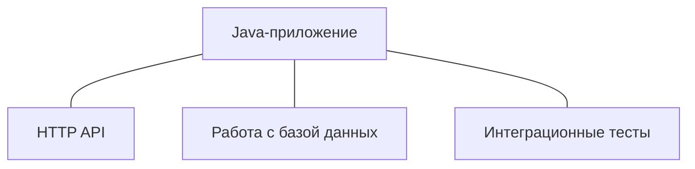

**Схема для разбора**

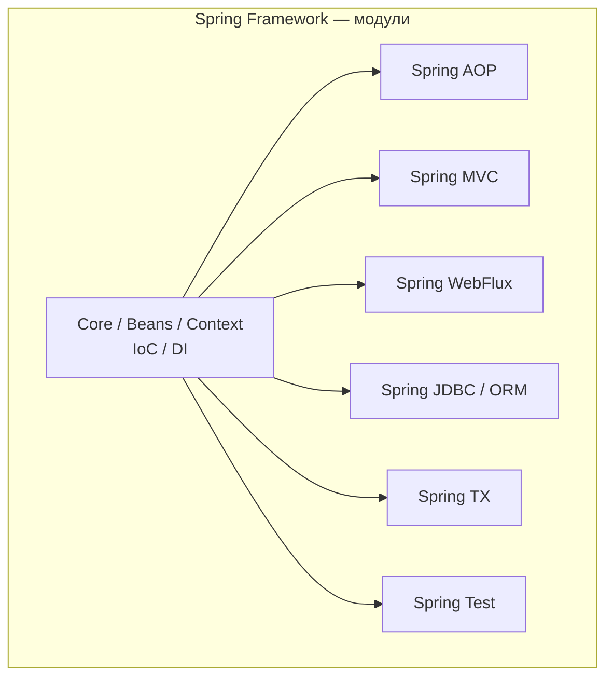

`Spring Boot`, `Spring Security` и `Spring Data` — **отдельные проекты экосистемы Spring**, а не модули Spring Framework. Их назначение разобрано в [Boot](spring-boot-interview.md), [Security](spring-security-interview.md) и [Data JPA](spring-data-jpa-interview.md). См. [официальный обзор Framework](https://spring.io/projects/spring-framework/) и [каталог проектов Spring](https://spring.io/projects/).

Конфигурация возможна через `@Configuration` + `@Bean`, компонентное сканирование (`@Component`, `@Service`, `@Repository`) или XML. Зависимости внедряются через конструктор (рекомендуется), сеттер или поле.

## Q2. (!) Особенности и преимущества `Spring Framework`?

Главная идея `Spring` — забрать у прикладного кода рутину (создание объектов, управление зависимостями, транзакции, доступ к данным) и оставить разработчику только бизнес-логику. Из этой идеи вырастают остальные преимущества.

1. **IoC/DI** — объект не создаёт свои зависимости сам, их подаёт контейнер. Это снижает связанность (coupling) и делает класс тестируемым: в тесте подменяешь зависимость моком, не трогая бизнес-код
2. **AOP** — сквозная логика (логирование, транзакции, безопасность) выносится в аспекты, поэтому бизнес-метод остаётся чистым и не обрастает техническими деталями
3. **Модульность** — подключаешь только нужные модули; не нужно тянуть весь фреймворк ради `IoC`-контейнера
4. **Интеграция** — сам Framework даёт транзакции, JDBC/ORM, веб-клиенты, задачи по расписанию и JMS; интеграции с Kafka, RabbitMQ и Redis предоставляют отдельные проекты Spring
5. **Тестируемость** — `spring-test` даёт TestContext, MockMvc и `@MockitoBean`. В Spring Boot `@SpringBootTest` обычно создаёт контекст приложения, а `@WebMvcTest` и другие тестовые срезы ограничивают его нужной частью; эти аннотации и `TestRestTemplate` относятся к Boot
6. **Экосистема** — [Spring Boot](spring-boot-interview.md) для быстрого старта, [Spring Cloud](spring-cloud-interview.md) для микросервисов, `Spring Batch` для пакетной обработки

Границу между Framework и соседними проектами сверяй по [обзору Framework](https://spring.io/projects/spring-framework/), [каталогу проектов](https://spring.io/projects/) и [руководству Boot по тестированию](https://docs.spring.io/spring-boot/reference/testing/spring-boot-applications.html).

Сканирование компонентов и предварительное создание бинов могут влиять на холодный старт. Spring AOT анализирует контекст при сборке и генерирует код и подсказки для запуска. Эти артефакты можно использовать на JVM. Для нативного бинарника нужен отдельный этап сборки GraalVM Native Image. Влияние на время запуска проверяют на конкретном приложении. [Spring AOT](https://docs.spring.io/spring-framework/reference/6.2/core/aot.html).

## Q3. (!) Что такое `Inversion of Control` (`IoC`)?

**Inversion of Control** — принцип, при котором управление созданием объектов и их зависимостями передаётся от прикладного кода контейнеру (фреймворку).

**Без IoC** (прямые зависимости):
```java
public class OrderService {
    private final OrderRepository repo = new JdbcOrderRepository();
}
```

**С IoC** (контейнер управляет зависимостями):
```java
@Service
public class OrderService {
    private final OrderRepository repo;

    // контейнер внедряет нужную реализацию
    public OrderService(OrderRepository repo) {
        this.repo = repo;
    }
}
```

В первом примере `OrderService` сам создаёт репозиторий через `new JdbcOrderRepository()`. Во втором примере Spring создаёт оба зарегистрированных бина и передаёт `JdbcOrderRepository` как зависимость `OrderService` через конструктор.

Преимущества:
- **Слабая связанность** — зависимость от абстракций, а не реализаций (подробнее в [ООП: SOLID](../../programming-languages/java/java-oop-interview.md))
- **Тестируемость** — легко подменять зависимости на моки
- **Гибкость конфигурации** — переключение реализаций без изменения бизнес-кода

## Q4. (!) Что такое `Dependency Injection` (`DI`)?

`Dependency Injection` — конкретная реализация принципа `IoC`, при которой зависимости передаются объекту **извне** (через конструктор, сеттер или поле), а не создаются внутри объекта.

Три способа DI в Spring:

| Способ | Пример | Когда использовать |
|--------|--------|-------------------|
| **Конструктор** | `public OrderService(OrderRepository repo)` | Обязательные зависимости (рекомендуется) |
| **Сеттер** | `@Autowired(required = false) public void setRepo(OrderRepository repo)` | Опциональная зависимость при явно заданном `required = false` |
| **Поле** | `@Autowired private OrderRepository repo;` | Внедрение после создания объекта. Поле в примере обязательно |

```java
@Service
public class PaymentService {
    private final PaymentGateway gateway;
    private final NotificationService notifications;

    public PaymentService(PaymentGateway gateway, NotificationService notifications) {
        this.gateway = gateway;
        this.notifications = notifications;
    }
}
```

**Почему конструктор лучше:**
- Поля можно сделать `final`: ссылку нельзя переназначить после конструктора. Состояние самого объекта может меняться.
- Конструктор явно принимает обязательные зависимости. При ручном создании проверку на `null` и другие инварианты определяет сам класс.
- Видна сигнатура зависимостей — если их слишком много, это сигнал к рефакторингу (подробнее в [паттернах рефакторинга](../../code-quality/refactoring-patterns-interview.md))

## Q5. (!) Типы контейнеров в `Spring Framework`

`Spring` предоставляет два основных контейнера: `BeanFactory` и `ApplicationContext`.

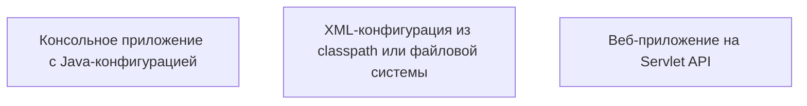

Для каждого приложения нужно выбрать подходящий способ создания контекста Spring. Для XML известно, откуда читается файл: из classpath или из файловой системы.

**Иерархия контейнеров и варианты контекста**

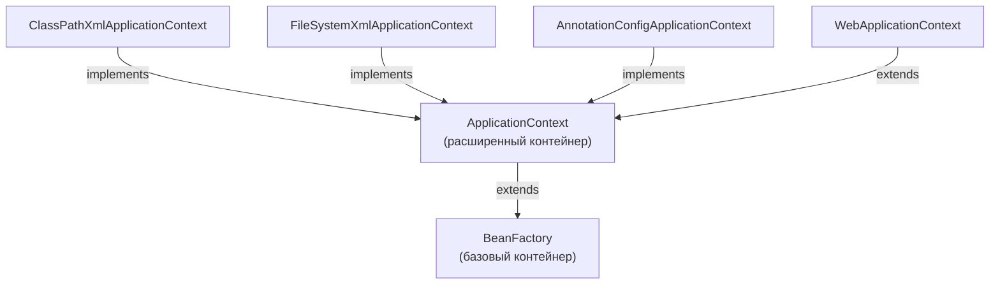

| Характеристика | `BeanFactory` | `ApplicationContext` |
|----------------|--------------|---------------------|
| Инициализация бинов | По запросу. У `DefaultListableBeanFactory` есть явный `preInstantiateSingletons()` | При `refresh()` заранее создаются non-lazy singleton |
| Events | Нет | `ApplicationEvent` / `@EventListener` |
| i18n | Нет | `MessageSource` |
| AOP | Постпроцессоры для проксирования можно подключить вручную | Постпроцессоры обнаруживаются автоматически при наличии соответствующей конфигурации |
| `Environment` | Отсутствует в контракте `BeanFactory` | Профили и источники свойств |
| `BeanPostProcessor` | Ручная регистрация | Автоматическая |

Для прикладного кода обычно выбирают `ApplicationContext`. Прямой доступ к `BeanFactory` полезен инфраструктуре, которая явно управляет настройкой фабрики и её постпроцессорами. [Spring 6.2: BeanFactory API](https://docs.spring.io/spring-framework/reference/6.2/core/beans/beanfactory.html).

## Q6. (!) Какой жизненный цикл у `Context`?

На примере `ConfigurableApplicationContext` жизненный цикл включает создание, `refresh()`, работу и закрытие. Конструктор `new AnnotationConfigApplicationContext(AppConfig.class)` сам вызывает `refresh()`. Для пошаговой настройки используют конструктор без аргументов, затем `register(...)` и `refresh()`. Такой контекст допускает один вызов `refresh()`.


**Схема для разбора**

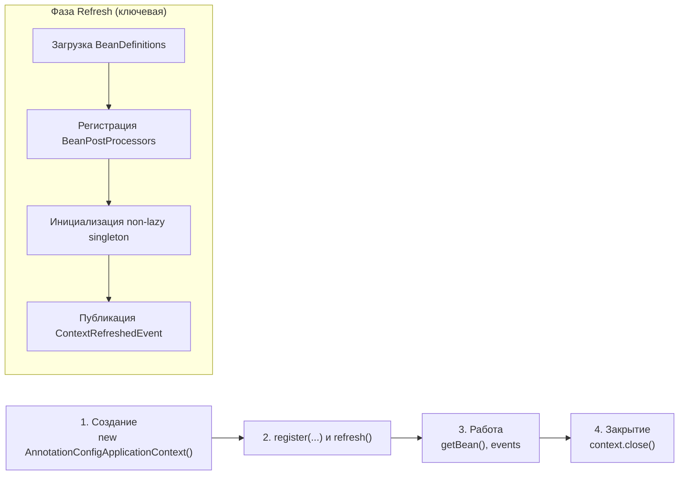

**Детализация фазы `refresh()`:**

1. **`prepareRefresh()`** — инициализация property sources, валидация required properties
2. `obtainFreshBeanFactory()` получает внутреннюю фабрику. XML-контекст загружает определения при подготовке фабрики. `AnnotationConfigApplicationContext` использует существующую фабрику, а производные определения из конфигурационных классов добавляет постпроцессор на шаге 4.
3. `prepareBeanFactory()` настраивает classloader и регистрирует стандартные объекты, например бины `environment` и `systemProperties`.
4. `invokeBeanFactoryPostProcessors()` вызывает фабричные постпроцессоры, например `ConfigurationClassPostProcessor` и объявленный в Q11 `PropertySourcesPlaceholderConfigurer`.
5. **`registerBeanPostProcessors()`** — регистрация `BeanPostProcessor` (`AutowiredAnnotationBeanPostProcessor`, `CommonAnnotationBeanPostProcessor`)
6. **`initMessageSource()`** — инициализация i18n
7. **`initApplicationEventMulticaster()`** — настройка механизма событий
8. `onRefresh()` даёт подклассу выполнить свою настройку. В Boot 3.5 `ServletWebServerApplicationContext` здесь создаёт встроенный сервер и регистрирует его lifecycle-компоненты.
9. **`registerListeners()`** — регистрация `ApplicationListener`
10. **`finishBeanFactoryInitialization()`** — предварительное создание non-lazy singleton. При разрешении их зависимостей могут быть запрошены также lazy-бины и prototype.
11. `finishRefresh()` вызывает `LifecycleProcessor.onRefresh()` и затем публикует `ContextRefreshedEvent`. В примере с Boot сервер запускает зарегистрированный lifecycle-компонент. [Spring 6.2: AbstractApplicationContext](https://docs.spring.io/spring-framework/docs/6.2.x/javadoc-api/org/springframework/context/support/AbstractApplicationContext.html) · [Spring Boot 3.5: ServletWebServerApplicationContext](https://github.com/spring-projects/spring-boot/blob/v3.5.0/spring-boot-project/spring-boot/src/main/java/org/springframework/boot/web/servlet/context/ServletWebServerApplicationContext.java).

## Q7. (!) В чем разница между `BeanFactory` и `ApplicationContext`?

`BeanFactory` — базовый интерфейс контейнера. При обычном использовании `DefaultListableBeanFactory` создаёт бины по запросу. Чтобы заранее создать non-lazy singleton, можно явно вызвать `preInstantiateSingletons()`. [DefaultListableBeanFactory API](https://docs.spring.io/spring-framework/docs/current/javadoc-api/org/springframework/beans/factory/support/DefaultListableBeanFactory.html#preInstantiateSingletons()).

`ApplicationContext` — расширение `BeanFactory`, добавляющее:
- **Предварительную инициализацию** non-lazy singleton при `refresh()`
- **Механизм событий** — `ApplicationEvent` / `@EventListener`
- **Интернационализацию** — `MessageSource`
- **Доступ к ресурсам** — `ResourceLoader` (classpath, filesystem, URL)
- **Обнаружение постпроцессоров**, включая инфраструктуру AOP, если она подключена
- **Профили и Environment** — `@Profile`, `@PropertySource`

```java
DefaultListableBeanFactory factory = new DefaultListableBeanFactory();
new XmlBeanDefinitionReader(factory).loadBeanDefinitions(new ClassPathResource("beans.xml"));
MyService service = factory.getBean(MyService.class);

ApplicationContext ctx = new AnnotationConfigApplicationContext(AppConfig.class);
MyService contextService = ctx.getBean(MyService.class);
```

`@Lazy` на определении откладывает создание бина до запроса. Если он нужен для создания eager singleton, этот запрос происходит при старте. `@Lazy` в точке внедрения имеет другую роль: оно позволяет внедрить прокси и отложить разрешение цели. Prototype создаётся при запросе, который тоже может произойти при старте. [Spring: Lazy-initialized Beans](https://docs.spring.io/spring-framework/reference/core/beans/dependencies/factory-lazy-init.html).

## Q8. (!) Как завершить работу `Context`?

При `close()` стандартный контекст публикует `ContextClosedEvent`, даёт `LifecycleProcessor` остановить lifecycle-компоненты и запускает разрушение управляемых singleton-бинов. Для одного бина с разными callbacks порядок такой: `@PreDestroy`, `DisposableBean.destroy()`, пользовательский destroy-метод. Для prototype действует правило из Q14. [Spring 6.2: Bean lifecycle callbacks](https://docs.spring.io/spring-framework/reference/6.2/core/beans/factory-nature.html).

```text
В консольном приложении вручную создан AnnotationConfigApplicationContext.
При завершении нужно освободить ресурсы управляемых singleton-бинов.
Какие варианты подходят для выхода из блока кода и для завершения JVM?
```

**Пример для разбора**

```java
// Способ 1: явный close() через ConfigurableApplicationContext
ConfigurableApplicationContext ctx = new AnnotationConfigApplicationContext(AppConfig.class);
try {
    // работа с контекстом
} finally {
    ctx.close();
}

// Способ 2: try-with-resources (ConfigurableApplicationContext extends Closeable)
try (var ctx = new AnnotationConfigApplicationContext(AppConfig.class)) {
    // работа с контекстом
}

// Способ 3: registerShutdownHook() — JVM shutdown hook
var ctx = new AnnotationConfigApplicationContext(AppConfig.class);
ctx.registerShutdownHook(); // close() будет вызван при завершении JVM
```

Spring Boot по умолчанию регистрирует shutdown hook. Для самостоятельно созданного контекста выберите явное закрытие или shutdown hook, если освобождение ресурсов должно происходить при завершении JVM.

## Q9. Что такое `Bean`?

`Bean` — объект, которым управляет IoC-контейнер Spring. Контейнер разрешает зависимости и запускает инициализацию. Ответственность за разрушение зависит от scope (Q14).

Три способа определения бинов:

**1. Компонентное сканирование (стереотипные аннотации):**
```java
@Service
public class UserService {
    private final UserRepository userRepository;

    public UserService(UserRepository userRepository) {
        this.userRepository = userRepository;
    }
}
```

**2. Java-конфигурация (`@Configuration` + `@Bean`):**
```java
@Configuration
public class AppConfig {
    @Bean
    public UserService userService(UserRepository userRepository) {
        return new UserService(userRepository);
    }

    @Bean
    public UserRepository userRepository(DataSource dataSource) {
        return new JdbcUserRepository(dataSource);
    }
}
```

**3. XML-конфигурация (legacy):**
```xml
<bean id="userService" class="com.example.UserService">
    <constructor-arg ref="userRepository"/>
</bean>
```

**На практике** в современных проектах используют комбинацию компонентного сканирования (для своих классов) и `@Bean`-методов (для сторонних библиотек, чьи классы нельзя аннотировать).

## Q10. (!) Какой жизненный цикл у `Bean`?

Жизненный цикл бина — одна из самых частых тем на собеседованиях. Важно знать не только этапы, но и порядок вызова callback-ов.

```java
// CacheWarmer зарегистрирован как компонент. Каков порядок его callback-ов
// при успешном запуске и последующем закрытии контекста?
//
// Spring Framework 6.2: SearchConfig зарегистрирован в том же контексте.
// searchIndex и searchService являются singleton без @Lazy.
// Когда searchService получит SearchIndex? Может ли refresh() завершиться,
// пока SearchIndex ещё создаётся?

@Component
public class CacheWarmer implements InitializingBean, DisposableBean {

    @PostConstruct
    public void postConstruct() {
    }

    @Override
    public void afterPropertiesSet() {
    }

    @PreDestroy
    public void preDestroy() {
    }

    @Override
    public void destroy() {
    }
}

@Configuration(proxyBeanMethods = false)
class SearchConfig {
    @Bean(destroyMethod = "shutdown")
    ExecutorService bootstrapExecutor() {
        return Executors.newFixedThreadPool(2);
    }

    @Bean(bootstrap = Bean.Bootstrap.BACKGROUND)
    SearchIndex searchIndex() {
        return new SearchIndex();
    }

    @Bean
    SearchService searchService(SearchIndex index) {
        return new SearchService(index);
    }

    record SearchIndex() {}
    record SearchService(SearchIndex index) {}
}
```

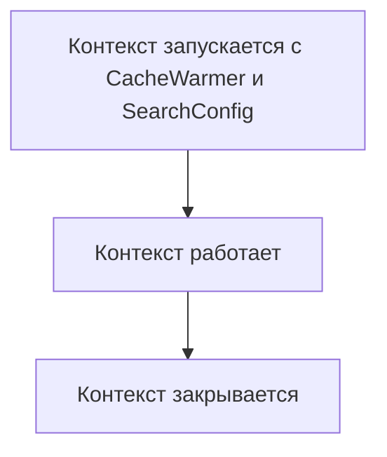

**Этапы жизненного цикла бина**

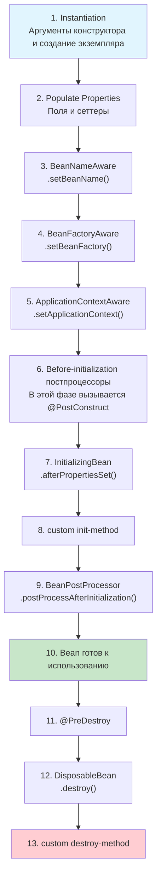

Конструкторная инъекция происходит **при создании экземпляра**: контейнер сначала разрешает зависимости и передаёт их аргументами конструктора. Поля и сеттеры заполняются уже после создания объекта, на этапе `Populate Properties`. Поэтому схему выше нельзя читать как «любая DI происходит после конструктора». См. [Spring Framework: Dependency Injection](https://docs.spring.io/spring-framework/reference/core/beans/dependencies/factory-collaborators.html).

В примере `CacheWarmer` сначала получает вызов `postConstruct()`, затем `afterPropertiesSet()`. При закрытии контекста `preDestroy()` вызывается перед `destroy()`.

`ApplicationContextAware` обрабатывает инфраструктурный постпроцессор контекста. `@PostConstruct` выполняет соответствующий постпроцессор в фазе `postProcessBeforeInitialization()`. В примере используются аннотации из `jakarta.annotation`. [Spring 6.2: Bean lifecycle callbacks](https://docs.spring.io/spring-framework/reference/6.2/core/beans/factory-nature.html).

Многие AOP-прокси создаются в `postProcessAfterInitialization()`. Это типичный путь, а порядок зависит от постпроцессоров. Например, некоторые авто-проксировщики могут предоставить раннюю ссылку в разрешимом цикле singleton-бинов. Вызов целевого метода через `this` обходит прокси (Q22).

**Фоновое создание при запуске (Spring Framework 6.2+):** `@Bean(bootstrap = Bean.Bootstrap.BACKGROUND)` позволяет выполнять создание конкретного бина в фоне, если в контексте есть бин `Executor` с именем `bootstrapExecutor`. Без него маркер игнорируется. Это параллелизм этапа создания бинов, а не вызов метода через `@Async`.

Для обычного singleton фоновые задачи **завершаются до конца `refresh()`**: пометка не разрешает завершить этот этап с недостроенным бином. Зависимый бин с обычной, не ленивой инъекцией ждёт его создания и может снова сделать главный поток критическим путём. Ленивая точка инъекции с `@Lazy` или `ObjectProvider` у потребителя откладывает доступ; если и сам фоновый бин помечен `@Lazy`, его завершение допускается при первом фактическом обращении. Собственные зависимости фонового бина должны быть созданы прежде него. Польза определяется измерением времени старта и графом зависимостей. [Spring 6.2: фоновая инициализация](https://docs.spring.io/spring-framework/reference/6.2/core/beans/java/composing-configuration-classes.html).

## Q11. Как создать статический `Bean`?

Модификатор `static` позволяет контейнеру вызвать фабричный `@Bean`-метод без создания экземпляра конфигурационного класса. Момент вызова зависит от роли и жизненного цикла результирующего бина.

```java
@Configuration
public class InfraConfig {

    @Bean
    public static PropertySourcesPlaceholderConfigurer propertyConfigurer() {
        return new PropertySourcesPlaceholderConfigurer();
    }

    @Bean
    public DataSource dataSource(@Value("${db.url}") String url) {
        HikariConfig config = new HikariConfig();
        config.setJdbcUrl(url);
        return new HikariDataSource(config);
    }
}
```

**Когда нужен статический `@Bean`:**
- `BeanFactoryPostProcessor` и `BeanDefinitionRegistryPostProcessor` нужны рано для обработки определений. Статическая фабрика позволяет получить их без преждевременного создания конфигурационного бина.
- В примере именно роль `PropertySourcesPlaceholderConfigurer` как `BeanFactoryPostProcessor` определяет ранний вызов. Произвольный статический `@Bean` не получает такой приоритет. [Spring @Bean Javadoc](https://docs.spring.io/spring-framework/docs/current/javadoc-api/org/springframework/context/annotation/Bean.html).

## Q12. Как внедрить `Bean`?

Три способа внедрения зависимостей:

```java
@Service
public class OrderService {
    private final OrderRepository repo;
    private final PaymentGateway gateway;

    public OrderService(OrderRepository repo, PaymentGateway gateway) {
        this.repo = repo;
        this.gateway = gateway;
    }
}

@Service
public class ReportService {
    private EmailSender emailSender;

    @Autowired(required = false)
    public void setEmailSender(EmailSender emailSender) {
        this.emailSender = emailSender;
    }
}

@Service
public class LegacyService {
    @Autowired
    private SomeDependency dep;
}
```

Конструктор удобен для обязательных зависимостей. В обеих формах, через поле и сеттер, обычный `@Autowired` требует зависимость. В примере сеттер опционален из-за `required = false`. Сравнение способов приведено в Q15.

## Q13. (!) Что такое `@Autowired`?

`@Autowired` — аннотация `Spring` для автоматического внедрения зависимости по типу. `Spring` ищет подходящий бин в контексте и внедряет его.

Для одиночной зависимости Spring сначала отбирает кандидатов, совместимых с типом. Если задан `@Qualifier`, он фильтрует кандидатов даже при одном бине подходящего типа. Если после фильтрации осталось несколько, контейнер применяет правила выбора, например учитывает `@Primary` и при определённых условиях имя точки внедрения (Q28).

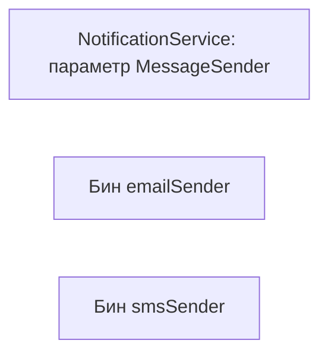

**Схема для разбора**

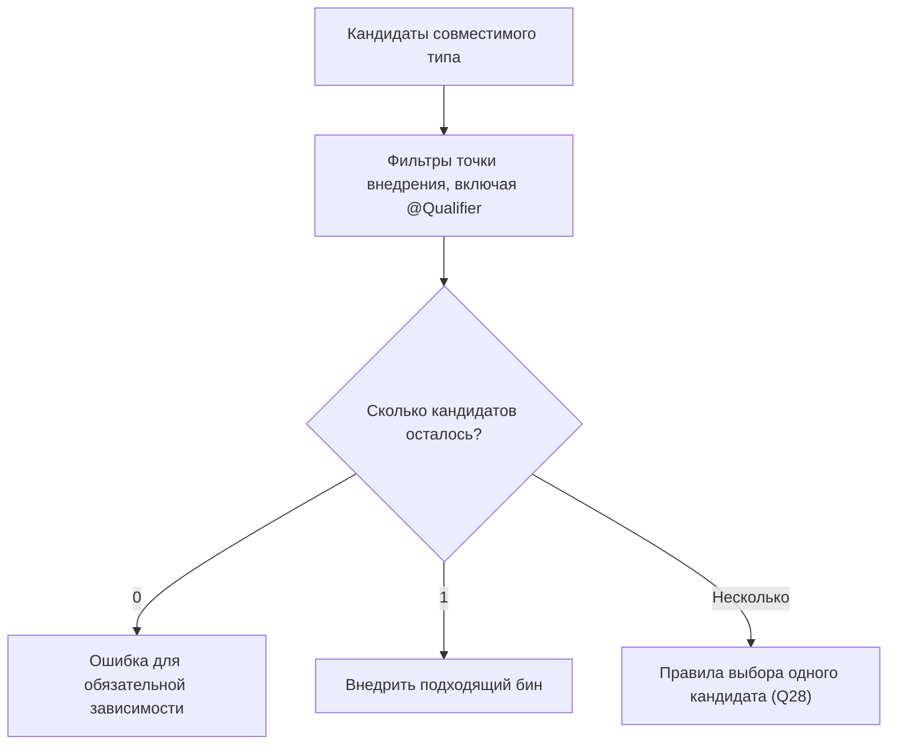

Для необязательной зависимости обработка отсутствия зависит от формы внедрения. Например, `Optional<T>` получает пустое значение, а необязательный `@Autowired`-сеттер может не вызываться. [Spring: Autowiring Qualifiers](https://docs.spring.io/spring-framework/reference/core/beans/annotation-config/autowired-qualifiers.html).

```java
@Service
public class NotificationService {
    private final MessageSender sender;

    public NotificationService(@Qualifier("emailSender") MessageSender sender) {
        this.sender = sender;
    }
}
```

**Важно:** начиная с `Spring 4.3`, если у класса **один** конструктор, `@Autowired` на нём не обязателен — `Spring` использует его автоматически.

## Q14. (!) Какие есть области действия `Bean`?

| Scope | Область экземпляра | Когда создаётся | Когда разрушается |
|-------|---------------------|-----------------|-------------------|
| `singleton` | Один экземпляр на определение бина в контейнере | Non-lazy singleton обычно при `refresh()`. Lazy singleton при запросе, в том числе при разрешении зависимости на старте | При закрытии контекста |
| `prototype` | Новый экземпляр при каждом запросе этого бина | При `getBean()` или разрешении зависимости | Контейнер не управляет разрушением |
| `request` | Один экземпляр на HTTP-запрос | При первом обращении к целевому бину в запросе | По завершении запроса |
| `session` | Один экземпляр на HTTP-сессию | При первом обращении к целевому бину в сессии | При завершении или инвалидации сессии |
| `application` | Один экземпляр на `ServletContext` | При первом разрешении целевого бина в этой области | При остановке `ServletContext` |
| `websocket` | Один экземпляр на поддерживаемую Spring STOMP-сессию поверх WebSocket | При первом обращении к целевому бину в STOMP-сессии | При завершении сессии |

[Spring Bean Scopes](https://docs.spring.io/spring-framework/reference/core/beans/factory-scopes.html) · [Spring STOMP WebSocket Scope](https://docs.spring.io/spring-framework/reference/web/websocket/stomp/scope.html).

```java
// DirectCartService является singleton. Его вызывают при двух заказах.
// Какая область у ShoppingCart и в какой момент контейнер выдаёт экземпляр?

@Component
@Scope("prototype")
public class ShoppingCart {
    private final List<Item> items = new ArrayList<>();
}

@Service
class DirectCartService {
    private final ShoppingCart cart;

    DirectCartService(ShoppingCart cart) {
        this.cart = cart;
    }
}
```

**Получение отдельной корзины для каждого заказа**

```java
// Решение 1: @Lookup
@Service
abstract class LookupCartService {
    @Lookup
    protected abstract ShoppingCart createCart();
}

// Решение 2: ObjectProvider
@Service
class ProviderCartService {
    private final ObjectProvider<ShoppingCart> cartProvider;

    ProviderCartService(ObjectProvider<ShoppingCart> cartProvider) {
        this.cartProvider = cartProvider;
    }

    public void processOrder() {
        ShoppingCart cart = cartProvider.getObject(); // новый экземпляр
    }
}
```

При прямой инъекции `DirectCartService` сохраняет корзину, полученную при собственном создании. Варианты с `@Lookup` и `ObjectProvider` получают новый экземпляр на каждый запрос корзины к контейнеру.

**Ловушка с `prototype`:** Spring **не вызывает** `@PreDestroy` для prototype-бинов — ответственность за очистку ресурсов лежит на клиенте.

## Q15. (!) Как лучше внедрять `Bean`?

**Рекомендация Spring Team:** конструктор для обязательных зависимостей, сеттер для необязательных.

| Критерий | Конструктор | Сеттер | Поле |
|----------|------------|--------|------|
| Заполнение `final`-поля при создании объекта | Да | Нет | Нет |
| Обязательность зависимости | Задаётся сигнатурой и настройками | `@Autowired` по умолчанию требует зависимость | `@Autowired` по умолчанию требует зависимость |
| Тестируемость | Легко (через `new`) | Средне | Сложно (reflection) |
| Циклические зависимости | Прямой цикл конструкторов неразрешим | Некоторые циклы singleton разрешимы при включённой поддержке | Некоторые циклы singleton разрешимы при включённой поддержке |
| Читаемость | Видна сигнатура | Разбросано по классу | Скрыто |

**Правило большого пальца:** если конструктор принимает больше 5-7 параметров, это сигнал к декомпозиции класса (нарушение Single Responsibility Principle — подробнее в [SOLID](../../programming-languages/java/java-oop-interview.md)).

Spring Framework может разрешить некоторые циклы singleton при внедрении через поля или сеттеры, если допустима ранняя ссылка на уже созданный экземпляр. Прямой цикл конструкторов без отложенного разрешения не даёт создать первый объект. В Spring Boot 2.6+ циклические ссылки по умолчанию запрещены. `spring.main.allow-circular-references=true` позволяет контейнеру попробовать разрешить цикл, если способ создания и проксирования это допускает. [Spring: Dependency Injection](https://docs.spring.io/spring-framework/reference/core/beans/dependencies/factory-collaborators.html) · [Spring Boot 2.6 Release Notes](https://github.com/spring-projects/spring-boot/wiki/Spring-Boot-2.6-Release-Notes).

## Q16. Является ли `Singleton Bean` потокобезопасным?

**Нет.** `Singleton` — это шаблон создания, а не поведения. Потокобезопасность зависит от реализации бина.

**Проблема:**
```java
@Service
public class CounterService {
    private int count = 0;

    // Два потока одновременно вызывают increment() на одном бине.
    public void increment() {
        count++;
    }
}
```

При конкурентном вызове обе операции могут прочитать одно исходное значение. `count++` выполняет чтение, вычисление и запись, поэтому одно из обновлений может потеряться.

**Решения:**
1. **Stateless бины** — не хранить mutable state (рекомендуется)
2. **Синхронизация** — `synchronized`, `Lock`, `AtomicInteger`
3. **ThreadLocal** — изоляция данных по потоку
4. **Разделение состояния.** `prototype` создаётся на запрос бина к контейнеру, например через `ObjectProvider.getObject()`. При прямой инъекции prototype в singleton ссылка остаётся с этим singleton. `request` задаёт экземпляр на HTTP-запрос, а не на поток.

```java
@Service
public class StatelessService {
    private final UserRepository repo;

    public StatelessService(UserRepository repo) {
        this.repo = repo;
    }

    public Optional<User> findUser(Long id) {
        return repo.findById(id);
    }
}
```

В примере `UserRepository` следует контракту Spring Data, где `findById` возвращает `Optional<User>`. `final` запрещает переназначить ссылку `repo`. Безопасность параллельных вызовов зависит от самого репозитория и состояния, используемого сервисом. Подробнее о потоках в [Java Concurrency](../../programming-languages/java/java-concurrency-interview.md).

## Q17. Как внедрить `Properties` в `Bean`?

**Способ 1: `@Value` — отдельные свойства:**
```java
@Service
public class MailService {
    @Value("${mail.host}")
    private String host;

    @Value("${mail.port:587}")
    private int port;

    @Value("${mail.enabled:true}")
    private boolean enabled;

    @Value("#{${mail.headers}}")
    private Map<String, String> headers;
}
```

В первом варианте `mail.headers` содержит текст карты SpEL, например `{'X-Env': 'dev'}`. Для вложенных свойств карты подходит привязка через `@ConfigurationProperties`.

**Способ 2.** Spring Boot привязывает группу свойств к отдельному типу. Ниже альтернативная конфигурация. [Spring Boot 3.5: Externalized Configuration](https://docs.spring.io/spring-boot/3.5/reference/features/external-config.html).
```java
@ConfigurationProperties(prefix = "mail")
@Validated
public class MailProperties {
    @NotBlank
    private String host;
    private int port = 587;
    private boolean enabled = true;
    private Map<String, String> headers = new HashMap<>();
    // Обычные getter и setter для каждого свойства опущены.
}

class MailService {
    private final MailProperties properties;

    MailService(MailProperties properties) {
        this.properties = properties;
    }
}

@Configuration
@EnableConfigurationProperties(MailProperties.class)
public class MailConfig {
    @Bean
    public MailService mailService(MailProperties props) {
        return new MailService(props);
    }
}
```

**Рекомендация:** для 1-2 свойств — `@Value`, для группы связанных свойств — `@ConfigurationProperties` с валидацией через `@Validated` + `Jakarta Validation`. Подробнее о конфигурации в [Spring Boot](spring-boot-interview.md).

## Q18. Что такое конфигурация `Spring` на основе `Java`?

Java-based конфигурация — способ определения бинов через `@Configuration`-классы вместо XML. Это типобезопасный подход с поддержкой IDE (автодополнение, рефакторинг, компиляционные проверки).

```java
@Configuration
public class AppConfig {

    @Bean
    public DataSource dataSource() {
        HikariConfig config = new HikariConfig();
        config.setJdbcUrl("jdbc:postgresql://localhost:5432/mydb");
        config.setMaximumPoolSize(10);
        return new HikariDataSource(config);
    }

    @Bean
    public TransactionManager transactionManager(DataSource dataSource) {
        return new DataSourceTransactionManager(dataSource);
    }
}
```

В полном режиме `@Configuration` контейнер создаёт подкласс конфигурации. Вызов переопределяемого `@Bean`-метода из другого фабричного метода разрешает бин через контейнер. В примере по умолчанию возвращается singleton:

```java
@Configuration
public class AppConfig {
    @Bean
    public DataSource dataSource() { return new HikariDataSource(); }

    @Bean
    public JdbcTemplate jdbcTemplate() {
        // НЕ создаёт новый DataSource — CGLIB-прокси возвращает singleton
        return new JdbcTemplate(dataSource());
    }
}
```

При `@Configuration(proxyBeanMethods = false)` прямой вызов исполняет тело обычного Java-метода. Если оно создаёт объект через `new`, такой вызов создаст новый объект. Контейнер по-прежнему соблюдает scope при запросе бина. Передача зависимости параметром фабричного метода работает в обоих режимах. [Spring: Basic Concepts](https://docs.spring.io/spring-framework/reference/core/beans/java/basic-concepts.html).

## Q19. (!) Можно ли иметь несколько файлов конфигурации `Spring`?

Да, и в крупных проектах это рекомендуемая практика — разделение по ответственности.

**Java-конфигурация:**
```text
DataConfig, SecurityConfig и CacheConfig находятся в отдельных классах.
Приложению нужен один контекст, который запускается с AppConfig.
Все три конфигурации нужно включить в этот контекст.
```

**Пример для разбора**

```java
@Configuration
@Import({DataConfig.class, SecurityConfig.class, CacheConfig.class})
public class AppConfig {
}
```

Альтернатива с component scan:

```java
@Configuration
@ComponentScan(basePackages = "com.example.config")
public class AppConfig {
}
```

**XML-конфигурация (legacy):**
```xml
<import resource="datasource-config.xml"/>
<import resource="security-config.xml"/>
```

**Типичная структура конфигурации:**
```
config/
├── AppConfig.java          — корневая конфигурация
├── DataConfig.java         — DataSource, JPA, Flyway
├── SecurityConfig.java     — Spring Security
├── CacheConfig.java        — Redis/Caffeine
├── AsyncConfig.java        — @EnableAsync, ThreadPoolTaskExecutor
└── WebConfig.java          — CORS, interceptors, formatters
```

## Q20. (!) Какие `Design Patterns` используются в `Spring Framework`?

Ценность вопроса не в списке, а в умении показать, что фреймворк построен на классических паттернах GoF, и назвать **конкретное место**, где каждый работает. Это доказывает, что ты понимаешь устройство `Spring`, а не просто пользуешься аннотациями. Подробнее о самих паттернах — в [Design Patterns](../../design-patterns/design-patterns-interview.md).

| Паттерн | Где используется | Пример |
|---------|-----------------|--------|
| **Singleton** | Scope бинов по умолчанию | `@Scope("singleton")` |
| **Фабрика** | Создание и получение бинов | `@Bean`-метод задаёт создание. `BeanFactory` выдаёт бин по контракту контейнера. Термин factory method здесь обозначает фабричный метод Spring |
| **Proxy** | AOP, `@Transactional`, `@Cacheable` | JDK Dynamic Proxy / CGLIB |
| **Шаблон с callback** | Повторяемый алгоритм JDBC | `JdbcTemplate.execute(...)` делегирует часть операции callback. Классический GoF Template Method меняет шаги через наследование |
| **Observer** | События | `ApplicationEvent`, `@EventListener` |
| **Strategy** | Выбор реализации | `HandlerMapping`, `ViewResolver` |
| **Adapter** | Интеграция | `HandlerAdapter`, `MessageConverter` |
| **Decorator** | Обёртки | `BeanPostProcessor` оборачивает бины прокси |
| **Composite** | Группа объектов предоставляет общий интерфейс | `CompositeHealthContributor` из Spring Boot Actuator |
| **Front Controller** | Веб | `DispatcherServlet` в [Spring MVC](spring-mvc-interview.md) |

## Q21. (!) Что такое `AOP`?

**Аспектно-ориентированное программирование (AOP)** — методология, позволяющая выделять сквозную функциональность (cross-cutting concerns) в отдельные модули — **аспекты**.

**Терминология:**

| Термин | Описание |
|--------|----------|
| **Aspect** | Модуль со сквозной логикой (`@Aspect`) |
| **Join Point** | Точка в программе, где можно подключить аспект (в Spring AOP — только вызов метода) |
| **Pointcut** | Выражение, определяющее, к каким Join Point применяется аспект |
| **Advice** | Действие аспекта: `@Before`, `@After`, `@Around`, `@AfterReturning`, `@AfterThrowing` |
| **Weaving** | В AspectJ связывание аспектов с целевым кодом через преобразование байткода (Q23) |
| **Target** | Объект, к которому применяется аспект |

```text
OrderService и PaymentService выполняют разные бизнес-операции.
Для обоих нужно измерять время выполнения методов.
Измерение должно работать и при исключении, а бизнес-код должен остаться прежним.
```

**Пример для разбора**

```java
@Aspect
@Component
public class PerformanceAspect {

    @Around("execution(* com.example.service.*.*(..))")
    public Object measureTime(ProceedingJoinPoint joinPoint) throws Throwable {
        long start = System.nanoTime();
        try {
            return joinPoint.proceed();
        } finally {
            long elapsed = System.nanoTime() - start;
            log.info("{}.{} выполнен за {} мс",
                joinPoint.getTarget().getClass().getSimpleName(),
                joinPoint.getSignature().getName(),
                elapsed / 1_000_000);
        }
    }
}
```

В Java-конфигурации Spring Framework поддержку `@Aspect` можно включить через `@EnableAspectJAutoProxy`. В Boot 3.5 при активной AOP-автоконфигурации и наличии AspectJ в classpath Boot включает эту поддержку сам. [Spring Boot 3.5: AOP](https://docs.spring.io/spring-boot/3.5/reference/features/aop.html).

## Q22. (!) Как работает `AOP`-прокси в `Spring`?

`Spring AOP` работает через прокси-объекты. При наличии аспекта `Spring` оборачивает целевой бин прокси, который перехватывает вызовы методов.

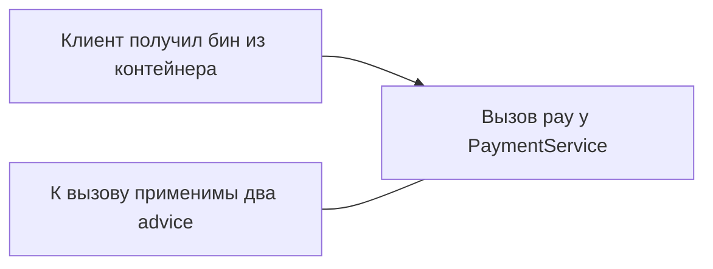

**Схема для разбора**


**Два типа прокси:**

| Характеристика | JDK Dynamic Proxy | CGLIB Proxy |
|----------------|-------------------|-------------|
| Механизм | `java.lang.reflect.Proxy` | Генерация подкласса |
| Требование | Вызов через интерфейс прокси | Наследуемый целевой класс и переопределяемый метод |
| Граница перехвата | Методы интерфейсов прокси, включая вызов `final` реализации | Методы, доступные для переопределения. `final` и `private` не перехватываются |
| Выбор механизма | По умолчанию Spring AOP выбирает JDK-прокси при наличии интерфейса, если инфраструктура не требует прокси класса | Spring AOP использует подкласс для цели без интерфейса. Конкретная конфигурация может принудительно выбрать подкласс |

При включённой AOP-автоконфигурации Boot 3.5 по умолчанию запрашивает прокси-подкласс. `spring.aop.proxy-target-class=false` позволяет выбрать JDK-прокси для целей с подходящими интерфейсами. Другие настройки проксирования могут повлиять на выбор. Производительность сравнивают на конкретной нагрузке. [Spring AOP: Proxying Mechanisms](https://docs.spring.io/spring-framework/reference/core/aop/proxying.html) · [Spring Boot 3.5: AOP](https://docs.spring.io/spring-boot/3.5/reference/features/aop.html).

```java
public interface PaymentService { void pay(Order order); }

@Service
public class PaymentServiceImpl implements PaymentService {
    @Transactional
    public void pay(Order order) { /* ... */ }
}

@Service
public class NotificationService {
    @Cacheable("notifications")
    public List<Notification> getAll() { /* ... */ }
}
```

**Главная ловушка — self-invocation:**
```java
@Service
public class UserService {
    @Transactional
    public void createUser(User user) {
        // ...
        this.sendWelcomeEmail(user); // Прокси ОБХОДИТСЯ! @Async не сработает
    }

    @Async
    public void sendWelcomeEmail(User user) { /* ... */ }
}
```

**Почему так происходит:** аспект живёт в прокси, а не в самом объекте. Вызов `this.sendWelcomeEmail()` идёт напрямую на целевой объект, минуя прокси, — перехватывать вызов некому.

**Как обойти:**
- **Вынести метод в другой бин** — вызов через зависимость снова идёт через прокси (чистое решение, рекомендуется)
- **`AopContext.currentProxy()`** — получить ссылку на собственный прокси и вызвать метод через неё (требует `exposeProxy = true`)
- **Self-injection.** Контейнер рассматривает ссылку на себя как резервного кандидата. Вариант зависит от разрешимости цикла и получения прокси (Q15).

## Q23. Что такое `Weaving`?

Weaving в AspectJ связывает аспекты с целевым кодом посредством преобразования байткода.

| Режим AspectJ | Когда преобразуется байткод |
|---------------|-----------------------------|
| Compile-time | При компиляции исходников |
| Post-compile | После компиляции, при обработке существующих `.class` или JAR |
| Load-time | При загрузке классов, например с агентом AspectJ |

Spring AOP в стандартном режиме создаёт прокси во время выполнения. Он перехватывает вызовы методов, проходящие через прокси. AspectJ после weaving может применять advice в точках, которые прокси не видит, например при доступе к полю или вызове конструктора. Advice всё равно выполняет код. Стоимость зависит от точки применения, самого advice и нагрузки. [AspectJ: Load-Time Weaving](https://eclipse.dev/aspectj/doc/latest/devguide/ltw.html) · [Spring AOP: Proxying Mechanisms](https://docs.spring.io/spring-framework/reference/core/aop/proxying.html).

## Q24. (!) В чём разница между `Spring AOP` и `AspectJ`?

Spring AOP применяет advice через прокси. AspectJ применяет advice в точках, выбранных при weaving байткода (Q23).

| Характеристика | Spring AOP | AspectJ |
|----------------|-----------|---------|
| Механизм | JDK-прокси или прокси-подкласс | Compile-time, post-compile или load-time weaving |
| Точки перехвата | Выполнение метода при вызове через прокси | В том числе методы, конструкторы и доступ к полям |
| Цель | Обычно бины под управлением Spring | Классы, включённые в weaving |
| Self-invocation | Вызов через `this` обходит прокси | Advice может сработать при совпадении с pointcut |
| Инструменты | Настройка проксирования Spring | Компилятор или обработка байткода, для LTW — настройка загрузки классов |

Прокси подходит для транзакций, кеширования и других сценариев на границе Spring-бина. AspectJ выбирают, когда нужна точка перехвата внутри класса или вне этой границы. В обоих случаях advice стоит измерять на реальной нагрузке. [Spring AOP: Proxying Mechanisms](https://docs.spring.io/spring-framework/reference/core/aop/proxying.html) · [AspectJ: Load-Time Weaving](https://eclipse.dev/aspectj/doc/latest/devguide/ltw.html).

## Q25. Что такое `CommandLineRunner` и `ApplicationRunner`?

Spring Boot вызывает `CommandLineRunner` и `ApplicationRunner` после refresh и публикации `ApplicationStartedEvent`, до `ApplicationReadyEvent`. Они подходят для работы, которую приложение должно выполнить до объявления готовности. [Spring Boot 3.5: Application Events and Listeners](https://docs.spring.io/spring-boot/3.5/reference/features/spring-application.html#features.spring-application.application-events-and-listeners).

```java
@Component
@Order(1)
public class DataInitializer implements CommandLineRunner {
    @Override
    public void run(String... args) {
        log.info("Инициализация данных...");
    }
}

@Component
@Order(2)
public class HealthChecker implements ApplicationRunner {
    @Override
    public void run(ApplicationArguments args) {
        if (args.containsOption("check-db")) {
            verifyDatabaseConnection();
        }
        List<String> positionalArgs = args.getNonOptionArgs();
    }
}
```

| Характеристика | `CommandLineRunner` | `ApplicationRunner` |
|----------------|--------------------|--------------------|
| Аргументы | `String... args` (сырой массив) | `ApplicationArguments` (парсинг `--key=value`) |
| Доступ к флагам | Ручной парсинг | `args.containsOption("key")` |
| Доступ к значениям | `args[0]`, `args[1]`... | `args.getOptionValues("key")` |

Подробнее о запуске приложений в [Spring Boot](spring-boot-interview.md).

## Q26. (!) Какие наиболее популярные аннотации в `Spring`?

На собеседовании от перечисления ждут не зубрёжки, а понимания, что аннотации группируются по задачам жизненного цикла бина: **объявить** бин (стереотипы), **сконфигурировать** контекст, **связать** зависимости (DI), **отреагировать** на этапы жизни, **навесить** сквозное поведение (AOP) и **включить** бин по условию. Дальше — по группам.

**Основные стереотипы:**
- `@Component` — базовый компонент
- `@Service` — бизнес-логика
- `@Repository` помечает слой доступа к данным и делает бин кандидатом на трансляцию исключений (Q27)
- `@Controller` / `@RestController` — обработка HTTP-запросов

**Конфигурация:**
- `@Configuration` объявляет класс конфигурации. В полном режиме Spring создаёт подкласс для фабричных вызовов (Q18)
- `@Bean` — определение бина
- `@ComponentScan` — сканирование пакетов
- `@Import` — импорт конфигураций

**DI:**
- `@Autowired` — внедрение по типу
- `@Qualifier` фильтрует кандидатов даже при одном совместимом бине (Q13)
- `@Primary` — приоритетный бин по умолчанию
- `@Value` — внедрение свойств/SpEL

**Жизненный цикл:**
- `@PostConstruct` — инициализация после DI
- `@PreDestroy` — очистка перед уничтожением
- `@Scope` — область действия бина
- `@Lazy` — ленивая инициализация

**AOP и транзакции:**
- `@Transactional` — управление транзакциями
- `@Aspect` — определение аспекта
- `@Cacheable` / `@CacheEvict` — кеширование

**Условия и профили:**
- `@Profile` — активация по профилю
- `@Conditional` — условная регистрация
- `@ConditionalOnProperty` / `@ConditionalOnClass` — условия в [Spring Boot](spring-boot-interview.md)

Подробнее об аннотациях Java в [Java Annotations](../../programming-languages/java/java-annotations-interview.md).

## Q27. (!) В чём разница между `@Component`, `@Service`, `@Repository` и `@Controller`?

`@Component` служит базовым стереотипом. `@Service`, `@Repository` и `@Controller` метааннотированы `@Component`, поэтому подходят для стандартного component scan. Каждый обозначает роль класса и может учитываться инфраструктурой Spring.

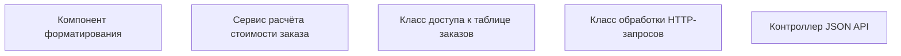

**Схема для разбора**

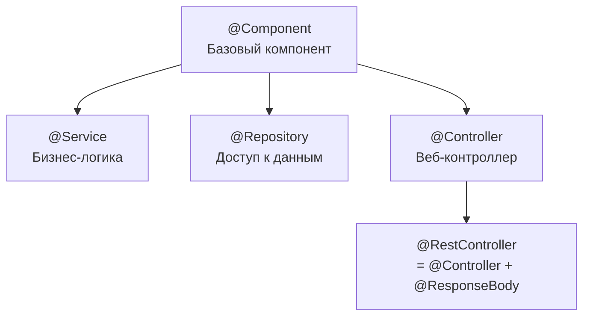

| Аннотация | Слой | Дополнительное поведение |
|-----------|------|------------------------|
| `@Component` | Любой | Базовое — только регистрация бина |
| `@Service` | Business | Семантическое — нет доп. поведения |
| `@Repository` | Persistence | При наличии `PersistenceExceptionTranslationPostProcessor` и подходящего переводчика поддерживаемые исключения доступа к данным преобразуются в `DataAccessException` |
| `@Controller` | Presentation | MVC обнаруживает методы-обработчики. Контроллер может вернуть представление или тело ответа |
| `@RestController` | Presentation | Сочетает `@Controller` и `@ResponseBody` для методов-обработчиков |

**Зачем различать, если поведение почти одинаковое?**
1. **Читаемость** — видно назначение класса по аннотации
2. **AOP pointcuts** — можно писать срезы по типу аннотации: `@within(org.springframework.stereotype.Service)`
3. **Специальная обработка.** Инфраструктура учитывает стереотип при обнаружении MVC-обработчиков или подключении трансляции исключений. [Spring 6.2: Stereotypes](https://docs.spring.io/spring-framework/reference/6.2/core/beans/classpath-scanning.html) · [PersistenceExceptionTranslationPostProcessor](https://docs.spring.io/spring-framework/docs/6.2.x/javadoc-api/org/springframework/dao/annotation/PersistenceExceptionTranslationPostProcessor.html).

## Q28. Что такое `@Qualifier` и `@Primary`?

`@Qualifier` фильтрует кандидатов по признаку. `@Primary` помогает выбрать бин для одиночной зависимости после фильтрации. При внедрении списка в него попадают все подходящие бины.

```java
public interface NotificationSender {
    void send(String message);
}

@Service("emailSender")
@Primary
public class EmailSender implements NotificationSender {
    public void send(String message) { /* email */ }
}

@Service("smsSender")
public class SmsSender implements NotificationSender {
    public void send(String message) { /* sms */ }
}

@Service
public class AlertService {
    private final NotificationSender defaultSender;

    private final NotificationSender smsSender;

    public AlertService(
            NotificationSender defaultSender,
            @Qualifier("smsSender") NotificationSender smsSender) {
        this.defaultSender = defaultSender;
        this.smsSender = smsSender;
    }
}
```

Сначала контейнер ищет кандидатов, совместимых с типом зависимости. `@Qualifier` сужает множество по признаку, которым может быть и имя совместимого бина. При одиночной зависимости единственный подходящий `@Primary` помогает выбрать один бин. Если выбор остаётся неоднозначным, Spring может сопоставить имя точки внедрения с именем или alias бина при отсутствии более сильного указания. Для имени параметра с Spring Framework 6.1 требуется компиляция с `-parameters`. С 6.2 для подходящего совпадения имени возможен быстрый путь, когда выбор не меняют условия по типу, квалификатору, primary или fallback. При нерешённой неоднозначности возникает ошибка. [Spring: Autowiring Qualifiers](https://docs.spring.io/spring-framework/reference/core/beans/annotation-config/autowired-qualifiers.html).

В примере для `defaultSender` выбирается `EmailSender` благодаря `@Primary`. Для второго параметра `@Qualifier("smsSender")` оставляет `SmsSender` единственным кандидатом.

**Кастомные квалификаторы:** можно создать собственную аннотацию вместо строковых имён:
```java
@Qualifier
@Retention(RetentionPolicy.RUNTIME)
public @interface EmailChannel {}

@Service @EmailChannel
public class EmailSender implements NotificationSender { /* ... */ }

@Service
public class AlertService {
    public AlertService(@EmailChannel NotificationSender sender) { /* ... */ }
}
```

## Q29. (!) Что такое `@Profile` и как работают профили?

`@Profile` — аннотация `Spring`, позволяющая регистрировать бины **только при активном профиле**. Профили — механизм для разделения конфигурации по средам.

```java
@Configuration
@Profile("dev & !prod")
public class DevDataSourceConfig {
    @Bean
    public DataSource dataSource() {
        // H2 in-memory для разработки
        return new EmbeddedDatabaseBuilder()
            .setType(EmbeddedDatabaseType.H2)
            .build();
    }
}

@Configuration
@Profile("prod")
public class ProdDataSourceConfig {
    @Bean
    public DataSource dataSource() {
        // PostgreSQL для production
        HikariConfig config = new HikariConfig();
        config.setJdbcUrl("jdbc:postgresql://prod-db:5432/app");
        config.setMaximumPoolSize(20);
        return new HikariDataSource(config);
    }
}
```

При `dev,prod` в этом примере регистрируется только конфигурация `prod` (Q40). Без обоих профилей ни одна из этих конфигураций не регистрируется.

Способы активации профиля:

| Способ | Пример |
|--------|--------|
| `application.properties` в Spring Boot | `spring.profiles.active=dev,metrics` |
| JVM аргумент | `-Dspring.profiles.active=prod` |
| Переменная окружения | `SPRING_PROFILES_ACTIVE=prod` |
| Программно | `ctx.getEnvironment().setActiveProfiles("prod")` до регистрации профильной конфигурации и `refresh()` |
| В тестах | `@ActiveProfiles("test")` |

**Продвинутые возможности:**

```java
// Логические выражения (Spring 5.1+)
@Profile("prod & !monitoring")  // AND + NOT
@Profile("dev | staging")        // OR

// Профиль по умолчанию
@Profile("default")  // подходит без активных профилей, если набор default profiles не изменён

// Spring Boot Config Data в одной локации
// application-dev.properties перекрывает application.properties при активном dev
```

**На собеседовании:** часто спрашивают, как организовать конфигурацию для `dev`/`staging`/`prod`. Рекомендация: общие свойства в `application.yml`, специфичные — в `application-{profile}.yml`. Секреты — через переменные окружения или vault, не в файлах.

## Q30. Что такое `@LookUp`?

`@Lookup` переопределяет метод в сгенерированном подклассе. При каждом вызове метод запрашивает бин у контейнера. Для `prototype` это новый экземпляр. Для singleton возвращается тот же бин, а для request scope — бин текущего запроса.

```java
@Service
public abstract class OrderProcessor {

    // ShoppingCart зарегистрирован как prototype, см. Q14
    @Lookup
    protected abstract ShoppingCart createCart();

    public void processOrder() {
        ShoppingCart cart = createCart();
        // Здесь заполняют и обрабатывают корзину.
    }
}
```

**Когда использовать:**
- Долгоживущему бину нужно разрешать зависимость при каждом обращении, например получать новый prototype или бин текущего запроса.
- Альтернатива — `ObjectProvider<T>` или `Provider<T>` (более явный подход)

Класс должен допускать наследование, а метод — переопределение. Метод может быть абстрактным, но класс всё равно должен допускать создание подкласса. Lookup method injection не работает для экземпляра, возвращённого фабричным `@Bean`-методом. Для него удобно использовать `ObjectProvider`. [Spring: Lookup Method Injection](https://docs.spring.io/spring-framework/reference/core/beans/dependencies/factory-method-injection.html).

## Q31. (!) Что такое `@Conditional` и как `Spring Boot` использует условные бины?

`@Conditional` — аннотация `Spring`, позволяющая регистрировать бин **только при выполнении условия**. Это фундамент **автоконфигурации** в [Spring Boot](spring-boot-interview.md).

**Базовый `@Conditional`:**
```java
public class OnLinuxCondition implements Condition {
    @Override
    public boolean matches(ConditionContext context, AnnotatedTypeMetadata metadata) {
        return context.getEnvironment().getProperty("os.name", "").contains("Linux");
    }
}

@Configuration
@Conditional(OnLinuxCondition.class)
public class LinuxSpecificConfig {
    @Bean
    public FileWatcher fileWatcher() {
        return new InotifyFileWatcher();
    }
}
```

**Spring Boot расширяет `@Conditional` набором готовых аннотаций:**

| Аннотация | Условие |
|-----------|---------|
| `@ConditionalOnClass` | Класс есть в classpath |
| `@ConditionalOnMissingClass` | Класса нет в classpath |
| `@ConditionalOnBean` | Есть подходящий бин среди уже обработанных кандидатов |
| `@ConditionalOnMissingBean` | Среди уже обработанных кандидатов нет подходящего бина |
| `@ConditionalOnProperty` | Проверяет свойство в `Environment`. По умолчанию оно должно присутствовать и отличаться от `false` |
| `@ConditionalOnResource` | Ресурс доступен |
| `@ConditionalOnWebApplication` | Это веб-приложение |
| `@ConditionalOnExpression` | SpEL-выражение истинно |

**Пример пользовательской автоконфигурации для Spring Boot 3.5**
```java
@AutoConfiguration
@ConditionalOnClass(RedisConnectionFactory.class)
@ConditionalOnProperty(prefix = "app.catalog", name = "redis-enabled", havingValue = "true")
@ConditionalOnSingleCandidate(RedisConnectionFactory.class)
@AutoConfigureAfter(RedisAutoConfiguration.class)
public class CatalogCacheAutoConfiguration {

    @Bean
    @ConditionalOnMissingBean(CatalogCache.class)
    RedisCatalogCache catalogCache(RedisConnectionFactory connectionFactory) {
        return new RedisCatalogCache(connectionFactory);
    }
}
```

Это пример своей автоконфигурации поверх Redis. Класс регистрируют в `META-INF/spring/org.springframework.boot.autoconfigure.AutoConfiguration.imports`. `RedisCatalogCache` реализует `CatalogCache`. `@ConditionalOnSingleCandidate` проверяет, что зависимость `RedisConnectionFactory` можно однозначно разрешить среди учтённых бинов, например если есть один кандидат или один `@Primary`.

Условия по бинам видят определения, обработанные к моменту проверки. Boot обрабатывает пользовательские определения до автоконфигураций. Порядок между автоконфигурациями можно задать через `@AutoConfigureAfter`. Он относится к обработке определений. Порядок создания экземпляров определяется зависимостями и lifecycle. [Spring Boot 3.5: Auto-configuration](https://docs.spring.io/spring-boot/3.5/reference/features/developing-auto-configuration.html).

## Q32. (!) Как работает механизм событий (`ApplicationEvent`) в `Spring`?

Механизм событий в `Spring` реализует паттерн **Observer** (подробнее в [Design Patterns](../../design-patterns/design-patterns-interview.md)). Позволяет компонентам обмениваться информацией без прямых зависимостей.

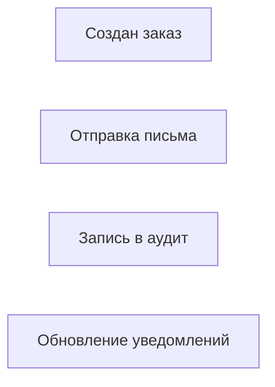

**Схема для разбора**

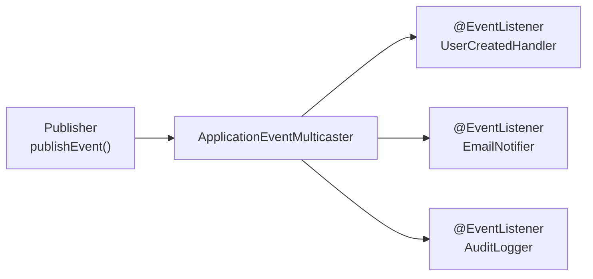

**Определение события:**
```java
public class OrderCreatedEvent extends ApplicationEvent {
    private final Order order;

    public OrderCreatedEvent(Object source, Order order) {
        super(source);
        this.order = order;
    }

    public Order getOrder() { return order; }
}

public record OrderCreated(Long orderId, BigDecimal total) {}
```

**Публикация:**
```java
@Service
@RequiredArgsConstructor
public class OrderService {
    private final ApplicationEventPublisher eventPublisher;
    private final OrderRepository orderRepository;

    @Transactional
    public Order createOrder(OrderRequest request) {
        Order order = orderRepository.save(toEntity(request));
        eventPublisher.publishEvent(new OrderCreated(order.getId(), order.getTotal()));
        return order;
    }
}
```

**Обработка:**
```java
@Component
public class OrderEventHandler {

    // Синхронный обработчик
    @EventListener
    public void onOrderCreated(OrderCreated event) {
        log.info("Заказ {} создан на сумму {}", event.orderId(), event.total());
    }

    // Асинхронная отправка после успешной фиксации заказа
    @Async
    @TransactionalEventListener(phase = TransactionPhase.AFTER_COMMIT)
    public void sendNotification(OrderCreated event) {
        emailService.sendOrderConfirmation(event.orderId());
    }

    // Условный обработчик
    @EventListener(condition = "#a0.total().compareTo(T(java.math.BigDecimal).valueOf(10000)) > 0")
    public void onLargeOrder(OrderCreated event) {
        fraudCheckService.verify(event.orderId());
    }

    // Цепочка событий — обработчик возвращает новое событие
    @EventListener
    public OrderObserved handleAndChain(OrderCreated event) {
        return new OrderObserved(event.orderId());
    }
}
```

**Встроенные события Spring:**

| Событие | Когда |
|---------|-------|
| `ContextRefreshedEvent` | Контекст инициализирован или обновлён |
| `ContextStartedEvent` | `context.start()` |
| `ContextStoppedEvent` | `context.stop()` |
| `ContextClosedEvent` | `context.close()` |
| `ServletRequestHandledEvent` | `FrameworkServlet` завершил обработку запроса при включённой публикации события |

С синхронным multicaster по умолчанию обычный `@EventListener` выполняется в потоке публикации. `#a0` указывает на первый аргумент метода. Для POJO-события `#root.event` указывает на обёртку `PayloadApplicationEvent`. Выражение по имени аргумента требует метаданных, например компиляции с `-parameters`. В примере метод сервиса вызывается через транзакционный прокси, а обработка `@Async` включена через `@EnableAsync`. [Spring 6.2: EventListener](https://docs.spring.io/spring-framework/docs/6.2.x/javadoc-api/org/springframework/context/event/EventListener.html).

Если добавить к обычному слушателю только `@Async`, задача может начаться до commit, а последующий rollback не отменит отправленное письмо. `@TransactionalEventListener(AFTER_COMMIT)` привязывает обработку к успешной фиксации транзакции. При публикации вне транзакции обработчик по умолчанию пропускается, если не включён `fallbackExecution`.

После commit почтовый сервис всё ещё может отказать, а процесс может завершиться до отправки. Если уведомление нужно доставлять с повторами после сбоя, сохраните событие в транзакционном outbox и сделайте потребитель идемпотентным. [Spring Transaction-bound Events](https://docs.spring.io/spring-framework/reference/data-access/transaction/event.html).

## Q33. (!) Иерархия `ApplicationContext`: parent-child контексты

`Spring` поддерживает иерархию контекстов, где дочерний контекст видит бины родительского, но **не наоборот**.

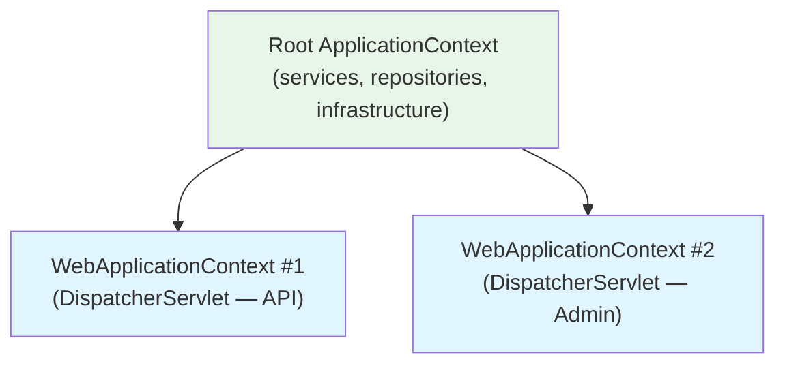

**Классический пример в Spring MVC (подробнее в [Spring MVC](spring-mvc-interview.md)):**
- **Root context** — `ContextLoaderListener` создаёт контекст с бизнес-логикой: `@Service`, `@Repository`, `DataSource`, `TransactionManager`
- **Web context** — `DispatcherServlet` создаёт контекст с веб-специфичными бинами: `@Controller`, `ViewResolver`, `HandlerMapping`

```java
// Программная настройка иерархии
AnnotationConfigApplicationContext root = new AnnotationConfigApplicationContext(RootConfig.class);

AnnotationConfigApplicationContext child = new AnnotationConfigApplicationContext();
child.setParent(root);
child.register(ChildConfig.class);
child.refresh();

// ServiceFromRoot зарегистрирован только в RootConfig.
// ControllerFromChild зарегистрирован только в ChildConfig.
// Оцените вызовы по отдельности.
child.getBean(ServiceFromRoot.class);
root.getBean(ControllerFromChild.class);
```

Первый вызов находит сервис в родительском контексте. Второй завершается `NoSuchBeanDefinitionException`, поскольку поиск из родительского контекста не захватывает дочерний.

**Правила видимости:**
- Дочерний контекст **видит** бины родительского
- Родительский контекст **не видит** бины дочернего
- При `getBean("name")` локальный бин с таким именем перекрывает одноимённый бин родителя. При внедрении по типу действуют правила отбора подходящих кандидатов (Q13, Q28).
- `@Autowired` в дочернем контексте может внедрить бин из родительского

**Практическое применение:**
- Разделение API и Admin-контроллеров в разные `DispatcherServlet` с общим слоем сервисов
- Мультитенантные приложения с общей инфраструктурой и tenant-специфичной конфигурацией
- В Spring Boot возможен один контекст. В Spring Cloud Config родительский bootstrap-контекст относится к явно включённому legacy bootstrap. Стандартный импорт через `spring.config.import` его не требует. [Spring Cloud Config Client](https://docs.spring.io/spring-cloud-config/reference/client.html).

## Q34. (!) В чём разница между `@Bean` и `@Component`?

`@Component` помечает класс для component scan. `@Bean` помечает фабричный метод, результат которого становится бином. Такой метод удобен для объектов сторонних библиотек и явной настройки создания. Сторонний тип можно зарегистрировать и программно, например через `GenericApplicationContext.registerBean`.

| Характеристика | `@Component` | `@Bean` |
|---------------|-------------|---------|
| Место | На классе | На методе в `@Configuration` или другом компоненте. В обычном `@Component` действует lite-режим |
| Управление | Spring сканирует и создаёт автоматически | Разработчик явно контролирует создание |
| Сторонние классы | Сканирование опирается на аннотации класса или настроенные фильтры | Фабричный метод может вернуть объект стороннего типа |
| Создание экземпляра | Контейнер вызывает выбранный конструктор | Контейнер вызывает фабричный метод |
| AOP-прокси результирующего бина | Возможен при подходящей AOP-конфигурации | Возможен при подходящей AOP-конфигурации |

```java
@Component
public class EmailService {
    private final JavaMailSender mailer;
    public EmailService(JavaMailSender mailer) { this.mailer = mailer; }
}

@Configuration
public class InfraConfig {

    @Bean
    public ObjectMapper objectMapper() {
        return JsonMapper.builder()
            .addModule(new JavaTimeModule())
            .disable(SerializationFeature.WRITE_DATES_AS_TIMESTAMPS)
            .build();
    }

    @Bean
    @Scope("prototype")
    public RestTemplate restTemplate() {
        RestTemplate rt = new RestTemplate();
        rt.setErrorHandler(new SilentErrorHandler());
        return rt;
    }
}
```

В полном режиме Spring создаёт подкласс конфигурационного класса, чтобы вызов одного переопределяемого `@Bean`-метода из другого разрешал зависимость через контейнер. В lite-режиме прямой вызов исполняет тело обычного метода. Проксирование конфигурации обслуживает фабричные вызовы. AOP-прокси самого бина, например для транзакций, создаётся отдельно и возможен при обоих способах регистрации. [Spring: Basic Concepts](https://docs.spring.io/spring-framework/reference/core/beans/java/basic-concepts.html).

```java
@Configuration
public class Config {
    @Bean
    public ServiceA serviceA() { return new ServiceA(sharedDep()); }

    @Bean
    public ServiceB serviceB() { return new ServiceB(sharedDep()); }

    @Bean
    public SharedDep sharedDep() { return new SharedDep(); }
    // sharedDep() вызывается дважды, но возвращает один бин (CGLIB-прокси)
}
```

## Q35. (!) Что такое `Pointcut` и как писать `Pointcut`-выражения в `Spring AOP`?

**Pointcut** определяет набор join points, к которым применяется advice. В Spring AOP поддерживается join point выполнения метода, доступный через AOP-прокси Spring-бина.

**Синтаксис `execution`:**
```
execution([модификатор] тип-возврата [класс.]метод(параметры) [throws])
```

```java
@Aspect
@Component
public class LoggingAspect {

    // Все публичные методы любого класса в пакете service
    @Pointcut("execution(public * com.example.service.*.*(..))")
    public void serviceLayer() {}

    // Только методы, возвращающие String, с одним аргументом типа Long
    @Pointcut("execution(java.lang.String com.example..*.find*(java.lang.Long))")
    public void findMethods() {}

    // По аннотации на методе
    @Pointcut("@annotation(com.example.annotation.Audited)")
    public void auditedMethods() {}

    // По аннотации на классе
    @Pointcut("@within(org.springframework.stereotype.Service)")
    public void serviceBeans() {}

    // Комбинирование через &&, ||, !
    @Pointcut("serviceLayer() && !execution(* *.toString(..))")
    public void serviceExcludeToString() {}

    // Получение аргументов в advice
    @Before(value = "execution(* com.example.service.*.*(..)) && args(id,..)", argNames = "id")
    public void logWithId(JoinPoint jp, Long id) {
        log.info("Calling {} with id={}", jp.getSignature().getName(), id);
    }
}
```

**Типы Pointcut-десигнаторов:**

| Десигнатор | Описание |
|-----------|---------|
| `execution` | По сигнатуре метода (основной) |
| `within` | Все методы в пакете / классе |
| `@annotation` | Методы с указанной аннотацией |
| `@within` | Классы с указанной аннотацией |
| `bean` | По имени бина в Spring-контексте |
| `args` | По фактическим аргументам. Именованный аргумент можно связать с параметром advice |
| `target` | По типу целевого объекта |

## Q36. (!) Как работает `@Around` advice и чем он отличается от `@Before` / `@After`?

`@Around` управляет продолжением цепочки через `proceed()`. Он может вызвать её с изменёнными аргументами, вернуть другой результат, повторить вызов или сразу вернуть своё значение. `@Before` выполняется до продолжения цепочки и может остановить вызов, выбросив исключение. `@AfterReturning` и `@AfterThrowing` реагируют на соответствующий исход, а `@After` выполняется при выходе по аналогии с `finally`.

Следующий разбор показывает порядок, когда все перечисленные виды advice одного аспекта совпадают с методом и `@Around` вызывает `proceed()`. Если совпадают несколько advice одного типа в том же аспекте, порядок между ними не определён. Между аспектами учитывается их приоритет.

```text
Один аспект содержит @Around, @Before, @AfterReturning, @AfterThrowing и @After.
Все advice применимы к одному методу. @Around вызывает proceed() один раз.
Рассмотрите два запуска: метод возвращает значение и метод бросает исключение.
```

**Пример для разбора**

```
@Around → @Before → метод → @AfterReturning / @AfterThrowing → @After → @Around (продолжение)
```

```java
@Aspect
@Component
public class RetryAspect {

    // @Before выполняется до метода и может прервать вызов исключением
    @Before("execution(* com.example.service.*.*(..))")
    public void logBefore(JoinPoint jp) {
        log.info("Before: {}", jp.getSignature().toShortString());
    }

    // @AfterReturning получает результат успешного вызова
    @AfterReturning(pointcut = "execution(* com.example.service.*.*(..))", returning = "result", argNames = "result")
    public void logReturn(Object result) {
        log.info("Returned: {}", result);
    }

    // @AfterThrowing — при выбросе исключения
    @AfterThrowing(pointcut = "execution(* com.example.service.*.*(..))", throwing = "ex", argNames = "ex")
    public void logException(Exception ex) {
        log.error("Exception: {}", ex.getMessage());
    }

    // @After — всегда (аналог finally)
    @After("execution(* com.example.service.*.*(..))")
    public void logAfter(JoinPoint jp) {
        log.info("After (finally): {}", jp.getSignature().getName());
    }

    // @Around — полный контроль: до, после, изменение аргументов и результата
    @Around("@annotation(com.example.annotation.Retry)")
    public Object withRetry(ProceedingJoinPoint pjp) throws Throwable {
        int attempts = 3;
        Throwable lastEx = null;
        for (int i = 0; i < attempts; i++) {
            try {
                return pjp.proceed();          // продолжить цепочку
            } catch (TransientException ex) {
                lastEx = ex;
                log.warn("Attempt {} failed, retrying...", i + 1);
            }
        }
        throw lastEx;
    }

    // @Around: изменение аргументов и результата
    @Around("execution(java.math.BigDecimal com.example.service.PricingService.calculate(java.math.BigDecimal))")
    public Object applyDiscount(ProceedingJoinPoint pjp) throws Throwable {
        Object[] args = pjp.getArgs();
        args[0] = ((BigDecimal) args[0]).multiply(BigDecimal.valueOf(0.9)); // скидка 10%
        BigDecimal result = (BigDecimal) pjp.proceed(args);
        return result.setScale(2, RoundingMode.HALF_UP);
    }
}
```

`@AfterReturning` может изменить состояние полученного mutable-объекта. Для подмены ссылки, возвращаемой вызывающему коду, используют `@Around`.

`@Around` может вызвать `proceed()` один раз, несколько раз или пропустить его. Без `proceed()` цепочка ниже этого advice не выполняется. Например, advice может вернуть кешированный результат. [Spring AOP: Advice](https://docs.spring.io/spring-framework/reference/core/aop/ataspectj/advice.html).

## Q37. (!) Что такое `SpEL` (`Spring Expression Language`) и где он применяется?

**SpEL** — встроенный язык выражений `Spring`, который вычисляется в рантайме прямо внутри аннотаций и конфигурации. Он умеет обращаться к бинам и их методам, читать системные свойства и `Environment`, вызывать статические методы, делать тернарные условия, работать с коллекциями и регулярками. Синтаксис: `#{...}` — это SpEL-выражение, `${...}` — подстановка свойства (часто их комбинируют).

**Где встречается чаще всего** (по этим местам его и спрашивают): `@Value`, ключи и условия в `@Cacheable`/`@CacheEvict`, проверки доступа в `@PreAuthorize`, условия в `@ConditionalOnExpression` и `@EventListener`.

```java
@Component
public class AppConfig {

    @Value("${server.port:8080}")
    private int port;

    @Value("#{systemProperties['user.home']}")
    private String userHome;

    @Value("#{T(Math).random() * 100}")
    private double randomValue;

    @Value("#{userService.findAll().size()}")
    private int userCount;

    @Value("#{environment.getProperty('app.env') == 'prod' ? 'prod-db' : 'dev-db'}")
    private String dbName;

    @Value("#{'${app.tags}'.split(',')}")
    private List<String> tags;
}
```

**В `@Cacheable`, `@CachePut` и `@CacheEvict`:**
```java
@Service
public class ProductService {

    // Для положительного ID проверяем кеш, null не сохраняем.
    @Cacheable(value = "products", key = "#p0",
               condition = "#p0 != null && #p0 > 0",
               unless = "#result == null")
    public Product findById(Long id) { /* ... */ }

    // Метод записи выполняется и обновляет запись кеша по ID результата.
    @CachePut(value = "products", key = "#result.id",
              unless = "#result == null")
    public Product save(Product product) { /* ... */ }

    // Сброс по вычисленному ключу
    @CacheEvict(value = "products", key = "#p0.id")
    public void delete(Product product) { /* ... */ }
}
```

В `@Cacheable` условие `condition` определяет, применяется ли кеширование. При попадании в кеш тело метода может не выполниться, а `unless` проверяет фактический результат после вызова. При вызове через кеширующий прокси `@CachePut` выполняет метод даже при наличии записи в кеше и использует результат для обновления. [Spring Cache Annotations](https://docs.spring.io/spring-framework/reference/integration/cache/annotations.html).

В следующем примере предполагается доступность имён параметров, например после компиляции с `-parameters`, и principal с полем `id`. Проверка выполняется при включённой method security.
```java
@PreAuthorize("hasRole('ADMIN') or #userId == authentication.principal.id")
public UserDto getUser(Long userId) { /* ... */ }

@PreAuthorize("#order.ownerId == authentication.principal.id")
public void cancelOrder(Order order) { /* ... */ }
```

**В `@ConditionalOnExpression`:**
```java
@Bean
@ConditionalOnExpression("${feature.new-algo.enabled:false} and '${app.env}' == 'prod'")
public AlgorithmV2 algorithmV2() { return new AlgorithmV2(); }
```

## Q38. (!) Как работает `@Async` и что нужно настроить для асинхронных методов?

В стандартном режиме `@Async` отправляет вызов, прошедший через прокси, в выбранный executor. Выполнение на другом потоке зависит от executor и политики отклонения.

**Необходимая конфигурация:**

```text
Обычный Spring Framework 6.2, два Spring-бина.
ReportController вызывает метод ReportService, формирующий отчёт.
Нужно передать работу отдельному пулу и вернуть вызывающему коду результат в CompletableFuture.
```

**Пример для разбора**

```java
@Configuration
@EnableAsync
public class AsyncConfig implements AsyncConfigurer {

    @Bean
    @Override
    public ThreadPoolTaskExecutor getAsyncExecutor() {
        ThreadPoolTaskExecutor executor = new ThreadPoolTaskExecutor();
        executor.setCorePoolSize(5);
        executor.setMaxPoolSize(20);
        executor.setQueueCapacity(100);
        executor.setThreadNamePrefix("async-");
        executor.setRejectedExecutionHandler(new ThreadPoolExecutor.CallerRunsPolicy());
        return executor;
    }

    @Override
    public AsyncUncaughtExceptionHandler getAsyncUncaughtExceptionHandler() {
        return (ex, method, params) ->
            log.error("Async exception in {}: {}", method.getName(), ex.getMessage());
    }
}
```

**Использование:**
```java
@Service
public class NotificationService {

    // Вызывающий код не получает Future с результатом задачи
    @Async
    public void sendEmail(String to, String body) {
        emailClient.send(to, body);
    }

    // CompletableFuture — можно дождаться результата
    @Async
    public CompletableFuture<String> fetchExternalData(String url) {
        String data = httpClient.get(url);
        return CompletableFuture.completedFuture(data);
    }
}

// Вызов
@Service
public class OrderService {
    private final NotificationService notifications;
    private final OrderRepository orderRepo;

    public OrderService(NotificationService notifications, OrderRepository orderRepo) {
        this.notifications = notifications;
        this.orderRepo = orderRepo;
    }

    public void placeOrder(Order order) {
        orderRepo.save(order);
        notifications.sendEmail(order.getEmail(), "Order confirmed"); // при насыщении пула здесь возможно синхронное выполнение
    }

    public void processWithResult() throws Exception {
        CompletableFuture<String> future = notifications.fetchExternalData("http://api.example.com");
        String data = future.get(5, TimeUnit.SECONDS); // ждём с таймаутом
    }
}
```

Пул объявлен как `@Bean`, поэтому Spring управляет его инициализацией и закрытием. Если метод с `CompletableFuture` выбрасывает исключение, возвращённый прокси future завершается с ошибкой. Исключение `void`-метода направляется обработчику необработанных асинхронных исключений. [Spring 6.2: EnableAsync](https://docs.spring.io/spring-framework/docs/6.2.x/javadoc-api/org/springframework/scheduling/annotation/EnableAsync.html).

**Ловушки:**
- Прокси-подкласс не перехватывает `final` и `private` методы. JDK-прокси перехватывает вызов через интерфейс даже при `final` у реализации соответствующего метода.
- Self-invocation — не работает (обходит прокси)
- Исключения из `void`-методов нужно перехватывать через `AsyncUncaughtExceptionHandler`
- В Spring Framework executor можно указать в `@Async("имя")` или настроить через `AsyncConfigurer`. При поиске по умолчанию Framework ищет единственный `TaskExecutor` или `Executor` с именем `taskExecutor`. Если подходящего бина нет, используется `SimpleAsyncTaskExecutor`.
- Spring Boot 3.5 при стандартной автоконфигурации создаёт `ThreadPoolTaskExecutor`, а при включённых виртуальных потоках на Java 21+ — `SimpleAsyncTaskExecutor` на виртуальных потоках. Фактический выбор зависит от пользовательских бинов и настроек, включая `spring.task.execution.mode`. [Spring Boot 3.5: Task Execution and Scheduling](https://docs.spring.io/spring-boot/3.5/reference/features/task-execution-and-scheduling.html).
- В примере при насыщении работающего пула `CallerRunsPolicy` может выполнить задачу прямо в вызывающем потоке. Если executor закрыт, эта политика отбрасывает задачу. [Java 21: CallerRunsPolicy](https://docs.oracle.com/en/java/javase/21/docs/api/java.base/java/util/concurrent/ThreadPoolExecutor.CallerRunsPolicy.html).

## Q39. (!) Что такое `@EventListener` и как публиковать события асинхронно?

`@EventListener` — декларативная альтернатива `ApplicationListener<E>`. Позволяет обрабатывать события без явной реализации интерфейса.

```java
// Включён @EnableAsync с отдельным исполнителем задач.
// Используется стандартный синхронный SimpleApplicationEventMulticaster.
// register() вызывается через транзакционный прокси.
// Сравните, где и когда выполняются обработчики при commit и rollback.

public record UserRegistered(Long userId, String email, Instant occurredAt) {}

@Service
@RequiredArgsConstructor
public class RegistrationService {
    private final ApplicationEventPublisher publisher;
    private final UserRepository userRepo;

    @Transactional
    public void register(RegistrationRequest req) {
        User user = userRepo.save(new User(req.email()));
        publisher.publishEvent(new UserRegistered(user.getId(), user.getEmail(), Instant.now()));
    }
}

@Component
public class WelcomeEmailHandler {

    @EventListener
    public void sendWelcome(UserRegistered event) {
        emailService.send(event.email(), "Welcome!");
    }

    @Async
    @EventListener
    public void initUserProfile(UserRegistered event) {
        profileService.createDefault(event.userId());
    }

    @EventListener(condition = "#a0.email().endsWith('@vip.com')")
    public void handleVipUser(UserRegistered event) {
        vipService.enroll(event.userId());
    }

    @TransactionalEventListener(phase = TransactionPhase.AFTER_COMMIT)
    public void notifyAnalytics(UserRegistered event) {
        analyticsService.track("user_registered", event.userId());
    }
}
```

При стандартном multicaster метод `sendWelcome()` выполняется в потоке публикатора. `handleVipUser()` выполняется там же, если адрес удовлетворяет условию SpEL. Прокси `@Async` передаёт `initUserProfile()` исполнителю задач. Этот вызов может начаться до фиксации транзакции. `notifyAnalytics()` запускается только после успешного commit. Rollback не отменяет уже выполненную работу обычных слушателей и сам по себе не отменяет задачу, переданную исполнителю. [Spring 6.2: события контекста и асинхронные слушатели](https://docs.spring.io/spring/reference/6.2/core/beans/context-introduction.html).

Обычный синхронный слушатель с возвращаемым значением может опубликовать его как следующее событие (Q32). Асинхронный слушатель для этого вызывает `ApplicationEventPublisher` явно.

Порядок вызова аннотированных слушателей можно задать через `@Order`. Это не гарантирует порядок завершения асинхронных задач. [Spring 6.2: EventListener](https://docs.spring.io/spring-framework/docs/6.2.x/javadoc-api/org/springframework/context/event/EventListener.html).
```java
@EventListener
@Order(1)    // меньше = раньше
public void firstHandler(UserRegistered event) { /* ... */ }

@EventListener
@Order(2)
public void secondHandler(UserRegistered event) { /* ... */ }
```

**@TransactionalEventListener vs @EventListener:**
- Обычный `@EventListener` с синхронным multicaster выполняется в потоке публикации. Если публикация идёт из транзакции, обработчик может сработать до commit. `@Async` меняет способ выполнения, но не привязывает его к commit (Q32).
- `@TransactionalEventListener` — привязан к фазе транзакции (`AFTER_COMMIT`, `BEFORE_COMMIT`, `AFTER_ROLLBACK`, `AFTER_COMPLETION`); если транзакции нет — событие **не обрабатывается** (если не указать `fallbackExecution = true`)

## Q40. Как настроить несколько реализаций одного бина с разными профилями?

`@Profile` определяет, регистрируется ли реализация. Несколько профилей могут быть активны одновременно. Например, при условиях `prod` и `dev | test` комбинация `prod,dev` регистрирует оба бина. В этом примере приоритет отдаём `prod`, а заглушку допускаем только при его отсутствии. Если ни одно условие не выполнено, обязательная зависимость от `PaymentGateway` не разрешится. [Spring: Bean Definition Profiles](https://docs.spring.io/spring-framework/reference/core/beans/environment.html#beans-definition-profiles).

```text
Есть PaymentGateway, реализация для Stripe и заглушка.
Для prod нужен Stripe даже при одновременно активном dev или test.
В dev и test без prod нужна заглушка, а зависимость CheckoutService обязательна.
```

**Пример для разбора**

```java
// Интерфейс
public interface PaymentGateway {
    PaymentResult charge(Order order, BigDecimal amount);
}

// Реальная реализация — только для prod
@Profile("prod")
@Service
public class StripePaymentGateway implements PaymentGateway {
    private final StripeClient stripe;

    public StripePaymentGateway(StripeClient stripe) {
        this.stripe = stripe;
    }

    @Override
    public PaymentResult charge(Order order, BigDecimal amount) {
        return stripe.createCharge(order.getCustomerId(), amount);
    }
}

// Заглушка — для dev или test при отсутствии prod
@Profile("!prod & (dev | test)")
@Service
public class StubPaymentGateway implements PaymentGateway {
    @Override
    public PaymentResult charge(Order order, BigDecimal amount) {
        log.info("STUB: Charged {} for order {}", amount, order.getId());
        return PaymentResult.success("stub-charge-id");
    }
}

// Потребитель — не знает о конкретной реализации
@Service
public class CheckoutService {
    private final PaymentGateway paymentGateway;

    public CheckoutService(PaymentGateway paymentGateway) {
        this.paymentGateway = paymentGateway;
    }

    public PaymentResult checkout(Cart cart) {
        return paymentGateway.charge(cart.toOrder(), cart.total());
    }
}
```

**Активация профиля:**
```yaml
# application.yml
spring:
  profiles:
    active: dev
```

```bash
# Через аргумент приложения
java -jar app.jar --spring.profiles.active=prod

# Через переменную окружения
SPRING_PROFILES_ACTIVE=prod java -jar app.jar
```

В отдельном варианте классы шлюзов регистрируются фабричными методами, без component scan этих классов. Значения `stripe` и `stub` взаимоисключающие. При отсутствии свойства регистрируется заглушка. При другом значении ни одна фабрика не сработает. Условие по отсутствию бина проверяется для всей автоконфигурации с учётом порядка из Q31. Для варианта `stripe` предполагается доступный бин `StripeClient`.

```java
@AutoConfiguration
@ConditionalOnMissingBean(PaymentGateway.class)
class PaymentGatewayAutoConfiguration {

    @Bean
    @ConditionalOnProperty(name = "payment.provider", havingValue = "stripe")
    StripePaymentGateway stripeGateway(StripeClient client) {
        return new StripePaymentGateway(client);
    }

    @Bean
    @ConditionalOnProperty(name = "payment.provider", havingValue = "stub", matchIfMissing = true)
    StubPaymentGateway stubGateway() {
        return new StubPaymentGateway();
    }
}
```

---

## Q41. Что такое `BeanRegistrar` и чем он лучше `BeanDefinitionRegistryPostProcessor` (Spring Framework 7)?

`BeanRegistrar` (`Spring Framework 7.0` / `Spring Boot 4`) — first-class механизм программной регистрации бинов. Вы реализуете метод `register(BeanRegistry, Environment)` и подключаете класс через `@Import` (он обнаруживается на этапе обработки конфигурации).

```java
class MyBeanRegistrar implements BeanRegistrar {
    @Override
    public void register(BeanRegistry registry, Environment env) {
        registry.registerBean("paymentService", PaymentService.class);
        if (env.matchesProfiles("cloud")) {
            registry.registerBean(CloudClient.class);
        }
    }
}

@Configuration
@Import(MyBeanRegistrar.class)
class AppConfig {}
```

`BeanRegistrar` подходит для добавления бинов из конкретной конфигурации. `BeanRegistry` позволяет зарегистрировать тип, задать имя, настроить определение и при необходимости передать supplier. В Kotlin доступен `BeanRegistrarDsl`.

`BeanDefinitionRegistryPostProcessor` остаётся точкой расширения для работы с реестром определений и последующей обработки фабрики. Стадия AOT тоже учитывает определения, добавленные на этапе обработки реестра. При AOT набор бинов и условия, влияющие на этот набор, определяются во время сборки. Если профиль `cloud` меняет состав бинов, его учитывают при AOT-обработке. [Spring Framework 7.0: Programmatic Bean Registration](https://docs.spring.io/spring-framework/reference/7.0/core/beans/java/programmatic-bean-registration.html) · [Spring Framework 7.0: AOT](https://docs.spring.io/spring-framework/reference/7.0/core/aot.html).

---

## See also

- [Spring Boot](spring-boot-interview.md) — автоконфигурация и Boot-стартеры поверх Framework
- [Spring MVC](spring-mvc-interview.md) — веб-слой на основе DispatcherServlet
- [Spring WebFlux](spring-webflux-interview.md) — реактивный стек на Project Reactor
- [Spring Security](spring-security-interview.md) — аутентификация и авторизация
- [Spring Data JPA](spring-data-jpa-interview.md) — доступ к данным с репозиториями
- [Spring Cloud](spring-cloud-interview.md) — распределённые системы и микросервисы
- [Spring Boot Actuator](spring-boot-actuator-interview.md) — мониторинг и health-эндпоинты
- [Spring Batch](spring-batch-interview.md) — пакетная обработка данных
- [Паттерны проектирования](../../design-patterns/design-patterns-interview.md) — паттерны, реализованные в Spring
- [ООП в Java](../../programming-languages/java/java-oop-interview.md) — объектно-ориентированные основы

- [Spring AOP](spring-aop-interview.md)
- [Spring Batch](spring-batch-interview.md)
- [Spring Boot Actuator](spring-boot-actuator-interview.md)
- [Spring Boot](spring-boot-interview.md)
- [Spring Cloud](spring-cloud-interview.md)
- [Spring Data JPA](spring-data-jpa-interview.md)
- [Spring Boot 3 Migration](spring-boot-3-migration-interview.md) — Java 17 baseline, javax→jakarta, GraalVM Native, AOT, HTTP Interface Clients,…
