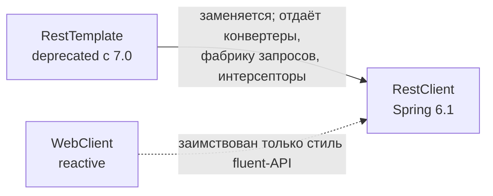

# Вопросы на собеседовании: REST-клиенты Spring

В Spring существует три основных HTTP-клиента: `RestTemplate` (классический; maintenance mode в Spring 6, формально deprecated с 7.0), `WebClient` (реактивный, Spring 5+), и `RestClient` (новый синхронный, Spring 6.1). На собеседованиях проверяют понимание различий, миграцию с RestTemplate и декларативный подход через `@HttpExchange`.

Дата последнего обновления: 2026-10-07

## Полезные ссылки

### Официальная документация

- [Spring RestClient](https://docs.spring.io/spring-framework/docs/current/reference/html/integration.html#rest-client) — документация RestClient
- [Baeldung: Spring RestClient](https://www.baeldung.com/spring-boot-restclient) — руководство по RestClient
- [Baeldung: HTTP Interface (@HttpExchange)](https://www.baeldung.com/spring-6-http-interface) — декларативные HTTP-клиенты

## Содержание

- [Полезные ссылки](#полезные-ссылки)
- [See also](#see-also)

**Сравнение клиентов**
- [Q1. (!) Какие HTTP-клиенты есть в Spring и чем они отличаются?](#q1--какие-http-клиенты-есть-в-spring-и-чем-они-отличаются)
- [Q2. Почему RestTemplate перевели в maintenance mode?](#q2-почему-resttemplate-перевели-в-maintenance-mode)

**RestClient (Spring 6.1)**
- [Q3. (!) Как работает RestClient?](#q3--как-работает-restclient)
- [Q4. Чем retrieve() отличается от exchange()?](#q4-чем-retrieve-отличается-от-exchange)
- [Q5. Как обрабатывать ошибки в RestClient?](#q5-как-обрабатывать-ошибки-в-restclient)
- [Q6. Как десериализовать коллекцию через RestClient?](#q6-как-десериализовать-коллекцию-через-restclient)

**WebClient**
- [Q7. (!) Когда использовать WebClient вместо RestClient?](#q7--когда-использовать-webclient-вместо-restclient)
- [Q8. Как сделать синхронный вызов через WebClient?](#q8-как-сделать-синхронный-вызов-через-webclient)

**@HttpExchange — декларативный клиент**
- [Q9. (!) Что такое @HttpExchange и как им пользоваться?](#q9--что-такое-httpexchange-и-как-им-пользоваться)
- [Q10. Какие аннотации параметров поддерживает @HttpExchange?](#q10-какие-аннотации-параметров-поддерживает-httpexchange)
- [Q11. Как подключить @HttpExchange к RestClient vs WebClient?](#q11-как-подключить-httpexchange-к-restclient-vs-webclient)

**Конфигурация и best practices**
- [Q12. Как настроить таймауты, базовый URL и заголовки?](#q12-как-настроить-таймауты-базовый-url-и-заголовки)
- [Q13. Как мигрировать с RestTemplate на RestClient?](#q13-как-мигрировать-с-resttemplate-на-restclient)
- [Q14. Как спроектировать исходящий HTTP-вызов с ограничением времени, повторами и наблюдаемостью?](#q14-как-спроектировать-исходящий-http-вызов-с-ограничением-времени-повторами-и-наблюдаемостью)

---

## Q1. (!) Какие HTTP-клиенты есть в Spring и чем они отличаются?

В Spring три HTTP-клиента, и различает их в первую очередь **модель выполнения** (синхронная vs реактивная) и **поколение API**. `RestTemplate` — классика на доживании, `RestClient` — современный синхронный клиент, `WebClient` — реактивный.

| | `RestTemplate` | `RestClient` | `WebClient` |
|---|---|---|---|
| Версия | Spring 3+ | Spring 6.1+ | Spring 5+ (WebFlux) |
| Стиль | Синхронный | Синхронный fluent | Реактивный |
| Статус | Maintenance mode в 6.x, deprecated с 7.0 | Актуальный | Актуальный |
| Стиль API | Методы перегрузки | Fluent builder chain | Reactive (Mono/Flux) |
| Зависимость | spring-web | spring-web | spring-webflux |
| Применение | Legacy код | Новые Spring 6 проекты | Реактивный стек |

Ключевая мысль: `RestClient` создан как современная синхронная замена `RestTemplate` — он берёт fluent-API от `WebClient`, но работает блокирующе, без реактивных типов. Поэтому он может переиспользовать настройки старого `RestTemplate` (конвертеры, фабрику запросов, интерсепторы).



**Как выбрать:**
- Новый проект на Spring 6.1+, классический блокирующий стек (Spring MVC) → **RestClient**.
- Spring WebFlux, высокая конкурентность, нужны `Mono`/`Flux` → **WebClient**.
- Legacy-код, который ещё не мигрировали → **RestTemplate** (продолжает работать, но новых фич не получает и с 7.0 помечен `@Deprecated`).

---

## Q2. Почему RestTemplate перевели в maintenance mode?

Причина не в том, что он плохо работает, а в том, что его API родом из эпохи Java 5 и плохо стареет. Накопились дизайн-проблемы, которые невозможно исправить, не сломав обратную совместимость:

- **Перегрузка методов вместо fluent-API.** Для одной и той же операции есть несколько методов: `getForObject()`, `getForEntity()`, `exchange()`. Запомнить, какой когда нужен, тяжело, а сигнатуры с varargs и `Object...` легко перепутать.
- **Сложная расширяемость.** Добавить свою логику (например, единую обработку статусов) неудобно — приходится оборачивать или подменять компоненты.
- **Нет удобной поддержки** современных форматов и паттернов работы с ответом.

`RestClient` решает всё это единым fluent builder и при этом совместим с той же инфраструктурой — `HttpMessageConverter`, `ClientHttpRequestFactory`. Поэтому миграция дёшева: ту же фабрику запросов и конвертеры можно передать в новый клиент.

**Важно про статус — он зависит от версии.** В Spring 6.x `RestTemplate` не был помечен `@Deprecated`: он находился в режиме поддержки (maintenance mode) — работал, но новых фич не получал. **Начиная со Spring Framework 7.0 он формально объявлен deprecated** в пользу `RestClient` и будет удалён в одной из будущих версий; для асинхронных и потоковых сценариев там же рекомендуется `WebClient`. Практический вывод: рабочий код не ломается и переписывать его в авральном режиме не нужно, но новый код пишут на `RestClient`, а миграцию существующего стоит планировать, а не откладывать бессрочно.

---

## Q3. (!) Как работает RestClient?

`RestClient` — это синхронный fluent-клиент: вы собираете запрос цепочкой методов и в конце вызываете терминальную операцию, которая блокирующе выполняет HTTP-вызов и возвращает результат. Каждый вызов строится по одной схеме: выбрать метод (`get()`/`post()`/…) → задать URI и тело → `retrieve()` → извлечь ответ (`body()`, `toEntity()`, `toBodilessEntity()`).

`RestClient.builder()` создаёт переиспользуемый клиент с общими настройками (базовый URL, заголовки по умолчанию). Один такой клиент потокобезопасен — его создают один раз и держат как бин.

```java
// Создание
RestClient client = RestClient.builder()
    .baseUrl("https://api.example.com")
    .defaultHeader("Authorization", "Bearer " + token)
    .build();

// GET
User user = client.get()
    .uri("/users/{id}", 42)
    .retrieve()
    .body(User.class);

// POST
User created = client.post()
    .uri("/users")
    .contentType(MediaType.APPLICATION_JSON)
    .body(new CreateUserRequest("Alice"))
    .retrieve()
    .body(User.class);

// PUT
client.put()
    .uri("/users/{id}", 42)
    .contentType(MediaType.APPLICATION_JSON)
    .body(updatedUser)
    .retrieve()
    .toBodilessEntity();

// DELETE
client.delete()
    .uri("/users/{id}", 42)
    .retrieve()
    .toBodilessEntity();
```

---

## Q4. Чем retrieve() отличается от exchange()?

Коротко: `retrieve()` — простой путь «дай мне тело», `exchange()` — полный контроль над сырым ответом. Разница в том, кто решает, что считать ошибкой.

- **`retrieve()`** сам трактует статус: 4xx/5xx по умолчанию превращаются в исключение (`RestClientException` и его наследники). Вы получаете готовое тело или исключение — промежуточного состояния нет.
- **`exchange()`** отдаёт вам объекты запроса и ответа, и вы сами решаете, что с ними делать: проверить статус, прочитать заголовки, разобрать тело по-разному в зависимости от кода. Никакой автоматической обработки ошибок — всё на вас.

Типичный сценарий для `exchange()`: код 404 — это не ошибка, а «ресурса нет», и его нужно превратить в `Optional.empty()`, а не в исключение.

```java
// retrieve() — просто и удобно
User user = client.get()
    .uri("/users/1")
    .retrieve()
    .body(User.class);

// exchange() — кастомная логика по статусу
Optional<User> user = client.get()
    .uri("/users/{id}", id)
    .exchange((request, response) -> {
        if (HttpStatus.NOT_FOUND.isSameCodeAs(response.getStatusCode())) {
            return Optional.empty();
        } else if (response.getStatusCode().is2xxSuccessful()) {
            return Optional.ofNullable(response.bodyTo(User.class));
        }
        throw new ServiceException("Unexpected: " + response.getStatusCode());
    });
```

В лямбде `exchange()` ответ имеет тип `ConvertibleClientHttpResponse`: он даёт как сырой `getBody()`, так и `bodyTo(User.class)` через настроенные конвертеры. `bodyTo()` возвращает `null` при пустом теле, поэтому здесь нужен `Optional.ofNullable()`. Это расширение `ClientHttpResponse`, а не метод базового интерфейса. См. [Javadoc Spring Framework 6.2](https://docs.spring.io/spring-framework/docs/6.2.x/javadoc-api/org/springframework/web/client/RestClient.RequestHeadersSpec.ConvertibleClientHttpResponse.html).

Помимо обработки статусов, `exchange()` даёт доступ к сырому ответу: чтению тела как `InputStream` и прочим низкоуровневым деталям. Заголовки при этом доступны и через `retrieve()` — их отдаёт `toEntity(...)` вместе с телом и статусом; разница не в самом доступе к заголовкам, а в том, что `exchange()` пускает к ответу до и помимо разбора тела.

Для обычного преобразования тела начинайте с `retrieve()`. Выбирайте `exchange()`, когда требуется контролировать сырой ответ или преобразовать статус в иной результат, например 404 в `Optional.empty()`. См. [Spring Framework 6.2: RestClient](https://docs.spring.io/spring-framework/reference/6.2/integration/rest-clients.html).

---

## Q5. Как обрабатывать ошибки в RestClient?

Главный инструмент — `onStatus()`: он перехватывает ответы по предикату статуса и позволяет бросить своё доменное исключение вместо стандартного. Это работает поверх `retrieve()`, до того как тело будет извлечено. Есть два уровня:

- **`onStatus(...)` на отдельном запросе** — обработка для конкретного вызова (например, 404 → `UserNotFoundException`).
- **`defaultStatusHandler(...)` на builder'е клиента** — глобальное правило для всех запросов этого клиента (например, 429 → `RateLimitException`).

```java
// onStatus — для конкретных кодов
User user = client.get()
    .uri("/users/{id}", id)
    .retrieve()
    .onStatus(HttpStatusCode::is4xxClientError,
        (request, response) -> {
            throw new UserNotFoundException("User not found: " + id);
        })
    .onStatus(HttpStatusCode::is5xxServerError,
        (request, response) -> {
            throw new ServiceUnavailableException("Remote service error");
        })
    .body(User.class);

// Глобальный обработчик через defaultStatusHandler:
RestClient client = RestClient.builder()
    .baseUrl("https://api.example.com")
    .defaultStatusHandler(
        status -> status.value() == 429,
        (req, resp) -> { throw new RateLimitException(); }
    )
    .build();
```

Если свой обработчик не задан, `retrieve()` сам бросает стандартные исключения: `HttpClientErrorException` для 4xx и `HttpServerErrorException` для 5xx (оба — наследники `RestClientException`). То есть «ничего не делать» — это тоже стратегия: ошибки не проглатываются молча, а превращаются в исключения.

---

## Q6. Как десериализовать коллекцию через RestClient?

Для одиночного объекта хватает `body(User.class)`, но для `List<User>` так не получится: из-за **стирания типов** (type erasure) в рантайме `List<User>` неотличим от `List<Object>`, и Jackson не узнает, во что разворачивать элементы. Решение — `ParameterizedTypeReference`: анонимный подкласс сохраняет полный generic-тип через рефлексию, и десериализатор получает точную информацию о `List<User>`.

```java
// Один объект — обычно просто:
User user = client.get().uri("/users/1")
    .retrieve().body(User.class);

// Список — нужен ParameterizedTypeReference:
List<User> users = client.get().uri("/users")
    .retrieve()
    .body(new ParameterizedTypeReference<List<User>>() {});
    // или короче, начиная с Java 9: .body(new ParameterizedTypeReference<>() {})

// Map:
Map<String, Object> data = client.get().uri("/info")
    .retrieve()
    .body(new ParameterizedTypeReference<Map<String, Object>>() {});
```

---

## Q7. (!) Когда использовать WebClient вместо RestClient?

Выбор определяется моделью выполнения вашего приложения, а не «новизной» клиента. Если стек блокирующий (Spring MVC, thread-per-request) — берите `RestClient`; если реактивный (WebFlux) — `WebClient`. Брать реактивный клиент в блокирующее приложение «на будущее» смысла нет: вы заплатите сложностью, не получив выигрыша.

**RestClient** (синхронный) — когда:
- Традиционное Spring MVC приложение (модель thread-per-request).
- Простые REST-вызовы, реактивность не нужна.
- Хочется максимальной простоты кода.

**WebClient** (реактивный) — когда:
- Приложение на Spring WebFlux.
- Нужны `Mono<T>`/`Flux<T>` как возвращаемые типы (чтобы не блокировать поток).
- Высокая конкурентность при малом числе потоков — реактивная модель здесь экономит ресурсы.
- Нужен стриминг ответа (`Flux<ServerSentEvent>`), а не один цельный результат.

```java
// WebClient в реактивном стеке:
Mono<User> userMono = webClient.get()
    .uri("/users/{id}", id)
    .retrieve()
    .bodyToMono(User.class);

Flux<User> allUsers = webClient.get()
    .uri("/users")
    .retrieve()
    .bodyToFlux(User.class);
```

**Подводный камень:** да, `WebClient` можно превратить в синхронный через `.block()` и использовать в обычном коде — но в блокирующем приложении это лишняя реактивная обёртка ради того же результата. Правильный синхронный клиент — `RestClient`.

---

## Q8. Как сделать синхронный вызов через WebClient?

Синхронный результат из реактивного `WebClient` получают блокирующим ожиданием: у `Mono` это `.block()`, у `Flux` — `blockFirst()` и `blockLast()`. Вызов ждёт завершения и возвращает развёрнутое значение. Но это сознательный мост из реактивного мира в блокирующий, и применять его можно далеко не везде (см. ниже).

```java
// .block() превращает реактивный вызов в блокирующий
User user = webClient.get()
    .uri("/users/{id}", id)
    .retrieve()
    .bodyToMono(User.class)
    .block();  // АНТИПАТТЕРН в WebFlux-окружении!
```

**Почему это опасно:** если вызвать `.block()` прямо на потоке event loop (внутри реактивной цепочки WebFlux), вы заблокируете поток, который должен обслуживать множество запросов. Reactor это распознаёт и бросает `IllegalStateException`, а в худшем случае вы получаете deadlock и просадку всего сервиса.

**Где допустимо:** в тестах и в чисто блокирующем коде, где нет реактивного контекста. Но если код и так блокирующий, правильнее сразу взять `RestClient` и не тащить реактивный стек ради одного вызова.

---

## Q9. (!) Что такое @HttpExchange и как им пользоваться?

`@HttpExchange` (Spring 6) — декларативный способ описать HTTP-клиент: вы пишете только Java-интерфейс с аннотированными методами, а Spring сам генерирует реализацию-прокси, которая под капотом делает реальные вызовы. Это встроенный в Spring Framework аналог `@FeignClient` из Spring Cloud — без отдельной зависимости.

Идея в том, чтобы убрать ручную «сборку» запросов: метод интерфейса `User getUser(long id)` уже описывает контракт, а где именно крутится `RestClient` или `WebClient` — деталь конфигурации. Это делает клиентский код типобезопасным и читаемым.

Подключение в три шага:

```java
// 1. Объявляем интерфейс
@HttpExchange("/users")
public interface UserClient {

    @GetExchange("/{id}")
    User getUser(@PathVariable long id);

    @GetExchange
    List<User> getAllUsers(@RequestParam String role);

    @PostExchange
    User createUser(@RequestBody CreateUserRequest request);

    @PutExchange("/{id}")
    User updateUser(@PathVariable long id, @RequestBody User user);

    @DeleteExchange("/{id}")
    void deleteUser(@PathVariable long id);
}

// 2. Регистрируем бин в @Configuration
@Bean
UserClient userClient(RestClient.Builder builder) {
    RestClient restClient = builder.baseUrl("https://users.service").build();
    RestClientAdapter adapter = RestClientAdapter.create(restClient);
    HttpServiceProxyFactory factory = HttpServiceProxyFactory.builderFor(adapter).build();
    return factory.createClient(UserClient.class);
}

// 3. Используем как обычный бин
@Service
public class OrderService {
    @Autowired UserClient userClient;

    public Order placeOrder(Long userId) {
        User user = userClient.getUser(userId);
        // ...
    }
}
```

Обратите внимание: аннотации на методах (`@GetExchange`, `@PostExchange` и т.д.) — это клиентские аналоги серверных `@GetMapping`/`@PostMapping`, а пути из `@HttpExchange("/users")` и метода складываются. Сам же интерфейс не зависит от того, какой клиент его исполняет — `RestClient` или `WebClient` подключается на шаге конфигурации (см. Q11).

---

## Q10. Какие аннотации параметров поддерживает @HttpExchange?

Параметры метода описываются теми же аннотациями, что и в серверных контроллерах Spring MVC, — это сделано намеренно, чтобы не учить новый набор. Каждая говорит, в какую часть HTTP-запроса попадёт аргумент:

| Аннотация | Описание |
|---|---|
| `@PathVariable` | Переменная в пути URL |
| `@RequestParam` | Query-параметр |
| `@RequestHeader` | HTTP-заголовок |
| `@RequestBody` | Тело запроса |
| `@CookieValue` | Cookie |
| `@RequestPart` | Часть multipart-запроса |
| `URI` | Динамический URL (переопределяет baseUrl) |
| `UriBuilderFactory` | Своя фабрика URI для этого вызова |
| `HttpMethod` | Динамический метод HTTP |

Отдельно стоят параметры без аннотаций — `URI`, `UriBuilderFactory` и `HttpMethod`: они распознаются по типу аргумента и задают цель и метод динамически в рантайме, переопределяя то, что прописано в аннотациях интерфейса.

```java
@HttpExchange
public interface SearchClient {

    @GetExchange("/search")
    SearchResult search(
        @RequestParam String query,
        @RequestParam(defaultValue = "1") Integer page,  // не int: defaultValue сработает только при null
        @RequestHeader("Accept-Language") String lang
    );

    @PostExchange
    ResponseEntity<Void> uploadFile(
        @RequestHeader("X-Upload-Token") String token,
        @RequestBody byte[] content,
        URI targetUri
    );
}
```

---

## Q11. Как подключить @HttpExchange к RestClient vs WebClient?

Для ручной сборки вы оборачиваете клиент в соответствующий адаптер, отдаёте его `HttpServiceProxyFactory`, и фабрика создаёт прокси по интерфейсу. `RestClientAdapter` поддерживает синхронные сигнатуры, `WebClientAdapter` — также реактивные. Вид возвращаемого значения интерфейса остаётся частью контракта.

```java
@HttpExchange("/users")
interface UserClient {
    @GetExchange("/{id}")
    User getById(@PathVariable Long id);
}
```

**С RestClient (синхронный, Spring 6.1+):**
```java
RestClient restClient = RestClient.builder().baseUrl(url).build();
RestClientAdapter adapter = RestClientAdapter.create(restClient);
HttpServiceProxyFactory factory = HttpServiceProxyFactory.builderFor(adapter).build();
UserClient client = factory.createClient(UserClient.class);
```

**С WebClient (реактивный):**
```java
WebClient webClient = WebClient.builder().baseUrl(url).build();
WebClientAdapter adapter = WebClientAdapter.create(webClient);
HttpServiceProxyFactory factory = HttpServiceProxyFactory.builderFor(adapter).build();
UserClient client = factory.createClient(UserClient.class);
```

С такой синхронной сигнатурой оба адаптера могут построить прокси, но `WebClientAdapter` при возврате `User` ждёт результат и не делает вызывающий код неблокирующим. Чтобы возвращать `Mono<User>` или поток `Flux<User>`, нужен реактивный адаптер и изменение сигнатуры интерфейса **вместе с его потребителями**. Прокси изолирует настройку транспорта, но не меняет модель выполнения сам.

При **ручной сборке** базовый URL задают на клиенте до создания адаптера: `RestClient.builder().baseUrl("https://users.service")` или `WebClient.builder().baseUrl(...)`. Для автоконфигурируемых HTTP Service групп в **Spring Boot 4.x** доступно свойство `spring.http.serviceclient.<group-name>.base-url` вместе с настройками таймаутов и заголовков. Это другой путь конфигурации, поэтому проверяйте версию Boot и способ регистрации клиента. См. [Spring Framework 6.2: HTTP Interface](https://docs.spring.io/spring-framework/reference/6.2/integration/rest-clients.html) и [Spring Boot 4: Calling REST Services](https://docs.spring.io/spring-boot/4.0/reference/io/rest-client.html).

---

## Q12. Как настроить таймауты, базовый URL и заголовки?

Разделение ответственности простое: **таймауты и работа с сокетами** живут в `ClientHttpRequestFactory` (это транспортный слой), а **базовый URL, заголовки по умолчанию и интерсепторы** задаются на `RestClient.builder()`. Поэтому сначала собирают фабрику с нужными таймаутами и передают её в builder через `requestFactory()`.

Для базовых нужд хватает `SimpleClientHttpRequestFactory`. Если нужен пул соединений, их вытеснение по TTL и тонкая настройка — берут `HttpComponentsClientHttpRequestFactory` поверх Apache HttpClient.

```java
// Таймауты через ClientHttpRequestFactory
SimpleClientHttpRequestFactory simpleFactory = new SimpleClientHttpRequestFactory();
simpleFactory.setConnectTimeout(Duration.ofSeconds(5));
simpleFactory.setReadTimeout(Duration.ofSeconds(10));

// Или через Apache HttpClient 5 (более гибко: пул, TTL соединений):
PoolingHttpClientConnectionManager connManager =
    PoolingHttpClientConnectionManagerBuilder.create().build();
connManager.setDefaultConnectionConfig(ConnectionConfig.custom()
    .setConnectTimeout(Timeout.ofSeconds(5))
    .setSocketTimeout(Timeout.ofSeconds(10))
    .setTimeToLive(TimeValue.ofSeconds(10))
    .build());
CloseableHttpClient httpClient = HttpClients.custom()
    .setConnectionManager(connManager)
    .evictExpiredConnections()
    .build();
HttpComponentsClientHttpRequestFactory apacheFactory =
    new HttpComponentsClientHttpRequestFactory(httpClient);

// RestClient с настройками:
RestClient client = RestClient.builder()
    .baseUrl("https://api.example.com/v2")
    .requestFactory(apacheFactory)
    .defaultHeader("Authorization", "Bearer " + apiKey)
    .defaultHeader("Accept", "application/json")
    .defaultUriVariables(Map.of("version", "2"))
    .build();
```

**Интерсептор для логирования.** `requestInterceptor` оборачивает каждый вызов: вы видите исходящий запрос, передаёте управление дальше через `execution.execute(...)` и затем читаете ответ. Удобно для логирования, добавления заголовков на лету или сбора метрик:
```java
RestClient client = RestClient.builder()
    .requestInterceptor((request, body, execution) -> {
        log.debug("→ {} {}", request.getMethod(), request.getURI());
        ClientHttpResponse response = execution.execute(request, body);
        log.debug("← {}", response.getStatusCode());
        return response;
    })
    .build();
```

В приложении со Spring Boot для штатных HTTP-метрик и передачи trace context внедряйте автоконфигурированный `RestClient.Builder`. Прямой вызов `RestClient.builder()` в примере выше не получает эти настройки автоматически; собственный интерсептор логирования их не заменяет. Подробности об общем бюджете вызова — в Q14.

---

## Q13. Как мигрировать с RestTemplate на RestClient?

Миграция дешёвая, потому что у клиентов общая инфраструктура. Есть два пути, и обычно их сочетают.

**Шаг 1 — переиспользовать настройки.** `RestClient.create(oldTemplate)` создаёт клиент, который наследует от старого `RestTemplate` всё ценное: конвертеры сообщений, фабрику запросов (а значит, таймауты) и интерсепторы. Перенастраивать заново ничего не нужно.

```java
RestTemplate oldTemplate = ...; // уже настроенный с interceptors, converters
RestClient client = RestClient.create(oldTemplate);
// Сохраняет MessageConverters, RequestFactory, Interceptors
```

**Шаг 2 — переписать вызовы.** Основные перегруженные методы `RestTemplate` имеют прямой fluent-аналог (у редких вроде `postForLocation()` или `optionsForAllow()` его придётся собрать вручную). Логика та же — меняется только форма записи:
```java
// RestTemplate
String result = restTemplate.getForObject(url, String.class);
// RestClient
String result = restClient.get().uri(url).retrieve().body(String.class);

// RestTemplate POST
ResponseEntity<User> response = restTemplate.postForEntity(url, body, User.class);
// RestClient
ResponseEntity<User> response = restClient.post().uri(url)
    .body(body).retrieve().toEntity(User.class);

// RestTemplate exchange
ResponseEntity<List<User>> resp = restTemplate.exchange(
    url, HttpMethod.GET, null, new ParameterizedTypeReference<>() {});
// RestClient
ResponseEntity<List<User>> resp = restClient.get().uri(url)
    .retrieve().toEntity(new ParameterizedTypeReference<>() {});
```

---

## Q14. Как спроектировать исходящий HTTP-вызов с ограничением времени, повторами и наблюдаемостью?

Для исходящего вызова `RestClient` задайте **общий бюджет времени** всей операции: ожидание свободного соединения из пула, подключение, ответ, паузы и повторные попытки должны укладываться в него. `RestClient` синхронный; отдельные настройки транспорта не складываются автоматически в такой deadline. Например, `connectionRequestTimeout` Apache HttpClient ограничивает ожидание соединения из пула, `connectTimeout` — установление соединения, `responseTimeout` — ожидание ответа. [Документация Apache HttpClient 5.6](https://hc.apache.org/httpcomponents-client-5.6.x/current/httpclient5/apidocs/org/apache/hc/client5/http/config/RequestConfig.Builder.html) прямо отмечает, что `responseTimeout` не является deadline и может быть превышен при повторном выполнении запроса. Настройку фабрики и пула см. в Q12.

Практический порядок для вызова `GET /users/{id}`:

1. Определить бюджет логической операции, например 2 секунды, и ограничить отдельно ожидание соединения, подключение и ответ. Перед каждой новой попыткой проверять оставшееся время; если оно исчерпано, не начинать повтор. При необходимости жёсткой верхней границы выбрать механизм отмены, который действительно прерывает используемый HTTP-транспорт: таймаут ожидания `Future` сам по себе не доказывает остановку уже выполняющегося блокирующего запроса.
2. Ограничить число повторов и выбирать сбои по контракту удалённого сервиса: например, временный сетевой сбой или `503` для безопасного `GET`. `429` и `503` могут сопровождаться `Retry-After`; пауза имеет смысл лишь в оставшемся бюджете. Бизнес-`4xx` обрабатывать как ошибки вызова (Q5), а не повторять без разбора. `POST` с побочным эффектом повторять только если сервер обеспечивает идемпотентность операции, например проверяет ключ и дедуплицирует запросы; потерянный ответ не означает, что первый запрос не был применён. Количество попыток и условия повтора настраиваются в [Resilience4j Retry](resilience4j-interview.md#q9-как-настроить-retry-в-spring-boot); семантика методов — в [RFC 9110, ` 9.2.2](https://www.rfc-editor.org/rfc/rfc9110.html#section-9.2.2).
3. Использовать переиспользуемый клиент и, если нагрузка требует, ограниченный пул соединений с таймаутом выдачи соединения. В Spring Boot строить клиент из **внедрённого автоконфигурированного** `RestClient.Builder`: тогда Actuator создаёт наблюдения `http.client.requests` и настроенная трассировка передаёт контекст исходящему запросу. Статический `RestClient.builder()` эти Boot-настройки сам не получает. Для HTTP-метрик сохранять шаблон маршрута, а не подставленный идентификатор пользователя как тег. См. [Spring Boot Metrics](https://docs.spring.io/spring-boot/reference/actuator/metrics.html#actuator.metrics.supported.http-clients) и [Tracing](https://docs.spring.io/spring-boot/reference/actuator/tracing.html#actuator.micrometer-tracing.propagating-traces).

`Resilience4j` отвечает за политику повторов и, при необходимости, circuit breaker/bulkhead; транспортный клиент — за соединение и его фазовые таймауты. `TimeLimiter` для асинхронного результата не превращает блокирующий `RestClient` в автоматически отменяемый вызов. Обе политики надо согласовать с бюджетом вызывающего сервиса, чтобы несколько попыток не пережили его ответ.

---

## See also

- [Spring WebFlux](spring-webflux-interview.md) — WebClient в реактивном стеке
- [Spring Framework](spring-framework-interview.md) — архитектура Spring, MessageConverters
- [Spring Boot](spring-boot-interview.md) — автоконфигурация HTTP-клиентов
- [HTTP & REST](../../api/http-rest-interview.md) — HTTP-методы, статус-коды, заголовки
- [Spring Security](spring-security-interview.md) — OAuth2 с RestClient/WebClient
- [Spring Testing](spring-testing-interview.md) — MockServer, WireMock для тестирования HTTP-клиентов
- [gRPC](../../api/grpc-interview.md) — альтернатива REST для межсервисного взаимодействия
- [Микросервисы](../../architecture/microservices-interview.md) — паттерны межсервисного взаимодействия
- [Resilience4j](resilience4j-interview.md) — Retry, TimeLimiter, CircuitBreaker и Bulkhead
