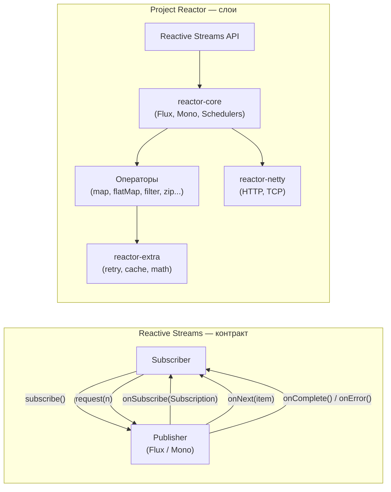
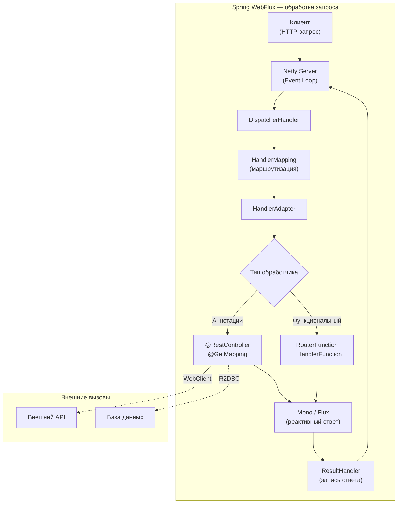
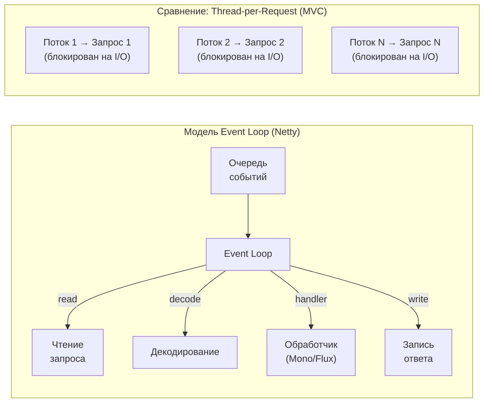
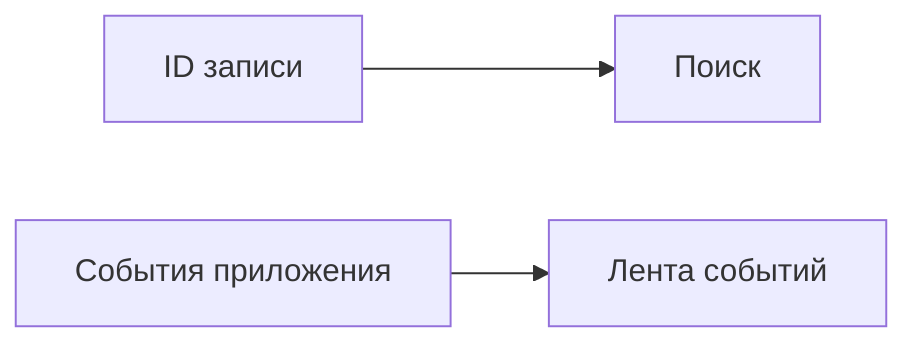
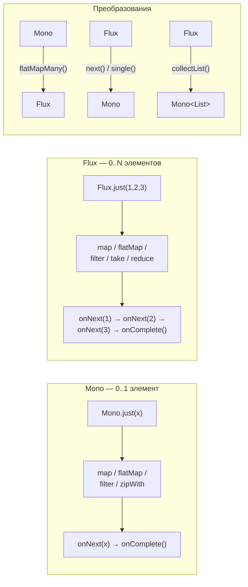
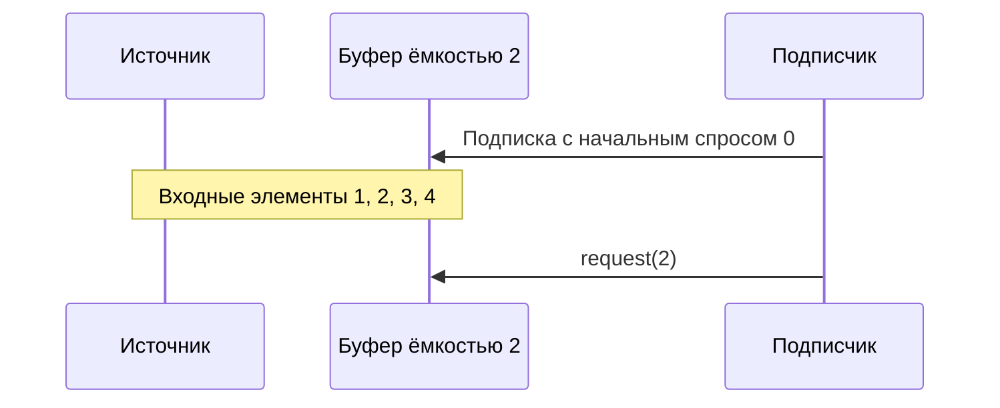
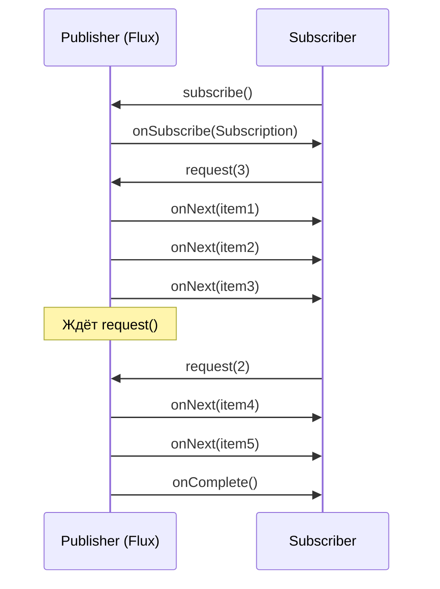
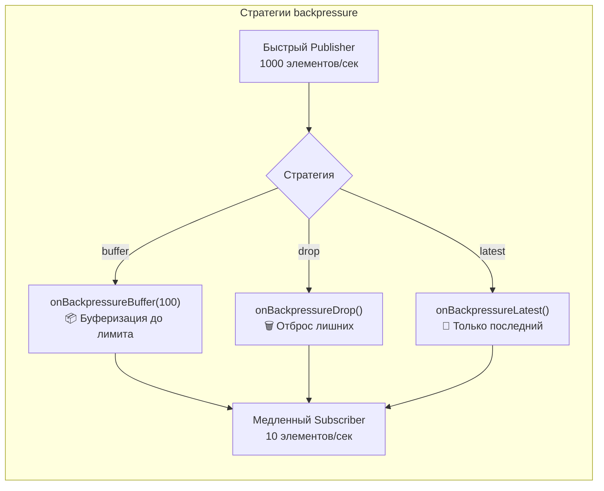
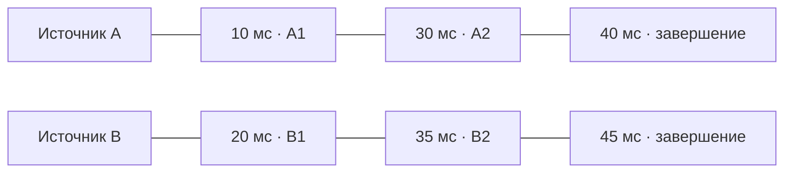

# Вопросы на собеседовании: `Spring WebFlux`

Краткие ответы по `Spring WebFlux`: `Mono / Flux`, реактивная модель, `WebClient`, отличия от `MVC`, `R2DBC`.

Краткое введение: `Spring WebFlux` — реактивный веб-стек на `Project Reactor`. На собеседованиях проверяют понимание реактивной модели, `Mono / Flux` и отличий от `Spring MVC`.

## Полезные ссылки

### Официальная документация

- [Spring WebFlux Documentation](https://docs.spring.io/spring-framework/reference/web/webflux.html) — основной справочник по реактивному веб-стеку
- [Project Reactor Reference](https://projectreactor.io/docs/core/release/reference/) — документация Reactor: Mono, Flux, операторы

### Baeldung

- [Guide to Spring WebFlux](https://www.baeldung.com/spring-webflux) — полный туториал по WebFlux
- [Difference Between Flux and Mono](https://www.baeldung.com/java-reactor-flux-vs-mono) — когда использовать Mono, а когда Flux
- [Spring WebClient](https://www.baeldung.com/spring-5-webclient) — реактивный HTTP-клиент: настройка и использование
- [Concurrency in Spring WebFlux](https://www.baeldung.com/spring-webflux-concurrency) — модель потоков, event loop и Schedulers
- [Set a Timeout in Spring WebClient](https://www.baeldung.com/spring-webflux-timeout) — настройка таймаутов и retry в WebClient
- [Using Reactor Mono.cache() for Memoization](https://www.baeldung.com/spring-reactor-mono-cache) — кеширование в реактивных цепочках

## Содержание

- [Полезные ссылки](#полезные-ссылки)
- [See also](#see-also)

**Основы Spring WebFlux**
- [Q1. Что такое `Project Reactor` и `Spring WebFlux`?](#q1-что-такое-project-reactor-и-spring-webflux)
- [Q2. (!) В чем отличие между `Project Reactor` и `Spring WebFlux`?](#q2--в-чем-отличие-между-project-reactor-и-spring-webflux)
- [Q3. (!) Какова архитектура `Project Reactor`?](#q3--какова-архитектура-project-reactor)
- [Q4. (!) Какова архитектура `Spring WebFlux`?](#q4--какова-архитектура-spring-webflux)

**Реактивное программирование**
- [Q5. Что такое реактивное программирование?](#q5-что-такое-реактивное-программирование)
- [Q6. Какие основные принципы реактивного программирования?](#q6-какие-основные-принципы-реактивного-программирования)
- [Q7. (!) Как реализована асинхронность в `Project Reactor`?](#q7--как-реализована-асинхронность-в-project-reactor)
- [Q8. (!) Как реализована асинхронность в `Spring WebFlux`?](#q8--как-реализована-асинхронность-в-spring-webflux)

**Flux, Mono и операторы**
- [Q9. Что такое `Flux` и `Mono` в `Project Reactor`?](#q9-что-такое-flux-и-mono-в-project-reactor)
- [Q10. Какие методы доступны для работы с реактивными потоками в `Spring WebFlux`?](#q10-какие-методы-доступны-для-работы-с-реактивными-потоками-в-spring-webflux)
- [Q11. Как обрабатывать ошибки в `Project Reactor`?](#q11-как-обрабатывать-ошибки-в-project-reactor)
- [Q12. Как обрабатывать ошибки в `Spring WebFlux`?](#q12-как-обрабатывать-ошибки-в-spring-webflux)
- [Q13. Как тестировать реактивные приложения, построенные на `Project Reactor` и `Spring WebFlux`?](#q13-как-тестировать-реактивные-приложения-построенные-на-project-reactor-и-spring-webflux)
- [Q14. Что такое `backpressure` и как с ним работать?](#q14-что-такое-backpressure-и-как-с-ним-работать)

**WebClient и R2DBC**
- [Q15. Чем `WebClient` отличается от `RestTemplate`?](#q15-чем-webclient-отличается-от-resttemplate)
- [Q16. Как использовать `R2DBC` с `Spring Data`?](#q16-как-использовать-r2dbc-с-spring-data)
- [Q17. Что такое `Schedulers` и когда какой использовать?](#q17-что-такое-schedulers-и-когда-какой-использовать)
- [Q18. Как реализовать `Server-Sent Events` (`SSE`) в `WebFlux`?](#q18-как-реализовать-server-sent-events-sse-в-webflux)
- [Q19. Что такое cold и hot publishers?](#q19-что-такое-cold-и-hot-publishers)
- [Q20. Как комбинировать `Mono` и `Flux` (zip, merge, concat)?](#q20-как-комбинировать-mono-и-flux-zip-merge-concat)

**Безопасность и маршрутизация**
- [Q21. Как обеспечить безопасность в `WebFlux` (`Spring Security`)?](#q21-как-обеспечить-безопасность-в-webflux-spring-security)
- [Q22. Что такое `RouterFunction` vs `@RestController`?](#q22-что-такое-routerfunction-vs-restcontroller)
- [Q23. Как валидировать запросы в реактивном стеке?](#q23-как-валидировать-запросы-в-реактивном-стеке)
- [Q24. Когда выбирать `WebFlux` вместо `Spring MVC`?](#q24-когда-выбирать-webflux-вместо-spring-mvc)

**Продвинутые темы**
- [Q25. Как обрабатывать таймауты и retry в реактивных цепочках?](#q25-как-обрабатывать-таймауты-и-retry-в-реактивных-цепочках)
- [Q26. Что такое `Reactor Context` и для чего он нужен?](#q26-что-такое-reactor-context-и-для-чего-он-нужен)
- [Q27. Как тестировать с `StepVerifier`?](#q27-как-тестировать-с-stepverifier)
- [Q28. Как обеспечить транзакционность в `R2DBC`?](#q28-как-обеспечить-транзакционность-в-r2dbc)
- [Q29. Какие метрики и мониторинг для `WebFlux`?](#q29-какие-метрики-и-мониторинг-для-webflux)
- [Q30. Какие best practices для реактивных приложений?](#q30-какие-best-practices-для-реактивных-приложений)

**Реактивная маршрутизация и фильтры**
- [Q31. (!) Как использовать `RouterFunction` для функционального стиля маршрутизации?](#q31--как-использовать-routerfunction-для-функционального-стиля-маршрутизации)
- [Q32. (!) Что такое `WebFilter` и как он работает?](#q32--что-такое-webfilter-и-как-он-работает)
- [Q33. Как реализовать `WebSocket` в `Spring WebFlux`?](#q33-как-реализовать-websocket-в-spring-webflux)
- [Q34. (!) Как настроить реактивный `WebClient` с retry и таймаутами?](#q34--как-настроить-реактивный-webclient-с-retry-и-таймаутами)
- [Q35. Как управлять `WebSession` в реактивном стеке?](#q35-как-управлять-websession-в-реактивном-стеке)
- [Q36. (!) Как интегрировать `R2DBC` с `Spring Data` и получить полностью реактивный стек?](#q36--как-интегрировать-r2dbc-с-spring-data-и-получить-полностью-реактивный-стек)
- [Q37. Какие операторы `Project Reactor` важнее всего знать для собеседования?](#q37-какие-операторы-project-reactor-важнее-всего-знать-для-собеседования)

**WebFlux и современные альтернативы**
- [Q38. Как WebFlux работает совместно с Virtual Threads (Java 21)?](#q38-как-webflux-работает-совместно-с-virtual-threads-java-21)
- [Q39. Как интегрировать Resilience4j с WebFlux?](#q39-как-интегрировать-resilience4j-с-webflux)
- [Q40. Как Spring Security работает в реактивном стеке?](#q40-как-spring-security-работает-в-реактивном-стеке)
- [Q41. Чем R2DBC отличается от JDBC и как использовать ReactiveCrudRepository?](#q41-чем-r2dbc-отличается-от-jdbc-и-как-использовать-reactivecrudrepository)
- [Q42. WebClient vs RestTemplate vs RestClient — когда что выбирать?](#q42-webclient-vs-resttemplate-vs-restclient--когда-что-выбирать)
- [Q43. Как тестировать WebFlux-приложения с WebTestClient и StepVerifier?](#q43-как-тестировать-webflux-приложения-с-webtestclient-и-stepverifier)

## Q1. Что такое `Project Reactor` и `Spring WebFlux`?

Это две связанные технологии для реактивного программирования в `Java`: `Project Reactor` — библиотека, `Spring WebFlux` — построенный на ней веб-фреймворк.

- **Project Reactor** — реактивная библиотека от команды `Spring`. Даёт два базовых типа: `Flux` (поток из нуля и более элементов) и `Mono` (ноль или один элемент), плюс богатый набор операторов для асинхронной обработки данных. Не привязана к вебу — её можно использовать в любом коде.
- **Spring WebFlux** — реактивный веб-модуль Spring Framework. Поддерживает аннотированные и функциональные обработчики, SSE и WebSocket. Пропускная способность зависит от сервера, конфигурации и зависимостей.

Примеры ориентированы на Spring Framework 6.2, Spring Boot 3.5 и Reactor 3.7.

## Q2. (!) В чем отличие между `Project Reactor` и `Spring WebFlux`?

Разница в уровне: Reactor — это библиотека реактивных типов, WebFlux — веб-фреймворк, который её использует.

- **Project Reactor** — самостоятельная библиотека: `Flux`, `Mono`, операторы, реализация спецификации `Reactive Streams`. Не зависит от веба и работает где угодно (сервисы, обработка данных, тесты).
- **Spring WebFlux** — модуль `Spring`, надстройка над Reactor для веб-слоя: аннотированные контроллеры (`@RestController` с возвратом `Mono`/`Flux`) или функциональные маршруты (`RouterFunction`), плюс реактивный `WebClient` для исходящих вызовов.

**Как запомнить:** Reactor можно подключить в проект без WebFlux, а WebFlux без Reactor существовать не может — он построен поверх его типов. На собеседовании частая ловушка — путать их или считать одним целым.

## Q3. (!) Какова архитектура `Project Reactor`?

В основе — спецификация **Reactive Streams** из четырёх интерфейсов:

- **Publisher** — источник данных (в Reactor это `Flux` и `Mono`).
- **Subscriber** — потребитель: получает данные через колбэки `onNext` / `onComplete` / `onError`.
- **Subscription** — связь между ними; через неё подписчик запрашивает данные (`request(n)`) и управляет потоком (`backpressure`).
- **Processor** — одновременно и Publisher, и Subscriber (промежуточное звено).

Сначала собирается цепочка операторов. Подписка связывает источник с подписчиком, а `request(n)` задаёт спрос. `Mono.just(load())` вычисляет `load()` при сборке. `Mono.defer(() -> source())` вызывает фабрику на подписке. Горячий источник может генерировать события независимо от подписки. [Reactor Reference](https://projectreactor.io/docs/core/release/reference/).



**Связь с Java:** сам `Reactive Streams` API вошёл в JDK 9+ как `java.util.concurrent.Flow` (см. [Java Concurrency](../../programming-languages/java/java-concurrency-interview.md)). Reactor совместим с ним и даёт мост через `JdkFlowAdapter` — поэтому его типы можно стыковать со стандартными `Flow.Publisher`/`Flow.Subscriber`.

## Q4. (!) Какова архитектура `Spring WebFlux`?

Архитектура повторяет `MVC` по структуре, но работает на неблокирующем стеке. Запрос проходит цепочку:

- **DispatcherHandler** — реактивный аналог `DispatcherServlet`: принимает запрос и оркеструет обработку.
- **HandlerMapping** — сопоставляет `URL` с нужным обработчиком.
- **HandlerAdapter** — вызывает обработчик и адаптирует результат.
- **Обработчик** — возвращает результат, например реактивное тело или функциональный `ServerResponse`.

Маршруты задают аннотациями или через `RouterFunction`. HTTP-абстракции WebFlux подключаются к серверу через адаптер.

В Boot 3.5 WebFlux starter по умолчанию подключает Reactor Netty. Возможны и другие серверы, например Tomcat и Jetty. Число потоков зависит от сервера и настроек. [WebFlux Overview](https://docs.spring.io/spring-framework/reference/6.2/web/webflux/new-framework.html).



MVC использует `DispatcherServlet` и поддерживает Servlet async. WebFlux использует `DispatcherHandler` и реактивную обработку HTTP.

## Q5. Что такое реактивное программирование?

Реактивное программирование описывает обработку сигналов и данных. Доставка может быть синхронной или асинхронной. Блокирующий callback продолжает занимать выполняющий его поток.

Ключевая разница с обычным (императивным) подходом: вместо «вызвал метод → ждём ответа → продолжили» мы строим конвейер из операторов и подписываемся на результат. Когда данные приходят, конвейер срабатывает сам.

Из чего складывается подход:

- **Потоки данных (Streams)** — последовательности событий или значений во времени; их обрабатывают и передают дальше.
- **Функциональные операторы** — `map`, `filter`, `flatMap` и др.: преобразуют, фильтруют и комбинируют потоки декларативно.
- **Подписки (Subscriptions)** — компонент подписывается на поток и реагирует на каждое новое значение.
- **Асинхронность** — источник может доставить сигнал позже, например после завершения неблокирующего I/O.

**Где применяют:** веб-приложения, микросервисы, шлюзы — везде, где много одновременных I/O-операций и важна масштабируемость при ограниченном числе потоков.

## Q6. Какие основные принципы реактивного программирования?

Четыре из них формулирует **Reactive Manifesto** — это свойства реактивной *системы*; остальные два описывают реактивный *код*.

Свойства системы (Reactive Manifesto):

- **Отзывчивость (Responsive)** — система отвечает быстро и предсказуемо; цель остальных трёх свойств — обеспечить именно это.
- **Эластичность (Elastic)** — производительность масштабируется под нагрузку: добавили ресурсов — выросла пропускная способность, без узких мест на блокирующих потоках.
- **Устойчивость к сбоям (Resilient)** — отказ одной части не роняет всю систему; ошибки изолируются и обрабатываются (восстановление, fallback).
- **Сообщения (Message-driven)** — компоненты общаются асинхронными сообщениями, что и даёт слабую связанность, изоляцию сбоев и эластичность.

Свойства кода, которыми всё это достигается:

- **Асинхронность и неблокирующий I/O** — операции не блокируют поток в ожидании результата, поэтому горстка потоков обслуживает множество запросов.
- **Декларативная обработка потоков** — данные текут через цепочку операторов (`map`, `filter`, `flatMap`), а подписчик реагирует на каждое новое значение и сигнал backpressure.

Отзывчивость и устойчивость системы зависят также от ресурсов, изоляции отказов и поведения зависимостей.

## Q7. (!) Как реализована асинхронность в `Project Reactor`?

Асинхронность в Reactor держится на двух вещах: реактивных типах (`Flux`/`Mono`) и планировщиках (`Schedulers`).

- **Сборка и подписка.** `just(value)` захватывает уже вычисленное значение, `defer` запускает фабрику при подписке.
- **Исполнение.** Callback обычно работает в потоке доставки сигнала. Синхронный источник может использовать поток подписки, а I/O-источник — поток своего runtime.

Примеры планировщиков:

- `Schedulers.parallel()` — пул из N потоков (по числу ядер) для параллельных CPU-задач.
- `Schedulers.single()` — один поток для строго последовательного выполнения.

`flatMap`, `merge` и `zip` сами не создают потоки. Границы исполнения определяют источники и планировщики.

## Q8. (!) Как реализована асинхронность в `Spring WebFlux`?

Асинхронность в WebFlux обеспечивают четыре связанных элемента — реактивные типы, неблокирующий I/O, реактивные контроллеры и event-loop-сервер:

1. **Реактивные типы данных.** Контроллер может вернуть `Mono<T>` или `Flux<T>`, чтобы MVC-подобная инфраструктура WebFlux обработала результат по сигналам.
2. **Неблокирующий I/O.** Неблокирующие HTTP-клиенты и драйверы БД позволяют не занимать поток ожиданием операции.
3. **Реактивные контроллеры.** `@GetMapping` и прочие маппинги выглядят как в [Spring MVC](spring-mvc-interview.md), а метод может возвращать реактивный или синхронный результат.
4. **Сервер.** Reactor Netty по умолчанию в Boot использует event loop. Размер пула зависит от версии и настроек сервера.



Синхронный MVC-обработчик может занимать поток до завершения запроса. Servlet async позволяет освободить поток исходного dispatch и завершить ответ позже. Число соединений и задержку сравнивают измерениями.

## Q9. Что такое `Flux` и `Mono` в `Project Reactor`?

Какой тип Reactor подходит каждому из этих контрактов?

```text
A: поиск записи по ID. Запись может отсутствовать.
B: лента событий. Новые события поступают, пока подписка активна.
```



**Разбор.** `Flux` и `Mono` — два базовых реактивных типа Reactor. Разница только в кардинальности: сколько элементов может прийти.

**`Flux<T>` — поток из 0..N элементов.** Это асинхронная «коллекция»: конечная (как список) или бесконечная (как `Flux.interval`). Поддерживает все операторы преобразования, фильтрации и комбинирования, а также параллельную обработку.

Пример использования `Flux`:

```java
Flux<Integer> numbers = Flux.just(1, 2, 3, 4, 5);
numbers.map(n -> n * 2).filter(n -> n > 5).subscribe(System.out::println);
```

**`Mono<T>` — 0..1 элемент.** Аналог `Optional`, а в других библиотеках — `Single`/`Maybe`. Подходит для результата одиночной операции: запрос по id, сохранение сущности, вызов сервиса, который вернёт одно значение или ничего.

Пример использования `Mono`:

```java
Mono<String> greeting = Mono.just("Hello");
greeting.map(s -> s + " World").subscribe(System.out::println);
```



Оба типа доставляют данные и терминальный сигнал. `Flux.reduce` возвращает `Mono`. Асинхронность и повторное вычисление зависят от источника.

## Q10. Какие методы доступны для работы с реактивными потоками в `Spring WebFlux`?

Это операторы Reactor — методы `Flux`/`Mono`, которые строят цепочку обработки. Их сотни; на собеседовании достаточно уверенно владеть базовым набором по группам:

Преобразование и фильтрация:

- **`map`** — синхронно преобразует каждый элемент (`1:1`).
- **`flatMap`** отображает элемент во вложенный publisher и объединяет результаты. Новые потоки сам оператор не создаёт.
- **`filter`** — пропускает только элементы, удовлетворяющие условию.

Ограничение и агрегация:

- **`take`** — берёт первые N элементов и завершает поток.
- **`reduce`** — сворачивает поток в одно значение (агрегация в `Mono`).

Комбинирование и обработка ошибок:

- **`zip`** объединяет элементы по позиции, когда есть значение от каждого источника.
- **`onErrorResume`** — подставляет альтернативный поток при ошибке.
- **`retry`** — повторяет цепочку при ошибке.

Помимо операторов, реактивный стек даёт компоненты для I/O: `WebClient` для HTTP-вызовов и `R2DBC` для реактивного доступа к БД — они возвращают `Mono`/`Flux` и встраиваются в те же цепочки.

## Q11. Как обрабатывать ошибки в `Project Reactor`?

Ошибка в реактивном потоке — это терминальный сигнал `onError`: он прекращает поток так же, как исключение прерывает обычный код. Reactor даёт операторы, чтобы перехватить ошибку и решить, что делать дальше — вернуть запасное значение, переключиться на другой поток или повторить попытку.

1. `doOnError`: побочное действие при ошибке — логирование, метрики, алерт. Важный нюанс: оператор **не перехватывает** ошибку и не «гасит» её — поток всё равно завершится сигналом `onError`, который пойдёт дальше по цепочке. Это «подсмотреть», а не «обработать». Отдельного оператора `onError` в Reactor нет: `onError` — это терминальный *сигнал*, а реагируют на него `doOnError` и операторы семейства `onError*` ниже.

```java
flux.doOnError(err -> {
    // побочное действие при ошибке (лог, метрика); ошибка идёт дальше
})
```

2. `onErrorReturn`: при ошибке подставляет фиксированное значение по умолчанию вместо неё — поток завершается этим значением, а не падает.

```java
flux.onErrorReturn("Default Value")
```

3. `onErrorResume`: при ошибке переключается на альтернативный поток (в отличие от `onErrorReturn`, который даёт одно значение, — здесь можно вернуть целый `Mono`/`Flux`, например запрос к резервному источнику).

```java
flux.onErrorResume(err -> {
    // вернуть альтернативный поток
})
```

4. `retry`: повторно подписывается на источник при ошибке (по сути — перезапускает операцию). Можно задать число попыток или, через `retryWhen`, условия и задержку между ними.

```java
flux.retry(3) // до трёх переподписок после первой попытки
```

**Как выбрать:** запасное значение → `onErrorReturn`; запасной поток/источник → `onErrorResume`; повтор → `retry`/`retryWhen`; только залогировать, не глуша ошибку → `doOnError`.

## Q12. Как обрабатывать ошибки в `Spring WebFlux`?

В WebFlux ошибки ловят на разных уровнях — от точечного перехвата в цепочке до глобального обработчика на всё приложение. Выбор зависит от того, насколько широко нужно покрыть ошибки.

1. **`@ExceptionHandler` (локально/в `@ControllerAdvice`)** — метод-обработчик для конкретного типа исключения: логирует, формирует кастомный ответ. Удобно для доменных исключений с понятным маппингом на HTTP-статус.

```java
@ExceptionHandler(YourException.class)
public ResponseEntity<ProblemDetail> handleYourException(YourException ex) {
    ProblemDetail body = ProblemDetail.forStatusAndDetail(
        HttpStatus.INTERNAL_SERVER_ERROR, "Custom error message");
    return ResponseEntity.status(HttpStatus.INTERNAL_SERVER_ERROR).body(body);
}
```

2. **`WebExceptionHandler`** может обработать ошибку или передать её следующему обработчику error-сигналом. Подтверждённый ответ произвольно заменить нельзя. [WebFlux Exceptions](https://docs.spring.io/spring-framework/reference/6.2/web/webflux/controller/ann-exceptions.html).

```java
@Component
public class CustomExceptionHandler implements WebExceptionHandler {
    @Override
    public Mono<Void> handle(ServerWebExchange exchange, Throwable ex) {
        ServerHttpResponse response = exchange.getResponse();
        if (response.isCommitted()) {
            return Mono.error(ex);
        }
        response.setStatusCode(HttpStatus.INTERNAL_SERVER_ERROR);
        response.getHeaders().setContentType(MediaType.TEXT_PLAIN);
        DataBuffer buffer = response.bufferFactory()
            .wrap("Custom error message".getBytes(StandardCharsets.UTF_8));
        return response.writeWith(Mono.just(buffer));
    }
}
```

3. **Оператор `onErrorResume` (точечно в цепочке)** — обработка ошибки прямо в реактивном конвейере: подставляет альтернативный поток или ответ. Подходит, когда обработка специфична для конкретной операции, а не общая для приложения.

```java
flux.onErrorResume(ex -> {
    // обработка ошибки
    return Mono.just("Error occurred");
})
```

4. **`HandlerExceptionResolver` (Servlet-механизм, для сравнения).** Это глобальный обработчик из мира `Spring MVC` (Servlet-стек, `HttpServletRequest`, `ModelAndView`). В чисто реактивном WebFlux он не используется — его реактивный аналог как раз `WebExceptionHandler` из п. 2. Полезно знать различие, чтобы не перепутать стеки на собеседовании.

```java
@Component
public class GlobalExceptionHandler implements HandlerExceptionResolver {
    @Override
    public ModelAndView resolveException(HttpServletRequest request, HttpServletResponse response, Object handler, Exception ex) {
        // обработка исключения
        ModelAndView modelAndView = new ModelAndView();
        modelAndView.addObject("errorMessage", "An error occurred");
        modelAndView.setViewName("error");
        return modelAndView;
    }
}
```

**Эмпирическое правило:** локальная ошибка одной операции → `onErrorResume`; маппинг доменных исключений на ответы → `@ExceptionHandler` в `@ControllerAdvice`; единый перехват всего → `WebExceptionHandler`.

## Q13. Как тестировать реактивные приложения, построенные на `Project Reactor` и `Spring WebFlux`?

Тестируют на двух уровнях: реактивные цепочки (сервисы) — через `StepVerifier`, HTTP-эндпоинты — через `WebTestClient`.

- **`StepVerifier` (Reactor)** — для unit-тестов `Mono`/`Flux`. Подписывается на поток и пошагово проверяет: ожидаемые элементы (`expectNext`), ошибки (`expectError`), завершение (`verifyComplete`). Главное преимущество — корректно работает с асинхронностью, а через виртуальное время (`withVirtualTime`) тестирует `delay`/`interval` без реальных задержек.
- **`WebTestClient` (Spring)** — для интеграционных тестов контроллеров: шлёт HTTP-запросы и проверяет статус, заголовки, тело. Умеет работать как против запущенного сервера, так и против замоканного (`@WebFluxTest`, `bindToRouterFunction`).
- **JUnit + `Mockito`** — для компонентов без HTTP: моки репозиториев/сервисов возвращают `Mono.just(...)`/`Flux.just(...)`, а результат проверяется через `StepVerifier`.
- **Тестовая БД** — для интеграции с хранилищем: эмбеддед-варианты вроде `H2` или `Embedded MongoDB` проверяют реальные запросы.

**Главный нюанс реактивного тестирования:** поток ничего не делает без подписки. `StepVerifier` сам подписывается при `verify()`; если просто вызвать сервис и не проверить через верификатор — тест не выполнит цепочку и ничего не проверит.

## Q14. Что такое `backpressure` и как с ним работать?

Какие сигналы получит подписчик в Reactor 3.7.0?

```text
Источник: Flux.range(1, 4)
Оператор: onBackpressureBuffer(2)
Начальный спрос подписчика: 0
После синхронной подписки: request(2)
```



**Разбор.** **Backpressure** — механизм протокола `Reactive Streams`, при котором подписчик через `Subscription.request(n)` сообщает издателю, сколько элементов он готов принять. Это предотвращает переполнение потребителя, когда издатель выдаёт данные быстрее, чем потребитель их обрабатывает.





В `Project Reactor backpressure` поддерживается из коробки: при подписке передаётся запрос на объём данных. Операторы обратной связи:

- **`onBackpressureBuffer(int capacity)`** — буферизует элементы до заданного лимита; при переполнении по умолчанию бросает overflow-ошибку (`Exceptions.failWithOverflow()` → сигнал `onError` с `IllegalStateException`); можно задать стратегию переполнения (DROP_OLDEST и т.д.).
- **`onBackpressureDrop()`** — отбрасывает элементы, которые потребитель не успел запросить; подходит, когда допустима потеря части данных (например, сенсорные сэмплы).
- **`onBackpressureLatest()`** — хранит только последний необработанный элемент; старые отбрасываются; полезно для «текущего значения» (например, курс, температура).

Для медленного потребителя (запись в БД, внешний `API`) часто ограничивают параллелизм через **`flatMap(`maxConcurrency`)`**, а не полагаются только на буфер: `flux.flatMap(item -> saveToDb(item), 10)` — не более 10 одновременных сохранений.

```java
// Нулевой начальный спрос позволяет воспроизвести переполнение.
StepVerifier.create(Flux.range(1, 4).onBackpressureBuffer(2), 0)
    .thenRequest(2)
    .expectNext(1, 2)
    .expectErrorMatches(Exceptions::isOverflow)
    .verify(Duration.ofSeconds(1));

// Ограничение параллелизма вместо неограниченного потока
Flux.range(1, 1000)
    .flatMap(id -> repository.save(entity(id)), 5)
    .subscribe();
```

При переполнении источник останавливается, а `onBackpressureBuffer(2)` передаёт ошибку после выдачи двух уже накопленных элементов. Обычный `subscribe(consumer)` запрашивает неограниченный спрос. Медленный синхронный callback сам по себе не демонстрирует переполнение.

## Q15. Чем `WebClient` отличается от `RestTemplate`?

| Критерий | `WebClient` | `RestTemplate` |
|----------|-----------|--------------|
| Модель | Реактивная, неблокирующая | Блокирующая (один запрос — один поток) |
| Возвращаемый тип | `Mono<T>`, `Flux<T>` | `ResponseEntity<T>`, тело напрямую |
| Транспорт | `ClientHttpConnector` по classpath или настройке | `ClientHttpRequestFactory` зависит от способа создания и настройки |
| Ожидание I/O | Неблокирующее с подходящим коннектором | Занимает вызывающий поток |

**WebClient** предпочтителен в реактивном стеке (`Spring WebFlux`), при высокой нагрузке и при необходимости стриминга тела ответа (`bodyToFlux`). **RestTemplate** проще для синхронного кода и legacy-интеграций.

В `WebFlux`-приложении вызов **RestTemplate** блокирует event loop; если его нельзя убрать, выполняют в отдельном пуле: `Mono.fromCallable(() -> restTemplate.getForObject(...)).subscribeOn(Schedulers.boundedElastic())`. Для новых интеграций используют `WebClient`.

```java
// WebClient — один запрос, Mono
WebClient client = WebClient.create("https://api.example.com");
Mono<User> user = client.get()
    .uri("/users/{id}", id)
    .retrieve()
    .bodyToMono(User.class);

// Стриминг списка
Flux<Item> items = client.get()
    .uri("/items")
    .retrieve()
    .bodyToFlux(Item.class);

// В тесте или при миграции — блокирующий вызов (не в реактивной цепочке!)
User u = user.block(Duration.ofSeconds(5));
```

`WebClient` также доступен из MVC. `new RestTemplate()` и клиент, собранный Boot, могут использовать разные фабрики запросов. [Spring REST Clients](https://docs.spring.io/spring-framework/reference/6.2/integration/rest-clients.html).

## Q16. Как использовать `R2DBC` с `Spring Data`?

`R2DBC` — реактивный доступ к реляционным БД; со `Spring Data` он работает почти как `JPA`, но репозитории отдают `Mono`/`Flux` вместо синхронных объектов.

Что нужно сделать:

- Подключить стартер `spring-boot-starter-data-r2dbc` и драйвер БД, настроить `ConnectionFactory`.
- Объявить репозиторий, наследующий `ReactiveCrudRepository`; его методы возвращают `Mono`/`Flux`.
- Запросы задаются как derived queries (по имени метода) или через `@Query` с SQL.
- Транзакции — через `@Transactional` в сервисе (работает реактивный `ReactiveTransactionManager`) или программно через `TransactionalOperator`.

**Чего нет по сравнению с JPA:** кэша 2-го уровня, lazy-загрузки связей и автоматических `@OneToMany`. Связанные сущности приходится грузить явными запросами. Это плата за неблокирующую модель — подробнее в Q36 и Q41.

## Q17. Что такое `Schedulers` и когда какой использовать?

Подписка начинается на потоке обработки HTTP. Как планировать блокирующий источник и вычислительный этап?

```text
Блокирующий источник: blockingService.call() ждёт ответ внешней системы.
Вычислительный этап: heavyComputation(n) выполняет тяжёлое вычисление для каждого входного значения.
```

**Разбор.** `Schedulers` задают пул потоков (подробнее о пулах — в [Java Concurrency](../../programming-languages/java/java-concurrency-interview.md)) для операторов:

| Scheduler | Потоки | Назначение |
|-----------|--------|------------|
| `parallel()` | Фиксированный пул (N = кол-во ядер) | CPU-bound задачи |
| `boundedElastic()` | Растущий пул с лимитом | Блокирующий I/O (JDBC, файлы) |
| `single()` | Один поток | Последовательные задачи |
| `immediate()` | Текущий поток | Без переключения |

`publishOn` переносит downstream на worker, но сам не распараллеливает элементы. `subscribeOn` планирует подписку и взаимодействие с источником, а асинхронный источник может использовать свои потоки. Для блокирующей операции используют `fromCallable` с `subscribeOn(boundedElastic())` рядом с источником.

```java
// Последовательный map на одном worker
Flux.range(1, 100)
    .publishOn(Schedulers.parallel())
    .map(n -> heavyComputation(n))
    .subscribe();

// Блокирующий вызов на boundedElastic
Mono.fromCallable(() -> blockingService.call())
    .subscribeOn(Schedulers.boundedElastic())
    .flatMap(result -> reactiveProcess(result))
    .subscribe();
```

## Q18. Как реализовать `Server-Sent Events` (`SSE`) в `WebFlux`?

**SSE** — однонаправленный поток событий от сервера к клиенту по одному долгоживущему HTTP-соединению. В WebFlux он ложится на `Flux` естественно: эндпоинт просто возвращает поток, а фреймворк дописывает каждый элемент в открытый ответ по мере появления.

Как реализовать:

- Контроллер возвращает `Flux<T>` или `Flux<ServerSentEvent<T>>` с типом контента `MediaType.TEXT_EVENT_STREAM_VALUE`: `@GetMapping(produces = MediaType.TEXT_EVENT_STREAM_VALUE) Flux<Event> stream()`.
- `Flux<ServerSentEvent<T>>` нужен, когда хотите управлять метаданными события (id, event-name, retry); для простого случая хватает `Flux<T>`.
- Событие собирают через `ServerSentEvent.builder(...).build()`.

**Клиент:** `EventSource` в браузере или `WebTestClient.bodyToFlux(ServerSentEvent.class)` в тестах. Соединение держится открытым, пока `Flux` не завершится.

**Сценарий применения:** push-уведомления, прогресс долгой задачи, котировки, лента событий. Если нужна двусторонняя связь — это уже `WebSocket` (Q33).

## Q19. Что такое cold и hot publishers?

Различие — в том, когда возникают данные и сколько раз они генерируются.

- **Cold publisher** создаёт работу для каждой подписки, например HTTP-запрос. `defer` вызывает фабрику на подписке. `just` отдаёт ранее захваченное значение.
- **Hot publisher** может делить активный источник между подписчиками. Поздний подписчик может получить историю, если она сохраняется через `replay` или `cache`.

**Почему это важно:** повторная подписка может повторить HTTP-запрос и его эффекты. Hot нужен для широковещания событий, когда один источник кормит много подписчиков и дублировать работу не нужно (биржевые тики, шина событий).

**Подводный камень:** превратить cold в hot (`share()`) без понимания приводит к тому, что поздние подписчики теряют ранние элементы. Если нужно, чтобы они получили историю, используют буферизацию (`replay()`/`cache()`).

## Q20. Как комбинировать `Mono` и `Flux` (zip, merge, concat)?

Какие значения и в каком порядке выдаст каждый способ комбинирования? Оба источника холодные. Время задано от подписки на соответствующий источник. Спрос подписчика не ограничен.

```text
Источник A: A1 через 10 мс, A2 через 30 мс, завершение через 40 мс.
Источник B: B1 через 20 мс, B2 через 35 мс, завершение через 45 мс.
```



**Разбор.** `zip` требует значения каждого источника. При пустом источнике `Mono.zip` может завершиться без результата. `merge` объединяет сигналы по готовности, а `concat` подписывается на источники по очереди. Операторы не создают потоки сами.

```mermaid
graph TB
    subgraph "Операторы комбинирования"
        direction TB

        subgraph "zip — попарно"
            ZA["Mono A: 👤 User"] --> ZIP["Mono.zip(A, B)"]
            ZB["Mono B: 📋 Orders"] --> ZIP
            ZIP --> ZR["Tuple2(User, Orders)"]
        end

        subgraph "merge — чередование по готовности"
            MA["Flux 1: A₁ A₂ A₃"] --> MERGE["Flux.merge(1, 2)"]
            MB["Flux 2: B₁ B₂"] --> MERGE
            MERGE --> MR["A₁ B₁ A₂ B₂ A₃"]
        end

        subgraph "concat — последовательно"
            CA["Flux 1: A₁ A₂"] --> CONCAT["Flux.concat(1, 2)"]
            CB["Flux 2: B₁ B₂"] --> CONCAT
            CONCAT --> CR["A₁ A₂ B₁ B₂"]
        end

        subgraph "flatMap — 1:N трансформация"
            FM["Flux: id₁ id₂ id₃"] --> FMAP["flatMap(id → getOrders(id))"]
            FMAP --> FR["Order₁₁ Order₂₁ Order₁₂ ..."]
        end
    end
```



В заданном сценарии `zip` выдаёт пары `(A1, B1)` и `(A2, B2)`. `merge` выдаёт `A1, B1, A2, B2`. `concat` выдаёт `A1, A2, B1, B2`: отсчёт задержек источника B начинается после завершения A.

**Когда что использовать:**

| Оператор | Порядок | Подписки | Типичный сценарий |
|----------|---------|----------------|-------------------|
| `zip` | Попарно | Нужно значение каждого | Собрать данные из нескольких источников |
| `merge` | По готовности | Могут перекрываться | Объединить события из нескольких потоков |
| `concat` | Последовательный | По очереди | Чтение двух источников по порядку |
| `flatMap` | По готовности | Могут перекрываться | Запрос вложенных данных |
| `concatMap` | Последовательный | По очереди | Порядок важен |

```java
// zip — объединение результатов запроса пользователя и его заказов
Mono<User> user = userService.findById(id);
Mono<List<Order>> orders = orderService.findByUserId(id);
Mono<UserProfile> profile = Mono.zip(user, orders)
    .map(t -> new UserProfile(t.getT1(), t.getT2()));

// merge — объединение событий из нескольких источников
Flux<Event> allEvents = Flux.merge(
    kafkaEvents,
    webSocketEvents,
    scheduledEvents
);

// concat — сначала кэш, потом БД, если подписка ещё активна
Flux<Product> products = Flux.concat(
    cacheService.find(query),
    databaseService.find(query)
).take(10);
```

Чтобы обратиться к БД только при пустом кэше, используйте `cacheService.find(query).switchIfEmpty(Flux.defer(() -> databaseService.find(query)))`.

## Q21. Как обеспечить безопасность в `WebFlux` (`Spring Security`)?

Подробнее о `Spring Security` — в [Spring Security](spring-security-interview.md). В реактивном стеке используются реактивные аналоги:

- **`ReactiveUserDetailsService`** вместо `UserDetailsService`
- **`ServerSecurityContextRepository`** вместо `SecurityContextRepository`
- **`SecurityWebFilterChain`** вместо `SecurityFilterChain`
- Фильтры работают с `ServerWebExchange` вместо `HttpServletRequest`

**Ключевая идея:** механизм тот же (фильтры, аутентификация, авторизация), но всё неблокирующее и возвращает `Mono`. Самое важное отличие — `SecurityContext` хранится не в `ThreadLocal` (он бесполезен в event-loop-модели, где запрос «прыгает» между потоками), а в **Reactor Context**. Доступ к нему — через `ReactiveSecurityContextHolder.getContext()`, и он автоматически прокидывается по цепочке. Подробнее с примерами конфигурации — в Q40.

## Q22. Что такое `RouterFunction` vs `@RestController`?

Это два стиля описания маршрутов в WebFlux; функционально они равноценны, разница — в подходе.

- **`@RestController`** — аннотационная модель, как в `Spring MVC`: маршруты «прибиты» к методам через `@GetMapping` и т.п. Привычнее, меньше шаблонного кода, понятна большинству.
- **`RouterFunction`** — функциональная модель: маршруты описываются явно в коде как данные (`route().GET(...).build()`), а логика — в отдельных `HandlerFunction`. Маршрутизация отделена от обработки.

**Когда что:** `@RestController` — для типового `REST API` (по умолчанию). `RouterFunction` — когда маршруты собираются динамически/программно, нужна лёгкая композиция и тестирование без поднятия HTTP-сервера (`bindToRouterFunction`). Оба стиля можно смешивать в одном приложении. Подробный пример — в Q31.

Функциональный handler возвращает `Mono<ServerResponse>`. В аннотированном API можно вернуть `Mono<Dto>`, `ResponseEntity<Dto>` или `ProblemDetail` для ошибки (Q12).

## Q23. Как валидировать запросы в реактивном стеке?

Валидация работает через привычный Bean Validation — `@Valid` с `@RequestBody` в WebFlux **работает так же надёжно, как в MVC**. Разница не в том, «сработает ли проверка», а в том, *как приходит ошибка*.

- На параметре ставят `@Valid` вместе с телом: `@Valid @RequestBody Dto body` — обычный вариант, проверка выполняется после десериализации тела. Можно валидировать и обёрнутое тело: `@Valid @RequestBody Mono<Dto> body` — тогда проверка произойдёт в момент, когда тело реально прочитано и `Mono` материализуется.
- При нарушении ограничений возникает `WebExchangeBindException` (реактивный аналог `MethodArgumentNotValidException` из MVC). **Ключевой реактивный нюанс:** с `Mono<Dto>` ошибка не бросается синхронно до входа в метод, а приходит **error-сигналом внутри реактивной цепочки** — её можно перехватить точечно через `onErrorResume` прямо на `Mono` тела.
- Глобально ошибку перехватывают в `@ControllerAdvice` через `@ExceptionHandler(WebExchangeBindException.class)` и формируют понятный ответ (список полей с ошибками); без обработчика клиент получит `400 Bad Request`.

**Для functional endpoints** (`RouterFunction`, Q31) автоматической валидации нет — там `Validator` вызывают вручную внутри `HandlerFunction`.

При встроенной валидации метода, например с прямым ограничением на параметре, возможен `HandlerMethodValidationException`. Это отдельная ветка от проверки DTO. `@Validated` на классе контроллера включает AOP-валидацию вместо встроенной валидации метода. [WebFlux Validation](https://docs.spring.io/spring-framework/reference/6.2/web/webflux/controller/ann-validation.html).

## Q24. Когда выбирать `WebFlux` вместо `Spring MVC`?

Выбор зависит от измеренной нагрузки и поддержки неблокирующих операций в зависимостях. WebFlux может помочь при высокой конкурентности I/O, если работа не блокирует event loop. Учитывайте стоимость миграции и ограничения внешних систем.

MVC поддерживает Servlet async, SSE и реактивный `WebClient`. Для JDBC и других блокирующих зависимостей стоит сравнить оба варианта на своём профиле нагрузки. Универсального порога соединений нет. [WebFlux Overview](https://docs.spring.io/spring-framework/reference/6.2/web/webflux/new-framework.html).

## Q25. Как обрабатывать таймауты и retry в реактивных цепочках?

Таймауты и повторы строятся из трёх операторов, которые ставят в цепочку друг за другом:

- **`timeout(Duration)`** — если за указанное время не пришёл следующий элемент, поток падает с `TimeoutException`. Вариант `timeout(Duration, fallback)` вместо ошибки переключается на запасной `Mono`/`Flux`.
- **`retry(n)`** — при ошибке переподписывается на источник до n раз (без задержки). Для внешних вызовов так делать опасно — мгновенные повторы добивают уже перегруженный сервис.
- **`retryWhen(Retry.backoff(...))`** — правильный способ для сети: повторы с нарастающей задержкой (экспоненциальный backoff) и `jitter`, чтобы развести во времени волну ретраев от множества клиентов.

Для `Mono` таймаут до `retryWhen` ограничивает попытку, а после него — весь вызов с задержками. Повторяйте только выбранные временные ошибки с учётом идемпотентности. Fallback учитывает тип ошибки при исчерпании повторов (Q34).

## Q26. Что такое `Reactor Context` и для чего он нужен?

**Reactor Context** — это иммутабельное хранилище «ключ-значение», привязанное к подписке. По сути, реактивная замена `ThreadLocal`: в event-loop-модели обработка «прыгает» между потоками, поэтому `ThreadLocal` не работает, а Context следует за цепочкой независимо от того, на каком потоке выполняется оператор.

Как с ним работают:

- **Запись** — `contextWrite(...)`. Важная особенность: контекст распространяется *снизу вверх* (от подписчика к источнику), поэтому `contextWrite` ставят **после** операторов, которые должны его видеть.
- **Чтение** — `deferContextual(ctx -> ...)` или специальные перегрузки операторов.
- Контекст иммутабелен: каждая запись создаёт новый экземпляр, старые значения не перезаписываются «вживую».

**Зачем нужен:** прокинуть сквозные данные без захламления сигнатур методов — `traceId` для трассировки, `SecurityContext` (так его и хранит Spring Security, Q40), локаль, tenant.

Вложенный publisher в `flatMap` участвует в композиции и может читать контекст downstream-подписчика. Отдельный ручной `subscribe()` не наследует его автоматически. `contextWrite` влияет на доступный контекст выше себя. [Reactor Context](https://projectreactor.io/docs/core/release/reference/advancedFeatures/context.html).

## Q27. Как тестировать с `StepVerifier`?

`StepVerifier.create(`fluxOrMono`)` — создать верификатор. Затем: `expectNext(...)`, `expectNextCount(n)`, `expectComplete()`, `expectError()`, `expectNextMatches(...)`. Завершить вызовом `verify()` или `verify(`Duration`)`. Для виртуального времени — `StepVerifier.withVirtualTime(() -> flux).thenAwait(...).expectNext(...).verify()`.

**Пример:** `StepVerifier.create(service.getUser(id)).expectNextMatches(u -> u.getName().equals("Alice")).expectComplete().verify(Duration.ofSeconds(2))` — проверяем, что `Mono` выдаёт один элемент и завершается. Для `Flux`: `expectNext(1).expectNext(2).expectNextCount(5).expectComplete().verify()`. Без вызова `verify()` подписка не выполняется — тест не проверит поток.

## Q28. Как обеспечить транзакционность в `R2DBC`?

Транзакции в R2DBC реактивные — управляются `ReactiveTransactionManager`. Есть три способа, от самого удобного к самому ручному:

- **`@Transactional`** с реактивным менеджером открывает транзакцию на подписке. Откат определяется правилами: по умолчанию для `RuntimeException` и `Error`, а checked-исключения можно настроить.
- **`TransactionalOperator`** — программный: оборачивает цепочку оператором `transactional(...)`. Удобно, когда границу транзакции нужно задать в коде, а не аннотацией.
- **Ручное управление** через `Connection`: `beginTransaction()` → `flatMap` с бизнес-операциями → `commit()`/`rollback()`. Самый низкоуровневый вариант, нужен редко.

Участвующим операциям нужен общий Reactor Context транзакции. Самостоятельный `subscribe()` обычно её не получает. Fallback внутри границы может превратить ошибку в успешное завершение. [Spring Transactional Annotation](https://docs.spring.io/spring-framework/reference/data-access/transaction/declarative/annotations.html).

## Q29. Какие метрики и мониторинг для `WebFlux`?

Мониторинг WebFlux строится на тех же `Actuator` и `Micrometer`, что и MVC, плюс специфика реактивного стека:

- **HTTP-метрики** — через `Actuator`: длительность запросов, коды ответов, ошибки, таймауты (по эндпоинтам).
- **Метрики Netty** — `reactor.netty.*`: количество активных соединений, состояние пула, занятость event loop. Полезны, чтобы поймать насыщение сети раньше, чем оно ударит по latency.
- **Кастомные метрики** — через `MeterRegistry`: счётчики и таймеры на критичных участках цепочки.
- **Логирование потока** — оператор `log()` в цепочке печатает все реактивные сигналы (`onNext`, `onError`, `request`), что помогает отлаживать backpressure и порядок событий.
- **Распределённая трассировка** — `Micrometer Tracing` (бывший `Sleuth`): `traceId` прокидывается через `Reactor Context`, поэтому сквозная трассировка работает несмотря на смену потоков.

Reactor Context поддерживает корреляцию при смене потоков. С Micrometer Context Propagation и подходящими адаптерами значения можно переносить в `ThreadLocal`, например MDC.

## Q30. Какие best practices для реактивных приложений?

Главное правило одно: **никогда не блокировать поток event loop** — всё остальное вытекает из него.

- **Не блокировать в цепочке.** Любой блокирующий вызов (`JDBC`, синхронный SDK, `.block()`) на потоке Netty замораживает обслуживание сотен запросов. Если убрать нельзя — выносите на отдельный пул через `subscribeOn(Schedulers.boundedElastic())`.
- **BlockHound** обнаруживает поддерживаемые инструментированные блокировки на отмеченных неблокирующих потоках. Покрытие зависит от интеграции и версии.
- **Не «глотать» подписку.** Пустой `subscribe()` без обработки ошибок прячет сбои; в контроллере цепочку должен подписать сам Spring (вернуть `Mono`/`Flux`), а не вы вручную.
- **Всегда обрабатывать ошибки** — `onErrorResume`/`onErrorReturn` для восстановления, `doOnError` для логирования. Необработанная ошибка терминально гасит поток.
- **Учитывать backpressure** — для быстрых источников и медленных потребителей (Q14), иначе риск переполнения памяти.
- **Не плодить лишние подписки** — повторный `subscribe()` на cold-источник = повторное выполнение (повторный запрос к БД/сети).
- **Тестировать через `StepVerifier`** — обычные ассерты не дождутся асинхронного результата.
- **Документировать контракт потока** — cold или hot, одноразовый ли он; от этого зависит, можно ли его переиспользовать.

## Q31. (!) Как использовать `RouterFunction` для функционального стиля маршрутизации?

Как связать маршруты с обработчиками в функциональной конфигурации?

```java
interface UserRoutesInput {
    // GET /api/users
    Mono<ServerResponse> getAll(ServerRequest request);

    // GET /api/users/{id}
    Mono<ServerResponse> getById(ServerRequest request);

    // POST /api/users
    Mono<ServerResponse> create(ServerRequest request);
}
```

**Разбор.** `RouterFunction` — альтернатива аннотационной модели. Маршруты и обработчики определяются явно в коде, что упрощает тестирование и композицию.

```java
// Handler — обработчик запросов (аналог методов контроллера)
@Component
public class UserHandler {
    private final UserService userService;

    public Mono<ServerResponse> getAll(ServerRequest request) {
        return ServerResponse.ok()
            .contentType(MediaType.APPLICATION_JSON)
            .body(userService.findAll(), UserDto.class);
    }

    public Mono<ServerResponse> getById(ServerRequest request) {
        Long id = Long.parseLong(request.pathVariable("id"));
        return userService.findById(id)
            .flatMap(user -> ServerResponse.ok().bodyValue(user))
            .switchIfEmpty(ServerResponse.notFound().build());
    }

    public Mono<ServerResponse> create(ServerRequest request) {
        return request.bodyToMono(CreateUserRequest.class)
            .flatMap(userService::create)
            .flatMap(user -> ServerResponse
                .created(URI.create("/api/users/" + user.getId()))
                .bodyValue(user));
    }
}

// Router — определяет маршруты
@Configuration
public class UserRouter {
    @Bean
    public RouterFunction<ServerResponse> userRoutes(UserHandler handler) {
        return RouterFunctions.route()
            .path("/api/users", builder -> builder
                .GET("", handler::getAll)
                .GET("/{id}", handler::getById)
                .POST("", handler::create)
            )
            .build();
    }
}

// Несколько router'ов объединяются автоматически через Spring-контекст.
// Можно комбинировать вручную:
@Bean
public RouterFunction<ServerResponse> allRoutes(UserHandler u, OrderHandler o) {
    return RouterFunctions.route()
        .path("/api/users", b -> b.GET("", u::getAll).POST("", u::create))
        .path("/api/orders", b -> b.GET("", o::getAll))
        .filter((req, next) -> {
            log.info(">>> {} {}", req.method(), req.path());
            return next.handle(req);
        })
        .build();
}
```

**Тестирование `RouterFunction` без HTTP-сервера:**
```java
@Test
void shouldReturnUsers() {
    RouterFunction<ServerResponse> router = new UserRouter().userRoutes(handler);

    WebTestClient client = WebTestClient.bindToRouterFunction(router).build();

    client.get().uri("/api/users")
        .exchange()
        .expectStatus().isOk()
        .expectBodyList(UserDto.class).hasSize(3);
}
```

Два примера конфигурации маршрутов — альтернативы. При регистрации совпадающих маршрутов порядок становится частью поведения. [WebFlux.fn](https://docs.spring.io/spring-framework/reference/6.2/web/webflux-functional.html).

## Q32. (!) Что такое `WebFilter` и как он работает?

`WebFilter` — реактивный аналог `jakarta.servlet.Filter`. Встраивается в цепочку обработки до `DispatcherHandler` и работает с `ServerWebExchange`.

```java
// Фильтр для логирования запросов
@Component
@Order(1)  // порядок применения
public class RequestLoggingFilter implements WebFilter {

    @Override
    public Mono<Void> filter(ServerWebExchange exchange, WebFilterChain chain) {
        ServerHttpRequest req = exchange.getRequest();
        long startTime = System.currentTimeMillis();

        return chain.filter(exchange)
            .doOnSuccess(v -> {
                long elapsed = System.currentTimeMillis() - startTime;
                log.info("{} {} → {} [{}ms]",
                    req.getMethod(), req.getPath(),
                    exchange.getResponse().getStatusCode(), elapsed);
            })
            .doOnError(ex -> log.error("{} {} → ERROR: {}",
                req.getMethod(), req.getPath(), ex.getMessage()));
    }
}

// Фильтр аутентификации по токену
@Component
@Order(2)
public class TokenAuthFilter implements WebFilter {

    private final TokenService tokenService;

    @Override
    public Mono<Void> filter(ServerWebExchange exchange, WebFilterChain chain) {
        String token = exchange.getRequest().getHeaders()
            .getFirst(HttpHeaders.AUTHORIZATION);

        if (token == null || !token.startsWith("Bearer ")) {
            exchange.getResponse().setStatusCode(HttpStatus.UNAUTHORIZED);
            return exchange.getResponse().setComplete();
        }

        return tokenService.validate(token.substring(7))
            .onErrorResume(InvalidTokenException.class, ex -> Mono.empty())
            .map(Optional::of)
            .defaultIfEmpty(Optional.empty())
            .flatMap(claims -> {
                if (claims.isEmpty()) {
                    exchange.getResponse().setStatusCode(HttpStatus.UNAUTHORIZED);
                    return exchange.getResponse().setComplete();
                }
                return chain.filter(exchange)
                    .contextWrite(Context.of("userId", claims.get().getSubject()));
            });
    }
}
```

**Отличие от `HandlerFilterFunction`** (для `RouterFunction`):
```java
// HandlerFilterFunction — только для функционального стиля, более типобезопасен
RouterFunction<ServerResponse> routes = RouterFunctions.route()
    .GET("/api/users", handler::getAll)
    .filter((request, next) -> {
        // работает только внутри этого router'а
        return next.handle(request);
    })
    .build();
```

`InvalidTokenException` — условная ошибка проверки токена. Технические ошибки проверки и ошибки дальнейшей цепочки проходят дальше.

## Q33. Как реализовать `WebSocket` в `Spring WebFlux`?

Как организовать обмен сообщениями и завершение реактивной обработки для этого маршрута?

```text
Путь: /ws/chat
Приём: читать текстовые сообщения клиента.
Отправка: доставлять принятые сообщения подключённым клиентам.
Завершение: при закрытии клиентского соединения завершить обработку его сессии.
```

**Разбор.** В отличие от `SSE` (Q18, поток только от сервера), `WebSocket` — полнодуплексный канал. В WebFlux он реализуется через `WebSocketHandler`: внутри одного метода `handle(session)` описываются оба направления — приём (`session.receive()`) и отправка (`session.send(...)`), оба как реактивные потоки. Для рассылки сообщения нескольким подписчикам используют `Sinks.Many` (мост из императивного кода в реактивный поток).

```java
// Handler для WebSocket-сессии
@Component
public class ChatWebSocketHandler implements WebSocketHandler {

    // Разделяем входящий поток между подписчиками
    private final Sinks.Many<String> chatSink = Sinks.many().multicast().onBackpressureBuffer();

    @Override
    public Mono<Void> handle(WebSocketSession session) {
        // Получение сообщений от клиента и публикация в sink
        Mono<Void> input = session.receive()
            .map(WebSocketMessage::getPayloadAsText)
            .doOnNext(msg -> {
                Sinks.EmitResult result = chatSink.tryEmitNext(session.getId() + ": " + msg);
                if (result.isFailure()) {
                    log.warn("Dropping chat message: {}", result);
                }
            })
            .doOnError(ex -> log.error("WS error: {}", ex.getMessage()))
            .then();

        // Отправка сообщений всем подписчикам
        Flux<WebSocketMessage> output = chatSink.asFlux()
            .map(session::textMessage);

        return session.send(output).and(input);
    }
}

// Регистрация маршрута WebSocket
@Configuration
public class WebSocketConfig {
    @Bean
    public HandlerMapping webSocketMapping(ChatWebSocketHandler handler) {
        Map<String, WebSocketHandler> map = Map.of("/ws/chat", handler);

        SimpleUrlHandlerMapping mapping = new SimpleUrlHandlerMapping();
        mapping.setUrlMap(map);
        mapping.setOrder(-1); // порядок среди HandlerMapping
        return mapping;
    }

    @Bean
    public WebSocketHandlerAdapter webSocketHandlerAdapter() {
        return new WebSocketHandlerAdapter();
    }
}
```

**Клиент (WebTestClient не поддерживает WS, нужен реактивный клиент):**
```java
WebSocketClient client = new ReactorNettyWebSocketClient();
URI uri = URI.create("ws://localhost:8080/ws/chat");

client.execute(uri, session ->
    session.send(Mono.just(session.textMessage("Hello")))
        .thenMany(session.receive().take(5))
        .map(WebSocketMessage::getPayloadAsText)
        .doOnNext(System.out::println)
        .then()
).block(Duration.ofSeconds(10));
```

В примере отказ публикации означает контролируемое отбрасывание с логированием. Возможные причины — конкурирующая публикация, переполнение и завершение sink. [WebFlux WebSocket](https://docs.spring.io/spring-framework/reference/6.2/web/webflux-websocket.html).

## Q34. (!) Как настроить реактивный `WebClient` с retry и таймаутами?

Как настроить клиент для заданной политики времени ожидания, повторов и резервного результата?

```text
Запрос: идемпотентный GET /api/payments/{id}
Лимит попытки: 2 с. Общий лимит с повторами и паузами: 6 с.
Повтор: HTTP 503 или таймаут попытки. Максимум два повтора, начальная пауза 200 мс.
Fallback: вернуть неизвестный статус, если исчерпаны повторы по этим причинам
или истёк общий лимит. Остальные ошибки передать вызывающему коду.
```

**Разбор.** Надёжный `WebClient` собирают из двух уровней настроек: **транспортных таймаутов** (на уровне `Reactor Netty` — connect/read/write/response) и **логики устойчивости** в цепочке вызова (`timeout`, `retryWhen` с backoff, маппинг статусов, fallback). Ниже — `@Bean` с настроенным коннектором и сервис, который применяет ретраи только к временным ошибкам.

```java
@Configuration
public class WebClientConfig {

    @Bean
    public WebClient paymentWebClient() {
        // Настройка Reactor Netty соединения
        HttpClient httpClient = HttpClient.create()
            .option(ChannelOption.CONNECT_TIMEOUT_MILLIS, 3000)
            .responseTimeout(Duration.ofSeconds(10))
            .doOnConnected(conn -> conn
                .addHandlerLast(new ReadTimeoutHandler(10))
                .addHandlerLast(new WriteTimeoutHandler(10)));

        return WebClient.builder()
            .baseUrl("https://payment-api.example.com")
            .clientConnector(new ReactorClientHttpConnector(httpClient))
            .defaultHeader(HttpHeaders.CONTENT_TYPE, MediaType.APPLICATION_JSON_VALUE)
            .defaultHeader("X-Client-Id", "cheatsheet-app")
            .filter(logRequest())
            .build();
    }

    private ExchangeFilterFunction logRequest() {
        return (req, next) -> {
            log.info("WebClient → {} {}", req.method(), req.url());
            return next.exchange(req);
        };
    }
}

// Чтение статуса платежа: GET без побочных эффектов.
@Service
public class PaymentStatusClient {
    private final WebClient webClient;

    public PaymentStatusClient(WebClient webClient) {
        this.webClient = webClient;
    }

    public Mono<PaymentStatus> readStatus(String id) {
        return Mono.defer(() -> webClient.get()
                .uri("/api/payments/{id}", id)
                .retrieve()
                .onStatus(status -> status.value() == 503, response ->
                    Mono.error(new ServiceUnavailableException("Payment service unavailable")))
                .bodyToMono(PaymentStatus.class))
            .timeout(Duration.ofSeconds(2))
            .retryWhen(Retry.backoff(2, Duration.ofMillis(200))
                .filter(ex -> ex instanceof ServiceUnavailableException
                    || ex instanceof TimeoutException)
                .onRetryExhaustedThrow((spec, signal) -> signal.failure()))
            .timeout(Duration.ofSeconds(6))
            .onErrorResume(ex ->
                ex instanceof ServiceUnavailableException || ex instanceof TimeoutException
                    ? Mono.just(PaymentStatus.unknown())
                    : Mono.error(ex));
    }
}
```

Первый таймаут ограничивает попытку, второй — весь вызов. По умолчанию Reactor оборачивает причину при исчерпании повторов. Здесь `onRetryExhaustedThrow` сохраняет исходный тип для fallback. Для записи через POST нужен отдельный контракт идемпотентности. [RetryBackoffSpec](https://projectreactor.io/docs/core/release/api/reactor/util/retry/RetryBackoffSpec.html).

## Q35. Как управлять `WebSession` в реактивном стеке?

Какие операции с сессией нужны для этих маршрутов?

```text
GET /api/session/data: прочитать атрибуты текущей сессии.
GET /api/session/info: получить ID, время создания и количество атрибутов.
POST /api/session/logout: завершить текущую сессию.
```

**Разбор.** `WebSession` — реактивный аналог `HttpSession`. Управляется через `WebSessionManager` (по умолчанию — in-memory с `DefaultWebSessionManager`).

```java
@RestController
@RequestMapping("/api/session")
public class SessionController {

    private final CartService cartService;

    public SessionController(CartService cartService) {
        this.cartService = cartService;
    }

    // Получение сессии через параметр метода
    @GetMapping("/data")
    public Mono<Map<String, Object>> getSessionData(WebSession session) {
        return Mono.just(session.getAttributes());
    }

    // Сохранение данных в сессии
    @PostMapping("/cart/add")
    public Mono<ResponseEntity<List<CartItem>>> addToCart(WebSession session,
                                          @RequestBody CartItem item) {
        session.start();
        return cartService.addItemAtomically(session.getId(), item)
            .map(ResponseEntity::ok);
    }

    // Сессия через ServerWebExchange
    @GetMapping("/info")
    public Mono<String> sessionInfo(ServerWebExchange exchange) {
        return exchange.getSession()
            .map(ws -> "Session ID: " + ws.getId() +
                       ", Created: " + ws.getCreationTime() +
                       ", Attrs: " + ws.getAttributes().size());
    }

    // Инвалидация сессии (logout)
    @PostMapping("/logout")
    public Mono<Void> logout(WebSession session) {
        return session.invalidate();
    }
}
```

**Не путать типы ответов двух стилей:** в аннотированном `@RestController` возвращают `Mono<T>`/`Flux<T>` или `ResponseEntity`, когда нужно управлять статусом и заголовками. `ServerResponse` — тип из **функционального стиля** (`RouterFunction` + `HandlerFunction`, Q31); внутри аннотированного контроллера он не работает — фреймворк не знает, как его сериализовать в ответ.

`CartService` обозначает атомарную операцию хранилища корзины. Чтение и изменение общего списка в сессии может потерять параллельные обновления. Отдельное хранилище должно управлять сроком хранения корзин. Для Redis-сессий в Boot 3.5 подключите `spring-session-data-redis` и реактивный Redis starter:
```yaml
spring:
  session:
    timeout: 30m
  data:
    redis:
      host: localhost
      port: 6379
```

Для ручной конфигурации можно использовать `@EnableRedisWebSession` вместо автоконфигурации Boot.

## Q36. (!) Как интегрировать `R2DBC` с `Spring Data` и получить полностью реактивный стек?

**R2DBC (Reactive Relational Database Connectivity)** — реактивный драйвер для реляционных БД.

**Зависимости (PostgreSQL):**
```groovy
implementation 'org.springframework.boot:spring-boot-starter-data-r2dbc'
implementation 'org.postgresql:r2dbc-postgresql'
```

**Конфигурация:**
```yaml
spring:
  r2dbc:
    url: r2dbc:postgresql://localhost:5432/mydb
    username: user
    password: secret
    pool:
      max-size: 10
      initial-size: 5
```

**Entity и репозиторий:**
```java
// Entity — без JPA-аннотаций, только Spring Data
@Table("users")
public class User {
    @Id
    private Long id;
    private String name;
    private String email;
    @Column("created_at")
    private LocalDateTime createdAt;
}

// Реактивный репозиторий
public interface UserRepository extends ReactiveCrudRepository<User, Long> {

    Flux<User> findByEmail(String email);

    @Query("SELECT * FROM users WHERE created_at > :since ORDER BY created_at DESC")
    Flux<User> findRecentUsers(LocalDateTime since);

    @Modifying
    @Query("UPDATE users SET email = :email WHERE id = :id")
    Mono<Integer> updateEmail(Long id, String email);
}

// Сервис с транзакциями
@Service
@Transactional  // реактивный TransactionManager (R2dbc)
public class UserService {
    private final UserRepository userRepo;
    private final AuditRepository auditRepo;

    public Mono<User> createUser(CreateUserRequest req) {
        User user = new User(null, req.name(), req.email(), LocalDateTime.now());
        return userRepo.save(user)
            .flatMap(saved ->
                auditRepo.save(new AuditLog("user_created", saved.getId()))
                    .thenReturn(saved)
            );
        // RuntimeException от auditRepo по умолчанию приводит к откату.
    }
}
```

**Ключевые отличия от JPA:**
- Нет JPA lazy loading. Отдельный запрос на каждую строку по-прежнему может дать N+1.
- Связи (`@OneToMany`) — только вручную через JOIN или отдельные запросы
- SQL-скрипты в Boot 3.5 настраиваются через `spring.sql.init.*`. Для внешней БД можно задать `spring.sql.init.mode=always`. [Boot Database Initialization](https://docs.spring.io/spring-boot/3.5/how-to/data-initialization.html).
- Аннотация `@Transactional` работает через реактивный `ReactiveTransactionManager`

## Q37. Какие операторы `Project Reactor` важнее всего знать для собеседования?

Какие операторы подходят для синхронного преобразования и для двух вариантов асинхронной обработки: выдача по готовности или сохранение порядка входа? Какой порядок получится в каждом случае?

```text
Входные ID: 1, 2, 3.
Синхронный вариант: преобразовать каждый ID в строку.
Асинхронный вариант: поиск каждого ID возвращает один ответ.
Задержки от запуска конкретного поиска: ID 1 — 90 мс, ID 2 — 20 мс, ID 3 — 50 мс.
Исполнитель позволяет запустить все три поиска одновременно.
```

**Разбор.** Для указанных ID синхронный `map` сохраняет входной порядок. При перекрывающихся подписках и заданных задержках `flatMap` выдаст ответы в порядке 2, 3, 1. `concatMap` подписывается на каждый поиск после завершения предыдущего, поэтому порядок будет 1, 2, 3.

Минимальный набор, который спрашивают чаще всего, удобно держать в голове по группам:

- **Преобразование:** `map` преобразует значение, `flatMap` объединяет вложенные publishers, а `concatMap` подписывается последовательно.
- **Фильтрация и ограничение:** `filter`, `take`, `skip`.
- **Агрегация:** `reduce`, `collectList`, `buffer`, `groupBy`.
- **Комбинирование:** `zip` (попарно), `merge` (по готовности), `concat` (последовательно).
- **Пустота и ошибки:** `switchIfEmpty`, `defaultIfEmpty`, `onErrorResume`, `doOnError`.
- **Прочее:** `cache` (мемоизация результата), `doOnNext`/`doOnComplete` (побочные эффекты без вмешательства в поток).

`flatMap` и `merge` могут объединять одновременно активные источники без создания новых потоков. `zip` требует значения каждого источника.

```java
// map — синхронное преобразование каждого элемента
Flux.just("alice", "bob")
    .map(String::toUpperCase)
    // → "ALICE", "BOB"

// flatMap — объединение вложенных publishers
Flux.just(1L, 2L, 3L)
    .flatMap(id -> userRepo.findById(id)) // порядок может измениться
    .subscribe(System.out::println);

// concatMap — как flatMap, но сохраняет порядок (последовательно)
Flux.just(1L, 2L, 3L)
    .concatMap(id -> userRepo.findById(id)) // последовательно, порядок сохраняется

// filter — фильтрация
Flux.range(1, 10)
    .filter(n -> n % 2 == 0)  // → 2, 4, 6, 8, 10

// reduce — агрегация в Mono
Flux.range(1, 5)
    .reduce(0, Integer::sum)   // → Mono.just(15)

// collectList — Flux → Mono<List>
Flux.just("a", "b", "c")
    .collectList()  // → Mono.just(["a","b","c"])

// zip — объединение по позиции
Mono<String> name = Mono.just("Alice");
Mono<Integer> age = Mono.just(30);
Mono.zip(name, age, (n, a) -> n + " is " + a)  // → "Alice is 30"

// merge — по готовности источников
Flux.merge(flux1, flux2, flux3)

// concat — последовательно, с сохранением порядка
Flux.concat(flux1, flux2, flux3)

// switchIfEmpty — fallback при пустом publisher
userRepo.findById(id)
    .switchIfEmpty(Mono.error(new NotFoundException("User " + id)))

// defaultIfEmpty — значение по умолчанию
userRepo.findById(id)
    .defaultIfEmpty(User.anonymous())

// doOnNext / doOnError / doOnComplete — side effects без изменения потока
flux
    .doOnNext(item -> log.info("Processing: {}", item))
    .doOnError(ex -> metrics.incrementError())
    .doOnComplete(() -> log.info("Done"))

// onErrorResume — восстановление при ошибке
userRepo.findById(id)
    .onErrorResume(DatabaseException.class, ex -> Mono.just(User.fallback()))

// cache — подписка вычисляется один раз, результат переиспользуется
Mono<Config> config = configService.load().cache(Duration.ofMinutes(5));

// take / skip — ограничение и пропуск
Flux.range(1, 100).skip(10).take(5)  // → 11, 12, 13, 14, 15

// buffer — группировка элементов
Flux.range(1, 10).buffer(3)  // → [1,2,3], [4,5,6], [7,8,9], [10]

// groupBy — разделение на подпотоки по ключу
Flux.just("a1", "b1", "a2", "b2")
    .groupBy(s -> s.charAt(0))
    .flatMap(group -> group.collectList()
        .map(list -> group.key() + ": " + list))
    // → "a: [a1, a2]", "b: [b1, b2]"
```

---

## Q38. Как WebFlux работает совместно с Virtual Threads (Java 21)?

**Virtual Threads** (Project Loom) и **WebFlux** решают одну проблему — масштабируемость при I/O-нагрузке, но разными способами. Важно понимать, когда их комбинирование имеет смысл, а когда нет.

**Ключевое различие:**

| | WebFlux (Reactor) | Virtual Threads (Loom) |
|--|--|--|
| Модель | Неблокирующий event-loop | Блокирующий код на лёгких потоках |
| Стек | Реактивный (`Mono`/`Flux`) | Привычный императивный |
| Стек вызовов | Плохо читаемый (операторы) | Обычный, понятный stacktrace |
| Подходит для | Streaming, SSE, WebSocket | CRUD с блокирующим I/O |

**Когда комбинировать WebFlux + Virtual Threads имеет смысл:**

```java
// Перенос блокирующей операции с event loop на отдельный пул
Mono<String> result = Mono.fromCallable(() -> blockingLegacyService.call())
    .subscribeOn(Schedulers.boundedElastic()); // по умолчанию — пул платформенных потоков
```

```yaml
# Spring Boot 3.2+ / Spring 6.1+: включение virtual threads (по умолчанию выключено)
spring:
  threads:
    virtual:
      enabled: true
```

**Важный нюанс, который любят на собеседованиях:** `Schedulers.boundedElastic()` по умолчанию работает на **платформенных потоках** — никакой «автоматической дружбы» с virtual threads у него нет. VT-исполнение появилось позже (Reactor 3.6+) и включается **явно**: системным свойством `reactor.schedulers.defaultBoundedElasticOnVirtualThreads=true` (тогда `boundedElastic()` отдаёт scheduler на виртуальных потоках, по одному на задачу) или созданием собственного VT-исполнителя (`Thread.ofVirtual()`, в Spring — `VirtualThreadTaskExecutor`). Флаг `spring.threads.virtual.enabled=true` переводит на виртуальные потоки инфраструктурные исполнители Spring Boot, но сам по себе не делает Reactor-шедулеры виртуальными.

**Практические сценарии:**
- **WebFlux + Virtual Threads**: если часть операций блокирующая (legacy JDBC, синхронные SDK) — перенос на `Schedulers.boundedElastic()`; при явно включённом VT-режиме эти блокирующие задачи лягут на виртуальные потоки
- **Spring MVC + Virtual Threads** (Spring Boot 3.2+): для простых REST API более читаемая альтернатива WebFlux
- **WebFlux без Virtual Threads**: для чисто реактивного стека (R2DBC, WebClient) — виртуальные потоки не нужны

Виртуальные потоки не переносят блокирующий вызов с event loop автоматически. Оберните вызов в `fromCallable` и явно выберите планировщик или исполнитель. Флаг Boot сам не меняет `boundedElastic()`.

---

## Q39. Как интегрировать Resilience4j с WebFlux?

`Resilience4j` поддерживает реактивный стек через модуль `resilience4j-reactor`. Операторы-трансформеры оборачивают `Mono`/`Flux` в `CircuitBreaker`, `RateLimiter`, `Retry`, `Bulkhead`.

**Подключение:**
```kotlin
implementation("io.github.resilience4j:resilience4j-reactor:2.x.x")
implementation("io.github.resilience4j:resilience4j-spring-boot3:2.x.x")
```

**Circuit Breaker с Mono:**
```java
CircuitBreaker cb = CircuitBreakerRegistry.ofDefaults().circuitBreaker("userService");

Mono<User> result = userWebClient.get()
    .uri("/users/{id}", id)
    .retrieve()
    .bodyToMono(User.class)
    .transformDeferred(CircuitBreakerOperator.of(cb))    // оборачиваем в circuit breaker
    .onErrorResume(CallNotPermittedException.class,      // CB открыт — fallback
        ex -> Mono.just(User.fallback()))
    .onErrorResume(ex -> Mono.error(new ServiceUnavailableException()));
```

**Retry с Flux:**
```java
Retry retry = RetryRegistry.ofDefaults().retry("dataStream");

Flux<Event> events = eventService.streamEvents()
    .transformDeferred(RetryOperator.of(retry));
```

**Rate Limiter:**
```java
RateLimiter rateLimiter = RateLimiterRegistry.ofDefaults().rateLimiter("api");

Mono<Response> response = apiClient.call()
    .transformDeferred(RateLimiterOperator.of(rateLimiter));
```

**Через аннотации (Spring Boot Starter):**
```java
@CircuitBreaker(name = "userService", fallbackMethod = "fallback")
public Mono<User> getUser(Long id) {
    return webClient.get().uri("/users/" + id).retrieve().bodyToMono(User.class);
}

public Mono<User> fallback(Long id, CallNotPermittedException ex) {
    return Mono.just(User.anonymous());
}
```

**Ключевой принцип:** `transformDeferred` применяется лениво — circuit breaker проверяется при каждой подписке, что корректно для реактивного холодного publisher.

Повтор подписки на потоковый источник может повторно доставить элементы, выданные до ошибки. Для побочных эффектов предусмотрите дедупликацию или возобновление по позиции.


---

## Q40. Как Spring Security работает в реактивном стеке?

В WebFlux-приложениях Spring Security использует **реактивный стек безопасности** — `ReactiveSecurityContextHolder` вместо `SecurityContextHolder`, и `SecurityWebFilterChain` вместо `SecurityFilterChain`.

**Ключевые компоненты:**

| Servlet (MVC) | Reactive (WebFlux) |
|--|--|
| `SecurityContextHolder` | `ReactiveSecurityContextHolder` |
| `SecurityFilterChain` | `SecurityWebFilterChain` |
| `UserDetailsService` | `ReactiveUserDetailsService` |
| `AuthenticationManager` | `ReactiveAuthenticationManager` |

**Настройка SecurityWebFilterChain:**
```java
@Configuration
@EnableWebFluxSecurity
public class SecurityConfig {

    @Bean
    public SecurityWebFilterChain securityWebFilterChain(ServerHttpSecurity http) {
        return http
            .authorizeExchange(ex -> ex
                .pathMatchers("/public/**").permitAll()
                .pathMatchers("/admin/**").hasRole("ADMIN")
                .anyExchange().authenticated()
            )
            .oauth2ResourceServer(oauth2 -> oauth2
                .jwt(Customizer.withDefaults())
            )
            .csrf(ServerHttpSecurity.CsrfSpec::disable)
            .build();
    }
}
```

**Извлечение SecurityContext в реактивной цепочке:**
```java
public Mono<String> getCurrentUsername() {
    return ReactiveSecurityContextHolder.getContext()
        .map(ctx -> ctx.getAuthentication().getName());
}

// Передача контекста через Reactor Context автоматически
@GetMapping("/profile")
public Mono<UserProfile> getProfile() {
    return ReactiveSecurityContextHolder.getContext()
        .map(SecurityContext::getAuthentication)
        .map(auth -> (JwtAuthenticationToken) auth)
        .flatMap(token -> userService.findById(token.getName()));
}
```

**Важный нюанс:** Reactor Context используется как аналог ThreadLocal. Spring Security автоматически помещает `SecurityContext` в Reactor Context при каждом запросе через `ReactorContextWebFilter`.

**Кастомный ReactiveUserDetailsService:**
```java
@Bean
public ReactiveUserDetailsService userDetailsService(UserRepository repo) {
    return username -> repo.findByUsername(username)
        .map(user -> User.withUsername(user.username())
            .password(user.passwordHash())
            .roles(user.roles().toArray(String[]::new))
            .build());
}
```

Отключение CSRF в примере предполагает, что клиент явно добавляет bearer-токен в `Authorization`, а браузер не прикладывает средства аутентификации автоматически. Для cookie и сессий оцените CSRF и настройте защиту.


---

## Q41. Чем R2DBC отличается от JDBC и как использовать ReactiveCrudRepository?

**R2DBC** (Reactive Relational Database Connectivity) — стандарт реактивного доступа к реляционным БД. В отличие от JDBC (блокирующий), R2DBC возвращает `Publisher` (`Mono`/`Flux`).

**Сравнение:**

| | JDBC | R2DBC |
|--|--|--|
| I/O модель | Блокирующий | Неблокирующий |
| Spring интеграция | Spring Data JPA | Spring Data R2DBC |
| Поддержка lazy loading | Через Hibernate | Нет JPA lazy loading. N+1 возможен при отдельных запросах |
| Поддержка join fetch | HQL/JPQL | Ручные запросы или `@Query` |
| Транзакции | `@Transactional` (синхронный) | `@Transactional` (реактивный) |

**Подключение (Spring Boot):**
```kotlin
// build.gradle.kts
implementation("org.springframework.boot:spring-boot-starter-data-r2dbc")
implementation("org.postgresql:r2dbc-postgresql")  // или другой драйвер
```

```yaml
# application.yml
spring:
  r2dbc:
    url: r2dbc:postgresql://localhost:5432/mydb
    username: user
    password: pass
```

**Сущность и репозиторий:**
```java
@Table("users")
public record User(@Id Long id, String username, String email) {}

public interface UserRepository extends ReactiveCrudRepository<User, Long> {

    Flux<User> findByEmail(String email);

    @Query("SELECT * FROM users WHERE username ILIKE :pattern")
    Flux<User> searchByUsername(String pattern);
}
```

**Использование в сервисе:**
```java
@Service
@RequiredArgsConstructor
public class UserService {

    private final UserRepository userRepository;

    @Transactional
    public Mono<User> createUser(CreateUserRequest req) {
        return userRepository.save(new User(null, req.username(), req.email()));
    }

    public Flux<User> findAll() {
        return userRepository.findAll();
    }
}
```

**Ограничения R2DBC относительно JPA:**
- Нет lazy loading — связи нужно загружать явно
- Нет `@OneToMany`, `@ManyToOne` — joins через `@Query` или `DatabaseClient`
- Нет кеша первого/второго уровня

**Когда выбирать R2DBC:** когда весь стек реактивный (WebFlux + R2DBC + WebClient) и нужна максимальная масштабируемость без блокировок.

SPI R2DBC возвращает `Publisher`, а Spring Data предоставляет адаптированные API с `Mono` и `Flux`. [Spring Data R2DBC Repositories](https://docs.spring.io/spring-data/relational/reference/r2dbc/repositories.html).


---

## Q42. WebClient vs RestTemplate vs RestClient — когда что выбирать?

В Spring 6.1 появился **RestClient** — синхронный fluent API, похожий на WebClient по стилю, но без реактивности.

**Сравнение трёх клиентов:**

| | RestTemplate | WebClient | RestClient |
|--|--|--|--|
| API-стиль | Template methods | Fluent, реактивный | Fluent, синхронный |
| Модель I/O | Синхронный, блокирующий | Асинхронный, неблокирующий | Синхронный, блокирующий |
| Status Spring | Maintenance mode | Активный | Активный (Spring 6.1+) |
| Возвращаемый тип | `T` | `Mono<T>` / `Flux<T>` | `T` |
| Стек | Spring MVC / любой | WebFlux / любой | Spring MVC / любой |
| Тест-поддержка | `MockRestServiceServer` | `MockWebServer` | `MockRestServiceServer` |

**RestTemplate (legacy):**
```java
RestTemplate restTemplate = new RestTemplate();
User user = restTemplate.getForObject("https://api.example.com/users/{id}", User.class, 1L);
// Более ранний блокирующий API Framework 6.x
```

**WebClient (реактивный стек):**
```java
WebClient client = WebClient.builder().baseUrl("http://api.example.com").build();

Mono<User> user = client.get()
    .uri("/users/{id}", 1L)
    .retrieve()
    .bodyToMono(User.class);
```

**RestClient (Spring 6.1+, синхронный):**
```java
RestClient restClient = RestClient.builder()
    .baseUrl("http://api.example.com")
    .build();

User user = restClient.get()
    .uri("/users/{id}", 1L)
    .retrieve()
    .body(User.class);
```

**Рекомендации по выбору:**
- **WebFlux-приложение** → `WebClient`
- **Spring MVC, новый проект** → `RestClient` (Spring 6.1+)
- **Spring MVC, legacy** → мигрируйте с `RestTemplate` на `RestClient`
- `WebClient` позволяет потреблять SSE и другие потоки реактивно через `Flux`. Синхронные клиенты могут обрабатывать потоковое тело в блокирующем callback, пока ответ открыт. [Spring REST Clients](https://docs.spring.io/spring-framework/reference/6.2/integration/rest-clients.html).

---

## Q43. Как тестировать WebFlux-приложения с WebTestClient и StepVerifier?

Для интеграционного тестирования WebFlux используют **WebTestClient**, для unit-тестирования реактивных цепочек — **StepVerifier**.

**WebTestClient — интеграционные тесты:**

```java
@SpringBootTest(webEnvironment = SpringBootTest.WebEnvironment.RANDOM_PORT)
class UserControllerIntegrationTest {

    @Autowired
    private WebTestClient webTestClient;

    @Test
    void shouldReturnUser() {
        webTestClient.get()
            .uri("/users/1")
            .accept(MediaType.APPLICATION_JSON)
            .exchange()
            .expectStatus().isOk()
            .expectHeader().contentType(MediaType.APPLICATION_JSON)
            .expectBody(User.class)
            .consumeWith(result -> {
                User user = result.getResponseBody();
                assertThat(user).isNotNull();
                assertThat(user.id()).isEqualTo(1L);
            });
    }

    @Test
    void shouldReturnListOfUsers() {
        webTestClient.get()
            .uri("/users")
            .exchange()
            .expectStatus().isOk()
            .expectBodyList(User.class)
            .hasSize(3);
    }

    @Test
    void shouldAllowAdminRole() {
        webTestClient.delete()
            .uri("/users/1")
            .headers(headers -> headers.setBasicAuth("test-admin", "test-password"))
            .exchange()
            .expectStatus().isNoContent();
    }
}
```

В `RANDOM_PORT` реальный HTTP-запрос аутентифицируется сервером. DELETE в примере предполагает отдельную тестовую цепочку с Basic, указанным тестовым пользователем и подходящей настройкой CSRF. `@WithMockUser` сам по себе не передаёт аутентификацию по сети. Без сети можно подключить Spring Security к `WebTestClient` и использовать `mockUser()`. [Reactive Security Testing](https://docs.spring.io/spring-security/reference/reactive/test/web/index.html).

**WebTestClient с mock server:**
```java
@WebFluxTest(UserController.class)
class UserControllerTest {

    @Autowired
    private WebTestClient webTestClient;

    @MockitoBean
    private UserService userService;

    @Test
    void shouldGetUser() {
        given(userService.findById(1L)).willReturn(Mono.just(new User(1L, "alice", "alice@example.com")));

        webTestClient.get().uri("/users/1")
            .exchange()
            .expectStatus().isOk()
            .expectBody()
            .jsonPath("$.username").isEqualTo("alice");
    }
}
```

**StepVerifier — unit-тесты реактивных цепочек:**
```java
class UserServiceTest {

    private final UserRepository userRepo = mock(UserRepository.class);
    private final UserService userService = new UserService(userRepo);

    @Test
    void shouldFindUser() {
        User expected = new User(1L, "alice", "alice@example.com");
        when(userRepo.findById(1L)).thenReturn(Mono.just(expected));

        StepVerifier.create(userService.findById(1L))
            .expectNext(expected)
            .verifyComplete();
    }

    @Test
    void shouldHandleNotFound() {
        when(userRepo.findById(99L)).thenReturn(Mono.empty());

        StepVerifier.create(userService.findById(99L))
            .expectError(UserNotFoundException.class)
            .verify();
    }

    @Test
    void shouldStreamEvents() {
        Flux<Event> events = Flux.just(
            new Event("e1"), new Event("e2"), new Event("e3")
        );
        when(eventRepo.findAll()).thenReturn(events);

        StepVerifier.create(userService.streamEvents())
            .expectNext(new Event("e1"))
            .expectNext(new Event("e2"))
            .expectNext(new Event("e3"))
            .verifyComplete();
    }

    @Test
    void shouldTestWithVirtualTime() {
        // Тест с виртуальным временем для delay/interval
        StepVerifier.withVirtualTime(() -> Mono.delay(Duration.ofHours(1)))
            .thenAwait(Duration.ofHours(1))
            .expectNextCount(1)
            .verifyComplete();
    }
}
```

**Ключевые методы StepVerifier:**
- `expectNext(T)` — проверить следующий элемент
- `expectNextCount(n)` — проверить количество элементов
- `expectError(Class)` — ожидать ошибку определённого типа
- `verifyComplete()` — проверить завершение и запустить
- `withVirtualTime()` — тест с виртуальным временем (для `delay`, `interval`)

---

## See also

- [Spring Framework](spring-framework-interview.md) — IoC-контейнер, на котором стоит WebFlux
- [Spring MVC](spring-mvc-interview.md) — классический синхронный стек, альтернатива WebFlux
- [Spring Boot](spring-boot-interview.md) — автоконфигурация реактивного стека
- [Spring Security](spring-security-interview.md) — реактивная безопасность (SecurityWebFilterChain)
- [Spring Data JPA](spring-data-jpa-interview.md) — сравнение с R2DBC в реактивном стеке
- [Spring Cloud](spring-cloud-interview.md) — Gateway на WebFlux под капотом
- [Spring Boot Actuator](spring-boot-actuator-interview.md) — мониторинг реактивных приложений
- [Spring Batch](spring-batch-interview.md) — пакетная обработка vs. реактивные потоки
- [Микросервисы](../../architecture/microservices-interview.md) — реактивные паттерны в распределённых системах
- [Java Concurrency](../../programming-languages/java/java-concurrency-interview.md) — потоки и модели конкурентности

- [Spring AOP](spring-aop-interview.md) — аспектно-ориентированное программирование
- [Шпаргалка: Spring WebFlux для Java](../../../frameworks/java-frameworks/spring/spring-webflux.md) — теория
- [Spring for GraphQL](spring-graphql-interview.md) — @QueryMapping, @MutationMapping, @SchemaMapping, DataLoader для N+1,…
