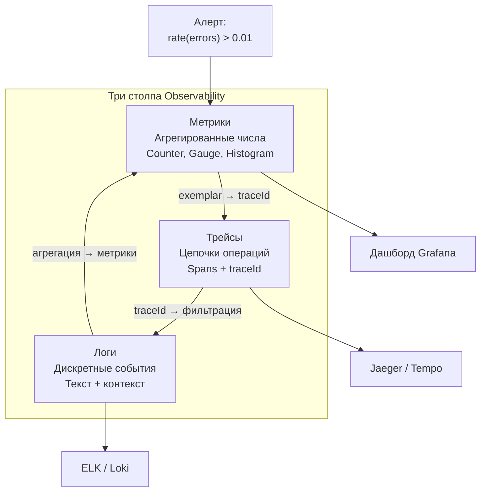
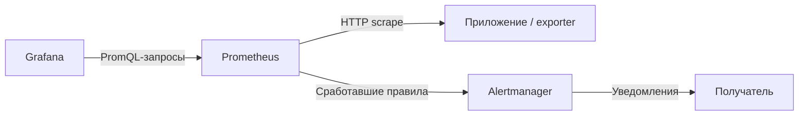
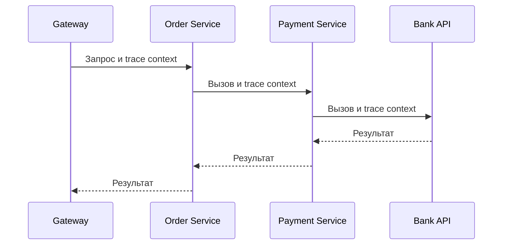
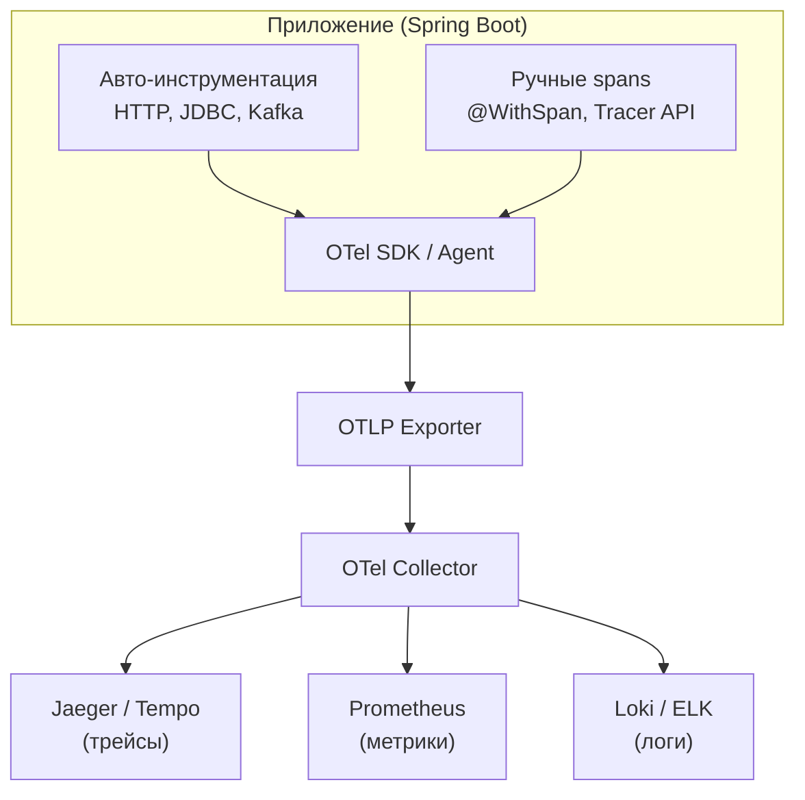
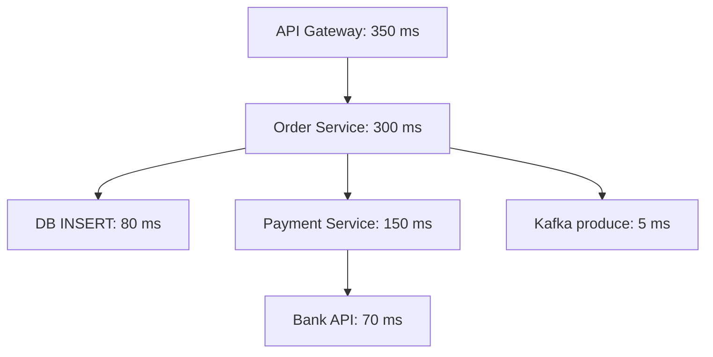
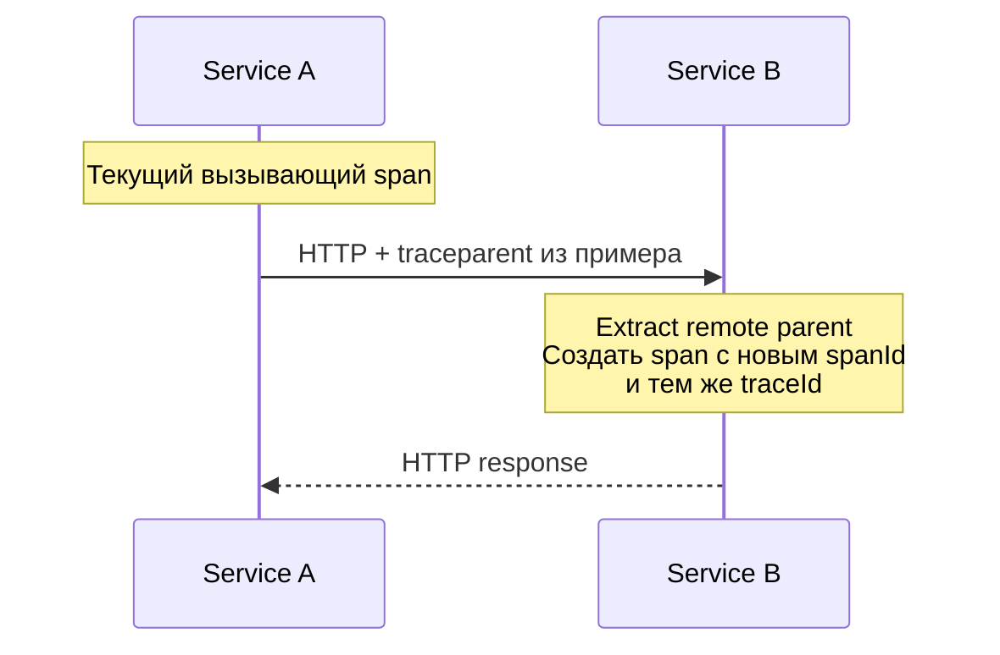
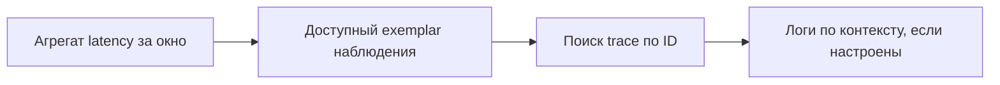
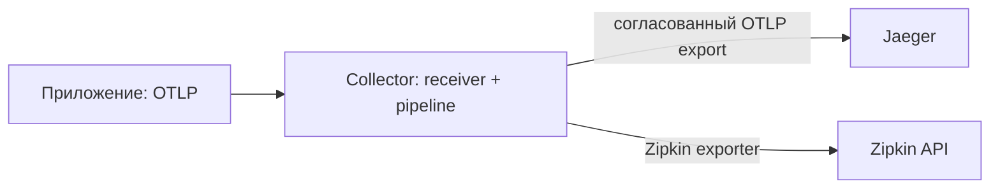
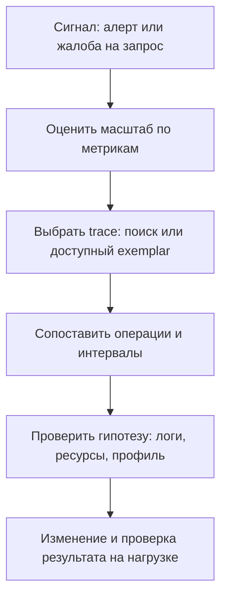
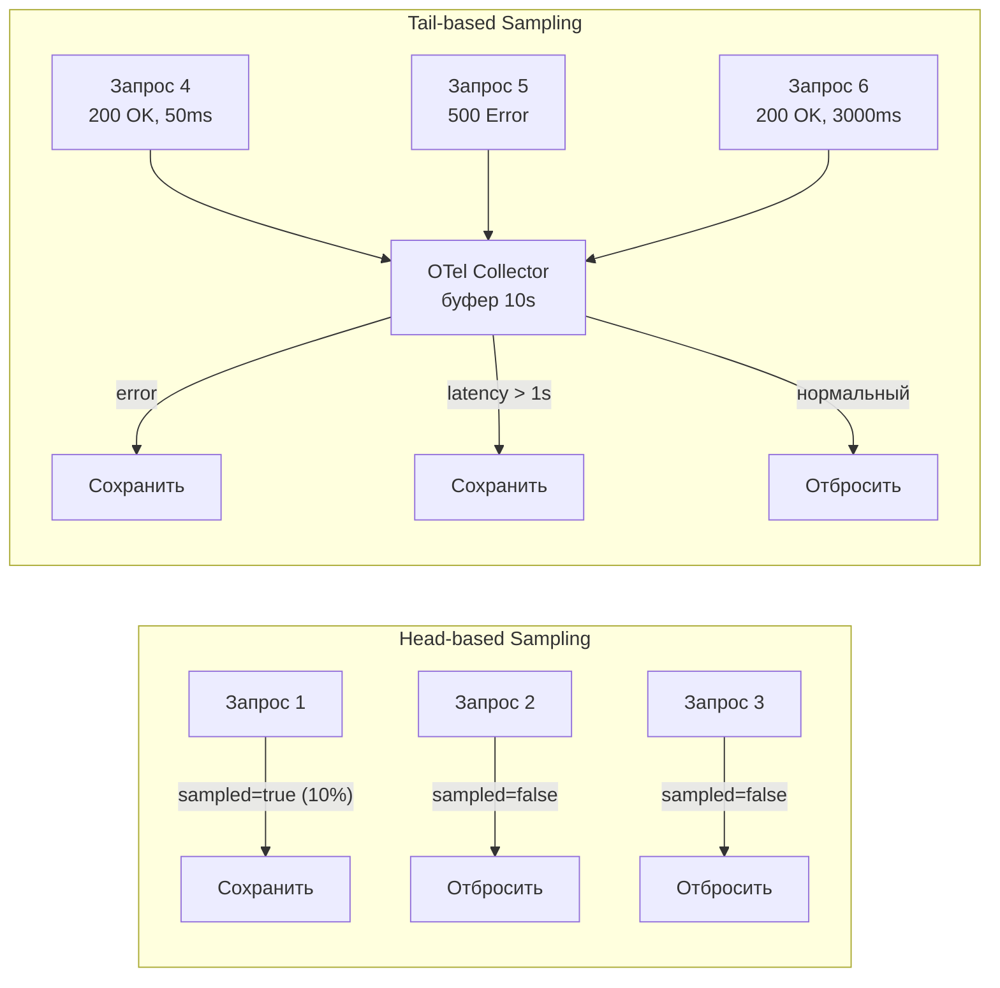

# Вопросы на собеседовании: Метрики и трейсинг

Комплексное руководство по вопросам собеседования на тему метрик и трейсинга для `Senior Java Developer`.

**Метрики и трейсинг** — два из трёх столпов наблюдаемости (observability) наряду с логированием. Вопросы по этой теме регулярно встречаются на собеседованиях для senior-позиций, так как работа с `Prometheus`, `Micrometer`, `OpenTelemetry`, `Jaeger` и `Grafana` — повседневная задача в микросервисной архитектуре. Подробнее о наблюдаемости в целом — в [вопросах по Observability](observability-interview.md).

## Полезные ссылки

### Официальная документация

- [OpenTelemetry Documentation](https://opentelemetry.io/docs/) — стандарт инструментирования
- [Prometheus Documentation](https://prometheus.io/docs/) — система мониторинга
- [Micrometer Documentation](https://micrometer.io/docs) — фасад метрик для Java
- [Grafana Documentation](https://grafana.com/docs/) — визуализация и дашборды
- [Jaeger Documentation](https://www.jaegertracing.io/docs/) — распределённая трассировка
- [Spring Boot Actuator](https://docs.spring.io/spring-boot/docs/current/reference/html/actuator.html) — эндпоинты мониторинга
- [Monitor a Spring Boot App Using Prometheus](https://www.baeldung.com/spring-boot-prometheus) — интеграция Spring Boot с Prometheus
- [Quick Guide to Micrometer](https://www.baeldung.com/micrometer) — обзор Micrometer: метрики для JVM
- [Spring Cloud - Tracing Services with Zipkin](https://www.baeldung.com/tracing-services-with-zipkin) — трассировка с Zipkin и Spring Cloud
- [OpenTelemetry Setup in Spring Boot Application](https://www.baeldung.com/spring-boot-opentelemetry-setup) — настройка OpenTelemetry в Spring Boot

## Содержание

- [Полезные ссылки](#полезные-ссылки)
- [See also](#see-also)

**Основы: метрики vs логи vs трейсы**
- [Q1. (!) Чем метрики отличаются от логов и трейсов?](#q1--чем-метрики-отличаются-от-логов-и-трейсов)
- [Q19. Что такое RED и USE методологии для метрик?](#q19-что-такое-red-и-use-методологии-для-метрик)
- [Q25. Как выбрать между метриками и трейсами для отладки?](#q25-как-выбрать-между-метриками-и-трейсами-для-отладки)
- [Q26. Что такое RED-метрики и USE-метрики?](#q26-что-такое-red-метрики-и-use-метрики)

**Prometheus и Micrometer**
- [Q2. (!) Что такое Prometheus и как он собирает метрики?](#q2--что-такое-prometheus-и-как-он-собирает-метрики)
- [Q3. (!) Что такое Micrometer и как он связан с Prometheus?](#q3--что-такое-micrometer-и-как-он-связан-с-prometheus)
- [Q4. (!) Какие типы метрик бывают (counter, gauge, histogram, summary)?](#q4--какие-типы-метрик-бывают-counter-gauge-histogram-summary)
- [Q10. Как интегрировать Micrometer с Spring Boot?](#q10-как-интегрировать-micrometer-с-spring-boot)
- [Q11. Что такое экспоненциальные гистограммы в метриках?](#q11-что-такое-экспоненциальные-гистограммы-в-метриках)
- [Q12. Как настроить метрики JVM (память, потоки, GC)?](#q12-как-настроить-метрики-jvm-память-потоки-gc)
- [Q13. Что такое custom metrics и когда их добавлять?](#q13-что-такое-custom-metrics-и-когда-их-добавлять)
- [Q17. (!) Что такое cardinality метрик и почему она важна?](#q17--что-такое-cardinality-метрик-и-почему-она-важна)
- [Q20. Как экспортировать метрики в Prometheus из Java?](#q20-как-экспортировать-метрики-в-prometheus-из-java)

**Распределённая трассировка**
- [Q5. (!) Что такое распределённая трассировка и зачем она нужна?](#q5--что-такое-распределённая-трассировка-и-зачем-она-нужна)
- [Q6. (!) Что такое OpenTelemetry и как он связан с трассировкой?](#q6--что-такое-opentelemetry-и-как-он-связан-с-трассировкой)
- [Q7. Что такое span и trace в трассировке?](#q7-что-такое-span-и-trace-в-трассировке)
- [Q8. Как передать контекст трассировки между микросервисами?](#q8-как-передать-контекст-трассировки-между-микросервисами)
- [Q15. Что такое Jaeger и Zipkin и чем они отличаются?](#q15-что-такое-jaeger-и-zipkin-и-чем-они-отличаются)
- [Q16. Как настроить трассировку в Spring Boot (OpenTelemetry)?](#q16-как-настроить-трассировку-в-spring-boot-opentelemetry)
- [Q23. Что такое traceId и spanId и как они связаны?](#q23-что-такое-traceid-и-spanid-и-как-они-связаны)

**Sampling и оптимизация**
- [Q9. Что такое sampling в трассировке и когда его применять?](#q9-что-такое-sampling-в-трассировке-и-когда-его-применять)
- [Q24. Как уменьшить поток данных трассировки до хранилища?](#q24-как-уменьшить-поток-данных-трассировки-до-хранилища)
- [Q27. Как уменьшить объём и стоимость хранения трейсов в production?](#q27-как-уменьшить-объём-и-стоимость-хранения-трейсов-в-production)
- [Q28. Как выбрать head-based и tail-based sampling для production?](#q28-как-выбрать-head-based-и-tail-based-sampling-для-production)

**Связь метрик и трейсов, алертинг**
- [Q14. (!) Как связать метрики и трейсы (например, в Grafana)?](#q14--как-связать-метрики-и-трейсы-например-в-grafana)
- [Q18. Как метрики и трейсы помогают при инцидентах?](#q18-как-метрики-и-трейсы-помогают-при-инцидентах)
- [Q21. Что такое exemplars и зачем они нужны?](#q21-что-такое-exemplars-и-зачем-они-нужны)
- [Q22. Как настроить алерты по метрикам (Prometheus, Alertmanager)?](#q22-как-настроить-алерты-по-метрикам-prometheus-alertmanager)
- [Q29. Как связать метрики приложения с бизнес-метриками?](#q29-как-связать-метрики-приложения-с-бизнес-метриками)
- [Q30. Как организовать алертинг по метрикам и трейсам?](#q30-как-организовать-алертинг-по-метрикам-и-трейсам)

**W3C TraceContext, Zipkin, бизнес-метрики**
- [Q31. (!) Что такое W3C TraceContext и зачем это стандарт?](#q31--что-такое-w3c-tracecontext-и-зачем-это-стандарт)
- [Q32. Как настроить Micrometer с кастомными тегами для бизнес-метрик?](#q32-как-настроить-micrometer-с-кастомными-тегами-для-бизнес-метрик)
- [Q33. Как интегрировать Zipkin в Spring Boot приложение?](#q33-как-интегрировать-zipkin-в-spring-boot-приложение)

**Расширенные темы: Micrometer, OpenTelemetry, SLI/SLO**
- [Q34. (!) Какие типы инструментов предоставляет Micrometer — Counter, Gauge, Timer, DistributionSummary?](#q34--какие-типы-инструментов-предоставляет-micrometer--counter-gauge-timer-distributionsummary)
- [Q35. Что такое OpenTelemetry Collector и как его использовать?](#q35-что-такое-opentelemetry-collector-и-как-его-использовать)
- [Q36. (!) Что такое SLI, SLO и SLA — определения, расчёт, error budget?](#q36--что-такое-sli-slo-и-sla--определения-расчёт-error-budget)
- [Q37. Как работает tail-based sampling в трассировке?](#q37-как-работает-tail-based-sampling-в-трассировке)
- [Q38. Что такое Exemplars и как они связывают метрики с трейсами?](#q38-что-такое-exemplars-и-как-они-связывают-метрики-с-трейсами)
- [Q39. (!) Что такое проблема высокой кардинальности в метриках и как её избежать?](#q39--что-такое-проблема-высокой-кардинальности-в-метриках-и-как-её-избежать)
- [Q40. Как реализовать context propagation в distributed tracing — W3C TraceContext и B3?](#q40-как-реализовать-context-propagation-в-distributed-tracing--w3c-tracecontext-и-b3)
- [Q41. Какие SLI использовать для разных типов сервисов?](#q41-какие-sli-использовать-для-разных-типов-сервисов)

## Метрики

## Q1. (!) Чем метрики отличаются от логов и трейсов?

Это три разных сигнала наблюдаемости, и различаются они тем, на какой вопрос отвечают. Коротко: метрики говорят «что происходит в целом», трейсы — «где в одном запросе ушло время», логи — «что именно случилось в конкретный момент».

- **Метрики** — агрегированные числа во времени (счётчики, gauge, гистограммы). Малый объём, дёшево хранить долго; основа для алертов и дашбордов. Отвечают на «насколько плохо», но не «почему».
- **Логи** — дискретные события с текстом и контекстом. Большой объём; для отладки и аудита конкретных случаев. Дают детали, но по ним тяжело увидеть общую картину.
- **Трейсы** — цепочка операций (spans) одного запроса по мере прохождения через сервисы. Показывают задержки по узлам и зависимости между вызовами. Отвечают на «где именно медленно».

Сигналы не заменяют, а дополняют друг друга и связаны общим `traceId`: по метрике видишь проблему, по трейсу — какой участок виноват, по логам (отфильтрованным по тому же `traceId`) — детали.



**Типичный сценарий расследования инцидента:** алерт по метрике (например, рост ошибок) -> открыть трейсы за период -> найти медленные/ошибочные запросы по `traceId` -> по `traceId` отфильтровать логи и локализовать причину. Подробнее о стратегиях логирования — в [вопросах по логированию](logging-strategies-interview.md).

## Q2. (!) Что такое Prometheus и как он собирает метрики?

**Prometheus** собирает и хранит временные ряды и выполняет запросы `PromQL`. Обычная схема сбора — **pull**: сервер периодически опрашивает HTTP-endpoints приложения или exporter. Scrape получает снимок экспонируемых измерений, а не отдельное сетевое сообщение на каждое изменение счётчика. Формат согласуется при опросе: поддерживаются текстовые варианты и protobuf, а не единственный текстовый протокол.

Неудачный scrape даёт `up=0` для цели, но не доказывает остановку процесса: причиной могут быть сеть, timeout, путь endpoint, TLS или авторизация. Проверяйте ошибку опроса и состояние цели отдельно. [Jobs and instances](https://prometheus.io/docs/concepts/jobs_instances/).



**Минимальный пример scrape-конфигурации**; 15 секунд — выбранный интервал примера, endpoint приложения настраивается отдельно:

```yaml
global:
  scrape_interval: 15s

scrape_configs:
  - job_name: 'spring-boot-apps'
    metrics_path: '/actuator/prometheus'
    static_configs:
      - targets: ['order-service:8080', 'payment-service:8080']
        labels:
          env: 'production'
```

Service discovery помогает находить динамические targets. `ServiceMonitor`/`PodMonitor` обрабатывает **Prometheus Operator**; сами аннотации Kubernetes не меняют конфигурацию обычного сервера без соответствующей интеграции или relabeling. Короткая задача может завершиться между scrape даже при корректном обнаружении. Для подходящих service-level batch jobs рассматривают Pushgateway. В Prometheus также есть отдельно включаемые remote-write/OTLP receivers; совместимость и ограничения приёма проверяют для выбранной версии.

[Prometheus overview](https://prometheus.io/docs/introduction/overview/), [receiver API](https://prometheus.io/docs/prometheus/latest/querying/api/#remote-write-receiver), [content negotiation](https://prometheus.io/docs/instrumenting/content_negotiation/), [Prometheus Operator](https://prometheus-operator.dev/docs/developer/getting-started/), [Pushgateway use cases](https://prometheus.io/docs/practices/pushing/).

## Q3. (!) Что такое Micrometer и как он связан с Prometheus?

`Micrometer` — API измерений JVM-приложения: код регистрирует counters, gauges, timers через `MeterRegistry`, а registry адаптирует их к backend экспорта. Registry хранит состояние измерений в процессе; долговременная TSDB и интерфейс дашбордов — другие компоненты. Смена backend часто сохраняет код инструментации, но требует проверить конфигурацию экспорта, единицы и поддерживаемые статистики.

`micrometer-registry-prometheus` подготавливает scrape-экспозицию. **Сам registry не открывает HTTP endpoint.** В Spring Boot с Actuator нужны соответствующие зависимости, включённый endpoint, web exposure и доступ scrape-клиента. При стандартном base path это `/actuator/prometheus`. Ниже пример для Boot 3.3.x; версии зависимостей задаёт BOM Boot:

```groovy
dependencies {
    implementation 'org.springframework.boot:spring-boot-starter-actuator'
    runtimeOnly 'io.micrometer:micrometer-registry-prometheus'
}
```

```yaml
spring:
  application:
    name: order-service
management:
  endpoints:
    web:
      exposure:
        include: health, prometheus
  metrics:
    tags:
      application: ${spring.application.name}
    distribution:
      percentiles-histogram:
        http.server.requests: true
      slo:
        http.server.requests: 100ms, 500ms, 1s, 5s
```

Здесь `slo` задаёт границы дополнительных buckets для целей задержки. В Boot 3.3.x по умолчанию экспонирован только health; наличие registry ещё не означает доступный scrape URL. Настройки security, management port и base path тоже влияют на доступ.

**Кастомный счётчик** с переданным приложению `MeterRegistry registry`:

```java
Counter completed = registry.counter("orders.completed", "result", "success");
completed.increment();
```

Наличие автоматических JVM/HTTP/pool meters зависит от binders, библиотек, бинов и конфигурации, а не гарантируется для любого приложения. Бюджет labels и нормализация значений разобраны в [Q17](#q17--что-такое-cardinality-метрик-и-почему-она-важна).

[Spring Boot 3.3 metrics](https://docs.spring.io/spring-boot/3.3/reference/actuator/metrics.html), [endpoint exposure](https://docs.spring.io/spring-boot/3.3/reference/actuator/endpoints.html#actuator.endpoints.exposing), [Micrometer Prometheus](https://docs.micrometer.io/micrometer/reference/implementations/prometheus.html).

## Q4. (!) Какие типы метрик бывают (counter, gauge, histogram, summary)?

Тип выбирают по смыслу измерения и запросам к данным. Название API Micrometer и тип экспорта Prometheus не всегда соответствуют друг другу один к одному.

| Тип Prometheus | Что представляет | Пример / API Micrometer |
|----------------|------------------|-------------------------|
| **Counter** | Накопление событий; обычное уменьшение не моделирует, но возможен reset | Завершённые запросы — `Counter` |
| **Gauge** | Текущее состояние, способное расти и падать | Размер очереди — `Gauge` |
| **Histogram** | Агрегированное распределение и связанные count/sum | Длительности — `Timer`, размеры — `DistributionSummary`, с histogram-настройками |
| **Summary** | Count/sum и, если настроены, локальные квантили | `Timer`/`DistributionSummary` с client-side percentiles |

Пример с заранее переданным `MeterRegistry registry` (imports опущены):

```java
Counter requests = registry.counter("http.requests", "endpoint", "/orders");
requests.increment();

AtomicInteger queueSize = new AtomicInteger(3);
Gauge.builder("queue.size", queueSize, AtomicInteger::get).register(registry);

// Histogram для серверной оценки распределения
Timer duration = Timer.builder("request.duration")
    .publishPercentileHistogram()
    .register(registry);
duration.record(12, TimeUnit.MILLISECONDS);

DistributionSummary payload = DistributionSummary.builder("response.size")
    .baseUnit("bytes")
    .publishPercentileHistogram()
    .register(registry);
payload.record(512);

// Отдельный meter с локальными percentile-оценками
Timer localDuration = Timer.builder("request.local.duration")
    .publishPercentiles(0.5, 0.95)
    .register(registry);
localDuration.record(12, TimeUnit.MILLISECONDS);
```

Источник gauge вроде `queueSize` должен оставаться сильно достижимым в приложении; meter обычно удерживает его слабо. Gauge показывает состояние при наблюдении и может не сохранить промежуточный пик. Counter после рестарта может начать отсчёт заново — это отличается от обычного уменьшения gauge.

**Агрегируемость:** локальные p99 двух инстансов в общем случае нельзя усреднить и получить p99 сервиса. При этом `sum` и `count` Summary можно складывать при совместимых единицах и scope. Название `DistributionSummary` в Micrometer не означает, что экспорт всегда будет Prometheus Summary: результат зависит от статистик и registry.

Histogram не хранит доступный список исходных наблюдений. У classic histogram экспонируются bucket-ряды; native histogram представляет составной sample. Совместимые histogram-данные можно агрегировать, но `histogram_quantile` обычно даёт **оценку**, точность которой зависит от представления и разрешения. При объединении проверяют единицы, bucket-схему и корректный учёт resets; это не восстановление исходных значений «без потерь».

[Prometheus histograms and summaries](https://prometheus.io/docs/practices/histograms/), [Micrometer histograms/percentiles](https://docs.micrometer.io/micrometer/reference/concepts/histogram-quantiles.html), [gauges](https://docs.micrometer.io/micrometer/reference/concepts/gauges.html).

## Q5. (!) Что такое распределённая трассировка и зачем она нужна?

Распределённая трассировка связывает **наблюдаемые операции** запроса между сервисами. Span описывает операцию, её временные границы и атрибуты; trace ID и связи parent/child помогают восстановить путь. Это позволяет локализовать участок задержки в конкретном запросе, но не гарантирует полное покрытие каждого вызова или единственную корневую причину.



Это иллюстрация синхронной цепочки. Асинхронные операции могут связываться через **span links**, в том числе между разными traces; реальное представление не обязано быть одним простым деревом. Длительности вложенных/параллельных spans могут перекрываться, поэтому их механическая сумма не равна задержке запроса.

**При расследовании:** выберите доступный trace известного запроса либо найдите медленные traces за период; сопоставьте наблюдаемые внутренние spans с общей задержкой. Для объяснения причины могут понадобиться логи, метрики или профиль. Фильтр по trace ID выбирает конкретный trace, а фильтр по длительности — медленные запросы.

**Граница:** неполная инструментация, разрыв propagation, sampling и потери доставки делают trace неполным. Отсутствие span не доказывает отсутствие вызова. Полноту и охват проверяют отдельно от красивого дерева в UI.

Примеры backends хранения и просмотра — Jaeger, Zipkin, Tempo; OpenTelemetry предоставляет API/SDK и механизмы сбора, а не обязательное собственное хранилище.

[OpenTelemetry traces](https://opentelemetry.io/docs/concepts/signals/traces/), [context propagation](https://opentelemetry.io/docs/concepts/context-propagation/), [sampling](https://opentelemetry.io/docs/concepts/sampling/).

## Q6. (!) Что такое OpenTelemetry и как он связан с трассировкой?

`OpenTelemetry` (OTel) — открытый стандарт и набор `SDK / API` для всех трёх сигналов: трассировки, метрик и логов. Его идея — инструментировать код один раз через вендоронезависимый API, а конкретный бэкенд выбирать на этапе экспорта. Меняешь бэкенд (`Jaeger`, `Zipkin`, облачный сервис) — код не трогаешь.

Что `OpenTelemetry` делает для трассировки:

- генерирует spans и trace context (`traceId`, `spanId`);
- передаёт контекст между сервисами — через `HTTP`-заголовки, `gRPC` metadata, заголовки сообщений;
- экспортирует собранные трейсы в бэкенд (`Jaeger`, `Zipkin` и др.).



**Пример кастомного span через OpenTelemetry API:**

```java
@Service
@RequiredArgsConstructor
public class InventoryService {

    private final Tracer tracer;

    public boolean checkAvailability(String productId, int quantity) {
        Span span = tracer.spanBuilder("inventory.checkAvailability")
                .setAttribute("product.id", productId)
                .setAttribute("requested.quantity", quantity)
                .startSpan();

        try (Scope scope = span.makeCurrent()) {
            boolean available = queryWarehouse(productId, quantity);
            span.setAttribute("result.available", available);
            return available;
        } catch (Exception e) {
            span.setStatus(StatusCode.ERROR, e.getMessage());
            span.recordException(e);
            throw e;
        } finally {
            span.end();
        }
    }
}
```

**Пример с аннотацией `@WithSpan` (Spring Boot + OTel):**

```java
@Service
public class NotificationService {

    @WithSpan("notification.send")
    public void sendNotification(
            @SpanAttribute("notification.type") String type,
            @SpanAttribute("notification.recipient") String recipient) {
        // Span создаётся автоматически с указанными атрибутами
        doSend(type, recipient);
    }
}
```

## Q7. Что такое span и trace в трассировке?

`Span` описывает одну операцию: HTTP-вызов, запрос к БД или обработку сообщения. У него есть имя, время начала и окончания, `spanId`, атрибуты и контекст с `traceId`; родитель необязателен у корневого span. `Trace` объединяет связанные spans по общему `traceId`. Корень может описывать HTTP-запрос, запуск задачи или другую операцию. [OpenTelemetry, Traces](https://opentelemetry.io/docs/concepts/signals/traces/).

Связи parent/child обычно изображают деревом. Дополнительные **span links** позволяют связать операции, в том числе из разных traces, например при асинхронной обработке. На схеме ниже показаны связи операций, а не их последовательность во времени:



**Сценарий:** по `traceId` в Jaeger/Zipkin изучают длительности, отношения операций, ошибки и атрибуты. Долгий span помогает выбрать направление расследования, но сам по себе не доказывает причину задержки. Вложенные и параллельные интервалы перекрываются, поэтому их длительности нельзя просто сложить. Неполная инструментация, sampling и потери при доставке могут оставить пробелы в видимом trace — полного пути каждого запроса такая схема не гарантирует.


## Q8. Как передать контекст трассировки между микросервисами?

В HTTP для W3C Trace Context вызывающая сторона **inject**-ит контекст текущего span в заголовки, принимающая — **extract**-ит его и использует как удалённого родителя нового span. Так сохраняется `traceId`, а новый span получает собственный `spanId`. `traceparent` несёт основной контекст; `tracestate` необязателен и предназначен для дополнительного вендорского состояния. Вызывающий span не обязан быть корневым. [W3C Trace Context](https://www.w3.org/TR/trace-context/).

**Валидный пример version `00`:**

```text
traceparent: 00-4bf92f3577b34da6a3ce929d0e0e4736-00f067aa0ba902b7-01
```

Поля значения: версия `00`, `trace-id` из 32 lowercase hex-символов, `parent-id` из 16 и flags из двух. Оба ID не могут состоять только из нулей. Здесь `parent-id` — ID вызывающего span, а не ID создаваемого span получателя. Младший бит flags (`01` в примере) — sampled: он передаёт решение о записи, но не гарантирует, что данные сохранятся в backend.



**Пример настроек Spring Boot 3.3** при подключённых Micrometer Tracing, поддерживаемом bridge/exporter и нужной инструментации:

```yaml
management:
  tracing:
    propagation:
      type: w3c
    sampling:
      probability: 0.1  # пример политики приложения, не универсальная норма
```

Для автоматической HTTP-пропагации Boot рекомендует создавать клиенты через автоконфигурированные `RestTemplateBuilder`, `RestClient.Builder` или `WebClient.Builder`. Произвольно созданный клиент, собственный executor и другие транспорты требуют соответствующей инструментации и переноса контекста; наличие OpenTelemetry само по себе не подключает любой клиент. Локальный `ThreadLocal` не переносит контекст в другой процесс. [Spring Boot 3.3, Propagating Traces](https://docs.spring.io/spring-boot/3.3/reference/actuator/tracing.html#actuator.micrometer-tracing.propagating-traces).


## Q9. Что такое sampling в трассировке и когда его применять?

`Sampling` — отбор данных трассировки для записи или дальнейшего экспорта. Он уменьшает объём телеметрии, но ограничивает то, какие запросы доступны для анализа. Отбор по ошибкам намеренно смещён: доля ошибок в таком наборе не отражает обычный трафик. При вероятностной выборке учитывают её политику и статистическую неопределённость.

**Момент решения и политика отбора — разные вещи:**

| Подход | Доступная информация | Цена и ограничение |
|---|---|---|
| Head-based | Контекст при начале span, без знания всего результата запроса | Можно сократить запись/экспорт рано, но будущая ошибка ещё неизвестна. |
| Tail-based | Полученная часть trace: статусы, длительности, атрибуты | Нужны состояние, буфер и согласованная маршрутизация; потерянные ранее данные не вернуть. |

Доля по trace ID, отбор по статусу или лимит скорости — политики конкретной реализации, а не три взаимоисключающих момента решения. Квота тоже не гарантирует сохранение редкого важного запроса. [OpenTelemetry Sampling](https://opentelemetry.io/docs/concepts/sampling/).

**Фрагмент API OpenTelemetry Java SDK 1.37.0:**

```java
import io.opentelemetry.sdk.trace.samplers.Sampler;

// Без родителя — пример вероятностной доли 10%; с родителем — его sampled flag.
Sampler sampler = Sampler.parentBased(Sampler.traceIdRatioBased(0.1));
// Этот sampler передают builder.setSampler(sampler) при создании SdkTracerProvider.
```

`0.1` не означает ровно каждый десятый запрос или ровно 10% в коротком окне. Сам `traceIdRatioBased` не обязан следовать sampled flag родителя; здесь это делает обёртка `parentBased`. Создание sampler само не подключает SDK к приложению и не настраивает exporter — интеграция разобрана в Q16. [Java 1.37.0 Sampler API](https://github.com/open-telemetry/opentelemetry-java/blob/v1.37.0/sdk/trace/src/main/java/io/opentelemetry/sdk/trace/samplers/Sampler.java).

Версию нужно учитывать: спецификация OTel 1.62.0 помечает `TraceIdRatioBased` deprecated и описывает замену через `ProbabilitySampler`; это не повод считать новый API доступным в любом старом SDK. Проверьте поддержку и рекомендации своей версии. [Tracing SDK specification](https://opentelemetry.io/docs/specs/otel/trace/sdk/#traceidratiobased).

Sampling применяют, когда диагностическая польза оправдывает затраты и допустимы пропуски. Универсальной доли для production нет; увеличение доли помогает будущим запросам, но не восстанавливает историю. Полноту выбранного trace проверяют отдельно. Меры сокращения потока — Q24, выбор head/tail — Q28, устройство tail sampler — Q37.

## Q10. Как интегрировать Micrometer с Spring Boot?

Для **Spring Boot 3.3** добавьте `spring-boot-starter-actuator` и `io.micrometer:micrometer-registry-prometheus`, используя версии из dependency management Boot. Автоконфигурация подключает подходящие binders и registry; доступность JVM/HTTP/пуловых метрик зависит также от используемых компонентов и настроек. Затем опубликуйте endpoint и обеспечьте доступ сборщика согласно настройкам сети и безопасности приложения. [Spring Boot 3.3, Metrics](https://docs.spring.io/spring-boot/3.3/reference/actuator/metrics.html).

**Пример `application.yml`:**

```yaml
spring:
  application:
    name: order-service
management:
  endpoints:
    web:
      exposure:
        include: health,prometheus
  metrics:
    tags:
      application: ${spring.application.name}
    distribution:
      percentiles-histogram:
        http.server.requests: true
      slo:
        http.server.requests: 100ms,500ms,1s
```

В этой версии свойство называется `management.metrics.distribution.slo`. Настройки распределения применяются к зарегистрированным meters; они не создают события измерения сами. Для Prometheus настраивают scrape `/actuator/prometheus`. Диагностический `/actuator/metrics`, если его отдельно открыть, возвращает сведения о meters и не заменяет scrape endpoint.

**`@Timed` требует работающего перехвата.** Например, для Spring AOP подключают AOP-инфраструктуру (`spring-boot-starter-aop`) и регистрируют аспект:

```java
import io.micrometer.core.aop.TimedAspect;
import io.micrometer.core.instrument.MeterRegistry;
import org.springframework.context.annotation.Bean;
import org.springframework.context.annotation.Configuration;

@Configuration
class MetricsConfig {
    @Bean
    TimedAspect timedAspect(MeterRegistry registry) {
        return new TimedAspect(registry);
    }
}
```

Метод с `@Timed("orders.create")` должен вызываться через соответствующий proxy. При обычном Spring proxy-варианте self-invocation через `this` обходит аспект. Одна аннотация или только объявление bean не гарантирует измерение каждого вызова; допустимы и другие механизмы инструментации, а `Timer` можно записывать программно, как в Q4. [Micrometer, Timers / TimedAspect](https://docs.micrometer.io/micrometer/reference/concepts/timers.html).


## Q11. Что такое экспоненциальные гистограммы в метриках?

У такой гистограммы границы бакетов идут по геометрической шкале: близкие по отношению значения попадают в сопоставимые по относительной ширине интервалы. Это удобно для длительностей с большим диапазоном. Экспоненциальной является **шкала значений**, а не рост числа событий во времени.

Например, в **OpenTelemetry ExponentialHistogram** разрешение задаёт `scale`:

```text
base = 2 ** (2 ** (-scale))
положительный бакет i: (base ** i, base ** (i + 1)]
```

| scale | base | Пример положительных бакетов |
|---|---|---|
| 0 | 2 | (1, 2], (2, 4], (4, 8] |
| 1 | √2 ≈ 1.4142 | (1, √2], (√2, 2], (2, 2√2] |

Чем больше `scale`, тем мельче интервалы. Формат отдельно описывает положительную, отрицательную и нулевую области; таблица иллюстрирует только положительные значения. Выбор разрешения и ограничения числа бакетов определяют компромисс памяти и ошибки. [OTel Metrics Data Model, ExponentialHistogram](https://opentelemetry.io/docs/specs/otel/metrics/data-model/#exponentialhistogram).

**Не смешивайте алгоритм и API конфигурации.** Micrometer `publishPercentileHistogram()` публикует бакеты для вычисления квантилей в поддерживающем backend; `minimumExpectedValue`/`maximumExpectedValue` ограничивают диапазон используемых бакетов. Эти вызовы сами по себе не означают выбор OTel ExponentialHistogram или Prometheus native histogram. Обычный `Timer` также не обещает такую экспозицию по умолчанию. Проверяйте конкретные версии SDK/registry, формат экспорта и поддержку backend. Явно заданные SLO-границы могут быть полезнее для конкретного порога; универсального выигрыша любого формата в памяти и точности нет. [Micrometer, Histograms and Percentiles](https://docs.micrometer.io/micrometer/reference/concepts/histogram-quantiles.html).


## Q12. Как настроить метрики JVM (память, потоки, GC)?

В **Spring Boot 3.3** автоконфигурация JVM binders Micrometer предоставляет метрики памяти, потоков, классов и GC. Для HTTP-экспозиции всё равно нужны подходящий registry, открытый и доступный endpoint из Q10; сам binder не публикует HTTP endpoint. Имена и наличие рядов проверяют в экспозиции выбранной версии и JVM. [Spring Boot 3.3, JVM Metrics](https://docs.spring.io/spring-boot/3.3/reference/actuator/metrics.html#actuator.metrics.supported.jvm).

| Что наблюдать | Примеры в Prometheus-экспозиции | Как интерпретировать |
|---|---|---|
| Память | `jvm_memory_used_bytes`, `jvm_memory_max_bytes` | Различать `area`, pool `id` и instance; max может быть не определён. |
| Потоки | `jvm_threads_live_threads`, `jvm_threads_states_threads` | Текущие количества и состояния потоков, а не доказательство дедлока. |
| GC | `jvm_gc_pause_seconds_sum`, `jvm_gc_pause_seconds_count` | По приростам получать среднее за окно; для хвоста распределения нужны подходящие дополнительные данные. |

В `JvmGcMetrics` **1.13.2** Timer `jvm.gc.pause` создаётся при обработке уведомления GC: до первого подходящего события ряда может ещё не быть. Это не то же самое, что нулевая длительность паузы. [JvmGcMetrics v1.13.2](https://raw.githubusercontent.com/micrometer-metrics/micrometer/v1.13.2/micrometer-core/src/main/java/io/micrometer/core/instrument/binder/jvm/JvmGcMetrics.java).

**Примеры PromQL** предполагают наличие соответствующих рядов и одинаковый набор labels у числителя и знаменателя:

```promql
# Заполнение конкретного heap pool > 85%, только при определённом max > 0
jvm_memory_used_bytes{area="heap"}
  / (jvm_memory_max_bytes{area="heap"} > 0) > 0.85

# Средняя длительность GC-паузы за 5 минут > 500 ms, при наличии событий
rate(jvm_gc_pause_seconds_sum[5m])
  / (rate(jvm_gc_pause_seconds_count[5m]) > 0) > 0.5
```

Первое выражение сохраняет разбивку по pool и instance: это не доля заполнения всей heap. Не складывайте used одних pools с max других и не усредняйте отношения разных JVM. Второе выражение показывает **среднюю**, а не максимальную/каждую паузу; отсутствие событий либо данных нельзя объявлять доказательством здоровья. Для алерта отдельно задают окно, длительность срабатывания и проверку отсутствующих данных.

В Grafana панель used/max в байтах должна иметь единицу bytes и осмысленную легенду по instance/pool. Пороги 0.8/0.9 относятся к отношению в диапазоне 0–1, а не к байтам; для такой панели нужны отдельное выражение отношения и согласованная единица.

**Дедлоки:** в исходнике `JvmThreadMetrics` версии **1.13.2** регистрируются peak/daemon/live/started/states, но нет `jvm.threads.deadlocked`. Поэтому алерт `jvm_threads_deadlocked_threads > 0` нельзя считать работающим по умолчанию для этой конфигурации. Отдельную диагностику или пользовательскую метрику нужно реализовать и проверить; это ограниченный вывод по указанной версии. [JvmThreadMetrics v1.13.2](https://raw.githubusercontent.com/micrometer-metrics/micrometer/v1.13.2/micrometer-core/src/main/java/io/micrometer/core/instrument/binder/jvm/JvmThreadMetrics.java).

Подробнее о профилировании — в [JVM Performance Tuning](../performance/jvm-performance-tuning-interview.md).


## Q13. Что такое custom metrics и когда их добавлять?

`Custom` metrics — это метрики, которые приложение определяет само под свою предметную область: счётчик заказов, размер очереди задач, бизнес-события. Стандартные метрики (`JVM`, `HTTP`) отвечают на вопрос «здоров ли процесс», но ничего не знают о бизнес-логике. Свои метрики добавляют ровно тогда, когда стандартных не хватает, чтобы поставить алерт или сделать анализ — например, нужно следить за долей отклонённых платежей или ростом очереди.

```java
@Component
@RequiredArgsConstructor
public class BusinessMetrics {

    private final MeterRegistry registry;

    // Счётчик бизнес-событий с лейблами
    public void recordOrderCreated(String region, String paymentMethod) {
        registry.counter("business.orders.created",
                "region", region,
                "payment_method", paymentMethod
        ).increment();
    }

    // Gauge для отслеживания размера очереди
    public void registerQueueMetrics(BlockingQueue<?> queue, String queueName) {
        Gauge.builder("queue.size", queue, BlockingQueue::size)
                .tag("queue", queueName)
                .description("Текущий размер очереди " + queueName)
                .register(registry);
    }

    // FunctionCounter — для значений, которые только растут
    public void registerProcessedMessages(AtomicLong counter, String topic) {
        FunctionCounter.builder("kafka.messages.processed", counter, AtomicLong::get)
                .tag("topic", topic)
                .register(registry);
    }

    // Timer с SLO-бакетами
    public Timer createSloTimer(String operation) {
        return Timer.builder("business." + operation + ".duration")
                .publishPercentiles(0.5, 0.95, 0.99)
                .serviceLevelObjectives(
                        Duration.ofMillis(100),
                        Duration.ofMillis(500),
                        Duration.ofSeconds(1)
                )
                .register(registry);
    }
}
```

**Регистрация и срок жизни:** создавайте meter один раз для каждого задуманного сочетания имени и tags и сохраняйте источник измерений достижимым. Gauge обычно держит слабую ссылку на наблюдаемый объект; приложение должно владеть очередью дольше регистрации. Он видит состояние в момент наблюдения и может пропустить промежуточный пик. Для `FunctionCounter` источник обязан монотонно расти в течение своего жизненного цикла; произвольное уменьшение `AtomicLong` нарушит это предположение. [Micrometer Gauges](https://docs.micrometer.io/micrometer/reference/concepts/gauges.html), [Function-tracking counters](https://docs.micrometer.io/micrometer/reference/concepts/counters.html).

**Cardinality:** ограничивайте и tags, и переменную часть имени (`operation` в примере). Пользовательские/запросные ID обычно непригодны для меток метрик. Даже конечные `status`, `region`, `payment_method` требуют бюджета всех реально возникающих сочетаний и числа рядов по репликам. Проверяйте размер очереди и исход счётчика, а также экспозицию конкретного registry; регистрация объекта не гарантирует публикацию любого формата.

## Q14. (!) Как связать метрики и трейсы (например, в Grafana)?

Первый способ — сопоставлять **время, сервис и другие атрибуты**: агрегат Prometheus показывает область ухудшения, а поиск в Jaeger/Tempo помогает выбрать отдельные запросы за тот же интервал. Общая TSDB для метрик и traces не обязательна.

Второй способ — **exemplar**, связанный с отдельным наблюдением и содержащий, например, trace ID. При настроенной цепочке instrumentation → export → Prometheus → Grafana он позволяет открыть соответствующий trace. Exemplar — пример наблюдения, а p99 — оценка квантиля по распределению за окно: соседняя точка не доказывает, что именно этот запрос определил p99 или причину всплеска. [Grafana exemplars](https://grafana.com/docs/grafana/latest/fundamentals/exemplars/).



**Пример provisioning связи Prometheus → Tempo:**

```yaml
apiVersion: 1
datasources:
  - name: Prometheus
    uid: prometheus
    type: prometheus
    url: http://prometheus:9090
    jsonData:
      exemplarTraceIdDestinations:
        - name: trace_id
          datasourceUid: tempo
  - name: Tempo
    uid: tempo
    type: tempo
    url: http://tempo:3200
```

Здесь `trace_id` — **пример имени label у exemplar**: замените его на фактическое имя из полученных данных (`traceID`, `trace_id` и другие варианты не взаимозаменяемы по написанию). `datasourceUid` должен совпасть с UID настроенного trace datasource. Это не инструкция добавлять уникальный trace ID в обычные labels временного ряда. Экспозиция, сбор exemplars и хранение traces включаются отдельно. [Grafana Prometheus configuration](https://grafana.com/docs/grafana/latest/datasources/prometheus/configure/).

Для связи с логами отдельно настройте datasource, UID и извлечение ID под реальный формат логов. Ссылка не гарантирует наличие trace: он мог не сохраниться из-за sampling/сбоя или истечь по retention. При отсутствии exemplar используйте поиск по времени и атрибутам; причинную гипотезу проверяйте дополнительными данными.


## Q15. Что такое Jaeger и Zipkin и чем они отличаются?

Это системы для приёма, хранения, поиска и просмотра **traces**. Сравнивайте конкретные версии, поддерживаемые протоколы, storage, запросы/UI, sampling и эксплуатационные требования; универсальный рейтинг «легче/богаче» мало помогает выбрать конфигурацию.

Например, **Jaeger v2** построен на OpenTelemetry Collector framework и дополняет его компонентами хранения и query/UI. В документации **2.22** описан приём traces по OTLP gRPC/HTTP; это не означает хранение всех типов OTel telemetry. Для Zipkin-приёмника можно использовать соответствующий exporter Collector, который отправляет spans в Zipkin API, например `/api/v2/spans`. [Jaeger 2.22 architecture](https://www.jaegertracing.io/docs/2.22/architecture/), [APIs](https://www.jaegertracing.io/docs/2.22/architecture/apis/), [Zipkin exporter](https://raw.githubusercontent.com/open-telemetry/opentelemetry-collector-contrib/main/exporter/zipkinexporter/README.md).



**Пример сетевой топологии:** Collector и Jaeger в разных контейнерах общей bridge-сети могут оба слушать внутренний TCP 4317. Collector экспортирует на `jaeger:4317`; для отправки с host публикуют, например, host 4317 только у Collector, а UI Jaeger — на 16686. Два одинаковых `4317:4317` на одном host IP/TCP одновременно конфликтуют: внутренний listener и публикация host-порта — разные уровни. [Docker port publishing](https://docs.docker.com/engine/network/port-publishing/).

OTel помогает отделить инструментацию от backend, но при смене назначения нужно согласовать exporter, receiver, protocol, endpoint/path, TLS/auth и нужные преобразования данных. Одной замены URL достаточно лишь при совместимых контрактах. Для реального развёртывания отдельно выбирают и проверяют версию образов, конфигурацию, storage и отказоустойчивость; схема выше описывает поток данных.


## Q16. Как настроить трассировку в Spring Boot (OpenTelemetry)?

Есть два распространённых пути: **OpenTelemetry Java Agent** инструментирует поддерживаемые библиотеки при запуске JVM, а **Micrometer Tracing с OTel bridge** использует интеграции приложения/Boot. Выбор зависит от требуемого контроля и поддерживаемых библиотек. Отдельно согласуйте пропагацию, sampling и экспорт; две параллельные инструментирующие системы могут потребовать настройки, чтобы не создавать повторные spans.

**Пример Java Agent 2.x, экспорт только traces по OTLP/HTTP:** файл агента заранее установлен в указанном пути, Collector имеет HTTP receiver на 4318.

```sh
export OTEL_SERVICE_NAME=order-service
export OTEL_EXPORTER_OTLP_PROTOCOL=http/protobuf
export OTEL_EXPORTER_OTLP_ENDPOINT=http://otel-collector:4318
export OTEL_TRACES_EXPORTER=otlp
export OTEL_METRICS_EXPORTER=none
export OTEL_LOGS_EXPORTER=none
export OTEL_TRACES_SAMPLER=parentbased_traceidratio
export OTEL_TRACES_SAMPLER_ARG=0.1
java -javaagent:/opt/otel/opentelemetry-javaagent.jar -jar /app/app.jar
```

Agent **2.0+** использует `http/protobuf` по умолчанию; здесь протокол указан явно. Для gRPC надо согласовать `grpc` и gRPC receiver, обычно на 4317: номер порта сам не выбирает протокол. Общий HTTP endpoint — базовый URL; у signal-specific `OTEL_EXPORTER_OTLP_TRACES_ENDPOINT` указывают полный путь, обычно `/v1/traces`. Sampling 0.1 — пример политики, не универсальная доля production. [Agent configuration](https://opentelemetry.io/docs/zero-code/java/agent/configuration/), [OTLP exporter configuration](https://opentelemetry.io/docs/languages/sdk-configuration/otlp-exporter/).

**Пример приложения Spring Boot 3.3**, версии зависимостей — из его dependency management:

```groovy
dependencies {
    implementation 'org.springframework.boot:spring-boot-starter-actuator'
    implementation 'io.micrometer:micrometer-tracing-bridge-otel'
    implementation 'io.opentelemetry:opentelemetry-exporter-otlp'
}
```

```yaml
management:
  tracing:
    sampling:
      probability: 0.1
    propagation:
      type: w3c
  otlp:
    tracing:
      endpoint: http://otel-collector:4318/v1/traces
```

`management.*` управляет указанной интеграцией Boot и не является автоматически конфигурацией отдельного Java Agent. В Boot при работающем tracing handler можно создать свой span через Observation:

```java
import io.micrometer.observation.Observation;
import io.micrometer.observation.ObservationRegistry;

final class OrderObservations {
    private final ObservationRegistry registry;

    OrderObservations(ObservationRegistry registry) {
        this.registry = registry;
    }

    void create(String orderType, String orderId, Runnable action) {
        Observation.createNotStarted("order.create", registry)
                .lowCardinalityKeyValue("order.type", orderType)
                .highCardinalityKeyValue("order.id", orderId)
                .observe(action);
    }
}
```

Сам вызов Observation не гарантирует экспорт span без соответствующих handlers/exporter. Ограничивайте набор `order.type`; уникальный order ID не добавляйте в обычные labels метрик. Автоматическую propagation HTTP-клиентов подключают с условиями Q8. [Spring Boot 3.3 tracing и custom spans](https://docs.spring.io/spring-boot/3.3/reference/actuator/tracing.html).


## Q17. (!) Что такое cardinality метрик и почему она важна?

`Cardinality` — число различных наборов значений лейблов для фиксированного имени метрики. Каждый фактически наблюдавшийся набор определяет отдельный временной ряд Prometheus. Новые значения `user_id` или `request_id` могут резко увеличить число рядов, расходы памяти, диска и стоимость запросов. Перегрузка и OOM возможны, но зависят от нагрузки и ресурсов; затраты и отказы измеряют на своей системе.

```java
// ПЛОХО: высокая cardinality — user_id может иметь миллионы значений
registry.counter("api.requests", "user_id", userId); // НЕ ДЕЛАТЬ!

// ПЛОХО: URL с path-параметрами
registry.counter("http.requests", "uri", "/api/users/12345"); // НЕ ДЕЛАТЬ!

// ХОРОШО: ограниченное множество значений
registry.counter("api.requests",
    "endpoint", "/api/orders",   // ограниченный набор эндпоинтов
    "method", "POST",            // GET, POST, PUT, DELETE
    "status", "200"              // ~10 статусов
);

// ХОРОШО: использовать MeterFilter для нормализации URI
@Bean
MeterRegistryCustomizer<MeterRegistry> uriNormalizer() {
    return registry -> registry.config().meterFilter(
        MeterFilter.replaceTagValues("uri", actualUri -> {
            // /api/users/123 → /api/users/{id}
            if (actualUri.matches("/api/users/\\d+")) {
                return "/api/users/{id}";
            }
            return actualUri;
        })
    );
}
```

**Оценка перед добавлением метрики:** для фиксированного имени и набора ключей labels произведение `V1 * V2 * ... * Vn` задаёт верхнюю оценку числа сочетаний, где `Vi` — число возможных значений i-го label. Равенство достигается, только если встретились все сочетания. Например, `(GET, /a)`, `(GET, /b)`, `(POST, /a)` дают три ряда при верхней оценке `2 * 2 = 4`. Уточняйте scope и окно наблюдения; учитывайте также labels `job`/`instance` и дополнительные ряды представления метрики.

У classic histogram bucket-значения `le` создают дополнительные ряды; native histogram хранит составной sample в одном ряду для набора labels. Это отличается от точности квантилей. Лучше использовать шаблон маршрута из инструментации; показанный URI-фильтр нормализует только `/api/users/<число>`, остальные значения требуют отдельного решения. [Prometheus data model](https://prometheus.io/docs/concepts/data_model/), [histograms](https://prometheus.io/docs/practices/histograms/), [Micrometer Meter Filters](https://docs.micrometer.io/micrometer/reference/concepts/meter-filters.html).

## Q18. Как метрики и трейсы помогают при инцидентах?

Метрики помогают оценить **масштаб и динамику**: долю отказов, распределение задержки, затронутые сервисы и ресурсы. Trace показывает наблюдаемые операции отдельного выполнения: интервалы, ошибки и отношения spans. Долгий span сужает область поиска, но не доказывает причину и не указывает автоматически строку кода; нужны логи, профили, состояние ресурсов или другие свидетельства.



Exemplar из Q14 связывает пример измерения с trace ID при настроенной цепочке и наличии данных. Он не является вычисленным p99 и не доказывает причину агрегатного всплеска. Trace может быть неполным из-за инструментации, sampling и доставки; один удачный запрос после исправления не доказывает восстановление всей нагрузки. Расследование может начинаться и с известного trace/лога, после чего метрики покажут распространённость проблемы. [Grafana exemplars](https://grafana.com/docs/grafana/latest/fundamentals/exemplars/), [OpenTelemetry traces](https://opentelemetry.io/docs/concepts/signals/traces/).

Подробнее о процессе расследования — в [Observability](observability-interview.md).


## Q19. Что такое RED и USE методологии для метрик?

Это способы выбрать диагностические измерения. **RED** смотрит на запросы сервиса: `Rate` — частота, `Errors` — неуспешные запросы (число/частота либо согласованная доля), `Duration` — распределение длительности. **USE** рассматривает каждый ресурс: `Utilization` — занятость/использование ёмкости, `Saturation` — работа, которую ресурс пока не может обслужить, `Errors` — ошибки ресурса. Их используют вместе, но набор метрик сам по себе ещё не устанавливает причину инцидента. [RED, Tom Wilkie](https://grafana.com/blog/the-red-method-how-to-instrument-your-services/), [USE, Brendan Gregg](https://www.brendangregg.com/usemethod.html).

**Пример RED для `order-service`**, окно 5 минут:

```promql
# Rate — общая частота запросов выбранного сервиса
sum(rate(http_server_requests_seconds_count{application="order-service"}[5m]))

# Errors — доля 5xx в той же области, если за окно были запросы
sum(rate(http_server_requests_seconds_count{application="order-service",status=~"5.."}[5m]))
/
(sum(rate(http_server_requests_seconds_count{application="order-service"}[5m])) > 0)

# Duration — оценка p99 по совместимым classic histogram buckets
histogram_quantile(0.99,
  sum by (le) (rate(http_server_requests_seconds_bucket{application="order-service"}[5m]))
)
```

Это примеры при наличии указанных рядов: Timer без включённой экспозиции buckets не обеспечит последний запрос. Для бизнес-операции критерий ошибки может быть шире HTTP 5xx; задавайте его явно. Отсутствие событий/рядов не подменяйте доказанным нулём ошибок. При разрезе по endpoint сохраняйте те же группировки у числителя и знаменателя.

**Примеры USE:**

| Ресурс | Utilization | Saturation | Errors |
|---|---|---|---|
| CPU | Доля времени busy в выбранной области | Run queue или scheduler latency | Доступные счётчики аппаратных/ресурсных ошибок |
| Дисковый I/O | Доля busy time устройства | Очередь и ожидание I/O | Ошибки устройства/операций |
| Пул потоков | Занятые threads относительно доступной ёмкости | Число ожидающих задач или время ожидания | Отказы выделения/приёма работы по определённой политике |

`busy/max` пула описывает занятость, **не длину очереди**. Обычный major GC — событие сборки, **не ошибка ресурса**; его частоту нельзя подписывать как USE Errors. Измерения и ограничения зависят от конкретного ресурса, JVM/OS и экспортера; недоступную метрику помечают как неизвестную, а не заменяют похожим по имени счётчиком.


## Q20. Как экспортировать метрики в Prometheus из Java?

Для scrape приложение публикует зарегистрированные meters через **доступный HTTP endpoint**, а Prometheus опрашивает его по своей конфигурации. В Java можно использовать registry/экспозицию клиентской библиотеки; сериализация и HTTP-публикация — разные обязанности. В Spring Boot 3.3 нужны Actuator, подходящий Prometheus registry, exposure и доступ сборщика (см. Q3/Q10). Один registry не создаёт универсальный HTTP endpoint. Стороны согласуют поддерживаемый формат scrape: возможны текстовые форматы и Protobuf, поэтому правило «scrape всегда только текст» неверно. [Prometheus content negotiation](https://prometheus.io/docs/instrumenting/content_negotiation/).

**Синтетический пример classic text exposition** (имена/labels зависят от конфигурации):

```
# HELP http_server_requests_seconds Duration of HTTP server request handling
# TYPE http_server_requests_seconds histogram
http_server_requests_seconds_bucket{method="GET",uri="/api/orders",status="200",le="0.1"} 1523
http_server_requests_seconds_bucket{method="GET",uri="/api/orders",status="200",le="0.5"} 1891
http_server_requests_seconds_bucket{method="GET",uri="/api/orders",status="200",le="1.0"} 1900
http_server_requests_seconds_bucket{method="GET",uri="/api/orders",status="200",le="+Inf"} 1905
http_server_requests_seconds_count{method="GET",uri="/api/orders",status="200"} 1905
http_server_requests_seconds_sum{method="GET",uri="/api/orders",status="200"} 234.56

# HELP jvm_memory_used_bytes The amount of used memory
# TYPE jvm_memory_used_bytes gauge
jvm_memory_used_bytes{area="heap",id="G1 Eden Space"} 52428800
jvm_memory_used_bytes{area="heap",id="G1 Old Gen"} 104857600
```

**ServiceMonitor для Kubernetes (Prometheus Operator):**

```yaml
apiVersion: monitoring.coreos.com/v1
kind: ServiceMonitor
metadata:
  name: order-service
  labels:
    release: prometheus
spec:
  selector:
    matchLabels:
      app: order-service
  endpoints:
    - port: http
      path: /actuator/prometheus
      interval: 15s
```

Для этого ServiceMonitor должны быть установлены Prometheus Operator/CRD; Prometheus выбирает сам ServiceMonitor по labels/namespace, а его selector — нужный **Service**, не непосредственно Pods. `endpoints.port: http` ссылается на имя порта Service; также проверяют namespace, доступ и RBAC. Аннотации Pods работают только при соответствующем scrape/relabel config, а не автоматически у любого Prometheus. [Operator ServiceMonitors](https://prometheus-operator.dev/docs/developer/getting-started/).

**Короткие задачи:** Pushgateway полезен для некоторых service-level batch jobs, результат которых трудно успеть собрать обычным scrape. Это не универсальная замена pull для любого cron/процесса: pushed series живут отдельно от процесса и не удаляются автоматически, поэтому нужен управляемый жизненный цикл данных. Prometheus опрашивает gateway, а не исходную задачу; успешный scrape gateway не доказывает здоровье этой задачи. [When to use Pushgateway](https://prometheus.io/docs/practices/pushing/).

## Q21. Что такое exemplars и зачем они нужны?

`Exemplar` сохраняет **пример отдельного наблюдения с контекстом** рядом с агрегированными данными метрики. В модели OpenTelemetry он содержит значение, время и дополнительные filtered attributes; связанные `trace_id`/`span_id` **необязательны**. Для histogram/sum значение exemplar уже участвует в агрегате: его не прибавляют повторно к count, sum или buckets. [OTel Metrics Data Model, Exemplars](https://opentelemetry.io/docs/specs/otel/metrics/data-model/#exemplars).

Если exemplar содержит trace ID и цепочка сбора/хранения/визуализации настроена, по нему можно открыть trace для расследования. Контекст exemplar отделён от labels, определяющих временной ряд. Exemplar не заменяет распределение и не доказывает причину скачка или принадлежность запроса вычисленному p99; это пример для проверки гипотезы, как в Q14.

**Синтетический фрагмент OpenMetrics 1.0** — один bucket с exemplar, не полная экспозиция:

```text
http_server_requests_seconds_bucket{method="POST",uri="/api/orders",le="0.5"} 120 # {trace_id="4bf92f3577b34da6a3ce929d0e0e4736",span_id="00f067aa0ba902b7"} 0.48 1712345678.000
```

`120` — cumulative bucket count, `0.48` — значение выбранного наблюдения в секундах, далее его timestamp. Дополнительные labels после `#` не создают ряд по trace ID. OpenMetrics определяет exemplars также для counter total; правило «exemplar бывает только у latency histogram» неверно. Формат этой строки не следует выдавать за Prometheus text 0.0.4. [OpenMetrics 1.0](https://prometheus.io/docs/specs/om/open_metrics_spec/).

**Подключение зависит от версий.** Для Boot 3.3 документация различает `SpanContext` нового Prometheus client и `SpanContextSupplier` legacy simpleclient; при подходящей Micrometer Tracing интеграции соответствующая связка автоконфигурируется. Нельзя смешивать конструкторы этих registry или считать один список зависимостей доказательством работы. Проверяйте фактическую экспозицию с exemplar, выбранный формат, сбор/хранение Prometheus и datasource-связь Grafana. [Boot 3.3 Prometheus exemplars](https://docs.spring.io/spring-boot/3.3/reference/actuator/metrics.html).

Сам ID ещё не гарантирует доступный trace: возможны sampling, потери и различный retention. При отсутствии trace-контекста exemplar может оставаться допустимым примером наблюдения, но прямой переход к trace недоступен.


## Q22. Как настроить алерты по метрикам (Prometheus, Alertmanager)?

**Prometheus** вычисляет PromQL-правила и состояние каждого alert instance по его набору labels. **Alertmanager** получает alerts и управляет группировкой, дедупликацией, маршрутизацией и подавлением уведомлений. [Alerting overview](https://prometheus.io/docs/alerting/latest/overview/).

| Состояние правила | Что произошло |
|---|---|
| inactive | Для этого набора labels нет активного элемента результата. |
| pending | Элемент есть, но заданный `for` ещё не выдержан. |
| firing | Условие оставалось активным на последовательных оценках в течение `for`; без `for` нет этой выдержки. |

`for` не суммирует разрозненные всплески: исчезновение элемента до firing прерывает pending, а новый набор labels — другая alert instance. Опциональный `keep_firing_for` может удерживать уже firing alert после исчезновения условия. Ошибки evaluation и потерю данных рассматривают отдельно. [Prometheus alerting rules](https://prometheus.io/docs/prometheus/latest/configuration/alerting_rules/).

**Важно: активность определяется наличием элемента вектора, даже со значением 0.** Например, `up == 0` фильтрует здоровые targets и оставляет неуспешные scrape со значением 0. `up == bool 0` сохраняет также нулевые элементы для здоровых targets, поэтому не подходит как замена этого фильтра в alert expression. [PromQL comparisons](https://prometheus.io/docs/prometheus/latest/querying/operators/#comparison-binary-operators).

**Иллюстративный файл правил:**

```yaml
groups:
  - name: application-alerts
    rules:
      - alert: TargetScrapeFailing
        expr: up{job="order-service"} == 0
        for: 5m
        labels:
          severity: critical
        annotations:
          summary: "Неуспешный scrape {{ $labels.instance }}"
      - alert: HighHeapPoolUsage
        expr: |
          jvm_memory_used_bytes{area="heap"}
          / (jvm_memory_max_bytes{area="heap"} > 0)
          > 0.85
        for: 10m
        labels:
          severity: warning
        annotations:
          summary: "Высокое заполнение pool {{ $labels.id }} на {{ $labels.instance }}"
```

Первое правило не доказывает падение процесса и не замечает исчезнувший из discovery target. Второе проверяет конкретный pool только при определённом положительном max, не заполнение всей heap (Q12). Правила и пороги подбирают под измерения приложения; отсутствие ряда не равно нулевой ошибке и требует отдельной проверки missing data.

В Alertmanager `group_wait` задерживает первое уведомление группы, `group_interval` и `repeat_interval` управляют последующими отправками. Эти таймеры не заменяют `for`. Silence и inhibition подавляют уведомления, но не меняют PromQL и состояние правила в Prometheus. Маршрут/receiver, доставка и resolved-уведомления проверяются отдельно; firing не означает, что сообщение уже получил дежурный. [Alertmanager](https://prometheus.io/docs/alerting/latest/alertmanager/).


## Q23. Что такое traceId и spanId и как они связаны?

`traceId` объединяет spans одного trace, `spanId` идентифицирует отдельную операцию; для указания конкретного span используют пару `traceId`/`spanId`. Отношение к родителю хранится отдельно: у root родителя нет, а root не обязан быть входящим HTTP-запросом. Дополнительные links могут связывать spans, в том числе из разных traces. Это контекст операций, а не список всех операций внутри одного ID. [OpenTelemetry traces](https://opentelemetry.io/docs/concepts/signals/traces/).

Для **W3C Trace Context version 00** `trace-id` содержит 32 lowercase hex-символа, `parent-id` — 16; полностью нулевые IDs недопустимы. В переданном `traceparent` поле parent-id обозначает span вызывающей стороны, а получатель создаёт span со своим ID (Q8). Это правило wire-формата; внешний correlation ID приложения может иметь другой формат. [W3C Trace Context](https://www.w3.org/TR/trace-context/).

**Пример текстового Logback config**, если трассировочная интеграция действительно заполняет MDC:

```xml
<configuration>
    <appender name="CONSOLE" class="ch.qos.logback.core.ConsoleAppender">
        <encoder>
            <pattern>%d{HH:mm:ss.SSS} %-5level %logger{36} [traceId=%X{traceId}, spanId=%X{spanId}] - %msg%n</pattern>
        </encoder>
    </appender>
    <root level="INFO">
        <appender-ref ref="CONSOLE"/>
    </root>
</configuration>
```

**Синтетические строки двух операций одного trace:**

```text
14:23:45.123 INFO  c.e.OrderController [traceId=4bf92f3577b34da6a3ce929d0e0e4736, spanId=00f067aa0ba902b7] - Creating order
14:23:45.234 INFO  c.e.PaymentService [traceId=4bf92f3577b34da6a3ce929d0e0e4736, spanId=a3ce929d0e0e4736] - Processing payment
```

Общий trace ID одинаков, собственные span IDs различаются; родительскую связь эти строки сами не показывают. Один Logback-шаблон не заполняет MDC: нужен активный контекст и соответствующая интеграция. Boot 3.3 с Micrometer Tracing использует MDC для correlation IDs; перенос в собственные executor/async-пути тоже нужно проверить. Поиск по ID связывает доступные логи, но не гарантирует полного trace или всех логов запроса. [Boot 3.3 logging correlation](https://docs.spring.io/spring-boot/3.3/reference/actuator/tracing.html), [логирование](logging-strategies-interview.md).


## Q24. Как уменьшить поток данных трассировки до хранилища?

Уменьшайте данные там, где они появляются, и перед записью в хранилище. Выбор места важен: head sampling в SDK снижает исходящий поток приложения, а tail sampling в Collector позволяет выбрать поступившие трейсы по результату запроса, но требует принять и временно удержать их span'ы.

1. **Sampling** — снижать число сохраняемых трейсов; выбор head/tail разобран в [Q28](#q28-как-выбрать-head-based-и-tail-based-sampling-для-production), работа tail sampler — в [Q37](#q37-как-работает-tail-based-sampling-в-трассировке).
2. **Ограничения в SDK** — задать лимит числа и длины атрибутов, событий и ссылок, не записывать чувствительные тела запросов и чрезмерно длинные значения.
3. **Фильтрация перед хранилищем** — удалить ненужные атрибуты или исключить малоценные span'ы. Фильтрация в Collector не уменьшает трафик между приложением и Collector; удаление отдельного span'а может сделать трейс неполным.
4. **Выборочная инструментация** — не создавать span'ы для малоценных операций, сохраняя данные, нужные для диагностики.

**Фрагмент processors для OTel Collector contrib:** это не полный запускаемый config; receivers, exporters и включение processors в `service.pipelines.traces` задаются отдельно.

```yaml
processors:
  tail_sampling:
    decision_wait: 10s
    num_traces: 100000
    expected_new_traces_per_sec: 1000
    policies:
      # Отбирать поступившие трейсы со статусом ERROR
      - name: errors-policy
        type: status_code
        status_code:
          status_codes: [ERROR]

      # Отбирать полученные трейсы с длительностью не меньше 1s
      - name: latency-policy
        type: latency
        latency:
          threshold_ms: 1000

      # Независимая базовая вероятностная выборка 5%
      - name: probabilistic-policy
        type: probabilistic
        probabilistic:
          sampling_percentage: 5

  # Удалить ненужный атрибут перед хранилищем
  attributes:
    actions:
      - key: http.request.body
        action: delete
```

В показанном наборе обычных политик trace может быть выбран по ERROR, latency **или** вероятностной политике; 5% не задают общую долю сохранения и не ограничивают первые две политики. `expected_new_traces_per_sec` помогает выделению внутренних структур, а не задаёт лимит экспорта. Для приведённой latency-политики без `upper_threshold_ms` граница `threshold_ms` включительная в проверенной реализации. [Tail Sampling Processor](https://github.com/open-telemetry/opentelemetry-collector-contrib/blob/main/processor/tailsamplingprocessor/README.md), [latency evaluator](https://github.com/open-telemetry/opentelemetry-collector-contrib/blob/main/processor/tailsamplingprocessor/internal/sampling/latency.go).

Лимиты числа атрибутов и событий span'а задают в SDK. Показанный `attributes` processor удаляет атрибут уже после получения данных Collector. Например, Java SDK поддерживает `otel.span.attribute.count.limit` и `otel.span.event.count.limit`. Числа `decision_wait`, `num_traces` и 5% в примере иллюстративны: их подбирают по нагрузке и проверяют по потерям и полноте трейсов. Tail sampler не восстановит ранее отброшенные span'ы и не гарантирует сохранение каждой ошибки. Срок хранения — отдельное решение в [Q27](#q27-как-уменьшить-объём-и-стоимость-хранения-трейсов-в-production). [OpenTelemetry Sampling](https://opentelemetry.io/docs/concepts/sampling/), [Java SDK configuration](https://opentelemetry.io/docs/languages/java/configuration/), [Tail Sampling Processor](https://github.com/open-telemetry/opentelemetry-collector-contrib/blob/main/processor/tailsamplingprocessor/README.md).

## Q25. Как выбрать между метриками и трейсами для отладки?

Правило простое: метрики отвечают на агрегированные вопросы «что и насколько» (какой сервис деградировал, какой тренд), трейсы — на точечные «почему именно этот запрос» (где в цепочке вызовов задержка или ошибка). Метрики — точка входа в расследование, трейсы — углубление в конкретный случай.

| Вопрос | Инструмент |
|--------|-----------|
| Какой сервис деградировал? | Метрики (дашборд, алерт) |
| Какой эндпоинт медленный? | Метрики (p99 по endpoint) |
| Почему конкретный запрос медленный? | Трейс (дерево spans) |
| Где в цепочке вызовов ошибка? | Трейс (span с ошибкой) |
| Каков тренд за неделю? | Метрики (PromQL range query) |
| Что произошло с запросом пользователя X? | Трейс + логи (по traceId) |

**Типичный поток:** метрики показывают рост латентности на сервисе A -> открываем трейсы за период -> в медленных трейсах видим, что задержка в вызове к БД или к сервису B. `Exemplars` сокращают этот путь — позволяют перейти к конкретному трейсу прямо с точки на графике.

## Q26. Что такое RED-метрики и USE-метрики?

Это совместимые методологии выбора сигналов с разными **объектами наблюдения**:

| Метод | Объект | Какие сигналы выбрать |
|---|---|---|
| RED | Запросы сервиса | Rate — частота запросов, Errors — их ошибки, Duration — длительность/распределение задержки. |
| USE | Конкретный ресурс | Utilization — занятость/использование ёмкости, Saturation — работа в ожидании обслуживания, Errors — ошибки ресурса. |

Общие определения и примеры запросов приведены в [Q19](#q19-что-такое-red-и-use-методологии-для-метрик). Это не обязательный исчерпывающий минимум и не гарантия нахождения корневой причины. Различие определяется смыслом измерений; одна система экспорта может передавать оба набора. [RED, Tom Wilkie](https://grafana.com/blog/the-red-method-how-to-instrument-your-services/), [USE, Brendan Gregg](https://www.brendangregg.com/usemethod.html).

**Пример применения:** у API выросла latency. RED помогает проверить частоту, долю ошибок и распределение задержки в согласованной области запросов. USE пула потоков добавляет занятость, ожидающие задания и отказы приёма. Рост занятости сам по себе ещё не устанавливает причину: сопоставьте окна, нагрузку и ожидание зависимостей, затем проверьте гипотезу логами, traces или профилем. Доменный сбой может потребовать дополнительных сигналов.

**Выбор инструмента — отдельный шаг.** Rate/Errors можно получать из подходящих counters/Timer с определённым критерием ошибки; Duration не ограничена одним видом инструмента. Для p99 нужны достаточные данные о распределении, а средняя длительность его не заменяет. Наличие JVM binders не даёт автоматически очередь/ошибки каждого ресурса; GC-событие не становится USE Errors, а busy/max — очередью. Проверяйте конкретные meters и область измерений.

RED пересекается с тремя SRE golden signals — traffic, errors, latency; четвёртый, saturation, рассматривается отдельно. USE помогает исследовать ресурсы, но не делает эти два подхода тождественными всем golden signals. [Google SRE, Monitoring Distributed Systems](https://sre.google/sre-book/monitoring-distributed-systems/).


## Q27. Как уменьшить объём и стоимость хранения трейсов в production?

Стоимость хранилища зависит от объёма, срока хранения и числа индексируемых атрибутов. После сокращения входящего потока из [Q24](#q24-как-уменьшить-поток-данных-трассировки-до-хранилища) управляйте тем, что и как долго сохраняется:

1. **Sampling и фильтрация** — снизить число и размер сохраняемых трейсов, не обещая сохранить все ошибки.
2. **Retention** — назначить срок хранения по задачам расследования, требованиям и бюджету; единого срока вроде 7–14 дней нет.
3. **Span metrics** — агрегировать поступающие span'ы в счётчики и гистограммы для трендов. Это не обратимое сжатие старых трейсов: дерево вызовов из метрик не восстановить.

**Фрагмент маршрутизации в OTel Collector:** один приёмник передаёт поступившие span'ы в две ветки. `span_metrics` получает их до tail sampling, а в хранилище идёт отобранный поток. Компоненты `otlp`, `tail_sampling` и exporters нужно определить отдельно.

```yaml
connectors:
  span_metrics:
    histogram:
      explicit:
        buckets: [10ms, 50ms, 100ms, 500ms, 1s, 5s]
service:
  pipelines:
    traces/metrics:
      receivers: [otlp]
      exporters: [span_metrics]
    traces/storage:
      receivers: [otlp]
      processors: [tail_sampling]
      exporters: [otlp/traces]
    metrics/span_metrics:
      receivers: [span_metrics]
      exporters: [otlp/metrics]
```

Если SDK уже выполнил head sampling, ветка `span_metrics` увидит только оставшиеся span'ы; её показатели нельзя без проверки считать полными метриками трафика. Tail sampling по ошибкам и задержке после генерации метрик сохраняет больше нужных для отладки трейсов, но расходует память Collector и тоже не гарантирует каждую аномалию. Точность метрик, кардинальность измерений и стоимость хранения проверяют отдельно. [Collector architecture](https://opentelemetry.io/docs/collector/architecture/), [Span Metrics Connector](https://github.com/open-telemetry/opentelemetry-collector-contrib/blob/main/connector/spanmetricsconnector/README.md), [OpenTelemetry Sampling](https://opentelemetry.io/docs/concepts/sampling/).

## Q28. Как выбрать head-based и tail-based sampling для production?

Для production сначала определите, что важнее: ограничить поток span'ов до экспорта или отбирать трейсы по результату запроса. `Head-based` принимает решение рано и снижает объём передаваемых данных, но может отбросить ошибочный запрос. `Tail-based` оценивает поступившие span'ы по статусу, задержке и другим признакам, зато требует памяти, времени ожидания и маршрутизации всех span'ов одного trace к одному экземпляру sampler.



**Выбор:** начните с head-based, если достаточно вероятностной выборки и нужно уменьшить экспортный трафик уже в приложении. Выберите tail-based, если важнее отбор по ошибкам или задержке и есть ресурс на stateful Collector. Tail-sampler видит только пришедшие span'ы: ранее отброшенный head sampler'ом trace он восстановить не сможет. При потере span'ов, вытеснении из буфера или неверной маршрутизации нельзя обещать сохранение каждой ошибки. Долю и правила проверяйте по стоимости, полноте данных и нагрузке Collector. Q37 показывает настройки и границы. [OpenTelemetry Sampling](https://opentelemetry.io/docs/concepts/sampling/), [Tail Sampling Processor](https://github.com/open-telemetry/opentelemetry-collector-contrib/blob/main/processor/tailsamplingprocessor/README.md).

## Q29. Как связать метрики приложения с бизнес-метриками?

Сопоставляйте технические сигналы (`RPS`, latency, ошибки) и **определённые бизнес-результаты** по согласованным времени и разрезам: региону, способу оплаты, продуктовой категории. На дашборде можно свести разные источники; перенос всех данных в Prometheus не является условием сопоставления. Совпадение падения заказов и роста latency помогает строить гипотезу, но само не доказывает причину.

Сначала определите единицу учёта: HTTP-попытка, логический заказ и подтверждённый платёж — разные события. `2xx` может означать только принятие запроса, а retries — относиться к прежнему заказу. Учитывайте задержку бизнес-результата, окно, часовой пояс и пропуски наблюдений.

**Фрагмент для выбранного события «заказ завершён»:** здесь сумма задана в рублях, теги — пример разрешённых значений. Вызывающая бизнес-логика отвечает за момент учёта и повторы; Micrometer сам не обеспечивает транзакционность или deduplication.

```java
registry.counter("business.checkout.completed",
        "region", "ru", "payment_method", "card").increment();
registry.summary("business.order.amount.rub", "region", "ru").record(1500.0);
```

В реальном обработчике значения тегов нормализуют в ограниченные множества; не передают сырой exception reason, user ID или order ID. Это оперативные агрегаты, не финансовый реестр. [Micrometer counters](https://docs.micrometer.io/micrometer/reference/concepts/counters.html), [DistributionSummary](https://docs.micrometer.io/micrometer/reference/concepts/distribution-summaries.html).

**PromQL для двух разных задач:**

```promql
# Отношение потоков завершений и новых корзин за час — не когортная конверсия
sum(rate(business_checkout_completed_total[1h]))
/
sum(rate(business_cart_created_total[1h]))

# Скорость суммы завершённых заказов, RUB/мин, по регионам
60 * sum by (region) (rate(business_order_amount_rub_sum[5m]))
```

`business_cart_created_total` должен отдельно учитывать своё определённое событие; первый фрагмент его не создаёт. Числитель может включать заказы из корзин прошлого окна, а знаменатель — новые ещё не завершённые корзины: отношение потоков может превысить 1. Для когортной конверсии нужен согласованный набор исходных объектов и их последующие исходы. При нулевом знаменателе доля не определена.

`rate` возвращает изменение в секунду, поэтому для RUB/мин нужен множитель 60. Денежную единицу и состав суммы задают явно; разные валюты нельзя просто складывать в одну сумму. [Prometheus rate](https://prometheus.io/docs/prometheus/latest/querying/functions/#rate). Подробности API и cardinality — Q32/Q17/Q39.

## Q30. Как организовать алертинг по метрикам и трейсам?

Выберите пользовательский симптом, расход SLO/error budget или срочный риск, **понятное действие и ответственного**. Условия формулируют по данным с известным покрытием; трейсы помогают расследованию, а производные от них показатели требуют проверки sampling bias. Доля ошибок после tail sampling может измениться от политики отбора при неизменном поведении сервиса.

| Этап | Что проверяют |
|---|---|
| Prometheus rule | Выражение, labels alert instance, pending/firing и устойчивость условия. |
| Alertmanager | Группу, маршрут, receiver, таймеры отправки и подавление уведомлений. |
| Расследование | Дашборд с областью/окном, runbook, доступные логи и traces. |

`for: 3m` требует активности того же label set на последовательных оценках в течение трёх минут. Это **не «2 из 3 точек»**; исчезновение элемента прерывает pending. Правило доли превышений формулируют отдельно. `group_wait` задерживает первое уведомление группы и не выполняет PromQL вместо Prometheus. Детали состояний — Q22. [Alerting rules](https://prometheus.io/docs/prometheus/latest/configuration/alerting_rules/).

**Иллюстративный фрагмент route Alertmanager:** receiver definitions и остальные настройки здесь не показаны.

```yaml
route:
  group_by: [alertname, service]
  receiver: ops
  routes:
    - matchers: ['severity="critical"']
      receiver: oncall
```

Labels `service` и `severity` должны соответствовать реальным правилам. Receiver names, каналы и срочность выбирает команда; названия severity сами не означают Slack, email или звонок. Inhibition и silences подавляют уведомления по заданным условиям, а не устраняют сбой. Доставку и поведение маршрутов проверяют отдельно. [Alertmanager configuration](https://prometheus.io/docs/alerting/latest/configuration/#route).

Добавьте ссылки на дашборд и runbook в annotations/шаблон уведомления. Ссылка на конкретный trace полезна лишь при реально доступном контексте: Alertmanager не получает её автоматически из каждого exemplar, а sampling и retention могут сделать trace недоступным. Переход к trace и его ограничения — Q14/Q38. [Alert annotations](https://prometheus.io/docs/prometheus/latest/configuration/alerting_rules/#templating).

Оценивайте покрытие, шум и полезность действий по срабатываниям. Ни минимальное число порогов, ни один `for` не гарантируют хороший алертинг; низкий трафик и multiwindow burn rate требуют отдельного выбора условий (Q36).

## Q31. (!) Что такое W3C TraceContext и зачем это стандарт?

**W3C Trace Context** задаёт совместимый формат HTTP-заголовков для передачи контекста трассировки: `traceparent` и необязательный `tracestate` с данными провайдеров. Это позволяет инструментированным участникам продолжать trace через границы систем. Стандарт не задаёт формат хранения spans и сам не обеспечивает инструментацию, доставку заголовков или доступность trace в backend.

**Пример формата version 00:**

```http
traceparent: 00-4bf92f3577b34da6a3ce929d0e0e4736-00f067aa0ba902b7-01
tracestate: vendor1=opaqueValue1,vendor2=opaqueValue2
```

| Поле | Значение в примере |
|---|---|
| version | `00`; спецификация описывает обработку будущих версий, поэтому «всегда 00» неверно. `ff` недопустима. |
| trace-id | 32 lowercase hex-символа, ненулевой ID всего trace. |
| parent-id | 16 lowercase hex-символов, ненулевой ID span вызывающей стороны. |
| trace-flags | В этом примере `01` означает установленный sampled bit. Это сигнал о sampling, а не гарантия записи всех spans. |

Получатель не копирует parent-id как ID собственного нового span; связь разобрана в Q8/Q23. Невалидный контекст нельзя принимать как пригодную родительскую связь, а IDs не являются удостоверением пользователя. [W3C Trace Context Recommendation](https://www.w3.org/TR/trace-context/).

**Поддержка формата и настройка по умолчанию — разные вещи.** В ручном `OpenTelemetrySdk.builder()` Java **1.37.0** propagators изначально no-op. SDK autoconfigure задаёт `otel.propagators` с default `tracecontext,baggage`; Spring Boot Micrometer и standalone Java Agent настраиваются своими средствами (Q40). Поэтому утверждение «любой Java SDK 1.x автоматически передаёт W3C» неверно. [Java 1.37.0 SDK builder](https://github.com/open-telemetry/opentelemetry-java/blob/v1.37.0/sdk/all/src/main/java/io/opentelemetry/sdk/OpenTelemetrySdkBuilder.java), [SDK autoconfigure](https://opentelemetry.io/docs/languages/java/configuration/#properties-general).

Проверяйте обе стороны вызова: извлечение входящего контекста, создание/активацию нужного span и добавление контекста в исходящий запрос. HTTP-клиент, proxy или нестандартный transport без подходящей интеграции могут прервать связь и при правильном формате.

## Q32. Как настроить Micrometer с кастомными тегами для бизнес-метрик?

Укажите `tag`/`tags` при регистрации meter. Его имя и значения тегов определяют идентичность измерения; значения могут выбираться при работе приложения, но их множество нужно ограничить. Prometheus relabeling не узнает скрытый бизнес-исход вместо инструментации. Типы инструментов разобраны в Q34, связь бизнес-событий — в Q29.

**Пример Micrometer 1.13.2:** один counter name с двумя исходами попытки и region. Объект сервиса удерживает очередь; каждый законченный attempt учитывается вызывающей логикой один раз. HTTP retry может быть новой попыткой, но не новым логическим заказом.

```java
import io.micrometer.core.instrument.Counter;
import io.micrometer.core.instrument.Gauge;
import io.micrometer.core.instrument.MeterRegistry;
import java.util.EnumMap;
import java.util.Locale;
import java.util.Queue;

public final class OrderMetrics {
    public enum Region { RU, OTHER }
    public enum Outcome { SUCCESS, FAILURE }

    private final EnumMap<Outcome, Counter> attempts = new EnumMap<>(Outcome.class);
    private final Queue<?> orderQueue;

    public OrderMetrics(MeterRegistry registry, Region region, Queue<?> orderQueue) {
        this.orderQueue = orderQueue;
        String regionTag = region.name().toLowerCase(Locale.ROOT);
        for (Outcome outcome : Outcome.values()) {
            attempts.put(outcome, Counter.builder("orders.attempts")
                    .tag("region", regionTag)
                    .tag("outcome", outcome.name().toLowerCase(Locale.ROOT))
                    .register(registry));
        }
        Gauge.builder("orders.queue.size", this.orderQueue, Queue::size)
                .tag("region", regionTag)
                .tag("priority", "high")
                .register(registry);
    }

    public void finished(Outcome outcome) {
        attempts.get(outcome).increment();
    }
}
```

Здесь оба исхода зарегистрированы заранее, включая нулевой failure. Удерживайте сам `OrderMetrics` и выбирайте очередь с нужной потокобезопасностью. Gauge наблюдает этот объект очереди при измерении; повторная регистрация того же имени/tags с другой очередью не заменяет источник. Обычный builder использует weak reference, поэтому без сильной ссылки наблюдаемый объект может быть собран GC. [Micrometer gauges](https://docs.micrometer.io/micrometer/reference/concepts/gauges.html).

**Доля неуспешных попыток по region:** числитель — failure, знаменатель — все исходы той же единицы и окна.

```promql
sum by (region) (rate(orders_attempts_total{outcome="failure"}[5m]))
/
sum by (region) (rate(orders_attempts_total[5m]))
```

`failed / placed`, если placed считает только успехи, даёт отношение ошибок к успехам, не долю ошибок. Кроме того, лишний `reason` только у failed без согласования labels может дать пустой результат при обычном vector matching. Агрегируйте обе стороны до одинаковых разрезов; не превращайте отсутствие данных или нулевой трафик в доказанный успех. [PromQL vector matching](https://prometheus.io/docs/prometheus/latest/querying/operators/#vector-matching).

**Отдельный фрагмент Timer с histogram** для длительности выбранных checkout-вызовов; это другая единица наблюдения, чем логический заказ:

```java
Timer checkoutTimer = Timer.builder("checkout.duration")
        .tag("region", "ru")
        .publishPercentileHistogram()
        .serviceLevelObjectives(Duration.ofMillis(200), Duration.ofMillis(500))
        .register(registry);
checkoutTimer.record(Duration.ofMillis(250));
```

Нужны imports `io.micrometer.core.instrument.Timer` и `java.time.Duration`. В **1.13.2** `serviceLevelObjectives` задаёт bucket boundaries. Client-side `publishPercentiles` не складываются в общий p99; не обещайте одновременную выгрузку quantiles и histogram одним именем. В новом Prometheus registry **1.13.2** при наличии buckets выбирается histogram-ветка экспорта. [Micrometer histograms](https://docs.micrometer.io/micrometer/reference/1.13/concepts/histogram-quantiles.html), [registry source 1.13.2](https://github.com/micrometer-metrics/micrometer/blob/v1.13.2/implementations/micrometer-registry-prometheus/src/main/java/io/micrometer/prometheusmetrics/PrometheusMeterRegistry.java).

Для p99 **по всем выбранным экземплярам внутри region**, сохранив `le` classic histogram:

```promql
histogram_quantile(0.99,
  sum by (le, region) (rate(checkout_duration_seconds_bucket[5m])))
```

Общий p99 не равен среднему p99 экземпляров. Имена метрик сверяют с реальной экспозицией registry; `userId`/`orderId` в labels не нужны для этих расчётов. Ограничивайте все комбинации тегов, а не только один список значений (Q17/Q39).

## Q33. Как интегрировать Zipkin в Spring Boot приложение?

Для **Spring Boot 3.3.2** выберите один поддерживаемый tracing bridge и совместимый Zipkin reporter/exporter. `spring-boot-starter-actuator` нужен обоим вариантам; версии зависимостей должны управляться согласованным Boot BOM. Endpoint настраивает отправку уже записанных spans, но не создаёт инструментацию сам.

| Путь | Дополнительно к Actuator |
|---|---|
| Micrometer → Brave → Zipkin | `micrometer-tracing-bridge-brave` + `zipkin-reporter-brave` |
| Micrometer → OpenTelemetry → Zipkin | `micrometer-tracing-bridge-otel` + `opentelemetry-exporter-zipkin` |

**Фрагмент dependencies для Brave-варианта в существующем Boot web-приложении:**

```xml
<dependencies>
    <dependency>
        <groupId>org.springframework.boot</groupId>
        <artifactId>spring-boot-starter-actuator</artifactId>
    </dependency>
    <dependency>
        <groupId>io.micrometer</groupId>
        <artifactId>micrometer-tracing-bridge-brave</artifactId>
    </dependency>
    <dependency>
        <groupId>io.zipkin.reporter2</groupId>
        <artifactId>zipkin-reporter-brave</artifactId>
    </dependency>
</dependencies>
```

```yaml
management:
  tracing:
    sampling:
      probability: 0.1
  zipkin:
    tracing:
      endpoint: http://localhost:9411/api/v2/spans
```

Это пример доли sampling, не обязательная production-норма и не гарантия ровно каждого десятого запроса. Здесь предполагается доступный локальный Zipkin; адрес и policy выбирают для своего окружения. Не подключайте оба альтернативных bridge ради одной и той же трассировки. [Boot tracing, source v3.3.2](https://github.com/spring-projects/spring-boot/blob/v3.3.2/spring-boot-project/spring-boot-docs/src/docs/antora/modules/reference/pages/actuator/tracing.adoc).

**Проверка пути:** создайте тестовую операцию, убедитесь в её instrumented observation/span, отправке и появлении trace в Zipkin за нужное окно. Для исходящих HTTP-вызовов Boot-путь использует автонастроенные `RestTemplateBuilder`, `RestClient.Builder` или `WebClient.Builder`; самостоятельно созданный клиент может не получить эту интеграцию. Sampling, ошибки экспорта и retention ограничивают доступные traces; успешный ответ одного exporter не доказывает полноту.

**Ручной SDK — отдельный путь.** Создание `ZipkinSpanExporter` в локальной переменной не подключает его к действующему tracer. Нужны span processor, используемый tracer provider/SDK, соответствующая инструментация и lifecycle завершения экспорта; отдельный `SdkTracerProvider` не становится автоматически Boot/global provider. Целостная настройка обсуждается в Q16. [OpenTelemetry Java SDK](https://opentelemetry.io/docs/languages/java/sdk/).

Zipkin выбирают по требованиям хранения, поиска, эксплуатации и поддерживаемым протоколам. Субъективная шкала «проще/богаче» не заменяет проверки конкретных версий backend; сравнение и OTLP-альтернативы — Q15.

## Q34. (!) Какие типы инструментов предоставляет Micrometer — Counter, Gauge, Timer, DistributionSummary?

Выбирайте инструмент по **смыслу наблюдения**, а не только по тому, что результат является числом:

| Инструмент | Что измеряет | Что не следует из его наличия |
|---|---|---|
| Counter | Накопленные положительные приращения событий | Это не текущий размер очереди; после restart значение может сброситься. |
| Gauge | Состояние наблюдаемого объекта в момент измерения | Он не сохраняет все промежуточные изменения между опросами. |
| Timer | Записанные длительности, их count и суммарное время | Незавершённая операция ещё не попала в обычное завершённое измерение; histogram/quantiles зависят от настройки и registry. |
| DistributionSummary | Записи не-временных величин, их count и сумму | Сумма размеров payload не является последним размером или текущим остатком. |

Micrometer `DistributionSummary` — API инструмента, а **Prometheus summary** — тип экспортируемых данных. Между ними нет тождества: DistributionSummary при соответствующей настройке может экспортировать histogram. Клиентские квантили разных экземпляров не складываются в общий p99 (Q4/Q32). [Micrometer counters](https://docs.micrometer.io/micrometer/reference/concepts/counters.html), [timers](https://docs.micrometer.io/micrometer/reference/concepts/timers.html), [distribution summaries](https://docs.micrometer.io/micrometer/reference/concepts/distribution-summaries.html).

**Фрагмент Micrometer 1.13.2**, где `registry` уже создан, а приложение сохраняет сильную ссылку на `orderQueue`:

```java
Counter events = registry.counter("demo.events", "region", "ru");
events.increment();
events.increment(5);

Gauge.builder("demo.queue.size", orderQueue, Queue::size)
        .tag("region", "ru")
        .register(registry);

Timer work = registry.timer("demo.work", "region", "ru");
work.record(Duration.ofMillis(150));

DistributionSummary payload = DistributionSummary.builder("demo.payload")
        .baseUnit("bytes")
        .tag("region", "ru")
        .register(registry);
payload.record(512);
payload.record(256);
```

Нужны imports Micrometer `Counter`, `Gauge`, `Timer`, `DistributionSummary`, `java.time.Duration` и `java.util.Queue`. Получились count Counter = 6, Timer count = 1 и время 150 ms, Summary count = 2 и сумма 768 bytes. Размер очереди Gauge прочитает при наблюдении. Timer/DistributionSummary уже имеют count: отдельный Counter для ровно тех же событий часто избыточен. Срок жизни Gauge и tags рассмотрены в Q32.

**LongTaskTimer** наблюдает ещё выполняющиеся задачи: active count, суммарную длительность активных задач и их max. Это не история завершённых длительностей обычного Timer.

```java
LongTaskTimer batchTimer = LongTaskTimer.builder("batch.import").register(registry);
LongTaskTimer.Sample active = batchTimer.start();
try {
    // Пока выполняется задача, sample остаётся активным.
} finally {
    active.stop();
}
```

Нужен import `io.micrometer.core.instrument.LongTaskTimer`. После stop задача больше не входит в active count; точные Prometheus-имена сверяют с экспозицией выбранного registry. [LongTaskTimer, Micrometer 1.13](https://docs.micrometer.io/micrometer/reference/1.13/concepts/long-task-timers.html).

Для histogram и SLO boundaries используйте настройки конкретной версии (пример 1.13.2 — Q32); одновременные publishPercentiles/publishPercentileHistogram не означают, что backend получит оба вида статистики одним именем. `@Timed` требует поддержки фреймворка или настроенного `TimedAspect`; одна аннотация не инструментирует произвольный метод автоматически.

## Q35. Что такое OpenTelemetry Collector и как его использовать?

**OpenTelemetry Collector** — настраиваемый процесс, который принимает телеметрию через **receivers**, обрабатывает её **processors** и отправляет **exporters**. Компоненты связывают в `service.pipelines` отдельно для совместимых signals. Объявить компонент в верхней секции недостаточно — его нужно включить в pipeline. Connectors при необходимости связывают pipelines и могут преобразовывать сигналы.

Collector можно разместить рядом с приложением или как gateway. Он не заменяет инструментацию приложения и не является обязательным: SDK может экспортировать прямо в совместимый backend. Collector позволяет менять последующую обработку/маршрут без изменения приложения, если его входящий контракт остаётся совместимым. [Collector configuration](https://opentelemetry.io/docs/collector/configuration/).

**Пример для `otelcol-contrib 0.111.0`:** локальный приём OTLP и диагностический вывод через debug, без backend хранения. Все компоненты ниже есть в manifest этой сборки. Это пример конфигурации, а не отчёт об успешном запуске Collector.

```yaml
receivers:
  otlp:
    protocols:
      grpc:
        endpoint: 127.0.0.1:4317
      http:
        endpoint: 127.0.0.1:4318

processors:
  memory_limiter:
    check_interval: 1s
    limit_mib: 128
    spike_limit_mib: 32
  batch:
    timeout: 5s
    send_batch_size: 512

exporters:
  debug:
    verbosity: basic

service:
  pipelines:
    traces:
      receivers: [otlp]
      processors: [memory_limiter, batch]
      exporters: [debug]
    metrics:
      receivers: [otlp]
      processors: [memory_limiter, batch]
      exporters: [debug]
    logs:
      receivers: [otlp]
      processors: [memory_limiter, batch]
      exporters: [debug]
```

Loopback подходит для клиента в том же сетевом пространстве; для отдельных контейнеров выберите фактически достижимый listener. `debug` выводит диагностические данные в консоль, не сохраняет их как tracing backend. Для backend выберите поддерживаемый exporter и включите его в нужный pipeline, согласовав signal, протокол и endpoint.

**Фрагмент замены вывода traces на OTLP/gRPC** при уже доступном `trace-backend:4317`: добавьте этот exporter и замените список exporters у traces в примере выше; receiver/processors сохраняются. Это не самостоятельный полный файл. Здесь показан plaintext для локального примера; транспорт должен соответствовать реальному backend.

```yaml
exporters:
  otlp/trace_backend:
    endpoint: trace-backend:4317
    tls:
      insecure: true
service:
  pipelines:
    traces:
      exporters: [otlp/trace_backend]
```

Имя `trace-backend` должно разрешаться из окружения Collector; его endpoint не должен указывать обратно на свой receiver. [OTLP exporter 0.111.0](https://github.com/open-telemetry/opentelemetry-collector/blob/v0.111.0/exporter/otlpexporter/README.md).

**Версия и distribution обязательны для проверки примера.** В contrib **0.111.0** есть `otlp`, `debug` и `loki` exporters, но нет `jaeger` exporter. Поддержка OTLP у выбранного Jaeger backend не требует наличия компонента с именем jaeger в Collector. Этот вывод нельзя переносить на все старые/будущие сборки или на отсутствие loki. [Manifest 0.111.0](https://github.com/open-telemetry/opentelemetry-collector-releases/blob/v0.111.0/distributions/otelcol-contrib/manifest.yaml), [debug exporter 0.111.0](https://github.com/open-telemetry/opentelemetry-collector/blob/v0.111.0/exporter/debugexporter/README.md).

В приведённой версии `memory_limiter` требует положительный `check_interval`, расположен первым и может отказывать в приёме, создавая backpressure. Числа памяти иллюстративны; это не гарантия отсутствия OOM и не persistent queue. `batch` группирует данные; `send_batch_size` — порог отправки, а не максимальный размер. Порядок processors имеет значение. [Memory limiter 0.111.0](https://github.com/open-telemetry/opentelemetry-collector/blob/v0.111.0/processor/memorylimiterprocessor/README.md), [batch config 0.111.0](https://github.com/open-telemetry/opentelemetry-collector/blob/v0.111.0/processor/batchprocessor/config.go).

Очереди, retries и при необходимости persistent storage настраиваются отдельно с учётом поддержки exporter. Ни память, ни batching, ни retry не гарантируют доставку без потерь при переполнении, исчерпании retry или сбое хранения. [Collector resiliency](https://opentelemetry.io/docs/collector/resiliency/).

**Настройка клиента — другой уровень:**

| Путь tracing | Пример для локального HTTP receiver |
|---|---|
| Boot 3.3.2 + Actuator + bridge-otel + OTLP exporter | `management.otlp.tracing.endpoint=http://127.0.0.1:4318/v1/traces` |
| Standalone OTel Java Agent 2.x | `OTEL_EXPORTER_OTLP_PROTOCOL=http/protobuf` и `OTEL_EXPORTER_OTLP_ENDPOINT=http://127.0.0.1:4318` |

Boot `management.otlp.*` не настраивает standalone Agent. Для метрик/логов тоже нужен реальный источник и соответствующая интеграция: наличие трёх pipelines само не включает все сигналы в приложении. Сверяйте входящий протокол и путь; конфигурация SDK/Agent разобрана в Q16/Q40. [Boot tracing v3.3.2](https://github.com/spring-projects/spring-boot/blob/v3.3.2/spring-boot-project/spring-boot-docs/src/docs/antora/modules/reference/pages/actuator/tracing.adoc), [Java Agent configuration](https://opentelemetry.io/docs/zero-code/java/agent/configuration/).

## Q36. (!) Что такое SLI, SLO и SLA — определения, расчёт, error budget?

**SLI** — определённый количественный показатель качества сервиса; **SLO** — цель для него с областью и окном оценки; **SLA** — соглашение с пользователями, включающее последствия выполнения или нарушения обязательств. Например: доля успешных допустимых запросов — SLI, «не менее 99.9% за последние 30 дней» — SLO. Цель без окна и правил измерения неполна. [Google SRE: Service Level Objectives](https://sre.google/sre-book/service-level-objectives/).

Внутреннюю цель часто делают строже договорной, чтобы оставить запас. Но `SLA ≤ SLO ≤ 100%` не универсальная формула: у целей бывают разные показатели, окна и исключения, а для latency меньшая граница строже. Сравнивать нужно конкретные условия.

Для SLI вида **good / total** и цели `s` в долях единицы:

```text
SLI = good / total
допустимая доля bad = 1 - s
бюджет bad-событий = total * (1 - s)
остаток бюджета = допустимые bad - фактические bad
```

При `s = 0.999` и миллионе допустимых запросов бюджет — **1000 плохих запросов**; 1200 плохих превышают его на 200. Это не 0.1% времени. Только для отдельно определённого временного SLI за ровно 30 суток `43200 * 0.001 = 43.2` минуты; из request-based SLO такого времени простоя не вывести.

**Иллюстративный PromQL для request-based SLI:** собственный counter `app_sli_events_total` учитывает каждый допустимый запрос один раз с `outcome="good"` или `"bad"`. Критерии допустимости и успеха задают заранее; обе серии должны существовать, в том числе при нулевом числе bad.

```promql
sum(increase(app_sli_events_total{service="api",outcome="good"}[30d]))
/
sum(increase(app_sli_events_total{service="api"}[30d]))
```

Область числителя и знаменателя одна. `increase` учитывает counter resets и экстраполирует по scrape-данным; это оценка, а не журнал точных событий. При нулевом трафике или отсутствующих рядах доля не доказывает здоровье сервиса. [Prometheus increase](https://prometheus.io/docs/prometheus/latest/querying/functions/#increase).

**Burn rate — нормированная скорость расходования бюджета:** `bad_fraction / (1 - s)`. При SLO 99.9% доля ошибок 1% даёт `0.01 / 0.001 = 10`, а не burn rate 0.01. Пример за последний час:

```promql
(
  sum(rate(app_sli_events_total{service="api",outcome="bad"}[1h]))
  /
  sum(rate(app_sli_events_total{service="api"}[1h]))
) / (1 - 0.999)
```

Порог `14.4` с окнами 1h и 5m — пример из SRE Workbook для быстрого расходования 30-дневного бюджета, не универсальная настройка. Production alert учитывает длинное/короткое окна и особенности низкого трафика; `for` не заменяет эту логику. [Alerting on SLOs](https://sre.google/workbook/alerting-on-slos/).

**Error budget policy** заранее определяет, как команда реагирует на расход бюджета. Ограничение релизов — возможное согласованное действие, не автоматический запрет «до следующего месяца»: окно может быть скользящим, а политика — содержать исключения для исправлений и безопасности. Важны владельцы решения и условия восстановления. [Пример политики Google SRE](https://sre.google/workbook/error-budget-policy/). Выбор показателей для разных сервисов — Q41.

## Q37. Как работает tail-based sampling в трассировке?

`Tail-based sampling` в OpenTelemetry Collector группирует поступившие span'ы по `trace_id` и применяет политики к накопленной части трейса. В стандартной стратегии `trace-complete` решение обычно принимается после `decision_wait`; ненулевой `decision_wait_after_root_received` может ускорить его после получения root span. Эти интервалы ожидания не гарантируют, что пришли все span'ы или завершился весь trace. Другие стратегии процессора могут принимать некоторые решения раньше. Для корректной оценки все span'ы одного trace должны попасть на один экземпляр Collector. [Tail Sampling Processor](https://github.com/open-telemetry/opentelemetry-collector-contrib/blob/main/processor/tailsamplingprocessor/README.md).

**Реализация через OTel Collector:**

```yaml
# Tail Sampling Processor в OTel Collector
processors:
  tail_sampling:
    decision_wait: 10s        # ждём до решения; полнота трейса не гарантирована
    num_traces: 100000        # буфер трейсов в памяти
    expected_new_traces_per_sec: 1000
    policies:
      # Политика 1: отбираем полученные трейсы с ERROR
      - name: errors-policy
        type: status_code
        status_code: {status_codes: [ERROR]}

      # Политика 2: отбираем полученные медленные трейсы > 500ms
      - name: slow-traces-policy
        type: latency
        latency: {threshold_ms: 500}

      # Политика 3: базовая вероятностная выборка 5%
      - name: baseline-policy
        type: probabilistic
        probabilistic: {sampling_percentage: 5}
```

**Сравнение head vs tail sampling:**

| Аспект | Head-based | Tail-based |
|--------|-----------|------------|
| Когда решаем | В начале запроса | После накопления поступивших span'ов |
| Ошибки | Могут быть отброшены | Можно отбирать среди поступивших трейсов |
| Медленные запросы | Могут быть отброшены | Можно отбирать при достаточной полноте span'ов |
| Память | Не нужен буфер полного трейса для решения | Нужен буфер; размер зависит от нагрузки и времени ожидания |
| Задержка решения | Ранняя | Зависит от стратегии и интервалов ожидания, включая ускорение после root span |
| Размещение | SDK или ранний этап конвейера | Stateful Collector или другой tail-sampler |

**Когда использовать tail-based sampling:**
- Нужно отбирать полученные трейсы по исходу запроса, а не только по ранней вероятности.
- Collector получает span'ы одного trace на одном экземпляре, и хватает памяти на ожидающее множество трейсов.
- Мониторятся вытеснения, неполные трейсы и нагрузка; абсолютной гарантии сохранить каждую аномалию нет.

## Q38. Что такое Exemplars и как они связывают метрики с трейсами?

Определение exemplar и его отличие от распределения — в [Q21](#q21-что-такое-exemplars-и-зачем-они-нужны). Для перехода **метрика → конкретный trace** exemplar должен содержать пригодный trace reference; общий exemplar не обязан иметь trace ID. Даже доступный trace остаётся примером запроса, а не доказательством причины вычисленного p99.

Практически проверяют всю цепочку, а не только наличие кнопки в Grafana:

| Этап | Что проверить |
|---|---|
| Создание наблюдения | Инструмент и exemplar sampler действительно сохраняют контекст нужного наблюдения. Имя метрики само не порождает trace ID. |
| Экспозиция приложения | В выбранном OpenMetrics scrape-пути ответ содержит exemplar labels/value, отделённые от labels ряда. Нужны поддержка registry/client и согласованный формат ответа. |
| Сбор и хранение | Версия Prometheus поддерживает выбранный scrape protocol, принимает exemplars и имеет нужную конфигурацию их хранения. Список scrape protocols сам по себе не доказывает работу storage. |
| Grafana | Имя label exemplar совпадает с данными, а datasource UID ведёт к реальному trace backend; пример настройки — Q14. |
| Trace backend | Указанный trace действительно записан и ещё доступен по retention; переданный ID этого не гарантирует. |

Для **Boot 3.3** проверяйте связку выбранного Prometheus client и Micrometer Tracing: новый client использует `SpanContext`, legacy simpleclient — другой API. `publishPercentileHistogram()` настраивает histogram buckets, но не создаёт tracing context и не является универсальным условием exemplar: counters также поддерживаются. Не переносите `management.prometheus.metrics.export.exemplars-sampling: true` в конфигурацию без подтверждения выбранной версии: в проверенной metadata **Boot 3.3.2** такого свойства нет. [Boot 3.3 Prometheus integration](https://docs.spring.io/spring-boot/3.3/reference/actuator/metrics.html), [OpenMetrics 1.0](https://prometheus.io/docs/specs/om/open_metrics_spec/).

**Диагностика:** сначала найдите exemplar в фактической экспозиции приложения, затем — в данных Prometheus, и только после этого проверяйте ссылку Grafana. У Prometheus документирован experimental API `/api/v1/query_exemplars` для запроса exemplars по выражению и интервалу времени; интерфейс и поддержку проверяют для своей версии. Описанный здесь путь относится к OpenMetrics scrape, а не ко всем возможным транспортам телеметрии. [Prometheus HTTP API](https://prometheus.io/docs/prometheus/latest/querying/api/#querying-exemplars), [Grafana exemplars](https://grafana.com/docs/grafana/latest/fundamentals/exemplars/).

Если цепочка не даёт нужного trace, используйте доступный поиск по времени/атрибутам и проверьте sampling, доставку и сроки хранения. Отсутствие ссылки не доказывает отсутствие запроса; один открытый exemplar не характеризует всю нагрузку.


## Q39. (!) Что такое проблема высокой кардинальности в метриках и как её избежать?

Определение и оценка сочетаний разобраны в [Q17](#q17--что-такое-cardinality-метрик-и-почему-она-важна). Произведение числа значений labels — верхняя оценка, а не обязательное число рядов: часть сочетаний может не встречаться. Для защиты production нужны бюджет рядов, нормализация источника и наблюдение за фактическим ростом.

**Начните с источника тегов.** Неограниченные `userId`, `orderId`, `requestId` или полный URL обычно не подходят для labels операционных метрик. Используйте шаблон endpoint, метод и ограниченную категорию статуса. Конечность каждого набора ещё не гарантирует дешёвую метрику: комбинации умножаются на число instances и других labels, а histogram может добавлять bucket-ряды. Бюджет выбирают по нагрузке, памяти, retention и стоимости запросов, а не по универсальным пределам «500 endpoints допустимо».

```java
Counter.builder("api.requests")
    .tag("endpoint", "/api/orders")
    .tag("method", "POST")
    .tag("status_class", "2xx")
    .register(registry);
```

Детали отдельных пользователей и запросов можно хранить в событиях/логах или трассах, сохраняя ограниченный набор labels для агрегатов. У этих сигналов тоже есть собственные затраты и ограничения.

**Различайте число рядов и число значений одного label.** Примеры для существующей метрики `http_requests_total`:

```promql
# Число выбранных рядов по имени метрики
topk(10, count by (__name__) ({__name__=~".+"}))

# Число рядов для каждого endpoint: учитывает сочетания остальных labels
count by (endpoint) (http_requests_total)

# Число различных непустых endpoint среди выбранных рядов
count(count by (endpoint) (http_requests_total{endpoint!=""}))
```

Это instant-запросы к выбранным данным, а не число всех рядов за retention или точный объём TSDB в памяти. Задавайте нужный scope (например, `job`) и сравнивайте результат со своим бюджетом. Всплески новых series и rejected samples наблюдайте отдельно.

**Ограничитель Micrometer — защитный отказ, а не нормализация.** Установите фильтр при инициализации registry до регистрации meters:

```java
registry.config().meterFilter(
    MeterFilter.maximumAllowableTags(
        "http.server.requests", "uri", 100,
        // Новое сверхлимитное значение uri: DENY регистрации meter
        MeterFilter.deny()
    )
);
```

`DENY` возвращает NOOP meter: записанные в него измерения отбрасываются. Значение не заменяется на `other`, и итоговые агрегаты могут стать неполными. Пример ограничивает разнообразие `uri` для подходящих имён meters в этом registry; это не общий предел всех рядов Prometheus. Число 100 иллюстративно. Если нужна агрегация в шаблон маршрута или `other`, задайте отдельное преобразование через `MeterFilter.replaceTagValues`/`map` либо нормализуйте тег до регистрации. Не подменяйте потерю измерений корректной агрегацией.

[Micrometer Meter Filters](https://docs.micrometer.io/micrometer/reference/concepts/meter-filters.html), [Prometheus naming/cardinality](https://prometheus.io/docs/practices/naming/), [PromQL aggregation operators](https://prometheus.io/docs/prometheus/latest/querying/operators/#aggregation-operators).

## Q40. Как реализовать context propagation в distributed tracing — W3C TraceContext и B3?

Передача контекста требует **согласованного формата и работающего пути inject → transport → extract**. В HTTP W3C использует `traceparent`/`tracestate`, B3 (Zipkin) — `b3` или `X-B3-*`. Propagator переносит IDs и sampling context, но не отправляет сами spans. После extract контекст нужно использовать как родительский при создании операции и активировать на время её выполнения; одно чтение заголовка этого не делает. Формат W3C разобран в Q31, жизненный цикл span — в Q7/Q8.

**Два представления одного синтетического контекста B3** — показываются как альтернативы, не как требование отправлять оба набора:

```http
X-B3-TraceId: 4bf92f3577b34da6a3ce929d0e0e4736
X-B3-SpanId: 00f067aa0ba902b7
X-B3-Sampled: 1
```

```http
b3: 4bf92f3577b34da6a3ce929d0e0e4736-00f067aa0ba902b7-1
```

B3 допускает trace ID длиной 16 или 32 hex-символа; span ID — 16. В B3 есть исторические особенности shared RPC spans. Для **OTel B3 propagator** нельзя копировать входящий X-B3-SpanId в собственный новый server span или добавлять X-B3-ParentSpanId при inject. Этот optional B3 header не равен автоматически W3C parent-id; старый пример с parent ID, равным собственному span ID, не задавал корректное дерево. [B3 specification](https://github.com/openzipkin/b3-propagation), [OTel B3 requirements](https://opentelemetry.io/docs/specs/otel/context/api-propagators/#b3-requirements).

**Spring Boot Micrometer Tracing — пример для Boot 3.3.2:** принимать W3C и оба B3, отправлять W3C при подключённой tracing-интеграции:

```yaml
management:
  tracing:
    propagation:
      consume: [w3c, b3, b3_multi]
      produce: [w3c]
```

В **3.3.2** свойство `type` задаёт оба направления и перекрывает `consume`/`produce`; `b3` означает single-header, `b3_multi` — multi-header. `aws_xray` не входит в enum этого Boot-свойства; не переносите сюда имена из другой системы конфигурации. Это проверено по metadata/классам и binding именно 3.3.2, а не для всех версий Boot. [TracingProperties 3.3.2](https://github.com/spring-projects/spring-boot/blob/v3.3.2/spring-boot-project/spring-boot-actuator-autoconfigure/src/main/java/org/springframework/boot/actuate/autoconfigure/tracing/TracingProperties.java).

**Standalone OTel Java Agent** использует, например, `OTEL_PROPAGATORS=tracecontext,baggage` или system property `otel.propagators`; `management.tracing.*` из Boot не является настройкой этого agent. Agent configuration file имеет Java properties format. Не смешивайте этот путь с Micrometer auto-configuration или OTel Spring Boot starter. [Agent configuration](https://opentelemetry.io/docs/zero-code/java/agent/configuration/), [propagator names/defaults](https://opentelemetry.io/docs/languages/java/configuration/#properties-general).

**Ручной SDK:** propagators задают явно; B3 API доступен через `opentelemetry-extension-trace-propagators`, а не одним присутствием пустого SDK builder. `TextMapPropagator.composite(...)` вызывает компоненты в заданном порядке. Это не автоматическое согласование конфликтующих W3C/B3 IDs: при поддержке нескольких форматов определите приоритет и проверьте неоднозначные входящие заголовки. [Propagators API](https://opentelemetry.io/docs/specs/otel/context/api-propagators/).

**Передача в другой поток — отдельная граница.** Поддерживаемая auto-instrumentation может уже переносить context; собственный executor, ручной SDK или нестандартная библиотека требуют проверки. Для OTel Java **1.37.0** есть `Context.taskWrapping(ExecutorService)`, захватывающий текущий context при отправке задания. Фрагмент тела метода с `throws Exception`, выполняемого внутри нужного активного context:

```java
ExecutorService executor = Context.taskWrapping(Executors.newFixedThreadPool(1));
try {
    Context insideWorker = executor.submit(Context::current).get();
    // insideWorker получен внутри задания; его содержимое проверяют по нужным данным.
} finally {
    executor.shutdown();
}
```

Нужны imports `io.opentelemetry.context.Context`, `java.util.concurrent.ExecutorService` и `Executors`. Обёртка передаёт context, но сама не создаёт spans и не инструментирует HTTP/Kafka. В Spring используйте совместимую интеграцию своего executor и lifecycle; показанный фрагмент не является Spring bean или production pool. [Context API 1.37.0](https://github.com/open-telemetry/opentelemetry-java/blob/v1.37.0/context/src/main/java/io/opentelemetry/context/Context.java). Покрытие auto-instrumentation и её ограничения проверяйте для своей библиотеки и версии: [Agent supported libraries](https://opentelemetry.io/docs/zero-code/java/agent/supported-libraries/).

**Baggage — передача прикладных пар ключ-значение рядом с trace context.** Значение доступно нижележащим сервисам, если установлен и используется `W3CBaggagePropagator`. Инструментация может отправить его и во внешний API: поэтому передавайте только нужные несекретные короткие значения, ограничивайте набор ключей и очищайте baggage на границе доверия. `userId`, токены и персональные данные нельзя без оценки раскрытия класть туда «для удобства». Входящий baggage не имеет встроенной проверки целостности, поэтому он не является основанием для авторизации. Он также не становится атрибутом спана, метрики или лога сам по себе — для этого требуется явное копирование либо специальный processor. [OpenTelemetry Baggage](https://opentelemetry.io/docs/concepts/signals/baggage/).

```java
// Небольшое несекретное значение, нужное далее по цепочке
Baggage baggage = Baggage.builder()
    .put("traffic.class", "standard")
    .build();
try (Scope scope = baggage.makeCurrent()) {
    // Внутри scope Baggage.current() видит значение; исходящий вызов
    // передаст его лишь при настроенном propagator и инструментации.
    String trafficClass = Baggage.current().getEntryValue("traffic.class");
    callDownstream();
}
```

**HTTP заголовок Baggage:**

```http
baggage: traffic.class=standard
```

W3C Baggage требует сохранять весь заголовок в пределах **64 элементов и 8192 байт**; сверх этих границ реализация может отбросить элементы. Это нижний порог совместимости спецификации, а не полезный размер для каждого запроса. Держите своё содержимое намного меньше и не рассчитывайте, что каждый ключ дойдёт до получателя. [W3C Baggage, limits](https://www.w3.org/TR/baggage/#limits).

## Q41. Какие SLI использовать для разных типов сервисов?

Сначала опишите значимый для пользователя результат, область измерения, окно и критерий успеха. Класс сервиса помогает выбрать кандидатов, но не запрещает другие SLI: у pipeline тоже бывают availability и end-to-end latency, а у API — correctness. Ниже — направления выбора, без универсальных числовых SLO.

| Сервис | Возможный SLI | Что уточнить |
|---|---|---|
| Request-driven API | Доля успешных запросов; доля запросов быстрее порога; качество результата | Какие запросы допустимы, что считать ошибкой, где измерена задержка. |
| Data pipeline / streaming | Freshness, correctness, coverage | Время данных на выходе, корректность преобразования, доля входа, обработанная в срок. |
| Storage | Durability, availability, read/write latency | Сохраняются ли нужные записи и удаётся ли их прочитать; успешный ответ на запись сам не доказывает durability. |
| Background jobs | Доля нужных заданий, завершённых к deadline | Один логический job, правила retry и одна согласованная группа заданий с наступившим сроком. |

**Пример latency SLI:** доля завершённых запросов не дольше 500 ms. Для выбранного classic histogram у всех включённых экземпляров должен существовать bucket `le="0.5"`; latency и успех можно измерять отдельно либо совместно по явно заданному контракту.

```promql
sum(rate(http_request_duration_seconds_bucket{job="api",le="0.5"}[5m]))
/
sum(rate(http_request_duration_seconds_count{job="api"}[5m]))
```

Это доля за 5 минут, ещё не сравнение с SLO. `histogram_quantile(0.99, ...) < 0.5` — другое представление с оценкой квантиля; bucket ratio прямо считает долю относительно выбранной границы. Потерянные запросы и незавершённые операции не появятся в histogram завершений сами. [Prometheus histograms](https://prometheus.io/docs/practices/histograms/).

**Для pipeline / Kafka consumer** время последнего `poll()` не измеряет возраст полезных данных: consumer может опрашивать пустой источник или отставать в обработке. Freshness измеряют по watermark результата либо доле обращений к данным с допустимым возрастом. Offset lag в записях тоже не равен секундам задержки без дополнительной модели. Throughput в записях/сек и доля успешно обработанного входа — разные величины. [Kafka 3.7.2 Consumer API](https://kafka.apache.org/37/javadoc/org/apache/kafka/clients/consumer/KafkaConsumer.html), [SRE: pipeline SLOs](https://sre.google/workbook/data-processing/).

**Для storage и jobs** нужен согласованный знаменатель. Доля успешных write-ответов измеряет успешность операций, а не сохранность записей позднее. У jobs деление двух несвязанных потоков «завершено сейчас / получено сейчас» смешивает разные поколения: сопоставляйте результаты с заданиями той же группы и deadline, не удваивая retry. Cache hit ratio полезен для диагностики, но сам по себе не доказывает доступность или корректность ответа пользователю.

SLI можно реализовать по логам, серверной/клиентской инструментации или blackbox-пробам; выбор источника определяет покрытие и слепые зоны. Пробы могут быть самой реализацией SLI, а не только дополнением. Небольшой набор ключевых типов помогает управлять целями; рекомендация «пять или меньше» — ориентир, не технический предел 3–5 для каждого сервиса. [SRE Workbook: Implementing SLOs](https://sre.google/workbook/implementing-slos/).

Для первой версии используйте доступные измерения, явно описав ограничения; важный, но пока неизмеримый пользовательский результат превращается в задачу инструментации. Числовые цели и error budget выбирают отдельно по Q36, а не копируют из таблицы чужого сервиса.

## See also

- [Observability](observability-interview.md) — три столпа наблюдаемости, `SLI`/`SLO`/`SLA`, алертинг, `RED`/`USE` методы, `OpenTelemetry` Collector
- [Стратегии логирования](logging-strategies-interview.md) — как связать логи с метриками: sampling, retention, централизованная агрегация
- [Logging](../logging/logging-interview.md) — инструментальный слой: `MDC`, `traceId` в логах, связка логов с трейсами через `Logback`
- [Микросервисная архитектура](../architecture/microservices-interview.md) — паттерны, где метрики и трейсы обязательны: circuit breaker, bulkhead, saga
- [Spring Boot](../frameworks/spring/spring-boot-interview.md) — `Micrometer`, `Actuator`, `/actuator/prometheus`, интеграция с `OpenTelemetry` Java agent
- [Kubernetes](../devops/kubernetes-interview.md) — `Prometheus Operator`, `kube-state-metrics`, `ServiceMonitor`, сбор метрик в кластере

- [Jaeger и Zipkin](jaeger-zipkin-interview.md)
- [Стратегии логирования](logging-strategies-interview.md)
- [Loki и Grafana](loki-grafana-interview.md)
- [Observability](observability-interview.md)
- [OpenTelemetry](opentelemetry-interview.md)
