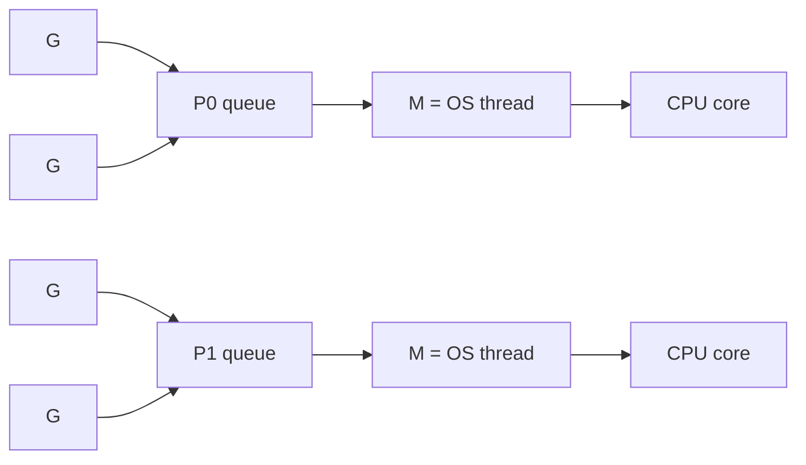

# Вопросы на собеседовании: Конкурентность в Go

Goroutines и channels — главная фича Go: они делают конкурентное программирование дешёвым и читаемым. Стек goroutine может расти по мере необходимости, а runtime планирует множество goroutines на потоках ОС. Это помогает обслуживать много ожидающих задач, но фактическая стоимость зависит от нагрузки. На собеседовании по этой теме чаще всего спрашивают: как устроен scheduler (модель M:N), чем отличаются buffered и unbuffered channels, как работает `select`, когда брать mutex, а когда atomic, и типовые паттерны — worker pool, fan-out/fan-in, pipeline.

## Полезные ссылки

### Официальная документация и авторитетные источники

- [Concurrency in Go — Official Docs](https://go.dev/doc/effective_go#concurrency)
- [Go Memory Model](https://go.dev/ref/mem)
- [Go Concurrency Patterns (Rob Pike talk)](https://www.youtube.com/watch?v=f6kdp27TYZs)
- [The Go Scheduler — Ardan Labs](https://www.ardanlabs.com/blog/2018/08/scheduling-in-go-part1.html)
- [Go by Example: Goroutines](https://gobyexample.com/goroutines)
- [sync package documentation](https://pkg.go.dev/sync)
- [Go 1.27: Goroutine Leak Profiles](https://go.dev/blog/goroutine-leak-profiles)

## Содержание

- [Полезные ссылки](#полезные-ссылки)
- [See also](#see-also)

**Goroutines**
- [Q1. (!) Что такое goroutine?](#q1--что-такое-goroutine)
- [Q2. (!) Чем goroutine отличается от OS thread?](#q2--чем-goroutine-отличается-от-os-thread)
- [Q3. (!) Как работает Go scheduler (M:N модель)?](#q3--как-работает-go-scheduler-mn-модель)
- [Q4. (!) Как запустить и остановить goroutine?](#q4--как-запустить-и-остановить-goroutine)
- [Q5. GOMAXPROCS — что это?](#q5-gomaxprocs--что-это)

**Channels**
- [Q6. (!) Что такое channel?](#q6--что-такое-channel)
- [Q7. (!) Чем отличаются buffered и unbuffered channels?](#q7--чем-отличаются-buffered-и-unbuffered-channels)
- [Q8. (!) Send, receive, close — семантика?](#q8--send-receive-close--семантика)
- [Q9. (!) Что происходит при чтении из закрытого channel?](#q9--что-происходит-при-чтении-из-закрытого-channel)
- [Q10. (!) Что происходит при записи в закрытый channel?](#q10--что-происходит-при-записи-в-закрытый-channel)
- [Q11. range над channel?](#q11-range-над-channel)

**select**
- [Q12. (!) Что такое select и как работает?](#q12--что-такое-select-и-как-работает)
- [Q13. (!) Default case в select?](#q13--default-case-в-select)
- [Q14. Timeout через select + time.After?](#q14-timeout-через-select--timeafter)

**sync пакет**
- [Q15. (!) Как работает `sync.Mutex` (Lock, Unlock, defer)?](#q15--как-работает-syncmutex-lock-unlock-defer)
- [Q16. (!) sync.RWMutex — когда использовать?](#q16--syncrwmutex--когда-использовать)
- [Q17. (!) sync.WaitGroup — синхронизация goroutines?](#q17--syncwaitgroup--синхронизация-goroutines)
- [Q18. sync.Once — однократная инициализация?](#q18-synconce--однократная-инициализация)
- [Q19. sync.Map — когда использовать?](#q19-syncmap--когда-использовать)
- [Q20. Что такое `sync.Pool` и когда он нужен?](#q20-что-такое-syncpool-и-когда-он-нужен)

**Atomic**
- [Q21. (!) sync/atomic — для счётчиков?](#q21--syncatomic--для-счётчиков)
- [Q22. atomic vs Mutex — производительность?](#q22-atomic-vs-mutex--производительность)

**Context**
- [Q23. (!) context.Context — концепция?](#q23--contextcontext--концепция)
- [Q24. (!) Чем различаются `WithCancel`, `WithTimeout`, `WithDeadline`?](#q24--чем-различаются-withcancel-withtimeout-withdeadline)
- [Q25. Распространение context через goroutines?](#q25-распространение-context-через-goroutines)

**Patterns**
- [Q26. (!) Как устроен паттерн Worker Pool?](#q26--как-устроен-паттерн-worker-pool)
- [Q27. (!) Как работают паттерны Fan-out и Fan-in?](#q27--как-работают-паттерны-fan-out-и-fan-in)
- [Q28. Как устроен паттерн Pipeline?](#q28-как-устроен-паттерн-pipeline)
- [Q29. Errgroup — обработка ошибок в параллельных задачах?](#q29-errgroup--обработка-ошибок-в-параллельных-задачах)

**Race conditions и debugging**
- [Q30. (!) Что такое data race в Go?](#q30--что-такое-data-race-в-go)
- [Q31. (!) Как использовать race detector?](#q31--как-использовать-race-detector)
- [Q32. Goroutine leak — что это и как избежать?](#q32-goroutine-leak--что-это-и-как-избежать)
- [Q33. (!) Deadlock в Go?](#q33--deadlock-в-go)

**Сравнения**
- [Q34. (!) Чем goroutines отличаются от Java threads?](#q34--чем-goroutines-отличаются-от-java-threads)
- [Q35. Чем Go channels отличаются от Java BlockingQueue?](#q35-чем-go-channels-отличаются-от-java-blockingqueue)

## Q1. (!) Что такое goroutine?

**Goroutine** — поток исполнения, которым управляет Go runtime. Выражение `go f()` запускает конкурентное выполнение функции. Вызывающая goroutine не ждёт её завершения. Немедленный старт и физический параллелизм не гарантированы. [Спецификация Go](https://go.dev/ref/spec#Go_statements).

```go
func say(s string) {
    fmt.Println(s)
}

go say("hello") // запуск в отдельной goroutine
say("world")    // в основной (main) goroutine
```

Go runtime распределяет goroutines по потокам ОС. Их стеки могут расти по мере необходимости. Размер стека, стоимость запуска и допустимое число goroutines зависят от реализации и нагрузки.

**Важный нюанс.** `main` сама по себе goroutine; когда она завершается, программа выходит, не дожидаясь остальных goroutines. Поэтому их завершение нужно синхронизировать явно — через `WaitGroup` или канал завершения. Контекст может подать сигнал отмены.

## Q2. (!) Чем goroutine отличается от OS thread?

Goroutine планирует Go runtime, а поток ОС — ядро. Несколько goroutines могут исполняться на одном потоке в разное время, и одна goroutine после ожидания может продолжить работу на другом потоке. Поэтому число goroutines не равно числу потоков ОС.

| Критерий | Goroutine | OS thread |
|---|---|---|
| Планирование | Go runtime | Ядро ОС |
| Стек | Растёт по мере необходимости | Зависит от ОС и настроек |
| Связь | Многие goroutines разделяют потоки | Сам является потоком ОС |

При блокирующем системном вызове runtime может задействовать другой поток ОС для готовых goroutines. Стоимость создания и переключения зависит от платформы, нагрузки и характера ожидания. `GOMAXPROCS` ограничивает одновременное исполнение Go-кода, но не фиксирует общее число потоков ОС (см. Q5).

## Q3. (!) Как работает Go scheduler (M:N модель)?

Go scheduler работает по модели **M:N**: M goroutines мультиплексируются на N OS threads. В этом участвуют три сущности — G, M и P:

```
G — Goroutine
M — Machine (OS thread)
P — Processor (logical, хранит queue goroutines)

Число P в данный момент = текущий GOMAXPROCS.
Default зависит от версии и настроек runtime (см. Q5).
```

`P` — это право на исполнение Go-кода: чтобы M запускал goroutine, ему нужен свободный P. Текущее число P задаёт `GOMAXPROCS` и ограничивает параллельное исполнение Go-кода; значение может меняться. M может быть больше (например, когда поток заблокирован в syscall).



Чтобы M-thread'ы не простаивали, а одна «зависшая» goroutine не блокировала остальных, планировщик применяет три ключевых механизма:

- **Work stealing** — если у P закончились свои goroutines, он может забрать часть готовых goroutines из очереди другого P. Это один из механизмов балансировки работы.
- **Preemptive scheduling** (с Go 1.14+) — раньше goroutine отдавала процессор только в «точках уступки» (вызовы функций, channel-операции), и цикл без них мог застрять навсегда. Асинхронное вытеснение позволяет прерывать многие такие вычисления. Порядок 10 мс — деталь реализации планировщика, а не гарантия максимальной задержки; возможность и момент вытеснения зависят от состояния runtime. [Go 1.14 runtime](https://go.dev/doc/go1.14#runtime), [runtime/proc.go](https://go.dev/src/runtime/proc.go).
- **Network poller** — когда goroutine блокируется на сетевом I/O, она снимается с M, а M отдаётся другой goroutine. Готовность сокета отслеживает отдельный poller (epoll/kqueue), и заблокированная goroutine не держит реальный поток.

В сумме это даёт **высокую concurrency** без накладных расходов «один OS thread на goroutine».

## Q4. (!) Как запустить и остановить goroutine?

**Запуск** — `go f()`; функция исполняется в новой goroutine. Остановка кооперативная: код получает сигнал и сам возвращается. Отправитель сигнала отдельно ожидает завершение, если оно нужно перед продолжением работы.

Через закрытие done-channel можно уведомить всех, кто его ожидает:

```go
done := make(chan struct{})
finished := make(chan struct{})
go func() {
    defer close(finished)
    <-done // здесь мог бы быть select с рабочим каналом
}()
close(done) // сигнал отмены, закрывает один владелец
<-finished // ожидание фактического завершения
```

Для передачи отмены между функциями используют контекст:

```go
ctx, cancel := context.WithCancel(context.Background())
finished := make(chan struct{})
go func() {
    defer close(finished)
    <-ctx.Done()
}()
cancel() // сигнал, а не ожидание завершения
<-finished
```

В рабочем цикле проверку `Done()` совмещают с ожиданием задания через `select`; пустой `default` в таком цикле создаёт busy-loop. Если обработчик выполняет долгую операцию, он тоже должен принимать контекст или проверять отмену. Сам `cancel()` не прерывает произвольный вызов и не ждёт выхода goroutine. Передавайте `ctx context.Context` первым параметром функций, которым нужны его отмена, срок или данные запроса. [context](https://pkg.go.dev/context), [Go pipelines: cancellation](https://go.dev/blog/pipelines).

## Q5. GOMAXPROCS — что это?

`GOMAXPROCS` ограничивает число OS threads, одновременно исполняющих пользовательский Go-код; ему соответствует текущее число логических процессоров `P`. Это не предел общего числа goroutines или потоков процесса и не привязка к конкретным физическим ядрам.

```go
fmt.Println("logical CPUs:", runtime.NumCPU())
fmt.Println("current GOMAXPROCS:", runtime.GOMAXPROCS(0))
```

**Default зависит от версии и настроек.** С Go 1.25 runtime учитывает число логических CPU, affinity процесса и, на Linux, cgroup CPU quota. Квота throughput отличается от числа доступных CPU: дробную квоту округляют вверх; при обычном расчёте default не опускают ниже 2, если CPU/affinity позволяют. Поэтому безусловное `GOMAXPROCS = NumCPU()` для современного контейнера неверно.

Значение по умолчанию может обновляться при изменении лимитов. Явные `GOMAXPROCS` в окружении или `runtime.GOMAXPROCS(n)` с положительным `n` отключают автообновление; `runtime.SetDefaultGOMAXPROCS()` (1.25+) возвращает политику runtime. Для языковой версии главного модуля до 1.25 новые defaults и автообновление по умолчанию отключены совместимыми настройками `GODEBUG`; проверяйте `go.mod`, `containermaxprocs` и `updatemaxprocs`.

В старых конфигурациях `NumCPU()` отражает CPU, доступные процессу на старте, но не обязательно ограничение throughput контейнера. Перед ручной настройкой сопоставьте runtime-значение, cgroup limit, профиль CPU и throttling; дополнительный P не создаёт дополнительную CPU-квоту. [runtime.GOMAXPROCS](https://pkg.go.dev/runtime#GOMAXPROCS), [Go 1.25 runtime](https://go.dev/doc/go1.25#runtime), [container-aware GOMAXPROCS](https://go.dev/blog/container-aware-gomaxprocs).

## Q6. (!) Что такое channel?

Канал передаёт типизированные значения между goroutines. Отправка синхронизирована с завершением соответствующего приёма. [Модель памяти Go](https://go.dev/ref/mem).

```go
ch := make(chan int)         // unbuffered
ch := make(chan int, 10)      // buffered (capacity 10)

ch <- 42         // send
v := <-ch        // receive
v, ok := <-ch    // ok=false, если канал закрыт и пуст

close(ch)        // закрытие
```

Передача владения через канал — соглашение между участниками. Если передать указатель, обе стороны всё ещё могут обратиться к объекту. Для конкурентных чтений и записей нужна отдельная синхронизация либо соблюдение соглашения о единственном владельце.

Channels типобезопасны (хранят значения одного типа) и потокобезопасны (вся синхронизация встроена в send/receive).

## Q7. (!) Чем отличаются buffered и unbuffered channels?

Разница в одном: есть ли у канала внутренний буфер. От этого зависит, **когда** блокируется отправитель.

**Unbuffered** (`make(chan int)`) — буфера нет, передача происходит «из рук в руки» (rendezvous). Отправитель блокируется, пока получатель не заберёт значение, — это точка синхронизации двух goroutines.

```go
ch := make(chan int)
done := make(chan struct{})
go func() {
    defer close(done)
    ch <- 1 // блокируется до приёма
    fmt.Println("sent")
}()
fmt.Println("waiting")
v := <-ch // принимает
fmt.Println("got:", v)
<-done // дожидаемся печати sent
```

`waiting` появляется первым. После rendezvous обе goroutines могут продолжить работу, поэтому порядок печати `sent` и `got` не гарантирован.

**Buffered** (`make(chan int, 3)`) — отправитель не блокируется, пока в буфере есть место; блокировка наступает, только когда буфер полон. Канал работает как ограниченная очередь.

```go
ch := make(chan int, 3)
ch <- 1
ch <- 2
ch <- 3 // OK
ch <- 4 // блокируется! буфер полон
```

| Тип | Семантика | Использование |
|-----|-----------|---------------|
| Unbuffered | Synchronization (rendezvous) | Координация goroutines |
| Buffered | Очередь сообщений | Producer-consumer с буфером |

**Эмпирическое правило:** unbuffered — когда нужна гарантия «получатель действительно принял»; buffered — когда нужно сгладить всплески нагрузки и развязать producer от consumer. Размер буфера выбирай осознанно: слишком большой маскирует backpressure и прячет проблему медленного потребителя.

## Q8. (!) Send, receive, close — семантика?

Три базовые операции и их поведение в граничных ситуациях — частый источник вопросов на собеседовании.

```go
ch := make(chan int)

// SEND
ch <- 42

// RECEIVE (два варианта)
v := <-ch
v, ok := <-ch  // ok=true если ОК, false если канал закрыт И пуст

// CLOSE
close(ch)
```

**Ключевые правила.**

- `close` сообщает, что отправок больше не будет. Канал закрывает владелец его жизненного цикла, когда все отправки завершились.
- При нескольких отправителях обычно ждут их завершения через `WaitGroup` и затем закрывают канал в координаторе. `sync.Once` предотвращает повторное закрытие, но сам по себе не упорядочивает отправки и закрытие.
- Поведение **закрытого** канала:
  - Чтение сначала возвращает оставшиеся значения буфера с `ok=true`. Когда буфер исчерпан, оно сразу возвращает zero value и `ok=false`.
  - Запись — **panic** `send on closed channel`.
- Отправка в nil-канал и приём из него блокируются навсегда. В `select` nil-канал отключает соответствующую ветку. `close(nil)` и повторное закрытие уже закрытого канала паникуют. [Спецификация Go](https://go.dev/ref/spec#Close).

## Q9. (!) Что происходит при чтении из закрытого channel?

Чтение из закрытого канала **не блокируется и не паникует** — это безопасная операция. Если канал пуст, оно немедленно возвращает zero value типа и `ok=false`:

```go
ch := make(chan int)
close(ch)

v, ok := <-ch
fmt.Println(v, ok) // 0 false
```

Если до `close` в буфере **остались значения**, они сначала вычитываются по одному, и только когда буфер опустеет, чтения начнут отдавать `ok=false`. То есть close не теряет уже отправленные данные:

```go
ch := make(chan int, 3)
ch <- 1
ch <- 2
close(ch)

for v := range ch {
    fmt.Println(v) // 1, 2
}
```

Именно поэтому `range` по каналу — идиоматичный способ прочитать всё «до конца»: он сам останавливается на закрытии. Различать «пришёл zero value» и «канал закрыт» помогает форма `v, ok := <-ch`.

## Q10. (!) Что происходит при записи в закрытый channel?

Запись в закрытый канал вызывает **panic** `send on closed channel`.

```go
ch := make(chan int)
close(ch)
ch <- 1 // panic: send on closed channel
```

Владелец жизненного цикла закрывает канал после завершения всех отправителей. Например, `WaitGroup` позволяет координатору дождаться всех отправок перед `close`. `sync.Once` защищает только от повторного вызова `close`. [Go pipelines](https://go.dev/blog/pipelines).

## Q11. range над channel?

`for v := range ch` читает значения по одному и выходит, когда канал закрыт и буфер исчерпан.

```go
ch := make(chan int, 3)
go func() {
    for i := 1; i <= 5; i++ {
        ch <- i
    }
    close(ch) // важно — иначе range блокируется навсегда
}()

for v := range ch {
    fmt.Println(v) // 1, 2, 3, 4, 5
}
```

Пока открытый канал пуст, цикл ждёт следующего значения. Если отправок больше не будет, владелец закрывает канал, чтобы читатель смог выйти.

## Q12. (!) Что такое select и как работает?

`select` выбирает одну из готовых операций отправки или приёма. Если ни одна не готова, он выполняет `default` при наличии этой ветки или ждёт.

```go
ch1 := make(chan int)
ch2 := make(chan int)

select {
case v := <-ch1:
    fmt.Println("from ch1:", v)
case v := <-ch2:
    fmt.Println("from ch2:", v)
case ch1 <- 42:
    fmt.Println("sent to ch1")
}
```

**Как работает:**
- Если ни одна case не готова — `select` блокируется и ждёт, пока готовой станет хоть одна.
- Если готовы несколько операций, Go выбирает одну равномерно псевдослучайно. Это не даёт гарантии от голодания. [Спецификация Go](https://go.dev/ref/spec#Select_statements).
- `case` может быть как receive, так и send — `select` слушает оба направления.
- Ветка `default` снимает блокировку (см. Q13).

## Q13. (!) Default case в select?

Ветка `default` выполняется, когда ни один канал не готов прямо сейчас. С ней `select` превращается из блокирующего в **неблокирующий**: попробовал — не вышло — пошёл дальше.

```go
select {
case v := <-ch:
    fmt.Println("got:", v)
default:
    fmt.Println("no message, not blocking")
}
```

**Сценарии применения:**
- **Non-blocking read/write** — забрать значение, только если оно уже есть; не ждать.
- **Polling** — периодически проверять канал, не останавливая основной цикл.
- **Health checks** — мгновенно опросить состояние без риска зависнуть.

**Подводный камень:** `select { default: }` в цикле без паузы превращается в busy-loop, который крутит CPU вхолостую. Если опрашиваешь в цикле — добавляй таймер или `time.Sleep`, а лучше переходи на блокирующий `select` без `default`.

## Q14. Timeout через select + time.After?

Таймаут — это ещё одна ветка `select`, которая станет готовой, если основной канал не ответил вовремя. `time.After(d)` сразу возвращает канал; таймер срабатывает не раньше чем через `d`. Если одновременно готовы несколько веток, `select` выбирает одну из них. Для передачи дедлайна вложенным вызовам используйте `context.WithTimeout` (см. Q24):

```go
select {
case v := <-ch:
    fmt.Println("got:", v)
case <-time.After(5 * time.Second):
    fmt.Println("timeout")
}
```

Каждый вызов `time.After` создаёт таймер. Начиная с Go 1.23 недостижимые таймеры может собрать GC ещё до срабатывания, поэтому сам по себе `time.After` в цикле больше не означает утечку. В часто выполняемом цикле создание новых таймеров всё же может быть лишней работой; если нужен явный контроль срока или измерения показали затраты, используйте `NewTimer` и `Reset` (подробнее — [Go stdlib Q16](go-stdlib-interview.md#q16-таймеры-timenewtimer-timetick-timeafter--в-чём-разница)). Для однократного ожидания с отменой достаточно:

```go
timer := time.NewTimer(5 * time.Second)
defer timer.Stop()

select {
case v := <-ch:
    fmt.Println("got:", v)
case <-timer.C:
    fmt.Println("timeout")
}
```

После `Stop`/`Reset` в новой семантике нельзя получить старое значение из `timer.C`, поэтому дренировать канал не требуется; безусловное чтение после `Stop` может зависнуть.

**Граница версий.** В Go 1.23–1.26 выбор семантики по умолчанию зависел от строки `go` главного модуля. Для `go 1.23` и выше использовались синхронные каналы. `asynctimerchan=0` включал эту семантику, а `asynctimerchan=1` возвращал старую. В Go 1.27 переключатель удалён, и каналы таймеров всегда синхронные, даже при старой строке `go`. При миграции удалите `asynctimerchan=1`, если сохранили его в конфигурации. В `go.mod` или `//go:debug` старое значение останавливает сборку, а в переменной окружения `GODEBUG` приводит к завершению программы при запуске. Значение `0` совместимо с новым поведением. [Удалённые настройки GODEBUG](https://go.dev/doc/godebug#go-127). При старой семантике перед `Reset` таймер останавливают и при необходимости вычитывают оставшееся значение, учитывая, читал ли его потребитель. [Go 1.27 release notes](https://go.dev/doc/go1.27#runtime). [time.After](https://pkg.go.dev/time#After), [Timer.Stop](https://pkg.go.dev/time#Timer.Stop), [Go 1.23 release notes](https://go.dev/doc/go1.23#timer).

## Q15. (!) Как работает `sync.Mutex` (Lock, Unlock, defer)?

`sync.Mutex` — взаимная блокировка, которая допускает к защищённому участку (critical section) ровно одну goroutine в момент времени. Всё, что между `Lock()` и `Unlock()`, выполняется эксклюзивно.

```go
import "sync"

var (
    mu      sync.Mutex
    counter int
)

func increment() {
    mu.Lock()
    defer mu.Unlock()
    counter++
}
```

**Правила работы.**
- `Lock()` блокирует goroutine, если mutex уже захвачен другой, — она ждёт `Unlock`.
- `Unlock()` может вызвать и другая goroutine. Вызов для незахваченного mutex — runtime error. [Документация sync.Mutex](https://pkg.go.dev/sync#Mutex).
- `defer mu.Unlock()` удобен, если критическая секция заканчивается при выходе из функции. В длинной функции или цикле `defer` может удерживать mutex дольше нужного. Ограничь область короткой функцией или освободи mutex явно при завершении секции.

Mutex нельзя копировать после первого использования. Структуру, содержащую используемый mutex, обычно передают по указателю.

## Q16. (!) sync.RWMutex — когда использовать?

`sync.RWMutex` разделяет блокировку на два режима. `RLock` (read) могут одновременно держать сколько угодно читателей — они не мешают друг другу, ведь чтение не меняет данные. `Lock` (write) эксклюзивен: писатель ждёт, пока освободятся все читатели, и на время записи никого не пускает.

```go
var (
    mu   sync.RWMutex
    data map[string]int
)

func read(key string) int {
    mu.RLock()
    defer mu.RUnlock()
    return data[key]
}

func write(key string, value int) {
    mu.Lock()
    defer mu.Unlock()
    data[key] = value
}
```

`RWMutex` может помочь, если операции чтения часто перекрываются по времени. Результат зависит от длительности критической секции, частоты записей и уровня конкуренции. Сравни с `Mutex` на своей нагрузке. Ожидающий писатель ограничивает приход новых читателей, пока не получит и не освободит блокировку.

## Q17. (!) sync.WaitGroup — синхронизация goroutines?

`sync.WaitGroup` считает незавершённые задачи. `Wait()` возвращается, когда счётчик равен нулю. С Go 1.25 метод `wg.Go(f)` регистрирует задачу, запускает `f` в отдельной goroutine и снимает задачу с учёта при возврате `f`.

```go
// Go 1.25+, внутри функции с импортом sync.
var wg sync.WaitGroup
var results [3]int

for i := range results {
    wg.Go(func() {
        results[i] = i * i
    })
}

wg.Wait()
// Здесь results содержит [0, 1, 4].
```

Каждая задача пишет в свой элемент массива. Завершение задач синхронизировано с возвратом из `Wait()`, поэтому вызывающий код может прочитать массив после ожидания. Если две задачи пишут в один элемент, `WaitGroup` сам по себе их записи не упорядочивает.

**Для версий до Go 1.25** используй `wg.Add(1)` перед запуском каждой goroutine и `defer wg.Done()` внутри неё. Если перенести `Add(1)` внутрь уже запущенной goroutine, `Wait()` может увидеть нулевой счётчик и вернуться до начала работы.

Этот шаблон можно проверить командой `go vet ./...`. Анализатор, добавленный в Go 1.25 как `waitgroup`, выявляет типичный случай `Add(1)` внутри только что запущенной горутины. В Go 1.27 анализатор `go vet` по-прежнему называется `waitgroup`. Переименование в `waitgroupgo` относится к отдельному анализатору команды `go fix`. Успешная проверка сама по себе не доказывает правильность регистрации задач и завершения группы. [Go 1.25](https://go.dev/doc/go1.25#vet) · [Go 1.27](https://go.dev/doc/go1.27#go-fix).

- Когда группа пуста, первую задачу регистрируют до вызова `Wait()`. Пока есть незавершённая задача, она может добавлять дочерние через `wg.Go`.
- Следующую независимую партию задач добавляй после возврата всех `Wait()` предыдущей партии. После первого использования `WaitGroup` нельзя копировать.
- Функция, переданная в `wg.Go`, по контракту не должна паниковать. Если нужно получить ошибку и передать сигнал отмены остальным задачам, см. `errgroup.WithContext` в Q29.

[Документация sync.WaitGroup](https://pkg.go.dev/sync#WaitGroup), [заметки к Go 1.25](https://go.dev/doc/go1.25#sync).

## Q18. sync.Once — однократная инициализация?

Каждый экземпляр `sync.Once` запускает переданную в `Do` функцию не более одного раза. Если функция паникует, следующий вызов `Do` её не повторяет. [Документация sync.Once](https://pkg.go.dev/sync#Once).

```go
var (
    once sync.Once
    cfg  *Config
)

func GetConfig() *Config {
    once.Do(func() {
        cfg = loadConfigFromFile()
    })
    return cfg
}
```

**Как это работает.** Первая goroutine, дошедшая до `Do`, выполняет `f`, остальные **блокируются** до её завершения — и только потом возвращаются. Поэтому результат успешно завершившейся инициализации виден после возврата из `Do`.

**Сценарии применения:** lazy initialization дорогих ресурсов, потокобезопасные singletons. Важно: `Once` нельзя переиспользовать — повторный `Do` ничего не выполнит, даже с другой функцией.

## Q19. sync.Map — когда использовать?

`sync.Map` — готовая потокобезопасная map. Нужна она нечасто: обычная `map` под `sync.Mutex` подходит для большинства случаев, а `sync.Map` оправдана лишь в узких сценариях, под которые оптимизирована.

```go
var m sync.Map

m.Store("alice", 30)

v, ok := m.Load("alice")
if ok { fmt.Println(v) }

m.Delete("alice")

m.Range(func(k, v any) bool {
    fmt.Printf("%v: %v\n", k, v)
    return true // continue
})
```

Документация выделяет два характерных сценария: ключи записывают один раз и читают много раз либо goroutines работают с непересекающимися наборами ключей. С Go 1.24 реализация изменилась и снизилась конкуренция при изменении разных ключей. Устройство внутреннего индекса не входит в контракт. [Документация sync.Map](https://pkg.go.dev/sync#Map) · [Go 1.24](https://go.dev/doc/go1.24#sync).

Обычная типизированная `map` с mutex удобна, когда одна блокировка защищает несколько связанных изменений. Производительность обоих вариантов зависит от нагрузки.

## Q20. Что такое `sync.Pool` и когда он нужен?

`sync.Pool` — пул переиспользуемых временных объектов, который снижает давление на аллокатор и GC. Вместо того чтобы каждый раз создавать новый объект, ты берёшь его из пула (`Get`), используешь и возвращаешь (`Put`). Если `Get` не находит подходящий объект, он вызывает `New`, если фабрика задана. Без `New` он может вернуть `nil`.

```go
var bufferPool = sync.Pool{
    New: func() any {
        return new(bytes.Buffer)
    },
}

func process() {
    buf := bufferPool.Get().(*bytes.Buffer)
    defer func() {
        buf.Reset()
        bufferPool.Put(buf)
    }()

    // используем buf
}
```

Обрати внимание на `buf.Reset()` перед возвратом: объект из пула приходит «как есть», с прежним содержимым, поэтому его нужно очистить, иначе следующий потребитель получит чужие данные.

**Сценарии применения:**
- тяжёлые короткоживущие объекты (buffers, временные структуры), которые создаются часто;
- когда аллокации этих объектов заметны в профилировке (`pprof`, allocs/op).

**Не подходит для:**
- connection pools — у соединений есть жизненный цикл и состояние, для них есть специализированные библиотеки;
- объектов со сложным state, который дорого или опасно сбрасывать.

**Ключевой нюанс:** Пул может отбросить любой сохранённый объект в любой момент, поэтому `Pool` нельзя использовать как кэш с гарантией наличия объекта. Это оптимизация скорости, а не часть корректности программы — код должен работать и тогда, когда пул пуст.

## Q21. (!) sync/atomic — для счётчиков?

Пакет `sync/atomic` даёт атомарные операции для отдельных значений. Атомарные операции ведут себя так, будто выполняются в некотором последовательном порядке. Если операция B наблюдает эффект атомарной операции A, модель памяти Go устанавливает отношение synchronized-before от A к B. Число машинных инструкций и стоимость зависят от платформы. [Документация sync/atomic](https://pkg.go.dev/sync/atomic).

```go
import "sync/atomic"

var counter int64

// Increment
atomic.AddInt64(&counter, 1)

// Read
v := atomic.LoadInt64(&counter)

// Set
atomic.StoreInt64(&counter, 100)

// Compare-and-swap
swapped := atomic.CompareAndSwapInt64(&counter, 100, 200)
```

`CompareAndSwap` (CAS) — основа lock-free алгоритмов: «запиши новое значение, только если текущее равно ожидаемому». CAS вернёт `false`, если в момент сравнения текущее значение отличается от ожидаемого. Если обновление нужно повторить, перечитай значение и пересчитай результат. CAS сравнивает значения и не обнаруживает промежуточное изменение с возвратом к исходному.

С Go 1.19+ есть типизированный API — `atomic.Int64`, `atomic.Pointer[T]` и т.п. Он удобнее для счётчика: операции чтения и изменения доступны через методы обёртки. Доступ к тем же данным через другой путь всё равно нужно согласовывать.

```go
var counter atomic.Int64
counter.Add(1)
counter.Load()
```

**Граница применимости:** одна atomic-операция защищает одно значение, а не произвольную последовательность изменений. Для инварианта между несколькими полями обычно проще `Mutex`; возможный CAS-алгоритм потребует отдельного доказательства корректности.

## Q22. atomic vs Mutex — производительность?

Atomic-операция подходит для одного независимого счётчика или флага. `Mutex` защищает целый критический участок, в котором можно согласованно изменить несколько полей. Фиксированного коэффициента ускорения между ними нет: стоимость зависит от числа конкурирующих goroutines, архитектуры процессора и длительности работы под lock.

```go
var counter atomic.Int64
counter.Add(1)
```

Например, если перевод должен уменьшить один баланс и увеличить другой как единое изменение, два вызова `Add` позволят читателю увидеть промежуточное состояние. Общий mutex защищает и перевод, и согласованное чтение обоих балансов. Сначала определите инвариант данных. Затем сравните варианты бенчмарком на похожей нагрузке. Сложные lock-free алгоритмы возможны, но для связанных полей обычный `Mutex` чаще проще проверить и сопровождать.

## Q23. (!) context.Context — концепция?

`context.Context` — стандартный способ протащить через всю цепочку вызовов сигнал «пора останавливаться» и сопутствующие метаданные. Он решает проблему: как отменить работу, разбросанную по множеству goroutines и слоёв, не передавая в каждую функцию отдельный done-channel. Context несёт три вещи:

- **Cancellation signal** — отмену операции через `CancelFunc` или отмену родителя.
- **Deadline / timeout** — автоматическую отмену по времени.
- **Request-scoped values** — данные на время запроса: request ID, информация о пользователе, trace.

```go
package main

import (
    "context"
    "fmt"
    "time"
)

func main() {
    ctx, cancel := context.WithTimeout(context.Background(), 5*time.Second)
    defer cancel()

    result, err := slowOp(ctx)
    if err != nil {
        fmt.Println(err)
        return
    }
    fmt.Println(result)
}

func slowOp(ctx context.Context) (string, error) {
    select {
    case <-time.After(10 * time.Second):
        return "done", nil
    case <-ctx.Done():
        return "", ctx.Err() // context.DeadlineExceeded или context.Canceled
    }
}
```

Канал `ctx.Done()` закрывается при отмене или истечении дедлайна — функция слушает его в `select` и возвращается досрочно. `ctx.Err()` уточняет причину: `context.Canceled` (вызвали `cancel`) или `context.DeadlineExceeded` (вышло время). Сам по себе контекст горутину не останавливает: код должен слушать его или передавать API, поддерживающему отмену. Если одновременно готовы результат и `ctx.Done()`, `select` не даёт ветке отмены приоритет: может быть выбран любой готовый case. Контракт принятия результата после дедлайна нужно задавать явно. [Go spec: select](https://go.dev/ref/spec#Select_statements).

**Рекомендация:** делай `ctx context.Context` **первым** параметром функции — это устоявшаяся идиома. Context не кладут в поля структур и не передают `nil`; если контекста ещё нет, используй `context.TODO()`.

## Q24. (!) Чем различаются `WithCancel`, `WithTimeout`, `WithDeadline`?

Три конструктора создают дочерний отменяемый контекст и возвращают `CancelFunc`. `WithCancel` добавляет ручную отмену. `WithTimeout` задаёт срок относительно текущего момента, а `WithDeadline` принимает абсолютный `time.Time`. Все три дочерних контекста также отменяются при отмене родителя; более ранний родительский дедлайн ограничивает дочерний.

```go
func runBefore(parent context.Context, deadline time.Time) error {
    ctx, cancel := context.WithDeadline(parent, deadline)
    defer cancel()
    _, err := slowOp(ctx)
    return err
}
```

Если вызывающей стороне нужен относительный срок, она использует `context.WithTimeout(parent, 5*time.Second)`; если момент уже пришёл извне, передаёт его в `WithDeadline`. Для ручной отмены без собственного срока достаточно `context.WithCancel(parent)`. `WithValue` не управляет отменой: он переносит значения запроса (см. [Go stdlib Q17](go-stdlib-interview.md#q17--contextcontext--основные-методы)).

Код, создавший дочерний контекст, вызывает `cancel()` после завершения операции на каждом пути исполнения, обычно через `defer`. Это отсоединяет потомка от родителя и останавливает связанный таймер. Без вызова дочерний контекст и его потомки могут оставаться достижимыми до отмены родителя; это не означает автоматическую утечку горутины. `CancelFunc` не ждёт завершения работы, а `go vet` проверяет потерянные функции отмены. [context](https://pkg.go.dev/context), [WithDeadline](https://pkg.go.dev/context#WithDeadline), [go vet](https://pkg.go.dev/cmd/vet).

## Q25. Распространение context через goroutines?

Функции `WithCancel` и `WithTimeout` создают дочерний контекст, сохраняя родительский контекст без изменений. Так выстраивается дерево, и отмена распространяется по нему **только вниз**: отмена родителя распространяется на связанные дочерние контексты. Начиная с Go 1.21, `context.WithoutCancel(parent)` сохраняет доступ к значениям родителя, но не наследует отмену и дедлайн, а его `Done()` равен nil. Отмена дочернего контекста на родителя не влияет. [WithoutCancel](https://pkg.go.dev/context#WithoutCancel).

```go
func canceledChild() error {
    parent, cancelParent := context.WithCancel(context.Background())
    defer cancelParent()
    child, cancelChild := context.WithTimeout(parent, 5*time.Second)
    defer cancelChild()

    cancelParent()
    <-child.Done()
    return child.Err() // context.Canceled
}
```

Здесь `child` отменится раньше своих 5 секунд, потому что отменили `parent`. Сигнал дойдёт до потомков, но не завершит работающие горутины сам: им нужно проверять `Done()` или вызывать API, которое принимает контекст. Каждый создатель дочернего контекста вызывает свою функцию отмены, когда работа завершена.

**Иерархия:**
```
Background (root)
  ├── parent (cancellable)
  │    ├── child1 (timeout)
  │    └── child2 (deadline)
  └── другой parent
```

На схеме оба дочерних контекста наследуют отмену `parent`.

## Q26. (!) Как устроен паттерн Worker Pool?

**Worker pool** — фиксированное число goroutines-воркеров, которые разбирают задачи из общего канала `jobs` и складывают результаты в `results`. Если каждый воркер выполняет одну задачу за раз, пул из N воркеров ограничивает число одновременно выполняемых задач до N.

```go
package main

import (
    "fmt"
    "sync"
)

func worker(id int, jobs <-chan int, results chan<- int) {
    for job := range jobs {
        fmt.Printf("worker %d processing %d\n", id, job)
        results <- job * 2
    }
}

func main() {
    jobs := make(chan int)
    results := make(chan int)
    var workers sync.WaitGroup
    for id := 1; id <= 3; id++ {
        workers.Add(1)
        go func(id int) {
            defer workers.Done()
            worker(id, jobs, results)
        }(id)
    }
    go func() {
        for job := 1; job <= 5; job++ {
            jobs <- job
        }
        close(jobs)
    }()
    go func() {
        workers.Wait()
        close(results)
    }()
    for result := range results {
        fmt.Println(result)
    }
}
```

**Как это работает.** Все воркеры читают из одного `jobs`. Каждое отправленное значение получает один воркер. Какой именно воркер получит следующую задачу, заранее неизвестно. `close(jobs)` после отправки задач завершает `for range` во всех воркерах, и они выходят. `<-chan` (read-only) и `chan<-` (write-only) в сигнатуре — это направленные каналы: компилятор не даст воркеру случайно записать в `jobs` или прочитать из `results`.

`jobs` закрывает производитель, а `results` — отдельная goroutine после `Wait()`. Поэтому конец `range results` означает, что workers завершились и все отправленные результаты прочитаны. Порядок результатов не фиксирован. Если потребитель может уйти раньше, передайте общий контекст производителю и воркерам. Производитель должен учитывать отмену при отправке в `jobs`, а воркер — при чтении из `jobs`, выполнении отменяемой операции и отправке в `results` (см. Q28). [Go pipelines](https://go.dev/blog/pipelines), [sync.WaitGroup](https://pkg.go.dev/sync#WaitGroup).

**Сценарий применения:** ограничение нагрузки на внешний ресурс (БД, API), где нельзя запускать неограниченное число параллельных запросов. Размер пула подбирают под пропускную способность ресурса. Ёмкость очереди задают отдельно. Например, при трёх воркерах и `jobs := make(chan int, 20)` одновременно обрабатываются до трёх задач и до двадцати ждут в канале. Когда буфер заполнен, обычная отправка ждёт свободного места. Если производители сами запускаются в отдельных горутинах, число ожидающих отправителей этим буфером не ограничено. На входе сервиса можно ограничить ожидание дедлайном или отклонить новую задачу по явно выбранной политике. [Спецификация каналов Go](https://go.dev/ref/spec#Channel_types).

## Q27. (!) Как работают паттерны Fan-out и Fan-in?

Два дополняющих друг друга приёма для распараллеливания этапа и сбора его результатов:

- **Fan-out** — несколько workers читают из **одного** входного канала, разбирая работу между собой (параллельная обработка).
- **Fan-in** — несколько каналов-источников сливаются в **один** выходной, из которого в примере читает один потребитель.

Связка fan-out → fan-in: раскидали работу по N воркерам, затем собрали все их выходы в один поток. Функция `merge` ниже как раз делает fan-in — для каждого входного канала запускает goroutine, перекладывающую значения в общий `out`, а отдельная goroutine ждёт завершения всех пересылок через `WaitGroup` и закрывает `out`.

```go
package main

import (
    "fmt"
    "sync"
)

func main() {
    input := make(chan int, 5)
    for n := 1; n <= 5; n++ {
        input <- n
    }
    close(input)

    for n := range merge(double(input), double(input), double(input)) {
        fmt.Println(n)
    }
}

func double(input <-chan int) <-chan int {
    out := make(chan int)
    go func() {
        defer close(out)
        for n := range input {
            out <- n * 2
        }
    }()
    return out
}

func merge(channels ...<-chan int) <-chan int {
    var wg sync.WaitGroup
    out := make(chan int)

    for _, ch := range channels {
        wg.Add(1)
        go func(c <-chan int) {
            defer wg.Done()
            for v := range c {
                out <- v
            }
        }(ch)
    }

    go func() {
        wg.Wait()
        close(out)
    }()
    return out
}
```

Производитель закрывает `input` после отправки пяти задач. Три воркера разбирают их из общего канала и закрывают собственные выходы после завершения. Потребитель получает 2, 4, 6, 8 и 10 в неопределённом порядке. Он читает до закрытия общего канала. Если потребителю нужен только первый результат, передайте сигнал отмены всем этапам, как в Q28. [Go Blog — Fan-out, fan-in](https://go.dev/blog/pipelines#fan-out-fan-in).

**Сценарий применения:** обработка независимых элементов (запросы к разным сервисам, парсинг файлов), где порядок результатов не важен, а важна пропускная способность. Закрытие `out` строго после `wg.Wait()` — обязательная деталь: закрой раньше, и goroutine, ещё пишущая в `out`, упадёт с panic.

## Q28. Как устроен паттерн Pipeline?

**Pipeline** — цепочка этапов (stages), соединённых каналами: каждый этап читает из входного канала, выполняет свою трансформацию и пишет в выходной, который становится входом следующего. Этапы работают **конкурентно** — пока `square` обрабатывает первое число, `generate` может начать отправку второго. Для показанного небуферизованного канала отправка завершится, когда `square` будет готов прочитать следующее число.

```go
package main

import (
    "context"
    "fmt"
)

func generate(ctx context.Context, nums ...int) <-chan int {
    out := make(chan int)
    go func() {
        defer close(out)
        for _, n := range nums {
            select {
            case out <- n:
            case <-ctx.Done():
                return
            }
        }
    }()
    return out
}

func square(ctx context.Context, in <-chan int) <-chan int {
    out := make(chan int)
    go func() {
        defer close(out)
        for {
            select {
            case <-ctx.Done():
                return
            case n, ok := <-in:
                if !ok {
                    return
                }
                select {
                case out <- n * n:
                case <-ctx.Done():
                    return
                }
            }
        }
    }()
    return out
}

func printSquares(limit int) {
    ctx, cancel := context.WithCancel(context.Background())
    defer cancel()

    squares := square(ctx, generate(ctx, 1, 2, 3, 4))
    for n := range squares {
        fmt.Println(n)
        limit--
        if limit == 0 {
            return // defer cancel() сигнализирует обоим этапам
        }
    }
}

func main() {
    printSquares(5) // 1, 4, 9, 16. Канал закрывается при исчерпании входа.
    printSquares(1) // 1. Потребитель дальше не читает.
}
```

При полном чтении `defer close(out)` завершает следующий этап после исчерпания канала. Если потребитель выходит раньше, отправка может заблокироваться до вызова `defer`. При раннем выходе из `printSquares` отложенный `cancel()` закрывает `ctx.Done()`. Оба этапа могут выйти из ожидания и закрывают свои выходные каналы при завершении. Если потребитель продолжит чтение после отмены, он ещё может получить значение: когда готовы и отправка, и `ctx.Done()`, `select` может выбрать отправку. `cancel()` только подаёт сигнал. Если вызывающей стороне нужно дождаться завершения всех этапов, добавьте явное ожидание, например через `WaitGroup`. [Go pipelines](https://go.dev/blog/pipelines).

## Q29. Errgroup — обработка ошибок в параллельных задачах?

`errgroup.Group` из `golang.org/x/sync` ждёт завершения группы горутин и возвращает первую ненулевую ошибку. Нулевое значение `Group` годится для ожидания и передачи ошибки. Если нужен общий сигнал отмены, группу создают через `WithContext` и передают полученный контекст задачам.

В примере после запуска второй задачи первая возвращает ошибку. Вторая ждёт сигнал отмены и возвращает свою ошибку. Вывод показывает, что `Wait()` дождался и второй задачи, а вернул исходную ошибку сервиса.

```go
package main

import (
	"context"
	"errors"
	"fmt"

	"golang.org/x/sync/errgroup"
)

func main() {
	g, ctx := errgroup.WithContext(context.Background())
	workerReady := make(chan struct{})

	g.Go(func() error {
		close(workerReady)
		<-ctx.Done()
		fmt.Println("Вторая задача завершилась после отмены")
		return ctx.Err()
	})

	g.Go(func() error {
		<-workerReady
		return errors.New("сервис каталога недоступен")
	})

	fmt.Println("Wait:", g.Wait())
}
```

```text
Вторая задача завершилась после отмены
Wait: сервис каталога недоступен
```

Контекст из `WithContext` отменяется при первой ненулевой ошибке задачи или при возврате `Wait()`, в зависимости от того, что произошло раньше. Даже после успешного `Wait()` для следующего этапа нужен родительский или новый контекст. `Wait()` продолжит ждать задачу, которая игнорирует отмену. Уже выполненные побочные эффекты сохраняются. [Контракт errgroup](https://pkg.go.dev/golang.org/x/sync/errgroup#Group).


## Q30. (!) Что такое data race в Go?

**Data race (гонка данных)** возникает, когда конкурентные обращения к одной области памяти не упорядочены синхронизацией и хотя бы одно из них — запись и хотя бы одно обращение неатомарно. [Модель памяти Go](https://go.dev/ref/mem). Это частный случай ошибки, зависящей от порядка выполнения. Программа с data race не получает гарантий поведения, которые даёт Go memory model коду без гонок.

```go
var counter int
var wg sync.WaitGroup
for i := 0; i < 1000; i++ {
    wg.Add(1)
    go func() {
        defer wg.Done()
        counter++ // конкурентная запись без синхронизации
    }()
}
wg.Wait()
fmt.Println(counter) // конкретное значение не гарантировано
```

`counter++` включает чтение и запись. Даже ожидание завершения через `WaitGroup` не синхронизирует обращения нескольких работников между собой. Защитите общий счётчик `Mutex` или `atomic.Int64`; другой вариант — передавать значения одной goroutine-владельцу через канал.

## Q31. (!) Как использовать race detector?

Флаг `-race` включает встроенный детектор гонок — компилятор инструментирует доступы к памяти, и runtime ловит несинхронизированные обращения по ходу выполнения.

```bash
go run -race main.go
go test -race ./...
go build -race
```

**Важная особенность:** detector находит только те гонки, что **реально произошли** на данном прогоне, — он не доказывает их отсутствие. Поэтому гонять `-race` нужно на тестах с хорошим покрытием конкурентного кода. Типичные оценки Go — время выполнения в 2–20 раз больше, потребление памяти в 5–10 раз выше. Фактические расходы зависят от программы. [Накладные расходы race detector](https://go.dev/doc/articles/race_detector#Runtime_Overhead). Добавляйте запуск в CI для конкурентного кода с достаточным покрытием; отсутствие отчёта не доказывает отсутствие гонок.

```
WARNING: DATA RACE
Read at 0x00c0000aa008 by goroutine 7:
  main.main.func1()
      /path/main.go:10 +0x44
Previous write at 0x00c0000aa008 by goroutine 6:
  main.main.func1()
      /path/main.go:10 +0x55
```

Отчёт показывает конфликтующую пару: **где** прочитали, **где** раньше записали, и какие goroutines это сделали — по стектрейсам легко найти место в коде и добавить синхронизацию.

## Q32. Goroutine leak — что это и как избежать?

**Goroutine leak** — goroutine навсегда заблокирована и не завершается. В отличие от обычной утечки памяти, здесь утекает и стек goroutine, и всё, на что она ссылается; со временем число «висящих» goroutines растёт и подъедает память.

```go
// LEAK
ch := make(chan int)
go func() {
    v := <-ch // никогда не получит — leak
    fmt.Println(v)
}()
// Если никто не пишет в ch — goroutine висит навсегда
```

**Частый сценарий:** goroutine заблокирована на канале (send или receive), а второй стороны больше не будет — никто не пишет, не читает или не закрывает канал. Такое же постоянное ожидание возможно на `sync.Mutex`, `sync.Cond` и других примитивах. Goroutine не умеет «передумать» сама — ей нужно дать путь к завершению.

**Профилактика:**
- Для отправки или чтения, которое может ждать после ухода потребителя, добавьте ветку `<-ctx.Done()` в тот же `select`. Проверка контекста перед блокирующей операцией не прерывает её, если отмена пришла позже. Пример с уходом потребителя — в [Q28](#q28-как-устроен-паттерн-pipeline).
- `for range` по каналу заканчивается после закрытия канала и чтения буфера. Если завершение зависит от отмены, а отправитель может не закрыть канал вовремя, используйте чтение через `select`.
- Для ожидания внутри API проверьте его контракт. Например, `sync.Mutex.Lock()` не принимает контекст, поэтому отмена не пробуждает горутину, уже заблокированную в `Lock()`.
- Владелец дочернего контекста вызывает `cancel()`, обычно через `defer`. Вызов убирает ссылку на дочерний контекст у родителя и останавливает связанный таймер, если он есть. [Документация context](https://pkg.go.dev/context), [Документация sync.Mutex.Lock](https://pkg.go.dev/sync#Mutex.Lock).

**Как обнаружить:**
- `runtime.NumGoroutine()` — счётчик: устойчивый рост — повод сопоставить счётчик с нагрузкой и проверить стеки;
- `pprof` goroutine-профиль — даёт стектрейсы всех goroutines и показывает, на какой строке они застряли.

С **Go 1.27** `runtime/pprof` дополнительно предоставляет профиль `goroutineleak`. Обычный `goroutine` показывает **все** текущие goroutines, включая штатно ожидающие; `goroutineleak` отбирает те, для которых runtime может доказать невозможность разблокировки. При сборке мусора runtime учитывает всю цепочку возможных пробуждений. Например, горутина A может отправить в канал `ready`, которого ждёт B. Если B после пробуждения может отправить в канал `result`, которого ждёт C, профиль учитывает возможность разблокировать C, даже когда у A нет ссылки на `result`.

Профиль строится по запросу. В Go 1.26 он был экспериментальным, а с Go 1.27 доступен без флага сборки.

Снятие профиля запускает цикл GC с анализом утечек. Он может занять больше времени, чем обычный GC, особенно при длинной цепочке зависимостей между ожидающими горутинами. Если на сервисе растёт число горутин, сначала сопоставьте его с нагрузкой. Снимите профиль для диагностики и измерьте влияние на задержки запросов, прежде чем включать периодический сбор. [Go Blog — стоимость анализа утечек](https://go.dev/blog/goroutine-leak-profiles#performance-impact).

```bash
curl --fail --silent --show-error http://localhost:6060/debug/pprof/goroutineleak -o leak.prof &&
    go tool pprof leak.prof
# в интерактивном pprof: top, list <function>
```

Эндпоинт появляется при подключённом `net/http/pprof` и запущенном диагностическом HTTP-сервере (см. [Go Memory & GC Q15](go-memory-gc-interview.md#q15--как-снять-memory-профиль-через-pprof)). Если профиль пуст, это **не доказательство отсутствия утечек**: ожидание на примитиве, доступном через глобальную переменную или работающую goroutine, может быть пропущено. Профиль также не ищет блокировки на сетевом/файловом I/O и пользовательские spinlock. Сопоставляйте его со стеками обычного `goroutine`-профиля, счётчиком и тестами. [Go 1.27 release notes](https://go.dev/doc/go1.27#goroutine-leak-profile), [runtime/pprof](https://pkg.go.dev/runtime/pprof), [Go blog](https://go.dev/blog/goroutine-leak-profiles).

## Q33. (!) Deadlock в Go?

**Deadlock** — goroutines заблокированы в ожидании друг друга так, что ни одна не может продвинуться. Самый простой случай — отправка в unbuffered-канал, из которого никто не читает:

```go
ch := make(chan int)
ch <- 1 // BLOCK forever — нет receiver
// fatal error: all goroutines are asleep - deadlock!
```

Runtime может диагностировать остановку программы, когда у пользовательских goroutines нет возможности продолжить выполнение. Он учитывает работу планировщика и ожидающие таймеры. Частичная блокировка может остаться незамеченной, пока другие goroutines продолжают работать. [runtime.checkdead](https://go.dev/src/runtime/proc.go).

Вторая частая причина — повторный захват уже взятого mutex:

```go
// Mutex deadlock
var mu sync.Mutex

mu.Lock()
mu.Lock() // блокируется: sync.Mutex нерекурсивный
```

`sync.Mutex` **не reentrant**: повторный `Lock` из той же goroutine ждёт освобождения mutex (в отличие от Java `ReentrantLock`). Обычно это всплывает, когда метод под локом вызывает другой метод, который снова берёт тот же mutex.

**Пример с двумя блокировками.** Перевод между двумя счетами захватывает mutex сначала у отправителя, затем у получателя. При одновременных переводах A → B и B → A каждый вызов может удерживать один mutex и ждать второй. Исправление — оба вызова захватывают mutex в порядке неизменяемых ID счетов, независимо от направления перевода. Все пути, где берутся обе блокировки, должны соблюдать это правило. Перевод на тот же счёт обработайте до захвата пары, чтобы не вызвать `Lock` дважды на одном mutex.

**Как диагностировать.** Если сервис продолжает отвечать на другие запросы, соберите стеки горутин и найдите места ожидания в `sync.Mutex.Lock`. Один такой стек показывает ожидание, а для подтверждения цикла нужно сопоставить точки захвата в обеих ветках кода. У `sync.Mutex` нет привязки к горутине-владельцу, поэтому профиль сам по себе не даёт карту «mutex → владелец». [Документация sync.Mutex](https://pkg.go.dev/sync#Mutex), [Документация runtime/pprof](https://pkg.go.dev/runtime/pprof).

Короткие критические секции уменьшают время ожидания. Чтобы сохранить выбранный порядок захвата, избегайте вызова под mutex внешнего кода, который может повторно взять этот mutex или захватить другие в обратном порядке.


## Q34. (!) Чем goroutines отличаются от Java threads?

Go runtime планирует множество goroutines на потоках ОС. У Java есть два вида потоков: platform threads обычно соответствуют потокам ОС, а virtual threads (Java 21+) тоже позволяют многим задачам разделять меньшее число потоков ОС. JVM может снять виртуальный поток с несущего platform thread при поддерживаемых блокирующих операциях. [JEP 444](https://openjdk.org/jeps/444).

| Критерий | Go goroutine | Java platform thread | Java virtual thread |
|---|---|---|---|
| Планирование | Go runtime | ОС | JVM на несущих потоках |
| Запуск | `go f()` | `Thread` или `Executor` | `Thread.ofVirtual()` или executor |
| Завершение | Ожидание через `WaitGroup` или канал, сигнал отмены через `context` | `join` для ожидания, interruption для сигнала | `join` для ожидания, interruption для сигнала |

Размер стека, стоимость запуска и масштабирование зависят от версии, платформы и характера работы. Для сервера с большим числом ожидающих запросов сравнивайте поведение конкретных API и нагрузку, включая работу с блокирующими вызовами. Подробнее — в [Java Concurrency](../java/java-concurrency-interview.md).

## Q35. Чем Go channels отличаются от Java BlockingQueue?

Оба помогают передавать данные между конкурентными задачами, но их протоколы различаются. Концептуально близки, но у Go-канала есть две выразительные возможности, которых у `BlockingQueue` нет: явное `close` и `select`.

| Критерий | Channel | BlockingQueue |
|----------|---------|---------------|
| Закрытие | `close(ch)` явное | Нет close |
| Range | `for v := range ch` | Через `take()` в цикле |
| Select | Multi-channel `select` | Нет аналога |
| Ёмкость | Без буфера или с буфером | Зависит от реализации. У `SynchronousQueue` ёмкость равна нулю |

**Передача без буфера.** В Go отправка в небуферизованный канал ждёт получателя. В Java похожий обмен даёт `SynchronousQueue`: если производитель вызывает `put(task)` раньше потребителя, он ждёт встречного `take()`. Задача передаётся напрямую. [Java 21 SynchronousQueue](https://docs.oracle.com/en/java/javase/21/docs/api/java.base/java/util/concurrent/SynchronousQueue.html).

**Что даёт `close`.** В Go получатель узнаёт «данных больше не будет» прямо из канала (`for range` сам завершится). В Java сигнал «конец потока» приходится моделировать вручную — например, класть в очередь специальное «отравленное» сообщение (poison pill).

**Что даёт `select`.** Можно ждать сразу несколько каналов, таймаут или отмену в одной конструкции. У `BlockingQueue` прямого аналога нет.

`BlockingQueue` также имеет операции с таймаутом: `offer(e, timeout, unit)` и `poll(timeout, unit)`. Для окончания потока и ожидания нескольких очередей нужен отдельный протокол; прямого `close` или `select` у интерфейса нет.

---

## See also

- [Go (базовый)](go-interview.md) — основы языка
- [Go Memory & GC](go-memory-gc-interview.md) — escape analysis, GC pauses
- [Go Standard Library](go-stdlib-interview.md) — net/http, context
- [Java Concurrency](../java/java-concurrency-interview.md) — для сравнения
- [Kotlin Coroutines](../kotlin/kotlin-coroutines-interview.md) — для сравнения
- [Event-driven паттерны](../../architecture/event-driven-patterns-interview.md) — channels вписываются
- [Микросервисы](../../architecture/microservices-interview.md) — Go идеален для них
- [gRPC](../../api/grpc-interview.md) — Go реализация сильна
