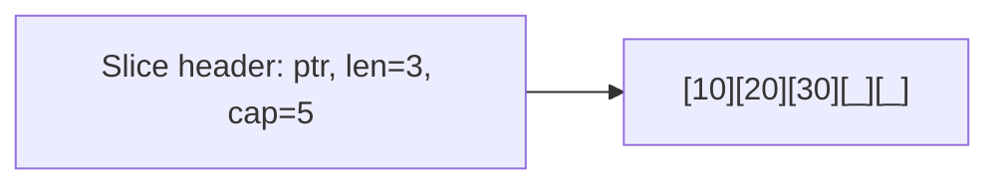

# Вопросы на собеседовании: `Go`

`Go` (Golang) — статически типизированный compiled язык от Google (с 2009). Дизайн: простота, явность, низкие накладные расходы. Главные применения: микросервисы, инфраструктура (Docker, Kubernetes, Terraform), CLI tools, network services.

## Полезные ссылки

### Официальная документация и авторитетные источники

- [Go Official Documentation](https://go.dev/doc/)
- [The Go Programming Language Specification](https://go.dev/ref/spec)
- [Effective Go](https://go.dev/doc/effective_go)
- [Tour of Go](https://go.dev/tour/)
- [Go by Example](https://gobyexample.com/)
- [Go Code Review Comments](https://github.com/golang/go/wiki/CodeReviewComments)
- [Go Wiki](https://go.dev/wiki/)
- [Standard Library](https://pkg.go.dev/std)

## Содержание

- [Полезные ссылки](#полезные-ссылки)
- [See also](#see-also)

**Базовые понятия**
- [Q1. (!) Что такое Go и почему его выбирают?](#q1--что-такое-go-и-почему-его-выбирают)
- [Q2. (!) Чем Go отличается от Java?](#q2--чем-go-отличается-от-java)
- [Q3. (!) Какова философия Go?](#q3--какова-философия-go)
- [Q4. Какие основные особенности языка?](#q4-какие-основные-особенности-языка)

**Переменные и типы**
- [Q5. (!) var, const, := — в чём разница?](#q5--var-const---в-чём-разница)
- [Q6. (!) Какие базовые типы в Go?](#q6--какие-базовые-типы-в-go)
- [Q7. Zero values — что это?](#q7-zero-values--что-это)
- [Q8. Как работают конвертации типов?](#q8-как-работают-конвертации-типов)
- [Q9. (!) Что такое pointer и как работает?](#q9--что-такое-pointer-и-как-работает)

**Композитные типы**
- [Q10. (!) Чем slice отличается от array?](#q10--чем-slice-отличается-от-array)
- [Q11. (!) Внутреннее устройство slice (length, capacity)?](#q11--внутреннее-устройство-slice-length-capacity)
- [Q12. (!) Как работают append и подводные камни?](#q12--как-работают-append-и-подводные-камни)
- [Q13. (!) Как устроена map?](#q13--как-устроена-map)
- [Q14. struct и embedding?](#q14-struct-и-embedding)

**Функции и методы**
- [Q15. (!) Множественные возвращаемые значения (multiple return values)?](#q15--множественные-возвращаемые-значения-multiple-return-values)
- [Q16. (!) Methods и receivers (value vs pointer)?](#q16--methods-и-receivers-value-vs-pointer)
- [Q17. (!) Variadic функции?](#q17--variadic-функции)
- [Q18. Closures в Go?](#q18-closures-в-go)

**Интерфейсы**
- [Q19. (!) Как устроены интерфейсы в Go?](#q19--как-устроены-интерфейсы-в-go)
- [Q20. (!) Неявная реализация интерфейсов (implicit implementation)?](#q20--неявная-реализация-интерфейсов-implicit-implementation)
- [Q21. (!) Empty interface — interface{} и any?](#q21--empty-interface--interface-и-any)
- [Q22. Type assertion и type switch?](#q22-type-assertion-и-type-switch)
- [Q23. (!) Interface satisfaction по structurality?](#q23--interface-satisfaction-по-structurality)

**Error handling**
- [Q24. (!) Как обрабатываются ошибки?](#q24--как-обрабатываются-ошибки)
- [Q25. (!) errors.Is, errors.As и оборачивание ошибок?](#q25--errorsis-errorsas-и-оборачивание-ошибок)
- [Q26. Как работают panic, recover и defer?](#q26-как-работают-panic-recover-и-defer)

**defer**
- [Q27. (!) Как работает defer?](#q27--как-работает-defer)
- [Q28. defer + ошибки в функции?](#q28-defer--ошибки-в-функции)

**Runtime и компиляция**
- [Q29. (!) Как устроен Go runtime?](#q29--как-устроен-go-runtime)
- [Q30. Cross-compilation — как работает?](#q30-cross-compilation--как-работает)
- [Q31. Статическая vs динамическая линковка?](#q31-статическая-vs-динамическая-линковка)

**Стандартная библиотека**
- [Q32. (!) Какие основные пакеты стандартной библиотеки?](#q32--какие-основные-пакеты-стандартной-библиотеки)
- [Q33. context.Context — что это?](#q33-contextcontext--что-это)

**Применение**
- [Q34. (!) Где Go используют в production?](#q34--где-go-используют-в-production)
- [Q35. Какие минусы Go?](#q35-какие-минусы-go)
- [Q36. (!) Когда выбирать Go вместо Java/Kotlin?](#q36--когда-выбирать-go-вместо-javakotlin)

## Q1. (!) Что такое Go и почему его выбирают?

`Go` — компилируемый, статически типизированный язык со сборкой мусора и встроенной поддержкой конкурентности. Robert Griesemer, Rob Pike и Ken Thompson начали его проектировать в Google в 2007 году; в 2009 году проект стал открытым. Задача состояла в том, чтобы упростить разработку крупных программ, сохранить быструю сборку и эффективное исполнение. [Go FAQ](https://go.dev/doc/faq), [Go at Google](https://go.dev/talks/2012/splash.article).

Почему его выбирают для серверных и инфраструктурных программ:

- Небольшой язык, статическая проверка типов, `gofmt` и инструменты сборки помогают читать и поддерживать код команды. Скорость знакомства с проектом зависит и от его устройства.
- Стандартная библиотека включает `net/http`, `encoding/json`, `database/sql` и другие пакеты для типовых задач. Внешние зависимости при этом не запрещены.
- Goroutines и channels позволяют организовать конкурентные задачи; они не гарантируют ускорения CPU-работы и не отменяют необходимости ограничивать нагрузку.
- Обычная сборка с компилятором `gc` включает Go runtime в исполняемый файл: отдельную Go VM устанавливать не нужно. Но при использовании `cgo` бинарник может зависеть от системных библиотек, поэтому «один файл для любого окружения» не гарантирован.
- `GOOS` и `GOARCH` задают целевую платформу из поддерживаемых сочетаний. Сборка с `cgo` может потребовать подходящий C toolchain.

Выбор Go проверяют на задаче и окружении: размер бинарника, потребление памяти и время запуска зависят от программы, зависимостей, сборки и платформы. [Go FAQ](https://go.dev/doc/faq), [supported targets](https://go.dev/doc/install/source#environment), [cgo](https://pkg.go.dev/cmd/cgo).

## Q2. (!) Чем Go отличается от Java?

Сравнивать стоит модель исполнения и средства языка, а ресурсы и задержки измерять на конкретных сервисах. Обычная сборка Go с `gc` выпускает машинный код с включённым Go runtime. Java обычно компилируется в байткод для JVM; HotSpot исполняет его и компилирует часто используемые участки во время работы. Это сравнение не исключает иных реализаций и способов сборки Java.

| Критерий | Go | Java на JVM |
|----------|----|-------------|
| Модель исполнения | Машинный код и встроенный runtime с планировщиком и GC | Байткод, JVM и JIT-компиляция в HotSpot |
| Типы и повторное использование | Структуры, методы, неявная реализация интерфейсов, embedding; type parameters с Go 1.18 | Классы, наследование, интерфейсы, generics с erasure |
| Обычные ошибки | Значение `error` в возвращаемом результате; `panic` для иных ситуаций | Checked и unchecked exceptions |
| Конкурентность | Goroutines, channels и средства `sync` | Platform threads, executors и virtual threads с Java 21 |
| Развёртывание | Не требует отдельной Go VM; внешние системные библиотеки возможны при `cgo` | Требует совместимый JVM runtime для обычного байткода |

Нельзя вывести из этой таблицы постоянное соотношение памяти, размера артефакта или времени старта: на них влияют код, фреймворк, GC, настройка VM, зависимости и платформа. Virtual threads позволяют Java-сервису обслуживать много блокирующих I/O-задач без потока ОС на каждую; они не делают отдельную задачу быстрее. При выборе стека сравните одинаковую нагрузку, требования к библиотекам, операционную поддержку и квалификацию команды. [Go FAQ](https://go.dev/doc/faq), [Java HotSpot VM](https://docs.oracle.com/en/java/javase/25/vm/java-virtual-machine-technology-overview.html), [Java virtual threads](https://docs.oracle.com/en/java/javase/25/core/virtual-threads.html).

## Q3. (!) Какова философия Go?

Go проектировали для работы с большими кодовыми базами: читаемость, простая композиция и инструменты важнее количества конструкций языка. Это инженерный компромисс, а не правило «всегда писать меньше кода».

- **Less is exponentially more:** новые возможности увеличивают число сочетаний, которые нужно понимать и поддерживать. При этом язык развивается: например, type parameters появились в Go 1.18.
- **Share memory by communicating:** channels удобны для передачи данных и координации задач. Для общего состояния, например счётчика или кэша, `sync.Mutex` может быть яснее; сами авторы Go не запрещают блокировки.
- **Errors are values:** обычную ошибку возвращают как `error`, её можно проверить, обернуть или передать дальше. `panic`/`recover` существуют, но не служат заменой обычной обработке ошибок.
- **Composition:** интерфейс удовлетворяется неявно набором методов, а embedding помогает собирать типы без иерархии наследования классов.

`gofmt` задаёт единый формат исходников и убирает споры об отступах. `go mod` и `go test` дают стандартные средства для модулей и тестов, но у задачи может быть несколько разумных реализаций и внешних инструментов. [Go at Google](https://go.dev/talks/2012/splash.article), [Go FAQ](https://go.dev/doc/faq), [Effective Go](https://go.dev/doc/effective_go#concurrency), [Mutex or channel?](https://go.dev/wiki/MutexOrChannel), [Errors are values](https://go.dev/blog/errors-are-values), [gofmt](https://go.dev/blog/gofmt).

## Q4. Какие основные особенности языка?

Go сочетает статическую типизацию и компиляцию в машинный код со сборкой мусора, goroutines и channels. Обычная сборка с `gc` включает Go runtime в исполняемый файл; при `cgo` могут понадобиться внешние системные библиотеки.

- **Статические типы и интерфейсы.** Компилятор проверяет операции с типами, а соответствие интерфейсу определяется набором методов без объявления `implements`. Type parameters для функций и типов появились в Go 1.18.
- **Память.** GC освобождает недостижимые объекты; в безопасном Go нет арифметики указателей, а проверки границ защищают доступ к срезам и массивам. `unsafe` и `cgo` выводят код за эти гарантии; GC не означает отсутствия пауз и затрат памяти.
- **Конкурентность.** Goroutines и channels встроены в язык и runtime. Для общего состояния есть также `sync.Mutex`; конкурентность сама по себе не ускоряет последовательную работу.
- **Управление потоком.** Функция может вернуть несколько значений, в том числе `(результат, error)`. `defer` откладывает вызов до выхода из функции; `panic` и `recover` предназначены для исключительных ситуаций, а обычные ошибки обрабатывают как значения.

Подробнее эти механизмы раскрыты в Q19–Q28 и в шпаргалке по конкурентности. [Go specification](https://go.dev/ref/spec), [Go FAQ](https://go.dev/doc/faq), [Go 1.18](https://go.dev/doc/go1.18), [GC guide](https://go.dev/doc/gc-guide).

## Q5. (!) var, const, := — в чём разница?

`var` объявляет переменную с указанным или выведенным типом; без инициализатора она получает zero value. `const` объявляет типизированную либо нетипизированную константу из выражения, вычислимого при компиляции. `:=` — короткое объявление с выводом типа, допустимое только внутри функций.

```go
package example

const limit = 10
var packageCount int // 0

func declarations() {
    var count int    // 0
    name := "Alice"  // тип string выведен
    count, next := 1, 2 // count получает новое значение, next объявлен
    _, _, _ = count, next, name
}
```

В `count, next := ...` повторное использование `count` допустимо, потому что `next` — новое непустое имя **в том же блоке** и тип `count` не меняется. Если новых имён нет, нужна обычная операция `=`. Объявление в вложенном блоке создаёт новую переменную и может затенить внешнюю. Внутри функции выбирайте `:=` для новой переменной, `var` — для явного типа или zero value; на уровне пакета `:=` запрещён. [Go specification: declarations](https://go.dev/ref/spec#Short_variable_declarations), [constants](https://go.dev/ref/spec#Constants).

## Q6. (!) Какие базовые типы в Go?

К базовым типам относятся `bool`, целые со знаком и без него, `float32`/`float64`, `complex64`/`complex128` и `string`. `byte` — алиас `uint8`, а `rune` — алиас `int32`; `rune` обычно обозначает Unicode code point. Ширина `int` и `uint` зависит от реализации и составляет не менее 32 бит. Массивы, slices, maps, channels, указатели, функции, структуры и интерфейсы — другие виды типов.

```go
package example

var number int = 42
var fixed int32 = 42
var raw byte = 0xff  // byte — алиас uint8
var letter rune = 'Ж' // rune — алиас int32
var text string = "hello"
var values []int
var counts map[string]int
```

`string` хранит **произвольные байты** и неизменяема; исходный код и строковые литералы без байтовых escape-последовательностей используют UTF-8, но полученная во время работы строка может содержать неверную UTF-8 последовательность. Между разными числовыми типами обычно нужна явная конвертация: `int32(x)` для переменной `int64` может **отбросить старшие биты без сигнала о переполнении**. Константа, не представимая в целевом типе, напротив, даёт ошибку компиляции. [Go specification: types](https://go.dev/ref/spec#Types), [conversions](https://go.dev/ref/spec#Conversions), [Go blog: strings](https://go.dev/blog/strings).

## Q7. Zero values — что это?

**Zero value** — начальное значение переменной без явного инициализатора. Оно определено для любого типа, но не обязательно позволяет сразу выполнить любую операцию.

| Тип | Zero value |
|-----|------------|
| Числовые типы | `0` (для комплексных обе части равны нулю) |
| `bool` | `false` |
| `string` | `""` |
| Указатель, slice, map, channel, func, interface | `nil` |
| Массив | zero value каждого элемента |
| Структура | zero value каждого поля |

```go
func zeroValues() {
    var count int
    var items []int
    items = append(items, count) // append работает с nil-slice

    var frequencies map[string]int
    _ = frequencies["missing"] // чтение вернёт 0
    frequencies = make(map[string]int)
    frequencies["found"] = 1 // запись теперь возможна
    _ = items
}
```

Нулевой `sync.Mutex` готов к использованию. Но запись в `nil`-map вызывает `panic`, а отправка и получение через `nil`-channel блокируются. Чтение из `nil`-map допускается и возвращает zero value элемента. Поэтому «переменная инициализирована» не означает «ресурс готов к использованию». [Go specification: zero value](https://go.dev/ref/spec#The_zero_value), [maps](https://go.dev/ref/spec#Map_types), [channels](https://go.dev/ref/spec#Channel_types), [sync.Mutex](https://pkg.go.dev/sync#Mutex).

## Q8. Как работают конвертации типов?

Для переменных разных числовых типов обычно нужна явная конверсия `T(x)`: переменную `int` нельзя присвоить переменной `float64` без `float64(x)`. Но формула «неявных преобразований нет вообще» слишком сильна: **нетипизированная константа** может использоваться в контексте другого типа, если её значение представимо. Например, `var f float64 = 42` допустимо, а `var b byte = 256` — ошибка компиляции.

```go
package example

import "strconv"

func conversions(raw string, count int) (int, float64, []byte, string, error) {
    parsed, err := strconv.Atoi(raw)
    if err != nil {
        return 0, 0, nil, "", err
    }
    return parsed, float64(count), []byte(raw), strconv.Itoa(count), nil
}
```

`[]byte(s)` даёт байты строки, `[]rune(s)` — её Unicode code points; `string(b)` преобразует срез байтов обратно в строку, не проверяя, что это корректный UTF-8. Преобразование `string(65)` **разрешено**, но даёт `"A"` по кодовой точке, а не десятичный текст `"65"`. Для текста числа используйте `strconv.Itoa`, для разбора — `strconv.Atoi` или `ParseInt`/`ParseFloat` с обработкой ошибки. Спецификация отмечает, что форма integer-to-string историческая и может быть удалена; `go vet` предупреждает о некоторых подозрительных случаях.

Явная числовая конверсия тоже не гарантирует сохранность значения: `int8(n)` при переменной `n == 256` даёт `0` без ошибки. Для значения, которое должно поместиться в узкий тип, проверьте диапазон до конверсии. [Go specification: conversions](https://go.dev/ref/spec#Conversions), [constants](https://go.dev/ref/spec#Constants), [strconv](https://pkg.go.dev/strconv).

## Q9. (!) Что такое pointer и как работает?

Значение типа `*T` указывает на переменную типа `T` или равно `nil`. Оператор `&` берёт адрес **адресуемого** значения (также допускается адрес составного литерала), а `*p` обращается к переменной через указатель. Указатель полезен, когда функция должна изменить значение вызывающего кода, когда копирование крупной структуры нежелательно или когда нужно отличать отсутствие значения от zero value.

```go
package example

func increment(p *int) {
    if p == nil {
        return
    }
    *p = *p + 1
}

func newCounter() *int {
    count := 0
    return &count // безопасно возвращать адрес локальной переменной
}

func example() int {
    value := 41
    increment(&value)
    return value // 42
}
```

В обычном безопасном Go нет арифметики типизированных указателей (`p + 1` не компилируется), а `*p` при `p == nil` вызывает `panic`. Память управляется автоматически; её нельзя освободить вызовом `free`. Пакет `unsafe` и вызовы через `cgo` имеют иные ограничения безопасности.

Адрес локальной переменной можно вернуть: значение будет жить столько, сколько требуется. **Escape analysis** выбирает размещение с учётом времени жизни; по одному выражению `&count` нельзя обещать обязательное выделение в heap — компилятор может оптимизировать код. [Go specification: address operators](https://go.dev/ref/spec#Address_operators), [Go FAQ: stack or heap](https://go.dev/doc/faq#stack_or_heap), [unsafe](https://pkg.go.dev/unsafe).

## Q10. (!) Чем slice отличается от array?

Массив (`array`) — значение фиксированной длины; длина входит в тип, поэтому `[3]int` и `[4]int` — разные типы. Присваивание массива копирует его элементы. Срез (`slice`) описывает последовательность в базовом массиве: при присваивании копируется значение среза, а элементы остаются общими. Изменение элемента через одну копию видно через другую, пока обе обращаются к одному массиву.

```go
package main

import "fmt"

func main() {
    arr := [3]int{1, 2, 3}
    arr2 := arr
    arr2[0] = 100
    fmt.Println(arr[0]) // 1: элементы массива скопированы

    sl := []int{1, 2, 3}
    sl2 := sl
    sl2[0] = 100
    fmt.Println(sl[0]) // 100: базовый массив общий
}
```

| Критерий | Array | Slice |
|----------|-------|-------|
| Размер | Фиксированный (часть типа!) | Динамический |
| Присваивание | Копируются элементы | Копируется значение среза; элементы остаются общими |
| Объявление | `[3]int` | `[]int` |
| Типичный выбор | Фиксированный размер как часть типа | Последовательность переменной длины |

Срез удобен для передачи и изменения последовательности без копирования элементов. Массив уместен, когда фиксированная длина важна для типа, например `[32]byte` для ключа или хеша. Если нужен отдельный базовый массив, скопируйте элементы через `copy` или `slices.Clone` (Go 1.21+). Это поверхностная копия: значения элементов, например указатели, сами могут разделять данные. [Go specification: arrays](https://go.dev/ref/spec#Array_types), [slices](https://go.dev/ref/spec#Slice_types), [slices.Clone](https://pkg.go.dev/slices#Clone).

## Q11. (!) Внутреннее устройство slice (length, capacity)?

Срез удобно представлять как описание участка базового массива: ссылка на первый видимый элемент, длина `len` и ёмкость `cap`. Это концептуальная модель, а не объявление типа или гарантия конкретной структуры в памяти. `len` задаёт доступные по индексу элементы; `cap` — максимальную длину, до которой этот срез можно расширить без выделения другого массива. Всегда `0 <= len <= cap`.

```go
package main

import "fmt"

func main() {
    sl := make([]int, 3, 10)
    fmt.Println(len(sl), cap(sl)) // 3 10

    sl = append(sl, 1, 2)
    fmt.Println(len(sl), cap(sl)) // 5 10: массив переиспользован
}
```

Если добавляемые элементы помещаются в `cap`, `append` переиспользует базовый массив. Иначе он выделяет новый массив достаточной ёмкости, переносит данные и возвращает срез с новой длиной. Точный рост `cap` спецификация не задаёт; на удвоение полагаться нельзя. У старого массива могут оставаться другие срезы. Результат `append` нужно использовать даже при переиспользовании массива: только возвращённый срез имеет новую длину. [Go specification: len/cap](https://go.dev/ref/spec#Length_and_capacity), [append](https://go.dev/ref/spec#Appending_and_copying_slices), [Go Slices: usage and internals](https://go.dev/blog/slices-intro).



## Q12. (!) Как работают append и подводные камни?

`append` возвращает срез с новой длиной. Когда ёмкости хватает, он переиспользует базовый массив; иначе выделяет новый. Поэтому последующие изменения общих элементов могут быть видны через оба среза, а могут остаться изолированными после выделения нового массива.

```go
package main

import "fmt"

func main() {
    base := make([]int, 3, 5)
    copy(base, []int{1, 2, 3})
    extended := append(base, 4)
    fmt.Println(len(base), len(extended)) // 3 4
    base[0] = 100
    fmt.Println(extended[0]) // 100: массив общий

    // Даже отдельные append к одному исходному срезу могут затереть данные.
    left := append(base, 4)
    right := append(base, 5)
    fmt.Println(left[3], right[3]) // 5 5

    var empty []int
    empty = append(empty, 1) // nil-срез допустим
    fmt.Println(empty)       // [1]
}
```

**Правило:** используйте возвращённый срез (`s = append(s, x)` или передайте результат дальше). Голый вызов `append(s, x)` в Go не разрешён как самостоятельный оператор; `_ = append(s, x)` компилируется, но отбрасывает новую длину и возможный новый массив. При общем массиве учитывайте алиасы и копируйте данные, если нужна независимость. `append` в nil-срез разрешён. [Go specification: append](https://go.dev/ref/spec#Appending_and_copying_slices), [expression statements](https://go.dev/ref/spec#Expression_statements).

## Q13. (!) Как устроена map?

`map[K]V` хранит значения по уникальным ключам. Тип ключа должен быть сравнимым: строки, числа, указатели, а также массивы и структуры из сравнимых полей подходят; срезы, карты и функции — нет. `v, ok := m[key]` отличает отсутствующий ключ от сохранённого zero value. Запись требует инициализированной карты: чтение из `nil`-map допустимо, а запись вызывает `panic`.

```go
package main

import "fmt"

func main() {
    ages := map[string]int{"alice": 30, "bob": 0}
    age, found := ages["bob"]
    fmt.Println(age, found) // 0 true
    age, found = ages["charlie"]
    fmt.Println(age, found) // 0 false

    delete(ages, "alice")
    for name, age := range ages { // порядок не определён
        fmt.Println(name, age)
    }
}
```

Реализация `map` не задаётся спецификацией. Нельзя опираться на фиксированное число элементов в бакете или способ разрешения коллизий: с Go 1.24 стандартный runtime использует реализацию на основе Swiss Tables. Порядок `range` **не определён** и не гарантирован одинаковым в двух обходах. Если нужен стабильный порядок, отдельно соберите и отсортируйте ключи.

**Подводные камни:**

- Обычная `map` не защищает конкурентные чтения и записи. Синхронизируйте доступ через `sync.Mutex`/`sync.RWMutex` или другой механизм. `sync.Map` подходит для специальных сценариев и не заменяет обычную карту с блокировкой по умолчанию.
- Элемент `map` не адресуем: `&ages["bob"]` и прямое изменение поля структуры `m[k].Field = x` не компилируются. Прочитайте значение, измените его и запишите обратно либо храните указатель как значение карты.
- При `range` удалённый до посещения ключ не будет выдан. Добавленный ключ может попасть в текущий обход или нет. Это поведение определено спецификацией; не рассчитывайте на конкретный вариант.

[Go specification: map](https://go.dev/ref/spec#Map_types), [range](https://go.dev/ref/spec#For_statements), [Go 1.24 release notes](https://go.dev/doc/go1.24), [Go maps in action](https://go.dev/blog/maps), [sync.Map](https://pkg.go.dev/sync#Map).

## Q14. struct и embedding?

`struct` — тип из именованных полей. При embedding поле объявляют по имени типа без отдельного имени переменной: `Animal` в `Dog` остаётся полем `Dog.Animal`. Его поля и методы могут быть **продвинуты** во внешний тип, если селектор однозначен. Это композиция, а не наследование или отношение подтипов.

```go
package main

import "fmt"

type Animal struct{ Name string }

func (a Animal) Greet() string { return "Hello, I am " + a.Name }
func (a *Animal) Rename(name string) { a.Name = name }

type Dog struct {
    Animal
    Breed string
}

func (d Dog) Greet() string { return "Woof! I am " + d.Name }

type Renamer interface{ Rename(string) }

var _ Renamer = (*Dog)(nil) // метод *Animal продвинут в набор методов *Dog

func main() {
    d := Dog{Animal: Animal{Name: "Rex"}, Breed: "Labrador"}
    fmt.Println(d.Name, d.Greet())        // Rex Woof! I am Rex
    fmt.Println(d.Animal.Greet())         // Hello, I am Rex
    d.Rename("Max")                       // d адресуем: метод с получателем *Animal доступен
    fmt.Println(d.Animal.Name)            // Max
}
```

Метод `Dog.Greet` на меньшей глубине **скрывает** продвинутый `Animal.Greet` для вызова `d.Greet()`. Встроенный метод по-прежнему доступен как `d.Animal.Greet()`. Это не виртуальное переопределение: вызовы внутри методов `Animal` не перенаправляются на одноимённые методы `Dog`. Если на одном минимальном уровне вложенности найдутся два одинаковых имени, сокращённый селектор неоднозначен и не компилируется; используйте явный путь через поле.

Набор методов зависит от типа встроенного поля. При `Animal` метод с получателем `*Animal` входит в набор методов `*Dog`, но не `Dog`; вызов `d.Rename(...)` для адресуемой переменной всё же возможен. При встраивании `*Animal` такие методы входят в наборы и `Dog`, и `*Dog`, но нужно учитывать `nil` встроенного указателя. `Dog` не становится подтипом `Animal`; унифицировать поведение можно через интерфейс, которому тип действительно удовлетворяет. [Go specification: struct types](https://go.dev/ref/spec#Struct_types), [selectors](https://go.dev/ref/spec#Selectors), [method sets](https://go.dev/ref/spec#Method_sets).

## Q15. (!) Множественные возвращаемые значения (multiple return values)?

Функция Go может вернуть несколько отдельных значений. Вызов с двумя результатами можно присвоить двум переменным либо явно отбросить ненужный результат через `_`. Обычная идиома функции, способной завершиться ошибкой, — `(result, error)` с проверкой `err` после вызова. Последняя позиция `error` — соглашение, а не ограничение синтаксиса.

```go
package main

import (
    "fmt"
    "strconv"
)

func divmod(a, b int) (int, int) { // b != 0
    return a / b, a % b
}

func parseInt(s string) (int, error) {
    return strconv.Atoi(s) // допустим прямой возврат двух результатов
}

func parseNamed(s string) (value int, err error) {
    value, err = strconv.Atoi(s)
    return // возвращает текущие значения value и err
}

func main() {
    quotient, remainder := divmod(17, 5)
    _, anotherRemainder := divmod(17, 5)
    value, err := parseInt("42")
    if err != nil {
        fmt.Println(err)
        return
    }
    fmt.Println(quotient, remainder, anotherRemainder, value) // 3 2 2 42
}
```

Имена результатов в сигнатуре создают локальные переменные, изначально равные zero value. Если все результаты именованы, пустой `return` возвращает их текущие значения. Это полезно в короткой функции с `defer`, которая меняет именованный `err` (см. Q28), но в длинной функции неявный возврат затрудняет чтение. Для простого делегирования `return strconv.Atoi(s)` яснее. Тень от локальной переменной с именем результата может сделать пустой `return` недопустимым. [Go specification: function types](https://go.dev/ref/spec#Function_types), [return statements](https://go.dev/ref/spec#Return_statements), [blank identifier](https://go.dev/ref/spec#Blank_identifier).

## Q16. (!) Methods и receivers (value vs pointer)?

Метод — функция с получателем перед именем. Получатель, как и обычный аргумент, передаётся по значению. Для `T` копируется значение `T`, для `*T` — указатель на него:

- **Value receiver** (`func (c Counter)`) получает копию структуры. Присваивание её полям не меняет исходную структуру. Копия остаётся поверхностной: срезы, карты и указатели в полях могут разделять данные с исходным значением.
- **Pointer receiver** (`func (c *Counter)`) получает копию указателя и может изменить исходную структуру через него. Такой получатель не обязателен для чтения, но нужен для мутации полей самого значения и часто уместен, чтобы избежать копирования большой структуры.

Для адресуемой переменной `c` вызов `c.Increment()` сокращает `(&c).Increment()`. Это правило вызова не добавляет pointer-метод в набор методов типа `Counter` и не помогает при присваивании значения интерфейсу.

```go
package main

import "fmt"

type Counter struct{ count int }

func (c *Counter) Increment() { c.count++ }
func (c *Counter) Value() int { return c.count }

type Incrementer interface{ Increment() }

type Bag struct{ items []int }

func (b Bag) SetFirst(value int) { b.items[0] = value }

func main() {
    counter := Counter{}
    counter.Increment() // адрес берётся автоматически
    var incrementer Incrementer = &counter
    incrementer.Increment()
    fmt.Println(counter.Value()) // 2

    bag := Bag{items: []int{1}}
    bag.SetFirst(5)
    fmt.Println(bag.items[0]) // 5: массив среза общий даже при value receiver
}
```

**Когда какой выбрать:**

- **Pointer receiver** — если нужно изменить поля исходного значения, если копирование структуры дорого или она содержит `sync.Mutex` либо другое состояние, которое нельзя копировать после начала использования.
- **Value receiver** — если копия мала и семантика значения полезна. Помните, что копия структуры с указателем или срезом не создаёт независимых данных за ними.

**Согласованность:** если часть методов типа требует `*T`, обычно выбирают `*T` и для остальных. Это рекомендация для понятного API, а не запрет языка. У `Counter` оба метода имеют получатель `*Counter`, а у отдельного типа `Bag` показана семантика копии со ссылочным полем.

**Наборы методов:** у `T` есть методы с получателем `T`; у `*T` — методы с получателями `T` и `*T` (без учёта отдельных правил embedding из Q14). Поэтому `Counter` не удовлетворяет `Incrementer`, а `*Counter` удовлетворяет. У неадресуемого значения, например результата функции, автоматическое взятие адреса для вызова pointer-метода не работает. [Go specification: method declarations](https://go.dev/ref/spec#Method_declarations), [method sets](https://go.dev/ref/spec#Method_sets), [Go FAQ: values or pointers](https://go.dev/doc/faq#methods_on_values_or_pointers), [Effective Go: methods](https://go.dev/doc/effective_go#methods).

## Q17. (!) Variadic функции?

Вариативная функция объявляет **последний** параметр как `...T`; внутри функции он имеет тип `[]T`. При вызове без аргументов для него передаётся `nil`-срез. Обычные отдельные аргументы собираются в новый срез. Если уже есть `[]T`, вызов `f(values...)` передаёт этот срез без создания нового базового массива: изменения его элементов внутри функции видны вызывающему коду.

```go
package main

import "fmt"

func sum(nums ...int) int {
    total := 0
    for _, n := range nums {
        total += n
    }
    return total
}

func setFirst(nums ...int) {
    if len(nums) > 0 {
        nums[0] = 9
    }
}

func main() {
    fmt.Println(sum(), sum(1, 2, 3)) // 0 6
    values := []int{1, 2, 3}
    fmt.Println(sum(values...))       // 6
    setFirst(values...)
    fmt.Println(values[0])           // 9: базовый массив общий
}
```

`fmt.Println` принимает `...any`, поэтому отдельные аргументы могут иметь разные типы. Но `fmt.Println(values...)` для `values []int` не компилируется: `[]int` нельзя использовать как `[]any`. Если вызвать `fmt.Println(values)`, сам срез будет **одним** аргументом. Существующий `[]int` для `sum` передают как `sum(values...)`, а `sum(values)` не компилируется. [Go specification: variadic parameters](https://go.dev/ref/spec#Passing_arguments_to_..._parameters), [fmt.Println](https://pkg.go.dev/fmt#Println).

## Q18. Closures в Go?

Замыкание — функция, которая обращается к переменным внешней функции. Эти переменные остаются доступными, пока живо замыкание. Каждый вызов `counter()` ниже создаёт собственную переменную `count`; вызовы одного возвращённого замыкания меняют её совместно. Захватывается переменная, а не снимок её значения при создании функции.

```go
package main

import "fmt"

func counter() func() int {
    count := 0
    return func() int {
        count++
        return count
    }
}

func main() {
    next := counter()
    fmt.Println(next(), next()) // 1 2

    var perIteration []func() int
    for i := 0; i < 3; i++ {
        perIteration = append(perIteration, func() int { return i })
    }
    // Вся строка: 0 1 2 при версии языка Go 1.22+
    for _, value := range perIteration {
        fmt.Print(value(), " ")
    }
    fmt.Println()

    var shared int
    var sameVariable []func() int
    for shared = 0; shared < 3; shared++ {
        sameVariable = append(sameVariable, func() int { return shared })
    }
    // Вся строка: 3 3 3, поскольку shared объявлена до цикла
    for _, value := range sameVariable {
        fmt.Print(value(), " ")
    }
    fmt.Println()
}
```

Начиная с версии языка **Go 1.22**, переменная, объявленная в `for` через `:=`, создаётся заново для каждой итерации. В модуле с `go 1.21` старое поведение сохраняется даже при сборке новым компилятором: первое семейство замыканий из примера после цикла вернуло бы `3 3 3`. Для старой семантики внутри цикла можно явно создать копию `i := i`. Если же переменная объявлена **до** цикла и цикл лишь присваивает ей новое значение, все замыкания продолжают видеть одну переменную и при новой семантике. При совместном вызове замыканий из разных goroutine доступ к общей изменяемой переменной также требует синхронизации. [Go specification: function literals](https://go.dev/ref/spec#Function_literals), [for statements](https://go.dev/ref/spec#For_statements), [Go 1.22 release notes](https://go.dev/doc/go1.22), [Go blog: loop variables](https://go.dev/blog/loopvar-preview).

## Q19. (!) Как устроены интерфейсы в Go?

Обычный интерфейс в Go задаёт набор методов: тип удовлетворяет ему, если его набор методов содержит нужные сигнатуры. Объявлять `implements` не требуется. Такой интерфейс описывает поведение, а его переменная может хранить значения разных подходящих типов. Начиная с Go 1.18 интерфейсы могут также содержать типовые элементы (`~T`, объединения типов) для ограничений параметров типа. Интерфейсы, которые нельзя выразить только методами, не используют как тип переменной.

```go
package main

import "fmt"

type Greeter interface { Greet() string }
type User struct { Name string }

func (u User) Greet() string { return "Hi, " + u.Name }

func main() {
    var g Greeter = User{Name: "Alice"}
    fmt.Println(g.Greet()) // Hi, Alice

    var p *User
    var typedNil Greeter = p
    fmt.Println(typedNil == nil) // false

    var empty Greeter
    fmt.Println(empty == nil) // true
}
```

Значение интерфейса удобно **понимать как пару**: динамический тип и динамическое значение. Это логическая модель для вызова метода, type assertion и type switch, а не обещание конкретного расположения данных в памяти или обязательного указателя на них. Пустой интерфейс равен `nil`, когда у него нет динамического типа и значения. Если поместить в него типизированный nil-указатель, динамический тип будет `*User`, поэтому интерфейс не равен `nil`. Вызывать `Greet` на таком указателе нельзя: тело метода обращается к полю через nil-указатель и вызовет панику. Для типичной ошибки при возврате `error` см. Q24. [Go spec: interface types](https://go.dev/ref/spec#Interface_types), [comparison operators](https://go.dev/ref/spec#Comparison_operators), [Go FAQ: nil error](https://go.dev/doc/faq#nil_error).

## Q20. (!) Неявная реализация интерфейсов (implicit implementation)?

Неявная реализация означает, что типу не нужно объявлять связь с интерфейсом через `implements`: компилятор проверяет набор методов при присваивании значения интерфейсной переменной или передаче аргумента. Это позволяет объявлять узкий интерфейс на стороне потребителя, в том числе для типов из чужих пакетов.

```go
package main

import (
    "fmt"
    "io"
)

type EmptyReader struct{}

func (*EmptyReader) Read([]byte) (int, error) { return 0, io.EOF }

var _ io.Reader = (*EmptyReader)(nil) // проверка при компиляции

func main() {
    var reader io.Reader = &EmptyReader{}
    var buf [1]byte
    _, err := reader.Read(buf[:])
    fmt.Println(err) // EOF
}
```

Здесь `*EmptyReader` удовлетворяет `io.Reader`, хотя тип не упоминает интерфейс. `EmptyReader` как значение ему **не удовлетворяет**: метод с получателем `*EmptyReader` входит в набор методов указателя, но не значения (см. Q16). Присваивание через `_` явно фиксирует намерение и выявляет изменение сигнатуры при компиляции; оно не создаёт рабочую реализацию. Без такого присваивания компилятор не проверяет каждый тип на соответствие каждому интерфейсу. Найти все неявные реализации иногда сложнее, чем при явном объявлении связи. [Go spec: method sets](https://go.dev/ref/spec#Method_sets), [implementing an interface](https://go.dev/ref/spec#Implementing_an_interface), [io.Reader](https://pkg.go.dev/io#Reader).

## Q21. (!) Empty interface — interface{} и any?

`interface{}` — интерфейс без методов, которому удовлетворяет любой тип. Предопределённое имя `any`, добавленное в Go 1.18, — алиас ровно этого интерфейса, а не новый тип с дополнительными возможностями. Через `any` можно хранить значения разных типов, но компилятор видит только интерфейс без методов и не разрешает обращаться к методам конкретного значения без проверки его динамического типа.

```go
package main

import (
    "encoding/json"
    "fmt"
)

func main() {
    var value any = 42
    value = "hello"
    fmt.Println(value)

    var document any
    if err := json.Unmarshal([]byte(`{"count": 42}`), &document); err != nil {
        panic(err)
    }
    fmt.Printf("%T\n", document)
}
```

`fmt.Println` принимает аргументы типа `...any`, а `json.Unmarshal` подходит для данных с неизвестной заранее структурой. При декодировании JSON в `any` объект становится `map[string]any`, массив — `[]any`, а число по умолчанию — `float64`. Если структура известна, обычно удобнее декодировать её в конкретный тип: поля и операции тогда проверяются при компиляции. Для типобезопасного алгоритма над значениями одного типа подходят параметры типа; для действительно разнородных данных и некоторых API нужен `any`. Проверка динамического типа разобрана в Q22, ловушка с типизированным nil — в Q19. [Go spec: interface types](https://go.dev/ref/spec#Interface_types), [encoding/json: Unmarshal](https://pkg.go.dev/encoding/json#Unmarshal), [fmt.Println](https://pkg.go.dev/fmt#Println).

## Q22. Type assertion и type switch?

`x.(T)` — проверка динамического типа значения `x`, чей статический тип должен быть интерфейсом. Если `T` — конкретный тип, он должен совпасть с динамическим типом `x`. Если `T` — интерфейс, динамический тип должен ему удовлетворять. Однозначная форма вызывает панику при несовпадении или пустом интерфейсе; форма `v, ok := x.(T)` возвращает нулевое значение `T` и `false` без паники.

```go
package main

import "fmt"

func main() {
    var x any = 42

    number, ok := x.(int)
    fmt.Println(number, ok) // 42 true

    text, ok := x.(string)
    fmt.Printf("%q %t\n", text, ok) // "" false

    switch value := x.(type) {
    case int:
        fmt.Println("int:", value)
    case string:
        fmt.Println("string:", value)
    default:
        fmt.Printf("другой тип: %T\n", value)
    }
}
```

`switch x.(type)` выбирает ветку по динамическому **типу**, когда возможны несколько вариантов. `case nil` срабатывает для пустого интерфейса; типизированный nil-указатель попадёт в ветку своего типа, если она есть, иначе в `default` (см. Q19). В ветке с одним указанным типом переменная `value` получает этот тип; в `default` и ветке с несколькими типами её статический тип остаётся типом исходного интерфейса. Для ожидаемого типа используйте форму `, ok`; однозначную форму оставляйте для случая, где несовпадение действительно означает нарушение инварианта. [Go spec: type assertions](https://go.dev/ref/spec#Type_assertions), [type switches](https://go.dev/ref/spec#Type_switches).

## Q23. (!) Interface satisfaction по structurality?

Структурное удовлетворение интерфейсу означает совпадение **набора методов**, а не явное объявление связи с именем интерфейса. В отличие от `implements` в Java, тип Go может удовлетворять интерфейсу другого пакета, даже если сам пакет типа ничего о нём не знает (механика неявной реализации — в Q20). Сверяются имена и сигнатуры методов: поле с тем же именем или метод с другим результатом не заменяют требуемый метод.

```go
package main

import "fmt"

type Named interface { Name() string }
type Product struct { name string }

func (p Product) Name() string { return p.name }

var _ Named = Product{} // проверка соответствия при компиляции

func main() {
    var value Named = Product{name: "book"}
    fmt.Println(value.Name()) // book
}
```

Если изменить `Name() string` на `Name() (string, error)`, `Product` перестанет удовлетворять `Named`; ошибка появится в присваивании интерфейсу и в проверке через `_`, а не на самом объявлении типа. Имена неэкспортируемых методов из разных пакетов считаются разными: интерфейс с таким методом нельзя случайно реализовать одноимённым методом чужого пакета. Граница наборов методов значения и указателя разобрана в Q16. [Go spec: interface types](https://go.dev/ref/spec#Interface_types), [method sets](https://go.dev/ref/spec#Method_sets), [uniqueness of identifiers](https://go.dev/ref/spec#Uniqueness_of_identifiers).

## Q24. (!) Как обрабатываются ошибки?

Обычные ошибки в Go возвращают как значения типа `error`, а вызывающий код решает, обработать их или передать выше. `error` — предопределённый интерфейс с методом `Error() string`; отсутствие ошибки обозначают `nil`. Последнее место в списке результатов для `error` — соглашение, а не требование языка. Механизма `try/catch` нет; `panic` и `recover` решают другую задачу (см. Q26).

```go
package main

import (
    "fmt"
    "log"
    "os"
)

func readConfig(path string) ([]byte, error) {
    data, err := os.ReadFile(path)
    if err != nil {
        return nil, fmt.Errorf("read config %q: %w", path, err)
    }
    return data, nil
}

func main() {
    if _, err := readConfig("config.json"); err != nil {
        log.Print(err)
    }
}
```

Проверка `if err != nil` делает ветку ошибки видимой, но компилятор не заставляет обрабатывать каждое возвращённое значение: ошибку можно проигнорировать через `_` или не сохранить результат вызова. Если файл открыт вручную, `Close` тоже возвращает `error`; запись `defer file.Close()` без дополнительной обработки теряет его. Как сохранить ошибку закрытия вместе с основной, показано в Q28. Для распознавания и оборачивания причин ошибки см. Q25.

**Ловушка с типизированным nil:** если функция возвращает `error`, а выражение `return e` содержит nil-указатель конкретного типа `*MyErr`, полученный интерфейс имеет динамический тип `*MyErr` и не равен `nil`. При отсутствии ошибки возвращайте явный `nil` как `error` (подробнее в Q19). [Go spec: errors](https://go.dev/ref/spec#Errors), [Go FAQ: nil error](https://go.dev/doc/faq#nil_error), [os.ReadFile](https://pkg.go.dev/os#ReadFile), [os.File.Close](https://pkg.go.dev/os#File.Close), [fmt.Errorf](https://pkg.go.dev/fmt#Errorf).

## Q25. (!) errors.Is, errors.As и оборачивание ошибок?

Начиная с Go 1.13, `fmt.Errorf` с `%w` добавляет контекст и сохраняет причину через `Unwrap`. `errors.Is(err, target)` ищет в дереве ошибок значение, совпадающее с `target`, учитывая также пользовательский метод `Is(error) bool`. `errors.As(err, &target)` находит первую ошибку подходящего типа и записывает её в целевую переменную. Оба обходят не только одиночную цепочку, но и ветви `Unwrap() []error` (например, после `errors.Join` с Go 1.20; см. Q28).

```go
package main

import (
    "errors"
    "fmt"
    "os"
)

func main() {
    cause := &os.PathError{Op: "open", Path: "config.json", Err: os.ErrNotExist}
    err := fmt.Errorf("load config: %w", cause)

    fmt.Println(errors.Is(err, os.ErrNotExist)) // true

    var pathErr *os.PathError
    if errors.As(err, &pathErr) {
        fmt.Println(pathErr.Path) // config.json
    }
}
```

Для `errors.As` нужен ненулевой указатель на целевую переменную: здесь `&pathErr` имеет тип `**os.PathError`. В Go 1.26+ для обычного поиска ошибки конкретного типа можно использовать `errors.AsType[*os.PathError](err)`; `errors.As` остаётся доступным и нужен, в частности, для цели интерфейсного типа. Сравнение текста ошибки вместо `Is`/`As` ненадёжно.

Выбирайте `%w`, когда вызывающему **нужно** распознавать исходную причину: это делает её частью контракта API. Если причина — внутренняя деталь, `%v` добавит её текст, но не откроет для `Is`/`As`. Это осознанная граница абстракции, а не безусловное правило оборачивать каждую ошибку. [Go 1.13 errors](https://go.dev/blog/go1.13-errors), [errors.Is/As/AsType](https://pkg.go.dev/errors), [fmt.Errorf](https://pkg.go.dev/fmt#Errorf), [os.PathError](https://pkg.go.dev/os#PathError).

## Q26. Как работают panic, recover и defer?

`panic` прекращает обычное выполнение текущей функции. Пока стек текущей goroutine раскручивается, выполняются её отложенные вызовы `defer`. Если панику не перехватить, программа завершится с сообщением об ошибке. Это не способ сообщать об ожидаемых ситуациях вроде неверного ввода: для них возвращают `error` (см. Q24).

`recover` останавливает текущую панику, только если вызван **напрямую из отложенной функции в той же goroutine**. Вызов вне этого места возвращает `nil`. После перехвата выполнение не возвращается на строку, вызвавшую `panic`: функция с `defer` завершает работу и возвращает управление своему вызывающему.

```go
package main

import "fmt"

func runCallback(callback func()) (err error) {
    defer func() {
        if value := recover(); value != nil {
            err = fmt.Errorf("callback panicked: %v", value)
        }
    }()

    callback()
    return nil
}

func main() {
    err := runCallback(func() { panic("broken invariant") })
    fmt.Println(err) // callback panicked: broken invariant
}
```

Такой перехват уместен на явно выбранной границе вызова чужого callback, где вызывающий код способен обработать сбой. Не превращайте через `recover` обычные ошибки в альтернативный путь возврата; панику из нарушенного внутреннего инварианта часто лучше не скрывать. С Go 1.21 `panic(nil)` больше не даёт успешному `recover` значение `nil` в обычном режиме: возникает `*runtime.PanicNilError`; для модулей с прежней версией языка существует совместимый режим `GODEBUG=panicnil=1`. Порядок и момент выполнения `defer` подробнее в Q27. [Go spec: handling panics](https://go.dev/ref/spec#Handling_panics), [defer statements](https://go.dev/ref/spec#Defer_statements), [Go 1.21 release notes](https://go.dev/doc/go1.21).

## Q27. (!) Как работает defer?

`defer` регистрирует вызов, который выполнится **перед возвратом из текущей функции**: после `return`, при достижении конца тела или при раскрутке стека из-за `panic`. Сама отложенная функция запускается позже, но её значение и аргументы вычисляются сразу при выполнении оператора `defer`. Несколько таких вызовов выполняются в обратном порядке регистрации (LIFO).

```go
package main

import "fmt"

func example() (result int) {
    value := 1
    defer fmt.Println("first", value)
    defer func() {
        result += 10
        fmt.Println("second")
    }()

    value = 2
    return value
}

func main() {
    fmt.Println("result", example())
    // second
    // first 1
    // result 12
}
```

`return value` сначала присваивает именованному результату `2`. Затем последний зарегистрированный `defer` увеличивает его до `12` и печатает `second`. Первый `defer` печатает сохранённое значение `1`, хотя локальная переменная уже равна `2`. После этого `example` возвращает `12`.

После успешного получения ресурса удобно сразу зарегистрировать его освобождение. Но `defer file.Close()` **теряет ошибку `Close`**, если её не обработать отдельно (см. Q28). `defer` внутри цикла копится до выхода из окружающей функции, а не выполняется после каждой итерации; для своевременного освобождения выделите тело итерации в отдельную функцию. Вызов `os.Exit` завершает процесс немедленно и не запускает отложенные функции. [Go spec: defer statements](https://go.dev/ref/spec#Defer_statements), [Go blog: Defer, Panic, and Recover](https://go.dev/blog/defer-panic-and-recover), [os.Exit](https://pkg.go.dev/os#Exit), [os.File.Close](https://pkg.go.dev/os#File.Close).

## Q28. defer + ошибки в функции?

`defer f.Close()` вызывает закрытие, но игнорирует его ошибку. Если нужно сохранить и ошибку записи, и ошибку закрытия, используйте именованный результат и объедините обе причины в отложенной функции:

```go
func write(data []byte) (err error) {
    f, err := os.Create("file")
    if err != nil {
        return err
    }
    defer func() {
        err = errors.Join(err, f.Close())
    }()

    _, err = f.Write(data)
    return err
}
```

С Go 1.20 `errors.Join` пропускает `nil`, поэтому при успешной записи и закрытии функция вернёт `nil`. Если обе операции дали ошибку, `errors.Is`/`errors.As` смогут найти каждую причину. Если же важна только ошибка закрытия при успешной записи, присвойте её результату лишь при `err == nil`.

В стандартном пакете `errors` нет `errors.Wrap`: одну причину оборачивают через `fmt.Errorf("...: %w", err)`. `Close` не заменяет `File.Sync`, когда требуется запись на устойчивый носитель. [errors.Join](https://pkg.go.dev/errors#Join), [File.Close/Sync](https://pkg.go.dev/os#File.Close), [fmt.Errorf](https://pkg.go.dev/fmt#Errorf).

## Q29. (!) Как устроен Go runtime?

При обычной сборке компилятором `gc` исполняемый файл содержит код Go runtime: отдельная Go VM для запуска не нужна. Runtime обеспечивает планирование goroutines, выделение памяти и сборку мусора, работу channels, сетевой poller и механизмы `defer`/`panic`/`recover`. Это не обещает отсутствие системных библиотек: сборка с cgo может зависеть от них.

Планировщик связывает **G** (goroutine), **M** (поток ОС) и **P** (ресурсы для исполнения Go-кода). Число P равно `GOMAXPROCS`: оно ограничивает число одновременно исполняющих Go-код потоков, но **не** общее число потоков ОС. Если поток заблокирован системным вызовом или cgo, runtime может использовать другой поток. Утверждение «goroutines всегда больше, чем потоков» неверно.

Сетевой poller помогает ожидать поддерживаемые сетевые операции без выделенного потока на каждую ожидающую goroutine; механизм зависит от платформы. Не всякое I/O становится неблокирующим. Сборщик мусора выполняет большую часть работы конкурентно, но имеет паузы и расходует ресурсы; фиксированной длительности пауз нет. Размер бинарника тоже зависит от программы, способа сборки и линковки, а не имеет гарантированного диапазона.

Подробнее: [Go Concurrency](go-concurrency-interview.md) о goroutines и [Go Memory & GC](go-memory-gc-interview.md) о сборщике. Источники: [Go runtime HACKING](https://go.dev/src/runtime/HACKING), [GC guide](https://go.dev/doc/gc-guide), [runtime package](https://pkg.go.dev/runtime).

## Q30. Cross-compilation — как работает?

Кросс-компиляция собирает программу для другой ОС или архитектуры. `GOOS` и `GOARCH` задают целевую пару из поддерживаемых установленной версией Go. Для кода без cgo компилятор Go обычно собирает такую цель без отдельного C-компилятора.

```bash
# Список поддерживаемых пар в установленном toolchain
go tool dist list

# Пример для проекта без обязательного cgo
CGO_ENABLED=0 GOOS=linux GOARCH=arm64 go build -o service-linux-arm64 .
```

`CGO_ENABLED=0` подходит, только если программа не требует файлов с `import "C"` или других обязательных C-зависимостей: такие файлы при отключённом cgo исключаются из сборки. При кросс-компиляции cgo обычно отключён по умолчанию; если он нужен, включают `CGO_ENABLED=1` и указывают C-компилятор для целевой платформы через `CC`. Проверяют также целевые системные библиотеки и режим линковки.

В отличие от JAR, исполняемый Go-файл собирают отдельно под каждую поддерживаемую цель. Внешняя Go VM не нужна, но наличие системных зависимостей определяется конкретной сборкой; эту границу раскрывает Q31. Источники: [Go build environment](https://go.dev/doc/install/source#environment), [cgo](https://pkg.go.dev/cmd/cgo).

## Q31. Статическая vs динамическая линковка?

При **статической линковке** нужный библиотечный код включён в исполняемый файл; при **динамической** файл ссылается на разделяемые библиотеки, которые понадобятся при запуске. Обычная сборка компилятором Go `gc` включает Go-код и runtime в исполняемый файл: отдельная Go VM на целевой машине не нужна. Это ещё не доказывает, что у файла нет зависимостей от системных библиотек.

```bash
# Для проекта без обязательных C-зависимостей
CGO_ENABLED=0 GOOS=linux GOARCH=amd64 go build -o app .

# На Linux проверьте фактический результат сборки
file app
readelf -lW app  # наличие INTERP — зависимость от загрузчика ELF
readelf -dW app  # записи NEEDED — зависимость от shared-библиотек
```

При обычной сборке `gc` без cgo исполняемый файл, как правило, не требует разделяемой библиотеки Go или C. Но **cgo и режим сборки влияют на результат**. C-код может добавить динамические зависимости; при необходимости его можно связать и статически через подходящий внешний линкер и доступные статические библиотеки. Режимы сборки Go также включают, например, shared library и plugin. Поэтому слово «cgo» само по себе не определяет тип линковки.

`net` и `os/user` показывают, почему важна проверка конкретной сборки. На Unix `net` обычно предпочитает Go-резолвер, но при некоторых настройках DNS использует cgo. `os/user` при доступном cgo может обращаться к libc, а без него читает `/etc/passwd` и `/etc/group` своей Go-реализацией. `CGO_ENABLED=0` исключает файлы с `import "C"`; если проект без них не собирается, флаг не создаст замену автоматически.

Для образа `scratch` мало проверить отсутствие динамических библиотек. Приложению могут понадобиться сертификаты CA для HTTPS, файлы конфигурации DNS, данные о пользователях и другие ресурсы. Сам исполняемый файл всё равно должен соответствовать ОС и архитектуре цели. Эти условия проверяют в итоговом образе, а не выводят из одного `CGO_ENABLED=0`.

Источники: [Go linker](https://pkg.go.dev/cmd/link), [cgo linking](https://go.dev/src/cmd/cgo/doc.go), [net Name Resolution](https://pkg.go.dev/net#hdr-Name_Resolution), [os/user](https://pkg.go.dev/os/user), [Docker scratch](https://docs.docker.com/build/building/base-images/#create-a-minimal-base-image-using-scratch).

## Q32. (!) Какие основные пакеты стандартной библиотеки?

Стандартная библиотека даёт готовые API для типовых задач сервиса. На интервью полезнее связывать пакет с задачей и его границей, чем перечислять все импорты наизусть:

| Пакет | Назначение |
|-------|------------|
| `fmt` | Форматирование, печать |
| `strings`, `bytes` | Манипуляции строк/байтов |
| `strconv` | Конвертация string ↔ числа |
| `errors` | Проверка и объединение причин ошибок |
| `os` | Файлы и окружение процесса |
| `io`, `bufio` | Потоки байтов и буферизация |
| `net/http` | HTTP-сервер и клиент |
| `encoding/json`, `encoding/xml` | Кодирование и декодирование данных |
| `database/sql` | Пул соединений, запросы и транзакции; драйвер СУБД добавляют отдельно |
| `context` | Отмена, дедлайны и значения запроса |
| `sync`, `sync/atomic` | Синхронизация |
| `time` | Время, таймеры |
| `regexp` | Регулярные выражения с синтаксисом RE2 и линейным временем сопоставления |
| `crypto/...` | Криптографические примитивы и TLS |
| `log/slog` | Структурированные логи с Go 1.21 |
| `testing` | Тесты и бенчмарки |

`net/http`, `encoding/json`, `log/slog` и `testing` позволяют построить базовый HTTP-сервис без веб-фреймворка. Это не означает, что любой сервер обходится без внешних пакетов: `database/sql` не содержит драйверов СУБД, а требования к протоколам, наблюдаемости и интеграциям зависят от проекта. `regexp` использует синтаксис RE2: lookahead и обратных ссылок PCRE в нём нет. Долю задач, закрываемых стандартной библиотекой, нельзя выразить универсальным процентом. Выбирайте зависимости по требованиям и поддержке, а не только по их числу.

Детали — в [Go Stdlib](go-stdlib-interview.md), в частности Q1 о `net/http` и Q22 о `database/sql`. Источники: [стандартная библиотека](https://pkg.go.dev/std), [`database/sql`](https://pkg.go.dev/database/sql), [`regexp`](https://pkg.go.dev/regexp), [синтаксис regexp](https://pkg.go.dev/regexp/syntax), [Go 1.21 release notes](https://go.dev/doc/go1.21#log_slog).

## Q33. context.Context — что это?

`context.Context` переносит через цепочку вызовов **сигнал отмены**, **дедлайн** и **значения, относящиеся к запросу**. Родительский контекст можно передать операциям и goroutines, работающим для одного запроса. Отмена родителя распространяется на дочерние контексты, но сама по себе не прерывает вычисление и не ждёт завершения goroutines: код должен проверять `Done()` либо вызывать API, которое учитывает контекст.

```go
func loadCount(ctx context.Context, db *sql.DB) (int, error) {
    queryCtx, cancel := context.WithTimeout(ctx, 2*time.Second)
    defer cancel()

    var count int
    err := db.QueryRowContext(queryCtx, "SELECT COUNT(*) FROM jobs").Scan(&count)
    return count, err
}
```

В примере вызывающий код передаёт контекст запроса, а функция ограничивает только запрос к БД. При отмене родителя дочерний контекст тоже отменяется; реакция на отмену зависит от API и драйвера. Если код сам ждёт на канале, он может добавить в `select` ветку `<-ctx.Done()` и вернуть `ctx.Err()` (`context.Canceled` или `context.DeadlineExceeded`).

**Идиома:** передавайте `ctx context.Context` первым параметром, не храните его в структурах и не передавайте `nil`. Для корня программы подходит `context.Background()`, а при пока не определённом родителе — `context.TODO()`. Создав производный контекст через `WithCancel`, `WithTimeout` или `WithDeadline`, вызывайте полученную `cancel` при завершении работы: это отсоединяет потомка и освобождает связанные ресурсы раньше дедлайна. `WithValue` используйте для данных запроса, проходящих через API, а не для конфигурации или необязательных параметров функции.

Подробнее: [Go Stdlib Q17](go-stdlib-interview.md#q17--contextcontext--основные-методы) и [Go Concurrency Q23–Q25](go-concurrency-interview.md#q23--contextcontext--концепция). Источники: [`context`](https://pkg.go.dev/context), [отмена операций БД](https://go.dev/doc/database/cancel-operations).

## Q34. (!) Где Go используют в production?

Go применяют и в инфраструктуре, и в серверных продуктах. Для ответа на интервью достаточно нескольких примеров с ясным источником и границей утверждения:

- **Docker и Kubernetes.** [Go FAQ](https://go.dev/doc/faq#usage) называет их крупными инфраструктурными проектами на Go. Это не означает, что все компоненты экосистемы написаны на одном языке.
- **Prometheus.** По [FAQ проекта](https://prometheus.io/docs/introduction/faq/) большинство его компонентов написано на Go; некоторые компоненты используют другие языки.
- **Google.** [Go FAQ](https://go.dev/doc/faq#usage) подтверждает production-применение, в том числе в сервисе загрузки `dl.google.com`, но прямо говорит, что Go не единственный язык компании.
- **PayPal.** [Публичный кейс 2020 года](https://go.dev/solutions/paypal) описывает переписывание NoSQL-системы и инфраструктурные сервисы на Go. Он подтверждает эти сценарии на дату публикации, а не текущую долю Go в кодовой базе PayPal.

Такие примеры показывают применимость Go для сетевых сервисов, инструментов и частей крупного backend. По списку проектов нельзя вывести долю языка в отрасли, скорость конкретного сервиса или то, что Go «доминирует» во всей cloud-native инфраструктуре.

## Q35. Какие минусы Go?

Ограничение важно связывать с задачей и версией Go, а не объявлять универсальным «минусом»:

1. **Явные ошибки.** Обычная ошибка возвращается значением `error`; проверки требуют кода на каждом уровне вызовов. Это делает поток ошибок видимым, но может добавлять повторение. `panic`/`recover` не заменяют обычную обработку ошибок.
2. **Выразительность типов.** В языке нет встроенного tagged sum type с проверкой исчерпывающего разбора вариантов. Объединения типов в constraints для generics не являются типом значения. `iota` помогает объявлять константы, но не создаёт такой контракт автоматически.
3. **Границы generics.** Type parameters появились в Go 1.18; **с Go 1.27** методы конкретных типов могут объявлять собственные параметры типа. Методы интерфейсов по-прежнему не могут, а generic-метод не реализует метод интерфейса. Старый тезис «generic-методы запрещены» для Go 1.27 неверен.
4. **Паузы и стоимость GC.** Сборщик выполняет большую часть работы конкурентно, но паузы и расход CPU остаются. Go не обещает строгой верхней границы задержки для жёстких real-time требований; поведение измеряют под своей нагрузкой.
5. **Развёртывание.** Обычный бинарник включает runtime, но его размер зависит от сборки и зависимостей; cgo может добавить системные библиотеки. Фиксированного диапазона размера или переносимости «куда угодно» нет.
6. **Ошибки `nil`.** Разыменование nil-указателя приводит к panic. Интерфейс с типизированным nil внутри также не равен nil-интерфейсу — это отдельная ловушка при возврате `error` (Q24).

Отсутствие тернарного оператора и единый стиль `gofmt` могут влиять на удобство команды, но сами по себе не определяют пригодность языка. Подробнее — [Go Generics Q18–Q19](go-generics-interview.md#q18--какие-минусы-и-ограничения-generics-в-go) и [Go Memory & GC](go-memory-gc-interview.md). Источники: [Go spec](https://go.dev/ref/spec), [Go 1.27](https://go.dev/doc/go1.27#language), [Go GC guide](https://go.dev/doc/gc-guide), [Go FAQ](https://go.dev/doc/faq).

## Q36. (!) Когда выбирать Go вместо Java/Kotlin?

Выбор зависит от существующей системы и измеримых требований. Go часто удобен для нового сетевого сервиса или CLI, когда команде подходят goroutines, стандартные HTTP/API-пакеты и сборка исполняемого файла под целевую платформу. Java/Kotlin могут быть выгоднее там, где уже работают совместимые библиотеки, интеграции, инфраструктура JVM и команда их поддерживает. Это довод о стоимости разработки и миграции, а не правило «сложный домен возможен только на JVM»: Q34 приводит backend-примеры на Go.

Для I/O-нагрузки нельзя сравнивать только goroutines с классическими потоками ОС: [virtual threads в Java 21](https://docs.oracle.com/en/java/javase/21/core/virtual-threads.html) тоже позволяют масштабировать множество блокирующих задач. Они повышают пропускную способность подходящих сценариев, но не ускоряют отдельный вызов. Для обычного Java-приложения нужна совместимая JVM; Go не требует отдельной Go VM, однако сборка с cgo может иметь системные зависимости (Q30–Q31).

Практический выбор проверяют на типовом для сервиса сценарии: требуемые API и библиотеки, навыки команды, целевые ОС, стоимость сборки и сопровождения, затем под нагрузкой — задержки p95/p99, throughput, CPU, память и время запуска. Сравнивать нужно конкретные версии и конфигурации. Ни Go, ни Java/Kotlin не дают универсально меньший footprint или «мгновенный» старт: например, JDK 25 уже включает средства ускорения запуска и уменьшения расхода памяти. При требовании строгой верхней границы задержки отдельно оценивают влияние GC и выбор платформы.

Источники: [Go FAQ](https://go.dev/doc/faq), [PayPal Go case study](https://go.dev/solutions/paypal), [Java virtual threads](https://docs.oracle.com/en/java/javase/21/core/virtual-threads.html), [JDK 25 changes](https://docs.oracle.com/en/java/javase/25/migrate/significant-changes-jdk-25.html), [Go GC guide](https://go.dev/doc/gc-guide).

## See also

- [Go Concurrency](go-concurrency-interview.md) — goroutines, channels, sync
- [Go Memory & GC](go-memory-gc-interview.md) — память и сборщик мусора
- [Go Generics](go-generics-interview.md) — Go 1.18+ generics
- [Go Standard Library](go-stdlib-interview.md) — net/http, encoding, и т.д.
- [Go Testing](go-testing-interview.md) — unit tests, benchmarks
- [Go Modules](go-modules-interview.md) — управление зависимостями
- [Java Core](../java/java-core-interview.md) — для сравнения
- [Kotlin](../kotlin/kotlin-interview.md) — другой современный язык
- [Микросервисы](../../architecture/microservices-interview.md) — Go хорош для них
- [Docker](../../devops/docker-interview.md) — написан на Go
- [Kubernetes](../../devops/kubernetes-interview.md) — написан на Go
- [gRPC](../../api/grpc-interview.md) — популярная пара с Go
- [Performance Testing](../../performance/performance-testing-interview.md) — Go бенчмарки

- [Go Generics](go-generics-interview.md)
- [Go Memory и GC](go-memory-gc-interview.md)
- [Go Modules](go-modules-interview.md)
- [Go Standard Library](go-stdlib-interview.md)
- [Go Testing](go-testing-interview.md)
- [Rust](../rust/rust-interview.md) — ownership и borrowing, lifetimes, move/Copy/Clone, типы, struct и enum,…
