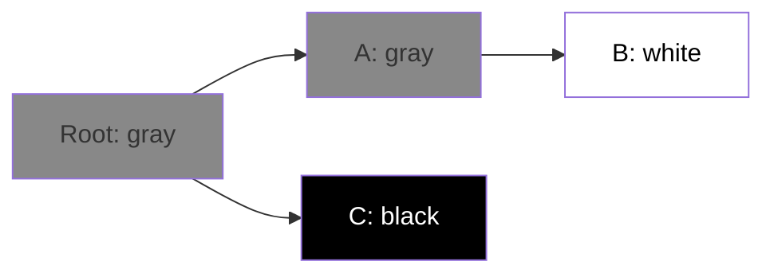

# Вопросы на собеседовании: `Go Memory и GC`

Сборщик стандартного Go toolchain выполняет маркировку и освобождение памяти преимущественно параллельно с приложением, но короткие остановки мира и затраты CPU остаются. Понимание escape analysis, настройки `GOGC`/`GOMEMLIMIT` и измерения памяти помогают оценить их влияние на конкретный сервис.

## Полезные ссылки

### Официальная документация и авторитетные источники

- [A Guide to the Go Garbage Collector](https://go.dev/doc/gc-guide)
- [Go 1.26: Green Tea GC](https://go.dev/doc/go1.26#runtime)
- [Go runtime metrics](https://pkg.go.dev/runtime/metrics)
- [JDK 25: G1 GC](https://docs.oracle.com/en/java/javase/25/gctuning/garbage-first-g1-garbage-collector1.html)
- [JDK 25: ZGC](https://docs.oracle.com/en/java/javase/25/gctuning/available-collectors.html)
- [JDK 24: поколенческий ZGC](https://docs.oracle.com/en/java/javase/25/migrate/significant-changes-jdk-24.html)
- [Go Memory Model](https://go.dev/ref/mem)
- [Diagnostics in Go](https://go.dev/doc/diagnostics)
- [Go Garbage Collection — Ardan Labs](https://www.ardanlabs.com/blog/2018/12/garbage-collection-in-go-part1-semantics.html)
- [Escape Analysis — Bill Kennedy](https://www.ardanlabs.com/blog/2017/05/language-mechanics-on-escape-analysis.html)

## Содержание

- [Полезные ссылки](#полезные-ссылки)
- [See also](#see-also)

**Stack vs Heap**
- [Q1. (!) Что такое stack и heap в Go?](#q1--что-такое-stack-и-heap-в-go)
- [Q2. (!) Что такое escape analysis?](#q2--что-такое-escape-analysis)
- [Q3. (!) Когда переменная переходит в heap?](#q3--когда-переменная-переходит-в-heap)
- [Q4. Как посмотреть решения escape analysis?](#q4-как-посмотреть-решения-escape-analysis)
- [Q5. Как растёт стек goroutine?](#q5-как-растёт-стек-goroutine)

**Garbage Collector**
- [Q6. (!) Какой сборщик мусора в Go?](#q6--какой-сборщик-мусора-в-go)
- [Q7. (!) Как работает tri-color marking?](#q7--как-работает-tri-color-marking)
- [Q8. (!) Что такое write barrier и зачем он нужен?](#q8--что-такое-write-barrier-и-зачем-он-нужен)
- [Q9. Какие фазы STW (Stop the World) есть в Go GC?](#q9-какие-фазы-stw-stop-the-world-есть-в-go-gc)
- [Q10. (!) Сколько длятся паузы GC?](#q10--сколько-длятся-паузы-gc)

**Tuning**
- [Q11. (!) Что такое GOGC?](#q11--что-такое-gogc)
- [Q12. (!) Что делает GOMEMLIMIT (Go 1.19+)?](#q12--что-делает-gomemlimit-go-119)
- [Q13. Чем отличается SetGCPercent от SetMemoryLimit?](#q13-чем-отличается-setgcpercent-от-setmemorylimit)
- [Q14. Когда стоит вызывать runtime.GC()?](#q14-когда-стоит-вызывать-runtimegc)

**Профилирование**
- [Q15. (!) Как снять memory-профиль через pprof?](#q15--как-снять-memory-профиль-через-pprof)
- [Q16. Как найти утечки памяти?](#q16-как-найти-утечки-памяти)
- [Q17. Что показывает allocs/op в бенчмарках?](#q17-что-показывает-allocsop-в-бенчмарках)

**Подводные камни**
- [Q18. (!) Как slice вызывает утечку памяти?](#q18--как-slice-вызывает-утечку-памяти)
- [Q19. (!) Освобождает ли map память после delete?](#q19--освобождает-ли-map-память-после-delete)
- [Q20. Влияет ли утечка goroutine на память?](#q20-влияет-ли-утечка-goroutine-на-память)
- [Q21. Что такое finalizer и зачем он нужен?](#q21-что-такое-finalizer-и-зачем-он-нужен)

**Сравнения**
- [Q22. (!) Чем Go GC отличается от JVM (G1, ZGC)?](#q22--чем-go-gc-отличается-от-jvm-g1-zgc)
- [Q23. Как сравнивать потребление памяти Go и Java-сервиса?](#q23-как-сравнивать-потребление-памяти-go-и-java-сервиса)

**Performance**
- [Q24. (!) Как sync.Pool снижает нагрузку на GC?](#q24--как-syncpool-снижает-нагрузку-на-gc)
- [Q25. Зачем заранее выделять ёмкость для slice и map?](#q25-зачем-заранее-выделять-ёмкость-для-slice-и-map)
- [Q26. (!) Что такое inlining?](#q26--что-такое-inlining)
- [Q27. Когда GC становится узким местом?](#q27-когда-gc-становится-узким-местом)

## Q1. (!) Что такое stack и heap в Go?

**Stack** хранит кадры вызовов goroutine и значения, срок жизни которых компилятор может связать с этими кадрами. У каждой goroutine свой растущий стек (Q5). Освобождение кадра после возврата обычно дешевле отдельной аллокации в куче. При этом GC **сканирует стеки как корни**, чтобы найти ссылки на живые объекты кучи; утверждение «GC не трогает stack» неверно.

**Heap** содержит значения, которым нужен срок жизни или способ размещения вне конкретного кадра. Их выделяет runtime, а недостижимую память впоследствии возвращает GC. Объект в heap не становится автоматически безопасным для одновременной записи из нескольких goroutine: для этого нужна синхронизация по [Go memory model](https://go.dev/ref/mem).

Размещение выбирает компилятор по результатам escape analysis и других ограничений, а не синтаксис `new`, `&` или желание автора. Указатель на локальное значение **может** остаться на стеке, если не переживает вызов; крупное или динамически размерное значение может оказаться в heap. Положение объекта не меняет семантику времени его жизни, пока он достижим. В Go 1.27 ускорены некоторые малые heap-аллокации, поэтому «heap всегда дорогой» — плохой вывод без профиля. Источники: [Go FAQ](https://go.dev/doc/faq#stack_or_heap), [Go GC guide](https://go.dev/doc/gc-guide), [Go 1.27: size-specialized allocations](https://go.dev/blog/size-specialized-allocations).

## Q2. (!) Что такое escape analysis?

**Escape analysis** — анализ компилятора, который решает, можно ли безопасно разместить значение в кадре стека или ему нужно другое хранилище. Если компилятор не доказывает, что ссылки на значение перестанут использоваться до освобождения кадра, значение может уйти в heap. Это решение об оптимизации памяти, а не о корректности программы: Go сохраняет значение живым, пока оно нужно.

```go
func local() int {
    x := 5
    p := &x
    return *p // само взятие адреса не требует heap
}

func retained() *int {
    x := 5
    return &x // ссылка переживает этот вызов
}
```

Для `retained` компилятор должен сохранить `x` доступным после выхода из функции. Но итоговое размещение в вызывающем коде может измениться после inlining и других оптимизаций. Поэтому по одному `&x` или объявлению указателя нельзя без сборки утверждать, что произошла heap-аллокация. Смотрите диагностику своей версии компилятора (Q4) и измеряйте аллокации на нужном пути исполнения. Источники: [Go FAQ](https://go.dev/doc/faq#stack_or_heap), [Go GC guide](https://go.dev/doc/gc-guide#Escape_analysis), [Go compiler README](https://go.dev/src/cmd/compile/README).

## Q3. (!) Когда переменная переходит в heap?

Значение размещается в heap, если компилятор не может доказать, что оно безопасно останется в кадре стека, или его размещение на стеке ограничено размером. Вероятные причины: ссылка сохраняется после возврата, значение записывается в уже живущий в heap объект, размер выделения определяется во время исполнения или значение слишком велико для допустимого кадра. Точный результат зависит от контекста и версии компилятора.

Частые **поводы проверить**, но не безусловные правила:

- `return &x` требует сохранить значение после возврата из этой функции; после inlining вызывающий код может разместить его иначе.
- Замыкание и goroutine могут удерживать захваченные данные дольше вызова, но это зависит от того, что именно захвачено и куда попадает замыкание.
- Передача через `any`/интерфейс, `fmt` или reflection сама по себе не доказывает escape каждого аргумента. Компилятор анализирует конкретный вызов и оптимизации.
- Большой массив или динамический backing array slice может попасть в heap; фиксированного порога «64 KB для всех значений» нет.

Пример различия между передачей адреса и его сохранением:

```go
func inspect(p *int) int { return *p }

func transient() int {
    x := 5
    return inspect(&x) // inspect не сохраняет p
}

func returnPointer() *int {
    x := 5
    return &x // ссылка выходит из функции
}
```

Сравнивайте диагностику компилятора и фактические `allocs/op`, прежде чем переписывать код ради предполагаемого escape. Источники: [Go FAQ](https://go.dev/doc/faq#stack_or_heap), [Go GC guide](https://go.dev/doc/gc-guide#Where_Go_Values_Live), [Go compiler optimizations](https://go.dev/wiki/CompilerOptimizations).

## Q4. Как посмотреть решения escape analysis?

Для стандартного Go compiler передайте диагностический флаг `-m` через `go build -gcflags`. Он выводит сведения об escape analysis **и других оптимизациях**, включая inlining. Для более подробного разбора используйте `-m=2` или пример из руководства GC с `-m=3`:

```bash
go build -gcflags=-m=2 ./path/to/package
# Для всех зависимостей: go build -gcflags='all=-m=2' ./path/to/package
```

Сообщения вроде `moved to heap: x` и `... escapes to heap` показывают разные решения компилятора; вывод `does not escape` тоже полезен. Не считайте каждую строку прямым доказательством аллокации на горячем пути: сообщения могут относиться к промежуточным значениям, а итог зависит от inlining и версии Go. `-gcflags` без шаблона `all=` действует на названные пакеты, что обычно удобнее для точечной проверки.

Если задача — найти расход памяти приложения, сначала измерьте `allocs/op` или `pprof`/`alloc_space` и только затем изучайте `-m` для горячего участка. Источники: [Go GC guide, Escape analysis](https://go.dev/doc/gc-guide#Escape_analysis), [Go compiler README](https://go.dev/src/cmd/compile/README), [CompilerOptimizations](https://go.dev/wiki/CompilerOptimizations).

## Q5. Как растёт стек goroutine?

Стек goroutine в стандартном Go runtime начинается небольшим и может расти и сжиматься. В [описании runtime](https://go.dev/src/runtime/HACKING#Stacks) в качестве примера указан старт около 2 KiB; это деталь реализации, а не обещанный размер для любой версии, архитектуры и программы.

Когда очередной кадр не помещается, runtime выделяет новый стек, переносит используемые кадры и корректирует указатели на них. В текущей [реализации роста](https://go.dev/src/runtime/stack.go) размер обычно удваивается; для большого кадра он может увеличиться сильнее. Позже неиспользуемый стек может уменьшиться. Поэтому адрес локальной переменной на стеке нельзя считать навсегда фиксированным. Если нужен стабильный адрес, компилятор может разместить значение в куче (Q2–Q3).

Малый начальный стек помогает запускать много goroutine, но число «миллион» нельзя выводить только из размера стека: память занимают сами goroutine, их выросшие стеки, захваченные данные, runtime и возможные OS-потоки. Проверяйте RSS и `/gc/stack/starting-size:bytes` на целевой версии и нагрузке. Предел роста отдельного стека задаётся `runtime/debug.SetMaxStack`; его начальное значение — 1 GiB на 64-разрядных и 250 MiB на 32-разрядных системах, но это не объём, зарезервированный каждой goroutine. Источники: [Go runtime HACKING](https://go.dev/src/runtime/HACKING#Stacks), [runtime/stack.go](https://go.dev/src/runtime/stack.go), [`SetMaxStack`](https://pkg.go.dev/runtime/debug#SetMaxStack), [`runtime/metrics`](https://pkg.go.dev/runtime/metrics).

## Q6. (!) Какой сборщик мусора в Go?

Стандартный Go toolchain использует **конкурентный mark-and-sweep GC**: маркировка достижимых объектов и освобождение памяти в основном идут одновременно с кодом приложения. Трёхцветная модель объясняет маркировку (Q7), а write barrier сохраняет её корректность при изменении ссылок (Q8).

- **Не поколенческий:** сборщик не делит Go heap на молодое и старое поколения. Это не означает, что он заново сканирует каждый байт кучи при каждом цикле: стоимость маркировки зависит прежде всего от достижимого графа и указателей.
- **Heap не уплотняется:** живые объекты в куче обычно не перемещаются сборщиком. Растущие стеки goroutine — отдельный механизм, их можно переносить.
- **Конкурентный, но не без пауз:** переходы между фазами требуют кратких STW; маркировка также потребляет CPU и может замедлять goroutine.

С **Go 1.26** реализация Green Tea включена по умолчанию. Она улучшает локальность и масштабирование маркировки небольших объектов, но не меняет перечисленные свойства в обещание фиксированной паузы. Источники: [Go GC guide](https://go.dev/doc/gc-guide), [Go 1.26 release notes](https://go.dev/doc/go1.26#runtime).

## Q7. (!) Как работает tri-color marking?

Трёхцветная модель объясняет, как трассирующий GC находит достижимые объекты. Цвет описывает состояние объекта в текущем цикле маркировки:

- **Белый** — пока не отмечен; станет кандидатом на освобождение, если останется белым к концу маркировки.
- **Серый** — обнаружен (достижим), но его исходящие ссылки ещё не просмотрены — «фронт волны».
- **Чёрный** — полностью обработан: и сам достижим, и все его ссылки уже учтены; не будет удалён.

Сборщик начинает с корней и обрабатывает серые объекты, пока работа не закончится. Это рабочее множество, а не обещание обхода строго в ширину или ровно одного посещения каждого объекта:

```
1. Объекты, ещё не отмеченные в этом цикле, считаются белыми.
2. Ссылки из корней (стеков, глобальных переменных) ставят достижимые объекты в работу.
3. При сканировании серого объекта его ещё белые соседи становятся серыми, а он — чёрным.
4. После завершения маркировки белые объекты недостижимы для этого цикла; sweep делает их память доступной для новых аллокаций.
```

В учебной модели без изменений ссылок опасна ситуация, когда уже просканированный чёрный объект ведёт к ещё не отмеченному белому. Но фразу «чёрный никогда не ссылается на белый» нельзя применять как буквальное описание всей реализации Go. Приложение меняет граф одновременно с GC; гибридный write barrier учитывает перезаписываемую ссылку и при нужном состоянии стека новую ссылку, чтобы достижимый объект не потерялся (Q8).



После завершения маркировки sweep делает память немаркированных объектов доступной для повторного выделения. Источники: [Go GC guide](https://go.dev/doc/gc-guide), [Go runtime write barrier](https://go.dev/src/runtime/mbarrier.go).

## Q8. (!) Что такое write barrier и зачем он нужен?

**Write barrier** помогает конкурентному GC не потерять достижимый объект, пока приложение меняет указатели во время маркировки. Компилятор добавляет его к записям указателей в области, которая *может находиться в куче*; это не отдельная остановка мира и не накладные расходы на каждое чтение указателя. Действие барьера зависит от фазы GC.

Представьте, что ссылка на ещё не отмеченный объект `B` удаляется из одной ячейки и записывается в уже просканированный объект. Без учёта этих записей сборщик мог бы закончить маркировку, не увидев `B`, и освободить живой объект. «Затенить» указатель означает пометить объект и поставить его в очередь на сканирование, а не считать уже полностью обработанным.

Go использует гибридный барьер. В объяснительной модели `runtime/mbarrier.go` перезапись затеняет **старый** указатель (Yuasa deletion), а затенение **нового** указателя (Dijkstra insertion) необходимо, пока стек текущей goroutine ещё серый. Гибридный барьер появился в Go 1.8 и позволил убрать повторное глобальное сканирование стеков в конце маркировки. Конкретная стоимость записи зависит от кода, процессора и версии Go; универсального значения «2–5 нс» нет.

Упрощённый алгоритм из комментария runtime:

```text
при записи slot = ptr во время маркировки:
    shade(старое значение slot)
    если стек goroutine ещё серый: shade(ptr)
    записать ptr в slot
```

Это модель корректности, а не обещание динамической проверки цвета стека при каждой записи. В проверенном SSA-проходе compiler может консервативно передавать в буфер и новый, и старый указатели; статически безопасные случаи, например известная нулевая ячейка, позволяют убрать часть работы. Из псевдокода нельзя выводить точное число проверок или наносекунд на конкретной сборке. Источники: [runtime/mbarrier.go](https://go.dev/src/runtime/mbarrier.go), [compiler writebarrier.go](https://go.dev/src/cmd/compile/internal/ssa/writebarrier.go), [Go 1.8 release notes](https://go.dev/doc/go1.8#garbage_collector), [Go GC guide](https://go.dev/doc/gc-guide).

## Q9. Какие фазы STW (Stop the World) есть в Go GC?

В обычном цикле GC есть две глобальные остановки на границах маркировки:

1. **Mark setup** — подготовка к конкурентной маркировке и включение write barrier.
2. **Mark termination** — завершение маркировки и переход к последующему освобождению памяти.

Между ними приложение работает одновременно с маркировкой; sweep выполняется преимущественно конкурентно. Кроме глобальных STW, при сканировании корней может приостанавливаться отдельная goroutine. Время ожидания запросов зависит также от работы GC на CPU, помощи мутаторных goroutine и планировщика, поэтому две короткие STW не равны гарантии короткого p99.

```text
STW (начало mark) → concurrent mark → STW (конец mark) → concurrent sweep
```

Длительность остановок измеряют на своей версии Go и нагрузке, а не выводят из размера heap или фиксированного порога. Источник: [Go GC guide, Latency](https://go.dev/doc/gc-guide#Latency).

## Q10. (!) Сколько длятся паузы GC?

У Go GC **нет гарантированной верхней границы паузы** вроде «всегда меньше 100 μs» или «всегда меньше 1 ms». Большая куча сама по себе не означает секундную глобальную остановку: полный обход достижимого графа не выполняется внутри одной STW-фазы. Но остановка goroutine, сканирование корней, конкуренция за CPU и помощь GC при аллокациях могут влиять на задержки приложения.

Измеряйте отдельно длительность STW и задержку запроса под целевой нагрузкой. Для первого подходят `GODEBUG=gctrace=1`, execution trace и гистограмма `/sched/pauses/total/gc:seconds` из `runtime/metrics`; для второго — p95/p99 запросов. Устаревшая `/gc/pauses:seconds` оставлена как эквивалент, предпочтительна метрика `/sched/pauses/total/gc:seconds`.

```bash
GODEBUG=gctrace=1 ./myapp
# Время двух STW-фаз и конкурентной маркировки смотрите в каждой строке gc.
```

В руководстве Go упомянуты рабочие потоки GC, потребляющие около 25% ресурсов CPU **во время маркировки**. Это источник возможной задержки планирования, а не обещание, что суммарная стоимость GC всегда равна 25% или что пауза ограничена этим числом. Для сравнения с JVM нужны такая же нагрузка, конкретные версии JDK, выбранный сборщик и его настройки (Q22). Источники: [Go GC guide, Latency](https://go.dev/doc/gc-guide#Latency), [runtime/metrics](https://pkg.go.dev/runtime/metrics), [Diagnostics](https://go.dev/doc/diagnostics).

## Q11. (!) Что такое GOGC?

`GOGC` задаёт цель роста кучи и тем самым компромисс между памятью и затратами CPU на GC. Начальное значение — `100`, если переменная окружения не задана. Меньшее значение обычно приводит к более частым сборкам и меньшему запасу heap; большее — к обратному компромиссу.

Для Go **1.18+** упрощённая модель целевого размера кучи такова:

```text
heap target = live heap после предыдущего GC
            + (live heap + GC roots) × GOGC / 100
```

`GC roots` включают сканируемые стеки goroutine и глобальные указатели. Например, при 8 MiB живой кучи, 1 MiB стеков и 1 MiB глобальных указателей `GOGC=100` даёт **цель 18 MiB**, а не 16 MiB. Это цель завершения цикла, не точный момент его запуска: runtime начинает маркировку заранее и может отклоняться от цели из-за аллокаций и работы сборщика.

```bash
GOGC=50 ./myapp   # меньшая цель heap, обычно больше работы GC
GOGC=200 ./myapp  # большая цель heap, обычно меньше работы GC
```

`GOGC=off` отключает сборку по этой цели, **но при заданном лимите памяти GC всё равно может запускаться**. Программный аналог настройки — `debug.SetGCPercent`. Источники: [Go GC guide, GOGC](https://go.dev/doc/gc-guide#GOGC), [`SetGCPercent`](https://pkg.go.dev/runtime/debug#SetGCPercent).

## Q12. (!) Что делает GOMEMLIMIT (Go 1.19+)?

`GOMEMLIMIT` задаёт **мягкий лимит памяти, учитываемой Go runtime**, а не предел всего RSS процесса или жёсткую квоту контейнера. Runtime стремится удерживать под ним величину `runtime.MemStats.Sys - runtime.MemStats.HeapReleased`; эквивалентные метрики — `/memory/classes/total:bytes - /memory/classes/heap/released:bytes`. Память C-библиотек, `syscall.Mmap`, файл бинарника и часть расходов ОС в эту величину не входят.

```bash
GOMEMLIMIT=900MiB ./myapp
```

`debug.SetMemoryLimit` задаёт тот же лимит программно. Если `GOMEMLIMIT` не задан, начальное значение — `math.MaxInt64`: это фактически отсутствие ограничивающей цели, а **не строковое значение `off`**. При приближении к лимиту GC может запускаться чаще, даже если `GOGC=off`. Когда живых данных слишком много, GC ограничивает собственные затраты CPU и допускает превышение мягкого лимита, чтобы не зациклить приложение на сборке.

В контейнере задавайте лимит с запасом для памяти вне Go runtime; [руководство Go](https://go.dev/doc/gc-guide#Memory_limit) предлагает 5–10% как начальный ориентир для контролируемого окружения. Проверяйте пиковый RSS, cgo/`mmap`, задержки и OOM на реальной нагрузке. Слишком низкий `GOMEMLIMIT` вызывает частые сборки и не гарантирует предотвращение OOM kill. Источники: [Go GC guide](https://go.dev/doc/gc-guide#Memory_limit), [`SetMemoryLimit`](https://pkg.go.dev/runtime/debug#SetMemoryLimit).

## Q13. Чем отличается SetGCPercent от SetMemoryLimit?

Это два взаимодействующих параметра GC, а не альтернативные режимы:

| Параметр | Что задаёт |
|---|---|
| `GOGC` / `debug.SetGCPercent` | Целевой рост heap относительно живой кучи и GC roots (Q11). |
| `GOMEMLIMIT` / `debug.SetMemoryLimit` | Мягкую цель для памяти, учитываемой Go runtime (Q12). |

Обычно `GOGC` выбирает компромисс между CPU и памятью. Если целевой heap приблизит runtime к `GOMEMLIMIT`, сборщик может уменьшить эффективную цель роста и собирать чаще. Даже при `GOGC=off` лимит памяти остаётся действующим. Поэтому `SetMemoryLimit` не «отменяет» `SetGCPercent`, а дополняет его.

Для контейнера с лимитом 1 GiB возможна исходная настройка `GOGC=100 GOMEMLIMIT=900MiB ./myapp`. Число 900 MiB — пример запаса, а не универсальная рекомендация или гарантия от OOM: нужно учесть память вне runtime, соседние процессы, пиковую нагрузку и стоимость дополнительных циклов GC. Если живой набор уже близок к лимиту контейнера, снижение `GOGC` или увеличение доступной памяти может быть полезнее слишком низкого `GOMEMLIMIT`. Источники: [Go GC guide, GOGC](https://go.dev/doc/gc-guide#GOGC), [Go GC guide, Memory limit](https://go.dev/doc/gc-guide#Memory_limit), [`runtime/debug`](https://pkg.go.dev/runtime/debug).

## Q14. Когда стоит вызывать runtime.GC()?

`runtime.GC()` принудительно запускает цикл сборки и блокирует вызывающую goroutine до его завершения; часть цикла может также останавливать программу. Это не подсказка сборщику и не команда немедленно уменьшить RSS. В обычном коде момент сборки выбирает runtime.

```go
runtime.GC() // только если нужен завершённый цикл перед измерением
```

В тесте или разовой диагностике вызов помогает получить профиль **после завершённого GC**, когда важен одинаковый момент измерения. Heap-профиль по умолчанию отражает последний завершённый цикл, поэтому дополнительный `runtime.GC()` перед каждым профилем не нужен. Для HTTP-эндпоинта `/debug/pprof/heap` тот же диагностический эффект даёт параметр `?gc=1` (Q15). Принудительный цикл может повлиять на измеряемую задержку и нагрузку; в тесте, требующем завершения асинхронного cleanup, одного вызова GC также недостаточно.

После разового спада нагрузки ручной GC не следует считать способом гарантированно освободить память ОС: живые объекты останутся живыми, а освобождённая память может остаться у runtime для повторного использования. Если нужна стабильная политика памяти, сначала измеряйте live heap и настройте `GOGC`/`GOMEMLIMIT` (Q11–Q13). Источники: [`runtime.GC`](https://pkg.go.dev/runtime#GC), [`runtime/pprof`](https://pkg.go.dev/runtime/pprof), [`net/http/pprof`](https://pkg.go.dev/net/http/pprof).

## Q15. (!) Как снять memory-профиль через pprof?

Анонимный импорт `net/http/pprof` регистрирует диагностические обработчики в `http.DefaultServeMux`. Сервер нужно запустить отдельно; при собственном mux обработчики подключают явно. Держите диагностический сервер на локальном адресе или закрывайте доступ к нему: профили содержат сведения о работе процесса.

```go
import (
    "log"
    "net/http"
    _ "net/http/pprof"
)

go func() { log.Println(http.ListenAndServe("localhost:6060", nil)) }()
```

```bash
go tool pprof http://localhost:6060/debug/pprof/heap
> top
> list <function>
> web  # граф, если доступен Graphviz
```

Heap-профиль **выборочный** и обычно отражает состояние на момент последнего завершённого GC, а не точный срез «прямо сейчас». Режимы `go tool pprof` отвечают на разные вопросы:

- **`inuse_space`** (по умолчанию) — оценка байтов у объектов, живых на момент профиля.
- **`alloc_space`** — оценка суммарно выделенных байтов с запуска процесса, включая уже собранные объекты.
- **`inuse_objects`** — оценка числа живых объектов.
- **`alloc_objects`** — оценка числа всех выделенных объектов.

```bash
go tool pprof -alloc_objects http://localhost:6060/debug/pprof/heap
# Если нужен свежий цикл GC перед снимком:
go tool pprof 'http://localhost:6060/debug/pprof/heap?gc=1'
```

Для поиска удерживаемой памяти обычно начинают с `inuse_space` и сравнивают профили при сопоставимой нагрузке (Q16); большой `alloc_space` сам по себе не означает утечку. С Go 1.22 пути `net/http/pprof` запрашивают методом GET. Источники: [`net/http/pprof`](https://pkg.go.dev/net/http/pprof), [`runtime/pprof`](https://pkg.go.dev/runtime/pprof).

## Q16. Как найти утечки памяти?

Сначала проверьте, растёт ли **живой набор** после сопоставимой нагрузки и циклов GC. Затем сравните heap-профили: рост удерживаемых объектов указывает, где искать долгоживущие ссылки. Один большой профиль или положительная разница сами по себе не доказывают утечку: причиной могут быть кэш, прогрев, изменение нагрузки и момент сборки. Heap-профиль к тому же основан на выборке аллокаций и отражает состояние на момент последнего завершённого GC.

1. Снимите профили при сопоставимой нагрузке и сравните `inuse_space`:
```bash
curl -o heap1.pb.gz http://localhost:6060/debug/pprof/heap
# Повторите ту же нагрузку и снимите следующий профиль.
curl -o heap2.pb.gz http://localhost:6060/debug/pprof/heap

go tool pprof -diff_base heap1.pb.gz heap2.pb.gz
```
`-diff_base` вычитает первый профиль из второго и сохраняет удобную для сравнения базу процентов. `-base` тоже вычитает профиль, но его процентные значения считаются иначе и прежде всего удобны для накопительных профилей. При анализе удерживаемой памяти не путайте `inuse_space` с накопительным `alloc_space` (Q15).

2. Сверьте рост числа goroutine и их стеки: зависшая goroutine может удерживать достижимые из неё объекты (Q20).
```bash
curl 'http://localhost:6060/debug/pprof/goroutine?debug=1'
```

Повторяйте измерения после одинаковых фаз нагрузки и проверяйте путь удержания ссылок в коде. Источники: [`runtime/pprof`](https://pkg.go.dev/runtime/pprof), [диагностика Go](https://go.dev/doc/diagnostics), [сравнение профилей pprof](https://github.com/google/pprof/blob/main/doc/README.md#comparing-profiles).

## Q17. Что показывает allocs/op в бенчмарках?

`allocs/op` — среднее число heap-аллокаций на одну операцию бенчмарка; `B/op` показывает среднее число выделенных байт. Для вывода этих колонок используйте `go test -bench=. -benchmem` или `b.ReportAllocs()`. Сравнивайте результаты только при одинаковых условиях и следите, чтобы компилятор не устранил измеряемую работу.

```bash
go test -bench=. -benchmem
```

Меньшее `allocs/op` может снизить стоимость выделения памяти и работу GC, но само по себе не гарантирует меньшие паузы или более быстрый код: важны также `B/op`, время операции, срок жизни объектов и нагрузка всего процесса. `0 allocs/op` означает, что в измеренном коде не обнаружены heap-аллокации на операцию; это не означает отсутствия GC в процессе или максимальной производительности.

Источник: [`testing.B.ReportAllocs`](https://pkg.go.dev/testing#B.ReportAllocs), [Go GC guide](https://go.dev/doc/gc-guide).

## Q18. (!) Как slice вызывает утечку памяти?

Slice — это лишь «окно» (указатель + длина + ёмкость) в подлежащий массив. Пока живёт хоть один slice, **весь** массив остаётся в памяти. Поэтому маленький под-slice, вырезанный из большого, удерживает целый большой массив и не даёт GC его освободить.

```go
func keepFirstByte() byte {
    big := make([]byte, 1_000_000)
    // ... fill big
    return big[0] // OK — копирует byte
}

func leakBig() []byte {
    big := make([]byte, 1_000_000)
    // ... fill big
    return big[:10] // удерживает большой backing array
}

// Правильно
func noLeak() []byte {
    big := make([]byte, 1_000_000)
    result := make([]byte, 10)
    copy(result, big[:10])
    return result // big может быть собран, если больше нет ссылок
}
```

**Решение** — скопировать нужный кусок в новый, маленький slice (как в `noLeak`). Большой массив станет доступным для сборки, когда на него не останется ссылок. Ограничение ёмкости через `big[:10:10]` предотвращает расширение slice через `append`, но не отделяет его от массива.

Тот же эффект возможен с **подстроками**. Когда нужно надолго сохранить маленькую часть большой строки, `strings.Clone(s[:10])` создаёт независимую копию; применять его стоит по результатам профилирования. Источники: [Go Wiki: SliceTricks](https://go.dev/wiki/SliceTricks), [`strings.Clone`](https://pkg.go.dev/strings#Clone).

## Q19. (!) Освобождает ли map память после delete?

`delete` удаляет запись, но не обещает уменьшить внутреннее хранилище живой map или вернуть память операционной системе. В текущей реализации после массового удаления выделенное под map хранилище может оставаться доступным для повторного использования. Термин «bucket» не стоит привязывать к универсальному описанию: с Go 1.24 встроенная map по умолчанию основана на Swiss Tables.

```go
compact := make(map[int]int, len(m))
for key, value := range m { // перенести только нужные записи
    compact[key] = value
}
m = compact // старое хранилище станет доступным GC без других ссылок
```

Пересоздавать map имеет смысл после значительного пика, если профили показывают заметное удержание памяти. Если данные больше не нужны, достаточно убрать все ссылки на старую map. Даже после GC снижение RSS не обязано быть немедленным: runtime может оставить освобождённую память для следующих аллокаций. Источники: [Go 1.24 release notes](https://go.dev/doc/go1.24#runtime), [исходный код текущей map](https://go.dev/src/internal/runtime/maps/map.go), [Go GC guide](https://go.dev/doc/gc-guide).

## Q20. Влияет ли утечка goroutine на память?

Да. Незавершившаяся goroutine использует стек и может удерживать объекты, которые остаются достижимы из её живых переменных. Если такие goroutine накапливаются, растёт и потребление памяти. Сам факт замыкания не означает, что все когда-либо захваченные объекты обязательно останутся живыми: компилятор и GC учитывают живость ссылок.

Не считайте память как «число goroutine × 2 KiB». Начальный размер стека порядка 2 KiB — деталь реализации; стеки растут и сжимаются, а удерживаемые объекты и накладные расходы различаются. Смотрите `runtime.NumGoroutine`, профиль `/debug/pprof/goroutine` и heap-профиль при сопоставимой нагрузке (Q16).

Подробнее о причинах утечек goroutine — в [Go Concurrency](go-concurrency-interview.md). Источники: [Go runtime HACKING](https://go.dev/src/runtime/HACKING), [`runtime/pprof`](https://pkg.go.dev/runtime/pprof), [диагностика Go](https://go.dev/doc/diagnostics).

## Q21. Что такое finalizer и зачем он нужен?

`runtime.SetFinalizer(obj, fn)` связывает с объектом функцию, которую runtime может запустить после утраты достижимости. Перед её вызовом объект снова становится достижимым; обычно освободить его память можно лишь в последующем цикле GC. Finalizer подходит только как запасной механизм для внешнего ресурса, например дескриптора, а не как обязательный путь закрытия или сброса буфера.

С **Go 1.24** для нового кода обычно предпочтительнее `runtime.AddCleanup(ptr, cleanup, arg)`: он гибче и меньше мешает освобождению памяти. В `arg` передают данные для очистки, например номер дескриптора, **без ссылки на `ptr`**. Если `arg` равен `ptr`, `AddCleanup` вызывает панику; если `cleanup` или `arg` косвенно удерживают `ptr`, очистка не сможет запуститься. После успешного явного закрытия ресурса `Cleanup.Stop()` может отменить ещё не поставленную в очередь очистку; для гарантии отмены `ptr` должен оставаться достижимым до завершения `Stop()`, при необходимости используйте `runtime.KeepAlive(ptr)`. Доступность `AddCleanup` проверяйте по целевой версии Go.

Оба механизма запускаются в неопределённый момент и могут не выполниться до завершения процесса. `runtime.GC()` не ждёт окончания cleanup. Объект может стать недостижимым уже после последнего использования его полей, поэтому при передаче внешнему API иногда требуется `runtime.KeepAlive` после операции. Основной путь всё равно явный `Close`/`defer`; GC-очистка лишь страхует забытый вызов. Источники: [`runtime.SetFinalizer`](https://pkg.go.dev/runtime#SetFinalizer), [`runtime.AddCleanup`](https://pkg.go.dev/runtime#AddCleanup), [`runtime.KeepAlive`](https://pkg.go.dev/runtime#KeepAlive), [Go 1.24 release notes](https://go.dev/doc/go1.24#runtime).

## Q22. (!) Чем Go GC отличается от JVM (G1, ZGC)?

Сравнивать нужно конкретные реализации и версии. В стандартном Go toolchain **Go 1.26+** Green Tea ускоряет маркировку и сканирование небольших объектов; Go GC при этом остаётся **непоколенческим** и не перемещает живые объекты heap. В HotSpot **JDK 25** сборщики G1 и ZGC **поколенческие** и могут перемещать живые объекты. G1 совмещает конкурентную работу с STW-сборками регионов; ZGC переносит большую часть дорогой работы в конкурентные фазы ради низкой задержки.

| Свойство | Go 1.26+ | HotSpot JDK 25: G1 | HotSpot JDK 25: ZGC |
|---|---|---|---|
| Поколения | Нет | Молодое и старое | Есть; непоколенческий режим удалён в JDK 24 |
| Перемещение объектов в heap | Нет | Есть, при эвакуации регионов | Есть, преимущественно конкурентно |
| Паузы и настройка | Краткие STW без фиксированной границы; `GOGC`, `GOMEMLIMIT` | STW-паузы; `MaxGCPauseMillis=200` по умолчанию — **цель**, не гарантия | Низкая задержка за счёт конкурентной работы; нужен запас heap для аллокаций |

По документации JDK 25 G1 выбран по умолчанию в большинстве конфигураций; ZGC включают явно. Нельзя вывести победителя по задержке, CPU или памяти из одного названия GC: учитывайте live heap, скорость аллокаций, `GOMAXPROCS`, лимиты контейнера и настройки JVM. Замеряйте p95/p99 и RSS на сопоставимой нагрузке. Источники: [Go 1.26](https://go.dev/doc/go1.26#runtime), [Go GC guide](https://go.dev/doc/gc-guide), [G1 в JDK 25](https://docs.oracle.com/en/java/javase/25/gctuning/garbage-first-g1-garbage-collector1.html), [коллекторы JDK 25](https://docs.oracle.com/en/java/javase/25/gctuning/available-collectors.html), [изменение ZGC в JDK 24](https://docs.oracle.com/en/java/javase/25/migrate/significant-changes-jdk-24.html).

## Q23. Как сравнивать потребление памяти Go и Java-сервиса?

Фраза «Go всегда использует меньше памяти» не следует из устройства языков. Go-бинарник включает runtime и GC; Java-сервис использует HotSpot, heap, metadata, JIT-код и другие области памяти. Но объём живых данных, частота аллокаций, стеков, буферов и нативной памяти определяется приложением и конфигурацией. `-Xmx` ограничивает Java heap, а не весь RSS процесса; `GOMEMLIMIT` в Go — мягкий лимит памяти, учитываемой runtime, а не жёсткий предел RSS.

Go-структуры и локальные значения могут размещаться компактно, но `escape analysis` и указатели меняют раскладку. Java тоже располагает примитивами и массивами; в JDK 25 можно включить compact object headers, уменьшающие заголовок объекта. Ни фиксированный «налог JVM», ни размеры стеков потоков, ни диапазоны вроде «Go 30–100 MB, Java 200–500 MB» не универсальны.

Для честного сравнения реализуйте одинаковый сценарий, укажите версии Go/JDK и настройки GC, прогрейте сервис при необходимости, затем измерьте RSS, live heap, CPU, throughput и p95/p99 при одинаковой нагрузке и лимитах контейнера. В Go не используйте один только VSS как показатель физической памяти. Источники: [Go GC guide](https://go.dev/doc/gc-guide), [Go runtime/metrics](https://pkg.go.dev/runtime/metrics), [HotSpot memory areas](https://docs.oracle.com/en/java/javase/25/gctuning/other-considerations.html), [JDK 25 compact object headers](https://docs.oracle.com/en/java/javase/25/gctuning/other-considerations.html).

## Q24. (!) Как sync.Pool снижает нагрузку на GC?

`sync.Pool` хранит временные объекты, которые могут повторно использовать независимые goroutine. Если `Get` вернул подходящий объект, не требуется создавать новый; это может снизить частоту аллокаций и работу GC на горячем пути. Но `Get` вправе не вернуть ранее положенный объект, а уменьшение пауз и ускорение сервиса нужно измерять.

```go
var bufPool = sync.Pool{
    New: func() any { return new(bytes.Buffer) },
}

func writeResponse(w io.Writer, req string) error {
    buf := bufPool.Get().(*bytes.Buffer)
    buf.Reset()
    defer bufPool.Put(buf)
    buf.WriteString(req)
    _, err := w.Write(buf.Bytes())
    return err
}
```

Возвращённый из `Get` объект используется одним вызовом до `Put`; после `Put` к буферу нельзя обращаться как к своему. `Pool` безопасен для одновременных `Get`/`Put`, но не делает параллельное изменение одного выданного буфера безопасным. Элементы пула могут исчезнуть без уведомления, поэтому в нём нельзя хранить обязательное состояние. Большой буфер, возвращённый в пул, может удерживать значительную ёмкость до удаления из пула; решение о переиспользовании проверяйте по профилю и размеру буферов.

Источник: [`sync.Pool`](https://pkg.go.dev/sync#Pool), [Go GC guide](https://go.dev/doc/gc-guide). Подробнее о владении между goroutine — в [Go Concurrency](go-concurrency-interview.md).

## Q25. Зачем заранее выделять ёмкость для slice и map?

Если `append` не помещает новые элементы в текущую ёмкость slice, он выделяет новый backing array и копирует прежние элементы. Когда число элементов известно, `make([]T, 0, n)` позволяет избежать роста массива в пределах `n` элементов. Это экономит выделения и копирование, но слишком большой резерв сам удерживает лишнюю память.

```go
sl := make([]int, 0, n)
for i := 0; i < n; i++ {
    sl = append(sl, i) // в пределах cap(sl) новый массив не нужен
}

m := make(map[string]int, n) // второй аргумент: оценка числа записей
```

У map нет пользовательской `capacity` как у slice. Второй аргумент `make(map[K]V, n)` задаёт **подсказку** для начального места примерно под `n` записей, а не предел размера и не обещание точного числа выделений. Если реальный объём близок к оценке, это может сократить рост структуры; переоценка тратит память. Не описывайте внутренности map универсальным словом «bucket»: с Go 1.24 по умолчанию действует реализация на Swiss Tables (Q19). Сравнивайте `B/op`, `allocs/op` и скорость на своём сценарии. Источники: [Go specification, `make`](https://go.dev/ref/spec#Making_slices_maps_and_channels), [Go blog: slices](https://go.dev/blog/slices), [Go 1.24 release notes](https://go.dev/doc/go1.24#runtime).

## Q26. (!) Что такое inlining?

**Inlining** — решение компилятора встроить тело вызываемой функции в место вызова. Оно может убрать стоимость вызова и открыть другие оптимизации, включая уточнение escape analysis. Встроится ли конкретный вызов и станет ли код быстрее, зависит от версии компилятора, контекста вызова и профиля сборки.

```go
func small(x int) int { return x + 1 }

func caller() int {
    return small(41) // компилятор может встроить вызов
}
```

Директива `//go:noinline` перед объявлением `small` **запретила бы** такое встраивание; её нельзя ставить в пример, который утверждает обратное. При встраивании компилятор видит больше контекста и иногда может избежать heap-аллокации, но это не гарантировано для каждого вызова.

Проверяйте решения своей сборки диагностикой компилятора (Q4):

```bash
go build -gcflags=-m=2 ./path/to/package
```

`can inline` сообщает, что функция подходит для встраивания; `inlining call` относится к конкретному вызову. С Go 1.20 доступна profile-guided optimization (PGO), которая может менять решения о встраивании горячих вызовов; одного универсального правила «новая версия встраивает больше» нет. Источники: [Go compiler README](https://go.dev/src/cmd/compile/README), [CompilerOptimizations](https://go.dev/wiki/CompilerOptimizations), [Go PGO guide](https://go.dev/doc/pgo).

## Q27. Когда GC становится узким местом?

GC становится узким местом, когда измеренная работа сборщика существенно уменьшает доступный приложению CPU или его паузы вносят значимый вклад в задержку запросов. Универсального порога вроде «25% CPU» нет: оценка зависит от бюджета CPU и SLO сервиса. Высокое `allocs/op` само по себе показывает выделения в бенчмарке, а не доказывает, что именно GC портит p99.

Проверяйте причину в таком порядке:

1. Сопоставьте p95/p99 и CPU-профиль с фазами GC. Для наблюдения используйте `runtime/metrics`: `/cpu/classes/gc/total:cpu-seconds` и `/sched/pauses/total/gc:seconds`. Первый счётчик — оценка времени CPU внутри runtime и включает фоновую работу на простаивающих P; его нельзя напрямую приравнивать к процессному CPU. `GODEBUG=gctrace=1` полезен для диагностики циклов, но формат строки может меняться.
2. Посмотрите `alloc_space`/`alloc_objects` профиля (Q15) и измерьте горячий участок бенчмарком (Q17). Уберите ненужные выделения или копирование там, где профиль и повторный замер подтверждают выигрыш. `sync.Pool` и резерв ёмкости — варианты после измерений, а не обязательные лекарства.
3. При достаточном запасе памяти настройте `GOGC` и повторите нагрузочный тест: больший heap target обычно уменьшает частоту циклов ценой памяти. `GOMEMLIMIT` — мягкая цель, а слишком низкий лимит может увеличить частоту GC и расход CPU (Q11–Q13).

Сравнивайте throughput, CPU, RSS и задержки до и после изменения при одинаковой нагрузке. Источники: [Go GC guide](https://go.dev/doc/gc-guide), [`runtime/metrics`](https://pkg.go.dev/runtime/metrics), [`runtime` gctrace](https://pkg.go.dev/runtime#hdr-Environment_Variables), [Go diagnostics](https://go.dev/doc/diagnostics).

## See also

- [Go (базовый)](go-interview.md) — типы, pointers
- [Go Concurrency](go-concurrency-interview.md) — goroutine stacks
- [Go Standard Library](go-stdlib-interview.md) — runtime/pprof
- [Memory Management](../../performance/memory-management-interview.md) — общие концепции
- [JVM Performance Tuning](../../performance/jvm-performance-tuning-interview.md) — для сравнения с JVM GC
- [Application Profiling](../../performance/application-profiling-interview.md) — pprof и аналоги
- [Performance Testing](../../performance/performance-testing-interview.md) — Go bench
- [Микросервисы](../../architecture/microservices-interview.md) — где Go экономит память

- [Go Generics](go-generics-interview.md)
- [Go](go-interview.md)
- [Go Modules](go-modules-interview.md)
- [Go Standard Library](go-stdlib-interview.md)
- [Go Testing](go-testing-interview.md)
