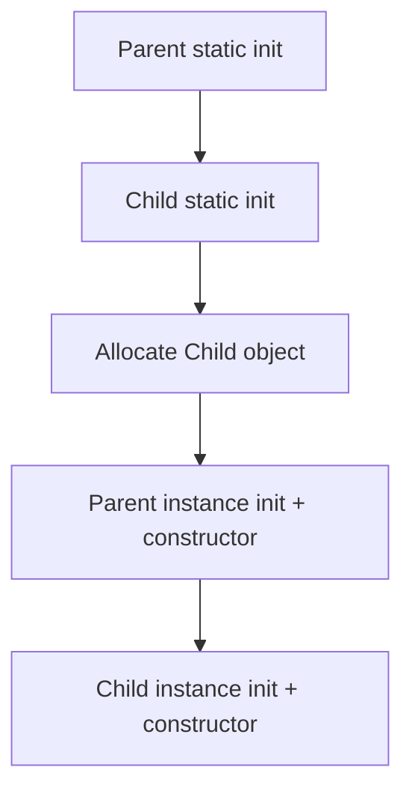
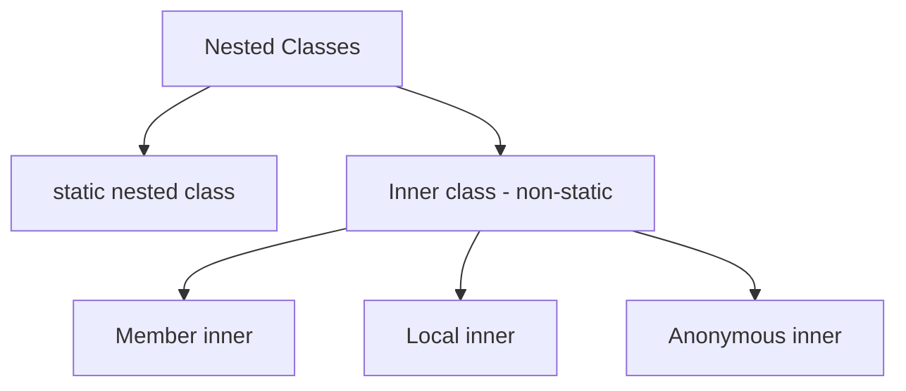

# Вопросы на собеседовании: Структура и инициализация классов Java

Подробный разбор устройства классов и порядка инициализации в `Java`: конструкторы, `static` и instance-блоки, nested / inner / local / anonymous классы, `final`, `static`, правила наследования и вызов `super()`. Темы критичны для middle/senior собеседования: кандидата почти всегда спрашивают «что напечатается?» с вложенными классами и блоками.

## Полезные ссылки

### Официальная документация

- [Java Language Specification §12.4 — Class Initialization](https://docs.oracle.com/javase/specs/jls/se21/html/jls-12.html#jls-12.4) — формальные правила инициализации
- [JLS §8.6 — Instance Initializers](https://docs.oracle.com/javase/specs/jls/se21/html/jls-8.html#jls-8.6)
- [JLS §8.7 — Static Initializers](https://docs.oracle.com/javase/specs/jls/se21/html/jls-8.html#jls-8.7)
- [Oracle Tutorial — Nested Classes](https://docs.oracle.com/javase/tutorial/java/javaOO/nested.html)
- [Oracle Tutorial — Initializing Fields](https://docs.oracle.com/javase/tutorial/java/javaOO/initial.html)

### Baeldung

- [Java Structure and Initialization Interview Questions](https://www.baeldung.com/java-classes-initialization-questions)
- [A Guide to Java Initialization](https://www.baeldung.com/java-initialization)
- [Static vs. Instance Initializer Block in Java](https://www.baeldung.com/java-static-instance-initializer-blocks)
- [`<init>` and `<clinit>` Methods in the JVM](https://www.baeldung.com/jvm-init-clinit-methods)
- [Nested Classes in Java](https://www.baeldung.com/java-nested-classes)

## Содержание

- [Полезные ссылки](#полезные-ссылки)
- [See also](#see-also)

**Конструкторы**
- [Q1. Что такое конструктор и чем он отличается от обычного метода?](#q1)
- [Q2. Что такое конструктор по умолчанию (default constructor) и когда он создаётся компилятором?](#q2)
- [Q3. Что такое конструктор копирования (copy constructor) в Java?](#q3)
- [Q4. Для чего нужны `this()` и `super()` в конструкторе и какие к ним правила?](#q4)
- [Q5. Можно ли сделать конструктор `private`, `final`, `abstract` или `static`?](#q5)
- [Q6. Что такое конструктор `record` и какие виды конструкторов у записи бывают?](#q6)

**Блоки инициализации**
- [Q7. Что такое `static`-блок инициализации и когда он выполняется?](#q7)
- [Q8. Что такое instance-блок инициализации и когда он выполняется?](#q8)
- [Q9. Когда стоит использовать init-блоки вместо конструктора?](#q9)
- [Q10. Может ли `static`-блок бросать checked-исключение и что происходит при ошибке в нём?](#q10)

**Порядок инициализации**
- [Q11. Какой порядок инициализации класса и создания экземпляра в JVM (без наследования)?](#q11)
- [Q12. Какой порядок инициализации при наследовании (`new Child()`)?](#q12)
- [Q13. Что такое методы `<clinit>` и `<init>` в байт-коде?](#q13)
- [Q14. Когда именно класс загружается и когда инициализируется (запускается `<clinit>`)?](#q14)
- [Q15. Что напечатает классический пример с наследованием, static- и instance-блоками при двух `new B()`?](#q15)

**Final, Static, Immutable**
- [Q16. Какие отличия между `static`- и instance-полями?](#q16)
- [Q17. Что такое `final`-поле и какими способами оно инициализируется?](#q17)
- [Q18. В чём разница между `static final` и просто `final`?](#q18)
- [Q19. Что такое constant folding и как он связан с `static final`?](#q19)

**Nested / Inner / Local / Anonymous классы**
- [Q20. Какие виды вложенных классов есть в Java?](#q20)
- [Q21. В чём разница между `static nested`-классом и inner-классом?](#q21)
- [Q22. Что такое local-класс и где его используют?](#q22)
- [Q23. Что такое анонимный класс и чем он отличается от лямбды?](#q23)
- [Q24. Почему анонимный / local класс видит только `effectively final` переменные?](#q24)
- [Q25. Как inner-класс ссылается на outer-экземпляр?](#q25)

**Записи (records) и sealed**
- [Q26. Как инициализируется `record` и что такое compact constructor?](#q26)
- [Q27. Как устроена инициализация `enum`?](#q27)

<a id="q1"></a>

## Q1. Что такое конструктор и чем он отличается от обычного метода?

Конструктор не вызывается автоматически перед `main()`: он выполняется при создании соответствующего объекта.

**Конструктор** — особый член класса, который JVM вызывает при создании объекта через `new`, чтобы перевести только что выделенную «сырую» память в валидное состояние: проинициализировать поля и установить инварианты. Это не метод — у него другая роль и другие правила.

Ключевые отличия от обычного метода:

| Свойство | Конструктор | Метод |
|---|---|---|
| Имя | совпадает с именем класса | любое |
| Тип возврата | отсутствует (даже `void` нельзя писать) | обязателен |
| Вызов | через `new` | по ссылке на объект или `ClassName.method()` |
| Наследование | не наследуется | наследуется |
| Модификатор | любой (включая `private`) | любой |

```java
public class User {
    private final String name;

    public User(String name) {   // конструктор
        this.name = name;
    }

    public String getName() {    // метод
        return name;
    }
}
```

**Главное отличие в одну фразу:** имена могут совпадать с классом, возвращаемого типа нет, и конструктор не наследуется — у каждого класса своя цепочка конструкторов через `super()`.

<a id="q2"></a>

## Q2. Что такое конструктор по умолчанию (default constructor) и когда он создаётся компилятором?

**Конструктор по умолчанию (default constructor)** — это безаргументный конструктор, который компилятор генерирует за вас, но только если в классе **не объявлено ни одного конструктора**. Как только вы пишете хотя бы один свой конструктор (с любыми параметрами), компилятор перестаёт добавлять default — он есть либо явно ваш, либо его нет.

```java
public class Foo {}                // компилятор создаст Foo() { super(); }

public class Bar {
    public Bar(int x) {}           // явный конструктор — default уже НЕ создастся
}

new Bar();                         // ❌ compile error: no default constructor
```

Сгенерированный default-конструктор имеет тот же модификатор доступа, что и класс, и состоит из единственного действия — вызова `super()` у родителя. Поэтому есть важное ограничение: если у родителя нет no-args конструктора (например, только `Parent(int)`), компилятору нечего вызвать в `super()` — он не сможет сгенерировать default у наследника, и код не соберётся.

**Подводный камень:** многие фреймворки (`Jackson`, `JPA`, сериализация) создают объект через рефлексию и требуют именно no-args конструктор. Как только вы добавили параметризованный конструктор, no-args исчезает — поэтому объявляйте его явно, если он нужен фреймворку.

<a id="q3"></a>

## Q3. Что такое конструктор копирования (copy constructor) в Java?

Параметр такого конструктора часто называют `source`, а копию получают выражением `new Point(source)`.

**Конструктор копирования** — это обычный конструктор, который принимает объект того же класса и создаёт его копию. В отличие от `C++`, в `Java` нет языковой поддержки copy-constructor — это просто соглашение, которое пишут руками:

```java
public class Point {
    private final int x, y;

    public Point(int x, int y) { this.x = x; this.y = y; }

    public Point(Point other) {          // конструктор копирования
        this(other.x, other.y);
    }
}
```

**Зачем нужен:** это предпочтительная альтернатива `clone()`. У `clone()` много подводных камней (нужен `Cloneable`, защищённый метод, нет вызова конструктора, поверхностная копия по умолчанию), а конструктор копирования прозрачен — глядя на тело, сразу видно, что и как копируется, и можно сделать глубокую копию там, где нужно.

<a id="q4"></a>

## Q4. Для чего нужны `this()` и `super()` в конструкторе и какие к ним правила?

Оба — это явные вызовы других конструкторов, которые делегируют часть инициализации:

- `this(args)` — вызывает **другой конструктор того же класса** (constructor chaining), чтобы не дублировать логику между перегрузками.
- `super(args)` — вызывает конструктор **родительского класса**, чтобы сначала проинициализировать унаследованную часть объекта.

Правила, которые любят спрашивать:

- Начиная с Java 25 перед явным вызовом конструктора допустим ограниченный пролог. В нём нельзя обращаться к экземпляру, который ещё строится. Инициализация полей текущего класса и его instance-блоки всё равно идут после конструктора родителя.
- В одном конструкторе нельзя использовать `this()` и `super()` одновременно — каждый из них передаёт управление, и точка входа может быть только одна.
- Если ни `this()`, ни `super()` не написаны явно — компилятор сам вставляет `super()` (вызов no-args конструктора родителя).

```java
public class Rectangle extends Shape {
    public Rectangle(int w, int h) {
        super("rectangle");     // вызов Shape(String)
        this.w = w; this.h = h;
    }

    public Rectangle() {
        this(10, 10);           // делегируем своему же конструктору
    }
}
```

**Итог:** `super()` гарантирует, что родитель проинициализирован до потомка, а `this()` устраняет дублирование логики между перегрузками, сводя инициализацию к одному «главному» конструктору.

<a id="q5"></a>

## Q5. Можно ли сделать конструктор `private`, `final`, `abstract` или `static`?

Из модификаторов доступа разрешены все, а вот специальные модификаторы методов к конструктору в основном неприменимы — потому что у конструктора другая семантика. Кратко по каждому:

| Модификатор | Можно? | Смысл |
|---|---|---|
| `private` | ✅ | Singleton, фабрики, утилитные классы |
| `public` / `protected` / package-private | ✅ | обычное использование |
| `final` | ❌ | конструктор и так не наследуется |
| `abstract` | ❌ | у конструктора нет тела без реализации, теряет смысл |
| `static` | ❌ | конструктор работает на экземпляре |
| `synchronized` | ❌ | этот модификатор не разрешён для конструктора |

```java
public class Holder {
    private Holder() {}                   // singleton
    public static Holder INSTANCE = new Holder();
}
```

<a id="q6"></a>

## Q6. Что такое конструктор `record` и какие виды конструкторов у записи бывают?

У `record` конструктор устроен особым образом: компилятор автоматически создаёт **canonical constructor** — конструктор, чьи параметры один-в-один совпадают с компонентами записи, и который присваивает все поля:

```java
public record Point(int x, int y) {
    // компилятор генерирует: public Point(int x, int y) { this.x = x; this.y = y; }
}
```

Три формы конструкторов у `record`:

- **Canonical** — точно повторяет компоненты. Генерируется автоматически, но его можно переопределить вручную, если нужна своя логика присваивания.
- **Compact** — пишется без списка параметров; нужен для валидации и нормализации входных данных. Присваивания полей компилятор дописывает сам **после** тела блока:
  ```java
  public record Age(int value) {
      public Age {
          if (value < 0) throw new IllegalArgumentException();
          // this.value = value — добавит компилятор
      }
  }
  ```
- **Дополнительный** (с другими параметрами) — допустим, но должен делегировать в другой конструктор записи через `this(...)`; цепочка в итоге достигает canonical-конструктора. С Java 25 перед `this(...)` допустим ограниченный пролог.

Подробнее в [java-17-21-interview](java-17-21-interview.md) и [java-oop-interview](java-oop-interview.md).

<a id="q7"></a>

## Q7. Что такое `static`-блок инициализации и когда он выполняется?

**`static`-блок инициализации** — это блок `static { ... }` на уровне класса. JVM выполняет его один раз при инициализации этого класса, в текстовом порядке с инициализаторами `static`-полей. Чтение compile-time константы класса само по себе инициализацию не запускает.

```java
public class Config {
    static final Map<String, String> DEFAULTS;

    static {
        DEFAULTS = new HashMap<>();
        DEFAULTS.put("region", "ru");
        DEFAULTS.put("tz", "UTC");
    }
}
```

Свойства:

- В классе может быть несколько `static`-блоков; они и `static`-инициализаторы полей выполняются в порядке объявления, сверху вниз.
- Запускается **до** `main()`, если класс уже загружен (точный момент — first active use, см. Q14).
- Удобен там, где присваивания мало: нужны try/catch, цикл, вычисление, reflection.

**Сценарий применения:** инициализация `static`-поля, которое нельзя задать одним выражением — например, заполнение неизменяемой `Map` константами или загрузка конфигурации с обработкой ошибок.

<a id="q8"></a>

## Q8. Что такое instance-блок инициализации и когда он выполняется?

**Instance-блок инициализации** — это блок `{ ... }` без `static` на уровне класса. В отличие от `static`-блока, он выполняется **при каждом создании экземпляра** и срабатывает после `super(...)`, но до тела конструктора.

Для каждого нового объекта сначала завершается конструктор родителя. Затем instance-инициализаторы своего класса присваивают поля, и только после них выполняется тело его конструктора. Блок не заменяет конструктор и не может изменить присваивание, сделанное позже в его теле.

```java
public class Cache {
    private final Map<String, Object> data;

    {
        data = new ConcurrentHashMap<>();
        System.out.println("instance block");
    }

    public Cache() {
        System.out.println("constructor");
    }
}
```

Механика: компилятор копирует instance-блоки и инициализаторы полей в **каждый** конструктор класса, сразу после `super(...)`. Именно поэтому общий для всех перегрузок код в блоке выполнится при любом `new`. В обычном коде применяется редко — логику проще держать в конструкторе. Главный реальный сценарий — анонимные классы, у которых конструктор объявить нельзя:

```java
Map<String, Integer> m = new HashMap<>() {{
    put("a", 1);   // double brace initialization — instance-блок анонимного класса
    put("b", 2);
}};
```

**Подводный камень:** double-brace initialization создаёт анонимный подкласс, который усложняет чтение кода. Если он сохраняет ссылку на enclosing instance, долгоживущий объект может удерживать внешний объект в памяти. Для простой неизменяемой таблицы обычно достаточно `Map.of(...)`.

<a id="q9"></a>

## Q9. Когда стоит использовать init-блоки вместо конструктора?

Короткий ответ: почти никогда — init-блок оправдан только в узких случаях, когда у обычного присваивания или конструктора есть конкретное ограничение. Ориентир по ситуациям:

| Ситуация | Решение |
|---|---|
| Сложная инициализация `static` поля (loop, try/catch) | `static`-блок |
| Однажды-вычисляемая константа таблиц (`static final Map`) | `static`-блок |
| Одинаковый код в нескольких конструкторах | instance-блок или `this()` |
| Анонимный класс, которому нужен конструктор | instance-блок |
| Обычное присваивание поля | инициализатор поля `= ...` |

Выбор зависит от жизненного цикла состояния. Общую таблицу класса готовят при инициализации класса, а instance-блок выполняется для каждого объекта, включая первый. В таком блоке нет доступа к параметрам конструктора, поэтому настройку по аргументам делают в самом конструкторе. Для простого присваивания поля блок не нужен.

**Эмпирическое правило:** init-блок уместен, когда одну и ту же последовательность действий нужно выполнить до тела конструктора у **всех** перегрузок, и при этом нельзя обойтись инициализатором поля.

<a id="q10"></a>

## Q10. Может ли `static`-блок бросать checked-исключение и что происходит при ошибке в нём?

**Checked-исключение нужно обработать внутри блока.** У `static`-блока нельзя объявить `throws`. Если инициализация завершается `Error`, JVM передаёт этот `Error` без обёртки; иное исключение оборачивает в `ExceptionInInitializerError`. Класс становится erroneous, и последующее активное использование обычно получает `NoClassDefFoundError`.

Поэтому типичный приём — поймать checked-исключение прямо в блоке и пробросить его уже завёрнутым в `ExceptionInInitializerError`:

```java
static {
    try {
        loadConfig();
    } catch (IOException e) {
        throw new ExceptionInInitializerError(e);
    }
}
```

**Вывод:** после сбоя данное определение класса не инициализируется повторно тем же загрузчиком. В `static`-блоках стоит избегать рискованной логики.

<a id="q11"></a>

## Q11. Какой порядок инициализации класса и создания экземпляра в JVM (без наследования)?

Инициализация делится на два независимых этапа: один раз готовится сам класс, и при каждом `new` — отдельный объект. Порядок такой:

**Инициализация класса (без наследования) — выполняется однократно:**

1. `static` поля получают **zero-значения** (по типу: `0`, `null`, `false`).
2. До обычных инициализаторов устанавливаются значения compile-time constant variables.
3. Остальные `static`-инициализаторы полей и блоки выполняются **сверху вниз** в порядке объявления.
4. Класс помечен как initialized.

**Создание экземпляра:**

5. Instance-поля получают zero-значения.
6. Выполняется `super(...)` (или `super()` неявно).
7. Instance-инициализаторы полей и блоки выполняются сверху вниз.
8. Выполняется оставшаяся часть тела конструктора.

```java
class A {
    static int s = init("static field");
    static { System.out.println("static block"); }
    int i = init("instance field");
    { System.out.println("instance block"); }
    A() { System.out.println("constructor"); }

    static int init(String name) { System.out.println(name); return 0; }
}

new A();
// static field
// static block
// instance field
// instance block
// constructor
```

<a id="q12"></a>

## Q12. Какой порядок инициализации при наследовании (`new Child()`)?

Ключевой принцип: классы и части объекта инициализируются от родителя к потомку. При каждом `new Child()` instance-части обоих классов выполняются снова, а static-инициализаторы не повторяются. Если `Child extends Parent`, порядок таков:

1. При необходимости инициализируется `Parent`: его `static`-поля и блоки.
2. Затем инициализируется `Child`: его `static`-поля и блоки.
3. Аллоцируется объект `Child`, все instance-поля обнуляются.
4. Вызывается `Parent` конструктор: `Parent` instance-поля + instance-блоки → тело конструктора.
5. Вызывается `Child` конструктор: `Child` instance-поля + instance-блоки → тело конструктора.



**Подводный камень:** если конструктор `Parent` вызывает переопределяемый метод, сработает версия из **Child** (виртуальная диспетчеризация работает с момента аллокации объекта). Но конструктор Child ещё не отработал — его поля держат zero-значения. Это классический ловушечный interview-вопрос.

```java
class Parent {
    Parent() { print(); }         // виртуальный вызов
    void print() { System.out.println("parent"); }
}
class Child extends Parent {
    String name = "child";
    void print() { System.out.println(name); }
}
new Child();    // напечатает "null" — name ещё null
```

**Вывод:** никогда не вызывай переопределяемые методы из конструктора.

<a id="q13"></a>

## Q13. Что такое методы `<clinit>` и `<init>` в байт-коде?

Это два специальных метода, которые `javac` синтезирует в байт-коде — вы их не пишете руками, но именно они и реализуют весь порядок инициализации из Q11–Q12. Имена в угловых скобках выбраны намеренно невызываемыми из Java-кода:

- `<clinit>` (class initializer) — метод, в который компилятор помещает код `static`-инициализаторов и блоков, если такой код есть. Класс без него тоже инициализируется. JVM синхронизирует инициализацию класса: если два потока одновременно её запрашивают, один выполняет код, другой ждёт.
- `<init>` (instance initializer) — каждый конструктор компилируется в собственный `<init>`. В него компилятор встраивает инициализаторы instance-полей и instance-блоки, причём сразу после вызова `super()`.

Посмотреть можно через `javap -c -p ClassName`:

```text
static {};   // <clinit>
  Code: ...

public Foo(int);  // <init>
  Code:
    aload_0
    invokespecial Object.<init>
    ...
```

**Итог:** `<clinit>` отвечает за «состояние класса», `<init>` — за «состояние объекта».

<a id="q14"></a>

## Q14. Когда именно класс загружается и когда инициализируется (запускается `<clinit>`)?

Важно различать два разных события, которые часто путают:

**Загрузка (load)** — получение представления класса из байт-кода или другого источника. Она может произойти раньше активного использования и сама по себе не запускает `static`-инициализацию.

**Инициализация (initialize)** — выполнение кода инициализации класса, если он есть. JVM откладывает её до **first active use**, когда состояние класса действительно понадобилось:

- Создание экземпляра (`new`).
- Обращение к `static` полю, **не являющемуся** `static final` константой compile-time.
- Вызов `static` метода.
- Присваивание `static` поля.
- Отражение через `Class.forName("Foo")` (с `initialize=true`, по умолчанию).
- Инициализация подкласса.
- Обращение к `main()` как entry point.

**Не триггерит** инициализацию (это любимые ловушки на собеседовании):

- Обращение к `static final` compile-time константе примитива/`String` — её значение зашито прямо в вызывающий класс (constant folding, см. Q19), читать класс-владелец не нужно.
- Литерал `Foo.class` — только ссылка на метаданные, без запуска `<clinit>`.
- `ClassLoader.loadClass()` загружает класс без обязательной инициализации; `Class.forName(String)` запрашивает инициализацию.

Подробнее о classloader в [jvm-interview](../../jvm/jvm-interview.md).

<a id="q15"></a>

## Q15. Что напечатает классический пример с наследованием, static- и instance-блоками при двух `new B()`?

Это проверка на знание порядка из Q12 на конкретном примере. Классический interview-вопрос:

Первый объект запускает static-блоки однажды, затем печатаются блок и конструктор родителя, а после них — блок и конструктор потомка. Второй объект повторяет только instance-часть; static-блоки не печатаются дважды.

```java
class A {
    static { System.out.println("1"); }
    { System.out.println("2"); }
    A() { System.out.println("3"); }
}

class B extends A {
    static { System.out.println("4"); }
    { System.out.println("5"); }
    B() { System.out.println("6"); }
}

public class Main {
    public static void main(String[] args) {
        new B();
        new B();
    }
}
```

Вывод:

```text
1        ← A static
4        ← B static (B загружается из-за new B)
2        ← A instance
3        ← A constructor
5        ← B instance
6        ← B constructor
2        ← A instance (второй new)
3
5
6
```

Обратите внимание: `1` и `4` (static-блоки) печатаются только при **первом** `new B()` — класс инициализируется один раз, поэтому при втором `new` повторяются лишь instance-части (`2 3 5 6`).

**Мнемоника:** «static parent → static child → (для каждого new) instance parent → ctor parent → instance child → ctor child».

<a id="q16"></a>

## Q16. Какие отличия между `static`- и instance-полями?

Создание нового объекта через `new` добавляет instance-поля, но не создаёт второе `static`-поле данного класса.

`static`-поле принадлежит определённому классу, а instance-поле — конкретному объекту. Расположение `static`-поля в памяти не задаётся спецификацией Java; утверждение о его обязательном хранении в Metaspace неверно.

| Свойство | `static` | instance |
|---|---|---|
| Принадлежит | определению класса | экземпляру класса |
| Экземпляров | одно на `ClassLoader` | по одному на объект |
| Обращение | `ClassName.field` | `obj.field` |
| Доступ из `static`-метода | напрямую | через ссылку на объект |
| Инициализация | при инициализации класса | при создании объекта |
| Стандартная сериализация | не включается | включается, если поле не `transient` |

```java
class Counter {
    static int total;     // общий счётчик
    int id;               // персональный
}
```

<a id="q17"></a>

## Q17. Что такое `final`-поле и какими способами оно инициализируется?

Пустое поле ссылочного типа не может остаться со значением `null` только потому, что оно объявлено `final`: компилятор требует явного присваивания.

**`final`-поле** — поле, которое можно присвоить ровно один раз, после чего переназначить его нельзя. Важно: `final` запрещает переприсваивание ссылки, но не делает сам объект неизменяемым (`final List` можно дополнять).

Пустое `final`-поле экземпляра нужно присвоить по каждому пути создания объекта. Это можно сделать тремя способами:

- Инициализатор: `private final int x = 10;`
- Instance-блок: `{ this.x = computeX(); }`
- Конструктор (каждый путь через `new` должен присвоить `final` ровно один раз).

```java
class Foo {
    final int x;
    final int y;
    final int z = 3;

    Foo(int a) {
        this.x = a;
        this.y = a * 2;
        // z уже инициализирован
    }
}
```

**Определённое присваивание (definite assignment):** компилятор статически доказывает, что по **любому** пути выполнения через конструктор каждое `final`-поле присваивается ровно один раз — не остаётся ни неинициализированным, ни присвоенным дважды. Не выполнили — ошибка компиляции.

Для `static final` пустого поля используются объявление или `static`-инициализатор. При корректном конструировании без утечки `this` правила JMM дают особую гарантию видимости значений `final`-полей после завершения конструктора. Она не делает весь объект глубоко неизменяемым и не заменяет безопасную публикацию для остальных изменяемых полей.

<a id="q18"></a>

## Q18. В чём разница между `static final` и просто `final`?

Оба запрещают переприсваивание. Поле `final` без `static` принадлежит объекту; `static final` принадлежит определению класса. Значение `static final` не обязательно является compile-time константой: ссылка на изменяемый объект тоже может быть `static final`.

| Характеристика | `final` | `static final` |
|---|---|---|
| Область | поле экземпляра | поле класса |
| Когда инициализируется | в конструкторе / инициализаторе | в `static`-блоке / инициализаторе, один раз |
| Может ли отличаться у объектов | да | нет, поле общее для данного определения класса |
| Где хранится | в состоянии объекта | реализация JVM не нормируется JLS |
| Используется для | неизменяемой ссылки или значения объекта | общего значения или ссылки |

```java
public static final int MAX = 100;   // константа
public final String id;              // значение отдельного объекта
```

**Правило:** `static final` — для значений, которые не зависят от объекта.

<a id="q19"></a>

## Q19. Что такое constant folding и как он связан с `static final`?

Модификатор `volatile` не делает значение compile-time константой; совместить `volatile` и `final` в объявлении поля нельзя.

**Constant folding** вычисляет константное выражение при компиляции. Если `static final`-поле примитива или `String` инициализировано таким выражением, оно становится *constant variable*. Значение этой переменной компилятор может встроить в байт-код потребителя вместо чтения поля:

```java
// A.java
public class A {
    public static final int SIZE = 100;
}

// B.java
int x = A.SIZE;   // в байт-коде B будет `bipush 100`, а не чтение A.SIZE
```

**Следствия:**

- Доступ к такой константе **не триггерит** инициализацию класса-владельца (см. Q14) — читать класс `A` уже не нужно, значение и так в `B`.
- Если в `A` потом поменять `SIZE = 200`, но **не перекомпилировать** `B`, то `B` продолжит использовать старое `100`. Это классический коварный баг многомодульных сборок: меняешь константу, а зависимые модули «не замечают».

Чтобы поле перестало быть compile-time константой и его значение не встраивалось в клиентский код, инициализируют его выражением, вычисляемым при запуске:

```java
public static final int SIZE = Integer.parseInt("100");   // уже не compile-time constant
```

<a id="q20"></a>

## Q20. Какие виды вложенных классов есть в Java?

В обычной классификации выделяют четыре формы вложенных классов. `static nested` не требует экземпляра внешнего класса. У нестатических форм связь с enclosing instance зависит от места объявления: например, local-класс внутри `static`-метода такой связи не имеет. Спецификация не требует конкретного скрытого поля для её реализации.



| Вид | Где объявлен | Связь с outer-экземпляром | Имя | `static`-члены |
|---|---|---|---|---|
| `static nested` | на уровне класса | нет | да | да |
| member inner | на уровне класса, без `static` | да (`Outer.this`) | да | допустимы с Java 16 |
| local | внутри метода/блока | зависит от контекста | да | допустимы с Java 16 |
| anonymous | в выражении `new` | зависит от контекста | нет | допустимы с Java 16 |

```java
class Outer {
    static class StaticNested {}            // 1
    class Inner {}                          // 2

    void method() {
        class Local {}                      // 3
        Runnable r = new Runnable() {       // 4
            public void run() {}
        };
    }
}
```

<a id="q21"></a>

## Q21. В чём разница между `static nested`-классом и inner-классом?

Экземпляр member inner-класса связан с enclosing instance, к которому можно обратиться через `Outer.this`. `static nested`-класс не требует внешнего объекта. Наличие, имя и сохранение синтетического поля зависят от компилятора и от того, использует ли код внешний объект.

| Характеристика | `static nested` | inner (non-static) |
|---|---|---|
| Связь с outer | нет | есть enclosing instance |
| Создание | `new Outer.Nested()` | `outer.new Inner()` или `new Inner()` изнутри outer |
| Доступ к instance-членам outer | только через ссылку | напрямую, включая `private` |
| Может иметь `static` члены | да | до Java 16 — нет; с 16+ — да |
| Сериализация | зависит от полей класса | может затронуть outer, если компилятор сохранил ссылку |
| Удержание outer в памяти | не обусловлено вложенностью | возможно, когда реализация хранит ссылку |

Если вложенному классу не нужен экземпляр outer, объявление `static nested` ясно выражает независимость и упрощает создание экземпляра.

<a id="q22"></a>

## Q22. Что такое local-класс и где его используют?

Local-класс можно объявить и в `static`-методе, и в методе экземпляра; связь с outer зависит от этого контекста.

**Local class** — это полноценный именованный класс, объявленный прямо внутри метода, конструктора или блока инициализации. Его область видимости ограничена окружающим блоком: снаружи на него сослаться нельзя. Как и анонимный класс, он захватывает effectively final локальные переменные окружения (см. Q24).

```java
public List<String> upper(List<String> items) {
    class Upper {
        String apply(String s) { return s.toUpperCase(); }
    }
    Upper u = new Upper();
    return items.stream().map(u::apply).toList();
}
```

**Когда применять.** В современном коде local-классы почти полностью вытеснены лямбдами и method reference. Они остаются оправданными в двух случаях:

- Нужен полноценный класс с несколькими методами и собственным состоянием — лямбда тут не подойдёт.
- На класс нужно ссылаться по имени, например для рекурсии внутри него.

<a id="q23"></a>

## Q23. Что такое анонимный класс и чем он отличается от лямбды?

**Анонимный класс** — это одноразовая реализация интерфейса или подкласс, объявленные без имени прямо в выражении `new`. Компилятор сразу создаёт класс и его единственный экземпляр:

```java
Runnable r = new Runnable() {
    @Override public void run() { System.out.println("hi"); }
};
```

Лямбда предназначена для функционального интерфейса (`functional interface`). У анонимного класса `this` обозначает его собственный объект, у лямбды сохраняет значение `this` окружающего контекста; в `static`-контексте такого `this` нет. Способ компиляции лямбды — деталь реализации, на имя или наличие отдельного `.class`-файла полагаться нельзя.

| Свойство | Анонимный класс | Лямбда |
|---|---|---|
| Генерация | класс создаётся компилятором | зависит от реализации JVM |
| `this` | анонимный экземпляр | `this` окружающего контекста, если он есть |
| Тип | расширяет класс или реализует интерфейс | функциональный интерфейс |
| Поля / объявленный конструктор | поля возможны, явный конструктор нет | собственные поля не объявляют |

Лямбда обычно короче для функции без собственного состояния. Анонимный класс нужен, когда требуется расширить класс, объявить поля или реализовать несколько методов.

<a id="q24"></a>

## Q24. Почему анонимный / local класс видит только `effectively final` переменные?

Потому что эти классы могут пережить метод, в котором созданы (а локальные переменные живут только на стеке этого метода). Чтобы их значения остались доступны, компилятор **захватывает копию** локальной переменной в скрытое поле класса. Будь переменная изменяемой, копия внутри класса и переменная в методе со временем разошлись бы — а молчаливое расхождение «двух истин» порождало бы неуловимые баги. Поэтому язык требует, чтобы захватываемая переменная не менялась.

```java
void method() {
    int x = 10;
    Runnable r = () -> System.out.println(x);
    // x = 20;  ❌ тогда x перестанет быть effectively final — compile error
    r.run();
}
```

**Effectively final** — переменная, которая фактически не переприсваивается после инициализации, хотя и не помечена `final`. С Java 8 компилятор разрешает захватывать такие переменные без явного ключевого слова `final`.

Если изменяемость всё же нужна, оборачивают значение в объект (массив, `AtomicReference`): захватывается неизменная **ссылка**, а меняется содержимое по ней:

```java
int[] counter = {0};
Runnable r = () -> counter[0]++;
```

<a id="q25"></a>

## Q25. Как inner-класс ссылается на outer-экземпляр?

При конфликте имён `super.x` обозначает член родительского класса, а `Outer.this.x` — поле enclosing instance.

Экземпляр member inner-класса связан с конкретным экземпляром внешнего класса при создании. В исходном коде к нему обращаются через `Outer.this`. Компилятор вправе реализовать эту связь синтетическим полем, но имя `this$0` и наличие такого поля не входят в контракт языка.

```java
class Outer {
    int x = 10;
    class Inner {
        int read() { return x; }    // фактически: return Outer.this.x
    }
}
```

Один из возможных результатов компиляции класса, который действительно читает `Outer.this`:

```java
class Outer$Inner {
    final Outer this$0;
    Outer$Inner(Outer outer) { this$0 = outer; }
    int read() { return this$0.x; }
}
```

Явное обращение к outer — через `Outer.this` (нужно при конфликте имён):

```java
class Outer {
    int x;
    class Inner {
        int x;
        int readOuter() { return Outer.this.x; }
    }
}
```

Если реализация хранит ссылку на внешний объект, долгоживущий inner-экземпляр может удерживать его в памяти. Когда доступ к outer не нужен, обычно достаточно `static nested` (см. Q21).

<a id="q26"></a>

## Q26. Как инициализируется `record` и что такое compact constructor?

**`record`** — класс с фиксированным набором компонентов и `final`-полями для их хранения. Он обеспечивает поверхностную неизменяемость: объект, на который указывает компонент, может оставаться изменяемым. Из объявления компонентов автоматически создаются:

- `private final` поля для каждого компонента.
- Canonical-конструктор, присваивающий все компоненты.
- `equals` / `hashCode` / `toString` на основе компонентов.
- Аксессоры без префикса `get` — `point.x()`, а не `point.getX()`.

**Compact constructor** — это особый вид canonical-конструктора без списка параметров. Он нужен, чтобы валидировать или нормализовать входные данные, не переписывая вручную весь список параметров и присваивания: компилятор дописывает `this.from = from; this.to = to;` сам, после тела блока.

```java
public record Range(int from, int to) {
    public Range {                                    // compact
        if (from > to) throw new IllegalArgumentException();
        // присваивание this.from / this.to выполнит компилятор
    }
}
```

Полноценный canonical-конструктор тоже допустим, но тогда присваивания делаешь сам:

```java
public record Range(int from, int to) {
    public Range(int from, int to) {                  // canonical
        if (from > to) throw new IllegalArgumentException();
        this.from = from; this.to = to;
    }
}
```

Подробнее о `record` — в [java-17-21-interview](java-17-21-interview.md).

<a id="q27"></a>

## Q27. Как устроена инициализация `enum`?

Перечисление неявно наследует `Enum<T>`. Если ни у одной константы нет собственного тела класса, enum-класс неявно `final`; если такое тело есть, он неявно `sealed`, а подклассы определены только этими константами. Все константы создаются в порядке объявления при инициализации enum-класса.

```java
public enum Status {
    ACTIVE,
    INACTIVE;

    private final String label;
    Status() { this.label = name().toLowerCase(); }
}
```

Особенности:

- Конструктор `enum` всегда фактически `private` (даже если модификатор не указан) — извне создать значение нельзя.
- Константы создаются один раз в рамках данного определения класса. JVM синхронизирует инициализацию класса. Поэтому `enum` удобен для синглтона (`INSTANCE`).
- Оператор `new` для `enum` запрещён — все возможные значения уже перечислены в объявлении.

```java
public enum Singleton {
    INSTANCE;

    public void doWork() { /* ... */ }
}
```

**Вывод:** набор enum-констант фиксирован объявлением; дополнительный экземпляр через `new` создать нельзя.

## See also

- [java-core-interview](java-core-interview.md) — основы Java, `Object`, `equals/hashCode`, final, ссылки
- [java-17-21-interview](java-17-21-interview.md) — `record`, `sealed`, pattern matching, Java 16+ новинки в nested классах
- [java-types-interview](java-types-interview.md) — примитивы, boxing/unboxing, autoboxing и инициализация
- [java-modules-interview](java-modules-interview.md) — JPMS, видимость пакетов и влияние на рефлексивный доступ к классам
- [java-concurrency-interview](java-concurrency-interview.md) — `final`-поля и JMM, безопасная публикация объектов
- [java-serialization-interview](java-serialization-interview.md) — `serialVersionUID`, `readObject`, инициализация при десериализации
- [jvm-interview](../../jvm/jvm-interview.md) — загрузка классов, `<clinit>`, `<init>`, ClassLoader, Metaspace
- [java-annotations-interview](java-annotations-interview.md) — `@PostConstruct` и порядок инициализации бинов в Spring
- [java-exceptions-interview](java-exceptions-interview.md) — `ExceptionInInitializerError`, ошибки в static-блоках
- [Java Reflection](java-reflection-interview.md) — Class, Method, Field, Constructor, InvocationHandler, динамические прокси,…
