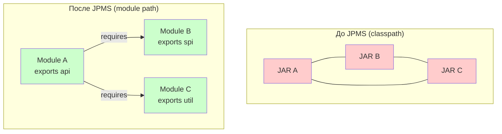
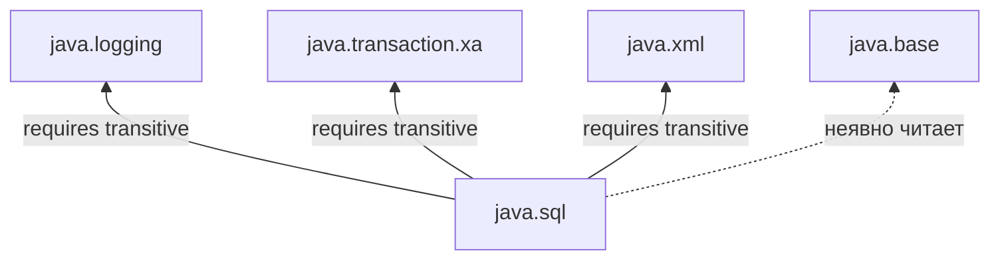
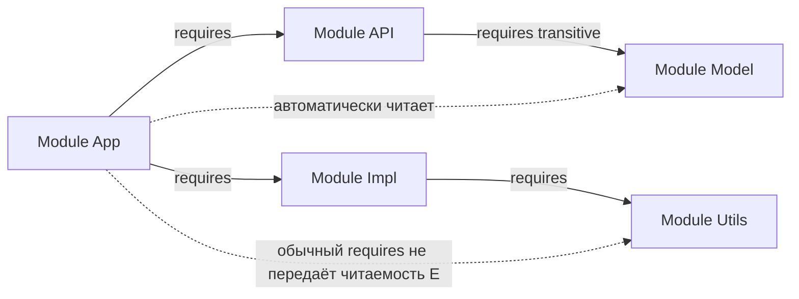
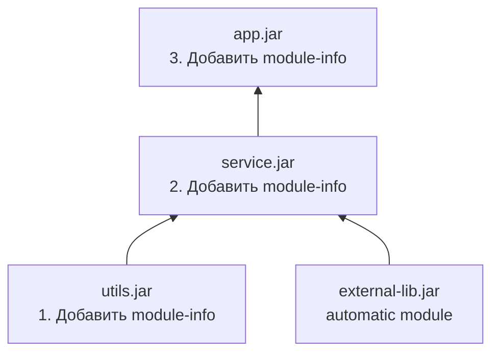
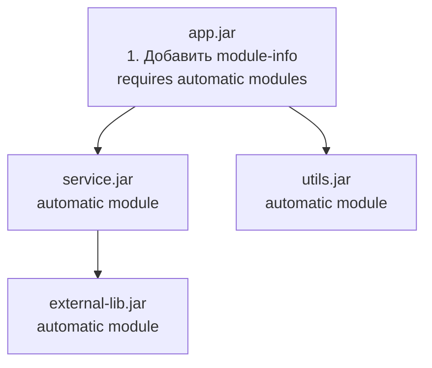
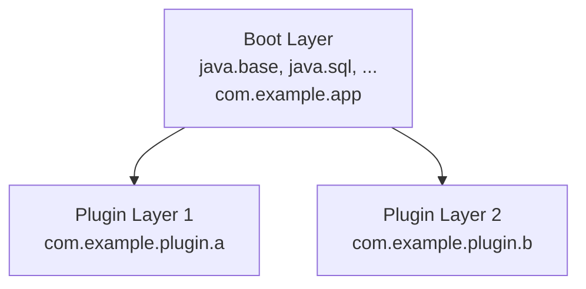
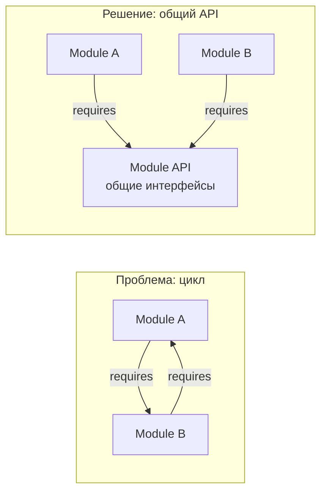

# Вопросы на собеседовании: Модули Java (JPMS)

Полное руководство по вопросам собеседования на тему модульной системы `Java` (`JPMS`, `Java 9+`): `module-info.java`, директивы `exports`/`requires`/`opens`/`uses`/`provides`, `automatic` и `unnamed` модули, `split packages`, `multi-release JAR`, `jlink`, `ServiceLoader`, рефлексия в модульном мире, `module layers`, стратегии миграции.

## Полезные ссылки

### Официальная документация

- [The State of the Module System (JSR 376)](https://openjdk.org/jeps/261) — JEP 261, описание модульной системы
- [Java Module System (Oracle JLS)](https://docs.oracle.com/javase/specs/jls/se17/html/jls-7.html#jls-7.7) — спецификация языка
- [JEP 238: Multi-Release JAR Files](https://openjdk.org/jeps/238) — спецификация multi-release JAR
- [JEP 282: jlink](https://openjdk.org/jeps/282) — создание custom runtime images
- [Java Platform Module System (Baeldung)](https://www.baeldung.com/java-9-modularity) — обзор JPMS на Baeldung
- [A Guide to Java 9 Modularity (Baeldung)](https://www.baeldung.com/java-modularity) — практическое руководство
- [Multi-Module Maven Application with Java Modules — Baeldung](https://www.baeldung.com/maven-multi-module-project-java-jpms) — Maven + JPMS на практике
- [Design Strategies for Decoupling Java Modules — Baeldung](https://www.baeldung.com/java-modules-decoupling-design-strategies) — паттерны декаплинга модулей

## Содержание

- [Полезные ссылки](#полезные-ссылки)
- [See also](#see-also)

**Основы JPMS**
- [Q1. (!) Что такое `JPMS` и какие проблемы он решает?](#q1--что-такое-jpms-и-какие-проблемы-он-решает)
- [Q2. (!) Что такое `module-info.java` и какие директивы в нём доступны?](#q2--что-такое-module-infojava-и-какие-директивы-в-нём-доступны)
- [Q3. Как устроена модульная структура самого `JDK`?](#q3-как-устроена-модульная-структура-самого-jdk)
- [Q4. Чем отличается `module path` от `classpath`?](#q4-чем-отличается-module-path-от-classpath)

**Директивы: `exports`, `requires`, `opens`**
- [Q5. (!) В чём разница между `exports` и `opens`?](#q5--в-чём-разница-между-exports-и-opens)
- [Q6. Что такое `qualified exports` и `qualified opens`?](#q6-что-такое-qualified-exports-и-qualified-opens)
- [Q7. (!) Что такое `requires` и `requires transitive`?](#q7--что-такое-requires-и-requires-transitive)
- [Q8. Что такое `requires static` и когда это используется?](#q8-что-такое-requires-static-и-когда-это-используется)
- [Q9. Что такое `open module`?](#q9-что-такое-open-module)

**Сервисы и `ServiceLoader`**
- [Q10. (!) Что такое `provides` и `uses` в контексте `ServiceLoader`?](#q10--что-такое-provides-и-uses-в-контексте-serviceloader)
- [Q11. Как `ServiceLoader` работает в модульном мире по сравнению с `classpath`?](#q11-как-serviceloader-работает-в-модульном-мире-по-сравнению-с-classpath)

**Рефлексия и модули**
- [Q12. (!) Как модули влияют на рефлексию и доступ к внутренним `API`?](#q12--как-модули-влияют-на-рефлексию-и-доступ-к-внутренним-api)
- [Q13. Какие параметры запуска помогают при миграции `JPMS`?](#q13-какие-параметры-запуска-помогают-при-миграции-jpms)

**`Unnamed module` и `automatic module`**
- [Q14. (!) Что такое `unnamed module`?](#q14--что-такое-unnamed-module)
- [Q15. (!) Что такое `automatic module` и как определяется его имя?](#q15--что-такое-automatic-module-и-как-определяется-его-имя)
- [Q16. В чём ключевые отличия между `unnamed module`, `automatic module` и явным именованным модулем?](#q16-в-чём-ключевые-отличия-между-unnamed-module-automatic-module-и-явным-именованным-модулем)

**`Split packages`**
- [Q17. (!) Что такое `split package` и почему это проблема в `JPMS`?](#q17--что-такое-split-package-и-почему-это-проблема-в-jpms)

**`Multi-release JAR`**
- [Q18. Что такое `multi-release JAR` и как он связан с модулями?](#q18-что-такое-multi-release-jar-и-как-он-связан-с-модулями)

**`jlink` и custom runtime**
- [Q19. (!) Что такое `jlink` и зачем собирать custom runtime image?](#q19--что-такое-jlink-и-зачем-собирать-custom-runtime-image)
- [Q20. Какие плагины и опции поддерживает `jlink`?](#q20-какие-плагины-и-опции-поддерживает-jlink)

**Стратегии миграции**
- [Q21. (!) Какие существуют стратегии миграции на модули?](#q21--какие-существуют-стратегии-миграции-на-модули)
- [Q22. Как мигрировать проект с `Maven`/`Gradle` на модули?](#q22-как-мигрировать-проект-с-mavengradle-на-модули)

**`Module layers`**
- [Q23. Что такое `ModuleLayer` и зачем он нужен?](#q23-что-такое-modulelayer-и-зачем-он-нужен)

**Циклические зависимости**
- [Q24. Как в `JPMS` обрабатываются циклические зависимости между модулями?](#q24-как-в-jpms-обрабатываются-циклические-зависимости-между-модулями)

**Тестирование**
- [Q25. Как тестировать модульное приложение?](#q25-как-тестировать-модульное-приложение)

**`JPMS` и фреймворки**
- [Q26. (!) Как `Spring`/`Spring Boot` работает с модульной системой?](#q26--как-springspring-boot-работает-с-модульной-системой)
- [Q27. Как `Hibernate`/`JPA` взаимодействует с модулями?](#q27-как-hibernatejpa-взаимодействует-с-модулями)

**Лучшие практики**
- [Q28. Какие практики проектирования модулей считаются хорошими?](#q28-какие-практики-проектирования-модулей-считаются-хорошими)
- [Q29. Какие типичные ошибки допускают при работе с модулями?](#q29-какие-типичные-ошибки-допускают-при-работе-с-модулями)
- [Q30. Как `JPMS` связан с современными возможностями платформы Java?](#q30-как-jpms-связан-с-современными-возможностями-платформы-java)

**Типы модулей и совместимость**
- [Q31. Как именованному модулю работать с библиотекой на `classpath` при миграции?](#q31-как-именованному-модулю-работать-с-библиотекой-на-classpath-при-миграции)
- [Q32. `Split packages`: почему запрещены в `JPMS` и как их устранить?](#q32-split-packages-почему-запрещены-в-jpms-и-как-их-устранить)
- [Q33. Когда нужны `--add-exports` и `--add-opens` при компиляции и запуске?](#q33-когда-нужны---add-exports-и---add-opens-при-компиляции-и-запуске)
- [Q34. `jlink`: создание custom minimal JRE — практическое руководство](#q34-jlink-создание-custom-minimal-jre--практическое-руководство)
- [Q35. `jdeps`: анализ зависимостей модулей перед миграцией](#q35-jdeps-анализ-зависимостей-модулей-перед-миграцией)
- [Q36. `ServiceLoader` с `JPMS`: директивы `uses` и `provides...with` в деталях](#q36-serviceloader-с-jpms-директивы-uses-и-provideswith-в-деталях)
- [Q37. Совместимость `Spring`, `Hibernate` и `Jackson` с `JPMS`: типичные проблемы](#q37-совместимость-spring-hibernate-и-jackson-с-jpms-типичные-проблемы)
- [Q38. Стратегии миграции legacy-кода: `Bottom-Up` vs `Top-Down` в деталях](#q38-стратегии-миграции-legacy-кода-bottom-up-vs-top-down-в-деталях)

---

## Q1. (!) Что такое `JPMS` и какие проблемы он решает?

**`JPMS`** (`Java Platform Module System`) — модульная система платформы, появившаяся в Java 9 (проект Jigsaw). Она добавляет уровень структуры выше пакета. Явный модуль объявляет зависимости через `requires` и доступные клиентам пакеты через `exports`; публичный тип в неэкспортированном пакете недоступен для обычного обращения извне. Automatic и unnamed modules имеют другие правила доступа (Q4/Q15).

Обычный JAR на `classpath` не задаёт граф чтения и экспорта пакетов между JAR. Дескриптор явного модуля позволяет проверить эти отношения при компиляции и разрешении модульной конфигурации. Модуль не обязан быть JAR: возможны также каталоги классов и другие формы поставки.

**Проблемы, которые решает `JPMS`:**

| Проблема | Как решает `JPMS` |
|----------|-------------------|
| **Неоднозначные зависимости** — дубли классов и конфликты пакетов | При разрешении графа выявляются отсутствующие модули и некоторые конфликты пакетов, например когда модуль читает два модуля, экспортирующих ему один пакет (Q17); JPMS не выбирает нужную версию библиотеки автоматически |
| **Нет границы API между JAR на общем `classpath`** — публичные типы доступны соседнему коду при обычных правилах загрузчика | `exports` контролирует, какие пакеты явного модуля доступны снаружи |
| **Неявные зависимости** — класс может случайно использовать чужой JAR | `requires` делает зависимости явными и проверяемыми |
| **Крупная поставка полного JDK** | `jlink` может собрать образ из выбранных модулей и их транзитивных зависимостей; состав нужно проверять на целевом запуске (Q19/Q34) |



Сам JDK тоже разбит на модули: `java.base` неявно читается каждым модулем, кроме него самого; `java.sql`, `java.xml`, `java.logging` и другие добавляют нужные API. Это позволяет собирать образ под конкретное приложение, но не гарантирует отсутствие поздних ошибок загрузки и доступа (Q4).

[JLS §7.7, Java SE 25](https://docs.oracle.com/javase/specs/jls/se25/html/jls-7.html#jls-7.7) · [Configuration, Java SE 25](https://docs.oracle.com/en/java/javase/25/docs/api/java.base/java/lang/module/Configuration.html) · [jlink, Java SE 25](https://docs.oracle.com/en/java/javase/25/docs/specs/man/jlink.html)

## Q2. (!) Что такое `module-info.java` и какие директивы в нём доступны?

`module-info.java` — исходное объявление **явного именованного модуля**. Оно задаёт его имя, зависимости, доступ к пакетам и сервисы; компилятор создаёт `module-info.class`. Файл помещают в корень исходников данного модуля, а не рядом с каждым корневым пакетом. Automatic module тоже имеет имя, но исходного `module-info.java` у него нет (Q15).

Содержимое — это имя модуля плюс набор директив, отвечающих на три вопроса: от чего модуль зависит, что отдаёт наружу и какие сервисы публикует/потребляет.

**Полный набор директив:**

| Директива | Назначение |
|-----------|------------|
| `requires` | Объявляет зависимость от другого модуля |
| `requires transitive` | Делает зависимый модуль читаемым для модулей, которые читают текущий; его пакеты доступны по собственным правилам экспорта |
| `requires static` | Зависимость обязательна при компиляции и необязательна при выполнении; если модуль присутствует при запуске, он может участвовать в графе (Q8) |
| `exports` | Делает публичные типы пакета доступными читающим модулям при компиляции и выполнении |
| `exports ... to` | Квалифицированный экспорт — только указанным модулям |
| `opens` | Открывает пакет для глубокой рефлексии во время выполнения; не даёт прямого доступа при компиляции |
| `opens ... to` | Квалифицированное открытие — только указанным модулям |
| `uses` | Объявляет потребление сервиса через `ServiceLoader` |
| `provides ... with` | Регистрирует один или несколько классов провайдеров сервиса |

```java
// Учебный фрагмент: все названные модули, пакеты и типы должны существовать.
module com.example.app {
    requires java.sql;
    requires com.example.spi;
    exports com.example.app.api;
    opens com.example.app.model to com.example.mapper;
    uses com.example.spi.PaymentProvider;
}
```

`provides ... with` пишут в модуле, который содержит класс провайдера (Q36). `static` и `transitive` можно сочетать в одной директиве `requires`, когда зависимость нужна для публичного API при компиляции, но необязательна во время выполнения; это отдельный выбор контракта (Q7/Q8). `open module` — модификатор объявления, а не отдельная директива: он открывает все пакеты для рефлексии, но не экспортирует их для компиляции (Q9). Имя должно однозначно определять модуль в разрешаемом графе; обратное доменное имя — соглашение, а не синтаксическое требование.

[JLS §7.7–7.7.4, Java SE 25](https://docs.oracle.com/javase/specs/jls/se25/html/jls-7.html#jls-7.7) · [ModuleDescriptor, Java SE 25](https://docs.oracle.com/en/java/javase/25/docs/api/java.base/java/lang/module/ModuleDescriptor.html)

## Q3. Как устроена модульная структура самого `JDK`?

Начиная с Java 9, классы платформы больше не поставляются одним `rt.jar`: JDK разделён на модули Java SE и модули инструментов/реализации. Их набор зависит от выпуска и поставки JDK, поэтому для конкретного окружения используйте `java --list-modules`. `jlink` связывает выбранные модули и их транзитивные зависимости в отдельный runtime-образ (Q19).

| Модуль | Содержимое |
|--------|------------|
| `java.base` | Фундамент: `java.lang`, `java.util`, `java.io`, `java.nio`, `java.net`, `java.time` и др. Подключается неявно — писать `requires java.base` не нужно |
| `java.sql` | JDBC API: `java.sql`, `javax.sql` |
| `java.xml` | XML-парсинг: DOM, SAX, StAX, XSLT |
| `java.logging` | `java.util.logging` |
| `java.desktop` | AWT, Swing, Java2D, `java.beans`, доступность, звук; JavaFX не входит в JDK начиная с JDK 11 и поставляется отдельно |
| `java.net.http` | HTTP Client API (с Java 11) |
| `jdk.httpserver` | Встроенный HTTP-сервер |
| `jdk.jlink` | Утилита `jlink` |



`java.*` содержит модули Java SE, а `jdk.*` — JDK-специфичные возможности, которые не следует считать частью переносимого Java SE API. Например, `jdk.jlink` предоставляет инструмент сборки образа, но приложению не нужен `requires jdk.jlink` только ради запуска в созданном образе. Фактические зависимости отдельного модуля смотрите через `java --describe-module java.sql` или страницу его API, а состав поставки — через `java --list-modules`.

[Java SE 25 API Overview](https://docs.oracle.com/en/java/javase/25/docs/api/index.html) · [java.sql, Java SE 25](https://docs.oracle.com/en/java/javase/25/docs/api/java.sql/module-summary.html) · [java.desktop, Java SE 25](https://docs.oracle.com/en/java/javase/25/docs/api/java.desktop/module-summary.html) · [JDK 11 migration guide](https://docs.oracle.com/en/java/javase/24/migrate/significant-changes-jdk-11.html) · [jdk.jlink, Java SE 25](https://docs.oracle.com/en/java/javase/25/docs/api/jdk.jlink/module-summary.html)

## Q4. Чем отличается `module path` от `classpath`?

На `classpath` обычные JAR входят в безымянный модуль своего загрузчика классов. На `module path` JAR с дескриптором становится явным именованным модулем, а JAR без дескриптора — automatic module. Различие влияет на разрешение зависимостей и доступ к пакетам, а не просто на способ поиска файлов.

| Ситуация | `classpath` | `module path` |
|----------|-------------|---------------|
| **Собственный код JAR** | Пакеты безымянного модуля экспортированы и открыты | Явный модуль задаёт `requires`, `exports`, `opens`; automatic module экспортирует и открывает пакеты по особому правилу |
| **Зависимости** | Для JAR нет дескрипторов и отдельного графа | Граф именованных модулей разрешается до `main`; отсутствие обязательного модуля обнаруживается при разрешении |
| **Одинаковый пакет в двух JAR** | JAR одного загрузчика разделяют безымянный модуль; порядок поиска классов может влиять на результат | Конфликт возникает, если один модуль читает два модуля, экспортирующих ему этот пакет (Q17) |
| **Поздние ошибки** | Отсутствующий класс может обнаружиться при его загрузке | Разрешённый граф не исключает ошибки загрузки класса, доступа к пакету или рефлексии во время работы |

Код на `classpath` **не получает** автоматический доступ к закрытым пакетам именованных модулей JDK: для них продолжают действовать `exports` и `opens`. И наоборот, именованный модуль не может написать `requires` на безымянный модуль с библиотекой на `classpath` (см. Q31).

```bash
# Немодульное приложение:
java -cp 'lib/*' com.example.Main

# Именованное приложение:
java --module-path mods -m com.example.app/com.example.Main
```

Смешанный запуск технически возможен, но само наличие JAR на обоих путях не создаёт зависимость именованного приложения от classpath-кода. Выбирайте путь для каждого артефакта с учётом его дескриптора и реальных зависимостей.

[JLS §7.7.5](https://docs.oracle.com/javase/specs/jls/se25/html/jls-7.html#jls-7.7.5) · [Java 25 launcher](https://docs.oracle.com/en/java/javase/25/docs/specs/man/java.html) · [Configuration.resolve](https://docs.oracle.com/en/java/javase/25/docs/api/java.base/java/lang/module/Configuration.html)

## Q5. (!) В чём разница между `exports` и `opens`?

`exports` делает публичные типы пакета доступными для обычного обращения из читающего модуля **при компиляции и выполнении**. `opens` разрешает глубокую рефлексию из других модулей, включая доступ к непубличным типам и членам; `opens ... to` ограничивает это право указанными модулями. Открытие также даёт доступ к публичным типам во время выполнения, но **не делает пакет доступным для прямого обращения при компиляции**.

| Директива | Прямое обращение к публичному API | Глубокая рефлексия |
|-----------|-----------------------------------|--------------------|
| `exports p` | Компиляция и выполнение | Не даёт доступа к закрытым членам |
| `opens p` | Доступ во время выполнения, но не при компиляции | Доступ к непубличным членам |

```java
module com.example.service {
    exports com.example.service.api;
    opens com.example.service.model to com.example.mapper;
}
```

Здесь другой модуль может компилироваться против публичного API. Модуль `com.example.mapper` может рефлексивно читать закрытые члены моделей, если остальные условия доступа выполнены. Это учебные имена модулей; в реальном приложении адресат `opens ... to` должен совпадать с фактическим модулем библиотеки. При отсутствии нужного открытия `setAccessible(true)` может выбросить `InaccessibleObjectException`; `trySetAccessible()` вернёт `false`.

Для фреймворка открывают **только пакеты, которым действительно нужна глубокая рефлексия**. Существуют и фреймворки или способы работы, которым достаточно публичного API. Параметры запуска для чужого модуля и разницу между фазами компиляции и запуска см. в Q33.

[JLS §7.7.2](https://docs.oracle.com/javase/specs/jls/se25/html/jls-7.html#jls-7.7.2) · [AccessibleObject, Java 25](https://docs.oracle.com/en/java/javase/25/docs/api/java.base/java/lang/reflect/AccessibleObject.html)

## Q6. Что такое `qualified exports` и `qualified opens`?

Квалифицированные формы адресуют **конкретным именованным модулям** доступ к одному пакету. `exports p to a, b` позволяет модулям `a` и `b` обращаться к публичным типам `p`, если они читают модуль-владелец. `opens p to a, b` разрешает им глубокую рефлексию; само по себе оно не даёт прямого compile-time доступа к пакету (Q5).

```java
module com.example.core {
    exports com.example.core.internal to com.example.tests;

    opens com.example.core.model to com.example.mapper;
}
```

Здесь тестовый модуль сможет компилироваться против публичных типов `internal`, если объявит `requires com.example.core`. Модуль `com.example.mapper` сможет рефлексивно обращаться к закрытым членам `model` при выполнении условий доступа. Оба имени — учебные: в приложении используйте реальные имена модулей-получателей. Квалифицированный экспорт не добавляет получателю `requires`, а квалифицированное открытие не раскрывает весь модуль. Указанный после `to` модуль может быть не виден при компиляции модуля-владельца; когда получатель появится в конфигурации, его имя должно точно совпасть с дескриптором.

Используйте адресный доступ для тестового модуля, тесно связанной библиотеки или фреймворка, когда известен конкретный получатель. Если тесты запущены в unnamed module на `classpath`, запись `to com.example.tests` к ним не относится; сначала проверьте фактический режим тестирования (Q25). Для временного доступа к unnamed-коду существуют параметры запуска с `ALL-UNNAMED` (Q33).

[JLS §7.7.2, Java SE 25](https://docs.oracle.com/javase/specs/jls/se25/html/jls-7.html#jls-7.7.2) · [ModuleDescriptor.Exports](https://docs.oracle.com/en/java/javase/25/docs/api/java.base/java/lang/module/ModuleDescriptor.Exports.html) · [ModuleDescriptor.Opens](https://docs.oracle.com/en/java/javase/25/docs/api/java.base/java/lang/module/ModuleDescriptor.Opens.html)

## Q7. (!) Что такое `requires` и `requires transitive`?

**`requires`** объявляет прямую зависимость и делает целевой модуль читаемым. Для доступа к его публичным типам пакет также должен быть экспортирован. Обычный `requires` **не передаёт читаемость клиентам**: если `App` требует `API`, а `API` требует `Model`, то из одной этой цепочки `App` не получает доступ к `Model`.

**`requires transitive`** даёт модулю, читающему ваш модуль, неявную зависимость от указанного модуля. Это не экспортирует закрытые пакеты транзитивной зависимости: её типы остаются доступны только по собственным правилам `exports`.



```java
// module-info.java модуля API
module com.example.api {
    requires transitive com.example.model; // клиенты API видят model
    exports com.example.api;
}

// module-info.java модуля приложения
module com.example.app {
    requires com.example.api;   // автоматически видит com.example.model
}
```

**Практическое правило**: если публичный API модуля содержит типы из другой модульной зависимости, используйте `requires transitive`, чтобы клиент мог читать модуль с этими типами. Для внутренней реализации обычно достаточно обычного `requires`. Если клиент уже читает эту зависимость другим способом, транзитивность не является единственным способом обеспечить доступ; проверьте контракт API и реальные `exports`.

[JLS §7.7.1, Java SE 25](https://docs.oracle.com/javase/specs/jls/se25/html/jls-7.html#jls-7.7.1)

## Q8. Что такое `requires static` и когда это используется?

`requires static` объявляет зависимость, **обязательную при компиляции и необязательную при разрешении модулей во время выполнения**. Это не установка библиотеки и не гарантия, что сборка исключит её из дистрибутива. Если runtime-код действительно обращается к типам такой зависимости, модуль должен быть доступен и разрешён при запуске.

```java
module com.example.lib {
    requires static com.example.annotations;
}
```

**Типичные сценарии:**

- **Аннотации только для компиляции**: исходники используют типы аннотаций из отдельного модуля, а runtime-код их не читает.
- **Опциональная интеграция**: библиотека умеет работать без второго модуля, а код зависимой функциональности выполняется лишь при его наличии.

**Границы**: директива не запускает процессор аннотаций — его настраивают средствами сборки. При разрешении графа во время выполнения `requires static` сам по себе не заставляет искать опциональный модуль. Если модуль попал в граф как корень или через другую зависимость, объявивший `requires static` модуль будет его читать. Поэтому наличие JAR на `module path` ещё не гарантирует работу интеграции; проверьте граф запуска через `java --show-module-resolution ...`. Обращение к отсутствующему типу может завершиться ошибкой загрузки; защиту интеграции проектируют с учётом того, где код впервые обращается к типу. Одного `Class.forName` недостаточно, чтобы доказать работоспособность всей функции.

`static` можно сочетать с `transitive`, когда зависимость участвует в публичном API, но остаётся необязательной при запуске. Это отдельное решение о контракте библиотеки, а не настройка annotation processor.

[JLS §7.7.1, Java SE 25](https://docs.oracle.com/javase/specs/jls/se25/html/jls-7.html#jls-7.7.1) · [java.lang.module resolution, Java SE 25](https://docs.oracle.com/en/java/javase/25/docs/api/java.base/java/lang/module/package-summary.html) · [ModuleDescriptor.Requires.Modifier, Java 25](https://docs.oracle.com/en/java/javase/25/docs/api/java.base/java/lang/module/ModuleDescriptor.Requires.Modifier.html) · [java launcher, Java SE 25](https://docs.oracle.com/en/java/javase/25/docs/specs/man/java.html)

## Q9. Что такое `open module`?

`open module` открывает **все** пакеты модуля для глубокой рефлексии извне. Во время выполнения публичные типы этих пакетов также доступны другим читающим модулям. Однако для **прямого обращения при компиляции** пакет по-прежнему нужно явно экспортировать через `exports` (Q5).

```java
// Все пакеты открыты для рефлексии; компилируемым API остаётся только api
open module com.example.app {
    exports com.example.app.api;
}
```

**Сценарий применения**: приложение, где рефлексивный доступ к большинству пакетов действительно нужен и список потребителей заранее трудно ограничить. Для конкретного фреймворка сначала проверьте, каким пакетам и модулям нужен доступ (Q26/Q27).

**Компромисс**: открытие всего модуля ослабляет границы рефлексии. Если доступ нужен нескольким известным пакетам, точечные `opens ... to` сохраняют остальные закрытыми.

**Ограничение**: внутри `open module` нельзя писать отдельные `opens`: JLS считает такую директиву ошибкой компиляции.

[JLS §7.7, Java SE 25](https://docs.oracle.com/javase/specs/jls/se25/html/jls-7.html#jls-7.7)

## Q10. (!) Что такое `provides` и `uses` в контексте `ServiceLoader`?

**`uses`** объявляет, что явный модуль потребляет сервис через `ServiceLoader`; **`provides ... with`** регистрирует один или несколько классов провайдеров в модуле-реализации. Если тип сервиса определён в отдельном модуле, потребитель читает этот модуль, но не обязан объявлять `requires` на каждую реализацию. Вызов `ServiceLoader.load` из явного модуля без соответствующего `uses` приводит к `ServiceConfigurationError`.

```java
// SPI-модуль: определяет контракт
module com.example.spi {
    exports com.example.spi;
}

// Модуль-провайдер: реализует контракт
module com.example.stripe {
    requires com.example.spi;
    provides com.example.spi.PaymentProvider
        with com.example.stripe.StripePaymentProvider;
}

// Модуль-потребитель: ищет реализации
module com.example.app {
    requires com.example.spi;
    uses com.example.spi.PaymentProvider;
}
```

```java
ServiceLoader<PaymentProvider> loader = ServiceLoader.load(PaymentProvider.class);
PaymentProvider provider = loader.findFirst()
    .orElseThrow(() -> new IllegalStateException("Payment provider not found"));
```

`findFirst()` возвращает первый **доступный** провайдер, а не гарантированно нужную реализацию. Модуль провайдера должен оказаться в разрешённой конфигурации и быть доступным выбранному способу поиска; присутствие JAR на `module path` само по себе этого не гарантирует. Загрузка и создание провайдеров ленивы, поэтому ошибка может обнаружиться при переборе или `findFirst()`. Подробности о конструкторе, `provider()` и отдельном `ModuleLayer` — в Q36.

`DriverManager` действительно использует механизм service providers для `java.sql.Driver`, но доступный набор драйверов зависит в том числе от контекстного загрузчика классов при его инициализации. При диагностике проверяйте регистрацию драйвера и фактический путь/слой, а не только наличие JAR.

[ServiceLoader, Java SE 25](https://docs.oracle.com/en/java/javase/25/docs/api/java.base/java/util/ServiceLoader.html) · [DriverManager, Java SE 25](https://docs.oracle.com/en/java/javase/25/docs/api/java.sql/java/sql/DriverManager.html)

## Q11. Как `ServiceLoader` работает в модульном мире по сравнению с `classpath`?

| Аспект | Провайдер в unnamed module на `classpath` | Провайдер в явном модуле на `module path` |
|--------|-------------------------|----------------------|
| **Регистрация** | `META-INF/services/<полное имя сервиса>` | `provides ... with` в `module-info.java` |
| **Как ищут** | Конфигурационные файлы через загрузчик классов | Провайдеры в доступных именованных модулях; набор зависит от загрузчика или слоя |
| **Когда возможна ошибка** | При чтении файла, загрузке или создании провайдера | При разрешении графа — часть ошибок дескриптора; при загрузке/создании провайдера — другие ошибки |

Смешанный запуск поддерживается: `ServiceLoader.load(service)` использует контекстный загрузчик текущего потока и ищет доступных провайдеров в именованных, затем в unnamed modules. Набор зависит от загрузчика и его слоёв; смена context class loader может изменить результат поиска. Automatic module на `module path` может получить объявления провайдеров из `META-INF/services`. Для **явного** модуля регистрация задаётся `provides`; если модульный JAR переместить на `classpath`, для поиска через unnamed module снова нужен сервисный файл (Q36). Это различие касается места регистрации, а не запрета совместного использования обоих путей.

`ServiceLoader.load(layer, service)` ищет провайдеров в данном слое и его предках, но не в unnamed modules. Порядок модулей одного слоя не определён, поэтому не полагайтесь на «первый» провайдер как на способ выбора конкретной реализации. При ошибке проверьте `uses`, регистрацию, включение провайдера в конфигурацию и выбранный загрузчик; успешный старт ещё не доказывает, что провайдер можно создать.

[ServiceLoader, Java SE 25](https://docs.oracle.com/en/java/javase/25/docs/api/java.base/java/util/ServiceLoader.html) · [JAR File Specification](https://docs.oracle.com/en/java/javase/25/docs/specs/jar/jar.html)

## Q12. (!) Как модули влияют на рефлексию и доступ к внутренним `API`?

Граница модуля различает **обычный доступ к публичному API** и **глубокую рефлексию**. Из другого модуля `setAccessible(true)` может открыть непубличный член, если его пакет открыт вызывающему модулю. Самого `exports` для приватного поля недостаточно. Внутри того же модуля условия иные; пакеты безымянного и `open module` открыты для рефлексии.

Фрагмент сообщения об ошибке при попытке прочитать закрытое поле `java.lang.String` из кода на `classpath`:

```text
java.lang.reflect.InaccessibleObjectException:
  module java.base does not "opens java.lang" to unnamed module
```

Не все сбои доступа к внутреннему API дают именно эту ошибку. Прямое обращение к неэкспортированному публичному типу проверяется при компиляции, а уже скомпилированный код может получить ошибку доступа при выполнении. Для этого случая нужен экспорт; для доступа к непубличному члену через рефлексию — открытие пакета (Q33).

**Граница версий JDK:** Java 9 ввела модули, но в Java 9–16 режимы `--illegal-access` временно разрешали часть старого рефлексивного доступа к внутренним пакетам JDK; с Java 16 режим по умолчанию — `deny`. Начиная с Java 17 сильная инкапсуляция действует по умолчанию, а `--illegal-access` лишь выдаёт предупреждение и игнорируется. Это не означает, что *любой* вызов `setAccessible(true)` до Java 9 всегда успешно обходил проверки: существовали другие ограничения доступа. `sun.misc` и `sun.reflect` имеют особый статус и не подпадают под обобщение «все внутренние пакеты JDK закрыты». Это не делает их поддерживаемым API: использование методов доступа к памяти `sun.misc.Unsafe` выдаёт предупреждение начиная с JDK 24.

Если модуль ваш, укажите адресный `opens p to consumer` только для пакета, где нужна рефлексия. Для чужого или JDK модуля правка собственного `module-info.java` не откроет его пакеты: обновите библиотеку или задайте адресный `--add-opens` при запуске после проверки конкретной ошибки. Глобальный набор параметров заранее не нужен.

[AccessibleObject, Java 25](https://docs.oracle.com/en/java/javase/25/docs/api/java.base/java/lang/reflect/AccessibleObject.html) · [Oracle JDK Migration Guide](https://docs.oracle.com/en/java/javase/25/migrate/migrating-jdk-8-later-jdk-releases.html)

## Q13. Какие параметры запуска помогают при миграции `JPMS`?

Когда дескриптор модуля или стороннюю библиотеку нельзя сразу исправить, параметры `java` помогают точечно настроить разрешение модулей и доступ. Они решают **разные** задачи:

| Параметр | Что меняет |
|----------|------------|
| `--add-reads M=N` | Модуль `M` начинает читать `N`; `ALL-UNNAMED` означает все безымянные модули. |
| `--add-exports M/p=N` | `N` получает доступ к публичным типам пакета `p` модуля `M`; при прямом использовании API параметр нужен и компилятору, и запуску. |
| `--add-opens M/p=N` | `N` получает доступ к пакету `p` для глубокой рефлексии во время выполнения. |
| `--add-modules M` | Добавляет `M` в набор корневых модулей для разрешения. |
| `--patch-module M=path` | Дополняет или заменяет содержимое `M` классами и ресурсами из указанного пути. |
| `--show-module-resolution` | Показывает разрешённые модули и зависимости при запуске; помогает проверить, что нужный провайдер или optional module действительно вошёл в граф. |

Например, `java --add-opens java.base/java.lang=ALL-UNNAMED -jar app.jar` открывает **один пакет** всем безымянным модулям. Такой параметр нужен лишь при подтверждённом обращении библиотеки к закрытым членам `java.lang`; он не является обязательной настройкой каждого Spring Boot приложения. Если известен конкретный именованный потребитель, укажите его вместо `ALL-UNNAMED`.

`--illegal-access` помогал со старым рефлексивным доступом в Java 9–16. В Java 16 режим по умолчанию стал `deny`; **начиная с Java 17 параметр устарел, игнорируется и выдаёт предупреждение**, а не восстанавливает доступ. Для миграции используйте адресные `--add-opens` или `--add-exports` по фактической ошибке. Разница между ними и примеры двух фаз разобраны в Q33.

[Java 25 launcher](https://docs.oracle.com/en/java/javase/25/docs/specs/man/java.html) · [Oracle JDK Migration Guide](https://docs.oracle.com/en/java/javase/25/migrate/migrating-jdk-8-later-jdk-releases.html)

## Q14. (!) Что такое `unnamed module`?

**`Unnamed module`** объединяет код, размещённый на `classpath` и загруженный одним загрузчиком классов. У него нет имени и дескриптора `module-info.class`; это механизм совместимости для немодульного кода, а не отдельный модуль на каждый JAR.

Он читает все наблюдаемые модули и экспортирует и открывает все свои пакеты. Но именованный модуль не может написать `requires` на безымянный: у того нет имени. Это ограничение **дескриптора**, а не абсолютный запрет runtime-чтения. При миграции направленное чтение можно добавить через `--add-reads <module>=ALL-UNNAMED`; оно не заменяет обычную зависимость в `module-info.java` и не делает код с `classpath` обычным именованным модулем (см. Q31).

[JLS §7.7.5](https://docs.oracle.com/javase/specs/jls/se25/html/jls-7.html#jls-7.7.5) · [параметры запуска Java 25](https://docs.oracle.com/en/java/javase/25/docs/specs/man/java.html)

## Q15. (!) Что такое `automatic module` и как определяется его имя?

**`Automatic module`** — JAR без применимого `module-info.class`, размещённый на `module path` и распознанный как модуль. Он получает имя, поэтому явный модуль может указать его в `requires`. Это переходный способ подключить библиотеку до появления её собственного дескриптора. Если допустимое имя не удаётся получить или содержимое JAR не подходит для модуля, поиск может завершиться `FindException`.

**Определение имени (в порядке приоритета):**

1. **Атрибут `Automatic-Module-Name`** в `MANIFEST.MF` — рекомендуемый способ:
   ```
   Automatic-Module-Name: com.google.gson
   ```
2. **Из имени файла JAR** — если атрибут отсутствует:
   - `gson-2.10.1.jar` → `gson`
   - `commons-lang3-3.12.0.jar` → `commons.lang3`
   - Суффикс `.jar` удаляется; часть имени начиная с первого `-` перед числовой версией не входит в имя модуля; остальные символы вне `[A-Za-z0-9]` заменяются точками, повторные точки схлопываются

**Свойства automatic module:**

- `exports` все свои пакеты — внутренней инкапсуляции нет.
- `opens` все свои пакеты для рефлексии; это снимает границу пакета, но не гарантирует успешную работу любого фреймворка.
- При разрешении графа читает другие модули конфигурации, а во время выполнения — также безымянные модули. Если приложение читает automatic module, при разрешении графа оно получает читаемость и остальных разрешённых automatic modules. Это правило не распространяется на явные или безымянные модули, которые читает сама библиотека. [Граф читаемости Java SE 25](https://docs.oracle.com/en/java/javase/25/docs/api/java.base/java/lang/module/package-summary.html).
- Поддерживает `META-INF/services` для `ServiceLoader`.

Для прямой зависимости явного модуля от старого JAR обычно переносят **нужный JAR** на `module path` и объявляют `requires` на его automatic-имя. Одного стороннего automatic-модуля между приложением и произвольной библиотекой на `classpath` недостаточно: читаемость модулей не создаёт зависимости `requires` на безымянный модуль. Имя, выведенное из файла, может измениться при переименовании JAR; `Automatic-Module-Name` позволяет закрепить его заранее. Перед записью `requires` проверьте результат через `jar --describe-module --file=lib.jar`.

[ModuleDescriptor, Java 25](https://docs.oracle.com/en/java/javase/25/docs/api/java.base/java/lang/module/ModuleDescriptor.html) · [ModuleFinder, Java 25](https://docs.oracle.com/en/java/javase/25/docs/api/java.base/java/lang/module/ModuleFinder.html) · [JAR specification](https://docs.oracle.com/en/java/javase/25/docs/specs/jar/jar.html)

## Q16. В чём ключевые отличия между `unnamed module`, `automatic module` и явным именованным модулем?

| Характеристика | Unnamed | Automatic | Явный именованный |
|----------------|---------|-----------|-------|
| **Типичное расположение** | `classpath` | `module path` (JAR без применимого `module-info.class`) | `module path` с дескриптором или модуль в runtime-образе JDK |
| **Имя** | Нет | Из `Automatic-Module-Name` в манифесте или имени JAR | Из `module-info.class` |
| **`exports`** | Все пакеты | Все пакеты | Только явно указанные |
| **`opens`** | Все пакеты | Все пакеты | Явно указанные; у `open module` — все |
| **Читаемость** | Все наблюдаемые модули | Другие модули конфигурации и безымянные во время выполнения | Собственные пакеты и читаемые модули: `java.base`, зависимости по `requires` и дополнительные рёбра графа, например через `requires transitive` |
| **Читает unnamed** | Да | Да | Не через `requires`; возможно добавить чтение извне |
| **Можно `requires`** | Нет | Да | Да |
| **Регистрация провайдера для `ServiceLoader`** | `META-INF/services` | `META-INF/services` | `provides ... with` |

Это таблица **свойств** модулей. На именованный и automatic module можно сослаться через `requires`, на безымянный — нельзя. Практический способ миграции библиотеки и ограничение `--add-reads` разобраны в Q31.

## Q17. (!) Что такое `split package` и почему это проблема в `JPMS`?

**Split package** возникает, когда разные модули содержат классы одного пакета. Если модуль читает два модуля, экспортирующих ему один пакет, разрешение графа завершается `ResolutionException` ещё до выполнения приложения. Та же проверка срабатывает, когда читающий модуль сам содержит пакет и другой модуль экспортирует ему пакет с тем же именем.

Например, `com.example.app` читает `com.example.alpha` и `com.example.beta`, а оба экспортируют `com.example.util`. Тогда система не выбирает первую попавшуюся копию пакета по порядку JAR. Это отличается от поведения `classpath`, где порядок загрузки мог скрывать конфликт до выполнения. Условие ошибки связано с **конкретным графом читаемости и экспорта**; формула «любые два модуля с одинаковым именем пакета всегда мешают друг другу» слишком широка.

Типичный источник конфликта — разбиение собственного приложения на модули с сохранением прежних имён пакетов. Как найти оба артефакта и выбрать исправление, разобрано в Q32.

[Configuration.resolve, Java 25](https://docs.oracle.com/en/java/javase/25/docs/api/java.base/java/lang/module/Configuration.html)

## Q18. Что такое `multi-release JAR` и как он связан с модулями?

**`Multi-release JAR`** (`MRJAR`, `JEP 238`) — один JAR с базовыми классами и вариантами классов или ресурсов для новых выпусков Java. При загрузке выбирается наиболее новая подходящая версия записи, не превышающая версию среды. Для этого в манифесте нужен `Multi-Release: true`. Например, библиотека сохраняет базовую версию для Java 8:

```
my-lib.jar
├── META-INF/
│   ├── MANIFEST.MF         # содержит "Multi-Release: true"
│   └── versions/
│       ├── 9/
│       │   ├── module-info.class
│       │   └── com/example/Util.class    # версия для Java 9+
│       └── 17/
│           └── com/example/Util.class    # версия для Java 17+
├── com/
│   └── example/
│       └── Util.class                    # базовая версия (Java 8)
```

**Связь с модулями**: в показанной схеме дескриптор лежит в `META-INF/versions/9/`: Java 8 использует базовые классы, а Java 9+ обнаруживает модуль на `module path`. Спецификация также допускает дескриптор в корне MRJAR; выбор расположения зависит от требований к публикации архива. Экспортируемый публичный API должен быть одинаковым между версиями, но среда выполнения не обязана проверять это правило. Файлы регистрации сервисов в `META-INF/services` нельзя версионировать через `META-INF/versions/`.

**Если нужен второй дескриптор.** Дескриптор в `META-INF/versions/17/module-info.class` должен совпадать с дескриптором для Java 9 из примера. Спецификация допускает два различия: директивы `uses` и зависимости от модулей `java.*` и `jdk.*`, объявленные без `transitive`. Например, реализация для Java 17 может добавить обычный `requires java.net.http`, а реализация для Java 9 продолжит работать со своим дескриптором. Изменить экспорт пакета или заменить `provides` таким способом нельзя. Проверяйте архив при сборке: спецификация не требует от JVM сверять дескрипторы между версиями.

**Важно для собеседования**: многоверсионность выбирает реализацию классов; зависимости модулей описывает `module-info.class`, если он есть. Это разные задачи, которые можно решить в одном архиве.

[JAR File Specification, Java 25](https://docs.oracle.com/en/java/javase/25/docs/specs/jar/jar.html)

## Q19. (!) Что такое `jlink` и зачем собирать custom runtime image?

`jlink` — утилита JDK для сборки **custom runtime image** из выбранных именованных модулей и их транзитивных зависимостей. Образ содержит собственную команду `java`; установленный JDK для его запуска не нужен. Обычно это уменьшает размер поставки и число включённых модулей JDK. Конкретный размер зависит от модулей и платформы; его измеряют на реальной сборке.

Можно связать образ с модульным приложением, если его модуль и весь граф зависимостей пригодны для `jlink`. Automatic module без дескриптора можно использовать для переходного запуска на `module path`, но его нельзя просто включить в связанный образ как зависимость приложения; для такого графа нужен явный модульный артефакт или другой способ поставки. Другой вариант — собрать образ только из нужных модулей JDK, а приложение на `classpath` поставить рядом и запустить его через `bin/java` этого образа. В последнем случае JAR приложения **не включён** в runtime image и должен поставляться отдельно.

Практическая команда и проверка результата — в Q34; плагины сборки — в Q20.

[jlink, Java 25](https://docs.oracle.com/en/java/javase/25/docs/specs/man/jlink.html)

## Q20. Какие плагины и опции поддерживает `jlink`?

`jlink` связывает корневые модули и их зависимости, а опции управляют составом и содержимым образа. В OpenJDK 25 для новых команд используйте `--compress=zip-N`, где `N` — уровень от 0 до 9. `zip-0` отключает сжатие, а `zip-9` задаёт максимальный уровень. Числовые значения `0`, `1` и `2` ещё принимаются, но помечены устаревшими. В частности, старое `1` включает совместное хранение строк и отличается от уровня ZIP `zip-1`. Доступные плагины и их параметры проверяйте через `jlink --list-plugins` в JDK, которым собираете образ.

| Плагин / Опция | Назначение |
|----------------|------------|
| `--strip-debug` | Удаляет отладочную информацию из классов |
| `--compress=zip-6` | Включает ZIP-сжатие ресурсов на уровне 6 в OpenJDK 25 |
| `--no-header-files` | Исключает C-header файлы |
| `--no-man-pages` | Исключает man-страницы |
| `--add-modules` | Задаёт корневые модули; их зависимости разрешаются автоматически |
| `--bind-services` | Добавляет модули-провайдеры сервисов, используемых разрешённым графом, и их зависимости |
| `--suggest-providers` | Показывает найденные на `module path` модули-провайдеры указанного сервиса; состав образа не меняет |
| `--launcher name=module/main` | Создаёт команду запуска в образе |
| `--endian` | Порядок байтов (`little` / `big`) |

```bash
# Пример с launcher; подбор сжатия остаётся отдельным решением
jlink --module-path "$JAVA_HOME/jmods:mods" \
      --add-modules com.example.app \
      --launcher myapp=com.example.app/com.example.Main \
      --strip-debug \
      --no-header-files \
      --no-man-pages \
      --output dist/myapp

# Запуск через launcher
./dist/myapp/bin/myapp
```

Без `--bind-services` в образ всё равно попадают транзитивные зависимости корневых модулей. Провайдер сервиса может попасть туда и по обычной зависимости либо как отдельный корневой модуль. В явных модулях потребитель объявляет `uses`, а провайдер — `provides`. `--bind-services` разрешает доступные провайдеры используемых сервисов автоматически; это может увеличить образ, поэтому проверяйте его состав и нужные реализации сервиса.

Если нужна одна определённая реализация, сначала посмотрите кандидатов через `jlink --module-path "$JAVA_HOME/jmods:mods" --suggest-providers java.security.Provider` (или укажите свой тип сервиса). Эта команда **не добавляет** провайдеров в образ. Выберите модуль из вывода, добавьте его имя в `--add-modules` вместе с модулем приложения, затем проверьте `bin/java --list-modules` и реальный вызов сервиса. `--bind-services` выбирайте, когда подходят все провайдеры, разрешаемые для используемых сервисов в наблюдаемом графе; список зависит от `module path`. [jlink, Java 25](https://docs.oracle.com/en/java/javase/25/docs/specs/man/jlink.html).

`jdeps` помогает исследовать зависимости существующего JAR, особенно перед миграцией. Для именованного корневого модуля `jlink` сам разрешает объявленные в дескрипторе зависимости (Q34). Генерация дескриптора — отдельная задача миграции (Q35).

[Плагин сжатия OpenJDK 25u](https://github.com/openjdk/jdk25u/blob/master/src/jdk.jlink/share/classes/jdk/tools/jlink/internal/plugins/DefaultCompressPlugin.java) · [jlink, Java 25](https://docs.oracle.com/en/java/javase/25/docs/specs/man/jlink.html) · [jdeps, Java 25](https://docs.oracle.com/en/java/javase/25/docs/specs/man/jdeps.html)

## Q21. (!) Какие существуют стратегии миграции на модули?

Миграцию можно вести от библиотек к приложению или от приложения к зависимостям. Это два полезных порядка работы, а не обязательные режимы JPMS. Выбор зависит от того, какими JAR вы управляете, какие из них уже имеют дескрипторы и где нужен модульный запуск. До этого приложение может продолжать работать на `classpath`.

### От библиотек к приложению (Bottom-Up)

Начните с библиотек, которые контролируете и от которых зависит остальной код. Это позволяет стабилизировать их API и имена модулей до перевода приложения. Сторонняя библиотека при этом может оставаться automatic module; сам порядок работы не делает весь граф явно модульным.



**Когда подходит**: вы владеете библиотеками нижних уровней и можете выпускать их независимо. Сторонние JAR проверяют отдельно: имя automatic module и его зависимости могут измениться при обновлении (Q15/Q31).

### Top-Down (сверху вниз)

Начните с дескриптора приложения, а подходящие JAR зависимостей временно разместите на `module path` как automatic modules. Это быстрее выявит проблемы доступа и рефлексии на границе приложения. JAR, оставшийся только на `classpath`, нельзя указать в обычном `requires` именованного приложения (Q31).



**Когда подходит**: нужен ранний модульный прогон приложения, а обновление зависимостей возможно постепенно. Цена — временная зависимость от automatic module и проверка его имени, пакетов и совместимости при каждом обновлении.

### Практический чеклист миграции

1. Сверить реальные зависимости через `jdeps` и сборщик, затем проверить имена нужных JAR через `jar --describe-module`.
2. Найти внутренние API JDK, конфликты пакетов и зависимости на `classpath`, которые именованный модуль не сможет читать напрямую.
3. Для собственных модулей описать `requires`, `exports` и только нужные `opens`; у сторонних JAR имя меняет их автор или управляемая вами сборка, а не ваш дескриптор.
4. Прогнать компиляцию, тесты и запуск в выбранной модульной конфигурации. Временные `--add-opens` добавлять по конкретной ошибке доступа.

`jdeps` даёт статическую картину зависимостей; динамическую загрузку классов, сервисов и рефлексию проверяйте тестами и реальным запуском. Подробный выбор порядка и его промежуточный результат — в Q38.

[JLS §7.7.1, Java SE 25](https://docs.oracle.com/javase/specs/jls/se25/html/jls-7.html#jls-7.7.1) · [Gradle Java Library Plugin](https://docs.gradle.org/current/userguide/java_library_plugin.html) · [jdeps, Java 25](https://docs.oracle.com/en/java/javase/25/docs/specs/man/jdeps.html)

## Q22. Как мигрировать проект с `Maven`/`Gradle` на модули?

`module-info.java` обычно помещают в `src/main/java/`, но миграция требует согласовать **две** модели: зависимости сборщика и `requires` в дескрипторе JPMS. Наличие файла не гарантирует, что все JAR попадут на `module path` и что модуль сможет читать оставшиеся на `classpath` зависимости. Поведение зависит от версии и настроек Maven Compiler Plugin, Surefire и Gradle.

### Maven

Сначала задайте имя и зависимости своего модуля в `src/main/java/module-info.java`, затем согласуйте их с зависимостями `pom.xml`. Например, `requires com.example.api` имеет смысл лишь тогда, когда соответствующий JAR действительно доступен компилятору как модуль с этим именем.

```xml
<!-- Пример настройки компиляции для конкретного проекта на Java 17 -->
<plugin>
    <groupId>org.apache.maven.plugins</groupId>
    <artifactId>maven-compiler-plugin</artifactId>
    <version>3.16.0</version>
    <configuration>
        <release>17</release>
    </configuration>
</plugin>
```

Проверьте эффективную команду `javac`: нужные модульные зависимости должны оказаться на `module path`, а их имена — совпасть с `requires`. Для тестов отдельно проверьте режим Surefire и доступ тестового кода к пакетам. `--add-opens` нужен лишь при конкретной глубокой рефлексии; общей строки для всех тестов нет (Q25).

### Gradle

```groovy
plugins {
    id 'java-library'
}

java {
    modularity.inferModulePath = true
}

dependencies {
    api 'com.example:public-api:1.0'
    implementation 'com.example:internal-lib:1.0'
}
```

Gradle выводит модульный путь, когда `inferModulePath` включён, проект объявляет модуль, а у зависимого JAR есть `module-info.class` или манифестный `Automatic-Module-Name`. Один лишь выводимый JVM модульный идентификатор из имени обычного JAR для этого вывода Gradle недостаточен: такой JAR остаётся на `classpath`, и именованный модуль **не может** просто написать `requires` на этот unnamed module. Для зависимости выбирают обновление/модуляризацию JAR либо отдельный переходный сценарий (Q31). В Gradle `api` соответствует `requires transitive`, `implementation` — `requires`; сборщик не проверяет их согласованность автоматически.

Сборочный модуль и JPMS-модуль не следует отождествлять по названию: проверьте содержимое выходного JAR, дескриптор и реальный запуск. Если библиотека должна сохранять совместимость с Java 8, сборка базовых классов и дескриптора Java 9 требует отдельной настройки (Q18).

[Gradle Java Library Plugin](https://docs.gradle.org/current/userguide/java_library_plugin.html) · [Maven Compiler Plugin: module-info](https://maven.apache.org/plugins/maven-compiler-plugin/examples/module-info.html) · [Maven Surefire: JPMS tests](https://maven.apache.org/surefire/maven-surefire-plugin/examples/jpms.html)

## Q23. Что такое `ModuleLayer` и зачем он нужен?

`ModuleLayer` размещает разрешённую `Configuration` модулей в JVM. Новый слой можно создать во время выполнения с boot layer в качестве родителя: разрешение модулей учитывает родительскую конфигурацию, а классы слоя загружает выбранный способ сопоставления модулей с `ClassLoader`.

```java
// Импорты java.lang.module.Configuration/ModuleFinder,
// java.nio.file.Path и java.util.Set опущены.
ModuleFinder finder = ModuleFinder.of(Path.of("plugins/"));
ModuleLayer parent = ModuleLayer.boot();

Configuration cfg = parent.configuration().resolve(
    finder,
    ModuleFinder.of(),           // fallback finder
    Set.of("com.example.plugin") // корневые модули
);

// Метод создаёт один НОВЫЙ загрузчик для модулей этого слоя;
// системный загрузчик служит его родителем.
ModuleLayer layer = parent.defineModulesWithOneLoader(cfg, ClassLoader.getSystemClassLoader());

// Загрузка класса из нового слоя
Class<?> pluginClass = layer.findLoader("com.example.plugin")
    .loadClass("com.example.plugin.MyPlugin");
```

В примере `com.example.plugin` должен быть обнаруживаемым модулем в `plugins/`, а его зависимости — находиться в дочернем или родительском разрешаемом графе. `loadClass` показывает работу загрузчика; для подключаемого контракта обычно удобнее `ServiceLoader.load(layer, Plugin.class)` с `uses` у потребителя и `provides` у плагина (Q12). При прямом использовании публичного типа плагина его пакет должен быть экспортирован потребителю; пакет реализации провайдера для `ServiceLoader` экспортировать не требуется.



**Где применить**: загрузить дополнительный набор модулей плагина и дать ему доступ к API родительского слоя. `defineModulesWithOneLoader` создаёт один новый загрузчик **для всех модулей данного слоя**; `defineModulesWithManyLoaders` создаёт загрузчик для каждого модуля. Два отдельных дочерних слоя можно настроить с разными загрузчиками, но это не автоматическая изоляция любых классов и ресурсов: учитывайте делегирование родителю и требования к экспортам.

`ModuleLayer` не предоставляет операцию «выгрузить плагин». Освобождение слоя зависит от оставшихся ссылок на его модули, классы, объекты и загрузчики, а жизненный цикл плагина организует приложение. Разные версии модуля в отдельных слоях — возможный сценарий, который требует проектирования загрузчиков и взаимодействия; одна команда `defineModulesWithOneLoader` не решает его целиком.

[ModuleLayer, Java SE 25](https://docs.oracle.com/en/java/javase/25/docs/api/java.base/java/lang/ModuleLayer.html) · [Configuration, Java SE 25](https://docs.oracle.com/en/java/javase/25/docs/api/java.base/java/lang/module/Configuration.html)

## Q24. Как в `JPMS` обрабатываются циклические зависимости между модулями?

При разрешении конфигурации `JPMS` отвергает цикл зависимостей: если `A` объявляет `requires B`, а `B` — `requires A`, конфигурация не разрешится. При компиляции модулей это ошибка разрешения, а при запуске разрешение конфигурации завершается `ResolutionException`. Текст сообщения зависит от команды и реализации; на него не стоит завязывать диагностику.

`open module` открывает пакеты для рефлексии, но не меняет зависимости `requires` и не устраняет цикл.

**Решения:**



1. **Выделить общий контракт** в третий модуль `api`, от которого зависят оба — цикл превращается в две стрелки в одну сторону.
2. **Инвертировать зависимость** через интерфейсы (принцип DIP): один модуль зависит от абстракции, а не от конкретного соседа.
3. **`ServiceLoader`** (`uses`/`provides`) — убрать зависимость потребителя от реализации. Контракт сервиса должен быть доступен потребителю, например из общего API-модуля. Провайдер при этом не должен требовать модуль потребителя: иначе цикл останется в графе.
4. **Объединить модули**, если они настолько срослись, что граница между ними искусственна.

При разрыве цикла проверьте весь граф `requires`, а не только две исходные декларации: промежуточный модуль тоже может замкнуть путь обратно.

[Configuration, Java SE 25](https://docs.oracle.com/en/java/javase/25/docs/api/java.base/java/lang/module/Configuration.html) · [JLS 7.7.1, Java SE 25](https://docs.oracle.com/javase/specs/jls/se25/html/jls-7.html#jls-7.7.1)

## Q25. Как тестировать модульное приложение?

Сначала определите, что проверяет тест: поведение кода или границы модулей. Эти цели требуют разных запусков.

- **Whitebox на classpath** — простой вариант для unit-тестов внутренних классов. В Gradle тестовый source set без `module-info.java` компилируется и запускается на classpath; такой тест не проверяет `exports` и `opens`.
- **Blackbox на module path** — тесты оформлены отдельным модулем с `requires` на тестируемый модуль и обращаются к его экспортированному API. Такой прогон обнаруживает ошибки модульной конфигурации, которые classpath скрывает. Тестовому фреймворку могут потребоваться адресные `exports` или `opens` пакета самих тестов; утверждать, что флаги никогда не нужны, нельзя.
- **Whitebox с patching** — тестовые классы добавляются в тестируемый модуль через `--patch-module`, когда нужно сохранить модульный запуск и обращаться к внутренним классам. Дополнительные чтения или открытия пакетов зависят от тестового фреймворка и способа запуска.

Не полагайтесь на универсальное поведение сборщика. Gradle прямо описывает patching как настройку задач компиляции и запуска, без специальной автоматической поддержки; Maven Surefire документирует отдельные модульные тестовые конфигурации. При запуске из IDE режим может отличаться от Gradle: проверьте фактическую команду тестовой JVM. Добавляйте `--add-reads`, `--add-exports` или `--add-opens` только для конкретной недоступной связи.

[Gradle: Testing Java Modules](https://docs.gradle.org/current/userguide/java_testing.html#sec:java_testing_java_modules) · [Maven Surefire: JPMS in Tests](https://maven.apache.org/surefire/maven-surefire-plugin/examples/jpms.html)

## Q26. (!) Как `Spring`/`Spring Boot` работает с модульной системой?

`Spring Framework` допускает запуск на `module path`. Его JAR имеют стабильные имена через `Automatic-Module-Name` (`spring.core`, `spring.context` и другие), но это само по себе не делает их явными модулями с `module-info.class` и не означает, что их можно включить в образ приложения через `jlink` (Q19). Обычный исполняемый JAR Spring Boot размещает классы приложения в `BOOT-INF/classes`, зависимости в `BOOT-INF/lib` и запускает их через собственный loader с classpath-подобной моделью. Такой запуск не проверяет границы JPMS как отдельный модульный прогон.

На `module path` сканирование компонентов Spring в целом работает, если пакеты с публичными компонентами экспортированы. Когда Spring должен обращаться к **непубличным** конструкторам, полям или методам, соответствующий пакет нужно дополнительно открыть. Поэтому набор `exports` и `opens` зависит от конкретного способа создания бинов, инъекции, проксирования и сериализации, а не задаётся одной универсальной заготовкой.

```java
module com.example.app {
    requires spring.context;
    exports com.example.app.service; // публичные компоненты для сканирования
    opens com.example.app.service to spring.core, spring.beans; // пример адресного доступа
}
```

Это **фрагмент дескриптора**, а не готовый дескриптор Spring Boot приложения. В реальной сборке проверьте имена модулей зависимостей и по ошибкам доступа установите, какому модулю требуется открыть конкретный пакет. `open module` снимает ограничения глубокой рефлексии для всех пакетов, поэтому его применяют осознанно. Разница между `exports` и `opens` разобрана в Q5.

[Spring Framework Overview, 7.0](https://docs.spring.io/spring-framework/reference/overview.html) · [Classpath Scanning, 7.0](https://docs.spring.io/spring-framework/reference/core/beans/classpath-scanning.html) · [Spring Boot Nested JARs](https://docs.spring.io/spring-boot/specification/executable-jar/nested-jars.html) · [Spring Boot Launcher](https://docs.spring.io/spring-boot/specification/executable-jar/launching.html)

## Q27. Как `Hibernate`/`JPA` взаимодействует с модулями?

Для Hibernate важен выбранный способ доступа к состоянию сущности. По умолчанию размещение `@Id` на поле выбирает **field access**, на getter — **property access**; его можно переопределить через `@Access`. При field access ORM обращается к полям, в том числе непубличным; при property access — к методам доступа. Если Hibernate должен выполнять глубокую рефлексию над сущностью в именованном модуле, одного `exports` недостаточно: откройте пакет сущностей фактическому модулю ORM. Публичный API для других модулей экспортируют только по необходимости (Q5).

```java
module com.example.persistence {
    requires jakarta.persistence;
    // Имя модуля Hibernate проверяйте на используемой версии JAR
    opens com.example.persistence.entity to org.hibernate.orm.core;
}
```

Этот фрагмент показывает адресное открытие при глубокой рефлексии; необходимые `requires` и другие открытия зависят от кода приложения и библиотек. Для Hibernate ORM проверяйте имя модуля по **конкретному JAR**, например через `jar --describe-module --file hibernate-core.jar`, прежде чем переносить его в дескриптор.

Отсутствие нужного `opens` может дать `InaccessibleObjectException` при запуске, создании метаданных или обращении к сущности — фаза зависит от операции. Поиск проблемы начинайте с текста ошибки: он называет модуль, пакет и вызывающую сторону. Не считайте, что ошибка всегда возникает до первого запроса. По Jakarta Persistence 3.2 сущности нужен `public` или `protected` конструктор без параметров; такой конструктор сам по себе не отменяет необходимость открыть пакет для доступа к закрытым полям. Возможность прокси зависит от других ограничений сущности и Hibernate.

[Hibernate ORM 7.1 User Guide](https://docs.hibernate.org/orm/7.1/userguide/html_single/) · [Jakarta Persistence 3.2](https://jakarta.ee/specifications/persistence/3.2/jakarta-persistence-spec-3.2.html) · [JLS §7.7.2](https://docs.oracle.com/javase/specs/jls/se25/html/jls-7.html#jls-7.7.2) · [jar, Java 25](https://docs.oracle.com/en/java/javase/25/docs/specs/man/jar.html)

## Q28. Какие практики проектирования модулей считаются хорошими?

Хорошая граница модуля соответствует **проверяемому контракту**: клиенту понятно, какие пакеты доступны и какие зависимости для них нужны. Деление по домену часто помогает, но технический слой тоже может быть самостоятельным модулем, если у него устойчивый API и однонаправленные зависимости. Не дробите проект лишь ради числа модулей; циклы `requires` при разрешении не допускаются (Q24).

1. **Экспортируйте API осознанно.** Неэкспортируемые пакеты реализации остаются недоступны для обычного обращения извне. Адресный `exports ... to` подходит известным именованным потребителям (Q6); опубликованный пакет становится частью контракта.
2. **Открывайте пакеты по нужной операции.** `opens` требуется для глубокой рефлексии, а не для любого использования фреймворка. Выбирайте фактический пакет и модуль-получатель; `open module` открывает все пакеты (Q5/Q37).
3. **Различайте внутреннюю и публичную зависимость.** Обычного `requires` достаточно, если зависимость нужна только реализации. `requires transitive` уместен, когда клиентам модуля нужно читать зависимость через его публичный API; он не экспортирует закрытые пакеты самой зависимости (Q7).
4. **Проверяйте пакеты в разрешаемом графе.** Конфликт возникает, в частности, когда модуль читает два модуля, экспортирующих ему один пакет. Требование «один пакет в одном модуле» полезно для проектирования, но диагноз ставят по конкретному графу (Q17/Q32).
5. **Отделяйте контракт сервиса от провайдера, если нужна замена реализации.** `ServiceLoader` позволяет потребителю не требовать модуль реализации, однако провайдер должен попасть в доступную конфигурацию (Q10/Q36).

**Учебный пример двух модулей:**

```java
// com.example.contract/module-info.java
module com.example.contract {
    exports com.example.contract;
}

// com.example.processing/module-info.java
module com.example.processing {
    requires transitive com.example.contract;
    exports com.example.processing.api;
    provides com.example.contract.Processor
        with com.example.processing.internal.DefaultProcessor;
}
```

Здесь `com.example.processing.api` использует тип `Processor` в публичных сигнатурах, поэтому транзитивная читаемость контракта оправдана. `DefaultProcessor` находится в том же модуле, что и `provides`, и его пакет не экспортируется. Сам класс провайдера должен быть `public`; для прямого создания через `ServiceLoader` ему нужен `public` конструктор без аргументов, а для фабричного варианта — подходящий `public static provider()` (Q36). Если публичный API не упоминает `com.example.contract`, замените `requires transitive` на обычный `requires`. Не создавайте отдельный модуль `impl` только ради скрытия класса: неэкспортируемый пакет уже решает эту задачу.

[JLS §7.7.1–7.7.4, Java SE 25](https://docs.oracle.com/javase/specs/jls/se25/html/jls-7.html#jls-7.7) · [Configuration.resolve](https://docs.oracle.com/en/java/javase/25/docs/api/java.base/java/lang/module/Configuration.html) · [ServiceLoader](https://docs.oracle.com/en/java/javase/25/docs/api/java.base/java/util/ServiceLoader.html)

## Q29. Какие типичные ошибки допускают при работе с модулями?

Сначала определите **фазу ошибки**: компиляция, разрешение графа при запуске или доступ к типу и его членам. Похожие сообщения требуют разных исправлений:

| Симптом | Что проверить сначала |
|---------|-----------------------|
| Компилятор сообщает, что модуль не читает другой модуль | Есть ли нужный `requires` и доступен ли экспортируемый пакет; один `requires` не открывает закрытый пакет (Q7) |
| `FindException` при разрешении | Найден ли модуль, читается ли его дескриптор, нет ли двух версий одного модуля в каталоге; это **не** общий признак забытого `requires` |
| `ResolutionException` | Конфликт графа, например цикл или два экспортёра пакета, читаемые одним модулем (Q17/Q32) |
| `InaccessibleObjectException` при глубокой рефлексии | Названные в ошибке модуль и пакет: нужен ли точечный `opens` вызывающей стороне (Q5/Q33) |

Для JAR зависимости проверьте имя командой `jar --describe-module --file=lib.jar`; если `FindException` сообщает об ошибке чтения, исследуйте сам JAR и `module-info.class`, а не добавляйте `requires` наугад. Немодульный JAR на `classpath` не становится целью `requires`; для миграции **нужного** JAR на `module path` см. Q31. Не открывайте весь модуль ради одного пакета и не меняйте `exports` наугад: сначала подтвердите конкретный отказ доступа. Диагностика split package разобрана в Q32.

[JLS §7.7.1, Java SE 25](https://docs.oracle.com/javase/specs/jls/se25/html/jls-7.html#jls-7.7.1) · [FindException API](https://docs.oracle.com/en/java/javase/25/docs/api/java.base/java/lang/module/FindException.html) · [Configuration.resolve API](https://docs.oracle.com/en/java/javase/25/docs/api/java.base/java/lang/module/Configuration.html)

## Q30. Как `JPMS` связан с современными возможностями платформы Java?

`JPMS` задаёт именованные модули, читаемость и границы доступа. Он позволяет собирать runtime image из нужных модулей через `jlink` (Q19/Q34) и объясняет, почему доступ к закрытым пакетам при миграции требует адресных `--add-exports` или `--add-opens` (Q33).

На примере Java SE 25 важно различать связанные, но самостоятельные возможности платформы:

- **Инкапсуляция JDK**: `--illegal-access` объявлен устаревшим в JDK 16, а с JDK 17 стал неработающим параметром. В Java 25 launcher всё ещё принимает его, игнорирует и предупреждает. Это не то же самое, что удаление параметра.
- **Project Leyden**: JDK 24 добавил AOT cache для загрузки и связывания классов, JDK 25 расширил его профилями методов. Кэш создаётся для конкретного приложения с `-classpath`, `-jar` **или** `--module-path`; модульный запуск не является единственным условием AOT-оптимизации.
- **Foreign Function and Memory API**: пакет `java.lang.foreign` находится в модуле `java.base`. Нативный доступ имеет собственные правила: для именованного модуля указывают его имя в `--enable-native-access`, для кода на classpath — `ALL-UNNAMED`. В JDK 25 доступ без разрешения по умолчанию предупреждает, а не отклоняет вызов; режим `deny` доступен явно и запланирован как будущий default. Не следует описывать FFM как «новые модули для FFI».

На собеседовании разделяйте гарантии JPMS и работу других механизмов JVM. Состав модулей важен для `jlink`, но сам по себе не объясняет работу Leyden, CDS или FFM. Для конкретной версии JDK проверяйте доступные параметры и ограничения, а не экстраполируйте их из прежнего выпуска.

[Java 25 launcher](https://docs.oracle.com/en/java/javase/25/docs/specs/man/java.html) · [Oracle JDK Migration Guide](https://docs.oracle.com/en/java/javase/25/migrate/migrating-jdk-8-later-jdk-releases.html) · [JDK 25 performance improvements](https://inside.java/2025/10/20/jdk-25-performance-improvements/) · [Foreign Function and Memory API](https://docs.oracle.com/en/java/javase/25/docs/api/java.base/java/lang/foreign/package-summary.html)

## Q31. Как именованному модулю работать с библиотекой на `classpath` при миграции?

Если именованному модулю нужна API старой библиотеки, обычный путь — перенести **эту библиотеку** с `classpath` на `module path`. JAR без `module-info.class` может стать automatic module, получить имя и быть указан в `requires`, **если** его имя и содержимое позволяют создать допустимый дескриптор; иначе поиск завершится `FindException` (Q15). Проверьте имя через `jar --describe-module --file=legacy-lib.jar` и закрепите его в манифесте библиотеки с помощью `Automatic-Module-Name`, если управляете её сборкой.

```java
module com.example.app {
    requires com.example.legacy;
}
```

Если JAR остаётся на `classpath`, написать `requires` на него нельзя: безымянный модуль не имеет имени. Параметр запуска `--add-reads com.example.app=ALL-UNNAMED` добавляет читаемость **во время выполнения** для исключительного сценария миграции. Он не создаёт запись в дескрипторе и не превращает немодульную библиотеку в пригодную для обычного `requires` зависимость; для прямого вызова API из исходного кода нужен тот же флаг у `javac`, а JAR должен быть на `classpath` в обеих командах. Например, если `src/module-info.java` объявляет `module com.example.app {}`, а `Main` вызывает публичный метод из `legacy-lib.jar`:

```bash
javac --class-path legacy-lib.jar --add-reads com.example.app=ALL-UNNAMED \
  -d out src/module-info.java src/com/example/Main.java
java --class-path legacy-lib.jar --module-path out \
  --add-reads com.example.app=ALL-UNNAMED -m com.example.app/com.example.Main
```

Сборка без первого флага отклонит обращение к пакету из нечитаемого модуля. Если собрать с флагом, но убрать его при запуске, прямое обращение к типу библиотеки может завершиться `IllegalAccessError`. [Java 25 javac](https://docs.oracle.com/en/java/javase/25/docs/specs/man/javac.html).

Automatic module сам читает безымянные модули, но это не делает произвольную classpath-библиотеку транзитивной зависимостью вашего модуля. Сначала определите, **какой именно артефакт** нужен приложению, и проверьте его положение и имя; простая трёхзвенная схема «named → automatic → unnamed» не описывает прямую зависимость кода приложения от classpath API.

[Java 25 `--add-reads`](https://docs.oracle.com/en/java/javase/25/docs/specs/man/java.html) · [JLS §7.7.5](https://docs.oracle.com/javase/specs/jls/se25/html/jls-7.html#jls-7.7.5) · [jar `--describe-module`](https://docs.oracle.com/en/java/javase/25/docs/specs/man/jar.html)

## Q32. `Split packages`: почему запрещены в `JPMS` и как их устранить?

Сначала выясните, **какие два модуля поставляют один пакет** и читает ли их вместе приложение. Если оба объявили `exports` для `com.example.util` в модуль, который читает их, граф не разрешится (см. Q17). То же произойдёт, если читающий модуль сам содержит этот пакет. Отдельная проверка действует при создании слоя: два модуля с одноимённым пакетом нельзя назначить одному загрузчику, даже если пакеты не экспортируются. [Граф читаемости](https://docs.oracle.com/en/java/javase/25/docs/api/java.base/java/lang/module/package-summary.html) · [ModuleLayer](https://docs.oracle.com/en/java/javase/25/docs/api/java.base/java/lang/ModuleLayer.html).

```bash
java --module-path mods --validate-modules
java --module-path mods --dry-run -m com.example.app/com.example.Main
```

`--validate-modules` проверяет все модули на `module path` и помогает найти конфликты даже до выбора корневого модуля; `--dry-run` проверяет разрешение конфигурации конкретного запуска без вызова `main`. Поэтому сообщение общей проверки ещё нужно сопоставить с фактическим графом приложения. Состав JAR и пакетов дополнительно сверяют через `jar --describe-module --file=lib.jar` и `jar --list --file=lib.jar`. `jdeps --check` анализирует зависимости и не является отдельным детектором всех split packages.

Например, в `mods` лежат два модуля без `exports`: `demo.app` с классом `demo.shared.Main` и `demo.extra` с классом `demo.shared.Helper`. Между модулями нет зависимостей. На Corretto 22.0.2 общая проверка сообщила о конфликте, а проверка запуска с одним корнем прошла:

```bash
java --module-path mods --validate-modules
java --module-path mods --dry-run -m demo.app/demo.shared.Main
java --module-path mods --add-modules demo.extra --dry-run -m demo.app/demo.shared.Main
```

Третья команда добавляет `demo.extra` в конфигурацию запуска. В этом примере оба модуля попадают к одному загрузчику, поэтому создание стартового слоя завершается `LayerInstantiationException`. Если `demo.extra` нужен приложению, простой запуск без него проверяет другую конфигурацию. Повторите диагностику с теми же корневыми модулями и параметрами, что и в фактическом запуске.

Исправление зависит от происхождения дубля:

1. Если одна копия пришла лишней транзитивной зависимостью, исключите **именно её** из сборки и проверьте оставшееся API.
2. Если это собственный код, перенесите общий пакет в один модуль либо переименуйте пакеты так, чтобы у каждого был один владелец.
3. Если артефакт нельзя переделать сразу, `--patch-module` может дополнить выбранный модуль классами из другого JAR. При этом исходный JAR не должен одновременно оставаться отдельным конфликтующим модулем на `module path`; учитывайте также дубли классов и совместимость ресурсов. Это временная мера, которую проверяют на конкретной сборке.

Старый пример с `java.xml.ws.annotation` относится к Java 9–10: этот модуль удалён из JDK 11 вместе с Java EE/CORBA модулями и не подходит как команда для Java 17/21/25.

[Java 25 launcher](https://docs.oracle.com/en/java/javase/25/docs/specs/man/java.html) · [Java 25 `jar`](https://docs.oracle.com/en/java/javase/25/docs/specs/man/jar.html) · [JDK 11 removal](https://docs.oracle.com/en/java/javase/22/migrate/removed-tools-and-components.html)

## Q33. Когда нужны `--add-exports` и `--add-opens` при компиляции и запуске?

Выбор зависит от операции, которая не проходит. **`--add-exports`** даёт другому модулю обычный доступ к публичным типам и членам пакета. **`--add-opens`** разрешает глубокую рефлексию, например `setAccessible(true)` для закрытого поля. Экспорт сам по себе не открывает приватные члены.

```bash
# Код на classpath обращается к публичному API внутреннего пакета JDK:
java --add-exports java.base/sun.nio.ch=ALL-UNNAMED -jar app.jar

# Библиотека на classpath рефлексивно читает закрытые члены java.lang:
java --add-opens java.base/java.lang=ALL-UNNAMED -jar app.jar
```

Если исходный код **напрямую** использует неэкспортированный публичный тип, `--add-exports` потребуется также при компиляции через `javac --add-exports ...`; одной настройки запуска недостаточно. При этом `javac --release` для выпуска с JPMS **не позволяет** расширить `--add-exports` набор экспортируемых пакетов системных модулей JDK: пример с `sun.nio.ch` несовместим с такой сборкой. Для `--add-opens` задача другая: настройка нужна во время выполнения рефлексии. Параметр направлен от исходного модуля и пакета к потребителю; `ALL-UNNAMED` охватывает весь код на `classpath`, а не одно приложение.

**Пример миграции двух именованных модулей.** В `src/demo.lib` дескриптор `module demo.lib {}` оставляет пакет `demo.internal` закрытым. В пакете есть публичный класс `Helper` с публичным статическим методом `ping()` и приватным статическим полем `label`. В `src/demo.app` дескриптор `module demo.app { requires demo.lib; }` задаёт читаемость. Класс `demo.app.Main` импортирует `Helper`, вызывает `Helper.ping()`, затем получает поле через `Helper.class.getDeclaredField("label")` и вызывает `setAccessible(true)`.

```bash
javac --module-source-path src -d mods -m demo.app,demo.lib \
      --add-exports demo.lib/demo.internal=demo.app

java --module-path mods \
     --add-exports demo.lib/demo.internal=demo.app \
     --add-opens demo.lib/demo.internal=demo.app \
     -m demo.app/demo.app.Main
```

Без экспорта в команде компиляции `javac` отклоняет импорт. Если оставить экспорт только у компилятора, запуск падает с `IllegalAccessError` при обращении к `Helper`. Экспорт при запуске разрешает вызов `ping()`. Для `setAccessible(true)` всё ещё нужен `--add-opens`, иначе возникает `InaccessibleObjectException`. Для обычной ссылки на тип также нужна читаемость, которую здесь даёт `requires demo.lib`. [AccessibleObject, Java SE 25](https://docs.oracle.com/en/java/javase/25/docs/api/java.base/java/lang/reflect/AccessibleObject.html)

Когда вы владеете модулем, предпочтительны нужные `exports` и `opens` в его дескрипторе. Дескриптор чужого или JDK модуля исправить своим `module-info.java` нельзя: временный параметр запуска либо обновление зависимости здесь могут быть единственным практическим выходом. Не добавляйте набор `--add-opens` ко всем приложениям заранее; сначала установите конкретный пакет и потребителя по ошибке доступа.

[Java 25 launcher](https://docs.oracle.com/en/java/javase/25/docs/specs/man/java.html) · [Java 25 javac](https://docs.oracle.com/en/java/javase/25/docs/specs/man/javac.html) · [Oracle JDK Migration Guide](https://docs.oracle.com/en/java/javase/25/migrate/migrating-jdk-8-later-jdk-releases.html)

## Q34. `jlink`: создание custom minimal JRE — практическое руководство

Для модульного приложения укажите его корневой модуль на `module path`. `jlink` найдёт транзитивные зависимости и создаст образ; `--launcher` добавит удобную команду запуска. Команды ниже предполагают, что `mods` содержит собранный `com.example.app` и все его внешние модульные зависимости, а `com.example.Main` — главный класс.

**Пример:**

```bash
# Создаём образ из корневого модуля и его зависимостей
jlink \
  --module-path "$JAVA_HOME/jmods:mods" \
  --add-modules com.example.app \
  --output dist/myapp-runtime \
  --launcher myapp=com.example.app/com.example.Main

# Проверяем состав и запускаем приложение
./dist/myapp-runtime/bin/java --list-modules
./dist/myapp-runtime/bin/myapp
```

`jdeps --print-module-deps` полезен, когда нужно оценить зависимости существующего JAR перед сборкой, но не является обязательным шагом для модульного приложения. Флаг `--ignore-missing-deps` скрывает отсутствующие зависимости и не годится для проверки полноты графа. Проверьте также используемые через `ServiceLoader` провайдеры: при необходимости добавьте нужные модули явно или оцените `--bind-services` (Q20). Образ собирают под целевую платформу и проверяют запуск в её окружении.

В показанной команде `:` разделяет элементы `module path` на macOS и Linux; на Windows нужен `;`. Если у модульного JAR есть подписанные файлы, связывание может остановиться: `--ignore-signing-information` подавляет эту ошибку, но удаляет сведения о подписи из образа. Решайте это после проверки происхождения артефакта, а не включайте флаг автоматически.

Сначала проверьте дескрипторы сторонних JAR: `jar --describe-module --file=lib.jar`. Приложение может запускаться на `module path` с зависимостью без `module-info.class`, если JDK распознаёт её как automatic module. При сборке образа OpenJDK 25 отклоняет automatic module, если тот попал в разрешённый граф. Это относится и к JAR, имя которого задано через `Automatic-Module-Name`. Например, на Corretto 22.0.2 JAR без дескриптора запустился через `java -m`, но `jlink` с тем же JAR в качестве корня вернул `automatic module cannot be used with jlink`. Для включения зависимости в образ нужен артефакт с явным дескриптором. [Исходник jlink в OpenJDK 25u](https://github.com/openjdk/jdk25u/blob/master/src/jdk.jlink/share/classes/jdk/tools/jlink/internal/JlinkTask.java)

Если приложение или зависимость нельзя включить в связанный модульный граф, можно собрать **отдельный runtime только из модулей JDK** и поставить JAR приложения рядом. Такой JAR не становится модулем образа; для него отдельно проверяют полноту набора модулей JDK и запуск через `bin/java -cp`.

[jlink, Java 25](https://docs.oracle.com/en/java/javase/25/docs/specs/man/jlink.html) · [jdeps, Java 25](https://docs.oracle.com/en/java/javase/25/docs/specs/man/jdeps.html)

## Q35. `jdeps`: анализ зависимостей модулей перед миграцией

`jdeps` анализирует зависимости классов без запуска приложения. Перед миграцией на `JPMS` он помогает найти зависимости от модулей и внутренних API JDK, а также получить черновик `module-info.java`. Это входные данные для проверки, а не доказательство, что приложение запустится в модульном режиме.

**Основные режимы работы:**

```bash
# Сводка зависимостей; для multi-release JAR укажите целевую версию
jdeps --module-path lib --multi-release 17 -s myapp.jar

# Отдельно найдите ссылки на внутренние API JDK и отсутствующие классы
jdeps --module-path lib --jdk-internals myapp.jar
jdeps --module-path lib --missing-deps myapp.jar

# Если старые зависимости ещё на classpath, укажите их отдельно
jdeps --class-path 'lib/*' --missing-deps myapp.jar

# Черновик дескриптора для немодульного JAR
jdeps --module-path lib --generate-module-info generated/ mylib.jar
```

`--jdk-internals` и `--missing-deps` запускают отдельно от `-s`: эти режимы несовместимы. `--generate-module-info` не допускает `--class-path`: зависимости для генерации должны быть разрешимы на `module path` либо уже присутствовать в JDK. Сгенерированный каталог и имя модуля зависят от входного JAR.

Сгенерированный дескриптор проверьте вручную: статический анализ не видит все обращения через рефлексию, динамически загружаемые классы и провайдеры сервисов. Оставьте только нужные `exports`, добавьте обоснованные `opens`, затем соберите и запустите приложение с настоящим `module-info.java`. `--ignore-missing-deps` не подходит для проверки полноты зависимостей.

Для приложения, которое останется на `classpath`, список модулей для образа JDK можно начать с вывода этой команды (Q34):

```bash
jdeps --class-path 'lib/*' --print-module-deps myapp.jar
```

Аргумент `--class-path` позволяет анализатору найти классы библиотек. Сами JAR приложения и библиотек остаются внешними файлами при поставке. Если ту же немодульную библиотеку поместить на `--module-path`, вывод может включить имя её automatic module. Такой список нельзя без проверки передавать в `jlink --add-modules`: `jdeps` может проанализировать automatic module, а `jlink` не включает его в образ. Проверьте запуск с собранным runtime, включая провайдеры сервисов и динамическую загрузку.

[jdeps, Java SE 25](https://docs.oracle.com/en/java/javase/25/docs/specs/man/jdeps.html)

## Q36. `ServiceLoader` с `JPMS`: директивы `uses` и `provides...with` в деталях

`ServiceLoader` работает и с именованными модулями, и с JAR на `classpath`. Для явного модуля потребитель объявляет `uses`, а модуль провайдера — `provides ... with`. Потребитель читает модуль с экспортированным типом сервиса, но ему не нужен `requires` на конкретного провайдера. Пакет реализации обычно не экспортируют.

```java
// com.example.spi/module-info.java
module com.example.spi {
    exports com.example.spi;
}

// com.example.stripe/module-info.java
module com.example.stripe {
    requires com.example.spi;
    provides com.example.spi.PaymentProvider
        with com.example.stripe.StripeProvider;
}

// com.example.app/module-info.java
module com.example.app {
    requires com.example.spi;
    uses com.example.spi.PaymentProvider;
}
```

`StripeProvider` в этом примере — публичный класс, реализующий `PaymentProvider`, с публичным конструктором без аргументов. Пакет `com.example.stripe` не обязан быть экспортирован. Одна директива `provides` может перечислять несколько провайдеров; явный модуль также допускает публичный статический метод `provider()` вместо конструктора при выполнении требований JLS. Для провайдера из **automatic module** метод `provider()` не поддерживается: нужен публичный конструктор без аргументов.

```java
ServiceLoader<PaymentProvider> loader = ServiceLoader.load(PaymentProvider.class);
for (PaymentProvider provider : loader) {
    // Используем возможности сервиса, а не имя класса реализации.
}
```

`stream()` даёт дескрипторы провайдеров. `Provider.type()` можно вызвать без создания экземпляра, а `Provider.get()` возвращает экземпляр сервиса.

Если провайдер создаётся через `public static PaymentProvider provider()`, то `type()` вернёт `PaymentProvider.class`, даже если фабрика возвращает объект закрытого класса `StripeProviderImpl`. Поэтому фильтр по аннотации на `StripeProviderImpl` через `type().isAnnotationPresent(...)` в таком случае её не увидит. [Контракт ServiceLoader.Provider, Java SE 25](https://docs.oracle.com/en/java/javase/25/docs/api/java.base/java/util/ServiceLoader.Provider.html)

Если провайдер лежит в отдельном слое, используйте подходящий `ServiceLoader.load(layer, service)` (Q23). Наличие JAR на `module path` само по себе не гарантирует, что модуль провайдера вошёл в разрешённую конфигурацию; при сборке образа `jlink` проверьте включение провайдеров через корневые модули или `--bind-services` (Q20).

На `classpath` регистрация остаётся файлом `META-INF/services/<полное имя сервиса>`. Automatic module может получить объявления провайдеров из такого файла. Если явный модульный JAR запустить на `classpath`, его `module-info.class` не определяет поведение загрузки: для обнаружения провайдера там нужен файл конфигурации. Ошибки создания провайдера могут возникнуть при обращении к `ServiceLoader`; успешное разрешение графа не доказывает, что все экземпляры создаются.

[ServiceLoader, Java SE 25](https://docs.oracle.com/en/java/javase/25/docs/api/java.base/java/util/ServiceLoader.html) · [JLS §7.7.3–7.7.4](https://docs.oracle.com/javase/specs/jls/se25/html/jls-7.html#jls-7.7.4) · [JAR File Specification](https://docs.oracle.com/en/java/javase/25/docs/specs/jar/jar.html)

## Q37. Совместимость `Spring`, `Hibernate` и `Jackson` с `JPMS`: типичные проблемы

При переходе на `module path` сначала определите, **какая операция** не удалась. Отсутствующий модуль или `requires`, закрытый для обычного доступа пакет и запрет глубокой рефлексии — разные причины. `InaccessibleObjectException` возможен, когда фреймворк пытается снять проверку доступа к члену; другие сбои не обязаны иметь этот тип и не лечатся одним `opens`.

| Сценарий | Что проверить | Возможная правка |
|---|---|---|
| Spring сканирует публичные компоненты | Экспортирован ли пакет с компонентами; нужен ли доступ к непубличным членам | `exports` для публичного доступа, адресный `opens` для глубокой рефлексии |
| Hibernate работает с entity | Выбран ли field или property access; к каким членам обращается ORM и какое имя у её модуля в данной версии | Открыть пакет сущностей нужному модулю при рефлексивном доступе к закрытым членам |
| Jackson читает или пишет DTO | Публичны ли тип и его используемые свойства; не пытается ли mapper обращаться к закрытым членам | Настроить модель/mapper либо открыть пакет модулю databind, если требуется глубокая рефлексия |

Например, при доказанной необходимости доступа к закрытым полям это могут быть **фрагменты** дескриптора приложения:

```java
opens com.example.entity to org.hibernate.orm.core;
opens com.example.dto to com.fasterxml.jackson.databind; // Jackson 2.x: проверьте фактическое имя модуля
```

Это не универсальная конфигурация. В Jackson 3.x модуль databind называется `tools.jackson.databind`; возьмите фактическое имя из JAR вашей версии. `exports` достаточно для доступного публичного API, а `opens` нужен для глубокой рефлексии (Q5/Q26/Q27/Q33). Сообщение «не найден сериализатор» само по себе не доказывает закрытый пакет: проверьте свойства DTO и настройки mapper. При миграции с Jackson 2.x на 3.x отдельно проверьте аннотации из `com.fasterxml.jackson.databind.annotation`: если старый databind остался транзитивной зависимостью, код может компилироваться, но Jackson 3 игнорирует такие аннотации. `opens` это не исправит.

Для диагностики проверьте `getModule()` у фактически загруженных классов модели и вызывающего кода фреймворка. Имя модуля в JAR полезно при сборке, а результат `getModule()` показывает, в каком модуле находится класс в текущей JVM. Например, приложение запущено как `com.example.app`, но код маппера загружен с `classpath` и находится в безымянном модуле. Тогда `opens com.example.dto to tools.jackson.databind` не даёт этому коду доступ к закрытому полю. Для диагностики в таком запуске можно добавить `--add-opens com.example.app/com.example.dto=ALL-UNNAMED` (Q33). Флаг открывает пакет всем безымянным модулям. Если маппер запускается как именованный модуль, укажите его фактическое имя. [Class.getModule(), Java SE 25](https://docs.oracle.com/en/java/javase/25/docs/api/java.base/java/lang/Class.html#getModule()) · [Параметры запуска Java 25](https://docs.oracle.com/en/java/javase/25/docs/specs/man/java.html)

`open module` открывает все пакеты для глубокой рефлексии и может помочь локализовать проблему, но ослабляет инкапсуляцию всего модуля. Для постоянного решения фиксируйте конкретный пакет и получателя доступа. Обычный исполняемый JAR Spring Boot с вложенными зависимостями не равен модульному запуску; сначала проверьте фактический способ запуска (Q26).

[Spring Framework Overview](https://docs.spring.io/spring-framework/reference/overview.html) · [Spring Classpath Scanning](https://docs.spring.io/spring-framework/reference/core/beans/classpath-scanning.html) · [Hibernate ORM 7.1](https://docs.hibernate.org/orm/7.1/userguide/html_single/) · [AccessibleObject, Java SE 25](https://docs.oracle.com/en/java/javase/25/docs/api/java.base/java/lang/reflect/AccessibleObject.html) · [Jackson 3 module-info](https://github.com/FasterXML/jackson-databind/blob/3.x/src/main/java/module-info.java) · [Jackson 3 migration](https://github.com/FasterXML/jackson/blob/main/jackson3/MIGRATING_TO_JACKSON_3.md)

## Q38. Стратегии миграции legacy-кода: `Bottom-Up` vs `Top-Down` в деталях

Оба порядка описаны в Q21. Выбирайте их по тому, **какой промежуточный результат нужно проверить**, а не по универсальному правилу «снизу вверх». Сначала нарисуйте граф собственных артефактов и выделите сторонние JAR: у них нужно отдельно проверить модульное имя, конфликты пакетов и возможность работы на `module path`.

| Порядок | Первый проверяемый результат | Ограничение |
|---|---|---|
| Bottom-Up: от библиотек без зависимостей на ваш код к приложению | Модульные контракты и `exports` библиотек | Приложение остаётся немодульным, пока не обработаны его зависимости; сторонние JAR могут быть automatic modules |
| Top-Down: от приложения к библиотекам | Ранний запуск приложения как именованного модуля | Пока нижние JAR не модуляризованы, нужны подходящие automatic modules; JAR только на `classpath` нельзя указать в `requires` |

Пример Top-Down допустим, если `service.jar` действительно наблюдается как automatic module с проверенным именем `com.example.service`:

```java
module com.example.app {
    requires com.example.service;
}
```

После добавления `module-info.java` в `service.jar` проверьте, что его явное имя сохранилось, а нужные пакеты экспортированы. При Bottom-Up сначала модуляризуют `service.jar` и его собственные зависимости, затем приложение. Ни один порядок сам по себе не устраняет split packages, рефлексивный доступ или зависимость от динамически загружаемых классов.

Проверьте также читаемость зависимостей **у потребителей**. Например, `service` и `contract` изначально являются automatic modules, а публичный метод сервиса возвращает `api.Contract`. Приложение с одним `requires service` может использовать этот тип благодаря подразумеваемой читаемости других automatic modules. После замены `service` явным модулем с обычным `requires contract` он по-прежнему сам видит `api.Contract`, но при перекомпиляции приложения обращение к типу может завершиться ошибкой `module app does not read it`. Если `Contract` входит в публичный API сервиса, объявите `requires transitive contract` и проверьте, что пакет `api` экспортируется потребителю. Если приложение обращается к `contract` как к самостоятельной зависимости, объявите `requires contract` в приложении. [JLS §7.7.1, Java SE 25](https://docs.oracle.com/javase/specs/jls/se25/html/jls-7.html#jls-7.7.1)

Для каждого шага используйте `jdeps` для статического обзора (Q35), `jar --describe-module` для имени JAR и реальную компиляцию/запуск с `module path`. `java --show-module-resolution` показывает, какие модули вошли в граф при данном запуске; `java --dry-run -m ...` проверяет разрешение без вызова `main` (Q32). Ни одна из этих команд не заменяет тесты рефлексии, сервисов и динамической загрузки. `jdeps --check` анализирует зависимости заданных модулей и не является универсальной проверкой split packages; конфликты проверяйте на конкретной разрешаемой конфигурации. Для unit-тестов и проверки модульных границ нужны разные режимы (Q25).

Если переход приложения пока не окупается, его можно оставить на `classpath` и связать отдельный runtime из модулей JDK. В таком образе JAR приложения остаётся внешним файлом, а нужные модули JDK и провайдеры сервисов следует проверить по фактическому запуску (Q34). Это отдельное решение о поставке, а не завершённая JPMS-миграция приложения.

[JLS §7.7.1, Java SE 25](https://docs.oracle.com/javase/specs/jls/se25/html/jls-7.html#jls-7.7.1) · [java launcher](https://docs.oracle.com/en/java/javase/25/docs/specs/man/java.html) · [jdeps, Java SE 25](https://docs.oracle.com/en/java/javase/25/docs/specs/man/jdeps.html) · [jlink, Java SE 25](https://docs.oracle.com/en/java/javase/25/docs/specs/man/jlink.html)

---

## See also

- [Java Core](java-core-interview.md) — базовые концепции языка, `ClassLoader`, рефлексия и инкапсуляция
- [Java 17-21](java-17-21-interview.md) — `sealed classes`, `records`, `virtual threads` — фичи, тесно связанные с модульностью
- [Java Annotations](java-annotations-interview.md) — аннотации и Annotation Processing в модульном контексте
- [Java IO / NIO](java-io-nio-interview.md) — `ServiceLoader` для плагинов ввода-вывода, модульные провайдеры
- [JVM](../../jvm/jvm-interview.md) — загрузка классов, `ClassLoader` иерархия, `InaccessibleObjectException` при рефлексии
- [Паттерны проектирования](../../design-patterns/design-patterns-interview.md) — `Service Locator`, `Plugin Pattern` через `ServiceLoader`
- [Spring Framework](../../frameworks/spring/spring-framework-interview.md) — Spring и `JPMS`: совместимость, `opens` для рефлексии Spring
- [Java 8](java-8-interview.md)
- [Java Annotations](java-annotations-interview.md)
- [Java Collections](java-collections-interview.md)
- [Java Concurrency](java-concurrency-interview.md)
- [Java Conditional Statements](java-conditional-statements-interview.md)
