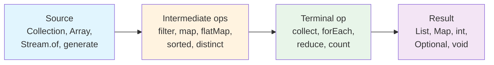
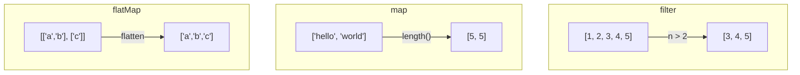
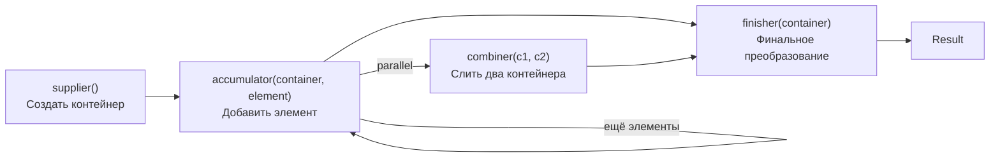
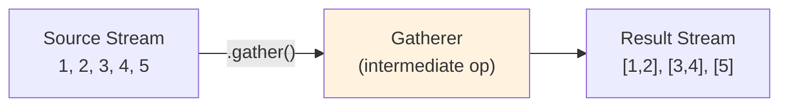

# Вопросы на собеседовании: Stream API в Java

Комплексное руководство по вопросам собеседования на тему `Java Stream API` — от базовых концепций pipeline и lazy evaluation до продвинутых `Collectors`, `parallel streams`, `Gatherers` (Java 22+) и типичных ловушек.

## Полезные ссылки

### Официальная документация

- [Java Stream API (JDK 21)](https://docs.oracle.com/en/java/javase/21/docs/api/java.base/java/util/stream/Stream.html) — основной Javadoc
- [Package java.util.stream](https://docs.oracle.com/en/java/javase/21/docs/api/java.base/java/util/stream/package-summary.html) — обзор пакета и гайд по stream operations
- [Collectors (JDK 21)](https://docs.oracle.com/en/java/javase/21/docs/api/java.base/java/util/stream/Collectors.html) — все встроенные коллекторы
- [JEP 461: Stream Gatherers](https://openjdk.org/jeps/461) — Gatherers API (preview Java 22, finalized Java 24)

### Baeldung

- [The Java Stream API Tutorial — Baeldung](https://www.baeldung.com/java-8-streams) — полное руководство по Stream API
- [Functional Programming in Java — Baeldung](https://www.baeldung.com/java-functional-programming) — функциональное программирование в Java
- [Functional Interfaces in Java — Baeldung](https://www.baeldung.com/java-8-functional-interfaces) — функциональные интерфейсы Java 8
- [Lambda Expressions and Best Practices — Baeldung](https://www.baeldung.com/java-8-lambda-expressions-tips) — советы и лучшие практики лямбд

## Содержание

- [Полезные ссылки](#полезные-ссылки)
- [See also](#see-also)

**Основы Stream API**
- [Q1. Что такое `Stream API` и чем он отличается от `Collections`?](#q1)
- [Q2. Что такое stream pipeline и из каких частей он состоит?](#q2)
- [Q3. Что такое lazy evaluation в `Stream` и почему она важна?](#q3)
- [Q4. Какие способы создания `Stream` существуют?](#q4)

**Промежуточные операции**
- [Q5. В чём разница между intermediate и terminal операциями?](#q5)
- [Q6. Чем отличаются stateless и stateful промежуточные операции?](#q6)
- [Q7. Когда использовать `map`, `flatMap` и `filter`?](#q7)
- [Q8. Как работает `flatMap` и чем он отличается от `map`?](#q8)
- [Q9. В чём разница между `sorted`, `distinct`, `limit` и `skip`?](#q9)
- [Q10. Что такое short-circuit операции и зачем они нужны?](#q10)

**Терминальные операции и Collectors**
- [Q11. Как работает `collect` и зачем нужны `Collectors`?](#q11)
- [Q12. Как работают `groupingBy`, `partitioningBy` и `toMap`?](#q12)
- [Q13. Как использовать `Collectors.joining` и `Collectors.teeing`?](#q13)
- [Q14. В чём разница между `reduce` и `collect`?](#q14)
- [Q15. Как написать собственный `Collector`?](#q15)
- [Q16. Что такое `Optional` в контексте `Stream` и как его правильно использовать?](#q16)
- [Q17. Как работает `forEach` и в чём его ограничения?](#q17)

**Примитивные стримы**
- [Q18. Когда использовать `IntStream`, `LongStream`, `DoubleStream`?](#q18)
- [Q19. Как создать диапазон чисел и получить статистику?](#q19)

**Parallel Streams**
- [Q20. Когда стоит переходить на `parallelStream`?](#q20)
- [Q21. Какие риски и анти-паттерны есть у parallel streams?](#q21)
- [Q22. Как работает `ForkJoinPool` и можно ли использовать свой пул?](#q22)
- [Q23. Как encounter order влияет на parallel streams?](#q23)

**Stream ordering и характеристики**
- [Q24. Что такое encounter order и как он сохраняется в pipeline?](#q24)
- [Q25. Что такое `Spliterator` и какие характеристики у `Stream`?](#q25)

**Продвинутые паттерны**
- [Q26. Как использовать `Stream.iterate` и `Stream.generate`?](#q26)
- [Q27. Как комбинировать `Stream` с `Optional`?](#q27)
- [Q28. Как работает `mapMulti` (Java 16+)?](#q28)
- [Q29. Что такое `Gatherers` (Java 22+) и зачем они нужны?](#q29)
- [Q30. Какие встроенные `Gatherers` доступны?](#q30)

**Производительность и best practices**
- [Q31. Как избежать лишних аллокаций в `Stream`-цепочках?](#q31)
- [Q32. Как дебажить сложные `Stream`-пайплайны?](#q32)
- [Q33. Когда лучше отказаться от `Stream` в пользу обычного цикла?](#q33)
- [Q34. Как писать читабельный `Stream`-код в production?](#q34)
- [Q35. Какие типичные ошибки допускают при работе со `Stream`?](#q35)

**Современные возможности и детали**
- [Q36. Что даёт `Stream.gather()` и Gatherers API (Java 22+)?](#q36)
- [Q37. Как работает `Collectors.teeing()` (двойной сборщик)?](#q37)
- [Q38. В чём разница между `flatMap` и `mapMulti` (Java 16) и что с производительностью?](#q38)
- [Q39. Что такое `ForkJoinPool.commonPool()` и как использовать custom pool для параллельных стримов?](#q39)
- [Q40. Когда `peek()` уместен при отладке Stream, а когда нет?](#q40)
- [Q41. Как работают `Stream.takeWhile()` и `dropWhile()` (Java 9)?](#q41)
- [Q42. Что важно знать про primitive streams: `IntStream.range()`, `summaryStatistics()` и boxing overhead?](#q42)

---

<a id="q1"></a>

## Q1. Что такое `Stream API` и чем он отличается от `Collections`?

`Stream API` (Java 8+) — это декларативный способ обработки последовательностей данных через pipeline операций. Главное отличие от `Collections`: коллекция — это **структура хранения** данных, а `Stream` — это **описание вычислений** над ними. `Stream` ничего не хранит, не меняет источник и пропускает элементы через цепочку операций по требованию.

Проще говоря: коллекция отвечает на вопрос «какие данные у меня есть», а стрим — «что я хочу с ними сделать».

Ключевые различия:

| Характеристика | `Collection` | `Stream` |
|---|---|---|
| Хранит данные | Да | Нет — вычисляет по требованию |
| Модифицирует источник | Зависит от коллекции и её API | Операции Stream не меняют источник сами по себе |
| Повторное использование | Сколько угодно | Только один раз |
| Итерация | Внешняя (`for`, `iterator`) | Внутренняя (декларативная) |
| Ленивость | Нет | Да — intermediate ops ленивые |
| Бесконечные данные | Нет | Да (`iterate`, `generate`) |

```java
// Collection — императивный подход
List<String> result = new ArrayList<>();
for (String name : names) {
    if (name.length() > 3) {
        result.add(name.toUpperCase());
    }
}

// Stream — декларативный подход
List<String> result = names.stream()
    .filter(name -> name.length() > 3)
    .map(String::toUpperCase)
    .toList(); // Java 16+
```

<a id="q2"></a>

## Q2. Что такое stream pipeline и из каких частей он состоит?

Stream pipeline включает **source** (источник), ноль или больше **intermediate operations** (промежуточных операций) и завершается одной **terminal operation** (терминальной операцией). Источник поставляет элементы, промежуточные шаги задают обработку, а терминальный запускает её и выдаёт результат.



Три правила, которые часто проверяют на собеседовании:
- Intermediate-операции **ленивые** — не выполняются до вызова terminal-операции. Без terminal-операции pipeline вообще не запустится.
- Terminal-операция потребляет Stream, поэтому повторно использовать его нельзя. Ресурсный Stream, например `Files.lines`, закрывают отдельно.
- Элементы проходят pipeline **вертикально** (один элемент за раз через всю цепочку), а не горизонтально (вся коллекция через одну операцию, потом через следующую). Именно поэтому работает short-circuit: `limit` может остановить обработку, не дойдя до конца источника.

```java
// Вертикальная обработка: каждый элемент проходит все операции
List<String> result = List.of("alice", "bob", "charlie", "dave")
    .stream()
    .filter(s -> s.length() > 3)   // alice -> да, bob -> нет, charlie -> да, dave -> да
    .map(String::toUpperCase)       // alice -> ALICE, charlie -> CHARLIE, dave -> DAVE
    .limit(2)                       // ALICE, CHARLIE — после 2-го элемента стоп
    .toList();
// Результат: ["ALICE", "CHARLIE"]
// "dave" вообще не обрабатывался — limit прервал pipeline
```

<a id="q3"></a>

## Q3. Что такое lazy evaluation в `Stream` и почему она важна?

**Lazy evaluation** (ленивое вычисление) означает, что промежуточные операции `Stream` не выполняются сразу — вызов `filter` или `map` лишь записывает в pipeline «что нужно сделать», но не делает этого. Реальная работа начинается только при вызове терминальной операции, которая «протягивает» элементы через всю цепочку.

Зачем это нужно — три практических следствия:
- **Меньше лишней работы**: многие stateless-шаги выполняются поэлементно без промежуточных коллекций. Работа зависит от порядка операций: дорогой `map` до `filter` может выполниться и для элемента, который позже будет отброшен.
- **Short-circuit**: `findFirst`, `limit`, `anyMatch` завершаются, как только ответ известен, не трогая остальные элементы.
- **Бесконечные стримы**: `Stream.iterate` / `Stream.generate` порождают бесконечную последовательность, а ленивость позволяет работать с ней — берём столько, сколько нужно, через `limit`.

```java
// Без терминальной операции — НИЧЕГО не выполнится
Stream<String> lazy = names.stream()
    .filter(n -> {
        System.out.println("filter: " + n); // Никогда не напечатается!
        return n.length() > 3;
    })
    .map(String::toUpperCase);
// pipeline создан, но ни один элемент не обработан

// Терминальная операция запускает выполнение
List<String> result = lazy.toList(); // Теперь filter/map работают
```

<a id="q4"></a>

## Q4. Какие способы создания `Stream` существуют?

Источников много, но на практике почти всё сводится к четырём группам: из коллекции/массива, из фиксированного набора (`Stream.of`), генераторы бесконечных стримов (`iterate`, `generate`) и числовые диапазоны (`IntStream.range`). Остальное — частные случаи для строк, файлов и регулярных выражений.

| Способ | Пример | Особенности |
|---|---|---|
| Из коллекции | `list.stream()` | Самый частый вариант |
| Из массива | `Arrays.stream(arr)` | Поддерживает подмассив `(arr, from, to)` |
| Фабричный метод | `Stream.of("a", "b", "c")` | Для фиксированного набора |
| Пустой | `Stream.empty()` | Для null-safe возвратов |
| `iterate` | `Stream.iterate(0, n -> n + 2)` | Бесконечный, с seed |
| `iterate` (Java 9+) | `Stream.iterate(0, n -> n < 100, n -> n + 2)` | С предикатом завершения |
| `generate` | `Stream.generate(Math::random)` | Бесконечный, без seed |
| `IntStream.range` | `IntStream.range(0, 10)` | `[0, 10)` — не включая конец |
| `IntStream.rangeClosed` | `IntStream.rangeClosed(1, 10)` | `[1, 10]` — включая конец |
| Из строки | `"hello".chars()` | `IntStream` символов |
| Из файла | `Files.lines(path)` | Ленивое чтение по строкам |
| `Pattern.splitAsStream` | `pattern.splitAsStream(input)` | Ленивый split |
| Builder | `Stream.builder().add(x).build()` | Императивное создание |

```java
// iterate с предикатом (Java 9+) — замена iterate + limit
Stream.iterate(1, n -> n <= 100, n -> n * 2)
    .forEach(System.out::println); // 1, 2, 4, 8, 16, 32, 64

// Files.lines — ленивое чтение (try-with-resources обязательно!)
try (Stream<String> lines = Files.lines(Path.of("data.csv"))) {
    long errorCount = lines
        .filter(line -> line.contains("ERROR"))
        .count();
}
```

<a id="q5"></a>

## Q5. В чём разница между intermediate и terminal операциями?

Различить их просто по тому, что возвращает операция: если `Stream` — она промежуточная, если что-то другое (`List`, число, `Optional`, `void`) — терминальная.

**Intermediate** (промежуточные) — возвращают новый `Stream`, поэтому их можно сцеплять. Они ленивые: ничего не вычисляют, пока не вызвана terminal-операция, — только описывают будущую работу.

**Terminal** (терминальные) — запускают выполнение всего pipeline и возвращают результат или дают побочный эффект. После terminal-операции `Stream` считается «использованным»: повторный вызов любой операции на нём бросит `IllegalStateException`. Один стрим — одна терминальная операция.

| Тип | Операции | Возвращает |
|---|---|---|
| Intermediate (stateless) | `filter`, `map`, `flatMap`, `peek`, `mapMulti` | `Stream<T>` |
| Intermediate (stateful) | `sorted`, `distinct`, `limit`, `skip` | `Stream<T>` |
| Terminal | `collect`, `toList`, `forEach`, `reduce`, `count` | Результат |
| Terminal (short-circuit) | `findFirst`, `findAny`, `anyMatch`, `allMatch`, `noneMatch` | Результат |

```java
Stream<String> stream = List.of("a", "b", "c").stream();

// Можно использовать только ОДНУ терминальную операцию
long count = stream.filter(s -> !s.isEmpty()).count();

// Повторное использование — IllegalStateException!
// stream.forEach(System.out::println); // Ошибка!
```

<a id="q6"></a>

## Q6. Чем отличаются stateless и stateful промежуточные операции?

Разница в том, нужна ли операции «память» о других элементах.

**Stateless** операции (`filter`, `map`, `flatMap`) не хранят состояние предыдущих элементов. Их стоимость и польза от распараллеливания зависят от функции и источника.

**Stateful** операции (`sorted`, `distinct`, `limit`, `skip`) учитывают уже увиденные элементы или позицию. `sorted` должен получить весь вход до выдачи результата, а `distinct` помнит увиденные значения. Их стоимость особенно важна для больших и бесконечных источников.

```java
// sorted — stateful: буферизирует ВСЕ элементы, потом сортирует
// На бесконечном стриме — OutOfMemoryError
Stream.generate(Math::random)
    .sorted()    // Пытается собрать все элементы — зависнет/OOM
    .limit(5)
    .forEach(System.out::println);

// Правильно: сначала limit, потом sorted
Stream.generate(Math::random)
    .limit(5)
    .sorted()
    .forEach(System.out::println);
```

<a id="q7"></a>

## Q7. Когда использовать `map`, `flatMap` и `filter`?

Выбор зависит от того, как меняется количество элементов на выходе:

- **`filter(Predicate)`** — отсев: элементов становится меньше или столько же, тип не меняется. Берёте, когда нужно убрать ненужное.
- **`map(Function)`** — преобразование один-к-одному: количество элементов то же, тип меняется. Берёте, когда нужно превратить каждый элемент в другой.
- **`flatMap(Function)`** — преобразование один-ко-многим: каждый элемент разворачивается в `Stream`, и все результаты «сплющиваются» в один поток. Берёте, когда из одного элемента рождается несколько (или ноль) — например, развернуть вложенные коллекции.



```java
// Типичная цепочка: filter → map → collect
List<String> activeUserEmails = users.stream()
    .filter(User::isActive)           // отбор
    .map(User::getEmail)              // преобразование
    .filter(email -> email.contains("@company.com"))
    .toList();
```

<a id="q8"></a>

## Q8. Как работает `flatMap` и чем он отличается от `map`?

Короткий ответ: `map` даёт по одному элементу на вход, `flatMap` — по целому стриму, который затем склеивается с остальными в один плоский поток.

Формально: функция в `map` возвращает значение `R`, и получается `Stream<R>`. Функция в `flatMap` возвращает `Stream<R>`, и если бы их просто собирали, вышел бы неудобный `Stream<Stream<R>>` — но `flatMap` сразу разворачивает вложенные стримы и выдаёт плоский `Stream<R>`. То есть `flatMap` = `map` + «склейка» вложенных стримов в один уровень.

```java
// map — вложенная структура остаётся
List<List<String>> nested = List.of(
    List.of("Java", "Kotlin"),
    List.of("Python", "Go")
);
// map вернёт Stream<Stream<String>> — не то, что нужно
// flatMap «разворачивает» вложенные стримы
List<String> flat = nested.stream()
    .flatMap(Collection::stream)  // каждый List -> Stream, затем склейка
    .toList();
// ["Java", "Kotlin", "Python", "Go"]

// Практический пример: все заказы всех клиентов
List<Order> allOrders = customers.stream()
    .flatMap(customer -> customer.getOrders().stream())
    .filter(order -> order.getTotal() > 1000)
    .toList();
```

<a id="q9"></a>

## Q9. В чём разница между `sorted`, `distinct`, `limit` и `skip`?

Все четыре — stateful-операции, но ведут себя по-разному. `sorted` и `distinct` «жадные» (вынуждены посмотреть на много элементов), а `limit` и `skip` работают по позиции и дёшевы. Главный практический вывод: порядок этих операций в цепочке влияет на производительность.

| Операция | Тип | Описание | Стоимость |
|---|---|---|---|
| `sorted()` | stateful | Сортирует весь поток (естественный порядок или `Comparator`) | O(n log n), буферизует всё |
| `distinct()` | stateful | Убирает равные по `equals` элементы | Хранит сведения об уже увиденных значениях |
| `limit(n)` | short-circuit stateful | Оставляет первые N элементов | O(1) на элемент |
| `skip(n)` | stateful | Пропускает первые N элементов | O(1) на элемент |

```java
// Пагинация (не для production — неэффективно на больших данных)
List<User> page = users.stream()
    .sorted(Comparator.comparing(User::getName))
    .skip((long) pageNumber * pageSize)
    .limit(pageSize)
    .toList();

// distinct + sorted — порядок важен!
// distinct перед sorted — экономит сортировку дубликатов
List<String> unique = names.stream()
    .distinct()
    .sorted()
    .toList();
```

<a id="q10"></a>

## Q10. Что такое short-circuit операции и зачем они нужны?

Short-circuit (короткое замыкание) — это операции, которые могут завершить обработку потока, **не дойдя до конца источника**, потому что ответ уже известен. Без них нельзя было бы работать с бесконечными стримами, а на больших данных они экономят массу лишней работы.

Их два вида:

**Intermediate short-circuit**: `limit(n)` ограничивает результат первыми N элементами. При параллельном выполнении реализация может обработать больше элементов источника, чем попадёт в результат.

**Terminal short-circuit**: `findFirst`, `findAny`, `anyMatch`, `allMatch`, `noneMatch` могут завершить обход досрочно, когда ответ известен. Если подходящего элемента нет, даже короткозамыкающая операция над бесконечным источником может не закончиться.

```java
// anyMatch завершается на первом true
boolean hasAdmin = users.stream()
    .anyMatch(u -> u.getRole() == Role.ADMIN);
// Если первый user — ADMIN, остальные не проверяются

// allMatch завершается на первом false
boolean allActive = users.stream()
    .allMatch(User::isActive);

// findFirst завершится, если подходящий элемент встретится
Optional<Integer> firstEvenSquare = Stream.iterate(1, n -> n + 1)
    .map(n -> n * n)
    .filter(n -> n % 2 == 0)
    .findFirst(); // Optional[4]
```

<a id="q11"></a>

## Q11. Как работает `collect` и зачем нужны `Collectors`?

`collect` — самая гибкая терминальная операция: она выполняет **мутабельную свёртку**, то есть накапливает элементы в изменяемый контейнер. Под капотом — три функции: `supplier` создаёт пустой контейнер, `accumulator` добавляет в него очередной элемент, `combiner` сливает контейнеры при параллельной обработке. Писать эти три функции руками почти никогда не нужно: класс `Collectors` уже содержит готовые сборщики под типовые задачи (в список, в map, в строку, с группировкой). На практике `collect` почти всегда вызывают именно с готовым `Collectors.*`.

```java
// Базовые коллекторы
List<String> list = names.stream().collect(Collectors.toList());
List<String> unmodifiable = names.stream().toList(); // Java 16+, немодифицируемый
Set<String> set = names.stream().collect(Collectors.toSet());

// toMap — ключ-значение
Map<Long, User> byId = users.stream()
    .collect(Collectors.toMap(User::getId, Function.identity()));

// toMap с обработкой дубликатов
Map<String, User> byName = users.stream()
    .collect(Collectors.toMap(
        User::getName,
        Function.identity(),
        (existing, replacement) -> existing // при дубликате — оставить первый
    ));

// toUnmodifiableMap (Java 10+)
Map<Long, String> idToName = users.stream()
    .collect(Collectors.toUnmodifiableMap(User::getId, User::getName));
```

<a id="q12"></a>

## Q12. Как работают `groupingBy`, `partitioningBy` и `toMap`?

Это три ключевых коллектора для создания `Map` из `Stream`. Разница в том, какой ключ получается: `groupingBy` — произвольный ключ и **список** значений в каждой группе; `partitioningBy` — частный случай с булевым ключом (всего две группы `true`/`false`); `toMap` — один ключ на одно значение (а не список).

**`groupingBy`** — группирует элементы по ключу, который вычисляет функция-классификатор. По умолчанию значения каждой группы собираются в `List`, но вторым аргументом можно подставить downstream-коллектор и собрать что угодно: посчитать (`counting`), усреднить (`averagingDouble`), вложить ещё одну группировку:

```java
// Простая группировка
Map<Department, List<Employee>> byDept = employees.stream()
    .collect(Collectors.groupingBy(Employee::getDepartment));

// Группировка + downstream collector (подсчёт)
Map<Department, Long> countByDept = employees.stream()
    .collect(Collectors.groupingBy(Employee::getDepartment, Collectors.counting()));

// Группировка + вычисление среднего
Map<Department, Double> avgSalary = employees.stream()
    .collect(Collectors.groupingBy(
        Employee::getDepartment,
        Collectors.averagingDouble(Employee::getSalary)
    ));

// Многоуровневая группировка
Map<Department, Map<String, List<Employee>>> byDeptAndCity = employees.stream()
    .collect(Collectors.groupingBy(
        Employee::getDepartment,
        Collectors.groupingBy(Employee::getCity)
    ));
```

**`partitioningBy`** — разделяет элементы строго на две группы по предикату. В отличие от `groupingBy`, возвращаемая map **всегда** содержит оба ключа `true` и `false`, даже если одна из групп пуста, — так что `get(false)` не вернёт `null`:

```java
Map<Boolean, List<Employee>> partitioned = employees.stream()
    .collect(Collectors.partitioningBy(e -> e.getSalary() > 100_000));

List<Employee> highPaid = partitioned.get(true);
List<Employee> lowPaid = partitioned.get(false);
```

**`toMap`** — см. Q11. Важная ловушка: без merge function дубликаты ключей бросают `IllegalStateException`.

<a id="q13"></a>

## Q13. Как использовать `Collectors.joining` и `Collectors.teeing`?

Оба коллектора решают частые задачи в один проход. `joining` склеивает строки, `teeing` применяет сразу два коллектора к одному потоку.

**`joining`** — конкатенация строк с разделителем, и опционально префиксом и суффиксом. Внутри использует `StringBuilder`, поэтому это правильный способ собрать строку из стрима (а не `reduce` с `+`):

```java
String csv = employees.stream()
    .map(Employee::getName)
    .collect(Collectors.joining(", "));
// "Alice, Bob, Charlie"

String json = employees.stream()
    .map(e -> "\"" + e.getName() + "\"")
    .collect(Collectors.joining(", ", "[", "]"));
// ["Alice", "Bob", "Charlie"]
```

**`teeing`** (Java 12+) передаёт каждый элемент двум коллекторам за **один проход** и сводит их результаты функцией слияния. Это не означает обязательное выполнение двух коллекторов в разных потоках. Метод удобен, когда нужны два агрегата сразу, а данные нежелательно читать дважды:

```java
// Одновременно получаем минимум и максимум
var minMax = employees.stream()
    .collect(Collectors.teeing(
        Collectors.minBy(Comparator.comparingDouble(Employee::getSalary)),
        Collectors.maxBy(Comparator.comparingDouble(Employee::getSalary)),
        (min, max) -> Map.entry(min.orElseThrow(), max.orElseThrow())
    ));

// Одновременно считаем количество и сумму
var stats = orders.stream()
    .collect(Collectors.teeing(
        Collectors.counting(),
        Collectors.summingDouble(Order::getTotal),
        (count, sum) -> "Orders: %d, Total: %.2f".formatted(count, sum)
    ));
```

<a id="q14"></a>

## Q14. В чём разница между `reduce` и `collect`?

Оба сворачивают поток в одно значение, но различаются природой результата.

**`reduce`** сворачивает значения ассоциативной операцией без мутации общего аккумулятора. Он подходит для суммы, произведения и других скалярных результатов. При конкатенации строк через `reduce` повторное создание строк может стоить дорого; для изменяемого контейнера используют `collect`.

**`collect`** накапливает элементы в изменяемых контейнерах (`ArrayList`, `StringBuilder`, `HashMap`) и объединяет частичные результаты при параллельном выполнении. Для сборки коллекций и строк обычно подходят готовые `Collectors`.

**Эмпирическое правило:** скалярный результат из ассоциативной операции — `reduce`; контейнер (список, map, строка) — `collect`.

```java
// reduce — ПЛОХО для конкатенации строк (O(n²) из-за создания новых String)
String bad = strings.stream()
    .reduce("", (a, b) -> a + b); // каждый шаг — новый String

// collect — ХОРОШО (O(n), StringBuilder внутри)
String good = strings.stream()
    .collect(Collectors.joining());

// reduce — хорошо для числовых операций
int sum = numbers.stream()
    .reduce(0, Integer::sum);

// Три формы reduce:
Optional<T> reduce(BinaryOperator<T> accumulator);           // без identity
T           reduce(T identity, BinaryOperator<T> accumulator); // с identity
<U> U       reduce(U identity, BiFunction<U,T,U> accumulator,
                    BinaryOperator<U> combiner);               // для parallel
```

> Для сборки списка обычно используют `collect`: это операция для изменяемого накопления. Передача общего изменяемого списка в `reduce` нарушает требования к функции свёртки, особенно при параллельном выполнении.

<a id="q15"></a>

## Q15. Как написать собственный `Collector`?

Свой `Collector<T, A, R>` нужен редко — почти всё закрыто готовыми `Collectors.*`. Но если типовой сборки не хватает (например, нужно собрать в `ImmutableList` из Guava), пишут собственный через `Collector.of`, задав четыре функции. Тип читается так: `T` — тип элементов потока, `A` — тип промежуточного контейнера-накопителя, `R` — тип финального результата.

```java
// Кастомный Collector: собирает в ImmutableList (Guava)
Collector<String, ImmutableList.Builder<String>, ImmutableList<String>> toImmutableList =
    Collector.of(
        ImmutableList::builder,                    // supplier
        ImmutableList.Builder::add,                // accumulator
        (b1, b2) -> b1.addAll(b2.build()),        // combiner (для parallel)
        ImmutableList.Builder::build               // finisher
    );

List<String> result = stream.collect(toImmutableList);
```



Характеристики (`Collector.Characteristics`):
- `CONCURRENT` — accumulator потокобезопасный, один контейнер на все потоки
- `UNORDERED` — порядок элементов неважен
- `IDENTITY_FINISH` — finisher не нужен (контейнер = результат)

<a id="q16"></a>

## Q16. Что такое `Optional` в контексте `Stream` и как его правильно использовать?

Терминальные операции, которые могут не найти результат (`findFirst`, `findAny`, `min`, `max`, `reduce` без identity), возвращают `Optional<T>` вместо `null`. Это заставляет вызывающий код явно обработать случай «значения нет» и убирает риск `NullPointerException`. Правильная работа с `Optional` — не `if (isPresent) get()`, а декларативная цепочка `map` / `filter` / `orElse`:

```java
// Правильное использование
Optional<User> user = users.stream()
    .filter(u -> u.getId() == targetId)
    .findFirst();

String name = user
    .map(User::getName)
    .orElse("Unknown");

// Optional.stream() (Java 9+) — интеграция Optional и Stream
List<String> emails = users.stream()
    .map(User::getEmail)         // Stream<Optional<String>> если getEmail возвращает Optional
    .flatMap(Optional::stream)   // отбрасывает пустые Optional
    .toList();

// Анти-паттерны
user.get();                        // NoSuchElementException — никогда без проверки
user.isPresent() ? user.get() : x; // Используйте orElse
Optional.of(nullableValue);        // NullPointerException — используйте ofNullable
```

<a id="q17"></a>

## Q17. Как работает `forEach` и в чём его ограничения?

`forEach` — терминальная операция, которая выполняет побочный эффект (печать, отправка, лог) для каждого элемента и ничего не возвращает. Главная ловушка: на `parallelStream` порядок вызовов **не гарантируется**, потому что элементы обрабатываются разными потоками. Если нужно сохранить порядок действий на упорядоченном потоке, используйте `forEachOrdered`; это может ограничить параллелизм.

```java
// forEach — порядок не гарантируется при parallel
list.parallelStream().forEach(System.out::println);       // непредсказуемый порядок
list.parallelStream().forEachOrdered(System.out::println); // исходный порядок

// Анти-паттерн: мутация внешней коллекции через forEach
List<String> result = new ArrayList<>();
stream.forEach(result::add); // Не потокобезопасно при parallel!
// Правильно:
List<String> result = stream.collect(Collectors.toList());
```

Ограничения `forEach`, из-за которых обычный `for` иногда уместнее:
- Нет `break`/`continue` для управления циклом. `return` из лямбды лишь пропускает текущий элемент (как `continue`), а прервать обход нельзя.
- Checked exception из лямбды нельзя бросить без обёртки в unchecked.
- Не возвращает значение — это тупик pipeline, годный только для побочных эффектов. Для накопления результата используйте `collect`, а не `forEach` с добавлением во внешнюю коллекцию (см. пример выше — это небезопасно при parallel).

<a id="q18"></a>

## Q18. Когда использовать `IntStream`, `LongStream`, `DoubleStream`?

`IntStream`, `LongStream` и `DoubleStream` нужны там, где работают с числами и важна скорость. Они дают два преимущества перед `Stream<Integer>`: убирают **autoboxing overhead** (постоянную упаковку/распаковку `int` ↔ `Integer`, которая создаёт мусор и нагружает GC) и добавляют специализированные числовые операции (`sum`, `average`, `summaryStatistics`), которых у объектного стрима просто нет.

```java
// Stream<Integer> — каждый элемент боксится
int sum1 = numbers.stream()
    .mapToInt(Integer::intValue)  // распаковка
    .sum();

// IntStream — без боксинга
int sum2 = IntStream.rangeClosed(1, 1_000_000).sum();

// Специализированные операции
IntSummaryStatistics stats = employees.stream()
    .mapToInt(Employee::getAge)
    .summaryStatistics();
// stats.getCount(), stats.getSum(), stats.getMin(), stats.getMax(), stats.getAverage()

// Конвертация обратно в объектный стрим
Stream<Integer> boxed = IntStream.range(0, 10).boxed();
```

Используйте примитивные стримы когда:
- Работаете с числовыми данными и важна производительность
- Нужны агрегатные операции (`sum`, `average`, `summaryStatistics`)
- Генерируете диапазоны чисел (`range`, `rangeClosed`)

<a id="q19"></a>

## Q19. Как создать диапазон чисел и получить статистику?

Для диапазонов есть два метода: `range` исключает верхнюю границу (`[start, end)` — удобно для индексов массива), `rangeClosed` включает её (`[start, end]`). Для статистики не нужно делать несколько проходов: `summaryStatistics` за один проход возвращает count, sum, min, max и average разом.

```java
// range — [start, end)
IntStream.range(0, 5).forEach(System.out::print); // 01234

// rangeClosed — [start, end]
IntStream.rangeClosed(1, 5).forEach(System.out::print); // 12345

// summaryStatistics — все метрики за один проход
DoubleSummaryStatistics salaryStats = employees.stream()
    .mapToDouble(Employee::getSalary)
    .summaryStatistics();

System.out.printf("Count: %d, Avg: %.2f, Min: %.2f, Max: %.2f%n",
    salaryStats.getCount(),
    salaryStats.getAverage(),
    salaryStats.getMin(),
    salaryStats.getMax());

// Объединение статистик (полезно для parallel или пакетной обработки)
DoubleSummaryStatistics combined = new DoubleSummaryStatistics();
combined.combine(stats1);
combined.combine(stats2);
```

<a id="q20"></a>

## Q20. Когда стоит переходить на `parallelStream`?

Параллельное выполнение имеет издержки деления источника и объединения результатов. Оно полезно на части вычислительных задач с достаточным объёмом работы; корректность и выигрыш проверяют для конкретного pipeline:

1. **Большой объём данных** — на маленьких коллекциях накладные расходы на разбиение и слияние съедают весь выигрыш.
2. **CPU-bound операции** — тяжёлые вычисления без блокирующего I/O. Блокирующие операции в parallel — антипаттерн (см. Q21).
3. **Независимые элементы** — нет общего изменяемого состояния, иначе будет гонка данных.
4. **Подходящий Spliterator** — источник должен достаточно дёшево делиться на части. Массивы и `ArrayList` обычно делятся эффективно; другие источники и операции оценивают на конкретной нагрузке.
5. **Ассоциативная операция свёртки** — результат не должен зависеть от порядка обработки (`a - b` не годится, см. Q21).

```java
// Хороший кейс: тяжёлые вычисления над большим массивом
double[] result = Arrays.stream(largeArray).parallel()
    .mapToDouble(this::expensiveCalculation)
    .toArray();

// Плохой кейс: простая фильтрация небольшого списка
List<String> filtered = smallList.parallelStream()  // overhead > выигрыш
    .filter(s -> s.startsWith("A"))
    .toList();
```

> Начинайте с понятной последовательной версии. Если параллелизм нужен ради скорости, измерьте его на представительной нагрузке; JMH полезен для микробенчмарка, но не заменяет проверку в приложении.

<a id="q21"></a>

## Q21. Какие риски и анти-паттерны есть у parallel streams?

Четыре главные ловушки, на которых ломаются parallel streams:

**1. Race condition на общем изменяемом состоянии.** Несколько потоков пишут в один не-потокобезопасный контейнер — данные теряются или летит исключение. Решение: не накапливать вручную, а отдать сборку `collect`, который сам корректно сливает частичные результаты:
```java
// ОПАСНО — race condition!
List<String> result = new ArrayList<>(); // не потокобезопасный
stream.parallel().forEach(result::add);  // гонка данных

// Правильно
List<String> result = stream.parallel().collect(Collectors.toList());
```

**2. Блокирующие операции в ForkJoinPool.** Обычный parallel Stream использует общий пул. Блокирующий I/O может занять его работников и задержать другие задачи:
```java
// ПЛОХО — все parallel streams в приложении делят один ForkJoinPool
users.parallelStream()
    .map(u -> httpClient.fetch(u.getUrl()))  // блокирующий I/O
    .toList();
// Забивает commonPool, тормозит ВСЕ parallel streams
```

**3. Неассоциативная свёртка.** При параллельной обработке элементы группируются и сворачиваются в произвольном порядке, поэтому операция должна быть ассоциативной. Вычитание — нет, и результат становится непредсказуемым:
```java
// НЕКОРРЕКТНО при parallel — вычитание не ассоциативно
int wrong = IntStream.rangeClosed(1, 4)
    .parallel()
    .reduce(0, (a, b) -> a - b); // результат непредсказуем
```

**4. Лямбды с состоянием и порядком.** Лямбда, которая зависит от порядка обработки или ведёт внешний счётчик, в parallel даст недетерминированный результат — даже потокобезопасный `AtomicInteger` не спасёт от непредсказуемого порядка:
```java
// ПЛОХО — AtomicInteger как счётчик внутри parallel stream
AtomicInteger counter = new AtomicInteger();
stream.parallel()
    .peek(e -> counter.incrementAndGet()) // порядок непредсказуем
    .toList();
```

<a id="q22"></a>

## Q22. Как работает `ForkJoinPool` и можно ли использовать свой пул?

Обычно parallel Stream использует `ForkJoinPool.commonPool()`. Его параллелизм может настраиваться и не всегда равен `availableProcessors() - 1`. Запуск терминальной операции в собственной задаче `ForkJoinPool` может использовать этот пул в текущей реализации, но API Stream не обещает выбор пула.

На текущих реализациях запуск терминальной операции внутри **собственного `ForkJoinPool`** может направить туда работу стрима; этот выбор не закреплён контрактом Stream:

```java
ForkJoinPool customPool = new ForkJoinPool(4);
try {
    List<String> result = customPool.submit(() ->
        largeList.parallelStream()
            .map(this::expensiveOperation)
            .toList()
    ).get(); // блокируемся до завершения
} finally {
    customPool.shutdown();
}
```

> При смене JDK или реализации это поведение нужно проверять заново. Для I/O-задач сначала выбирают подходящую модель конкурентности, а не только пул Stream.

<a id="q23"></a>

## Q23. Как encounter order влияет на parallel streams?

Сохранение encounter order может удорожить некоторые параллельные операции, особенно `limit`, `distinct` и `findFirst`. Если порядок не нужен, `unordered()` позволяет реализации выбрать менее строгую стратегию; выигрыш зависит от pipeline и требует измерения.

```java
// С порядком — parallel должен собирать результаты в правильном порядке
List<String> ordered = list.parallelStream()    // ArrayList — ordered
    .filter(s -> s.length() > 3)
    .toList();                                   // порядок сохранён

// Без порядка — быстрее
Set<String> unordered = set.parallelStream()    // HashSet — unordered
    .filter(s -> s.length() > 3)
    .collect(Collectors.toSet());               // порядок неважен

// Явный сброс порядка
list.parallelStream()
    .unordered()                                // разрешаем не поддерживать порядок
    .limit(100)                                 // limit с unordered — быстрее
    .toList();
```

Операции, чувствительные к порядку: `limit`, `skip`, `findFirst`, `forEachOrdered`. Если порядок неважен — снимайте его: `unordered()` для всего pipeline и `findAny` вместо `findFirst`. Эти замены позволяют параллельному стриму не тратить силы на поддержание последовательности.

<a id="q24"></a>

## Q24. Что такое encounter order и как он сохраняется в pipeline?

**Encounter order** — это порядок, в котором источник выдаёт элементы стриму. Он есть не у всех источников: `List` и массив упорядочены, а `HashSet` и `HashMap` — нет (их порядок не определён). Дальше по pipeline порядок наследуется или меняется в зависимости от операций.

| Источник | Упорядочен? |
|---|---|
| `List`, массив | Да |
| `LinkedHashSet`, `LinkedHashMap` | Да |
| `HashSet`, `HashMap` | Нет |
| `TreeSet`, `TreeMap` | Да (по ключу) |
| `Stream.generate` | Нет |
| `Stream.iterate` | Да |

Промежуточные операции и порядок:
- `sorted` — **устанавливает** порядок
- `unordered` — **снимает** гарантию порядка
- `filter`, `map`, `flatMap` — **сохраняют** порядок источника
- `distinct` — сохраняет порядок первого вхождения (для ordered sources)

```java
// HashSet — неупорядочен
Set.of("c", "a", "b").stream()
    .forEach(System.out::print); // Порядок не определён

// sorted устанавливает порядок
Set.of("c", "a", "b").stream()
    .sorted()
    .forEach(System.out::print); // abc
```

<a id="q25"></a>

## Q25. Что такое `Spliterator` и какие характеристики у `Stream`?

`Spliterator` (splitable iterator — «делимый итератор») — это фундамент, на котором держится параллелизм Stream. Обычный `Iterator` умеет только перебирать, а `Spliterator` дополнительно умеет **делиться на части**, что и позволяет раздавать куски данных разным потокам. Он умеет три вещи:
- Перебирать элементы (`tryAdvance`, `forEachRemaining`).
- Делить себя на части (`trySplit`) — возвращает часть элементов для отдельной обработки; равное деление пополам не гарантировано.
- Сообщать о себе: характеристики и примерный размер (`estimateSize`). От характеристик зависит, какие оптимизации применит pipeline.

Характеристики `Spliterator`:

| Характеристика | Значение | Пример |
|---|---|---|
| `ORDERED` | Порядок элементов определён | `List` |
| `DISTINCT` | Все элементы уникальны | `Set` |
| `SORTED` | Элементы отсортированы | `TreeSet` |
| `SIZED` | Известно точное количество | `ArrayList` |
| `SUBSIZED` | Части после split тоже sized | `ArrayList` |
| `NONNULL` | Элементы не null | — |
| `IMMUTABLE` | Изменение источника при обходе не поддерживается | Зависит от конкретного Spliterator |
| `CONCURRENT` | Безопасна конкурентная модификация | `ConcurrentHashMap` |

```java
Spliterator<String> spliterator = list.spliterator();
System.out.println(spliterator.estimateSize());        // примерное количество
System.out.println(spliterator.characteristics());     // битовая маска характеристик
System.out.println(spliterator.hasCharacteristics(Spliterator.ORDERED)); // true для List
```

<a id="q26"></a>

## Q26. Как использовать `Stream.iterate` и `Stream.generate`?

Двухаргументный `iterate` и `generate` создают потенциально бесконечные потоки. Перегрузка `iterate(seed, hasNext, next)` с Java 9 может завершиться по предикату.

**`Stream.iterate`** — генерирует каждый элемент из предыдущего: задаёте seed (стартовое значение) и функцию перехода. Подходит для последовательностей, где есть зависимость от предыдущего шага (степени двойки, Фибоначчи). С Java 9 есть перегрузка с предикатом-условием остановки — это компактная замена связки `iterate` + `limit`/`takeWhile`:

```java
// Бесконечный итеративный стрим
Stream.iterate(1, n -> n * 2)
    .limit(10)
    .forEach(System.out::println); // 1, 2, 4, 8, 16, ...

// С предикатом (Java 9+) — замена iterate + limit
Stream.iterate(1, n -> n <= 1000, n -> n * 2)
    .toList(); // [1, 2, 4, 8, 16, 32, 64, 128, 256, 512]

// Генерация последовательности Фибоначчи
Stream.iterate(new long[]{0, 1}, f -> new long[]{f[1], f[0] + f[1]})
    .limit(10)
    .mapToLong(f -> f[0])
    .forEach(System.out::println); // 0, 1, 1, 2, 3, 5, 8, 13, 21, 34
```

**`Stream.generate`** — генерирует независимые элементы через `Supplier`, не глядя на предыдущие. Подходит, когда каждый элемент самостоятелен: случайные числа, UUID, константы. Для терминальной операции, которая обходит весь поток, такой источник нужно ограничить. Короткое замыкание может завершиться и без `limit`:

```java
// Бесконечный стрим случайных чисел
Stream.generate(Math::random)
    .limit(5)
    .forEach(System.out::println);

// Генерация UUID
List<String> ids = Stream.generate(() -> UUID.randomUUID().toString())
    .limit(100)
    .toList();
```

**Итог различия:** `iterate` даёт упорядоченный последовательный стрим (элемент зависит от предыдущего, поэтому параллелить его нечего), `generate` — неупорядоченный стрим независимых элементов, который лучше параллелизуется.

<a id="q27"></a>

## Q27. Как комбинировать `Stream` с `Optional`?

Ключевой приём — `Optional.stream()` (Java 9+): он превращает `Optional` в стрим из 0 или 1 элемента. Это позволяет в `flatMap` одним шагом и развернуть `Optional`, и отбросить пустые — вместо неуклюжей пары `filter(isPresent).map(get)`:

```java
// До Java 9 — неуклюже
List<String> phones = users.stream()
    .map(User::getPhone)                    // Optional<String>
    .filter(Optional::isPresent)
    .map(Optional::get)
    .toList();

// Java 9+ — чисто через flatMap + Optional.stream()
List<String> phones = users.stream()
    .map(User::getPhone)                    // Optional<String>
    .flatMap(Optional::stream)              // пустые Optional исчезают
    .toList();

// Optional.or() (Java 9+) — цепочка fallback-ов
Optional<User> user = findInCache(id)
    .or(() -> findInDatabase(id))
    .or(() -> findInExternalService(id));

// Optional.ifPresentOrElse() (Java 9+)
findUser(id).ifPresentOrElse(
    user -> log.info("Found: {}", user),
    () -> log.warn("User {} not found", id)
);
```

<a id="q28"></a>

## Q28. Как работает `mapMulti` (Java 16+)?

`mapMulti` (Java 16+) получает элемент и `Consumer`, которому функция передаёт ноль или больше результатов. Это бывает удобнее `flatMap` при малом числе результатов. Документация описывает реализацию по умолчанию через буфер и `flatMap`, поэтому отсутствие промежуточных объектов и выигрыш по GC не гарантированы:

```java
// flatMap — создаёт промежуточный Stream для каждого элемента
List<Integer> flatMapped = numbers.stream()
    .flatMap(n -> n % 2 == 0 ? Stream.of(n, n * 2) : Stream.empty())
    .toList();

// Пользовательская функция mapMulti не создаёт Stream; внутренняя реализация зависит от JDK
List<Integer> multiMapped = numbers.stream()
    .<Integer>mapMulti((n, consumer) -> {
        if (n % 2 == 0) {
            consumer.accept(n);
            consumer.accept(n * 2);
        }
    })
    .toList();
```

Когда предпочтителен `mapMulti`:
- Элемент преобразуется в небольшое количество результатов — возможен выигрыш по аллокациям, который проверяют измерением
- Нужна **императивная** логика с условиями
- Комбинация `filter` + `map` в одном шаге

<a id="q29"></a>

## Q29. Что такое `Gatherers` (Java 22+) и зачем они нужны?

`Gatherers` — фабрики промежуточных операций для окон, накопления и ограниченного конкурентного преобразования. Они не заменяют терминальные `Collectors` и не сводятся к `parallelStream`: обычные `map` и `filter` сами по себе не хранят состояние между соседними элементами. Собственный `Gatherer` расширяет промежуточную обработку, как `Collector` расширяет терминальную сборку. Для такой логики раньше нередко требовался собственный `Spliterator` или обработка вне Stream. `Gatherer` может хранить состояние, выдавать ноль или несколько элементов на входящий элемент и досрочно завершать обработку. После preview в Java 22–23 API стал постоянным в Java 24.

```java
// Gatherer — промежуточная операция через stream.gather(gatherer)
Stream.of(1, 2, 3, 4, 5, 6, 7, 8, 9)
    .gather(Gatherers.windowFixed(3))     // группировка по 3 элемента
    .toList();
// [[1, 2, 3], [4, 5, 6], [7, 8, 9]]
```

`Gatherer<T, A, R>` определяет четыре компонента (аналогично `Collector`):
- **initializer** — создание состояния
- **integrator** — обработка элемента (может emit 0..N результатов, может остановить pipeline)
- **combiner** — опционально, для параллелизма
- **finisher** — вызывается после всех элементов



<a id="q30"></a>

## Q30. Какие встроенные `Gatherers` доступны?

Готовые Gatherers лежат в классе `java.util.stream.Gatherers`. Они закрывают операции, которых раньше в Stream API не было: разбиение на окна, накопительные свёртки и контролируемый параллельный map.

```java
// windowFixed — окна фиксированного размера
Stream.of(1, 2, 3, 4, 5)
    .gather(Gatherers.windowFixed(2))
    .toList(); // [[1, 2], [3, 4], [5]]

// windowSliding — скользящее окно
Stream.of(1, 2, 3, 4, 5)
    .gather(Gatherers.windowSliding(3))
    .toList(); // [[1, 2, 3], [2, 3, 4], [3, 4, 5]]

// fold — stateful редукция как промежуточная операция
Stream.of(1, 2, 3, 4)
    .gather(Gatherers.fold(() -> 0, Integer::sum))
    .toList(); // [10]

// scan — кумулятивная операция (все промежуточные результаты)
Stream.of(1, 2, 3, 4)
    .gather(Gatherers.scan(() -> 0, Integer::sum))
    .toList(); // [1, 3, 6, 10]

// mapConcurrent — параллельная обработка с ограничением конкурентности
Stream.of(url1, url2, url3)
    .gather(Gatherers.mapConcurrent(4, this::fetchUrl))
    .toList();
```

`mapConcurrent` выполняет преобразование с ограничением числа одновременных вызовов и использует виртуальные потоки. Он может быть удобен для I/O-задач; величина `n` задаёт верхнюю границу конкурентности, а пригодность проверяют по конкретной нагрузке.

<a id="q31"></a>

## Q31. Как избежать лишних аллокаций в `Stream`-цепочках?

Лишние аллокации в стримах рождаются в двух местах: боксинг чисел и неудачный порядок операций (когда дорогой шаг обрабатывает больше данных, чем нужно). Основные техники:

**1. Примитивные стримы вместо боксинга:**
```java
// Объектный Stream<Integer> может требовать упаковки чисел
int boxedSum = items.stream().map(Item::getValue).reduce(0, Integer::sum);

// Примитивный IntStream позволяет считать сумму без упаковки каждого элемента
int primitiveSum = items.stream().mapToInt(Item::getValue).sum();
```

**2. Порядок операций:**
```java
// Плохо — сортировка ДО фильтрации
list.stream()
    .sorted(Comparator.comparing(User::getName))  // сортируем 10_000
    .filter(User::isActive)                         // фильтруем — поздно
    .limit(10);

// Хорошо — фильтрация ДО сортировки
list.stream()
    .filter(User::isActive)                         // фильтруем до 500
    .sorted(Comparator.comparing(User::getName))    // сортируем 500
    .limit(10);
```

**3. Выбирайте способ сборки по контракту результата:** `Stream.toList()` даёт немодифицируемый список, а `collect` принимает коллектор; сравнение аллокаций требует измерения.
```java
// Stream.toList() возвращает немодифицируемый список; выигрыш по аллокациям не гарантирован
var result = stream.toList();
```

**4. Избегайте peek в production:**
```java
// peek добавляет overhead — используйте только для отладки
stream.peek(System.out::println).toList(); // уберите после дебага
```

<a id="q32"></a>

## Q32. Как дебажить сложные `Stream`-пайплайны?

Стрим — это «чёрный ящик»: пошагово в отладчике его не пройти, как обычный цикл. Поэтому для дебага есть отдельные приёмы.

**1. `peek` для временного логирования** — посмотреть, что приходит на вход и выход каждой операции:
```java
List<String> result = users.stream()
    .peek(u -> log.debug("Before filter: {}", u))
    .filter(User::isActive)
    .peek(u -> log.debug("After filter: {}", u))
    .map(User::getName)
    .toList();
```

**2. Разбиение цепочки на переменные:**
```java
// Вместо одной длинной цепочки
Stream<User> activeUsers = users.stream().filter(User::isActive);
Stream<String> names = activeUsers.map(User::getName);
List<String> result = names.sorted().toList();
```

**3. Breakpoints в IDE:** IntelliJ IDEA поддерживает breakpoints внутри лямбд — ставьте breakpoint на строку с лямбдой, а не на всю цепочку.

**4. IntelliJ Stream Debugger:** `Trace Current Stream Chain` показывает состояние данных после каждой операции в виде таблицы. Доступен через иконку в debugger panel.

**5. Не оставляйте `peek` в production** — это отладочный инструмент, не часть бизнес-логики.

<a id="q33"></a>

## Q33. Когда лучше отказаться от `Stream` в пользу обычного цикла?

Stream удобен для линейных преобразований «отфильтровать → преобразовать → собрать». Обычный цикл может яснее выразить сложное управление потоком и изменение нескольких структур. На горячем пути производительность сравнивают измерением. Цикл предпочтителен, когда:

**1. Сложный control flow** — `break`, `continue`, множественные условия выхода. Стрим не умеет прервать обход из середины pipeline, и попытки это эмулировать делают код хуже цикла:
```java
// Stream не поддерживает break из середины pipeline
// Цикл — яснее
for (User user : users) {
    if (user.isBlocked()) continue;
    if (user.isSuperAdmin()) break;
    process(user);
}
```

**2. Мутация нескольких структур:**
```java
// Цикл — понятнее, когда нужно обновлять несколько Map/List
Map<String, Integer> counts = new HashMap<>();
List<String> errors = new ArrayList<>();
for (Record r : records) {
    if (r.isValid()) {
        counts.merge(r.getCategory(), 1, Integer::sum);
    } else {
        errors.add(r.getError());
    }
}
```

**3. Checked exceptions** — лямбды не поддерживают checked exceptions без обёрток.

**4. Performance-critical hot path** — минимальная абстракция, предсказуемое поведение.

**5. Один элемент** — `if`/`else` читабельнее, чем `Stream.of(x).filter(...).map(...).findFirst()`.

<a id="q34"></a>

## Q34. Как писать читабельный `Stream`-код в production?

Главный принцип: цепочка должна читаться как описание намерения, а не как головоломка. Несколько правил, которые этого добиваются.

**1. Именованные предикаты и маперы** — вынесите сложное условие в переменную или метод с говорящим именем, чтобы из цепочки было видно «что», а не «как»:
```java
// Плохо — сложная инлайн-лямбда
users.stream()
    .filter(u -> u.getAge() > 18 && u.isActive() && u.getRole() != Role.BOT)
    .toList();

// Хорошо — читаемый предикат
Predicate<User> isEligible = u -> u.getAge() > 18
    && u.isActive()
    && u.getRole() != Role.BOT;
users.stream().filter(isEligible).toList();

// Ещё лучше — метод
users.stream().filter(this::isEligible).toList();
```

**2. Одна операция — одна строка:**
```java
List<OrderDto> result = orders.stream()
    .filter(Order::isPaid)
    .sorted(Comparator.comparing(Order::getCreatedAt).reversed())
    .map(orderMapper::toDto)
    .limit(50)
    .toList();
```

**3. Следите за сложностью цепочки.** Выносите шаги в методы, когда это проясняет бизнес-логику; универсального предела по числу операций нет.

**4. Комментируйте нетривиальную бизнес-логику**, а не механику Stream API.

<a id="q35"></a>

## Q35. Какие типичные ошибки допускают при работе со `Stream`?

Большинство ошибок со стримами — следствие непонимания двух свойств: стрим одноразовый и ленивый. Отсюда же типовые грабли.

**1. Повторное использование Stream** — после терминальной операции поток потреблён, повторная операция запрещена:
```java
Stream<String> stream = list.stream().filter(s -> !s.isEmpty());
long count = stream.count();
List<String> result = stream.toList(); // IllegalStateException!
```

**2. Бесконечный стрим без limit:**
```java
Stream.iterate(0, n -> n + 1)
    .sorted()   // пытается собрать ВСЕ элементы — зависание/OOM
    .limit(5);
```

**3. Забытая терминальная операция** — без неё ленивый pipeline не запустится, и побочные эффекты в промежуточных операциях не сработают:
```java
// Ничего не произойдёт! peek — промежуточная, нет terminal op
users.stream()
    .filter(User::isActive)
    .peek(u -> emailService.send(u)); // побочный эффект не выполнится
```

**4. toMap без merge function:**
```java
// IllegalStateException при дубликатах ключей
Map<String, User> byName = users.stream()
    .collect(Collectors.toMap(User::getName, Function.identity()));
// Два пользователя с одинаковым именем — исключение!
```

**5. Модификация источника во время Stream:**
```java
List<String> list = new ArrayList<>(List.of("a", "b", "c"));
list.stream()
    .filter(s -> !s.equals("b"))
    .forEach(s -> list.remove(s));  // ConcurrentModificationException!
```

**6. forEach вместо collect для накопления результата** — см. Q17.

---

<a id="q36"></a>

## Q36. Что даёт `Stream.gather()` и Gatherers API (Java 22+)?

**Gatherers API** (preview в Java 22–23, постоянный API с Java 24) позволяет писать **собственные промежуточные операции**. `Collector` расширяет терминальную сборку, а `Gatherer` — промежуточную обработку. Раньше для окон и накопления между элементами обычно требовался собственный `Spliterator`, внешняя библиотека или сложная логика вне Stream.

**Проблема:** до Java 22 многие операции над потоками невозможно было выразить через стандартный API:
```java
// Хотим: скользящее окно размером 3
// До Java 22: нужен кастомный Spliterator или внешние библиотеки
```

**`Stream.gather(Gatherer<T,A,R>)` — новая промежуточная операция:**

```java
import java.util.stream.Gatherers;

List<Integer> numbers = List.of(1, 2, 3, 4, 5, 6, 7, 8);

// Встроенный Gatherer: скользящее окно
List<List<Integer>> windows = numbers.stream()
    .gather(Gatherers.windowSliding(3))
    .toList();
// [[1,2,3], [2,3,4], [3,4,5], [4,5,6], [5,6,7], [6,7,8]]

// Фиксированное окно (без перекрытий)
List<List<Integer>> fixed = numbers.stream()
    .gather(Gatherers.windowFixed(3))
    .toList();
// [[1,2,3], [4,5,6], [7,8]]

// scan — running total (накопленный результат)
List<Integer> runningSum = numbers.stream()
    .gather(Gatherers.scan(() -> 0, Integer::sum))
    .toList();
// [1, 3, 6, 10, 15, 21, 28, 36]

// fold выдаёт итоговое накопленное значение; scan выдаёт промежуточные значения

// mapConcurrent — параллельный map с ограничением concurrency
List<String> results = urls.stream()
    .gather(Gatherers.mapConcurrent(4, url -> fetch(url)))
    .toList();
// Выполняет fetch параллельно, но максимум 4 одновременно
```

**Кастомный Gatherer — группировка по последовательным элементам:**
```java
// Gatherer для группировки соседних одинаковых элементов (run-length encoding)
Gatherer<Integer, List<Integer>, List<Integer>> groupConsecutive =
    Gatherer.ofSequential(
        ArrayList::new, // initializer
        (state, element, downstream) -> { // integrator
            if (!state.isEmpty() && state.get(state.size()-1).equals(element)) {
                state.add(element);
            } else {
                if (!state.isEmpty() && !downstream.push(new ArrayList<>(state))) {
                    return false;
                }
                state.clear();
                state.add(element);
            }
            return true;
        },
        (state, downstream) -> { // finisher
            if (!state.isEmpty()) downstream.push(state);
        }
    );

List.of(1,1,2,2,2,3,1,1).stream()
    .gather(groupConsecutive)
    .toList();
// [[1,1], [2,2,2], [3], [1,1]]
```

**Встроенные Gatherers (Java 24):**

| Gatherer | Описание |
|----------|----------|
| `windowFixed(n)` | Фиксированные окна по n элементов |
| `windowSliding(n)` | Скользящее окно шириной n |
| `scan(init, fn)` | Running accumulation (prefix scan) |
| `fold(init, fn)` | Свёртка с итоговым значением |
| `mapConcurrent(n, fn)` | Параллельный map, ≤n одновременно |

---

<a id="q37"></a>

## Q37. Как работает `Collectors.teeing()` (двойной сборщик)?

**`Collectors.teeing()`** (Java 12) передаёт каждый элемент двум коллекторам и сводит их результаты функцией слияния. Главная ценность — один проход по данным вместо двух. Для бесконечного источника такой терминальный сборщик сам по себе не завершится.

**Сигнатура:**
```java
static <T, R1, R2, R> Collector<T, ?, R> teeing(
    Collector<? super T, ?, R1> downstream1,
    Collector<? super T, ?, R2> downstream2,
    BiFunction<? super R1, ? super R2, R> merger
)
```

**Пример: min и max за один проход:**
```java
List<Integer> numbers = List.of(5, 3, 8, 1, 9, 2, 7);

record MinMax(int min, int max) {}

MinMax minMax = numbers.stream()
    .collect(Collectors.teeing(
        Collectors.minBy(Integer::compareTo),
        Collectors.maxBy(Integer::compareTo),
        (min, max) -> new MinMax(min.orElseThrow(), max.orElseThrow())
    ));
// MinMax[min=1, max=9]
```

**Пример: среднее и количество одновременно:**
```java
record Stats(double avg, long count) {}

List<Double> values = List.of(1.0, 2.0, 3.0, 4.0, 5.0);

Stats stats = values.stream()
    .collect(Collectors.teeing(
        Collectors.averagingDouble(Double::doubleValue),
        Collectors.counting(),
        Stats::new
    ));
// Stats[avg=3.0, count=5]
```

**Пример: разбить на два списка по условию за один проход:**
```java
record Partitioned<T>(List<T> matched, List<T> rest) {}

List<String> words = List.of("apple", "banana", "apricot", "cherry", "avocado");

Partitioned<String> result = words.stream()
    .collect(Collectors.teeing(
        Collectors.filtering(s -> s.startsWith("a"), Collectors.toList()),
        Collectors.filtering(s -> !s.startsWith("a"), Collectors.toList()),
        Partitioned::new
    ));
// matched: [apple, apricot, avocado], rest: [banana, cherry]
```

**Вложенный teeing:**
```java
// teeing внутри teeing — для трёх агрегатов
numbers.stream().collect(
    Collectors.teeing(
        Collectors.summingInt(Integer::intValue),       // sum
        Collectors.teeing(
            Collectors.counting(),                       // count
            Collectors.averagingInt(Integer::intValue),  // avg
            (count, avg) -> Map.of("count", count, "avg", avg)
        ),
        (sum, map) -> { /* объединяем */ }
    )
);
```

**Когда использовать `teeing`:**
- Нужно два агрегата за один проход по данным
- Источник ленивый или одноразовый; бесконечный поток сначала нужно ограничить
- Производительность критична: избегаем двойной материализации коллекции

---

<a id="q38"></a>

## Q38. В чём разница между `flatMap` и `mapMulti` (Java 16) и что с производительностью?

Обе операции решают задачу «один элемент → несколько результатов». `flatMap` получает поток результатов, `mapMulti` передаёт их в `Consumer`. Для `mapMulti` возможен выигрыш по аллокациям, но его реализация по умолчанию сама использует буфер и `flatMap`; выбор проверяют профилированием.

**flatMap — классический подход:**
```java
// flatMap: для каждого элемента создаётся промежуточный Stream
List<Integer> result = List.of(1, 2, 3).stream()
    .flatMap(n -> Stream.of(n, n * 10))
    .toList();
// [1, 10, 2, 20, 3, 30]

// Для каждого n создаётся Stream.of(n, n*10) — дополнительные аллокации
```

**mapMulti — без промежуточных Stream:**
```java
// mapMulti: Consumer<R> downstream — элементы передаются напрямую
List<Integer> result = List.of(1, 2, 3).stream()
    .<Integer>mapMulti((n, consumer) -> {
        consumer.accept(n);
        consumer.accept(n * 10);
    })
    .toList();
// [1, 10, 2, 20, 3, 30]
// Нет промежуточных Stream-объектов!
```

**Когда mapMulti быстрее flatMap:**
```java
// 1. Когда количество элементов на выходе мало или непредсказуемо
List<String> words = List.of("hello world", "foo", "bar baz qux");
List<String> longWords = words.stream()
    .<String>mapMulti((sentence, consumer) -> {
        for (String word : sentence.split(" ")) {
            if (word.length() > 3) consumer.accept(word);  // условная передача
        }
    })
    .toList();

// 2. При раскрытии дерева/вложенных структур
record Node(String value, List<Node> children) {}

void flatten(Node node, Consumer<String> consumer) {
    consumer.accept(node.value());
    for (Node child : node.children()) {
        flatten(child, consumer); // рекурсия без Stream
    }
}

List<String> allValues = List.of(root).stream()
    .<String>mapMulti(this::flatten)
    .toList();
```

**Сравнение производительности:**

| Критерий | flatMap | mapMulti |
|----------|---------|----------|
| Аллокации | Поток результатов для каждого элемента | Зависят от реализации; default использует буфер и flatMap |
| Читаемость | Лучше (декларативно) | Хуже (imperative) |
| Ленивость | Полная | Полная |
| Производительность | Зависит от входа и реализации | Зависит от входа и реализации |
| Когда использовать | Обычно | Горячие пути, много элементов |

**Практическое правило:**
- **flatMap** — по умолчанию: читабельнее, производительность обычно достаточна
- **mapMulti** — когда профилировщик показывает, что flatMap создаёт GC pressure

---

<a id="q39"></a>

## Q39. Что такое `ForkJoinPool.commonPool()` и как использовать custom pool для параллельных стримов?

Parallel Stream обычно исполняется в `ForkJoinPool.commonPool()`. Блокирующая работа может занять его потоки и задержать другие задачи. Собственный пул иногда помогает изолировать нагрузку, но Stream API не гарантирует выбор пула.

**ForkJoinPool.commonPool() — особенности:**
```java
// Параллелизм зависит от числа доступных процессоров и настроек JVM
System.out.println(ForkJoinPool.commonPool().getParallelism());
// При необходимости свойство java.util.concurrent.ForkJoinPool.common.parallelism
// задают при запуске JVM, до инициализации общего пула.
```

**Проблема "пула по умолчанию":**
```java
// ПЛОХО: блокирующие операции в parallel stream → исчерпывают commonPool
List<String> results = urls.parallelStream()
    .map(url -> httpClient.get(url)) // блокирует поток!
    .toList();
// Другие задачи в общем пуле могут получить меньше доступных работников
```

**Custom ForkJoinPool — изоляция параллельных задач:**
```java
// Запускаем parallel stream в отдельном пуле
ForkJoinPool customPool = new ForkJoinPool(4);

try {
    List<String> results = customPool.submit(() ->
        urls.parallelStream()
            .map(this::fetchUrl)
            .toList()
    ).get();
} finally {
    customPool.shutdown();
}
```

**Ограничение конкурентности через Gatherers (Java 24+ без preview):**
```java
// Лучше для IO-bound задач — используем mapConcurrent
List<String> results = urls.stream()
    .gather(Gatherers.mapConcurrent(4, this::fetchUrl))
    .toList();
// Не больше 4 одновременных вызовов преобразования
```

**Virtual Threads + Stream для IO-bound задач (Java 21+):**
```java
// Один из вариантов для I/O-bound параллелизма
try (ExecutorService vte = Executors.newVirtualThreadPerTaskExecutor()) {
    List<CompletableFuture<String>> futures = urls.stream()
        .map(url -> CompletableFuture.supplyAsync(() -> fetchUrl(url), vte))
        .toList();

    List<String> results = futures.stream()
        .map(CompletableFuture::join)
        .toList();
}

```

**Выбор подхода:**

| Задача | Подход |
|--------|--------|
| CPU-bound, малые данные | Обычно последовательная обработка; измерить издержки parallel |
| CPU-bound, изоляция | Custom ForkJoinPool |
| IO-bound | Виртуальные потоки или `Gatherers.mapConcurrent` на Java 24+ |
| Ограниченная concurrency | `Gatherers.mapConcurrent(n, fn)` |

---

<a id="q40"></a>

## Q40. Когда `peek()` уместен при отладке Stream, а когда нет?

**`peek()`** — промежуточная операция с `Consumer<T>`, предназначенная прежде всего для отладки. Её действие может не вызываться для всех элементов из-за короткого замыкания и оптимизаций, поэтому критичную бизнес-логику в неё не помещают.

Почему `peek()` опасен для бизнес-логики:
- Он промежуточный и ленивый: без терминальной операции тело `peek` вообще не выполнится.
- Порядок и факт вызова не гарантированы — особенно на parallel streams, где элементы идут вразнобой по потокам. JVM в принципе вправе пропустить `peek` для элементов, которые не влияют на результат.

**Правильное использование peek() — логирование:**
```java
// ХОРОШО: логирование промежуточных значений при отладке
List<String> result = names.stream()
    .filter(s -> s.length() > 3)
    .peek(s -> log.debug("After filter: {}", s))
    .map(String::toUpperCase)
    .peek(s -> log.debug("After map: {}", s))
    .toList();
```

**Распространённые ошибки с peek():**

```java
// ОШИБКА 1: peek() без терминальной операции — ничего не выполнится!
users.stream()
    .filter(User::isActive)
    .peek(u -> emailService.send(u)); // side effect НЕ выполнится!
// Нет terminal operation → lazy evaluation → ноль итераций

// ОШИБКА 2: модификация объектов через peek()
// Технически работает, но антипаттерн
orders.stream()
    .peek(order -> order.setStatus("PROCESSED")) // мутация!
    .collect(Collectors.toList());
// Лучше использовать map() и возвращать новый объект

// ОШИБКА 3: бизнес-логика в peek()
result = stream
    .peek(item -> database.save(item)) // side effect в промежуточной операции
    .toList();
// Гарантий порядка нет (особенно в parallel streams)
```

**Почему peek() плохо для side effects:**
```java
// peek() на parallel stream — порядок не определён
List.of(1, 2, 3, 4, 5).parallelStream()
    .peek(n -> System.out.println("Thread: " + Thread.currentThread().getName() + ", n=" + n))
    .toList();
// Вывод будет в случайном порядке!
```

**Альтернативы peek() для production-кода:**
```java
// Вместо peek() для трансформации — используй map()
List<Order> processed = orders.stream()
    .map(order -> {
        order.setStatus("PROCESSED"); // если нужна мутация
        return order;
    })
    .toList();

// Или создавай новый объект (immutable подход)
List<Order> processed = orders.stream()
    .map(order -> order.withStatus("PROCESSED")) // только если в Order определён такой метод
    .toList();

// Для логирования в production — логировать в map():
List<String> result = names.stream()
    .filter(s -> s.length() > 3)
    .map(s -> {
        if (log.isDebugEnabled()) log.debug("Processing: {}", s);
        return s.toUpperCase();
    })
    .toList();
```

**Правило:** используйте `peek()` для наблюдения за pipeline, а бизнес-действия выражайте явно. При отладке учитывайте, что даже терминальная операция не гарантирует вызов `peek()` для каждого элемента.

---

<a id="q41"></a>

## Q41. Как работают `Stream.takeWhile()` и `dropWhile()` (Java 9)?

**`takeWhile()`** и **`dropWhile()`** (Java 9) отрезают часть упорядоченного потока по условию: `takeWhile` берёт элементы с начала, **пока** предикат истинен, и останавливается на первом ложном; `dropWhile` симметрично выбрасывает начало, пока предикат истинен, и отдаёт всё после.

На упорядоченном потоке `takeWhile` берёт начальный префикс до первого нарушения и может завершить обход досрочно. `dropWhile` пропускает такой префикс, затем отдаёт остаток. `filter` отбирает подходящие элементы независимо от их позиции.

**takeWhile() — брать элементы, пока условие выполняется:**
```java
// Берём числа, пока они < 5 (останавливаемся при первом нарушении)
List<Integer> result = Stream.of(1, 2, 3, 4, 5, 6, 7)
    .takeWhile(n -> n < 5)
    .toList();
// [1, 2, 3, 4]  — останавливается на 5, дальше не смотрит

// Отличие от filter():
Stream.of(1, 2, 3, 4, 5, 6, 7)
    .filter(n -> n < 5)
    .toList();
// [1, 2, 3, 4]  — тот же результат, но filter проходит ВСЕ элементы!

// Важно: если первый элемент не удовлетворяет условию — результат пустой
Stream.of(5, 1, 2, 3)
    .takeWhile(n -> n < 5)
    .toList();
// []  — 5 не < 5, остановились сразу
```

**dropWhile() — пропускать элементы, пока условие выполняется:**
```java
// Пропускаем, пока < 5, затем берём всё остальное
List<Integer> result = Stream.of(1, 2, 3, 4, 5, 6, 7)
    .dropWhile(n -> n < 5)
    .toList();
// [5, 6, 7]

// Если условие ни разу не выполнилось — возвращает всё
Stream.of(5, 6, 7)
    .dropWhile(n -> n < 5)
    .toList();
// [5, 6, 7]
```

**Практические примеры:**

```java
// 1. Пагинация логов: пропустить старые записи
List<LogEntry> recentLogs = allLogs.stream()
    .dropWhile(log -> log.getTimestamp().isBefore(startDate))
    .takeWhile(log -> log.getTimestamp().isBefore(endDate))
    .toList();

// 2. Парсинг CSV: пропустить заголовки
List<String> dataRows = lines.stream()
    .dropWhile(line -> line.startsWith("#") || line.startsWith("//"))
    .toList();

// 3. Числа Фибоначчи до 100:
Stream.iterate(new int[]{0, 1}, f -> new int[]{f[1], f[0] + f[1]})
    .mapToInt(f -> f[0])
    .takeWhile(n -> n <= 100)
    .forEach(System.out::println);
// 0, 1, 1, 2, 3, 5, 8, 13, 21, 34, 55, 89
```

**Поведение на неупорядоченных/parallel streams:**
```java
// На неупорядоченном parallel stream поведение непредсказуемо!
Set<Integer> set = Set.of(1, 2, 3, 4, 5, 6);
set.parallelStream()
    .takeWhile(n -> n < 4)
    .toList();
// Результат непредсказуем: Set не имеет гарантированного порядка

// ВСЕГДА используйте с упорядоченными источниками (List, SortedSet, sorted())
```

**Сравнение:**

| Операция | Проходит все элементы? | Короткое замыкание? |
|----------|----------------------|---------------------|
| `filter()` | Да | Нет |
| `takeWhile()` | Нет (stop при false) | Да |
| `dropWhile()` | Нет (skip при true) | Да |
| `limit(n)` | Нет | Да |

---

<a id="q42"></a>

## Q42. Что важно знать про primitive streams: `IntStream.range()`, `summaryStatistics()` и boxing overhead?

**Primitive Streams** (`IntStream`, `LongStream`, `DoubleStream`) обрабатывают примитивные значения без обязательной упаковки каждого элемента. Они предоставляют числовые методы (`sum`, `average`, `min`, `max`, `summaryStatistics`), которых нет у `Stream<Integer>`. Реальный выигрыш по времени и памяти зависит от данных и реализации JVM.

**IntStream.range() и rangeClosed():**
```java
// range: [startInclusive, endExclusive)
IntStream.range(0, 5)     // 0, 1, 2, 3, 4
IntStream.rangeClosed(0, 5) // 0, 1, 2, 3, 4, 5

// Практические применения:
// 1. Вместо for-loop
IntStream.range(0, list.size())
    .forEach(i -> process(list.get(i), i)); // с индексом!

// 2. Генерация данных
List<String> ids = IntStream.rangeClosed(1, 100)
    .mapToObj(i -> "ID-" + i)
    .toList();

// 3. Параллельная обработка индексов
IntStream.range(0, array.length)
    .parallel()
    .forEach(i -> array[i] = compute(i));
```

**summaryStatistics() — агрегация за один проход:**
```java
// Получаем count, sum, min, max, average одновременно!
IntSummaryStatistics stats = IntStream.of(3, 1, 4, 1, 5, 9, 2, 6)
    .summaryStatistics();

System.out.println(stats.getCount());   // 8
System.out.println(stats.getSum());     // 31
System.out.println(stats.getMin());     // 1
System.out.println(stats.getMax());     // 9
System.out.println(stats.getAverage()); // 3.875

// То же для double:
DoubleSummaryStatistics dStats = prices.stream()
    .mapToDouble(Product::getPrice)
    .summaryStatistics();
```

**Boxing overhead — почему это важно:**
```java
// МЕДЛЕННО: Stream<Integer> — автобоксинг каждого int
Stream<Integer> boxed = Stream.of(1, 2, 3, 4, 5);
int boxedSum = boxed.reduce(0, Integer::sum); // операции с Integer могут требовать boxing

// БЫСТРО: IntStream — нет boxing
int primitiveSum = IntStream.of(1, 2, 3, 4, 5).sum();

// Разница на больших данных:
// У Stream<Integer> нет метода sum(); для числовой суммы используют mapToInt или reduce

// ПЛОХО: .mapToInt() не использовали
List<Employee> employees = getEmployees();
OptionalDouble avgSalary = employees.stream()
    .map(Employee::getSalary) // Stream<BigDecimal> — нет boxing, но нет спец. методов
    .mapToDouble(BigDecimal::doubleValue) // конвертируем в примитивный DoubleStream
    .average();
```

**Конвертация между Stream<T> и IntStream:**
```java
// Stream<Integer> → IntStream (unbox)
IntStream intStream = Stream.of(1, 2, 3).mapToInt(Integer::intValue);

// IntStream → Stream<Integer> (box)
Stream<Integer> boxedStream = IntStream.of(1, 2, 3).boxed();

// IntStream → LongStream (расширение)
LongStream longStream = IntStream.of(1, 2, 3).asLongStream();
```

**Специализированные методы IntStream:**
```java
// sum, average, min, max — без collect()
int sum = IntStream.range(1, 101).sum();      // 5050
OptionalDouble avg = IntStream.of(1,2,3).average(); // OptionalDouble[2.0]
OptionalInt max = IntStream.of(5,3,8,1).max();      // OptionalInt[8]

// Собрать в массив — эффективно
int[] arr = IntStream.range(0, 10).toArray();

// toList() через boxed (Java 16+)
List<Integer> list = IntStream.range(0, 10).boxed().toList();
```

---

## See also

- [Java 8](java-8-interview.md) — лямбды, `FunctionalInterface`, `Optional` — основа для Stream API
- [Java Collections](java-collections-interview.md) — коллекции как источники стримов, `Spliterator`, `Iterable`
- [Java Concurrency](java-concurrency-interview.md) — `parallel streams`, `ForkJoinPool`, потокобезопасность в стримах
- [Java Core](java-core-interview.md) — базовые концепции: методы-ссылки, `Comparable`, `Comparator`
- [Java Generics](java-generics-interview.md) — дженерики в `Collector<T,A,R>`, `Function<T,R>`, type inference
- [Java 17-21](java-17-21-interview.md) — `Gatherers` API (Java 22+), `SequencedCollection` в Java 21
- [Java IO / NIO](java-io-nio-interview.md) — `Files.lines()`, `Files.walk()` возвращают `Stream<String>`/`Stream<Path>`
