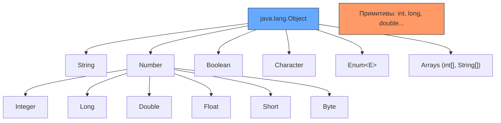
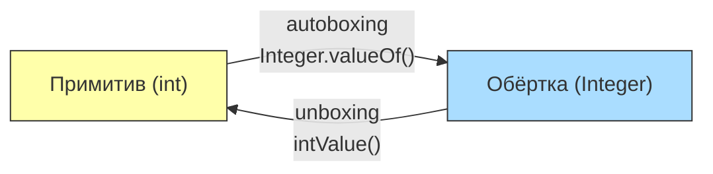
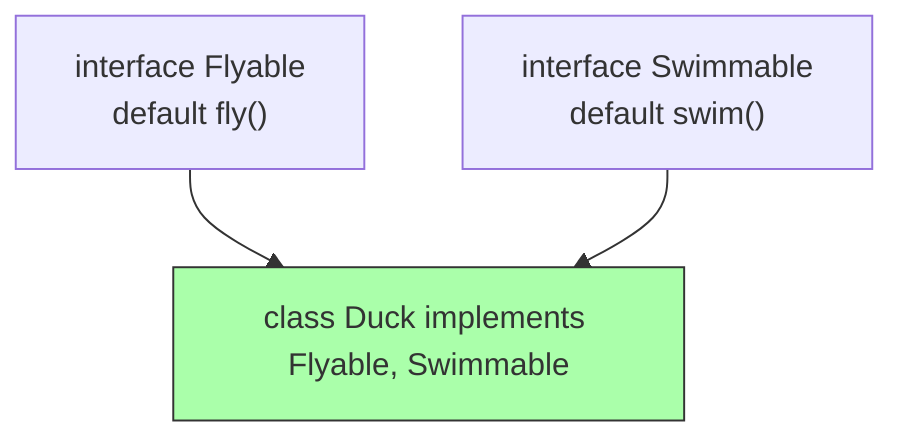
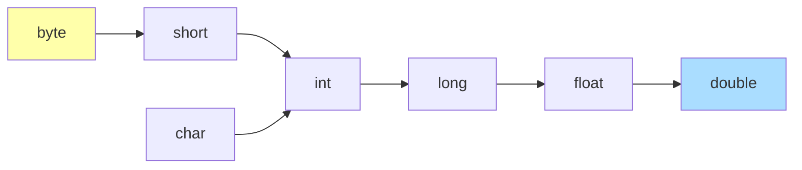
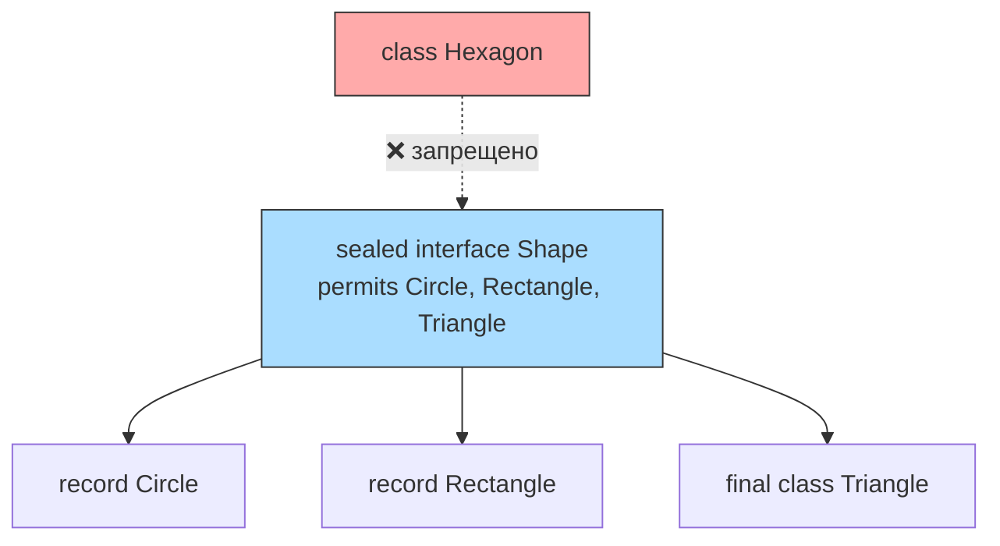

# Вопросы на собеседовании: Типы данных Java

Система типов `Java` — фундаментальная тема на собеседованиях. Она охватывает примитивные и ссылочные типы, механизмы `autoboxing`/`unboxing`, классы-обёртки, современные конструкции (`record`, `sealed`, `var`) и правила приведения типов. Понимание этих концепций критично для написания корректного и производительного кода.

## Полезные ссылки

### Официальная документация

- [Java Tutorial — Primitive Data Types](https://docs.oracle.com/javase/tutorial/java/nutsandbolts/datatypes.html) — официальное руководство по примитивам
- [Java Language Specification — Types](https://docs.oracle.com/javase/specs/jls/se17/html/jls-4.html) — спецификация системы типов
- [Wrapper Classes in Java — Baeldung](https://www.baeldung.com/java-wrapper-classes) — обёртки и autoboxing
- [Java Primitives vs Objects — Baeldung](https://www.baeldung.com/java-primitives-vs-objects) — сравнение примитивов и объектов
- [Sealed Classes and Interfaces — Baeldung](https://www.baeldung.com/java-sealed-classes-interfaces) — sealed-классы
- [Java Type System Interview Questions — Baeldung](https://www.baeldung.com/java-type-system-interview-questions) — вопросы по системе типов с ответами

## Содержание

- [Полезные ссылки](#полезные-ссылки)
- [See also](#see-also)

**Иерархия типов и `Object`**
- [Q1. (!) Приём, что берёт любое тело, взял ряд голых значений целиком, а ячейку того же ряда по одной брать отказался. Чем это вызвано?](#q1--приём-что-берёт-любое-тело-взял-ряд-голых-значений-целиком-а-ячейку-того-же-ряда-по-одной-брать-отказался-чем-это-вызвано)
- [Q2. Тело собрали, ни одного поля не задав; счёт по одному полю сорвался пустотою, а по соседнему такому же дал ноль. Чем это вызвано?](#q2-тело-собрали-ни-одного-поля-не-задав-счёт-по-одному-полю-сорвался-пустотою-а-по-соседнему-такому-же-дал-ноль-чем-это-вызвано)
- [Q3. (!) Голое малое значение, набранное со старшим разрядом, при переводе в широкое вышло отрицательным, а буквенное того же вида — положительным. Чем это вызвано?](#q3--голое-малое-значение-набранное-со-старшим-разрядом-при-переводе-в-широкое-вышло-отрицательным-а-буквенное-того-же-вида--положительным-чем-это-вызвано)
- [Q4. Сверку по содержимому у рода переписали, два одинаковых тела сверяются равными, а в наборе второе легло отдельной ячейкой. Чем это вызвано?](#q4-сверку-по-содержимому-у-рода-переписали-два-одинаковых-тела-сверяются-равными-а-в-наборе-второе-легло-отдельной-ячейкой-чем-это-вызвано)

**Классы-обёртки и `autoboxing`**
- [Q5. (!) Поиск по собранию оболочек промахнулся, приёмник под него объявлен голым значением, и ход сорвался прямо на укладке. Чем это вызвано?](#q5--поиск-по-собранию-оболочек-промахнулся-приёмник-под-него-объявлен-голым-значением-и-ход-сорвался-прямо-на-укладке-чем-это-вызвано)
- [Q6. (!) Два тела завернули из одного малого числа и свели тождеством, вышло равенство; повторили с числом покрупнее, вышло неравенство. Чем это вызвано?](#q6--два-тела-завернули-из-одного-малого-числа-и-свели-тождеством-вышло-равенство-повторили-с-числом-покрупнее-вышло-неравенство-чем-это-вызвано)
- [Q7. Оболочку свели тождеством с голым значением, вышло равенство; ту же оболочку свели с такою же оболочкой, вышло неравенство. Чем это вызвано?](#q7-оболочку-свели-тождеством-с-голым-значением-вышло-равенство-ту-же-оболочку-свели-с-такою-же-оболочкой-вышло-неравенство-чем-это-вызвано)
- [Q8. Поле в теле сменили с голого значения на оболочку, ход остался прежним, а память под большое множество таких тел выросла кратно. Чем это вызвано?](#q8-поле-в-теле-сменили-с-голого-значения-на-оболочку-ход-остался-прежним-а-память-под-большое-множество-таких-тел-выросла-кратно-чем-это-вызвано)

**Классы, интерфейсы и наследование**
- [Q9. (!) Общее поведение десятка родов вынесли в умение, а теперь понадобилось держать там свой счётчик на каждом теле, и вынести его туда не выходит. Чем это вызвано?](#q9--общее-поведение-десятка-родов-вынесли-в-умение-а-теперь-понадобилось-держать-там-свой-счётчик-на-каждом-теле-и-вынести-его-туда-не-выходит-чем-это-вызвано)
- [Q10. Вспомогательный кусок вынесли в умение отдельным приёмом, чтобы приёмы с умолчанием его звали, а он вылез наружу у взявших это умение родов. Чем это вызвано?](#q10-вспомогательный-кусок-вынесли-в-умение-отдельным-приёмом-чтобы-приёмы-с-умолчанием-его-звали-а-он-вылез-наружу-у-взявших-это-умение-родов-чем-это-вызвано)
- [Q11. (!) Вложенный род завели слушателем и держат его в долгом списке, а объемлющие тела из памяти не уходят, хотя ими давно никто не пользуется. Чем это вызвано?](#q11--вложенный-род-завели-слушателем-и-держат-его-в-долгом-списке-а-объемлющие-тела-из-памяти-не-уходят-хотя-ими-давно-никто-не-пользуется-чем-это-вызвано)
- [Q12. Род взял два умения разом, у каждого нашёлся приём с умолчанием об одном и том же, и сборка встала на этом роде красной. Чем это вызвано?](#q12-род-взял-два-умения-разом-у-каждого-нашёлся-приём-с-умолчанием-об-одном-и-том-же-и-сборка-встала-на-этом-роде-красной-чем-это-вызвано)
- [Q13. Одноразовую заготовку завели безымянным родом прямо на месте, а передать ей наладку через сборщик у разработчика не выходит. Чем это вызвано?](#q13-одноразовую-заготовку-завели-безымянным-родом-прямо-на-месте-а-передать-ей-наладку-через-сборщик-у-разработчика-не-выходит-чем-это-вызвано)

**Проверка типа и приведение**
- [Q14. (!) Разбор событий разводит тела по ветвям сверкой на род, пустое тело ушло в запасную ветвь без всякого срыва, и пропажу заметили лишь по счёту. Чем это вызвано?](#q14--разбор-событий-разводит-тела-по-ветвям-сверкой-на-род-пустое-тело-ушло-в-запасную-ветвь-без-всякого-срыва-и-пропажу-заметили-лишь-по-счёту-чем-это-вызвано)
- [Q15. Счёт из широкого числа переложили в малое поле, в сводке пошли отрицательные величины, а срыва при переносе не случилось. Чем это вызвано?](#q15-счёт-из-широкого-числа-переложили-в-малое-поле-в-сводке-пошли-отрицательные-величины-а-срыва-при-переносе-не-случилось-чем-это-вызвано)

**Современные возможности: `record`, `sealed`, `var`**
- [Q16. (!) Запись отдали наружу носителем данных, в ней лежит ряд, и после правки того ряда снаружи содержание самой записи поехало. Чем это вызвано?](#q16--запись-отдали-наружу-носителем-данных-в-ней-лежит-ряд-и-после-правки-того-ряда-снаружи-содержание-самой-записи-поехало-чем-это-вызвано)
- [Q17. (!) Разбор по сомкнутому роду собран без запасной ветви, завели свежий потомок, и он молча ушёл в чужую ветвь вместо отказа сборки. Чем это вызвано?](#q17--разбор-по-сомкнутому-роду-собран-без-запасной-ветви-завели-свежий-потомок-и-он-молча-ушёл-в-чужую-ветвь-вместо-отказа-сборки-чем-это-вызвано)
- [Q18. Сборник завели выводом рода с пустой меткой рода, а при чтении всякий раз приходится спускать род вниз. Чем это вызвано?](#q18-сборник-завели-выводом-рода-с-пустой-меткой-рода-а-при-чтении-всякий-раз-приходится-спускать-род-вниз-чем-это-вызвано)
- [Q19. Сомкнутый род объявили без списка допущенных, и сборка прошла; после выноса подрода в отдельный исходник она встала. Чем это вызвано?](#q19-сомкнутый-род-объявили-без-списка-допущенных-и-сборка-прошла-после-выноса-подрода-в-отдельный-исходник-она-встала-чем-это-вызвано)

**`Enum`**
- [Q20. (!) Перечень завели с общим складом соответствий, сборщик всякой поимённой величины кладёт себя в тот склад, а подъём рода валится срывом на пустоте. Чем это вызвано?](#q20--перечень-завели-с-общим-складом-соответствий-сборщик-всякой-поимённой-величины-кладёт-себя-в-тот-склад-а-подъём-рода-валится-срывом-на-пустоте-чем-это-вызвано)

**`Generics` и вариантность**
- [Q21. Захотели на ходу узнать, чем набит сборник, сверка на род с родовой меткой не собирается, а спуск рода вниз проходит молча. Чем это вызвано?](#q21-захотели-на-ходу-узнать-чем-набит-сборник-сверка-на-род-с-родовой-меткой-не-собирается-а-спуск-рода-вниз-проходит-молча-чем-это-вызвано)
- [Q22. Сборник отдали приёму меткой вверх, чтение оттуда идёт свободно, а укладка не собирается даже телом того самого рода. Чем это вызвано?](#q22-сборник-отдали-приёму-меткой-вверх-чтение-оттуда-идёт-свободно-а-укладка-не-собирается-даже-телом-того-самого-рода-чем-это-вызвано)
- [Q23. Ряд отсылок отдали приёму как ряд самых общих тел, приём уложил туда чужое тело, и срыв пришёл на ходу прогона вместо сборки. Чем это вызвано?](#q23-ряд-отсылок-отдали-приёму-как-ряд-самых-общих-тел-приём-уложил-туда-чужое-тело-и-срыв-пришёл-на-ходу-прогона-вместо-сборки-чем-это-вызвано)

**Массивы, `Optional`, сериализация**
- [Q24. Ряд голых значений сменили рядом оболочек ради пустоты, число тел осталось прежним, а обход стал втрое медленнее. Чем это вызвано?](#q24-ряд-голых-значений-сменили-рядом-оболочек-ради-пустоты-число-тел-осталось-прежним-а-обход-стал-втрое-медленнее-чем-это-вызвано)
- [Q25. Ларец почти всегда полон, а дорогой запасной расчёт всё равно отрабатывает при каждом заходе. Чем это вызвано?](#q25-ларец-почти-всегда-полон-а-дорогой-запасной-расчёт-всё-равно-отрабатывает-при-каждом-заходе-чем-это-вызвано)
- [Q26. Тело подняли из потока, поля из потока на месте, а поля с пометою непереносимости пусты, и сборщик того рода не отработал. Чем это вызвано?](#q26-тело-подняли-из-потока-поля-из-потока-на-месте-а-поля-с-пометою-непереносимости-пусты-и-сборщик-того-рода-не-отработал-чем-это-вызвано)

**Дополнительные темы**
- [Q27. Замок повесили на оболочку числа, на одном прогоне взаимное исключение держится, на другом пропадает, а сборка молчит. Чем это вызвано?](#q27-замок-повесили-на-оболочку-числа-на-одном-прогоне-взаимное-исключение-держится-на-другом-пропадает-а-сборка-молчит-чем-это-вызвано)
- [Q28. Из сборника чисел убирали тело по значению, довод передали голым числом, и ушло тело, стоящее на том месте по счёту. Чем это вызвано?](#q28-из-сборника-чисел-убирали-тело-по-значению-довод-передали-голым-числом-и-ушло-тело-стоящее-на-том-месте-по-счёту-чем-это-вызвано)
- [Q29. Род завели прямо в приёме тела, одно его тело положили в долгий сборник, и вместе с ним в куче застряло большое внешнее тело. Чем это вызвано?](#q29-род-завели-прямо-в-приёме-тела-одно-его-тело-положили-в-долгий-сборник-и-вместе-с-ним-в-куче-застряло-большое-внешнее-тело-чем-это-вызвано)
- [Q30. Умению добавили готовый приём, роды его переняли, а зовётся у них по-прежнему старый приём надрода, и сборка про это молчит. Чем это вызвано?](#q30-умению-добавили-готовый-приём-роды-его-переняли-а-зовётся-у-них-по-прежнему-старый-приём-надрода-и-сборка-про-это-молчит-чем-это-вызвано)

**Современные возможности: расширенные темы**
- [Q31. (!) Разбор по родам собрали без запасной ветви на замкнутой семье, семье добавили свежий род, потребителя не пересобрали, и на ходу пришёл срыв разбора. Чем это вызвано?](#q31--разбор-по-родам-собрали-без-запасной-ветви-на-замкнутой-семье-семье-добавили-свежий-род-потребителя-не-пересобрали-и-на-ходу-пришёл-срыв-разбора-чем-это-вызвано)
- [Q32. (!) Многострочный кусок сдвинули по отступу вместе с закрывающей меткой, тело куска на глаз прежнее, а отпечаток его сменился. Чем это вызвано?](#q32--многострочный-кусок-сдвинули-по-отступу-вместе-с-закрывающей-меткой-тело-куска-на-глаз-прежнее-а-отпечаток-его-сменился-чем-это-вызвано)
- [Q33. (!) Счётчик в горячем кругу завели оболочкой, итог сходится, а куча растёт и круг стал много медленнее. Чем это вызвано?](#q33--счётчик-в-горячем-кругу-завели-оболочкой-итог-сходится-а-куча-растёт-и-круг-стал-много-медленнее-чем-это-вызвано)
- [Q34. Сборник завели выведенным родом с пустою родовою меткой, укладка чужих тел проходит молча, а чтение просит приведения. Чем это вызвано?](#q34-сборник-завели-выведенным-родом-с-пустою-родовою-меткой-укладка-чужих-тел-проходит-молча-а-чтение-просит-приведения-чем-это-вызвано)
- [Q35. (!) Набор перечня сложили в хранилище готовым видом, в перечень вставили свежее имя посреди старых, и прежние записи стали означать иное. Чем это вызвано?](#q35--набор-перечня-сложили-в-хранилище-готовым-видом-в-перечень-вставили-свежее-имя-посреди-старых-и-прежние-записи-стали-означать-иное-чем-это-вызвано)
- [Q36. Замкнутую семью растащили по двум свёрткам ради слоёв, роды остались прежними, а сборка встала на переписи дозволенных родов. Чем это вызвано?](#q36-замкнутую-семью-растащили-по-двум-свёрткам-ради-слоёв-роды-остались-прежними-а-сборка-встала-на-переписи-дозволенных-родов-чем-это-вызвано)
- [Q37. В сжатом сборщике записи довод поправили перед укладкой, а наружу через чтеца выходит прежнее непоправленное значение. Чем это вызвано?](#q37-в-сжатом-сборщике-записи-довод-поправили-перед-укладкой-а-наружу-через-чтеца-выходит-прежнее-непоправленное-значение-чем-это-вызвано)
- [Q38. Запись с рядом внутри взяли ключом свода, тела туда легли, а по свежесобранному такому же ключу ничего не находится. Чем это вызвано?](#q38-запись-с-рядом-внутри-взяли-ключом-свода-тела-туда-легли-а-по-свежесобранному-такому-же-ключу-ничего-не-находится-чем-это-вызвано)

## Q1. (!) Приём, что берёт любое тело, взял ряд голых значений целиком, а ячейку того же ряда по одной брать отказался. Чем это вызвано?

`java.lang.Object` — корень всей иерархии классов: любой класс наследует от него явно или неявно, поэтому ссылку на любой объект можно положить в переменную типа `Object`. Это и есть «единый супертип» ссылочного мира Java.

Массивы тоже объекты — даже массив примитивов. У них есть поле `length`, методы `Object` (`equals`, `hashCode`, `toString`), и любой массив можно присвоить переменной типа `Object`.

Граница проходит по **8 примитивным типам** (`boolean`, `byte`, `short`, `char`, `int`, `float`, `long`, `double`): они **не наследуются от `Object`**, потому что это не объекты, а голые значения без заголовка и без методов. Именно из-за этого их нельзя напрямую положить в `Object` или коллекцию — нужна обёртка (см. Q5).



**Лямбда — особый случай.** Хотя в итоге это объект, присвоить её переменной типа `Object` напрямую нельзя: у лямбды нет собственного типа, её тип выводится из target type — функционального интерфейса. `Object` функциональным интерфейсом не является, поэтому компилятор не знает, какой интерфейс реализовать. Достаточно дать ему цель — и всё работает:

```java
// Ошибка компиляции: Object — не функциональный интерфейс
// Object obj = () -> System.out.println("hello");

// Рабочие варианты
Runnable r = () -> System.out.println("hello");
Object obj = r;  // upcast к Object
Object obj2 = (Runnable) () -> System.out.println("hello");  // cast + assign
```

## Q2. Тело собрали, ни одного поля не задав; счёт по одному полю сорвался пустотою, а по соседнему такому же дал ноль. Чем это вызвано?

Коротко: **примитив хранит само значение, ссылочная переменная хранит адрес объекта в куче.** Отсюда вытекают все остальные различия — копирование, `null`, поведение в коллекциях и накладные расходы памяти.

| Характеристика | Примитивный тип | Ссылочный тип |
|---|---|---|
| Наследование | Не наследуется от `Object` | Наследуется от `Object` |
| Значение по умолчанию | `0`, `false`, `\u0000` | `null` |
| Хранение | В стеке (локальная) или inline в объекте | Ссылка в стеке → объект в куче |
| Передача | По значению (копия) | Ссылка по значению (копия ссылки) |
| `null` | Не может быть `null` | Может быть `null` |
| Коллекции | Не могут храниться в `List`, `Map` | Могут храниться в коллекциях |
| Накладные расходы | Нет заголовка объекта | Заголовок объекта 12-16 байт |

```java
// Примитив — значение копируется
int a = 10;
int b = a;   // b = 10, независимая копия
b = 20;      // a по-прежнему 10

// Ссылка — копируется адрес, объект общий
int[] arr1 = {1, 2, 3};
int[] arr2 = arr1;  // arr2 ссылается на тот же массив
arr2[0] = 99;       // arr1[0] тоже стал 99
```

**Ключевой нюанс:** Java всегда передаёт аргументы **по значению**. Для ссылочного типа по значению копируется сама ссылка — оба имени указывают на один объект, поэтому изменение его полей видно через обе переменные, но переприсваивание (`arr2 = new int[]{...}`) внутри метода исходную переменную не затрагивает.

Подробнее о хранении объектов в памяти — в [вопросах по JVM](../../jvm/jvm-interview.md).

## Q3. (!) Голое малое значение, набранное со старшим разрядом, при переводе в широкое вышло отрицательным, а буквенное того же вида — положительным. Чем это вызвано?

В Java **8 примитивных типов**, и их размеры строго фиксированы спецификацией (в отличие от C, где `int` зависит от платформы) — это гарантирует одинаковое поведение программы на любой машине.

Целочисленные типы (`byte`, `short`, `int`, `long`) — **знаковые** (есть отрицательные значения). Единственное исключение — `char`: он беззнаковый и хранит код символа Unicode (0..65 535).

| Тип | Размер | Диапазон | Значение по умолчанию | Обёртка |
|---|---|---|---|---|
| `boolean` | ~1 бит* | `true`/`false` | `false` | `Boolean` |
| `byte` | 8 бит | -128 .. 127 | `0` | `Byte` |
| `short` | 16 бит | -32 768 .. 32 767 | `0` | `Short` |
| `char` | 16 бит | 0 .. 65 535 (Unicode) | `'\u0000'` | `Character` |
| `int` | 32 бит | ≈ ±2.1 млрд | `0` | `Integer` |
| `long` | 64 бит | ≈ ±9.2 × 10¹⁸ | `0L` | `Long` |
| `float` | 32 бит | IEEE 754 | `0.0f` | `Float` |
| `double` | 64 бит | IEEE 754 | `0.0d` | `Double` |

*\* Размер `boolean` не определён в JLS; JVM обычно использует 1 байт или даже `int` (4 байта) для отдельной переменной.*

```java
// Литералы
int decimal = 42;
int hex = 0x2A;          // 42 в шестнадцатеричной
int binary = 0b101010;   // 42 в двоичной
long big = 3_000_000_000L; // _ для читаемости, L — long
float f = 3.14f;         // f обязательна для float
double d = 3.14;         // double по умолчанию
char c = 'A';            // или '\u0041'
```

## Q4. Сверку по содержимому у рода переписали, два одинаковых тела сверяются равными, а в наборе второе легло отдельной ячейкой. Чем это вызвано?

Главное различие: **`==` сравнивает идентичность (это один и тот же объект?), а `equals()` — равенство по содержимому (объекты «одинаковы по смыслу»?).**

**`==`** — это оператор, его поведение зависит от типа операндов:
- Для примитивов сравнивает **значения** (`5 == 5` → `true`).
- Для ссылочных типов сравнивает **ссылки** — указывают ли обе переменные на один объект в куче.

**`equals()`** — метод из `Object`. По умолчанию (унаследованная реализация) он делает ровно то же, что `==` — сравнивает ссылки. Поэтому осмысленное сравнение по содержимому работает только в классах, где `equals()` **переопределён** (`String`, обёртки, `record` и т.д.).

```java
String s1 = new String("hello");
String s2 = new String("hello");

s1 == s2;       // false — разные объекты в куче
s1.equals(s2);  // true — одинаковое содержимое

// Строковый пул (string interning)
String s3 = "hello";
String s4 = "hello";
s3 == s4;       // true — один объект из пула

// Integer cache: значения -128..127 кэшируются
Integer i1 = 127;
Integer i2 = 127;
i1 == i2;       // true — один объект из кэша

Integer i3 = 128;
Integer i4 = 128;
i3 == i4;       // false — разные объекты!
i3.equals(i4);  // true
```

> **Правило**: для объектов **всегда используйте `equals()`**, а не `==`. Исключение — сравнение с `null` (только `==`).

## Q5. (!) Поиск по собранию оболочек промахнулся, приёмник под него объявлен голым значением, и ход сорвался прямо на укладке. Чем это вызвано?

**Классы-обёртки** (`Wrapper classes`) — объектные аналоги примитивных типов: каждому примитиву соответствует свой класс (`int` → `Integer`, `boolean` → `Boolean` и т.д.). Они нужны там, где требуется именно объект, а не значение: generic-коллекции, `Optional<T>`, рефлексия, `null` как «нет значения».

**`Autoboxing`** — автоматическое преобразование примитива в обёртку, **`unboxing`** — обратное. Это синтаксический сахар: компилятор сам вставляет вызовы `Integer.valueOf(...)` и `intValue()`, поэтому код выглядит так, будто примитив и обёртка взаимозаменяемы. На самом деле под капотом создаётся (или достаётся из кэша) объект — и об этой «невидимой» стоимости легко забыть (см. подводные камни в Q7).

```java
// Autoboxing: int → Integer (компилятор вставляет Integer.valueOf(42))
Integer boxed = 42;

// Unboxing: Integer → int (компилятор вставляет boxed.intValue())
int unboxed = boxed;

// Autoboxing в коллекциях — примитивы нельзя положить напрямую
List<Integer> list = new ArrayList<>();
list.add(10);         // autoboxing: 10 → Integer.valueOf(10)
int value = list.get(0); // unboxing: Integer → int
```



Подробнее о влиянии обёрток на коллекции — в [вопросах по коллекциям](java-collections-interview.md).

## Q6. (!) Два тела завернули из одного малого числа и свели тождеством, вышло равенство; повторили с числом покрупнее, вышло неравенство. Чем это вызвано?

`Integer.valueOf(int)` кэширует готовые объекты для значений от **-128 до 127** (по умолчанию) и для них всегда возвращает **один и тот же экземпляр**. Кэш существует ради экономии: маленькие целые встречаются на каждом шагу (счётчики, индексы, размеры), и нет смысла плодить тысячи одинаковых `Integer`.

Побочный эффект кэша — то, ради чего этот вопрос и задают на собеседовании: для значений из диапазона кэша `==` возвращает `true` (один объект), а за его пределами `valueOf()` создаёт новый объект каждый раз, и `==` даёт `false`. То есть результат `==` для одинаковых чисел зависит от их величины — классическая ловушка.

```java
Integer a = 127;   // Integer.valueOf(127) — из кэша
Integer b = 127;   // тот же объект из кэша
System.out.println(a == b);      // true (один объект)
System.out.println(a.equals(b)); // true

Integer c = 128;   // Integer.valueOf(128) — новый объект
Integer d = 128;   // ещё один новый объект
System.out.println(c == d);      // false (разные объекты!)
System.out.println(c.equals(d)); // true
```

**Важные детали:**
- Верхнюю границу кэша можно увеличить через JVM-флаг `-XX:AutoBoxCacheMax=N`
- `Byte`, `Short`, `Long` тоже кэшируют -128..127
- `Character` кэширует 0..127
- `Boolean` кэширует `TRUE` и `FALSE` (всего 2 объекта)
- `Float` и `Double` **не кэшируются**

> **Для собеседования**: этот вопрос — классическая ловушка. Всегда используйте `equals()` для сравнения обёрток, а не `==`.

## Q7. Оболочку свели тождеством с голым значением, вышло равенство; ту же оболочку свели с такою же оболочкой, вышло неравенство. Чем это вызвано?

Все ловушки происходят из одного факта: компилятор молча вставляет преобразования, и в коде они не видны. Поэтому легко не заметить ни `NPE` при разворачивании `null`, ни лишние аллокации, ни подмену `equals`-сравнения на сравнение ссылок.

**1. `NullPointerException` при `unboxing` `null`:**

```java
Integer nullValue = null;
int primitive = nullValue; // NPE! unboxing вызывает nullValue.intValue()
```

**2. Лишние аллокации в циклах:**

```java
// Плохо: каждая итерация создаёт объект Integer через autoboxing
Long sum = 0L;
for (long i = 0; i < 1_000_000; i++) {
    sum += i;  // unboxing sum → long, сложение, autoboxing → Long
}

// Хорошо: используем примитив
long sum = 0L;
for (long i = 0; i < 1_000_000; i++) {
    sum += i;  // операция с примитивами, без боксинга
}
```

**3. Неожиданное поведение `==`:**

```java
Integer x = 100;
Integer y = 100;
System.out.println(x == y);  // true (кэш)

Integer a = 200;
Integer b = 200;
System.out.println(a == b);  // false (разные объекты!)
```

**4. Autoboxing в тернарном операторе:**

```java
Integer a = null;
Integer b = 2;
// Ошибка: компилятор может решить unbox обе стороны → NPE
int result = true ? a : b; // NPE из-за unboxing a
```

## Q8. Поле в теле сменили с голого значения на оболочку, ход остался прежним, а память под большое множество таких тел выросла кратно. Чем это вызвано?

**Эмпирическое правило:** по умолчанию берите примитив; обёртку — только когда нужен объект (коллекции, generics) или нужен `null` как «значение отсутствует». Обёртка даёт две возможности — `null` и хранение в коллекциях — но платит за это аллокацией объекта и риском `NPE` при unboxing.

| Когда | Используйте |
|---|---|
| Локальные переменные, счётчики, вычисления | Примитивы (`int`, `long`, `double`) |
| Коллекции (`List`, `Map`, `Set`) | Обёртки (`Integer`, `Long`) |
| Nullable-поля в БД (через [Hibernate](../../databases/hibernate-interview.md)) | Обёртки (`null` = отсутствие значения) |
| Поля `record` / `DTO` | Зависит: примитивы для обязательных, обёртки для nullable |
| `generics` (`Comparable<T>`, `Optional<T>`) | Обёртки (примитивы не параметризуют `generics`) |
| Горячие участки (hot path) | Примитивы (нет overhead на объект) |

> **Для `Stream API`** используйте специализированные стримы: `IntStream`, `LongStream`, `DoubleStream` — они работают без боксинга. Подробнее в [вопросах по Stream API](java-stream-interview.md).

## Q9. (!) Общее поведение десятка родов вынесли в умение, а теперь понадобилось держать там свой счётчик на каждом теле, и вынести его туда не выходит. Чем это вызвано?

Концептуально: **`abstract class` отвечает на вопрос «что это такое» (общая природа, состояние, частичная реализация), а `interface` — «что это умеет» (контракт-способность).** Отсюда главное практическое различие: класс можно наследовать только один, а интерфейсов реализовать сколько угодно. После Java 8 интерфейсы получили `default`-методы и сильно сблизились с абстрактными классами, но остались без состояния экземпляра и без конструктора.

| Критерий | `abstract class` | `interface` |
|---|---|---|
| Наследование | Один класс (`extends`) | Несколько (`implements`) |
| Поля | Любые (в т.ч. mutable) | Только `public static final` |
| Конструктор | Да | Нет |
| Методы | Любые (abstract, concrete, static) | `abstract`, `default`, `static`, `private` (с Java 9) |
| Состояние | Может хранить состояние | Нет состояния экземпляра |
| Множественное наследование | Нет | Да (через несколько `implements`) |

```java
// Абстрактный класс: общее состояние и шаблон
public abstract class Shape {
    protected final String color;
    
    protected Shape(String color) { this.color = color; }
    
    public abstract double area();
    
    public String describe() { return color + " shape, area=" + area(); }
}

// Интерфейс: контракт без состояния
public interface Drawable {
    void draw();
    
    default void drawWithBorder() {
        draw();
        System.out.println("border drawn");
    }
}

// Класс наследует один abstract class + реализует несколько interface
public class Circle extends Shape implements Drawable, Serializable {
    private final double radius;
    
    public Circle(String color, double radius) {
        super(color);
        this.radius = radius;
    }
    
    @Override public double area() { return Math.PI * radius * radius; }
    @Override public void draw() { System.out.println("Drawing circle"); }
}
```

Подробнее о наследовании — в [вопросах по ООП](java-oop-interview.md).

## Q10. Вспомогательный кусок вынесли в умение отдельным приёмом, чтобы приёмы с умолчанием его звали, а он вылез наружу у взявших это умение родов. Чем это вызвано?

Ограничения вытекают из природы интерфейса: он описывает контракт, а не хранит состояние экземпляра. Поэтому полей-данных у него нет — только константы, а методы либо абстрактны, либо несут реализацию, не привязанную к состоянию объекта.

**Поля** интерфейса неявно `public static final` — это константы. Нельзя объявить `private` или нестатическое поле:

```java
public interface Constants {
    int MAX_SIZE = 100;  // неявно public static final
    // private int x = 5;  // ошибка компиляции
}
```

**Методы** интерфейса:
- `public abstract` (по умолчанию) — контракт без реализации
- `default` (Java 8+) — реализация по умолчанию, наследуется
- `static` (Java 8+) — статический метод, вызывается через имя интерфейса
- `private` (Java 9+) — вспомогательный метод для `default`-методов

```java
public interface Validator<T> {
    boolean isValid(T value);            // abstract
    
    default boolean isInvalid(T value) { // default
        return !isValid(value);
    }
    
    static <T> Validator<T> not(Validator<T> v) { // static
        return value -> !v.isValid(value);
    }
    
    private void log(String msg) {       // private (Java 9+)
        System.out.println("[Validator] " + msg);
    }
}
```

## Q11. (!) Вложенный род завели слушателем и держат его в долгом списке, а объемлющие тела из памяти не уходят, хотя ими давно никто не пользуется. Чем это вызвано?

Всё сводится к одной детали: **`inner class` хранит неявную ссылку на экземпляр внешнего класса (`Outer.this`), а `static nested class` — нет.** Из этой ссылки следует и доступ к нестатическим полям внешнего класса, и способ создания, и риск утечки памяти.

| Критерий | `Inner class` | `Static nested class` |
|---|---|---|
| Ключевое слово | Без `static` | С `static` |
| Доступ к внешнему классу | Все члены, включая `private` | Только `static` члены |
| Создание | `outer.new Inner()` | `new Outer.Nested()` |
| Ссылка на внешний объект | Хранит неявную ссылку `Outer.this` | Нет ссылки |
| Утечка памяти | Возможна (удерживает внешний объект) | Нет риска |

```java
public class Outer {
    private int value = 42;
    
    // Inner class — имеет неявную ссылку на Outer.this
    class Inner {
        int getValue() { return value; } // доступ к private полю
    }
    
    // Static nested class — независим от экземпляра Outer
    static class Nested {
        // int getValue() { return value; }  // ошибка: нет доступа к instance полям
        static String greet() { return "Hello from Nested"; }
    }
}

// Создание
Outer outer = new Outer();
Outer.Inner inner = outer.new Inner();      // нужен экземпляр Outer
Outer.Nested nested = new Outer.Nested();   // не нужен экземпляр Outer
```

> **На практике**: предпочитайте `static nested class`, если не нужен доступ к полям внешнего класса. Это предотвращает утечки памяти и упрощает сериализацию.

## Q12. Род взял два умения разом, у каждого нашёлся приём с умолчанием об одном и том же, и сборка встала на этом роде красной. Чем это вызвано?

Ответ зависит от того, о наследовании чего речь. **Множественного наследования классов в Java нет** — наследоваться можно только от одного класса (`extends`). Причина — **diamond problem** (ромбовидное наследование): если два родителя приносят одноимённое поле или метод с реализацией, неясно, какой из них достанется потомку.

Зато класс может реализовать **сколько угодно интерфейсов** (`implements`) — это множественное наследование **типов**, а с появлением `default`-методов (Java 8) ещё и **поведения**. С состоянием конфликта не возникает, потому что у интерфейсов нет полей экземпляра; а конфликт `default`-методов компилятор заставляет разрешить вручную (см. ниже и Q38).



При конфликте `default`-методов из разных интерфейсов класс **обязан** переопределить метод:

```java
interface A { default void hello() { System.out.println("A"); } }
interface B { default void hello() { System.out.println("B"); } }

class C implements A, B {
    @Override
    public void hello() {
        A.super.hello(); // явный выбор реализации
    }
}
```

## Q13. Одноразовую заготовку завели безымянным родом прямо на месте, а передать ей наладку через сборщик у разработчика не выходит. Чем это вызвано?

Анонимный класс — класс без имени, который объявляется и сразу инстанцируется «на месте», в одном выражении, чтобы расширить класс или реализовать интерфейс. Применяется, когда реализация нужна ровно один раз и заводить отдельный именованный класс избыточно.

```java
// Реализация интерфейса
Comparator<String> comp = new Comparator<String>() {
    @Override
    public int compare(String a, String b) {
        return a.length() - b.length();
    }
};

// С Java 8 для функциональных интерфейсов лучше использовать лямбду
Comparator<String> comp2 = (a, b) -> a.length() - b.length();
```

**Особенности:**
- Имеет доступ к `final` и `effectively final` переменным внешнего `scope`
- Может обращаться к полям внешнего класса (аналогично `inner class`)
- Не может иметь явный конструктор (используется блок инициализации `{}`)
- С приходом лямбд используется реже — только когда нужен не-функциональный интерфейс или расширение класса

## Q14. (!) Разбор событий разводит тела по ветвям сверкой на род, пустое тело ушло в запасную ветвь без всякого срыва, и пропажу заметили лишь по счёту. Чем это вызвано?

Ключевой выбор — учитывать наследование или нет. `instanceof` и `isInstance()` отвечают на вопрос «является ли объект экземпляром типа **или его подтипа**», а `getClass() ==` — на вопрос «это **ровно** этот класс?». В 95% случаев нужен первый, и предпочтительный инструмент — `instanceof` (с pattern matching).

**1. `instanceof`** — проверяет тип с учётом наследования:
```java
Object obj = "hello";
if (obj instanceof String) { /* true */ }
if (obj instanceof CharSequence) { /* true — String implements CharSequence */ }
```

**2. Pattern matching для `instanceof`** (Java 16+) — проверка + приведение в одно выражение:
```java
// До Java 16
if (obj instanceof String) {
    String s = (String) obj;
    System.out.println(s.toUpperCase());
}

// Java 16+: переменная s сразу доступна
if (obj instanceof String s) {
    System.out.println(s.toUpperCase());
}
```

**3. `getClass()`** — возвращает **точный** класс (без учёта наследования):
```java
obj.getClass() == String.class;        // true только для String
obj.getClass() == CharSequence.class;  // false! CharSequence — интерфейс
```

**4. `Class.isInstance()`** — динамическая проверка через объект `Class`:
```java
Class<?> clazz = String.class;
clazz.isInstance(obj);  // true — аналог instanceof, но тип определяется в runtime
```

| Способ | Учитывает наследование | Работает с `null` |
|---|---|---|
| `instanceof` | Да | `null instanceof X` → `false` |
| `getClass() ==` | Нет (точное совпадение) | `NPE` если `null` |
| `isInstance()` | Да | `false` если `null` |

## Q15. Счёт из широкого числа переложили в малое поле, в сводке пошли отрицательные величины, а срыва при переносе не случилось. Чем это вызвано?

Приведение типов — это указание компилятору трактовать значение как другой тип. Делится на два класса по безопасности: **расширение** безопасно и происходит неявно, **сужение** требует явного `(Type)` и может либо потерять данные (для примитивов), либо упасть с `ClassCastException` (для ссылок).

**Расширение** (widening) — безопасное, неявное приведение к более широкому типу:
```java
int i = 42;
long l = i;      // int → long — автоматически
double d = l;    // long → double — автоматически
Object obj = "hello"; // String → Object — upcast
```

**Сужение** (narrowing) — требует явного приведения, может потерять данные:
```java
long l = 1_000_000_000_000L;
int i = (int) l;   // потеря данных! переполнение

double d = 3.99;
int truncated = (int) d;  // 3 — дробная часть отбрасывается

Object obj = "hello";
String s = (String) obj;       // downcast — OK
Integer n = (Integer) obj;     // ClassCastException!
```



*Стрелки — направление неявного расширения примитивов.*

## Q16. (!) Запись отдали наружу носителем данных, в ней лежит ряд, и после правки того ряда снаружи содержание самой записи поехало. Чем это вызвано?

`record` (Java 14 preview, Java 16 stable) — компактный тип для **неизменяемых данных-носителей** (DTO, ключи, value-объекты). Главная идея: вы объявляете только список компонентов, а компилятор сам генерирует весь обвязочный код — `private final`-поля, канонический конструктор, геттеры по имени компонента (`name()`, а не `getName()`), а также `equals()`/`hashCode()`/`toString()` на основе значений компонентов. Это убирает десятки строк boilerplate и гарантирует, что equals/hashCode согласованы.

```java
// Обычный класс — ~30 строк boilerplate
public class UserDto {
    private final String name;
    private final int age;
    public UserDto(String name, int age) { this.name = name; this.age = age; }
    public String getName() { return name; }
    public int getAge() { return age; }
    // + equals(), hashCode(), toString()
}

// Record — одна строка
public record UserDto(String name, int age) {}

// Использование
var user = new UserDto("Alice", 30);
user.name();  // "Alice" — метод, не поле
user.age();   // 30
```

**Ограничения `record`:**
- Все поля `final` — неизменяемый
- Нельзя наследовать (`extends`) от другого класса (неявно `extends Record`)
- Может реализовывать интерфейсы
- Может иметь `compact constructor` для валидации:

```java
public record Email(String value) {
    public Email {  // compact constructor — без скобок
        if (!value.contains("@")) {
            throw new IllegalArgumentException("Invalid email: " + value);
        }
        value = value.toLowerCase(); // нормализация
    }
}
```

## Q17. (!) Разбор по сомкнутому роду собран без запасной ветви, завели свежий потомок, и он молча ушёл в чужую ветвь вместо отказа сборки. Чем это вызвано?

`sealed` (Java 17) ограничивает иерархию наследования: расширять `sealed`-класс или реализовывать `sealed`-интерфейс могут **только** типы, явно перечисленные в `permits`. Это золотая середина между `final` (вообще нельзя наследовать) и открытым классом (наследует кто угодно): автор фиксирует **закрытый, заранее известный набор** подтипов.

```java
public sealed interface Shape permits Circle, Rectangle, Triangle {}

public record Circle(double radius) implements Shape {}
public record Rectangle(double w, double h) implements Shape {}
public final class Triangle implements Shape { /* ... */ }
```

**Зачем это нужно.** Раз набор подтипов известен компилятору, открывается **exhaustive switch** (Java 21+): он проверяет, что `switch` покрыл все варианты, и тогда `default` не нужен. Если позже добавить новый `permits`-тип, все такие `switch` перестанут компилироваться — компилятор сам напомнит дописать обработку. Так `sealed` + `record` дают в Java алгебраические типы данных (ADT).

```java
double area = switch (shape) {
    case Circle c    -> Math.PI * c.radius() * c.radius();
    case Rectangle r -> r.w() * r.h();
    case Triangle t  -> t.area();
    // нет default — компилятор знает, что все варианты покрыты
};
```



**Подтипы `sealed` класса обязаны быть:**
- `final` — закрытая ветка
- `sealed` — продолжение ограниченной иерархии
- `non-sealed` — открытая ветка (любой может наследовать)

## Q18. Сборник завели выводом рода с пустой меткой рода, а при чтении всякий раз приходится спускать род вниз. Чем это вызвано?

`var` (Java 10) — вывод типа локальной переменной компилятором. Важно понимать, что это **не динамическая типизация**: компилятор выводит конкретный тип из инициализатора прямо при компиляции и навсегда его фиксирует. `var x = 1;` — это ровно тот же `int x = 1;`, просто тип не написан явно; переприсвоить `x` строкой нельзя. `var` сокращает шумные объявления, но не меняет систему типов.

```java
var list = new ArrayList<String>(); // тип: ArrayList<String>
var stream = list.stream();         // тип: Stream<String>
var entry = Map.entry("key", 1);    // тип: Map.Entry<String, Integer>
```

**Ограничения `var`:**
- Только локальные переменные с инициализатором
- Нельзя для полей, параметров, возвращаемых типов
- Нельзя `var x = null;` (тип не выводится)
- Нельзя `var x = {1, 2, 3};` (array initializer)
- Нельзя для лямбд без target type: `var f = (x) -> x;` (ошибка)

**Когда использовать:**
```java
// Хорошо: тип очевиден из правой части
var users = userRepository.findAll();
var config = new HashMap<String, List<Integer>>();

// Плохо: тип неочевиден, ухудшает читаемость
var result = process(data); // что возвращает process?
```

## Q19. Сомкнутый род объявили без списка допущенных, и сборка прошла; после выноса подрода в отдельный исходник она встала. Чем это вызвано?

Оба ограничивают наследование, но на разном уровне жёсткости. **`final` запрещает наследование полностью** (ноль подклассов), **`sealed` его разрешает — но только заранее названному списку** (`permits`). По сути это «спектр закрытости»: `final` (никто) → `sealed` (известные) → обычный класс (любой).

| Критерий | `final` | `sealed` |
|---|---|---|
| Наследование | Полностью запрещено | Разрешено только для `permits`-типов |
| Подклассы | 0 | Ограниченное число |
| Pattern matching | Нет смысла (один тип) | Exhaustive switch по подтипам |
| Пример | `String`, `Integer` | Алгебраические типы данных |

```java
// final — никаких наследников
public final class ImmutablePoint {
    private final int x, y;
    public ImmutablePoint(int x, int y) { this.x = x; this.y = y; }
}

// sealed — контролируемая иерархия
public sealed interface Result<T> permits Success, Failure {}
record Success<T>(T value) implements Result<T> {}
record Failure<T>(String error) implements Result<T> {}
```

## Q20. (!) Перечень завели с общим складом соответствий, сборщик всякой поимённой величины кладёт себя в тот склад, а подъём рода валится срывом на пустоте. Чем это вызвано?

`enum` — тип с фиксированным набором именованных экземпляров (например, статусы заказа). В отличие от C, где enum — это просто набор `int`-констант, в Java `enum` — полноценный **класс**, неявно наследующий `java.lang.Enum<E>`. Каждая константа — это `public static final`-объект этого класса, созданный единожды (singleton), поэтому константы можно безопасно сравнивать через `==`, наделять полями и методами.

```java
public enum OrderStatus {
    NEW("Новый"),
    PROCESSING("В обработке"),
    SHIPPED("Отправлен"),
    DELIVERED("Доставлен");
    
    private final String displayName;
    
    OrderStatus(String displayName) { // конструктор всегда private
        this.displayName = displayName;
    }
    
    public String getDisplayName() { return displayName; }
}

// Использование
OrderStatus status = OrderStatus.NEW;
String name = status.name();          // "NEW"
int ordinal = status.ordinal();       // 0
OrderStatus[] all = OrderStatus.values();
OrderStatus parsed = OrderStatus.valueOf("NEW");
```

**Внутреннее устройство:** компилятор генерирует `final class`, наследующий `Enum`, с `public static final` полями для каждой константы. Каждая константа — singleton.

**`enum` с абстрактными методами** (strategy pattern):
```java
public enum Operation {
    ADD  { public int apply(int a, int b) { return a + b; } },
    SUB  { public int apply(int a, int b) { return a - b; } },
    MUL  { public int apply(int a, int b) { return a * b; } };
    
    public abstract int apply(int a, int b);
}
```

`enum` реализует `Comparable` (по `ordinal`) и `Serializable`; безопасен для использования в `switch`, `EnumSet`, `EnumMap`.

## Q21. Захотели на ходу узнать, чем набит сборник, сверка на род с родовой меткой не собирается, а спуск рода вниз проходит молча. Чем это вызвано?

`Type erasure` — стирание информации о generic-параметрах при компиляции. В байт-коде `List<String>` превращается в `List` (raw type), а параметр `T` заменяется на `Object` (или на верхнюю границу, если она есть: `<T extends Number>` → `Number`). Generics в Java существуют только на этапе компиляции — это была сознательная плата за **обратную совместимость**: старый код без generics должен был работать на новой JVM без перекомпиляции. В рантайме `List<String>` и `List<Integer>` — один и тот же тип.

```java
// Исходный код
public class Box<T> {
    private T value;
    public T get() { return value; }
}

// После erasure (в байт-коде)
public class Box {
    private Object value;
    public Object get() { return value; }
}
```

**Последствия:**
- Нельзя `new T()` или `new T[]` — тип неизвестен в runtime
- Нельзя `instanceof List<String>` — параметр стёрт
- Перегрузка по generic-типу невозможна:

```java
// Ошибка компиляции: оба метода после erasure имеют сигнатуру process(List)
// void process(List<String> list) { }
// void process(List<Integer> list) { }

// Обход: передать Class<T> для рефлексии
public <T> T[] toArray(List<T> list, Class<T> clazz) {
    @SuppressWarnings("unchecked")
    T[] arr = (T[]) Array.newInstance(clazz, list.size());
    return list.toArray(arr);
}
```

Подробнее — в [вопросах по Generics](java-generics-interview.md).

## Q22. Сборник отдали приёму меткой вверх, чтение оттуда идёт свободно, а укладка не собирается даже телом того самого рода. Чем это вызвано?

`Wildcard` (`?`) — «неизвестный тип» в generic-выражении. Он нужен, чтобы сделать API гибче: `List<Number>` не принимает `List<Integer>` (generics инвариантны, см. Q23), а `List<? extends Number>` — принимает. Цена гибкости — ограничения на операции: из `extends`-коллекции можно только читать, в `super`-коллекцию только писать.

| Форма | Значение | Можно читать как | Можно записывать |
|---|---|---|---|
| `<?>` | Любой тип | `Object` | Ничего (кроме `null`) |
| `<? extends T>` | T или подтип | `T` | Ничего |
| `<? super T>` | T или супертип | `Object` | `T` и подтипы T |

**PECS** — мнемоника для выбора wildcard: **P**roducer **E**xtends, **C**onsumer **S**uper. Если коллекция **отдаёт** вам значения (источник, producer) — `? extends T`; если **принимает** ваши значения (приёмник, consumer) — `? super T`.

```java
// Producer (читаем из коллекции) → extends
public static double sum(List<? extends Number> numbers) {
    double sum = 0;
    for (Number n : numbers) { // читаем как Number
        sum += n.doubleValue();
    }
    return sum;
}
sum(List.of(1, 2, 3));       // List<Integer> — OK
sum(List.of(1.5, 2.5));      // List<Double> — OK

// Consumer (пишем в коллекцию) → super
public static void addIntegers(List<? super Integer> list) {
    list.add(1);   // записываем Integer
    list.add(2);
}
addIntegers(new ArrayList<Number>());  // OK
addIntegers(new ArrayList<Object>());  // OK
```

## Q23. Ряд отсылок отдали приёму как ряд самых общих тел, приём уложил туда чужое тело, и срыв пришёл на ходу прогона вместо сборки. Чем это вызвано?

Вариантность отвечает на вопрос: если `A` — подтип `B`, то как соотносятся «обёртки» над ними — `F(A)` и `F(B)` (где `F` — массив, `List` и т.п.)?

- **Ковариантность** — связь сохраняется: `F(A)` остаётся подтипом `F(B)` (как `String` ⊂ `Object`, так и `String[]` ⊂ `Object[]`).
- **Контравариантность** — связь обращается: `F(B)` становится подтипом `F(A)`.
- **Инвариантность** — никакой связи нет (это случай generic-коллекций).

| Конструкция | Вариантность | Пример |
|---|---|---|
| Массивы | Ковариантные | `String[]` подтип `Object[]` |
| `List<T>` | Инвариантный | `List<String>` **не** подтип `List<Object>` |
| `List<? extends T>` | Ковариантный (чтение) | `List<? extends Number>` принимает `List<Integer>` |
| `List<? super T>` | Контравариантный (запись) | `List<? super Integer>` принимает `List<Number>` |
| Возвращаемый тип метода | Ковариантный | Override может сузить возвращаемый тип |

**Почему массивы инвариантными не сделали, а коллекции — сделали.** Ковариантность массивов — историческая ошибка: она позволяет подсунуть объект не того типа и обнаружить это лишь в рантайме (`ArrayStoreException`). Generic-коллекции намеренно инвариантны — несовместимость ловится на компиляции, безопаснее.

```java
// Ковариантность массивов — опасна!
Object[] array = new String[3]; // компилятор разрешает
array[0] = 42;                  // ArrayStoreException в runtime!

// Generic-коллекции инвариантны — безопаснее
// List<Object> list = new ArrayList<String>(); // ошибка компиляции
```

## Q24. Ряд голых значений сменили рядом оболочек ради пустоты, число тел осталось прежним, а обход стал втрое медленнее. Чем это вызвано?

Корень различия: **`int[]` хранит значения подряд в одном блоке памяти, а `String[]` хранит лишь массив ссылок — сами объекты разбросаны по куче.** Поэтому примитивный массив компактнее и дружелюбнее к кэшу процессора (данные рядом — меньше промахов кэша), а ссылочный гибче (ковариантность, любые типы), но дороже по памяти и медленнее при обходе.

| Критерий | Примитивный (`int[]`) | Ссылочный (`String[]`) |
|---|---|---|
| Хранение | Значения подряд в памяти | Массив ссылок → объекты в куче |
| Значение по умолчанию | `0`, `false` | `null` |
| Кэш-эффективность | Высокая (данные рядом) | Низкая (разбросаны по куче) |
| Ковариантность | Нет (нет наследования примитивов) | Да (`String[]` → `Object[]`) |
| Использование в `generics` | Невозможно (`List<int[]>` — ОК, но `List<int>` — нет) | Свободное |

```java
int[] prims = new int[3];       // [0, 0, 0] — инициализировано нулями
String[] refs = new String[3];  // [null, null, null]

// Ковариантность ссылочных массивов
Object[] objArr = refs;         // OK — String[] подтип Object[]
// Object[] objArr = prims;     // ошибка компиляции — int[] не подтип Object[]

// Но int[] сам является объектом
Object obj = prims;             // OK — массив → Object
```

## Q25. Ларец почти всегда полон, а дорогой запасной расчёт всё равно отрабатывает при каждом заходе. Чем это вызвано?

`Optional<T>` — контейнер-обёртка, которая либо содержит значение типа `T`, либо пуста. Его задача — сделать **возможное отсутствие результата частью типа метода**: сигнатура `Optional<User> findById(...)` явно говорит вызывающему «может ничего не вернуться», тогда как `User findById(...)` об этом молчит и провоцирует `NullPointerException`. Плюс `Optional` даёт цепочку безопасных операций (`map`, `filter`, `orElse`) вместо ручных проверок на `null`.

```java
// Создание
Optional<String> present = Optional.of("hello");
Optional<String> empty = Optional.empty();
Optional<String> nullable = Optional.ofNullable(getValue()); // null → empty

// Использование
String result = present
    .filter(s -> s.length() > 3)
    .map(String::toUpperCase)
    .orElse("default");

// Не рекомендуемые паттерны
optional.get();              // NoSuchElementException если пусто — не используйте!
optional.isPresent();        // ifPresent/orElse — лучше
```

**Когда использовать:**
- Возвращаемые значения методов, где результат может отсутствовать — это основной и фактически единственный рекомендованный сценарий.
- **НЕ** для полей классов, параметров методов или коллекций. Причина: `Optional` сам может быть `null` (двойная неопределённость), он не `Serializable`, добавляет лишнюю аллокацию; для «пустой» коллекции правильнее вернуть пустой `List`, а не `Optional<List>`.

**Специализированные версии** для примитивов (без боксинга): `OptionalInt`, `OptionalLong`, `OptionalDouble`.

Подробнее — в [вопросах по Java 8+](java-8-interview.md).

## Q26. Тело подняли из потока, поля из потока на месте, а поля с пометою непереносимости пусты, и сборщик того рода не отработал. Чем это вызвано?

Тип объекта определяет, можно ли его вообще сериализовать и какие поля попадут в поток. Для стандартной Java-сериализации класс должен реализовать **маркерный** интерфейс `Serializable` (без методов — он лишь «разрешает» сериализацию). Дальше судьбу каждого поля решают его тип и модификаторы:

```java
public class User implements Serializable {
    private static final long serialVersionUID = 1L; // версия класса
    
    private String name;          // сериализуется
    private transient String password; // НЕ сериализуется
    private static int counter;   // НЕ сериализуется (static)
    private int age;              // примитив — сериализуется
}
```

**Ключевые правила:**
- Примитивные поля сериализуются всегда
- Ссылочные поля должны тоже быть `Serializable`, иначе — `NotSerializableException`
- `transient` поля пропускаются
- `static` поля не сериализуются (принадлежат классу, а не объекту)
- Если родитель не `Serializable` — при десериализации его поля инициализируются конструктором по умолчанию
- `serialVersionUID` фиксирует версию для совместимости

Подробнее — в [вопросах по сериализации](java-serialization-interview.md).

## Q27. Замок повесили на оболочку числа, на одном прогоне взаимное исключение держится, на другом пропадает, а сборка молчит. Чем это вызвано?

`Value-based` классы — классы, для которых важно **значение, а не идентичность объекта**. Спецификация прямо предупреждает: JVM вправе свободно создавать и подменять их экземпляры (например, выдавать один объект из кэша вместо двух одинаковых), поэтому полагаться на `==`, `synchronized` или `System.identityHashCode()` для них нельзя — две «логически равные» величины могут оказаться как одним, так и разными объектами. Эти ограничения — задел под будущие inline-типы из Project Valhalla, у которых вообще не будет стабильной идентичности.

**Признаки value-based класса:**
- `final` и неизменяемый
- `equals()`/`hashCode()` определяются по значению полей
- Нет доступного конструктора — создание через фабричные методы (`valueOf`, `of`)
- Не следует использовать `==`, `synchronized`, `identityHashCode`

**Примеры**: `Integer`, `Long`, `Double`, `LocalDate`, `LocalTime`, `Optional`, все `record`-типы.

```java
// Нельзя синхронизироваться на value-based классах
Integer lock = 42;
synchronized (lock) { /* warning: synchronization on value-based class */ }

// record — типичный value-based
record Point(int x, int y) {}
var p1 = new Point(1, 2);
var p2 = new Point(1, 2);
p1.equals(p2); // true — по значению полей
```

> В `Project Valhalla` (будущие версии Java) value-based классы станут основой для **value types** — inline-типов без заголовка объекта.

## Q28. Из сборника чисел убирали тело по значению, довод передали голым числом, и ушло тело, стоящее на том месте по счёту. Чем это вызвано?

Перегрузка (`overloading`) — это несколько методов с одним именем, но разными параметрами. Какой из них вызвать, компилятор решает **статически, на этапе компиляции**, по объявленным типам аргументов (в отличие от переопределения/override, которое разрешается динамически по фактическому типу объекта в рантайме).

Компилятор ищет «наиболее специфичный» подходящий метод, перебирая способы подгонки аргумента по нарастанию «стоимости» (в порядке приоритета):

1. **Точное совпадение** типов
2. **Расширение примитива** (`int` → `long`)
3. **Autoboxing** (`int` → `Integer`)
4. **Varargs** (`int...`)

```java
public class Overload {
    void process(int x)     { System.out.println("int"); }
    void process(long x)    { System.out.println("long"); }
    void process(Integer x) { System.out.println("Integer"); }
    void process(int... x)  { System.out.println("varargs"); }
}

var o = new Overload();
o.process(42);    // "int"     — точное совпадение
o.process(42L);   // "long"    — точное совпадение
// Если убрать process(int): o.process(42) → "long" (расширение, не autoboxing!)
```

**Ловушка на собеседовании:**

```java
void test(Object obj) { System.out.println("Object"); }
void test(String str) { System.out.println("String"); }

test(null); // "String" — выбирается наиболее специфичный тип
```

## Q29. Род завели прямо в приёме тела, одно его тело положили в долгий сборник, и вместе с ним в куче застряло большое внешнее тело. Чем это вызвано?

Локальный класс — именованный класс, объявленный **внутри метода** (или блока). Виден только в пределах этого блока и захватывает его `final`/effectively final переменные. По сути это анонимный класс, которому дали имя: имя нужно, когда требуется несколько методов или повторное создание экземпляров — то, чего лямбда и анонимный класс дать не могут.

```java
public List<String> filterAndFormat(List<String> items, String prefix) {
    
    class Formatter { // локальный класс — виден только в этом методе
        String format(String item) {
            return prefix + ": " + item.toUpperCase(); // доступ к effectively final prefix
        }
    }
    
    var formatter = new Formatter();
    return items.stream()
        .filter(item -> item.startsWith(prefix))
        .map(formatter::format)
        .toList();
}
```

На практике локальные классы используются редко — лямбды и анонимные классы покрывают большинство случаев. Локальный класс оправдан, когда нужно переиспользовать его несколько раз в методе и он требует несколько методов (анонимный класс и лямбда не подходят).

## Q30. Умению добавили готовый приём, роды его переняли, а зовётся у них по-прежнему старый приём надрода, и сборка про это молчит. Чем это вызвано?

Решающий критерий — нужно ли **общее состояние и конструктор**. Если подклассам нужны общие поля или шаблонный метод с управляемым жизненным циклом — берите `abstract class`. Если нужен только контракт (особенно для несвязанных по природе классов) или множественное наследование поведения — `interface`. Современный совет: начинайте с интерфейса и переходите к абстрактному классу только когда состояние действительно понадобится.

| Ситуация | Выбор |
|---|---|
| Нужен общий контракт для несвязанных классов | `interface` |
| Нужно общее состояние (поля) для подклассов | `abstract class` |
| Шаблонный метод (Template Method pattern) | `abstract class` |
| Множественное наследование поведения | `interface` с `default`-методами |
| Моделирование закрытой иерархии (ADT) | `sealed interface` + `record` |
| Маркер для фреймворка | `interface` (напр. `Serializable`) |

```java
// Абстрактный класс: общий шаблон с состоянием
public abstract class AbstractRepository<T> {
    protected final DataSource ds;
    
    protected AbstractRepository(DataSource ds) { this.ds = ds; }
    
    public final T findById(long id) {  // Template Method
        var sql = buildSelectQuery(id);
        return executeQuery(sql);
    }
    
    protected abstract String buildSelectQuery(long id);
    protected abstract T executeQuery(String sql);
}

// Интерфейс: контракт без состояния
public interface Auditable {
    Instant createdAt();
    Instant updatedAt();
    
    default Duration age() {
        return Duration.between(createdAt(), Instant.now());
    }
}
```

> **Совет на собеседовании**: начинайте с интерфейса. Переходите к абстрактному классу только когда реально нужны общие поля или конструктор. Подробнее — в [вопросах по паттернам проектирования](../../design-patterns/design-patterns-interview.md).

## Q31. (!) Разбор по родам собрали без запасной ветви на замкнутой семье, семье добавили свежий род, потребителя не пересобрали, и на ходу пришёл срыв разбора. Чем это вызвано?

Java 21 сделал **pattern matching в `switch`** стабильной фичей (JEP 441). Раньше `switch` умел ветвиться только по константам (числа, строки, enum); теперь `case` может содержать **паттерн типа** — и `switch` заменяет громоздкие цепочки `if (x instanceof A) ... else if (x instanceof B) ...`. Метка вида `case Circle c` одновременно проверяет тип и связывает переменную `c` уже приведённого типа, а `when` добавляет произвольное условие.

```java
sealed interface Shape permits Circle, Rectangle, Triangle {}
record Circle(double radius) implements Shape {}
record Rectangle(double w, double h) implements Shape {}
record Triangle(double base, double height) implements Shape {}

// Pattern matching в switch
double area = switch (shape) {
    case Circle c    -> Math.PI * c.radius() * c.radius();
    case Rectangle r -> r.w() * r.h();
    case Triangle t  -> 0.5 * t.base() * t.height();
    // default не нужен — компилятор видит sealed-иерархию
};
```

**Guarded patterns** (охраняемые паттерны) — условие `when` после паттерна:

```java
String describe(Object obj) {
    return switch (obj) {
        case Integer i when i < 0  -> "отрицательное: " + i;
        case Integer i when i == 0 -> "ноль";
        case Integer i             -> "положительное: " + i;
        case String s when s.isEmpty() -> "пустая строка";
        case String s  -> "строка: " + s;
        case null      -> "null";
        default        -> "другой тип: " + obj.getClass().getSimpleName();
    };
}
```

**Паттерн деконструкции record** (Java 21+):

```java
// Без деконструкции
if (shape instanceof Circle c) {
    System.out.println(c.radius());
}

// С деконструкцией в switch
switch (shape) {
    case Circle(double r) -> System.out.println("Радиус: " + r);
    case Rectangle(double w, double h) -> System.out.println(w + "x" + h);
}
```

**Важно**: для `switch` по `sealed`-иерархии компилятор проверяет полноту покрытия (exhaustiveness) — если добавить новый `permits`-тип, код перестанет компилироваться.

## Q32. (!) Многострочный кусок сдвинули по отступу вместе с закрывающей меткой, тело куска на глаз прежнее, а отпечаток его сменился. Чем это вызвано?

`Text blocks` (Java 15, стабильно) — многострочные строковые литералы, которые избавляют от `\n` и экранирования кавычек. Открываются тройной кавычкой `"""` плюс обязательный перевод строки, закрываются `"""`. Главная их хитрость — **автоматическое удаление общего отступа**: текст внутри можно красиво выровнять по коду, а в итоговую строку лишние ведущие пробелы не попадут. Это резко упрощает встроенные JSON, SQL, HTML.

```java
// Обычная строка с JSON — неудобно
String json = "{\n  \"name\": \"Alice\",\n  \"age\": 30\n}";

// Text block — чисто и читаемо
String json = """
        {
          "name": "Alice",
          "age": 30
        }
        """;
```

**Алгоритм удаления отступов (re-indentation):** компилятор находит минимальный отступ среди всех непустых строк (включая строку с закрывающим `"""`) и удаляет его из каждой строки.

```java
// Закрывающий """ влияет на отступ!
String a = """
           hello
           """;    // удалит 11 пробелов → "hello\n"

String b = """
           hello
    """;           // удалит только 4 пробела → "       hello\n"
```

**Специальные escape-последовательности:**

| Последовательность | Значение |
|--------------------|----------|
| `\n` | Перевод строки (обычный) |
| `\` в конце строки | Продолжение строки без `\n` |
| `\s` | Пробел (защищает концевые пробелы от удаления) |

```java
String noNewline = """
        Hello, \
        World!
        """;  // → "Hello, World!\n"

String keepSpaces = """
        "name": "Alice",\s
        """;  // пробел перед \s сохраняется
```

**Кавычки** внутри text block не нужно экранировать (кроме `"""`):

```java
String html = """
        <a href="https://example.com">link</a>
        """; // кавычки без экранирования
```

## Q33. (!) Счётчик в горячем кругу завели оболочкой, итог сходится, а куча растёт и круг стал много медленнее. Чем это вызвано?

Разница между `int` и `Integer` критична для высоконагруженных приложений и сводится к двум вещам: **обёртка занимает в разы больше памяти** (заголовок объекта + поле + ссылка вместо 4 голых байт) и **боксинг/анбоксинг создаёт лишние объекты**, нагружая аллокатор и сборщик мусора. На массиве в миллионы элементов или в горячем цикле это даёт заметный проигрыш по скорости и памяти.

**Память:**

| Тип | Размер |
|-----|--------|
| `int` | 4 байта в стеке/массиве |
| `Integer` | 16 байт в куче (заголовок объекта) + 4 байта поле + ссылка 4/8 байт |

```java
// int[] — 400 байт (100 * 4)
int[] ints = new int[100];

// Integer[] — ~2400 байт (100 ссылок + 100 объектов по ~16 байт)
Integer[] integers = new Integer[100];
```

**Производительность boxing/unboxing:**

```java
// Скрытый boxing в цикле — медленно!
Long sum = 0L;
for (long i = 0; i < 1_000_000; i++) {
    sum += i; // Long += long → unbox Long, add, box Long → миллион объектов!
}

// Правильно — примитив
long sum = 0L;
for (long i = 0; i < 1_000_000; i++) {
    sum += i; // никакого boxing
}
```

**Integer Cache:** `Integer.valueOf(-128..127)` возвращает кэшированные объекты — `==` работает в этом диапазоне, но это ловушка:

```java
Integer a = 127, b = 127; // a == b → true (кэш)
Integer c = 128, d = 128; // c == d → false (новые объекты)
```

**Когда обёртки оправданы:**
- Коллекции (`List<Integer>`, `Map<String, Long>`)
- `null`-значение как сигнал отсутствия
- Рефлексия, дженерики
- `Optional<Integer>` вместо `OptionalInt` (когда нужна цепочка map)

**Когда строго примитивы:**
- Математические вычисления, циклы
- Массивы для числовых данных
- Поля в domain-классах без `null`

## Q34. Сборник завели выведенным родом с пустою родовою меткой, укладка чужих тел проходит молча, а чтение просит приведения. Чем это вызвано?

`var` удобен, но почти все его ловушки растут из одного корня: **тип выводится из правой части буквально**, без оглядки на то, какой тип вы «имели в виду». Компилятор берёт самый конкретный тип инициализатора, а не удобный интерфейс, и навсегда его фиксирует.

**1. Тип выводится как конкретный, а не как интерфейс:**

```java
// Тип переменной — ArrayList<String>, а не List<String>!
var list = new ArrayList<String>();
list.trimToSize(); // метод ArrayList, недоступный через List

// Лучше явно:
List<String> list = new ArrayList<>();
```

**2. Анонимные классы расширяют возможности `var`:**

```java
// var захватывает анонимный тип с дополнительным методом!
var obj = new Object() {
    String greet() { return "hello"; }
};
obj.greet(); // работает — тип виден компилятору в локальном scope
```

**3. Инициализатор определяет тип — изменить нельзя:**

```java
var x = 42;    // тип int, не Integer
var y = 42L;   // тип long
var z = 42.0;  // тип double
// x = "hello"; // ошибка компиляции — тип уже зафиксирован
```

**4. Потеря информации о wildcard:**

```java
// Плохо: тип выводится как List<capture#1>, не List<? extends Number>
var numbers = getNumbers(); // возвращает List<? extends Number>
// Лучше явно указать тип, если wildcard важен
```

**5. `var` в lambda и method reference — нельзя:**

```java
// Ошибка: нет target type для вывода
// var fn = (x) -> x * 2;

// Нужно явно:
Function<Integer, Integer> fn = (x) -> x * 2;

// Но в Java 11 var можно в параметрах лямбды (для аннотаций):
(@NonNull var x, var y) -> x + y;
```

## Q35. (!) Набор перечня сложили в хранилище готовым видом, в перечень вставили свежее имя посреди старых, и прежние записи стали означать иное. Чем это вызвано?

`EnumSet` и `EnumMap` — специализированные коллекции для `enum`-ключей. Они работают быстрее и экономнее `HashSet`/`HashMap`, потому что используют главную особенность enum: у каждой константы есть фиксированный порядковый номер `ordinal()`. Это позволяет хранить данные не в хэш-таблице, а в битовой маске или плотном массиве — без хэширования, коллизий и упаковки в bucket-ы.

**`EnumSet`** — реализация `Set` только для `enum`-констант. Внутри хранит присутствие констант битами в `long`-маске (`RegularEnumSet` — для ≤ 64 констант, `JumboEnumSet` — для больших). Поэтому проверка наличия, добавление, объединение и пересечение — это просто битовые операции:

```java
public enum Permission { READ, WRITE, EXECUTE, DELETE }

// Создание
EnumSet<Permission> readOnly = EnumSet.of(Permission.READ);
EnumSet<Permission> all      = EnumSet.allOf(Permission.class);
EnumSet<Permission> none     = EnumSet.noneOf(Permission.class);
EnumSet<Permission> writeOps = EnumSet.of(Permission.WRITE, Permission.DELETE);

// Complement — дополнение
EnumSet<Permission> noWrite  = EnumSet.complementOf(writeOps);

// Операции O(1)
readOnly.add(Permission.EXECUTE);
readOnly.contains(Permission.WRITE); // false

// Пересечение, объединение
EnumSet<Permission> intersection = EnumSet.copyOf(readOnly);
intersection.retainAll(all);
```

**`EnumMap`** — реализация `Map`, где ключами служат `enum`-константы. Внутри — обычный массив значений, индексированный по `ordinal()` ключа: получение значения сводится к доступу по индексу (никакого хэша), а итерация всегда идёт **в порядке объявления констант**:

```java
EnumMap<Permission, String> descriptions = new EnumMap<>(Permission.class);
descriptions.put(Permission.READ,    "Чтение файлов");
descriptions.put(Permission.WRITE,   "Запись файлов");
descriptions.put(Permission.EXECUTE, "Выполнение");
descriptions.put(Permission.DELETE,  "Удаление");

// Итерация в порядке объявления enum-констант (гарантировано!)
descriptions.forEach((perm, desc) -> System.out.println(perm + ": " + desc));
```

**Сравнение с `HashSet`/`HashMap`:**

| | `EnumSet` | `HashSet` | `EnumMap` | `HashMap` |
|--|-----------|-----------|-----------|-----------|
| Память | O(1) — битовая маска | O(n) — хэш-таблица | O(n) — массив по ordinal | O(n) — хэш-таблица |
| Скорость | O(1) — битовые операции | O(1) амортизировано | O(1) — прямой доступ | O(1) амортизировано |
| Порядок | По `ordinal()` | Не гарантирован | По `ordinal()` | Не гарантирован |
| `null` ключ | Нет | Да | Нет | Да |

**Когда использовать:** всегда, когда ключи — значения `enum`. Используйте `EnumSet` вместо `Set<MyEnum>` и `EnumMap` вместо `Map<MyEnum, V>` — это быстрее и эффективнее по памяти.

## Q36. Замкнутую семью растащили по двум свёрткам ради слоёв, роды остались прежними, а сборка встала на переписи дозволенных родов. Чем это вызвано?

`permits`-типы не обязаны жить в одном файле с sealed-типом — они могут быть в разных файлах, но при этом действует требование «близости»: в безмодульном коде все они должны лежать в **том же пакете**, а в модульном (named module) — в том же модуле. Это требование нужно компилятору, чтобы видеть весь закрытый набор подтипов и проверять полноту `switch`.

```java
// Shape.java
public sealed interface Shape permits Circle, Rectangle, Triangle {}

// Circle.java
public record Circle(double radius) implements Shape {}

// Rectangle.java
public record Rectangle(double w, double h) implements Shape {}

// Triangle.java — non-sealed, открыта для наследования
public non-sealed class Triangle implements Shape {
    private double base, height;
    // ...
}
```

**Ключевые правила:**
- `permits` можно опустить, если все подтипы объявлены в **том же файле** (компилятор выводит их автоматически)
- Начиная с Java 21, sealed-классы работают с **named modules**: подклассы могут быть в том же модуле (но не обязательно в том же пакете)
- Каждый `permits`-тип должен явно `extends`/`implements` родительский sealed-тип

**Три варианта для подкласса:**

```java
// 1. final — закрытая конечная ветка
public final class Circle implements Shape { }

// 2. sealed — продолжение ограниченной иерархии
public sealed interface Polygon extends Shape permits Triangle, Quadrilateral { }

// 3. non-sealed — открытая ветка (любой может наследовать)
public non-sealed class FreeShape implements Shape { }
```

## Q37. В сжатом сборщике записи довод поправили перед укладкой, а наружу через чтеца выходит прежнее непоправленное значение. Чем это вызвано?

`Record` (Java 16) всегда имеет **канонический конструктор** — тот, что принимает все компоненты в порядке объявления; по умолчанию он сгенерирован неявно. Если нужна валидация или нормализация входных данных, его переопределяют — в одной из двух форм.

**Компактный конструктор** (compact constructor) — короткая форма: пишется `public Range {...}` без списка параметров и без присваиваний `this.x = x`. Параметры доступны как обычные переменные, а присваивание полям компилятор дописывает сам **в конце**. Внутри удобно валидировать и менять параметры — изменённые значения и попадут в поля. Это идиоматичное место для всех проверок record:

```java
public record Range(int min, int max) {
    // Компактный конструктор — только валидация и нормализация
    public Range {
        if (min > max) throw new IllegalArgumentException("min > max");
        // Изменение параметров — ДОПУСТИМО (компилятор присвоит после)
        min = Math.max(min, 0); // нормализуем отрицательное min
    }
    // Компилятор добавит: this.min = min; this.max = max;
}
```

**Явный канонический конструктор** — полная форма с параметрами и присваиванием:

```java
public record Point(int x, int y) {
    public Point(int x, int y) {
        this.x = x; // здесь присваиваем сами
        this.y = y;
    }
}
```

**Дополнительные конструкторы** должны делегировать каноническому:

```java
public record Point(int x, int y) {
    // Дополнительный конструктор
    public Point(int coord) {
        this(coord, coord); // ОБЯЗАТЕЛЬНО делегировать this(...)
    }
}
```

**Ограничения record:**
- Все компоненты неявно `private final`
- Нет `extends` (только `implements`)
- Не может быть `abstract`
- Внутренний `record` всегда `static`
- Нельзя объявлять поля экземпляра, только статические

## Q38. Запись с рядом внутри взяли ключом свода, тела туда легли, а по свежесобранному такому же ключу ничего не находится. Чем это вызвано?

**Diamond problem** возникает, когда класс получает два одноимённых `default`-метода из разных интерфейсов и компилятор не может выбрать, какой использовать. Java не угадывает — она перекладывает выбор на разработчика: при настоящем конфликте класс **обязан** переопределить метод и при необходимости явно вызвать нужную реализацию через `ИмяИнтерфейса.super.метод()`. Но прежде чем требовать override, компилятор применяет два правила, которые часто разрешают «конфликт» автоматически.

**Правила разрешения конфликтов (в порядке приоритета):**

1. **Класс выигрывает у интерфейса** — если класс (или его суперкласс) переопределяет метод, он всегда побеждает
2. **Более специфичный интерфейс выигрывает** — если интерфейс A extends интерфейс B, default-метод из A приоритетнее
3. **Конфликт** — если нет явного победителя, класс **обязан** переопределить метод

```java
interface A {
    default String greet() { return "Hello from A"; }
}

interface B {
    default String greet() { return "Hello from B"; }
}

// Правило 3: конфликт — компилятор требует переопределения
class C implements A, B {
    @Override
    public String greet() {
        // Явный выбор через InterfaceName.super.method()
        return A.super.greet() + " and " + B.super.greet();
    }
}
```

**Правило 2 — специфичность:**

```java
interface Animal {
    default String sound() { return "..."; }
}

interface Dog extends Animal {
    @Override
    default String sound() { return "Woof"; }
}

// Cat наследует от обоих, но Dog.sound() специфичнее Animal.sound()
class Cat implements Dog, Animal {
    // Переопределять НЕ нужно — Dog::sound выиграл автоматически
}
new Cat().sound(); // "Woof"
```

**Правило 1 — класс выигрывает:**

```java
class Base {
    public String greet() { return "Hello from Base"; }
}

class Child extends Base implements A, B {
    // Base::greet выигрывает у A::greet и B::greet — конфликта нет!
}
```

> **На собеседовании:** упомяните, что `abstract` класс не может иметь `default`-методы (это только у интерфейсов). `abstract class` использует `abstract` методы, которые обязаны переопределяться. Путать нельзя.

---

## See also

- [Java Generics](java-generics-interview.md) — дженерики, `type erasure`, `wildcard` — обобщённые типы как расширение системы типов Java
- [OOP & Java](java-oop-interview.md) — наследование, полиморфизм, инкапсуляция — как типы взаимодействуют через объектную модель
- [Java Collections](java-collections-interview.md) — коллекции и их связь с типами: `List<Integer>` vs `int[]`, boxing overhead
- [Java Core](java-core-interview.md) — основы языка: `Object` как корень иерархии, `equals`/`hashCode` и boxing
- [Java 8+](java-8-interview.md) — лямбды, `Stream API`, `Optional` — функциональные типы и `var` в Java 10+
- [JVM](../../jvm/jvm-interview.md) — представление типов в байт-коде, `checkcast`, `instanceof` на уровне JVM, boxing в памяти
- [Java 17-21](java-17-21-interview.md) — `record`, `sealed classes`, pattern matching — новые конструкции системы типов
