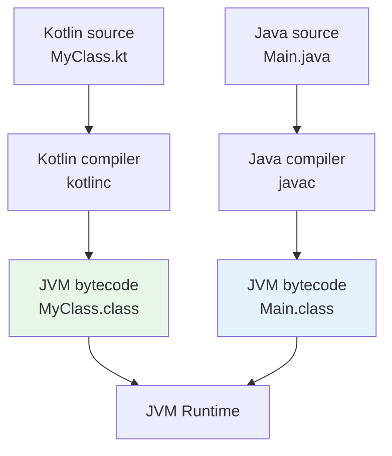
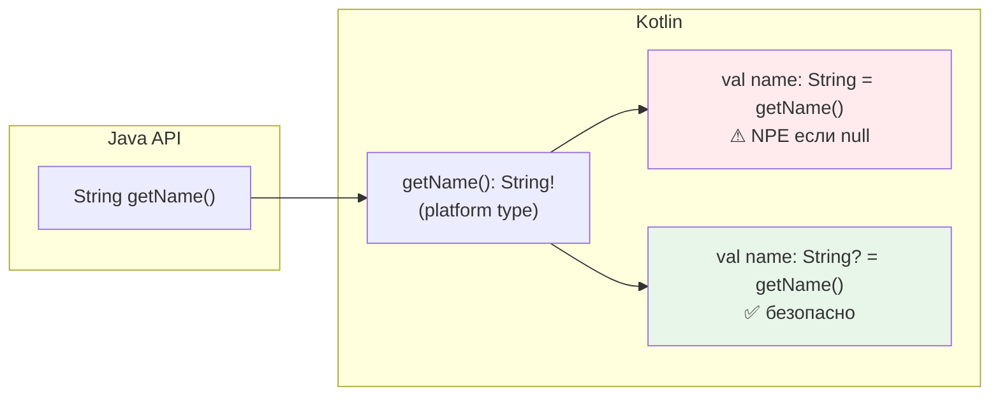
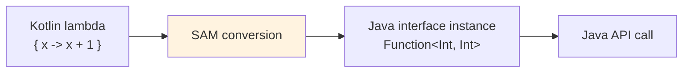
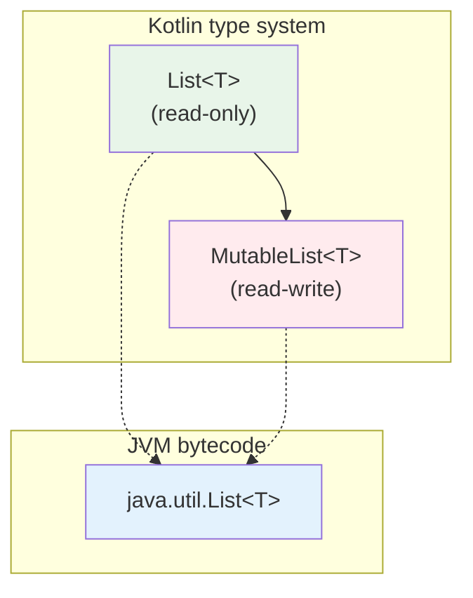
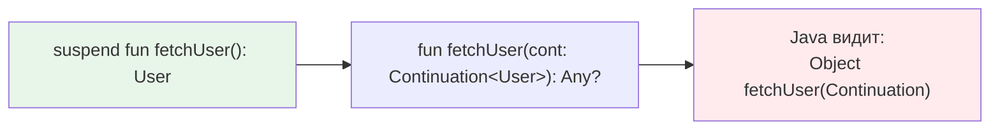
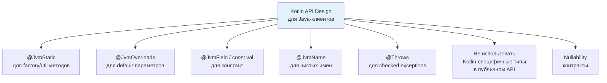

# Вопросы на собеседовании: интероп `Kotlin` и `Java`

Вопросы и ответы по взаимодействию `Kotlin` и `Java`: `platform types`, nullability-аннотации, `@JvmStatic`/`@JvmField`/`@JvmOverloads`/`@JvmName`, SAM-конверсии, коллекции, generics variance (`in`/`out` vs wildcards), `inline`-классы и вызов `suspend`-функций из `Java`.

## Введение

`Kotlin` компилируется в байткод `JVM` и полностью совместим с `Java`: можно вызывать `Java`-код из `Kotlin` и наоборот. Это одно из ключевых преимуществ `Kotlin` — возможность постепенной миграции с `Java` без переписывания всего проекта. На собеседованиях по этой теме проверяют понимание нюансов: как `Kotlin`-конструкции отображаются в байткоде, какие аннотации нужны для удобного вызова из `Java`, как работают `platform types`, generics и коллекции на границе двух языков.

## Полезные ссылки

### Официальная документация

- [Calling Java from Kotlin](https://kotlinlang.org/docs/java-interop.html) — работа с `Java`-кодом из `Kotlin`
- [Calling Kotlin from Java](https://kotlinlang.org/docs/java-to-kotlin-interop.html) — вызов `Kotlin`-кода из `Java`
- [SAM conversions](https://kotlinlang.org/docs/fun-interfaces.html) — функциональные интерфейсы и SAM-конверсии
- [Generics: in, out, where](https://kotlinlang.org/docs/generics.html) — система дженериков `Kotlin`
- [Inline value classes](https://kotlinlang.org/docs/inline-classes.html) — `value class` и `@JvmInline`

### Baeldung

- [Kotlin Java Interoperability — Baeldung](https://www.baeldung.com/kotlin/java-interoperability) — полное руководство по интеропу Kotlin и Java
- [Guide to JVM Platform Annotations in Kotlin — Baeldung](https://www.baeldung.com/kotlin/jvm-annotations) — @JvmStatic, @JvmField, @JvmOverloads и другие JVM-аннотации
- [SAM Conversions in Kotlin — Baeldung](https://www.baeldung.com/kotlin/sam-conversions) — SAM-конверсии и функциональные интерфейсы
- [A Guide to @Throws in Kotlin — Baeldung](https://www.baeldung.com/kotlin/throws-annotation) — аннотация @Throws для корректного интеропа

## Содержание

- [Введение](#введение)
- [Полезные ссылки](#полезные-ссылки)
- [See also](#see-also)

**Основы интеропа и байткод**
- [Q1. Как Java вызывает top-level функцию `f()` из файла `Utils.kt` без аннотаций?](#q1)
- [Q2. Как `@JvmStatic`, `@JvmOverloads` и `@JvmField` меняют Java-доступ к Kotlin API?](#q2)
- [Q3. Как Java получает метод и поля из Kotlin `companion object` с `@JvmStatic` и `@JvmField`?](#q3)
- [Q4. Как из `Java` вызывать функции `Kotlin` с default-параметрами?](#q4)
- [Q5. Как из `Java` вызвать extension-функцию `Kotlin`?](#q5)

**Nullability и platform types**
- [Q6. Что такое `platform types` и как с ними работать?](#q6)
- [Q7. Что меняет `-Xjsr305=strict` для nullability Java API?](#q7)
- [Q8. Как в `Kotlin` объявить API, чтобы из `Java` были видны корректные nullability-контракты?](#q8)

**Аннотации `@JvmName`, `@JvmSynthetic`, `@Throws`**
- [Q9. Для чего нужна аннотация `@JvmName` и когда её использовать?](#q9)
- [Q10. Зачем нужна аннотация `@JvmSynthetic`?](#q10)
- [Q11. Что даёт `@Throws(IOException::class)` Java-клиенту Kotlin-функции?](#q11)

**SAM-конверсии и функциональные интерфейсы**
- [Q12. Что такое SAM-conversion при интеропе `Kotlin` и `Java`?](#q12)
- [Q13. Чем отличается `fun interface` в `Kotlin` от `Java` SAM-интерфейса?](#q13)

**Generics: variance, wildcards**
- [Q14. Как связаны `out`/`in` Kotlin и `? extends`/`? super` Java?](#q14)
- [Q15. Когда нужны аннотации `@JvmSuppressWildcards` и `@JvmWildcard`?](#q15)

**Коллекции и потоки**
- [Q16. Как работает интероп коллекций между `Kotlin` и `Java`?](#q16)
- [Q17. Чем `Stream` и `Sequence` отличаются по повторному обходу и параллелизму?](#q17)

**Свойства и доступ к полям**
- [Q18. Какие Java-методы дают обычные Kotlin-свойства `val`, `var` и Boolean `isActive`?](#q18)

**Top-level функции и `object`**
- [Q19. Как Java вызывает top-level Kotlin-функцию без аннотаций и с `@file:JvmName`?](#q19)

**`inline`-классы и `Java`**
- [Q20. Как открыть Java-клиенту API с Kotlin `value class` в современных версиях?](#q20)

**Корутины и `suspend`-функции**
- [Q21. Как предоставить Java-клиенту удобный вызов Kotlin `suspend`-функции?](#q21)

**Перегрузка и разрешение методов**
- [Q22. Как Kotlin выбирает перегрузку Java-метода и что будет при `process(null)` для `String` и `Integer`?](#q22)

**Checked exceptions**
- [Q23. Как `Kotlin` работает с checked exceptions из `Java`?](#q23)

**Kotlin-специфичные конструкции из `Java`**
- [Q24. Как Java 21 разбирает Kotlin `sealed interface`, скомпилированный с JVM target 17?](#q24)
- [Q25. Как из `Java` использовать `data class` из `Kotlin`? В частности, как создать копию, изменив одно поле?](#q25)

**Смешанные проекты: best practices**
- [Q26. Какие практики делают `Kotlin` API удобным для `Java`-клиентов (fluent API без знания про `Companion`)?](#q26)
- [Q27. Как Gradle собирает смешанный Kotlin/Java модуль и нужны ли Java stubs для `javac`?](#q27)
- [Q28. Как из Kotlin прочитать `x` у Java record `Point(int x, int y)`?](#q28)
- [Q29. Куда ставить `@Column` в Kotlin JPA entity с field access через `@field:Id`?](#q29)

**Platform types, `inline`, sealed и null safety**
- [Q30. Как безопаснее читать nullable значение из неаннотированного Java API?](#q30)
- [Q31. Почему Java не может вызвать Kotlin `inline`-функцию с `reified T` и как дать замену?](#q31)
- [Q32. Как JVM target влияет на `PermittedSubclasses` у Kotlin `sealed`?](#q32)
- [Q33. Как превратить Java `Optional<String>` в Kotlin `String?` для дальнейшей обработки?](#q33)

**Lombok, companion object и generics**
- [Q34. Почему Kotlin-код в смешанном модуле может не видеть Lombok `builder()` и как исправить?](#q34)
- [Q35. Как работает `companion object` с `@JvmStatic` из `Java`? Как из Java получить `val DEFAULT_TIMEOUT = Duration.ofSeconds(30)` и `const val MAX_ITEMS = 100`?](#q35)
- [Q36. Как extension-функции `Kotlin` выглядят в байткоде? Что вернёт `Java`-вызов `AnimalExtKt.speak(new Dog())` при `fun Animal.speak() = "generic"` и `fun Dog.speak() = "woof"`?](#q36)
- [Q37. Что означает `User?` в методе Kotlin Spring Data репозитория по сравнению с `Optional<User>`?](#q37)
- [Q38. Почему Java видит `List<? extends Handler>` в Kotlin-конструкторе и как получить `List<Handler>`?](#q38)

---

<a id="q1"></a>

## Q1. Как Java вызывает top-level функцию `f()` из файла `Utils.kt` без аннотаций?

Никакого моста не нужно: `Kotlin` компилируется в тот же байткод `JVM`, что и `Java`, поэтому `Kotlin`-классы видны из `Java` как обычные классы. Вся сложность — не в вызове, а в том, что одна `Kotlin`-конструкция может превратиться в неожиданный для `Java` элемент байткода: top-level функция станет статическим методом класса-обёртки, `object` — синглтоном с полем `INSTANCE`, свойство — парой геттер/сеттер. Чтобы вызывать `Kotlin` идиоматично, надо знать эти соответствия.



| Конструкция `Kotlin` | Как выглядит из `Java` |
|---|---|
| Класс `MyClass` | Обычный класс `MyClass` |
| Top-level функции в `Utils.kt` | Статические методы `UtilsKt.funcName()` |
| `object MySingleton` | `MySingleton.INSTANCE.method()` |
| `companion object` | `MyClass.Companion.method()` |
| Свойство `val name: String` | Геттер `getName()` |
| Свойство `var count: Int` | `getCount()` + `setCount()` |
| Extension-функция | Статический метод с receiver как первый параметр |

**Ключевая мысль:** без специальных аннотаций код всё равно вызывается — просто синтаксис на стороне `Java` получается громоздким (`Companion.method()`, `INSTANCE.method()`, `getName()`). Аннотации `@JvmStatic`, `@JvmOverloads`, `@JvmField`, `@JvmName` не меняют поведение, а делают `Java`-вызовы короче и привычнее. В чисто `Kotlin`-проекте они не нужны.

<a id="q2"></a>

## Q2. Как `@JvmStatic`, `@JvmOverloads` и `@JvmField` меняют Java-доступ к Kotlin API?

Каждая из трёх аннотаций убирает один конкретный источник «уродливого» синтаксиса на стороне `Java`: лишний `Companion`, обязательную передачу всех аргументов и вызов геттера вместо чтения поля.

**`@JvmStatic`** — генерирует статический метод для функции или статический accessor для свойства в самом классе, а не во вложенном `Companion`. Без неё члены `companion object` доступны только через `MyClass.Companion.method()`:

```kotlin
class ConnectionPool {
    companion object {
        @JvmStatic
        fun create(size: Int): ConnectionPool = ConnectionPool()
    }
}
```

```java
// Без @JvmStatic:
ConnectionPool.Companion.create(10);
// С @JvmStatic:
ConnectionPool.create(10);  // идиоматичный Java-вызов
```

**`@JvmOverloads`** — для функции с default-параметрами генерирует набор перегрузок, отсекая параметры с default-значениями справа. `Java` не умеет default-значения, поэтому без этой аннотации пришлось бы всегда передавать все параметры:

```kotlin
class HttpClient {
    @JvmOverloads
    fun get(
        url: String,
        timeout: Int = 30,
        headers: Map<String, String> = emptyMap()
    ): String { /* ... */ }
}
```

```java
// Java: три перегрузки
client.get("https://api.example.com");
client.get("https://api.example.com", 60);
client.get("https://api.example.com", 60, headers);
```

**`@JvmField`** — превращает свойство в обычное публичное поле без геттера/сеттера, чтобы из `Java` к нему обращались напрямую, а не через `getX()`/`setX()`:

```kotlin
class Config {
    companion object {
        @JvmField
        val MAX_RETRIES = 3
    }
    @JvmField
    var debugMode = false
}
```

```java
int retries = Config.MAX_RETRIES;  // поле, не getMAX_RETRIES()
config.debugMode = true;           // поле, не setDebugMode()
```

> **Что подчеркнуть на собеседовании:** все три аннотации меняют только форму вызова на стороне `Java`, а не семантику кода. Они нужны исключительно когда `Kotlin`-модуль потребляется из `Java`; в чисто `Kotlin`-проекте они бессмысленны.

<a id="q3"></a>

## Q3. Как Java получает метод и поля из Kotlin `companion object` с `@JvmStatic` и `@JvmField`?

`companion object` компилируется во вложенный класс-синглтон `Companion`, поэтому по умолчанию из `Java` к его членам обращаются через `MyClass.Companion.method()`. Форма доступа меняется в зависимости от того, какой аннотацией помечен член:

```kotlin
class UserRepository {
    companion object {
        const val TABLE_NAME = "users"           // compile-time constant

        @JvmStatic
        fun findById(id: Long): User? = TODO()

        fun count(): Int = TODO()                // без @JvmStatic

        @JvmField
        val DEFAULT_PAGE_SIZE = 20
    }
}
```

```java
// const val — всегда видна как статическое поле
String table = UserRepository.TABLE_NAME;

// @JvmStatic — статический метод
User user = UserRepository.findById(42L);

// Без @JvmStatic — через Companion
int count = UserRepository.Companion.count();

// @JvmField — статическое поле
int pageSize = UserRepository.DEFAULT_PAGE_SIZE;
```

Для обычного `object` (не companion) сам синглтон доступен через статическое поле `INSTANCE`:

```java
// object MyRegistry в Kotlin:
MyRegistry.INSTANCE.getItems();
// С @JvmStatic на getItems():
MyRegistry.getItems();
```

**Когда что выбрать для константы:**

- `const val` — только для примитивов и `String`, значение подставляется по месту использования в compile-time (как `static final` в `Java`). Всегда видна из `Java` напрямую, без аннотаций.
- `@JvmField val` — работает с любым типом, но значение читается из поля в runtime. Нужна, когда тип не примитив и не `String` (например, `Set`, `Duration`).

<a id="q4"></a>

## Q4. Как из `Java` вызывать функции `Kotlin` с default-параметрами?

Коротко: либо передавайте из `Java` все аргументы, либо повесьте `@JvmOverloads`. Default-значения — это фича `Kotlin`-компилятора, в байткоде их нет: по умолчанию для `Java` доступна сигнатура со **всеми** параметрами, и `Java` обязан заполнить каждый.

`@JvmOverloads` решает это, заставляя компилятор сгенерировать дополнительные перегрузки — каждая отбрасывает крайний правый параметр:

```kotlin
@JvmOverloads
fun connect(
    host: String = "localhost",
    port: Int = 8080,
    ssl: Boolean = false
) { /* ... */ }
```

Генерируются 4 метода:

```java
connect("db.local", 5432, true);  // все параметры
connect("db.local", 5432);       // ssl = false
connect("db.local");             // port = 8080, ssl = false
connect();                       // все default
```

**Подводный камень — порядок параметров.** Перегрузки отсекают параметры только **справа**, поэтому пропустить средний из `Java` невозможно: в `Kotlin` это решают named arguments, а в `Java` их нет. Вывод для проектирования API: ставьте самые «нужные» параметры слева, а необязательные — справа в порядке убывания вероятности, что их захотят задать.

**Конструкторы** тоже поддерживают `@JvmOverloads`:

```kotlin
class HttpRequest @JvmOverloads constructor(
    val url: String,
    val method: String = "GET",
    val body: String? = null
)
```

<a id="q5"></a>

## Q5. Как из `Java` вызвать extension-функцию `Kotlin`?

Extension-функция — это не метод класса, а статический метод, у которого receiver передан первым параметром. Никакой «магии» здесь нет: `String.toSlug()` в байткоде превращается в `toSlug(String)`, и из `Java` его так и вызывают — как статический метод класса-обёртки:

```kotlin
// файл StringUtils.kt
package com.example

fun String.toSlug(): String =
    lowercase().replace(" ", "-").replace(Regex("[^a-z0-9-]"), "")
```

```java
// Java: статический вызов, receiver передаётся первым аргументом
String slug = StringUtilsKt.toSlug("Hello World!");
```

Имя класса-обёртки по умолчанию — `<FileName>Kt`. Изменить его можно аннотацией `@file:JvmName`:

```kotlin
@file:JvmName("Strings")
package com.example

fun String.toSlug(): String = /* ... */
```

```java
String slug = Strings.toSlug("Hello World!");
```

Если несколько файлов используют одно `@JvmName`, нужно добавить `@file:JvmMultifileClass` — тогда все функции объединяются в один фасадный класс.

<a id="q6"></a>

## Q6. Что такое `platform types` и как с ними работать?

**Platform type** — это тип, пришедший из `Java`, про который компилятор `Kotlin` не знает, nullable он или нет (в `Java`-сигнатуре нет аннотации nullability). Чтобы не ломать интероп ложными ошибками, `Kotlin` снимает с такого типа проверки на `null` и доверяет их разработчику. В IDE это видно по восклицательному знаку: `String!`, `List<User>!`.



Главное свойство platform type: его можно присвоить и в `String` (non-null), и в `String?` — компилятор не возражает. Если вы выбрали non-null, а значение оказалось `null`, `NullPointerException` прилетит **в момент присваивания**, а не отложенно при первом использовании, как было бы в `Java`. Это и плюс (ошибка ближе к причине), и риск (никто не предупредил).

**Рекомендации:**

1. **Явно указывайте тип** при работе с `Java`-API:
```kotlin
// Плохо — тип выведен как platform type
val name = javaObject.getName()

// Хорошо — явный non-null (бросит NPE сразу, если null)
val name: String = javaObject.getName()

// Хорошо — явный nullable (безопасно)
val name: String? = javaObject.getName()
```

2. **Используйте safe calls** при сомнениях: `javaObject.getName()?.uppercase()`

3. **Аннотируйте `Java`-код** аннотациями `@Nullable`/`@NotNull` — тогда `Kotlin`-компилятор увидит точный тип вместо platform type.

Подробнее о nullability — в [вопросах по основам Kotlin](kotlin-interview.md).

<a id="q7"></a>

## Q7. Что меняет `-Xjsr305=strict` для nullability Java API?

Эти аннотации — способ убрать platform types: если `Java`-элемент помечен `@Nullable`/`@NotNull`, `Kotlin` перестаёт «угадывать» и видит точный тип (`String?` или `String`) с полным контролем `null`. Компилятор понимает аннотации из множества библиотек:

| Библиотека | Аннотации |
|---|---|
| JetBrains | `org.jetbrains.annotations.@Nullable`, `@NotNull` |
| JSR-305 | `javax.annotation.@Nullable`, `@Nonnull` |
| Android | `androidx.annotation.@Nullable`, `@NonNull` |
| Spring | `org.springframework.lang.@Nullable`, `@NonNull` |
| Eclipse | `org.eclipse.jdt.annotation.@Nullable`, `@NonNull` |
| Lombok | `lombok.@NonNull` |

**Из `Java` в `Kotlin`:**

```java
// Java
public class UserService {
    @NotNull
    public String getName() { return "Alice"; }

    @Nullable
    public String getMiddleName() { return null; }

    public String getNickname() { return "bob"; } // без аннотации
}
```

```kotlin
// Kotlin
val name: String = userService.name           // OK, компилятор знает — non-null
val middle: String? = userService.middleName  // OK, компилятор знает — nullable
val nick = userService.nickname               // String! — platform type
```

**Из `Kotlin` в `Java`:** обратное направление работает автоматически — компилятор `Kotlin` сам проставляет `@NotNull`/`@Nullable` в байткод для всех параметров и возвращаемых типов. Поэтому `Java`-IDE (IntelliJ, Eclipse) подсвечивают передачу `null` в `Kotlin`-метод с non-null параметром ещё до запуска.

**Строгий режим (`-Xjsr305=strict`):** флаг управляет только тем, насколько строго компилятор реагирует на JSR-305-аннотации — включая default-квалификаторы вроде `@ParametersAreNonnullByDefault`, которые задают nullability сразу для всего пакета/класса. По умолчанию нарушение таких контрактов — warning, в strict-режиме — ошибка компиляции. Важный нюанс: типы вообще без аннотаций флаг не трогает — они как были, так и остаются platform types.

<a id="q8"></a>

## Q8. Как в `Kotlin` объявить API, чтобы из `Java` были видны корректные nullability-контракты?

Хорошая новость: специально делать почти ничего не нужно — `Kotlin`-компилятор сам кодирует контракт nullability в байткоде из обычных типов `Kotlin`:

- Параметр `name: String` → `@NotNull String name` в байткоде
- Параметр `name: String?` → `@Nullable String name` в байткоде
- Возвращаемый тип `String` → `@NotNull String` + runtime-проверка

Контракт не только декларативный, но и защищён в runtime: если `Java`-код передаст `null` в non-null параметр, `Kotlin` выбросит `NullPointerException` **прямо на входе в метод**, а не отложенно при первом разыменовании (до Kotlin 1.4 бросался `IllegalArgumentException`). Эту проверку компилятор вставляет автоматически.

```kotlin
// Kotlin
fun process(name: String): String = name.uppercase()
```

```java
// Java — при вызове process(null) немедленно выбросит:
// NullPointerException: Parameter specified as non-null is null
UserKt.process(null);
```

**Рекомендация:** для публичных `Kotlin`-библиотек контракт nullability всё равно стоит документировать словами — старые или нестандартные `Java`-IDE могут не показать предупреждение по байткодной аннотации, и `Java`-клиент узнает о non-null только в виде падения в runtime.

<a id="q9"></a>

## Q9. Для чего нужна аннотация `@JvmName` и когда её использовать?

`@JvmName` переопределяет имя, под которым элемент попадает в байткод (а значит — видится из `Java`), не меняя его имени в `Kotlin`. Применяется в четырёх типовых ситуациях: дать читаемое имя классу-обёртке, развести конфликт после type erasure, поправить имя геттера и собрать функции из разных файлов в один класс.

**1. Переименование файлового класса** — для top-level функций (по умолчанию был бы `DatesKt`):

```kotlin
@file:JvmName("Dates")
package com.example

fun parseDate(s: String): LocalDate = /* ... */
```

```java
LocalDate d = Dates.parseDate("2026-01-01"); // вместо DatesKt
```

**2. Разрешение конфликтов** — type erasure стирает дженерик-параметры, и `filter(List<String>)` и `filter(List<Int>)` превращаются в одинаковую сигнатуру `filter(List)`. `@JvmName` даёт им разные имена в байткоде:

```kotlin
// Ошибка компиляции без @JvmName: обе функции → filterStrings(List) в байткоде
@JvmName("filterStrings")
fun filter(list: List<String>): List<String> = /* ... */

@JvmName("filterInts")
fun filter(list: List<Int>): List<Int> = /* ... */
```

**3. Переименование геттеров/сеттеров** — например, чтобы `Boolean`-свойство c `is`-префиксом не получило двойное `isIsActive()`:

```kotlin
val isActive: Boolean
    @JvmName("isActive") get() = /* ... */
    // без аннотации геттер был бы getActive() из-за is-convention
```

**4. `@file:JvmMultifileClass`** — объединение top-level функций из разных файлов в один `Java`-класс:

```kotlin
// file1.kt
@file:JvmName("Utils")
@file:JvmMultifileClass

fun foo() {}

// file2.kt
@file:JvmName("Utils")
@file:JvmMultifileClass

fun bar() {}
```

```java
Utils.foo(); // оба метода в одном классе
Utils.bar();
```

<a id="q10"></a>

## Q10. Зачем нужна аннотация `@JvmSynthetic`?

`@JvmSynthetic` помечает элемент (метод, свойство, поле) флагом `synthetic` в байткоде, и `Java`-компилятор перестаёт его видеть — будто элемента нет. Из `Kotlin` он при этом доступен как обычно. Смысл — спрятать от `Java` то, что без `Kotlin`-синтаксиса всё равно бесполезно или опасно.

Основные случаи использования:

1. **Скрытие служебных API** — когда функция имеет смысл только для `Kotlin`-потребителей:

```kotlin
class KotlinDsl {
    @JvmSynthetic
    internal fun configure(block: Config.() -> Unit) { /* ... */ }
}
```

2. **DSL-builders** — чтобы `Java`-разработчики не видели extension-функции и лямбда-ориентированные методы, которые не имеют смысла без `Kotlin`-синтаксиса.

3. **Предотвращение случайного использования** служебных методов, сгенерированных для `inline`-классов или `operator`-функций.

> **Чем отличается от `internal`:** модификатор `internal` компилируется в `public` с искажённым именем (name-mangling) — то есть элемент технически доступен из `Java`, просто с уродливым именем. `@JvmSynthetic` скрывает элемент от обычного вызова в Java-исходнике; в байткоде он остаётся и может быть виден через reflection.

<a id="q11"></a>

## Q11. Что даёт `@Throws(IOException::class)` Java-клиенту Kotlin-функции?

`@Throws` нужна, чтобы добавить `throws` в сигнатуру `Kotlin`-метода в байткоде. Причина: в `Kotlin` все исключения unchecked, поэтому компилятор не пишет `throws` сам. Но `Java`-компилятор считает `catch (IOException e)` ошибкой, если в сигнатуре нет соответствующего `throws` — он не верит, что метод вообще может бросить `IOException`. Без `@Throws` `Java`-клиент не сможет точечно поймать checked-исключение из `Kotlin`-кода.

```kotlin
@Throws(IOException::class)
fun readConfig(path: String): Config {
    val file = File(path)
    if (!file.exists()) throw IOException("File not found: $path")
    return parseConfig(file.readText())
}
```

```java
// Java: теперь можно (и нужно) обработать IOException
try {
    Config config = ConfigKt.readConfig("/etc/app.conf");
} catch (IOException e) {
    log.error("Failed to read config", e);
}
```

Без `@Throws` `Java`-код может только ловить `Exception` или `Throwable`, что менее точно. Подробнее об обработке ошибок — в [вопросах по исключениям Kotlin](kotlin-exceptions-interview.md).

<a id="q12"></a>

## Q12. Что такое SAM-conversion при интеропе `Kotlin` и `Java`?

**SAM-conversion** (Single Abstract Method) — автоматическое превращение лямбды `Kotlin` в реализацию `Java`-интерфейса с ровно одним абстрактным методом (`Runnable`, `Comparator`, `Callable`, `Consumer` и т.д.). Благодаря ему не нужно писать `object : Runnable { override fun run() ... }` — достаточно лямбды, а компилятор сам обернёт её в анонимную реализацию интерфейса.

```kotlin
// Вместо анонимного объекта:
executor.submit(object : Runnable {
    override fun run() {
        println("Running")
    }
})

// SAM-conversion — лямбда:
executor.submit { println("Running") }

// Ещё примеры:
list.sortWith(Comparator { a, b -> a.length - b.length })
button.setOnClickListener { view -> handleClick(view) }
```



**Важные нюансы:**

1. Исторически SAM-conversion работал только для **`Java`-интерфейсов**. Для `Kotlin`-интерфейса (до `Kotlin` 1.4) лямбду подставить было нельзя — приходилось писать `object : Interface { }`.

2. С `Kotlin` 1.4 SAM-conversion работает и для `Kotlin`-интерфейса, но только если тот объявлен как `fun interface` (см. Q13).

3. Если перегрузки неоднозначны (несколько SAM-типов подходят), укажите тип явно, обернув лямбду в имя интерфейса:
```kotlin
// Явный SAM-тип при неоднозначности
executor.submit(Runnable { println("task") })
```

4. **Подводный камень:** два отдельно записанных лямбда-выражения не гарантируют одну и ту же ссылку на SAM-объект. Для `addListener`/`removeListener` сохраните переданный экземпляр и используйте его повторно. Не делайте вывод о числе аллокаций без проверки конкретной реализации.

<a id="q13"></a>

## Q13. Чем отличается `fun interface` в `Kotlin` от `Java` SAM-интерфейса?

`fun interface` — это `Kotlin`-способ явно объявить SAM-интерфейс (один абстрактный метод), для которого разрешена SAM-conversion. Появился в `Kotlin` 1.4. Ключевое отличие от `Java`: там любой интерфейс с одним методом автоматически считается функциональным, а в `Kotlin` это надо включить вручную словом `fun`:

```kotlin
// Kotlin: fun interface
fun interface Transformer<T, R> {
    fun transform(input: T): R
}

// SAM-conversion работает:
val upper: Transformer<String, String> = Transformer { it.uppercase() }
```

| Аспект | `Java` SAM-интерфейс | `Kotlin` `fun interface` |
|---|---|---|
| SAM-conversion из `Kotlin` | Да (всегда) | Да (с `Kotlin` 1.4) |
| SAM-conversion из `Java` | Да (через лямбду `Java`) | Да |
| Обычный `interface` без `fun` | N/A | SAM-conversion **не** работает |
| Несколько абстрактных методов | N/A — не SAM | Ошибка компиляции при `fun` |

**Типичная ошибка:** объявить обычный `Kotlin interface` с одним методом и ожидать SAM-conversion — без ключевого слова `fun` это не работает, нужно создавать `object : Interface { }`.

<a id="q14"></a>

## Q14. Как связаны `out`/`in` Kotlin и `? extends`/`? super` Java?

`out T` разрешает отдавать `T` (producer), а `in T` — принимать `T` (consumer). По смыслу это соответствует Java `? extends T` и `? super T`. Kotlin задаёт вариантность при объявлении типа и поддерживает проекции в месте использования; Java wildcard указывает в месте использования.

Это соответствие описывает безопасность типов, а не обещает буквальный wildcard в каждой JVM-сигнатуре. Компилятор учитывает позицию типа и может убрать избыточный wildcard для конкретного `final`-типа. Для Java API проверяйте сгенерированную сигнатуру, особенно если её читает DI или reflection. `@JvmSuppressWildcards` и `@JvmWildcard` управляют этим представлением (Q15).

<a id="q15"></a>

## Q15. Когда нужны аннотации `@JvmSuppressWildcards` и `@JvmWildcard`?

Поскольку у `Java` нет declaration-site variance, `Kotlin`-компилятору приходится переводить свои `out T`/`in T` в `Java`-сигнатурах через wildcards (`? extends T` / `? super T`). Важно: автоматически это происходит только **в позициях параметров** — в return-типах wildcards по умолчанию не генерируются (чтобы не заставлять `Java`-клиентов с ними возиться). Обычно перевод правильный, но иногда лишний wildcard ломает код, который ожидает точный тип. Эти две аннотации дают ручное управление переводом.

**`@JvmSuppressWildcards`** — убирает автоматический wildcard, оставляя точный тип:

```kotlin
// Kotlin: обработчики приходят параметром конструктора
class Dispatcher(private val handlers: List<Handler>) { /* ... */ }

// Java видит конструктор: Dispatcher(List<? extends Handler> handlers) — лишний wildcard
// С аннотацией:
class Dispatcher(private val handlers: List<@JvmSuppressWildcards Handler>) { /* ... */ }
// Java видит: Dispatcher(List<Handler> handlers) — точный тип
```

Когда это спасает:
- DI-фреймворки (Dagger, Guice) сопоставляют типы буквально и не видят `List<? extends Foo>` как `List<Foo>` — инъекция падает
- `suspend`-функции: их результат уезжает в скрытый параметр `Continuation`, поэтому wildcard появляется даже у «return-типа» — отсюда привычный `@JvmSuppressWildcards` на возвратах `suspend`-методов в Retrofit
- библиотечные API, где один wildcard тянет за собой каскад wildcards по всему `Java`-коду клиента

**`@JvmWildcard`** — обратная аннотация: добавляет wildcard там, где `Kotlin` по умолчанию его не ставит:

```kotlin
fun process(items: List<@JvmWildcard String>) { /* ... */ }
// Java видит: void process(List<? extends String> items)
```

Используется реже — в основном для совместимости с `Java`-API, ожидающими wildcard-типы.

<a id="q16"></a>

## Q16. Как работает интероп коллекций между `Kotlin` и `Java`?

Суть в одном факте: разделение на read-only и mutable существует только в системе типов `Kotlin` на этапе компиляции, а в байткоде остаётся один и тот же `java.util.List`. `Kotlin` даёт два интерфейса — read-only (`List`, `Set`, `Map`) без мутирующих методов и `Mutable*` с ними, — но оба отображаются на одни и те же `Java`-классы. Из-за этого граница между языками теряет информацию о мутабельности, и отсюда растут все подводные камни ниже.



**Из `Java` в `Kotlin`:**

- `java.util.List` → `(Mutable)List<T!>!` — platform type, `Kotlin` не знает, mutable она или нет
- Разработчик сам решает: принять как `List<String>` (read-only) или `MutableList<String>`
- Если принять изменяемую Java-коллекцию как `List`, другая ссылка всё ещё может изменить её содержимое

**Из `Kotlin` в `Java`:**

- `listOf(1, 2, 3)` возвращает read-only API, но из `Java` это `java.util.List`; результат мутации зависит от конкретной реализации, неизменяемость этим типом не гарантируется
- `mutableListOf(1, 2, 3)` — из `Java` мутация работает нормально

```kotlin
// Kotlin
fun getNames(): List<String> = listOf("Alice", "Bob")
fun getMutableNames(): MutableList<String> = mutableListOf("Alice", "Bob")
```

```java
// Java
List<String> names = MyKt.getNames();
names.add("Charlie");        // UnsupportedOperationException!

List<String> mutable = MyKt.getMutableNames();
mutable.add("Charlie");      // OK
```

> **Частая ошибка на собеседованиях:** считать, что `Kotlin` read-only коллекции immutable. Они не immutable — просто интерфейс не содержит мутирующих методов. Под капотом может быть `MutableList`, и `Java`-код может его мутировать. Подробнее — в [вопросах по коллекциям Kotlin](kotlin-collections-interview.md).

<a id="q17"></a>

## Q17. Чем `Stream` и `Sequence` отличаются по повторному обходу и параллелизму?

Обе дают ленивую (отложенную) обработку цепочки операций, но создавались под разные приоритеты: `Java Streams` делает ставку на встроенный параллелизм, а `Kotlin Sequences` — на ленивые цепочки и единый API с коллекциями. Отличия в деталях:

| Аспект | `Java Streams` | `Kotlin Sequences` |
|---|---|---|
| Повторное использование | Нет (повторное использование не гарантируется) | Обычно да; отдельные Sequence ограничены одним проходом |
| Параллелизм | `parallelStream()` из коробки | Нет встроенного параллелизма |
| API | `filter`, `map`, `reduce`, `collect` | `filter`, `map`, `fold`, `toList` |
| Null-элементы | Допускает (но не рекомендует) | Допускает |
| Интеграция с коллекциями | `stream()` / `collect(Collectors...)` | `asSequence()` / `toList()` |
| Примитивные специализации | `IntStream`, `LongStream`, `DoubleStream` | Нет (автобоксинг) |

```kotlin
// Kotlin Sequence
val result = listOf(1, 2, 3, 4, 5)
    .asSequence()
    .filter { it > 2 }
    .map { it * it }
    .toList()

// Java Stream из Kotlin
val result2 = listOf(1, 2, 3, 4, 5)
    .stream()
    .filter { it > 2 }
    .map { it * it }
    .collect(Collectors.toList())
```

**Когда использовать что:**
- В чисто `Kotlin`-коде: `Sequence` — идиоматичен для ленивой обработки; возможность повторного обхода зависит от источника
- Параллельная обработка больших данных: `Java Streams` с `parallelStream()`
- Взаимодействие с `Java`-API, ожидающим `Stream`: `collection.stream()`
- `Kotlin`-коллекции уже имеют `filter`/`map`/`flatMap` напрямую (eager) — `Sequence` нужна только для больших коллекций или цепочек операций

<a id="q18"></a>

## Q18. Какие Java-методы дают обычные Kotlin-свойства `val`, `var` и Boolean `isActive`?

Из `Java` `Kotlin`-свойство выглядит не как поле, а как пара методов: приватное backing-поле плюс геттер `getX()` и (для `var`) сеттер `setX()`. Особый случай — `Boolean`-свойства с префиксом `is`: для них геттер называется не `getIsActive()`, а `isActive()`, что часто удивляет на собеседовании.

```kotlin
class User {
    val name: String = "Alice"        // val → getName()
    var age: Int = 30                 // var → getAge() + setAge()
    val isActive: Boolean = true      // Boolean is-property → isActive()
    var isVerified: Boolean = false   // Boolean is-property → isVerified() + setVerified()
}
```

```java
User u = new User();
u.getName();          // "Alice"
u.getAge();           // 30
u.setAge(31);
u.isActive();         // true — не getIsActive()!
u.isVerified();       // false до вызова setVerified(true)
u.setVerified(true);  // не setIsVerified()!
```

**Модификаторы и аннотации, влияющие на видимость:**

| Аннотация / модификатор | Эффект в `Java` |
|---|---|
| `@JvmField` | Публичное поле, без геттера/сеттера |
| `const val` (companion) | `static final` поле, compile-time constant |
| `private` | Приватное поле, без геттера/сеттера |
| `internal` | `public` с name-mangling (непредсказуемое имя) |
| `lateinit var` | Публичное поле (без `@JvmField`) + геттер/сеттер |

> **Нюанс с `lateinit`:** из `Java` видно поле напрямую (`user.name`), т.к. `lateinit` генерирует публичное поле. Если поле не инициализировано, при доступе из `Java` будет `null` (без `Kotlin`-проверки `UninitializedPropertyAccessException`).

<a id="q19"></a>

## Q19. Как Java вызывает top-level Kotlin-функцию без аннотаций и с `@file:JvmName`?

У `JVM` нет «функций вне класса», поэтому `Kotlin` для каждого файла создаёт класс-обёртку и складывает туда все top-level функции и свойства как статические члены. Имя класса по умолчанию — имя файла плюс суффикс `Kt` (`MathUtils.kt` → `MathUtilsKt`). Свойства превращаются в статические геттеры:

```kotlin
// файл MathUtils.kt
package com.example

fun factorial(n: Int): Long = if (n <= 1) 1 else n * factorial(n - 1)

val PI_APPROX = 3.14159
```

```java
// Java
long f = MathUtilsKt.factorial(5);     // 120
double pi = MathUtilsKt.getPI_APPROX(); // 3.14159
```

Управление именем класса:

```kotlin
@file:JvmName("MathUtils")   // MathUtils.factorial()
```

Объединение из нескольких файлов:

```kotlin
// algebra.kt
@file:JvmName("MathUtils")
@file:JvmMultifileClass
fun gcd(a: Int, b: Int): Int = /* ... */

// geometry.kt
@file:JvmName("MathUtils")
@file:JvmMultifileClass
fun areaOfCircle(r: Double): Double = /* ... */
```

```java
// Один фасадный класс
MathUtils.gcd(12, 8);
MathUtils.areaOfCircle(5.0);
```

<a id="q20"></a>

## Q20. Как открыть Java-клиенту API с Kotlin `value class` в современных версиях?

`@JvmInline value class` обычно передаётся на JVM как underlying-тип. Функции с таким параметром получают mangled-имя, чтобы не столкнуться с перегрузкой, принимающей underlying-тип. Поэтому обычный Java-исходник не получает привычный конструктор и метод с простым именем автоматически.

Для Java API есть три осознанных пути: объявить фасад с обычным `Long`/`String`, дать unboxed-методу читаемое имя через `@JvmName` или в Kotlin 2.2+ использовать экспериментальную `@JvmExposeBoxed` с opt-in. Последняя генерирует публичный boxed-конструктор и boxed-вариант помеченной функции; аналогичный эффект для модуля даёт `-Xjvm-expose-boxed`.

```kotlin
@JvmInline value class UserId(val value: Long)
fun findUserById(id: Long): User? = findUser(UserId(id))
```

Боксинг возможен и без этих аннотаций, например для nullable, generic или интерфейсной позиции, но это не делает весь API автоматически удобным из Java. Выбирайте Java-представление явно и проверяйте сгенерированную сигнатуру.

<a id="q21"></a>

## Q21. Как предоставить Java-клиенту удобный вызов Kotlin `suspend`-функции?

Напрямую — почти никак: правильный ответ в том, что из `Java` нужно вызывать не саму `suspend`-функцию, а её адаптер. Под капотом `suspend fun foo(): User` компилируется в `Object foo(Continuation<User>)` — компилятор добавляет скрытый параметр `Continuation` (механизм CPS, Continuation Passing Style) и меняет тип возврата на `Object`. Чтобы вызвать такой метод из `Java`, пришлось бы вручную реализовать `Continuation` и разобраться с маркером `COROUTINE_SUSPENDED` — на практике так не делают.



**Способы вызова из `Java`:**

**1. Обёртка с `CompletableFuture`** (если Java API ожидает future):

Для `future` нужен модуль `kotlinx-coroutines-jdk8`; `scope` предоставляет код, который управляет жизненным циклом операции.

```kotlin
// Kotlin: suspend-функция
suspend fun fetchUser(id: Long): User = /* ... */

// Адаптер для Java
fun fetchUserAsync(id: Long, scope: CoroutineScope): CompletableFuture<User> =
    scope.future { fetchUser(id) }  // scope имеет явный жизненный цикл
```

```java
// Java
// scope передан вызывающему коду владельцем жизненного цикла корутин
CompletableFuture<User> future = UserServiceKt.fetchUserAsync(42L, scope);
User user = future.get();
```

**2. Обёртка с `runBlocking`** (блокирует поток; допустима лишь при явно синхронном контракте):

```kotlin
fun fetchUserBlocking(id: Long): User = runBlocking {
    fetchUser(id)
}
```

**3. Reactor / RxJava адаптеры** (для реактивных проектов):

```kotlin
// kotlinx-coroutines-reactor
fun fetchUserMono(id: Long): Mono<User> = mono {
    fetchUser(id)
}
```

> **Рекомендация:** держать `suspend`-функции внутри `Kotlin`-слоя, а для `Java`-потребителей публиковать адаптеры: `CompletableFuture`, `Mono` или синхронные обёртки. Подробнее — в [вопросах по корутинам Kotlin](kotlin-coroutines-interview.md).

<a id="q22"></a>

## Q22. Как Kotlin выбирает перегрузку Java-метода и что будет при `process(null)` для `String` и `Integer`?

Kotlin вызывает перегруженные Java-методы по статическим типам аргументов. Если Java объявляет `process(String)` и `process(Integer)`, литерал `null` подходит обоим несвязанным ссылочным типам, поэтому `process(null)` неоднозначен. Выбор можно задать типом выражения, например `process(null as String?)`.

Иная ситуация с `process(String)` и `process(Object)`: `String` специфичнее `Object`, так что один только nullable-тип не создаёт неоднозначность. Не советуйте безусловный `as String` для значения, которое может быть `null`: такое приведение само может упасть.

<a id="q23"></a>

## Q23. Как `Kotlin` работает с checked exceptions из `Java`?

`Kotlin` игнорирует checked-контракт `Java`: в нём все исключения unchecked, поэтому при вызове `Java`-метода с `throws IOException` компилятор не требует ни `try-catch`, ни объявления `throws` — но поймать исключение, разумеется, по-прежнему можно, если нужно:

```java
// Java
public class FileReader {
    public String read(String path) throws IOException { /* ... */ }
}
```

```kotlin
// Kotlin — IOException не обязательно ловить
val content = fileReader.read("/tmp/data.txt") // OK, компилируется

// Но можно:
try {
    val content = fileReader.read("/tmp/data.txt")
} catch (e: IOException) {
    logger.error("Failed to read", e)
}
```

**В обратную сторону**: `Kotlin`-функции по умолчанию не объявляют `throws` в байткоде. Чтобы `Java`-код мог ловить конкретные checked exceptions, используйте `@Throws` (см. Q11).

Подробнее об обработке ошибок — в [вопросах по исключениям Kotlin](kotlin-exceptions-interview.md).

<a id="q24"></a>

## Q24. Как Java 21 разбирает Kotlin `sealed interface`, скомпилированный с JVM target 17?

Представление Kotlin `sealed` зависит от целевой JVM. При JVM target 17 Kotlin 2.4.10 записывает в class file `PermittedSubclasses`; Java 21 видит закрытую иерархию. В локальной проверке `javac --release 21` собрал `switch` по всем двум наследникам без `default`.

```kotlin
sealed interface Result {
    data class Success(val value: String) : Result
    data class Failure(val message: String) : Result
}
```

```java
String text = switch (result) {
    case Result.Success s -> s.getValue();
    case Result.Failure f -> f.getMessage();
};
```

При более старой целевой JVM Java sealed-атрибут не представлен; это не означает, что Kotlin теряет собственную проверку `when`. Для Java pattern switch без preview ориентируйтесь на Java 21. Проверяйте сочетание версии Kotlin, `jvmTarget` и версии `javac` перед обещанием exhaustive `switch`.

<a id="q25"></a>

## Q25. Как из `Java` использовать `data class` из `Kotlin`? В частности, как создать копию, изменив одно поле?

`data class` — это обычный `Java`-класс, в котором компилятор за вас сгенерировал геттеры, `equals`/`hashCode`/`toString`, `copy()` и `componentN()`. Все они доступны из `Java`, но с одной оговоркой по `copy()` (см. ниже):

```kotlin
data class User(val name: String, val age: Int)
```

```java
// Java: доступны все сгенерированные методы
User user = new User("Alice", 30);
user.getName();           // геттер
user.getAge();
user.component1();        // "Alice" — для destructuring
user.component2();        // 30
user.copy("Bob", 30);     // копия с изменённым name
user.toString();          // "User(name=Alice, age=30)"
user.hashCode();
user.equals(other);
```

**Подводный камень с `copy()`:** удобство `copy(age = 31)` — это named/default-параметры `Kotlin`, которых в `Java` нет. А `@JvmOverloads` к сгенерированному `copy()` повесить нельзя, поэтому из `Java` приходится передавать **все** поля вручную, повторяя неизменяемые значения:

```java
// Java: нужно передать все параметры
User updated = user.copy("Bob", user.getAge()); // нельзя пропустить age
```

Чтобы упростить, можно добавить builder-паттерн или фабричные методы вручную для `Java`-потребителей.

<a id="q26"></a>

## Q26. Какие практики делают `Kotlin` API удобным для `Java`-клиентов (fluent API без знания про `Companion`)?

Главный принцип — «Kotlin inside, Java-friendly edge»: внутри модуля пишите идиоматичный `Kotlin`, а на публичной границе адаптируйте API под `Java`. Конкретные правила сводятся к тому, чтобы расставить JVM-аннотации и не протаскивать наружу `Kotlin`-специфичные конструкции, недоступные из `Java`:



**Чек-лист для `Java`-friendly API:**

1. **`@JvmStatic`** на factory-методах и утилитах в `companion object`
2. **`@JvmOverloads`** на функциях и конструкторах с default-параметрами
3. **`@JvmField`** или `const val` для констант
4. **`@JvmName`** для осмысленных имён файловых классов и разрешения конфликтов
5. **`@Throws`** для функций, бросающих checked exceptions
6. **Избегать `inline`/`reified` в публичном API** — они недоступны из `Java`
7. **Избегать `value class` без `Java`-адаптеров** — name mangling делает вызов невозможным
8. **Не использовать `Kotlin`-специфичные типы** (`Unit`, `Nothing`, `Pair`, `Result`) в публичных сигнатурах — лучше `void`, стандартные `Java`-типы
9. **Документировать nullability** — даже если `Kotlin`-компилятор добавляет аннотации автоматически
10. **Принцип "Kotlin inside, Java-friendly edge"** — внутри модуля писать идиоматичный `Kotlin`, на границе — адаптировать для `Java`

<a id="q27"></a>

## Q27. Как Gradle собирает смешанный Kotlin/Java модуль и нужны ли Java stubs для `javac`?

В обычном смешанном JVM-модуле есть отдельные задачи `compileKotlin` и `compileJava`. Kotlin-компилятор может анализировать Java-исходники того же source set; Java-компилятор затем получает уже созданные Kotlin `.class`-файлы. Специальные Java stubs Kotlin-классов для `javac` не нужны. Не путайте это со stubs, которые `kapt` создаёт для Java annotation processors над Kotlin-кодом.

Размещайте Java-исходники в `src/main/java`, Kotlin-исходники в `src/main/kotlin` и согласуйте JVM target связанных задач. Kotlin Gradle plugin проверяет несовпадение их целевых версий. Если включён JPMS, для доступа `javac` к Kotlin output может понадобиться описанный в документации `--patch-module`.

<a id="q28"></a>

## Q28. Как из Kotlin прочитать `x` у Java record `Point(int x, int y)`?

Два направления, и оба простые. `Java record` (с `Java 16`) — компактный неизменяемый DTO; из `Kotlin` он используется напрямую, с одной особенностью: accessor-методы записи идут без `get`-префикса (`point.x()`, а не `getX()`). В обратную сторону аннотация `@JvmRecord` заставляет `Kotlin`-`data class` скомпилироваться в настоящий `Java record`, чтобы `Java`-клиенты видели именно record (важно для pattern matching и некоторых библиотек).

**Вызов Java `record` из Kotlin:**

```kotlin
// Java record
public record Point(int x, int y) {}

// Kotlin — доступ через accessor-методы без get-префикса (особенность records)
val point = Point(10, 20)
println(point.x)    // 10 — Kotlin property-синтаксис вызывает x()
println(point.y)    // 20
println(point)      // Point[x=10, y=20] — toString из record
```

**Создание `@JvmRecord` в Kotlin:**

```kotlin
@JvmRecord
data class Coordinates(val latitude: Double, val longitude: Double)

// Компилируется в Java record:
// record Coordinates(double latitude, double longitude) {}

// Из Java:
// Coordinates c = new Coordinates(55.7, 37.6);
// c.latitude()    // accessor без get-префикса
// c.longitude()
```

**Ограничения `@JvmRecord`:**
- Требует JVM target 16+
- Класс должен быть `data class`
- Не может быть `open`, `abstract`, `sealed`
- Все свойства только в primary constructor, только `val`

```kotlin
// build.gradle.kts
kotlin {
    jvmToolchain(17)
}

// Kotlin data class (без @JvmRecord) — не record, геттеры с get-префиксом
data class PlainUserDto(val name: String)  // Java видит: getName()

// С @JvmRecord — настоящий record
@JvmRecord
data class RecordUserDto(val name: String)  // Java видит: name()
```

**Когда использовать `@JvmRecord`:**
- Публичный API, используемый из `Java`-кода, который ожидает `record` (паттерн-матчинг Java 21+)
- Интеграция с фреймворками, работающими специфично с `record` (некоторые JSON-библиотеки)
- В чисто Kotlin-проектах предпочтителен обычный `data class`

<a id="q29"></a>

## Q29. Куда ставить `@Column` в Kotlin JPA entity с field access через `@field:Id`?

JPA/Hibernate выбирает default access по месту `@Id`: `@field:Id` задаёт field access, а `@get:Id` — property access через геттер. Для field access размещайте `@Column` на backing field явно: `@field:Column`. При property access нужна аннотация на геттере.

```kotlin
@Entity
class ProductEntity(
    @field:Id val id: Long,
    @field:Column(name = "product_name") val name: String,
)
```

Kotlin-свойство может соответствовать полю, геттеру и параметру конструктора. Use-site target фиксирует нужный JVM-элемент и не зависит от изменяемых правил выбора target по умолчанию. Конструктор entity и ограничения JPA требуют отдельной настройки; сам `@field:Column` их не решает.

<a id="q30"></a>

## Q30. Как безопаснее читать nullable значение из неаннотированного Java API?

Platform types (`T!`) опасны тем, что отключают главную защиту `Kotlin` — гарантии null-safety — и делают это молча. Для platform type компилятор разрешает и non-null, и nullable присваивание, ничего не подсвечивая, так что весь контроль `null` ложится на разработчика. В смешанных `Kotlin`/`Java` проектах это становится главным источником `NullPointerException`: код выглядит «безопасным по-котлиновски», но на деле проверок нет.

**Типичные ловушки:**

```kotlin
// Java API без аннотаций nullability
val service: UserService = getUserService() // UserService! — platform type

// Опасно: переменная выведена как platform type
val name = service.getName() // String! — если null → NPE при использовании

// Опасно: platform type в цепочке вызовов
val upper = service.getName().uppercase() // NPE если getName() == null

// Безопасно: явное присваивание nullable
val name: String? = service.getName()
val upper = name?.uppercase() ?: "UNKNOWN"
```

**Как избежать:**

| Стратегия | Как применять |
|-----------|---------------|
| **Явные типы** | Всегда указывать тип при получении значения из Java API |
| **Аннотировать Java-код** | Добавить `@NotNull`/`@Nullable` в Java-источник |
| **JSR-305 strict mode** | `-Xjsr305=strict` в kotlinc — нарушения JSR-305-аннотаций (включая default-квалификаторы вроде `@ParametersAreNonnullByDefault`) становятся ошибками компиляции, а не warnings. Типы без аннотаций остаются platform types |
| **Defensive programming** | `requireNotNull()`, `checkNotNull()` на границе Java/Kotlin |
| **Обёртки** | Создавать Kotlin-обёртки над Java API с явными nullability-контрактами |

```kotlin
// -Xjsr305=strict в build.gradle.kts
tasks.withType<KotlinCompile> {
    kotlinOptions {
        freeCompilerArgs = listOf("-Xjsr305=strict")
    }
}

// Теперь нарушения JSR-305-контрактов — ошибки компиляции, а не warnings.
// Если пакет помечен @ParametersAreNonnullByDefault, передача null станет ошибкой.
// Но типы без аннотаций по-прежнему platform types:
val name = service.getName() // String! — как и без флага
```

**Рекомендация для фасадного слоя:**

```kotlin
// Kotlin-обёртка над Java API с явными контрактами
class UserServiceAdapter(private val javaService: JavaUserService) {
    fun getName(id: Long): String = // явно non-null
        requireNotNull(javaService.getName(id)) { "Name cannot be null for id=$id" }

    fun getMiddleName(id: Long): String? = // явно nullable
        javaService.getMiddleName(id)
}
```

<a id="q31"></a>

## Q31. Почему Java не может вызвать Kotlin `inline`-функцию с `reified T` и как дать замену?

Обычная `inline`-функция может оставить вызываемый JVM-метод, но Java-вызов не получает инлайнинг. `reified T` требует подстановки конкретного типа в Kotlin call-site, которой Java-исходник не выполняет. Локальный Kotlin/JVM 2.4.10 оставил у такой функции метод в class file с флагом `ACC_SYNTHETIC`; утверждение «inline-метода нет в байткоде» неверно.

Для Java-клиента публикуют отдельную обычную функцию с `Class<T>` или другой явной передачей типа:

```kotlin
inline fun <reified T : Any> decode(text: String): T = decode(text, T::class.java)
fun <T : Any> decode(text: String, type: Class<T>): T = /* ... */
```

Java вызывает `decode(text, User.class)`. Доступность и имя JVM-метода полезно сверить после компиляции, если API уже опубликован.

<a id="q32"></a>

## Q32. Как JVM target влияет на `PermittedSubclasses` у Kotlin `sealed`?

Java sealed-механизм представлен атрибутом `PermittedSubclasses` в class file версии 61 (Java 17). Локальный Kotlin/JVM 2.4.10 при `-jvm-target 17` создал этот атрибут для `sealed interface`; `javap -v` показал `major version: 61` и `PermittedSubclasses`. При target 8 такой Java 17-атрибут в байткоде отсутствует.

Поэтому утверждение «Kotlin sealed всегда выглядит для Java как обычный открытый тип» неверно. Возможность Java проверить `switch` зависит от фактического байткода и версии Java. Обратное направление тоже зависит от версии Kotlin: локальный Kotlin 2.4.10 принял исчерпывающий `when` по Java sealed interface с двумя наследниками без `else`. Для конкретного проекта проверяйте настроенный `jvmTarget` и компилятор.

<a id="q33"></a>

## Q33. Как превратить Java `Optional<String>` в Kotlin `String?` для дальнейшей обработки?

Обе конструкции выражают «значения может не быть», но на разных уровнях: `Java Optional<T>` — это runtime-обёртка (отдельный объект-аллокация), а `Kotlin T?` — свойство системы типов, проверяемое в compile-time без накладных расходов. Отсюда вывод для границы языков: внутри `Kotlin`-кода предпочтительнее nullable, а `Optional` оставлять только как формат обмена с `Java`-API, который его ожидает.

**Сравнение подходов:**

| Аспект | `Java Optional<T>` | `Kotlin T?` |
|--------|-------------------|-------------|
| Механизм | Объект-обёртка (аллокация) | Система типов (compile-time) |
| Накладные расходы | Аллокация объекта на каждый вызов | Нет (null в байткоде) |
| Вложенность | `Optional<Optional<T>>` — анти-паттерн | `T??` — запрещено |
| Проверка | В runtime (`.isPresent()`) | В compile-time |
| NPE-безопасность | Нет (`.get()` без проверки → `NoSuchElementException`) | Полная (компилятор требует проверки) |
| Сериализация | Не рекомендуется (не `Serializable`) | Прозрачно |

**Взаимодействие на границе Kotlin/Java:**

```kotlin
// Kotlin получает Optional из Java API
val optional: Optional<String> = javaService.findName(id)

// Способ 1: orElse/orElseGet
val name: String = optional.orElse("default")

// Способ 2: getOrNull() — расширение из kotlin-stdlib (Kotlin 1.8+),
// import kotlin.jvm.optionals.getOrNull
val name: String? = optional.getOrNull()
// или вручную:
val name: String? = if (optional.isPresent) optional.get() else null

// Способ 3: свой extension, если Kotlin старее 1.8
fun <T> Optional<T>.orNull(): T? = orElse(null)
```

```kotlin
// Kotlin отдаёт в Java API значение, которое может быть null
// Если Java ожидает Optional, нужна обёртка:
fun findUser(id: Long): Optional<User> =
    Optional.ofNullable(repository.findById(id)) // Kotlin nullable → Optional
```

**Рекомендация:** в Kotlin-коде не использовать `Optional` — только nullable типы. На границе с Java предоставлять адаптер:

```kotlin
// Kotlin-внутренности
internal fun findUser(id: Long): User? = repository.findById(id)

// Java-friendly публичный API
@JvmStatic
fun findUserOptional(id: Long): Optional<User> =
    Optional.ofNullable(findUser(id))
```

<a id="q34"></a>

## Q34. Почему Kotlin-код в смешанном модуле может не видеть Lombok `builder()` и как исправить?

Lombok создаёт члены Java-класса во время Java-компиляции. Если Kotlin-код того же модуля анализируется раньше, вызов `UserRequest.builder()` может быть недоступен компилятору. Один лишь `kapt` не заменяет поддержку Lombok-членов Java-исходника.

Официальный Kotlin Lombok compiler plugin позволяет Kotlin-коду использовать Lombok-декларации Java из того же смешанного модуля. В Gradle подключают `kotlin("plugin.lombok")` и отдельно сохраняют обычную настройку самого Lombok для Java-компиляции. Плагин поддерживает, в частности, `@Builder`, `@Data`, геттеры и конструкторные аннотации; его поддержка зависит от версии. Если Java-класс уже скомпилирован в отдельном модуле, потребителю Kotlin обычно не нужен этот plugin.

Замена `kapt` на KSP сама по себе проблему Lombok не решает. Не связывайте её с MapStruct автоматически: у процессоров и сгенерированных классов могут быть иные пути компиляции.

<a id="q35"></a>

## Q35. Как работает `companion object` с `@JvmStatic` из `Java`? Как из Java получить `val DEFAULT_TIMEOUT = Duration.ofSeconds(30)` и `const val MAX_ITEMS = 100`?

`companion object` — это привязанный к классу синглтон, который компилируется во вложенный класс `Companion`. Главный подводный камень для `Java`: по умолчанию **всё** в нём (методы, не-`const` свойства) доступно только через `MyClass.Companion.x()`, и статический доступ создают аннотации `@JvmStatic` и `@JvmField` в разных формах. Разберём, что во что превращается.

**Подробная механика:**

```kotlin
class Order {
    companion object {
        const val MAX_ITEMS = 100               // всегда static final в Java
        val DEFAULT_TIMEOUT = Duration.ofSeconds(30) // НЕ const → только через Companion

        @JvmField
        val ALLOWED_STATUSES = setOf("PENDING", "CONFIRMED") // статическое поле

        @JvmStatic
        fun create(): Order = Order() // статический метод

        fun validate(order: Order): Boolean = TODO() // только через Companion
    }
}
```

```java
// Java-вызовы:
int max = Order.MAX_ITEMS;                    // const val → static final, всегда
Duration timeout = Order.Companion.getDEFAULT_TIMEOUT(); // без @JvmField
Set<String> statuses = Order.ALLOWED_STATUSES; // @JvmField → статическое поле
Order svc = Order.create();             // @JvmStatic → статический метод
boolean ok = Order.Companion.validate(order);  // без @JvmStatic
```

`@JvmStatic` на обычном `val` добавляет статический геттер, а не статическое поле. Для поля нужен `@JvmField` (если применим).

**Подводные камни:**

1. **`const val` vs `@JvmField val`**: `const` только для примитивов и `String`, подставляется в compile-time. `@JvmField` — для любых типов, читается в runtime.

2. **`internal` в companion**: компилируется в `public` с name-mangling — из `Java` доступно, но имя непредсказуемо.

3. **Именованный `companion object`**: имя влияет на доступ из `Java`:
```kotlin
class Config {
    companion object Defaults {
        @JvmStatic fun timeout() = 30
    }
}
// Java: Config.Defaults.timeout() (без @JvmStatic)
// Java: Config.timeout() (с @JvmStatic)
```

4. **Наследование**: `companion object` нельзя переопределить в подклассе — только скрыть. Для полиморфного поведения используйте интерфейсы.

<a id="q36"></a>

## Q36. Как extension-функции `Kotlin` выглядят в байткоде? Что вернёт `Java`-вызов `AnimalExtKt.speak(new Dog())` при `fun Animal.speak() = "generic"` и `fun Dog.speak() = "woof"`?

Extension-функции компилируются в статические методы с receiver первым параметром. Два объявления ниже дают перегрузки `speak(Animal)` и `speak(Dog)`; они не переопределяют друг друга виртуально.

```kotlin
open class Animal
class Dog : Animal()
fun Animal.speak() = "generic"
fun Dog.speak() = "woof"
```

Java разрешает статическую перегрузку по compile-time типу выражения. У `new Dog()` тип `Dog`, поэтому `AnimalExtKt.speak(new Dog())` вызовет `speak(Dog)` и вернёт `"woof"`. Если аргумент — переменная `Animal animal = new Dog()`, выберется `speak(Animal)` и вернётся `"generic"`. То же правило статического выбора важно при вызове extension из Kotlin через переменную базового типа.

<a id="q37"></a>

## Q37. Что означает `User?` в методе Kotlin Spring Data репозитория по сравнению с `Optional<User>`?

У `Spring Data` исторически `findById` возвращает `Optional<T>`, и в `Kotlin` это смотрится чужеродно. Есть два пути: либо аккуратно «приземлять» `Optional` (через `orElseThrow`/`orElse(null)`/`getOrNull()` из kotlin-stdlib), либо вообще от него уйти — объявлять методы репозитория с nullable-возвратом, который `Spring Data` понимает нативно (см. ниже). Второй путь идиоматичнее.

```kotlin
// Repository возвращает Optional<User>
interface UserRepository : JpaRepository<User, Long>

// Kotlin-сервис: несколько стилей работы с Optional
@Service
class UserService(private val repo: UserRepository) {

    // Стиль 1: orElseThrow — явное исключение
    fun getUser(id: Long): User =
        repo.findById(id).orElseThrow { EntityNotFoundException("User $id not found") }

    // Стиль 2: orElse с nullable
    fun findUser(id: Long): User? = repo.findById(id).orElse(null)

    // Стиль 3: Kotlin-идиоматичный findById — getOrNull() из kotlin-stdlib (1.8+),
    // import kotlin.jvm.optionals.getOrNull
    fun findUserKotlin(id: Long): User? = repo.findById(id).getOrNull()
}

// До Kotlin 1.8 такого хелпера в stdlib не было — писали свой extension:
fun <T> Optional<T>.orNull(): T? = orElse(null)
```

**`Spring Data` + Kotlin null safety:** Spring Data поддерживает Kotlin nullable-возвращаемые типы в query methods; для runtime-интроспекции nullability нужен `kotlin-reflect`:

```kotlin
interface UserRepository : JpaRepository<User, Long> {
    // Kotlin nullable вместо Optional
    fun findByEmail(email: String): User?  // Spring Data понимает Kotlin nullable!
    
    // Аналогично:
    fun findByName(name: String): User?
}

// Теперь в сервисе:
fun findByEmail(email: String): User? = repo.findByEmail(email)
// Никаких Optional — идиоматичный Kotlin!
```

<a id="q38"></a>

## Q38. Почему Java видит `List<? extends Handler>` в Kotlin-конструкторе и как получить `List<Handler>`?

`List` в Kotlin ковариантен. Если `Handler` — интерфейс, Kotlin/JVM 2.4.10 для `class Service(val handlers: List<Handler>)` сгенерировал Java-конструктор с `List<? extends Handler>`. DI-инструмент, сопоставляющий generic-типы буквально, может не приравнять его к `List<Handler>`.

```kotlin
interface Handler
class Service(val handlers: List<@JvmSuppressWildcards Handler>)
```

В локальной проверке `javap` показал для такого конструктора `List<Handler>`. Для `final`-типа элемента компилятор может убрать wildcard и без аннотации. Поэтому сначала проверьте реальную JVM-сигнатуру, а затем ставьте `@JvmSuppressWildcards` там, где действительно нужен точный тип. Замена `List` на `Provider<List<...>>` меняет контракт DI, но не исправляет исходный wildcard.
