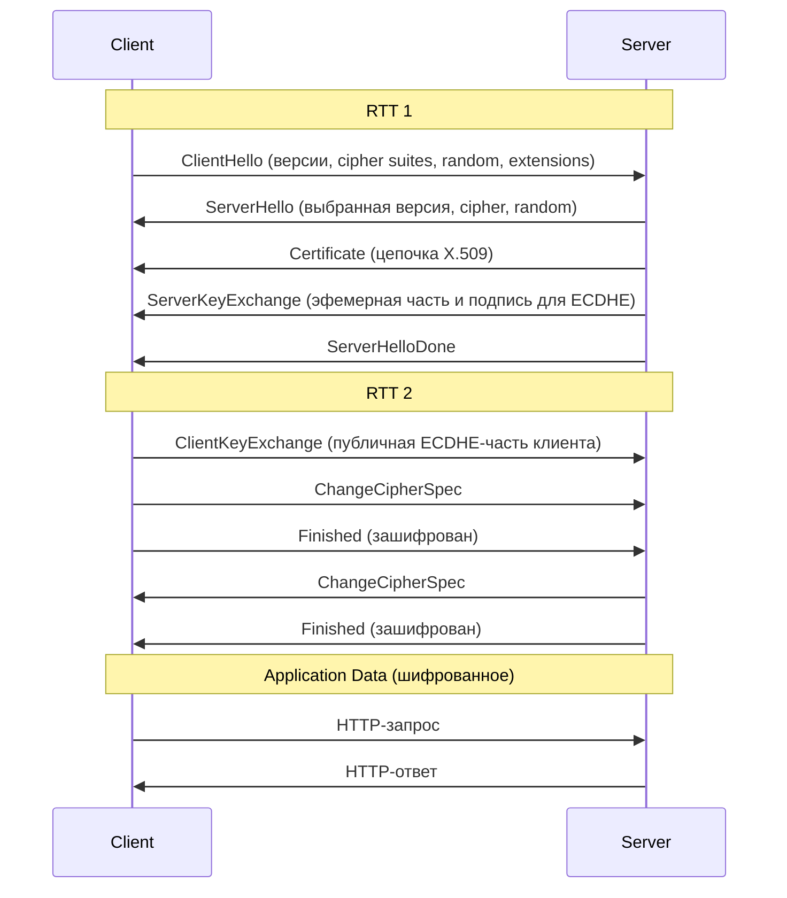
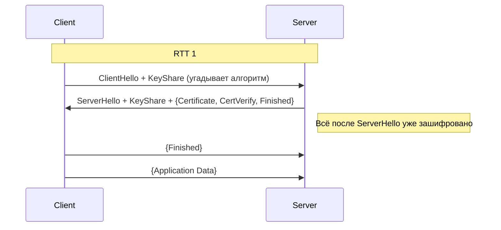
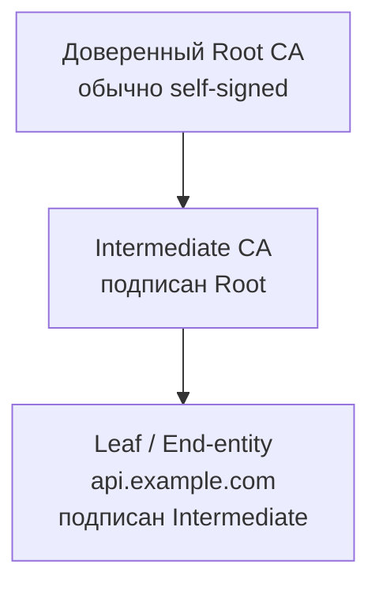
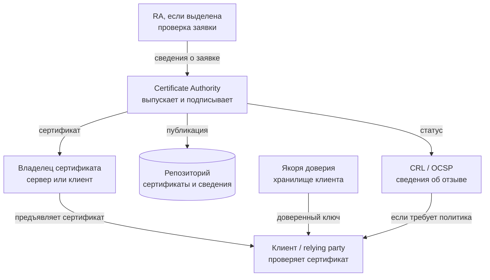
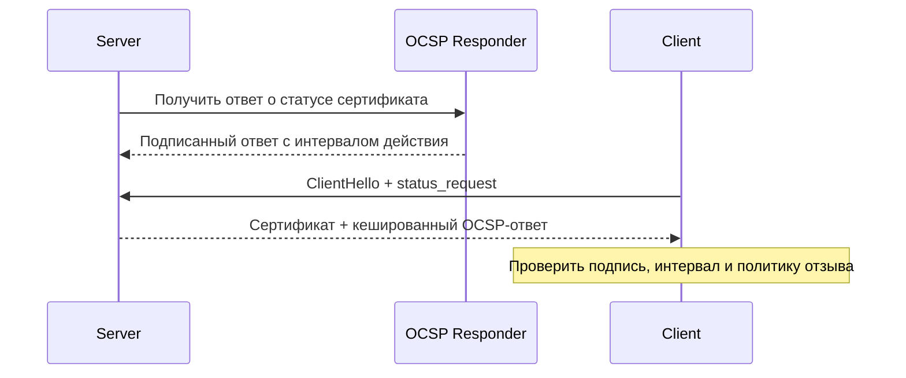
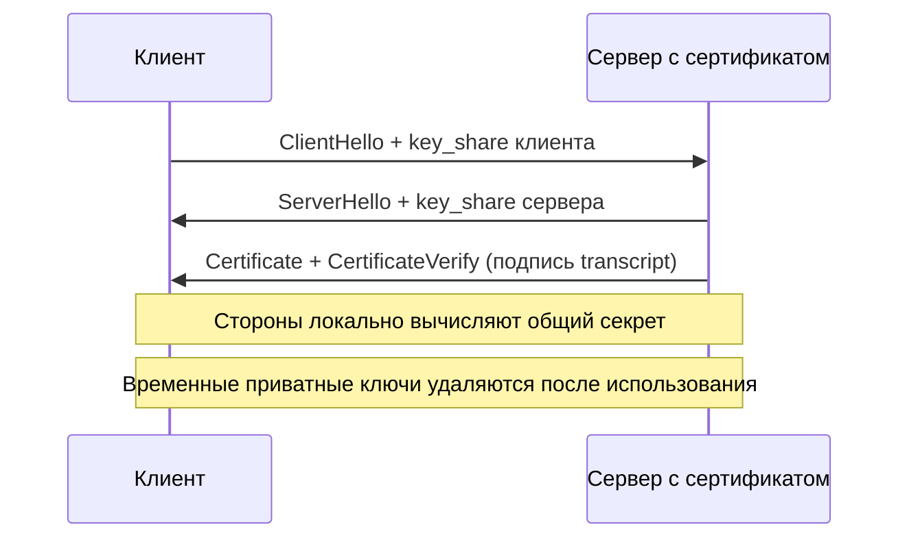
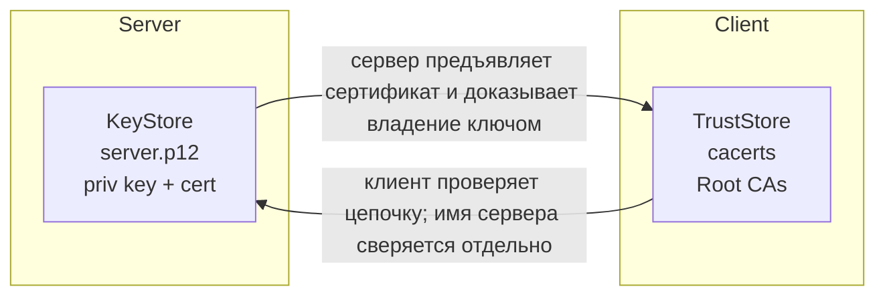

# Вопросы на собеседовании: `TLS/SSL`

Комплексное руководство по вопросам собеседования на тему `TLS/SSL` для `Senior Java Developer`. Включает детали handshake `TLS 1.2` и `TLS 1.3`, устройство `X.509` сертификатов и `PKI`, cipher suites, forward secrecy, настройку `Java KeyStore`/`TrustStore`, `SSLContext`, `Spring Boot` SSL, `mTLS`, `Let's Encrypt`/`ACME`, известные атаки и меры защиты.

**TLS** (`Transport Layer Security`) — криптографический протокол, обеспечивающий конфиденциальность, целостность и аутентификацию на транспортном уровне. Используется в `HTTPS`, `gRPC`, `SMTPS`, `FTPS`, `Kafka SSL`, `JDBC SSL` и десятках других протоколов. На интервью тема `TLS` проверяет понимание сетевой безопасности, криптографии и способность настроить и отладить реальный HTTPS-сервис.

## Полезные ссылки

### Официальная документация

- [RFC 9846 — TLS 1.3](https://datatracker.ietf.org/doc/html/rfc9846) — редакция июля 2026 года, заменившая RFC 8446
- [RFC 5246 — TLS 1.2](https://datatracker.ietf.org/doc/html/rfc5246) — предыдущая версия, всё ещё широко используется
- [RFC 5280 — X.509 Certificate Profile](https://datatracker.ietf.org/doc/html/rfc5280) — формат сертификатов
- [RFC 8555 — ACME Protocol](https://datatracker.ietf.org/doc/html/rfc8555) — автоматизация выдачи сертификатов (Let's Encrypt)
- [RFC 6960 — OCSP](https://datatracker.ietf.org/doc/html/rfc6960) — Online Certificate Status Protocol
- [TLSRef Server-Side TLS](https://docs.tlsref.org/server-side-tls.html) — рекомендованные профили TLS для сервера
- [SSL Labs Server Test](https://www.ssllabs.com/ssltest/) — аудит TLS-конфигурации сервера
- [Baeldung: Introduction to SSL in Java](https://www.baeldung.com/java-ssl)
- [Baeldung: TLS Setup in Spring](https://www.baeldung.com/spring-tls-setup)
- [Baeldung: KeyStore vs TrustStore](https://www.baeldung.com/java-keystore-truststore-difference)
- [Baeldung: mTLS Calls in Java](https://www.baeldung.com/java-execute-mtls-calls)
- [Baeldung: SSL Bundles in Spring Boot](https://www.baeldung.com/spring-boot-security-ssl-bundles)
- [OWASP Transport Layer Protection Cheat Sheet](https://cheatsheetseries.owasp.org/cheatsheets/Transport_Layer_Protection_Cheat_Sheet.html)

## Содержание

- [Полезные ссылки](#полезные-ссылки)
- [See also](#see-also)

**Основы TLS/SSL**
- [Q1. (!) Что такое `TLS/SSL` и зачем он нужен?](#q1--что-такое-tlsssl-и-зачем-он-нужен)
- [Q2. Чем `TLS` отличается от `SSL`? Какая версия актуальна?](#q2-чем-tls-отличается-от-ssl-какая-версия-актуальна)
- [Q3. (!) Какие три гарантии обеспечивает `TLS`?](#q3--какие-три-гарантии-обеспечивает-tls)
- [Q4. На каком уровне `OSI` работает `TLS`?](#q4-на-каком-уровне-osi-работает-tls)
- [Q5. Что такое `HTTPS` и как он связан с `TLS`?](#q5-что-такое-https-и-как-он-связан-с-tls)

**TLS Handshake**
- [Q6. (!) Как устроен `TLS 1.2` handshake?](#q6--как-устроен-tls-12-handshake)
- [Q7. (!) Что изменилось в `TLS 1.3` handshake? Почему быстрее?](#q7--что-изменилось-в-tls-13-handshake-почему-быстрее)
- [Q8. (!) Что такое `0-RTT` в `TLS 1.3` и в чём риски?](#q8--что-такое-0-rtt-в-tls-13-и-в-чём-риски)
- [Q9. Как работает session resumption? `Session ID` vs `Session Ticket` vs `PSK`](#q9-как-работает-session-resumption-session-id-vs-session-ticket-vs-psk)
- [Q10. Что такое `SNI` (Server Name Indication)?](#q10-что-такое-sni-server-name-indication)

**X.509 и сертификаты**
- [Q11. (!) Что такое `X.509` сертификат и из чего состоит?](#q11--что-такое-x509-сертификат-и-из-чего-состоит)
- [Q12. (!) Как работает цепочка доверия: Root, Intermediate и Leaf?](#q12--как-работает-цепочка-доверия-root-intermediate-и-leaf)
- [Q13. (!) Что проверяет `SAN` и почему `CN` недостаточен?](#q13--что-проверяет-san-и-почему-cn-недостаточен)
- [Q14. Как выбирать явные имена и wildcard в `SAN`?](#q14-как-выбирать-явные-имена-и-wildcard-в-san)
- [Q15. Что такое self-signed сертификат и когда его использовать?](#q15-что-такое-self-signed-сертификат-и-когда-его-использовать)
- [Q16. `DV` vs `OV` vs `EV` сертификаты — в чём разница?](#q16-dv-vs-ov-vs-ev-сертификаты--в-чём-разница)

**PKI, CRL, OCSP**
- [Q17. (!) Что такое `PKI`? Какие компоненты входят?](#q17--что-такое-pki-какие-компоненты-входят)
- [Q18. (!) Как проверяется отзыв сертификата? `CRL` vs `OCSP` vs `OCSP Stapling`](#q18--как-проверяется-отзыв-сертификата-crl-vs-ocsp-vs-ocsp-stapling)
- [Q19. Что такое `Certificate Transparency`?](#q19-что-такое-certificate-transparency)

**Криптография и cipher suites**
- [Q20. (!) В чём разница между симметричным и асимметричным шифрованием в `TLS`?](#q20--в-чём-разница-между-симметричным-и-асимметричным-шифрованием-в-tls)
- [Q21. (!) Что такое cipher suite и как его читать?](#q21--что-такое-cipher-suite-и-как-его-читать)
- [Q22. (!) Что такое Forward Secrecy (`PFS`) и как `ECDHE` её обеспечивает?](#q22--что-такое-forward-secrecy-pfs-и-как-ecdhe-её-обеспечивает)
- [Q23. Чем `RSA key exchange` отличается от `(EC)DHE`?](#q23-чем-rsa-key-exchange-отличается-от-ecdhe)
- [Q24. Что такое `AEAD` и какие шифры используются в `TLS 1.3`?](#q24-что-такое-aead-и-какие-шифры-используются-в-tls-13)

**Let's Encrypt и ACME**
- [Q25. (!) Что такое `Let's Encrypt` и `ACME` протокол?](#q25--что-такое-lets-encrypt-и-acme-протокол)
- [Q26. Какие challenges поддерживает ACME (`HTTP-01`, `DNS-01`, `TLS-ALPN-01`)?](#q26-какие-challenges-поддерживает-acme-http-01-dns-01-tls-alpn-01)

**Java: KeyStore, TrustStore, SSLContext**
- [Q27. (!) В чём разница между `KeyStore` и `TrustStore`?](#q27--в-чём-разница-между-keystore-и-truststore)
- [Q28. (!) `JKS` vs `PKCS12` — какой формат использовать?](#q28--jks-vs-pkcs12--какой-формат-использовать)
- [Q29. Как сгенерировать сертификат через `keytool` и `openssl`?](#q29-как-сгенерировать-сертификат-через-keytool-и-openssl)
- [Q30. (!) Как работает `SSLContext` в Java?](#q30--как-работает-sslcontext-в-java)
- [Q31. Как доверять кастомному CA в Java-приложении?](#q31-как-доверять-кастомному-ca-в-java-приложении)

**Spring Boot SSL**
- [Q32. (!) Как включить HTTPS в Spring Boot?](#q32--как-включить-https-в-spring-boot)
- [Q33. Что такое `SSL Bundles` в Spring Boot 3.1+?](#q33-что-такое-ssl-bundles-в-spring-boot-31)
- [Q34. Как настроить HTTPS-клиент в `RestTemplate`/`WebClient`?](#q34-как-настроить-https-клиент-в-resttemplatewebclient)

**mTLS (Mutual TLS)**
- [Q35. (!) Что такое `mTLS` и когда его применять?](#q35--что-такое-mtls-и-когда-его-применять)
- [Q36. Как настроить mTLS в Spring Boot (сервер + клиент)?](#q36-как-настроить-mtls-в-spring-boot-сервер--клиент)

**Атаки и защита**
- [Q37. (!) Какие известные атаки на TLS? `POODLE`, `BEAST`, `Heartbleed`](#q37--какие-известные-атаки-на-tls-poodle-beast-heartbleed)
- [Q38. (!) Что такое downgrade attack и как `TLS_FALLBACK_SCSV` с ним борется?](#q38--что-такое-downgrade-attack-и-как-tls_fallback_scsv-с-ним-борется)
- [Q39. Что такое MITM и как TLS от него защищает?](#q39-что-такое-mitm-и-как-tls-от-него-защищает)

**HSTS, CSP, pinning**
- [Q40. (!) Что такое HSTS и зачем он нужен?](#q40--что-такое-hsts-и-зачем-он-нужен)
- [Q41. Что такое certificate pinning? Почему HPKP устарел?](#q41-что-такое-certificate-pinning-почему-hpkp-устарел)

**Инструменты и отладка**
- [Q42. (!) Чем отлаживать TLS? `openssl s_client`, `keytool`, `testssl.sh`](#q42--чем-отлаживать-tls-openssl-s_client-keytool-testsslsh)
- [Q43. Как прочитать и проверить содержимое сертификата?](#q43-как-прочитать-и-проверить-содержимое-сертификата)
- [Q44. `PKIX path building failed` — как диагностировать?](#q44-pkix-path-building-failed--как-диагностировать)
- [Q45. Чеклист безопасности TLS для production](#q45-чеклист-безопасности-tls-для-production)

---

## Q1. (!) Что такое `TLS/SSL` и зачем он нужен?

`TLS` (`Transport Layer Security`) защищает соединение между двумя участниками. Handshake согласует параметры, проверяет подлинность собеседника в выбранном режиме и выводит ключи; затем записи защищают передаваемые данные от чтения и незаметной подмены. В обычном HTTPS клиент проверяет сертификат и имя сервера, а клиентский сертификат нужен только при настроенном mTLS. Исторический предшественник TLS — `SSL` (`Secure Sockets Layer`); его версии использовать нельзя (Q2).

`TLS` решает три базовые задачи:

1. **Конфиденциальность** — содержимое защищённых записей зашифровано; IP-адреса, размер и время передачи TLS полностью не скрывает.
2. **Целостность** — изменение защищённых данных обнаруживается через `MAC` или `AEAD`.
3. **Аутентификация** — в обычном HTTPS клиент проверяет сервер по сертификату и имени; TLS также допускает другие режимы, например PSK, и необязательную аутентификацию клиента (Q3/Q22).

**Зачем это нужно.** При обращении к `https://api.example.com` проверка сертификата и имени позволяет клиенту подтвердить, с каким сервером он установил защищённое соединение. После handshake посредник в сети не должен читать или незаметно менять HTTP-запросы и ответы. Если приложение отключило проверку сертификата или имени, оно может установить зашифрованный канал с атакующим (Q39). TLS также не защищает данные после расшифровки на конечном узле или TLS-терминаторе (Q5).

Обычный TLS для HTTP/1.1 и HTTP/2 работает поверх TCP. HTTP/3 использует handshake TLS 1.3 внутри QUIC, а для датаграмм существует DTLS (Q4). TLS не обещает доступность сервиса и не скрывает все метаданные соединения.

[RFC 9846, §1–2](https://datatracker.ietf.org/doc/html/rfc9846), [RFC 9325, §5.1](https://www.rfc-editor.org/rfc/rfc9325.html), [RFC 9110, §4.2.2](https://www.rfc-editor.org/rfc/rfc9110.html).

## Q2. Чем `TLS` отличается от `SSL`? Какая версия актуальна?

`TLS` — стандартизованный преемник `SSL`, а не новое название одной и той же неизменной версии протокола. Версии SSL 2.0 и 3.0 запрещены; TLS 1.0 и 1.1 выведены из употребления. Для современных соединений используют TLS 1.2 или TLS 1.3, предпочитая TLS 1.3 там, где обе стороны его поддерживают.

| Версия | Статус для нового соединения |
|--------|------------------------------|
| `SSL 2.0` | Не согласовывать (`RFC 6176`) |
| `SSL 3.0` | Не согласовывать (`RFC 7568`) |
| `TLS 1.0` / `TLS 1.1` | Исторические версии; не согласовывать (`RFC 8996`) |
| `TLS 1.2` | Поддерживается при безопасной настройке; не объявлен запрещённым |
| `TLS 1.3` | Предпочтительная версия, если поддерживается обеими сторонами |

**Важная граница версий.** TLS 1.3 первоначально описан в RFC 8446 (2018); его актуальная редакция — RFC 9846 (июль 2026). RFC 9846 заменил также документ RFC 5246, но это **не означает запрета TLS 1.2**: рекомендации RFC 9325 по-прежнему допускают его при корректной конфигурации. TLS 1.0/1.1, напротив, прямо запрещены к согласованию RFC 8996.

Слово «SSL» осталось в разговорной речи и именах API вроде Java `SSLContext`; оно не означает, что соединение использует SSL 3.0. Так же `OpenSSL 3.0` — версия библиотеки, а не версия протокола: объявленное в сентябре 2026 окончание её публичной поддержки не меняет статус TLS 1.2 или 1.3. Проверяйте отдельно версию библиотеки, разрешённые версии протокола и фактически согласованную версию (Q42/Q45).

[RFC 6176](https://www.rfc-editor.org/rfc/rfc6176.html), [RFC 7568](https://www.rfc-editor.org/rfc/rfc7568.html), [RFC 8996](https://www.rfc-editor.org/rfc/rfc8996.html), [RFC 9325, §3.1](https://www.rfc-editor.org/rfc/rfc9325.html), [RFC 9846](https://datatracker.ietf.org/doc/html/rfc9846), [OpenSSL 3.0 EOL, 16.09.2026](https://openssl-library.org/post/2026-09-16-eol30/).

## Q3. (!) Какие три гарантии обеспечивает `TLS`?

`TLS` защищает конфиденциальность и целостность данных и позволяет аутентифицировать собеседника. В обычном HTTPS клиент проверяет сервер, а сервер проверяет клиента только при соответствующей настройке, например `mTLS`. Это не триада `CIA`: её третья буква означает **Availability** (доступность), которую TLS сам по себе не гарантирует.

| Гарантия | Как достигается в TLS |
|----------|----------------------|
| **Confidentiality** (конфиденциальность) | Симметричное шифрование сессионным ключом (`AES-GCM`, `ChaCha20-Poly1305`) |
| **Integrity** (целостность) | `MAC` / `AEAD` — любое искажение шифртекста обнаруживается |
| **Authentication** (аутентификация) | Проверка `X.509` сертификата сервера через подпись доверенного `CA`; опционально — клиентский сертификат (`mTLS`) |

Связь между ними важна: без аутентификации шифрование бесполезно — можно установить идеально зашифрованный канал, но с самим атакующим (`MITM`). Поэтому сертификат сервера — фундамент, на котором держатся остальные две гарантии.

При полном `TLS 1.3` handshake с эфемерным `(EC)DHE` есть **Forward Secrecy** относительно последующей утечки долгосрочного ключа сервера. Для возобновления через `PSK` это зависит от выбранного режима: `psk_dhe_ke` добавляет новый обмен, `psk_ke` обходится без него. Данные `0-RTT` не имеют протокольной гарантии Forward Secrecy.

**Чего TLS не делает.** `TLS` **не защищает** от:
- атак на endpoint (вредонос на клиенте/сервере видит незашифрованные данные)
- полного сокрытия метаданных: IP-адреса, размера и времени передачи пакетов; обычный `SNI` без `ECH` тоже может быть виден
- неправильной валидации сертификата самим приложением

[RFC 9846, §1](https://datatracker.ietf.org/doc/html/rfc9846), [NIST: CIA](https://csrc.nist.gov/glossary/term/CIA).

## Q4. На каком уровне `OSI` работает `TLS`?

В обычном HTTPS с HTTP/1.1 или HTTP/2 TLS защищает данные **между HTTP и TCP**: приложение передаёт данные TLS, а TLS отправляет записи через надёжный поток TCP. Номер уровня OSI для TLS не закреплён протоколом. В учебных схемах его относят к сеансовому или представительному уровню (`L5/L6`); для практической диагностики полезнее назвать соседние протоколы и точку терминации.

```
┌─────────────────┐
│ HTTP/1.1 или 2 │  приложение
├─────────────────┤
│  TLS (записи)  │  защита канала
├─────────────────┤
│       TCP       │  транспорт
├─────────────────┤
│       IP        │  сеть
└─────────────────┘
```

**Границы этой схемы:**

- Для защиты датаграмм существует `DTLS` (например, DTLS 1.3 по RFC 9147), который сохраняет семантику датаграмм. Это не обычные TLS-записи поверх UDP.
- `HTTP/3` использует `QUIC` поверх UDP. QUIC применяет handshake TLS 1.3 для аутентификации и получения ключей, но защищает пакеты сам: TLS record layer там не передаётся поверх QUIC.
- Балансировщик без терминации TLS не видит путь и заголовки HTTP. Он может маршрутизировать по IP и порту; если он разбирает `ClientHello`, ему доступны также видимые поля вроде SNI или ALPN. При ECH настоящее имя может быть скрыто (Q10).

[RFC 9001, §3](https://www.rfc-editor.org/rfc/rfc9001.html), [RFC 9114, §1.2](https://www.rfc-editor.org/rfc/rfc9114.html), [RFC 9147](https://www.rfc-editor.org/rfc/rfc9147.html), [RFC 9849](https://www.rfc-editor.org/rfc/rfc9849.html).

## Q5. Что такое `HTTPS` и как он связан с `TLS`?

`HTTPS` — HTTP-обмен с защитой и проверкой сервера, обозначенный схемой URI `https://` (RFC 9110). Для HTTP/1.1 и HTTP/2 клиент обычно устанавливает TLS поверх TCP, а затем передаёт запросы и ответы через защищённые TLS-записи. Для HTTP/3 те же правила HTTP и схема `https://` работают поверх QUIC: он использует handshake TLS 1.3, а данные защищает своими пакетами (Q4). Поэтому HTTPS не следует определять как обязательную связку «HTTP + TLS-записи + TCP».

**Что проверяется и что видно:**
- Для схемы `https://` порт по умолчанию — `443`; соединение может идти по TCP или QUIC/UDP. Схема `http://` обычно использует порт `80` и не обещает такую защиту.
- Клиент проверяет подлинность сервера, обычно по сертификату и имени из целевого URI (Q12/Q13). Один только SNI не заменяет эту проверку.
- На защищённом участке путь и параметры запроса, заголовки и тело HTTP не видны пассивному наблюдателю. IP-адреса, порты, размеры и время пакетов видны; при обычном TLS может быть виден SNI, если не применяется ECH (Q10).

**Пример для backend.** Если ingress завершает TLS-соединение и отправляет запрос к приложению по HTTP, защита клиентского соединения заканчивается на ingress. Для участка ingress → приложение отдельно определяют транспорт, доверие к прокси и необходимость нового TLS-соединения; один внешний `https://` не шифрует внутренний участок автоматически.

[RFC 9110, §4.2.2](https://www.rfc-editor.org/rfc/rfc9110.html), [RFC 9114, §1.2 и §3](https://www.rfc-editor.org/rfc/rfc9114.html), [RFC 9001, §3](https://www.rfc-editor.org/rfc/rfc9001.html), [RFC 9849](https://www.rfc-editor.org/rfc/rfc9849.html). См. подробнее в [вопросах по HTTP/REST](../api/http-rest-interview.md).

## Q6. (!) Как устроен `TLS 1.2` handshake?

Полный `TLS 1.2` handshake с серверной аутентификацией согласует параметры соединения, проверяет сертификат сервера и выводит ключи для защиты данных. Типичный полный обмен с `(EC)DHE` требует **2 RTT поверх уже установленного TCP-соединения** до первого запроса приложения. Возобновление прежней сессии короче (Q9); схема ниже относится именно к полному обмену без клиентского сертификата.



Что происходит на каждом шаге:

1. **ClientHello** — клиент предлагает версию TLS и cipher suites, передаёт `client_random` и расширения, например `SNI` и `ALPN`.
2. **ServerHello** — сервер выбирает из предложенного версию и cipher suite, отвечает своим `server_random`
3. **Certificate** — сервер присылает свой сертификат (и промежуточные), чтобы клиент мог его проверить и аутентифицировать сервер
4. **ServerKeyExchange** — при выбранном `ECDHE` сервер передаёт эфемерную публичную часть и подпись параметров ключом сертификата. Клиент проверяет подпись и цепочку сертификата.
5. **ClientKeyExchange** — клиент передаёт свою публичную `ECDHE`-часть. Обе стороны независимо вычисляют общий `premaster secret`.
6. Из `client_random` + `server_random` + `premaster_secret` через `PRF` обе стороны выводят `master secret`, а из него — сессионные симметричные ключи
7. После `ChangeCipherSpec` каждая сторона отправляет защищённый `Finished` с `verify_data`, вычисленным через `PRF` от `master secret` и хеша предшествующих сообщений handshake. Проверка обнаруживает несовпадение согласованных параметров и ключей. `ChangeCipherSpec` — отдельный тип сообщений TLS, а не сообщение handshake.

После проверки `Finished` можно обмениваться защищёнными данными приложения. На схеме сам сессионный симметричный ключ не передаётся. В историческом RSA key exchange сообщение `ClientKeyExchange` вместо публичной ECDHE-части содержит **зашифрованный** `premaster secret`; этот режим не даёт Forward Secrecy. При запросе клиентского сертификата появляются дополнительные сообщения `Certificate` и `CertificateVerify` (Q35/Q36).

[RFC 5246, §7.3, §7.4.7 и §7.4.9](https://www.rfc-editor.org/rfc/rfc5246.html), [RFC 8422: ECDHE для TLS 1.2](https://www.rfc-editor.org/rfc/rfc8422.html), [RFC 9325: современные настройки TLS](https://www.rfc-editor.org/rfc/rfc9325.html).

## Q7. (!) Что изменилось в `TLS 1.3` handshake? Почему быстрее?

`TLS 1.3` (первоначально `RFC 8446`, с июля 2026 — `RFC 9846`) сократил обычный полный handshake до одного RTT и удалил ряд устаревших механизмов. Основные изменения:

**1. Handshake за 1-RTT** (вместо 2-RTT):



Почему хватает одного RTT: клиент не ждёт, пока сервер выберет алгоритм, а сразу «угадывает» его и в первом же сообщении прикладывает `KeyShare` — свою эфемерную публичную часть. Если угадал (а ходовые алгоритмы наперечёт), сервер тут же отвечает своей частью и начинает шифровать всё последующее. Лишний обмен из `TLS 1.2` (отдельный `ClientKeyExchange`) просто исчезает.

**2. Выкинуты небезопасные алгоритмы:**
- Нет `RSA key exchange`; при полном handshake с сертификатом используется эфемерный `(EC)DHE`
- Нет `CBC`-шифров — только `AEAD` (`AES-GCM`, `ChaCha20-Poly1305`)
- Для `CertificateVerify` не выбирают подписи на `MD5` или `SHA-1`; проверка подписи цепочки сертификатов — отдельное решение клиента
- Нет `static DH`, сжатия, ренегоциации, `NULL`-шифров

**3. 0-RTT резюмирование** — клиент может отправить данные в самом первом сообщении при повторном подключении.

**4. Session resumption через PSK** — возобновление может выбрать `psk_dhe_ke` с новым обменом `(EC)DHE` или `psk_ke` без него. Для `0-RTT` RFC не гарантирует Forward Secrecy и предупреждает о replay.

**5. Сообщения после `ServerHello` зашифрованы** — включая `Certificate`. Пассивный наблюдатель не читает этот сертификат, но имя сервера в обычном `SNI` может оставаться видимым без `ECH`.

[RFC 9846, §2, §4.3.9 и §8.1](https://datatracker.ietf.org/doc/html/rfc9846).

**Итог:** обычный полный handshake укладывается в один RTT, если подходит предложенная клиентом группа обмена. `0-RTT` позволяет отправить часть данных до завершения handshake, но требует отдельной оценки replay и Forward Secrecy. Проверять надо фактически согласованные алгоритмы и режим PSK, а не только номер версии.

## Q8. (!) Что такое `0-RTT` в `TLS 1.3` и в чём риски?

`0-RTT` (early data) позволяет при TLS 1.3 с подходящим PSK отправить данные приложения сразу после первого `ClientHello`, до ответа сервера. Ключи early data выводятся из PSK, полученного в предыдущем соединении или заданного извне. Сервер может отклонить early data и продолжить обычный handshake; отправка данных раньше не означает, что handshake уже завершён.

```
Клиент → сервер: ClientHello с PSK identity, затем зашифрованный запрос в early data
```

Выигрыш — приложение может начать передачу до первого ответа сервера. Это полезно только если протокол приложения разрешает early data и допускает его повтор.

**Два ограничения:**

1. **Replay между соединениями.** Атакующий может повторить первый полёт сообщений. TLS 1.3 не гарантирует, что разные узлы кластера не обработают один запрос несколько раз. Например, повтор платёжного запроса может создать вторую операцию, если приложение не защищает её отдельно.
2. **Нет протокольной гарантии Forward Secrecy для early data.** Эти ключи выводятся до свежего обмена `(EC)DHE`; последующий выбор `psk_dhe_ke` не меняет защиту уже отправленных ранних данных. Последствия утечки PSK зависят от того, как он создан и хранится.

**Как принимать решение для HTTP:**
- Для early data допускайте только запросы, которые приложение действительно может безопасно повторить. Метод `GET` сам по себе не доказывает отсутствие побочных эффектов; одна идемпотентность тоже не означает безопасность обработки до handshake.
- Если запрос может менять состояние или повтор небезопасен, отклоняйте его до обработки либо отвечайте `425 Too Early`. Повтор после `425` отправляют уже после завершения handshake, не снова в early data.
- На TLS-уровне ограничивайте повторное принятие первого полёта и согласуйте защиту между узлами. Даже согласованный anti-replay на узлах не заменяет идемпотентность или дедупликацию бизнес-операции: приложение должно учитывать повторы и обычных запросов.

**За обратным прокси.** Если прокси принял запрос в early data и передаёт его origin до завершения handshake с клиентом, он добавляет `Early-Data: 1`. Этот заголовок сохраняется на следующих переходах. Для origin он означает, что запрос мог быть повторён на предыдущем участке. Завершённый handshake между прокси и origin этой неопределённости не устраняет. Если origin не может безопасно выполнить такой запрос, он отвечает `425 Too Early` до выполнения операции. Если прокси не знает, поддерживает ли origin этот механизм, он может дождаться завершения клиентского handshake перед пересылкой запроса, который ещё не пересылался и не помечен `Early-Data`, либо сам вернуть `425`.

Пример: `GET /balance` может быть допустим, если он лишь читает данные и повтор не вызывает побочного действия. `POST /transfer` нужно обработать после handshake или защитить на уровне бизнес-операции; одного кэша использованных билетов для денежного перевода недостаточно. TLS-реализация не должна включать 0-RTT без явного запроса приложения.

[RFC 9846, §2.3, §4.3.10 и §8](https://datatracker.ietf.org/doc/html/rfc9846), [RFC 8470, §3–§6](https://www.rfc-editor.org/rfc/rfc8470.html), [RFC 9325, §3.10](https://www.rfc-editor.org/rfc/rfc9325.html#section-3.10).

## Q9. Как работает session resumption? `Session ID` vs `Session Ticket` vs `PSK`

Session resumption позволяет новому соединению опереться на секрет предыдущего handshake, не повторяя всю аутентификацию сертификатом. В TLS 1.2 для этого применялись `Session ID` и tickets, в TLS 1.3 — PSK с идентификатором, часто доставляемым через `NewSessionTicket`. Возобновление всё равно проводит новый handshake и выводит новые ключи трафика; его задержка и Forward Secrecy зависят от версии и режима обмена.

**Session ID (TLS 1.2)** — клиент возвращает идентификатор, а сервер ищет сохранённое состояние. В кластере для такого возобновления состояние должно быть доступно узлу, который принял новое соединение; помогают общая сессия или маршрутизация на нужный узел.

**Session Ticket (TLS 1.2, RFC 5077)** — билет может содержать защищённое серверным ключом состояние, которое хранит клиент. Такой вариант уменьшает потребность в серверном хранилище, но другая нода примет билет лишь при доступе к нужному ключу. Утечка или слишком долгое использование ключа защиты билета может свести на нет Forward Secrecy возобновлённых соединений. RFC 9325 требует регулярно менять и затем уничтожать эти ключи, а срок билета ограничивать.

**PSK (TLS 1.3)** — после handshake сервер может отправить `NewSessionTicket` с идентификатором. Клиент выводит связанный PSK и предлагает идентификатор в следующем `ClientHello`; сервер находит соответствующий секрет, а `binder` подтверждает владение им. Сам секрет не пересылается в `NewSessionTicket`. Идентификатор может указывать на состояние сервера либо быть самодостаточным защищённым билетом: PSK не означает обязательный stateless-режим.

Для Forward Secrecy нового соединения выбирают `psk_dhe_ke` со свежим `(EC)DHE`; `psk_ke` обходится без `key_share`. `0-RTT` — отдельная возможность поверх PSK, которую сервер может не разрешить (Q8). В TLS 1.3 срок `ticket_lifetime` не может превышать **7 дней**, клиент тоже не должен использовать билет дольше 7 дней; билеты и ключи их защиты нужно ограничивать по сроку и защищать от утечки. Если PSK не принят, стороны могут перейти к полному handshake.

[RFC 9846, §2.2, §4.3.9 и §4.7.1](https://datatracker.ietf.org/doc/html/rfc9846), [RFC 9325, §3.4](https://www.rfc-editor.org/rfc/rfc9325.html#section-3.4), [OpenSSL: stateful/stateless tickets](https://docs.openssl.org/master/man3/SSL_CTX_set_options/).

## Q10. Что такое `SNI` (Server Name Indication)?

`SNI` (`server_name`, RFC 6066) — расширение `ClientHello` с DNS-именем сервера. Оно помогает серверу выбрать сертификат для нужного виртуального хоста ещё до передачи HTTP-запроса. В обычном TLS без `ECH` это имя видно наблюдателю сети; сам SNI не подтверждает право сервера на имя — сертификат и имя проверяет клиент (Q13).

**Зачем понадобилось.** На одном IP-адресе обычно живёт много HTTPS-сайтов с разными сертификатами (virtual hosting). Возникает «проблема курицы и яйца»: чтобы прислать правильный сертификат, сервер должен знать имя домена, но имя домена обычно лежит в HTTP-заголовке `Host`, а он передаётся уже **внутри** TLS — то есть после того, как сертификат уже отправлен. `SNI` разрывает этот круг: имя домена кладётся прямо в `ClientHello`, и сервер сразу выбирает нужный сертификат.

```
ClientHello {
  ...
  extensions: [
    server_name: "api.example.com"
    ...
  ]
}
```

**Проверка нового балансировщика перед сменой DNS.** Если `api.example.com` ещё указывает на старый адрес, для прямого запроса используйте:

```bash
curl --resolve api.example.com:443:203.0.113.10 https://api.example.com/
```

Соединение пойдёт на заданный IP. Имя из URL сохранится для SNI, проверки сертификата и HTTP-запроса. Если вместо этого открыть URL с IP и подставить HTTP-заголовок `Host`, заголовок поступит только после TLS handshake и не повлияет на выбор сертификата. Если балансировщик получил неизвестное SNI, RFC допускает продолжение handshake или его прерывание с `unrecognized_name`. При продолжении клиент всё равно проверяет сертификат для имени из URL. [curl: `--resolve`](https://curl.se/docs/manpage.html#--resolve), [RFC 6066, §3](https://www.rfc-editor.org/rfc/rfc6066.html#section-3).

**Приватность.** В обычном TLS 1.3 `ClientHello` и SNI открыты, хотя сертификат сервера уже шифруется. `ECH` (`Encrypted Client Hello`, RFC 9849, опубликован в марте 2026 года) помещает настоящее имя в зашифрованный `ClientHelloInner`; видимый `ClientHelloOuter` остаётся в сети. Для защиты нужны поддержка и согласованная конфигурация на клиенте и сервере. Даже с ECH IP-адрес и незашифрованные DNS-запросы могут раскрывать назначение. `ESNI` — прежний проект, не название действующего механизма ECH.

**В Java.** Для HTTPS URL провайдеры Oracle JSSE обычно задают SNI автоматически. Сторонний провайдер может вести себя иначе; при работе с низкоуровневыми `SSLSocket`/`SSLEngine` имя можно явно задать через `SSLParameters.setServerNames(List.of(new SNIHostName("api.example.com")))`. SNI типа `host_name` содержит DNS-имя, а не IP-литерал. Настройка SNI не заменяет проверку имени сертификата (Q30).

[RFC 6066, §3](https://www.rfc-editor.org/rfc/rfc6066.html), [RFC 9849, §1](https://www.rfc-editor.org/rfc/rfc9849.html), [Oracle JDK 25: JSSE и SNI](https://docs.oracle.com/en/java/javase/25/security/java-secure-socket-extension-jsse-reference-guide.html).

## Q11. (!) Что такое `X.509` сертификат и из чего состоит?

Сертификат `X.509` связывает публичный ключ с данными о владельце и содержит подпись ключом издателя. `RFC 5280` задаёт профиль сертификатов для Internet PKI и правила проверки пути. Сам сертификат не создаёт доверия: клиент должен построить допустимый путь к своему `trust anchor`, проверить срок, назначение и имя сервера. Сертификат может быть самоподписанным; когда и почему ему доверяют, разбирается в Q12/Q15.

**Основные поля:**

| Поле | Пример | Назначение |
|------|--------|-----------|
| `Version` | v3 | Версия формата X.509 |
| `Serial Number` | 03:1A:B5:... | Уникальный ID у CA |
| `Signature Algorithm` | `SHA256withRSA` | Алгоритм подписи издателя |
| `Issuer` | `CN=Let's Encrypt R3, O=LE` | Кто подписал |
| `Validity` | notBefore / notAfter | Срок действия |
| `Subject` | `CN=api.example.com` | Данные о субъекте; имя HTTPS-сервера проверяют по `SAN` |
| `Subject Public Key Info` | RSA/EC public key | Публичный ключ владельца |
| `Extensions` | `SAN`, `KeyUsage`, `EKU`, `AIA`, `CRL Distribution Points` | Расширения (v3) |
| `Signature` | bytes | Подпись ключом издателя |

**Ключевые extensions** (v3) — именно они определяют, как сертификат можно применять:
- **`Subject Alternative Name` (`SAN`)** — типизированные DNS-имена или IP-адреса для проверки сервера (Q13)
- **`Key Usage`** — что разрешено ключу: digitalSignature, keyEncipherment, ...
- **`Extended Key Usage` (`EKU`)** — назначение сертификата: `serverAuth`, `clientAuth`, `codeSigning`
- **`Authority Information Access` (`AIA`)** — способы доступа к информации о выпустившем CA: `caIssuers` может помочь найти его сертификат, `OCSP` указывает responder для проверки статуса; наличие адреса не означает, что клиент автоматически им воспользуется (Q12/Q18)
- **`CRL Distribution Points`** — где искать информацию CRL об отозванных сертификатах; адрес CRL не относится к `AIA` (Q18)
- **`Basic Constraints`** — флаг «это CA?» (`CA:TRUE`): отличает корневые/промежуточные от обычных серверных

**Формат хранения:** `DER` (бинарный `ASN.1`) или `PEM` (тот же `DER`, закодированный в base64 и обёрнутый в BEGIN/END-блоки — текстовый, удобно копировать).

Например, при сбое цепочки `caIssuers` в `AIA` подсказывает источник сертификата выпускающего CA, а `CRL Distribution Points` — источник списка отзыва. Проверять и скачивать эти данные клиент будет согласно своей конфигурации и политике проверки. [RFC 5280, §4.2.2.1](https://www.rfc-editor.org/rfc/rfc5280.html#section-4.2.2.1), [§4.2.1.13](https://www.rfc-editor.org/rfc/rfc5280.html#section-4.2.1.13).

```
-----BEGIN CERTIFICATE-----
MIID...base64...XYZ
-----END CERTIFICATE-----
```

## Q12. (!) Как работает цепочка доверия: Root, Intermediate и Leaf?

Клиент проверяет путь от конечного сертификата сервера (`leaf`) через сертификаты выпускающих CA до заранее настроенного **якоря доверия** (`trust anchor`). Подпись каждого звена доказывает связь с ключом следующего CA, но сама по себе не делает цепочку доверенной: якорь должен быть известен этому клиенту до соединения. Корневой сертификат часто служит таким якорем, однако RFC 5280 не требует одного и того же корня для всех приложений и не сводит якорь к сертификату в системном хранилище.



**Три типа сертификатов:**

1. **Root CA** — верхний CA в типичном пути; его сертификат обычно самоподписан, а доверие к нему задано вне этого пути. Ключ корня защищают особенно строго; способ хранения зависит от PKI. Разные клиенты могут иметь разные наборы якорей.
2. **Intermediate CA** — сертификат подчинённого CA, подписанный корнем или другим CA. Он может выпускать серверные сертификаты в пределах своих ограничений. Сервер обычно отправляет нужные intermediate вместе с leaf.
3. **Leaf / end-entity** — сертификат сервера или клиента. Он подтверждает привязку имени к публичному ключу, если путь и правила применения прошли проверку; leaf не является CA.

**Процесс валидации:**

1. Клиент получает цепочку, которую прислал сервер, и строит допустимый путь до одного из **своих** якорей; подходящий intermediate может также оказаться в локальном хранилище или быть получен реализацией иным разрешённым способом.
2. Для звеньев пути он проверяет подписи, сроки, ограничения CA (`basicConstraints`, `keyCertSign`), допустимое применение и политики. Имя сервера в `SAN` проверяется для конкретного HTTPS-адреса отдельно от общего алгоритма PKIX.
3. Статус отзыва проверяется **по политике и возможностям клиента**. Наличие CRL/OCSP-адреса в сертификате не доказывает, что данный клиент запросил и применил ответ об отзыве. Для JDK проверяйте настройки провайдера, а не предполагайте автоматическую онлайн-проверку.

**Зачем нужен intermediate.** Он отделяет повседневный выпуск от корневого ключа и позволяет делегировать выпуск с ограничениями. При компрометации ключа intermediate публичные TLS-требования обязывают CA отозвать его сертификат. Это не означает, что все клиенты сразу перестанут принимать выпущенные им цепочки: нужна доставка и применение информации об отзыве или блокировке, а затронутые сертификаты приходится заменять. Корень может остаться доверенным, если его ключ не пострадал, но само существование доверенного корня не обезвреживает украденный ключ intermediate. [CA/Browser Forum, §4.9.1.2](https://cabforum.org/working-groups/server/baseline-requirements/requirements/#4912-reasons-for-revoking-a-subordinate-ca-certificate), [разбор Go Security 26.10.2026](https://go.dev/blog/emudhra-incident).

**Практический сбой.** Если сервер забыл intermediate, клиент без другого источника этого сертификата не построит путь и может сообщить `unable to find valid certification path` (Q44). Некоторые клиенты получают недостающее звено по `AIA`. У Oracle JDK 25 `caIssuers` через AIA **отключён по умолчанию**, но его можно включить настройкой `com.sun.security.enableAIAcaIssuers=true` и разрешёнными адресами. Поэтому серверу следует присылать нужные intermediate, не рассчитывая на сетевое достраивание пути. [RFC 5280, §6.1](https://www.rfc-editor.org/rfc/rfc5280.html#section-6.1), [Oracle Java PKI Guide](https://docs.oracle.com/en/java/javase/25/security/java-pki-programmers-guide.html).

## Q13. (!) Что проверяет `SAN` и почему `CN` недостаточен?

`Subject Alternative Name` (`SAN`) — расширение сертификата с типизированными идентификаторами сервера. Для HTTPS по DNS-имени сверяют запись `dNSName`, а при подключении по IP-адресу — `iPAddress`. Записей может быть несколько, но `SAN` нужен и для одного имени. `Common Name` (`CN`) — поле в `Subject`, исторически использовавшееся как имя сервера; оно не заменяет `SAN`.

```
Subject: CN=example.com
X509v3 Subject Alternative Name:
    DNS:example.com
    DNS:www.example.com
    DNS:api.example.com
    IP:203.0.113.10
```

**Границы правила.** RFC 9525 запрещает использовать `CN` как идентификатор сервиса. Действующие CA/Browser Forum TLS Baseline Requirements требуют `SAN` с хотя бы одним `dNSName` или `iPAddress` у публично выпускаемого серверного сертификата. Поэтому совпадение `CN` само по себе не подтверждает имя для такого сертификата. Поведение старых и специально настроенных клиентов может отличаться; по одному номеру версии JDK нельзя обещать одинаковую проверку во всех клиентах. В Java `HttpsURLConnection` выполняет стандартную проверку имени, а назначенный `HostnameVerifier` может быть вызван, если она не установила совпадение. Отключать проверку имени ради совместимости нельзя.

**Практика:** включайте в `SAN` именно те DNS-имена и IP-адреса, по которым клиенты подключаются. Для публичного сертификата CA проверит право на эти имена. Убедитесь, что выпущенный сертификат, а не только запрос `CSR`, содержит нужные записи. Пример запроса через OpenSSL:

```bash
openssl req -new -key server.key -out server.csr \
  -subj "/CN=api.example.com" \
  -addext "subjectAltName=DNS:api.example.com,DNS:www.api.example.com"
```

[RFC 9525, §2 и §6](https://www.rfc-editor.org/rfc/rfc9525.html), [CA/Browser Forum, §7.1.2.7.12](https://cabforum.org/working-groups/server/baseline-requirements/requirements/#712712-subscriber-certificate-subject-alternative-name), [Oracle JSSE Guide](https://docs.oracle.com/en/java/javase/25/security/java-secure-socket-extension-jsse-reference-guide.html).

## Q14. Как выбирать явные имена и wildcard в `SAN`?

Wildcard — это **значение `dNSName` в `SAN`**, например `*.example.com`, а не отдельный вид сертификата вместо SAN. В одном сертификате могут быть явные имена (`example.com`, `api.example.com`) и wildcard-имя. Каждое имя должно пройти проверку CA по правилам выпуска.

`*.example.com` подходит для `api.example.com` и `www.example.com`, но не для самого `example.com` и не для `a.b.example.com`: звёздочка заменяет ровно один крайний левый DNS-label. Сертификат не создаёт DNS-записи и не направляет трафик на сервер. Новый хост одного уровня может совпасть с уже выпущенным wildcard-именем без перевыпуска сертификата, если остальные условия его проверки соблюдены; для нового явного имени потребуется перевыпуск.

**Выбор покрытия.** Для известного небольшого набора хостов перечислите их явно. Wildcard удобен, когда одноуровневые хосты регулярно добавляются, но расширяет круг имён, за которые отвечает один приватный ключ. Если этот ключ используется на нескольких серверах, его утечка затронет все имена в сертификате; ограничивайте распространение ключа и планируйте ротацию. В обоих случаях компрометация затрагивает весь набор имён, указанных в одном сертификате, поэтому размер и состав SAN важнее ярлыка «multi-domain» или «wildcard».

[RFC 9525, §6.3 и §7.1](https://www.rfc-editor.org/rfc/rfc9525.html), [CA/Browser Forum, §7.1.2.7.12](https://cabforum.org/working-groups/server/baseline-requirements/requirements/#712712-subscriber-certificate-subject-alternative-name).

## Q15. Что такое self-signed сертификат и когда его использовать?

**Self-signed** — сертификат, чья подпись проверяется публичным ключом **из самого сертификата**. Одинаковые `Issuer` и `Subject` означают лишь *self-issued*: при смене ключа CA такой сертификат может быть подписан прежним ключом, так что одного совпадения имён недостаточно. Самоподпись доказывает владение ключом, но не личность владельца: без заранее установленного доверия клиент не знает, кто предъявил этот ключ. Шифрование TLS от способа подписи сертификата не становится слабее; риск — в непроверенной аутентификации.

**Когда можно:**
- Локальная разработка (`localhost`) и тесты с явной настройкой доверия у клиента.
- Внутренняя PKI: самоподписанный сертификат корневого CA распространяют через проверенный канал как якорь доверия для нужных клиентов. Серверные сертификаты затем подписывает CA; установка корня не делает произвольный self-signed leaf доверенным.
- Закрытая интеграция, где конкретный self-signed leaf заранее проверен и закреплён у клиента; тогда обновление ключа и сертификата надо планировать отдельно.

**Когда нельзя:**
- Публичный HTTPS для обычных браузеров: у их клиентов нет заранее заданного доверия к вашему leaf, поэтому проверка сертификата завершится предупреждением или отказом.
- Среда, где нельзя безопасно доставить и обновлять доверенный ключ. Принятие сертификата при первом соединении (`TOFU`) само по себе уязвимо к подмене этого первого соединения.

Даже при явном доверии проверяйте назначение сертификата, имя узла и срок действия в контексте используемого TLS-клиента. Импортировать leaf, полученный из уже не прошедшего проверку соединения, без независимой сверки отпечатка нельзя (Q31/Q44). [RFC 5280, §3.2](https://www.rfc-editor.org/rfc/rfc5280.html#section-3.2), [Oracle `keytool`](https://docs.oracle.com/en/java/javase/25/docs/specs/man/keytool.html).

Генерация через keytool:

```bash
keytool -genkeypair -alias server \
  -keyalg RSA -keysize 2048 \
  -validity 365 \
  -keystore server.p12 -storetype PKCS12 \
  -dname "CN=localhost" \
  -ext "san=dns:localhost,ip:127.0.0.1"
```

Через openssl:

```bash
openssl req -x509 -newkey rsa:2048 -nodes -days 365 \
  -keyout server.key -out server.crt \
  -subj "/CN=localhost" \
  -addext "subjectAltName=DNS:localhost,IP:127.0.0.1"
```

Второй пример оставляет приватный ключ без пароля (`-nodes`); это допустимо для одноразового локального теста при защите файла, но не шаблон хранения рабочего ключа.

## Q16. `DV` vs `OV` vs `EV` сертификаты — в чём разница?

Для публичных TLS-сертификатов это категории **проверенной информации о владельце**, а не уровни стойкости шифрования. Во всех случаях CA проверяет контроль над указанным DNS-именем или IP-адресом. Категория сама по себе не определяет алгоритм TLS и не доказывает, что сайт или организация безопасны.

| Тип | Что дополнительно подтверждает CA |
|-----|----------------------------------|
| **DV** (Domain Validated) | Контроль над DNS-именем или IP-адресом; подтверждённое название организации в сертификат не включается. |
| **OV** (Organization Validated) | Личность и адрес организации для сведений об организации в `subject`, наряду с контролем над именем или адресом сервера. |
| **EV** (Extended Validation) | Сведения о юридическом лице по отдельным требованиям EV, включая проверку его существования и официального наименования. Требования к имени или адресу сервера тоже сохраняются. |

**Что видно пользователю.** Название организации в EV раньше показывали прямо в адресной строке. Например, Firefox 70 в 2019 году перенёс EV-индикатор в панель сведений о сайте. Интерфейс зависит от браузера и версии: отсутствие названия рядом с URL не означает, что сертификат стал DV; сведения можно проверить в деталях сертификата. Не используйте EV-индикатор как доказательство добросовестности сайта.

**Выбор для сервиса.** Если требуется подтвердить только контроль над именем сервера, достаточно DV. OV или EV имеют смысл, когда потребителям сертификата либо внутренней политике нужна подтверждённая информация об организации. Проверку цепочки, имени, срока, назначения и политики доверия клиент выполняет независимо от этой категории (Q12–Q13).

[CA/Browser Forum, TLS Baseline Requirements §7.1.2.7](https://cabforum.org/working-groups/server/baseline-requirements/requirements/#7127-subscriber-certificate), [EV Guidelines §3.2.2](https://cabforum.org/working-groups/server/extended-validation/guidelines/#322-authentication-of-organization-identity), [Mozilla, Firefox 70](https://blog.mozilla.org/security/2019/10/15/improved-security-and-privacy-indicators-in-firefox-70/).

## Q17. (!) Что такое `PKI`? Какие компоненты входят?

`PKI` (`Public Key Infrastructure`) связывает публичные ключи с именами или другими атрибутами субъектов через сертификаты, правила выпуска и доверие клиентов. Подпись CA подтверждает это утверждение по его политике, а клиент решает, доверяет ли данному CA и подходит ли сертификат для конкретной цели (Q12). Основа — асимметричная криптография; процессы выпуска и проверки не сводятся к одному сертификату.



**Компоненты:**

1. **CA (Certificate Authority)** — проверяет заявку по своей политике, выпускает и подписывает сертификат; корневой и подчинённый CA могут иметь разные роли (Q12).
2. **RA (Registration Authority)** — необязательная выделенная роль для проверки и одобрения заявок от имени CA. RA не подписывает и не выпускает сертификаты; CA может выполнять эти действия сам.
3. **Репозиторий и сведения об отзыве** — средства публикации сертификатов, CRL и ответов OCSP. Отдельная «VA» не обязательна; ответ OCSP может подписывать CA или уполномоченный responder (Q18).
4. **Subscriber / end entity** — владелец сертификата и соответствующего приватного ключа, например TLS-сервер или клиент.
5. **Relying party** — клиент, который проверяет сертификат, цепочку, имя и назначение. Он использует настроенные для него якоря доверия; одно лишь присутствие сертификата в репозитории доверия не создаёт.
6. **CP/CPS** — политика применения сертификатов и описание практик CA. Они задают контекст того, что именно CA удостоверяет и как это проверялось.

**Web PKI и частная PKI.** Публичные корни принимаются только клиентами, в чьи программы доверия они включены; наборы доверенных корней у клиентов могут различаться. Во внутренней PKI организация распространяет собственный якорь доверия среди нужных клиентов, например для внутренних сервисов и `mTLS`. Универсального доверия ко всем корням не существует.

[RFC 3647, участники PKI и роли RA/CA](https://www.rfc-editor.org/rfc/rfc3647.html#section-2), [RFC 5280, построение и проверка пути](https://www.rfc-editor.org/rfc/rfc5280.html#section-6.1), [CA/Browser Forum, TLS Baseline Requirements](https://cabforum.org/working-groups/server/baseline-requirements/requirements/).

## Q18. (!) Как проверяется отзыв сертификата? `CRL` vs `OCSP` vs `OCSP Stapling`

Отзыв сообщает, что сертификат перестал быть пригодным **до истечения срока**: например, после компрометации ключа. `CRL` и `OCSP` передают статус, а `OCSP Stapling` доставляет OCSP-ответ через сервер. Ни один способ не заменяет проверку цепочки, назначения и имени (Q11–Q13). Применит ли клиент сведения об отзыве и как поступит при недоступном источнике, зависит от его политики.

**CRL (`Certificate Revocation List`, RFC 5280).** CA публикует подписанный список отозванных сертификатов; расположение указывает расширение `CRL Distribution Points` (Q11). Клиент может скачать и кешировать список, проверив подпись и срок актуальности. Ему не обязательно обращаться к CA на каждое соединение. Список может охватывать часть сертификатов, а новый отзыв станет виден клиенту после публикации и обновления его кеша.

**OCSP (`Online Certificate Status Protocol`, RFC 6960).** Клиент может запросить статус конкретного сертификата у responder, указанного в `AIA`, и проверить подписанный ответ `good` / `revoked` / `unknown`. `good` означает, что responder не считает указанный сертификат отозванным в рамках ответа; это **не доказательство** того, что сертификат был выпущен, подходит по имени или ещё действует. Ответы имеют `thisUpdate` и обычно `nextUpdate`, могут создаваться заранее и кешироваться. Поэтому OCSP не гарантирует свежий сетевой запрос при каждом handshake. Прямой запрос может раскрыть responder посещаемый сайт и добавить ожидание сети.

**OCSP Stapling (RFC 6066, RFC 8446).** TLS-сервер или терминатор получает OCSP-ответ, кеширует его и при запросе клиента `status_request` передаёт вместе с сертификатом. В TLS 1.2 ответ идёт в `CertificateStatus`, в TLS 1.3 — в расширении записи `CertificateEntry`. Клиент проверяет полномочия подписавшего responder, соответствие ответа сертификату и допустимый интервал. Это убирает отдельный запрос клиента к responder, если подходящий ответ приложен; отсутствие или просрочка ответа обрабатываются по политике клиента.



**`Must-Staple` — условная мера.** Расширение `TLS Feature` из RFC 7633 объявляет поддержку `status_request` в сертификате. Клиент, который проверяет это расширение, обычно должен отклонить конфигурацию без требуемого ответа; RFC допускает отдельные исключения, например подтверждение статуса другим способом. Не все клиенты обеспечивают такое поведение. RFC 9325 предлагает оценить эксплуатационные условия перед выпуском такого сертификата: недоступный или просроченный ответ может оставить исправный сервер без соединений. Поэтому `Must-Staple` не является универсальной настройкой «включить всегда».

**Короткий срок ограничивает окно риска, но не отменяет реакцию на компрометацию.** На 05.11.2026 у Let's Encrypt срок по умолчанию — 90 дней; профиль примерно на шесть дней (`160` часов) доступен отдельно по выбору владельца. CA/Browser Forum относит к короткоживущим публичные сертификаты со сроком не более семи дней и разрешает CA не поддерживать их отзыв. Если ключ украден, нужно прекратить его использование, заменить ключ и сертификат, запросить отзыв там, где он поддерживается, и учитывать политику конкретных клиентов. Просто ждать истечения срока оставляет окно для атаки. Например, после компрометации intermediate в октябре 2026 года Mozilla отдельно распространяла блокировку через OneCRL; сам факт отзыва не означал мгновенного применения всеми клиентами.

[RFC 5280](https://www.rfc-editor.org/rfc/rfc5280.html#section-4.2.1.13), [RFC 6960](https://www.rfc-editor.org/rfc/rfc6960.html#section-2.2), [RFC 6066](https://www.rfc-editor.org/rfc/rfc6066.html#section-8), [RFC 7633](https://www.rfc-editor.org/rfc/rfc7633.html#section-4.2.3.1), [RFC 9325](https://www.rfc-editor.org/rfc/rfc9325.html#section-7.5), [CA/Browser Forum TLS BR](https://cabforum.org/working-groups/server/baseline-requirements/requirements/), [Let's Encrypt, сроки действия](https://letsencrypt.org/docs/cert-lifetimes/), [Mozilla, eMudhra 20.10.2026](https://blog.mozilla.org/security/2026/10/20/protecting-firefox-users-following-the-compromise-of-emudhra-intermediate-certificates/).

## Q19. Что такое `Certificate Transparency`?

`Certificate Transparency` (`CT`) делает выпуск **публичных TLS-сертификатов** наблюдаемым: сертификат или precertificate направляют в открытые append-only логи. Владелец домена может заметить неожиданную выдачу, а наблюдатели — проверить работу CA и логов. RFC 9162 описывает CT 2.0 и заменяет RFC 6962, но требования браузера к доверию задаёт его собственная CT-политика. Частная PKI не становится публичной только потому, что использует X.509.

**Как это работает:**
1. CA или другой отправитель передаёт сертификат либо precertificate в лог. Лог выдаёт `SCT` (`Signed Certificate Timestamp`) — подписанное **обещание** включить запись в дерево за `Maximum Merge Delay` (`MMD`), а не доказательство, что она уже доступна.
2. SCT доставляют клиенту, например, внутри сертификата или через TLS. Клиент сверяет его с доверенными по своей политике логами. Сам SCT не подтверждает право на домен, корректность цепочки или отсутствие отзыва.
3. Монитор читает опубликованные записи и ищет неожиданные имена. Аудитор проверяет доказательства включения и согласованности append-only дерева. При подозрительной выдаче владелец выясняет её источник и инициирует реакцию с CA; CT сам не отзывает сертификат (Q18).

**Границы требования на 05.11.2026.** Chrome требует CT-compliance для публично доверенных TLS-сертификатов при действующей политике; для встроенных SCT ему нужны минимум два разных лога при сроке сертификата до 180 дней и три при большем сроке, причём учитываются операторы и состояние логов. Firefox также применяет собственную CT-политику и допускает её настройку. Поэтому правило «любому браузеру достаточно ровно двух SCT» неверно. С Chrome 148 SCT, переданный внутри stapled OCSP-ответа, больше не засчитывается для CT-политики Chrome; это не отключает сам OCSP stapling для проверки отзыва. При расследовании смотрите, **какой клиент**, откуда он получил SCT и в какие логи запись обещана.

Пример: если монитор нашёл сертификат для `api.example.com`, который команда не заказывала, проверяют запись и CA, затем сообщают о подозрительной выдаче. Запись в CT помогает обнаружить проблему, но не гарантирует, что монитор заметит её мгновенно или что сертификат будет автоматически отозван.

[RFC 9162, §4.2 и §8](https://www.rfc-editor.org/rfc/rfc9162.html), [Chrome CT Policy](https://googlechrome.github.io/CertificateTransparency/ct_policy.html), [Mozilla CT Policy](https://wiki.mozilla.org/SecurityEngineering/Certificate_Transparency), [Chrome 148, релиз 05.05.2026](https://developer.chrome.com/release-notes/148).

## Q20. (!) В чём разница между симметричным и асимметричным шифрованием в `TLS`?

`TLS` сочетает разные операции. В обычном полном handshake стороны согласуют секрет с помощью `(EC)DHE` и проверяют подлинность сервера по сертификату и подписи. Из секрета выводятся ключи для симметричной защиты записей. Сторонам не нужен заранее общий ключ.

| Задача | Механизм | Что важно различать |
|--------|----------|---------------------|
| Согласовать секрет | Эфемерный `(EC)DHE` | Это обмен ключами, а не шифрование данных. |
| Подтвердить сервер | Сертификат и подпись, например RSA-PSS, ECDSA или EdDSA | Подпись удостоверяет handshake; сама по себе не создаёт общий секрет. |
| Защитить данные | Симметричный `AEAD`, например AES-GCM или ChaCha20-Poly1305 | Обеспечивает конфиденциальность и целостность записей после вывода ключей. |

Симметричная защита подходит для всего потока данных; операции с публичным ключом нужны прежде всего в handshake. Сравнивать их скорость без алгоритма, реализации и оборудования бессмысленно. В старом варианте `TLS 1.2` с `RSA key exchange` клиент шифровал premaster secret публичным ключом сервера. В `TLS 1.3` такой обмен удалён; возобновление через `PSK` — отдельный сценарий и не обязательно использует `(EC)DHE`.

[RFC 9846, §1.2 и §2](https://datatracker.ietf.org/doc/html/rfc9846), [RFC 5246, §7.4.7.1](https://www.rfc-editor.org/rfc/rfc5246.html#section-7.4.7.1).

## Q21. (!) Что такое cipher suite и как его читать?

Cipher suite — согласуемый набор алгоритмов. Клиент предлагает suites в `ClientHello`, сервер выбирает одну из подходящих. Состав имени зависит от версии протокола: `TLS 1.2` кодирует также обмен ключами и способ аутентификации, а `TLS 1.3` — только защиту записей и хеш для вывода ключей.

Пример `TLS 1.2`:

```
TLS_ECDHE_RSA_WITH_AES_128_GCM_SHA256
    ↑      ↑       ↑         ↑      ↑
    |      |       |         |      └─ SHA-256 для TLS PRF
    |      |       |         └─── cipher + mode: AES-128 в GCM
    |      |       └──────────── WITH — разделитель
    |      └──────────────────── аутентификация: RSA-подпись
    └──────────────────────────── key exchange: ECDHE (ephemeral)
```

Здесь `ECDHE` согласует секрет, `RSA` обозначает аутентификацию сервера, а `AES_128_GCM` защищает записи. Суффикс `SHA256` задаёт хеш для `TLS PRF`. Целостность записей обеспечивает сам `GCM` как `AEAD`, поэтому отдельного `HMAC-SHA256` для них нет. Имена OpenSSL могут отличаться: `ECDHE-RSA-AES128-GCM-SHA256` обозначает ту же suite.

В **`TLS 1.3`** suite задаёт `AEAD` и хеш для `HKDF`:

```
TLS_AES_128_GCM_SHA256
TLS_AES_256_GCM_SHA384
TLS_CHACHA20_POLY1305_SHA256
```

Группа обмена ключами и алгоритмы подписи согласуются отдельно. По `TLS_AES_128_GCM_SHA256` нельзя определить, использовались ли `ECDHE`, подпись сертификата или возобновление через `PSK`.

**Пример выбора для сервера на 05.11.2026.** TLSRef Modern включает только `TLS 1.3` и три suite выше. Для сервера, которому нужны клиенты `TLS 1.2`, профиль TLSRef Intermediate добавляет, в частности:

- `ECDHE-ECDSA-AES128-GCM-SHA256`;
- `ECDHE-RSA-AES128-GCM-SHA256`.

Для общего сервера с `TLS 1.2` выбирают `ECDHE` с `AEAD`, а старые `RC4`, `3DES` и статический RSA-обмен исключают. `CBC` оставляют лишь при обоснованной совместимости: RFC 9325 рекомендует не использовать такую suite, если не согласовано расширение **encrypt-then-MAC**. Старый порядок **MAC-then-encrypt** этой рекомендации не выполняет. В `TLS 1.3` поддерживаются только `AEAD` suites; стойкость соединения также зависит от выбранного обмена ключами и проверки сертификата.

[RFC 5289, §3](https://www.rfc-editor.org/rfc/rfc5289.html#section-3), [RFC 9846, §9.1](https://datatracker.ietf.org/doc/html/rfc9846#section-9.1), [RFC 9325, §4.2](https://www.rfc-editor.org/rfc/rfc9325.html#section-4.2), [RFC 7366](https://www.rfc-editor.org/rfc/rfc7366.html), [TLSRef Server-Side TLS](https://docs.tlsref.org/server-side-tls.html).

## Q22. (!) Что такое Forward Secrecy (`PFS`) и как `ECDHE` её обеспечивает?

**Forward Secrecy (FS)** означает, что последующая утечка долгосрочного ключа аутентификации сервера сама по себе не раскрывает записанный трафик прежнего полного handshake. При эфемерном `(EC)DHE` стороны выводят секрет из временных приватных ключей и удаляют их после использования. Свойство не обещает защиты при утечке уже выведенного секрета трафика или компрометации конечной системы во время соединения.

Понять идею проще через сравнение «было/стало»:

**Без FS (RSA key exchange в TLS 1.2):** восстановление premaster secret зависит от долгосрочного приватного RSA-ключа.
- Клиент шифрует `premaster_secret` публичным ключом сервера и шлёт его
- Атакующий тихо записывает весь TLS-трафик «про запас»
- Если позднее этот ключ утекает, атакующий может восстановить секрет записанных соединений, использовавших такой обмен.

**С FS (`DHE`/`ECDHE`):**
- Стороны создают временные приватные ключи и обмениваются только публичными частями; общий секрет вычисляется локально.
- При аутентификации сертификатом сервер подписывает handshake, связывая обмен с проверенной личностью, но не шифрует общий секрет ключом сертификата.
- После использования временные приватные ключи удаляют. Поздней утечки только ключа сертификата недостаточно для восстановления секрета такого соединения при принятых криптографических допущениях.



**Граница свойства в TLS 1.3.** `ECDHE` использует эллиптические кривые для эфемерного обмена; само имя cipher suite не сообщает, был ли он выбран (Q21). При возобновлении `psk_dhe_ke` добавляет новый обмен, а `psk_ke` не передаёт `key_share` и не даёт FS относительно последующей утечки соответствующего PSK. Данные `0-RTT` не получают протокольной гарантии FS даже при последующем обмене `(EC)DHE`. Для сервера, которому важна FS при возобновлении, RFC 9325 рекомендует `psk_dhe_ke`.

[RFC 9846, §2.2, §4.3.9 и §8.1](https://datatracker.ietf.org/doc/html/rfc9846), [RFC 9325, §3.4](https://www.rfc-editor.org/rfc/rfc9325.html#section-3.4).

## Q23. Чем `RSA key exchange` отличается от `(EC)DHE`?

При `RSA key exchange` в `TLS 1.2` клиент передаёт **зашифрованный premaster secret**. При `(EC)DHE` стороны передают публичные части и независимо вычисляют общий секрет; сам секрет не отправляют. Это разные механизмы обмена, а не разные варианты RSA-подписи.

| Свойство | RSA key exchange | (EC)DHE |
|----------|-----------------|---------|
| Механизм | Клиент шифрует premaster secret публичным RSA-ключом сервера | Стороны обмениваются временными публичными частями и выводят общий секрет |
| Сертификат | Его RSA-ключ нужен для расшифрования premaster secret | При сертификатной аутентификации ключом сервера подписывается handshake |
| Утечка долгосрочного ключа сервера | Позволяет восстановить секрет ранее записанного обмена | Сама по себе не раскрывает прежний секрет, если временные ключи удалены |
| TLS 1.3 | Удалён | Используется в полном handshake; при PSK-возобновлении возможен `psk_dhe_ke`, но также допускается `psk_ke` без нового DH |

**Практический вывод.** При `RSA key exchange` последующая утечка RSA-ключа сервера раскрывает секрет записанного handshake. `(EC)DHE` защищает от такого сценария в классической модели, но само по себе не обещает стойкости к будущему квантовому взлому сохранённых публичных частей. Это отдельная задача постквантового обмена ключами.

[RFC 5246, §7.4.7.1](https://www.rfc-editor.org/rfc/rfc5246.html#section-7.4.7.1), [RFC 9846, §1.2 и §4.3.9](https://datatracker.ietf.org/doc/html/rfc9846), [Cloudflare, 08.09.2026](https://blog.cloudflare.com/automatic-key-exchange-for-origins/).

## Q24. Что такое `AEAD` и какие шифры используются в `TLS 1.3`?

`AEAD` (`Authenticated Encryption with Associated Data`) шифрует запись и проверяет её целостность в одной операции. Дополнительные аутентифицируемые данные, например заголовок записи, связываются с шифртекстом; отдельный HMAC для записи не нужен. `AEAD` не удостоверяет личность сервера: это задача handshake.

**Зачем это нужно.** В прежних TLS-схемах с `CBC` шифрование и MAC применялись отдельно; порядок `MAC-then-encrypt` привёл к атакам на обработку padding и ошибок. TLS 1.3 использует AEAD для защиты записей. Это убирает именно старую конструкцию CBC, но не освобождает реализацию от требований к nonce, ключам и проверке тега.

**Примеры suites TLS 1.3, рекомендуемых TLSRef для обычного сервера:**

| Cipher suite | Защита записей | Хеш HKDF |
|--------------|----------------|----------|
| `TLS_AES_128_GCM_SHA256` | AES-128-GCM | SHA-256 |
| `TLS_AES_256_GCM_SHA384` | AES-256-GCM | SHA-384 |
| `TLS_CHACHA20_POLY1305_SHA256` | ChaCha20-Poly1305 | SHA-256 |

RFC 9846 также определяет `TLS_AES_128_CCM_SHA256` и `TLS_AES_128_CCM_8_SHA256`; они не входят в три приведённых выше suite профиля TLSRef Modern. Производительность AES-GCM и ChaCha20-Poly1305 зависит от аппаратной поддержки и реализации, поэтому без измерений нельзя объявить один вариант быстрее на всех телефонах или серверах. Имя suite не указывает режим обмена ключами и не гарантирует Forward Secrecy.

[RFC 9846, §5.2 и приложение B.4](https://datatracker.ietf.org/doc/html/rfc9846), [TLSRef Server-Side TLS](https://docs.tlsref.org/server-side-tls.html), [RFC 9325, §4.2](https://www.rfc-editor.org/rfc/rfc9325.html#section-4.2).

## Q25. (!) Что такое `Let's Encrypt` и `ACME` протокол?

**Let's Encrypt** — бесплатный автоматизированный центр сертификации (CA) организации ISRG. Он проверяет контроль над доменным именем и выдаёт DV-сертификат; наличие такого сертификата не подтверждает юридическое лицо или безопасность сайта.

**ACME** (`Automatic Certificate Management Environment`, RFC 8555) — протокол между клиентом и CA для автоматизации проверки идентификатора, выпуска, обновления и отзыва сертификата. Это не формат сертификата и не уникальная возможность Let's Encrypt: ACME могут поддерживать и другие CA. Приватный ключ сертификата создаёт и хранит клиент, CA получает запрос на подпись (CSR).

**Типичный flow** — клиент доказывает контроль над доменом, затем получает подписанный сертификат:

```mermaid
sequenceDiagram
    participant Client as ACME Client<br/>(certbot / acme.sh)
    participant CA as Let's Encrypt

    Client->>CA: регистрация account (ключ учётной записи)
    Client->>CA: newOrder (домены: example.com)
    CA-->>Client: authorizations + challenges
    Client->>Client: выполняет challenge<br/>(HTTP, DNS или TLS-ALPN)
    Client->>CA: challenge готов — проверяй
    CA->>Client: верификация идентификатора
    CA-->>Client: valid
    Client->>CA: finalize order с CSR
    CA-->>Client: URL готового сертификата; клиент скачивает цепочку
```

**Срок и продление.** В production Let's Encrypt на 22 ноября 2026 года профиль по умолчанию `classic` выдаёт сертификаты на **90 дней**, опциональный `tlsserver` — на **45 дней**, а `shortlived` — на **160 часов**. Для выбора опционального профиля нужна поддержка в ACME-клиенте. Доступные профили проверяйте через `directory` нужного окружения. С 10 февраля 2027 года CA планирует выдавать новые сертификаты `classic` на **64 дня**. Ранее выданные сертификаты сохраняют срок действия.

Для автоматического продления используйте клиент с поддержкой **ACME Renewal Information (ARI)**. Он получает рекомендуемое окно продления от CA. Без ARI для обычных сертификатов ориентируйтесь примерно на две трети фактического срока действия, а короткоживущие Let's Encrypt рекомендует продлевать примерно через три дня. Например, задача с фиксированным запуском на 60-й день оставит только четыре дня на повторы после перехода на 64-дневный срок. Контролируйте дату истечения сертификата, который реально отдаёт сервер, и проверяйте, что после продления он загрузил новый сертификат.

**Практика:** ACME-клиент (`certbot`, `acme.sh`, `lego`, `cert-manager` или средство автоматизации в прокси) должен иметь доступ к выбранному способу проверки, хранить ключи и вовремя обновлять сертификат на всех узлах. Не следует приписывать встроенную поддержку ACME конкретной версии веб-сервера без проверки его документации.

[RFC 8555](https://www.rfc-editor.org/rfc/rfc8555.html), [Let's Encrypt: профили](https://letsencrypt.org/docs/profiles/), [переход на 64 дня и рекомендации по ARI](https://letsencrypt.org/2026/10/07/64-day-certs) и [FAQ](https://letsencrypt.org/docs/faq/).

## Q26. Какие challenges поддерживает ACME (`HTTP-01`, `DNS-01`, `TLS-ALPN-01`)?

Challenge подтверждает контроль над идентификатором для CA. ACME-клиент публикует ответ, связанный с токеном и ключом учётной записи, а CA проверяет его через доступный канал. Это не «секретный токен», который можно просто положить куда угодно: способ проверки и ограничения задаются типом challenge и политикой CA.

**`HTTP-01`** (самый популярный) — доказательство через файл на сайте:
- Клиент отдаёт ответ по `http://example.com/.well-known/acme-challenge/<token>`; CA начинает проверку с порта 80, даже если затем следует допустимому redirect
- **Требует:** публично доступный порт 80
- **Не подходит для:** wildcard-имён и сервера, который CA не может проверить извне; при нескольких фронтендах ответ должен быть доступен на каждом

**`DNS-01`** — доказательство через DNS-запись:
- Клиент создаёт TXT-запись `_acme-challenge.example.com` с нужным значением, CA делает DNS-запрос и сравнивает
- Подходит для wildcard и сервера без публичного HTTP/TLS-доступа, если CA видит публичную TXT-запись; для IP-адресов этот способ Let's Encrypt не применяет
- Для надёжного автоматического продления нужен доступ к DNS API. Учётные данные лучше ограничивать по правам или вынести проверку в отдельную зону через CNAME/NS; перед проверкой учитывать распространение TXT-записи

**`TLS-ALPN-01`** — доказательство прямо в TLS-handshake:
- Проверка идёт на порт 443 с ALPN `acme-tls/1`; клиент предъявляет временный проверочный сертификат с extension `acmeIdentifier`, связанной с ответом на challenge
- Подходит, когда доступен 443, но не 80; требуется поддержка ACME-клиента и TLS-терминатора, wildcard не поддерживается

**Выбор для Let's Encrypt:** для `*.example.com` нужен `DNS-01`; для обычного имени проще `HTTP-01`, если CA может достичь порта 80; `TLS-ALPN-01` уместен, когда проверка должна идти через 443. Поддерживаемые идентификаторы и методы зависят от CA, профиля и клиента; наличие публичной DNS-записи не требует публиковать сам внутренний сервис.

[Let's Encrypt: challenge types](https://letsencrypt.org/docs/challenge-types/), [RFC 8555](https://www.rfc-editor.org/rfc/rfc8555.html), [RFC 8737](https://www.rfc-editor.org/rfc/rfc8737.html).

## Q27. (!) В чём разница между `KeyStore` и `TrustStore`?

Это роли хранилища при настройке TLS, а не два несовместимых формата. В Java обе роли может выполнять объект `KeyStore` с типом JKS или PKCS12. Обычно **keystore отвечает на «кто я»**, предоставляя приватный ключ и цепочку сертификатов, а **truststore — на «кому доверяю»**, предоставляя доверенные сертификаты для проверки другой стороны. Сам API `KeyStore` допускает записи с приватными и секретными ключами, а также доверенными сертификатами: название файла не доказывает его содержимое.

| Свойство | KeyStore | TrustStore |
|----------|----------|-----------|
| Что хранит в типичном TLS-сценарии | Свой приватный ключ и цепочку сертификатов | Доверенные сертификаты CA или конкретной стороны |
| Контекст | "Кто я" | "Кому я верю" |
| Используется | `KeyManagerFactory` (для серверной аутентификации и клиентских сертов) | `TrustManagerFactory` (для валидации чужих сертификатов) |
| Защита | Ограничивать доступ к файлу и паролю ключа | Защищать целостность файла и проверять источник сертификатов: добавленный CA меняет границу доверия |
| По умолчанию в SunJSSE | Без `javax.net.ssl.keyStore` — пустое хранилище ключей | Без явного пути — `jssecacerts` или `cacerts`. Для заданного пути см. Q31 |



**Для mTLS клиента** нужны оба:
- `KeyStore` — клиентский сертификат для аутентификации
- `TrustStore` — чтобы доверять серверу

Для файлового truststore SunJSSE передаёт заданный непустой `javax.net.ssl.trustStorePassword` провайдеру при загрузке. Пароль используется для проверки целостности, а для защищённых записей PKCS12 может потребоваться и для их чтения. Без пароля проверка целостности, требующая пароля, пропускается. Ограничьте права на запись в файл: его содержимое определяет, каким сертификатам доверяет клиент (Q31).

[Oracle JDK 25: KeyStore API](https://docs.oracle.com/en/java/javase/25/docs/api/java.base/java/security/KeyStore.html), [JSSE Reference Guide](https://docs.oracle.com/en/java/javase/25/security/java-secure-socket-extension-jsse-reference-guide.html).

## Q28. (!) `JKS` vs `PKCS12` — какой формат использовать?

Для нового файлового хранилища Java обычно выбирают **PKCS12**: это опубликованный формат обмена ключами и сертификатами (RFC 7292), а `JKS` — формат JDK. Выбор всё же зависит от потребителя: согласуйте поддерживаемые алгоритмы защиты, пароли и типы записей с инструментом, который прочитает файл.

| Формат | Стандарт | Расширение | Когда использовать |
|--------|----------|-----------|-------------------|
| **JKS** | Формат JDK | `.jks` | Существующее хранилище или требование совместимости |
| **PKCS12** | RFC 7292 | `.p12`, `.pfx` | Новое хранилище и обмен с поддерживающими формат инструментами |

С JDK 9 `PKCS12` — тип нового хранилища по умолчанию. Это изменение не преобразует существующие файлы JKS. Свойство безопасности `keystore.type` позволяет изменить тип по умолчанию, а `-storetype` задаёт тип явно для `keytool`. Это не означает, что каждый PKCS12-файл читается каждым инструментом: важны поддержка конкретных алгоритмов и записей. Безопасность также определяется алгоритмами защиты, паролями и правами доступа, а не одним расширением файла. JKS поддерживается для совместимости; для переноса явно укажите типы источника и назначения.

Конвертация JKS → PKCS12:

```bash
keytool -importkeystore \
  -srckeystore server.jks -srcstoretype JKS \
  -destkeystore server.p12 -deststoretype PKCS12
```

В `application.yml`:

```yaml
server:
  ssl:
    key-store: classpath:server.p12
    key-store-type: PKCS12
    key-store-password: ${TLS_KEYSTORE_PASSWORD}
```

[Oracle JDK 25: keytool](https://docs.oracle.com/en/java/javase/25/docs/specs/man/keytool.html), [KeyStore API](https://docs.oracle.com/en/java/javase/25/docs/api/java.base/java/security/KeyStore.html), [RFC 7292](https://www.rfc-editor.org/rfc/rfc7292.html).

## Q29. Как сгенерировать сертификат через `keytool` и `openssl`?

`keytool -genkeypair` создаёт ключ и самоподписанный сертификат в Java keystore. Для сертификата от CA нужен отдельный запрос CSR и ответ CA; наличие CSR ещё не означает, что сертификат выпущен или будет доверенным. В OpenSSL те же шаги выполняются с файлами ключа, CSR и сертификата. Имена сервиса задавайте в SAN; CA проверяет запрос и решает, какие расширения включить в выпущенный сертификат (Q12/Q13).

**JDK 25, PKCS12:**

```bash
# Локальный ключ и самоподписанный сертификат, пригодный для разработки
keytool -genkeypair -alias myapp -keyalg RSA -keysize 2048 \
  -validity 30 -keystore server.p12 -storetype PKCS12 \
  -dname "CN=api.example.com, O=MyCompany" \
  -ext "SAN=dns:api.example.com,dns:www.example.com"

# CSR создаётся из того же ключа; SAN включаем и в запрос
keytool -certreq -alias myapp -keystore server.p12 -storetype PKCS12 \
  -ext "SAN=dns:api.example.com,dns:www.example.com" -file server.csr

# После ответа CA импортируем цепочку под прежний alias ключа
keytool -importcert -alias myapp -keystore server.p12 -storetype PKCS12 \
  -file server-chain.pem
keytool -list -v -keystore server.p12 -storetype PKCS12
```

`keytool` запросит пароли интерактивно. Перед импортом проверьте сертификат CA и полученный ответ; если CA выдал только leaf, для построения цепочки могут потребоваться доверенные сертификаты CA в хранилище или `cacerts`. Импорт сертификата под новый alias создаст запись доверия, а не заменит сертификат существующего ключа. Как настраивать truststore клиента, описано в Q31.

**OpenSSL 3.5:**

```bash
# Ключ и CSR с SAN для CA
openssl genpkey -algorithm RSA -pkeyopt rsa_keygen_bits:2048 -out server.key
openssl req -new -key server.key -out server.csr \
  -subj "/CN=api.example.com/O=MyCompany" \
  -addext "subjectAltName=DNS:api.example.com,DNS:www.example.com"

# Отдельный самоподписанный сертификат для локальной проверки
openssl req -new -x509 -key server.key -out server.crt -days 30 \
  -subj "/CN=api.example.com" \
  -addext "subjectAltName=DNS:api.example.com"

# Упаковать ключ и сертификат в PKCS12; пароль будет запрошен
openssl pkcs12 -export -in server.crt -inkey server.key \
  -out server.p12 -name myapp
```

Ключ `server.key` в этом примере не зашифрован на диске: ограничьте права доступа и используйте защищённое хранение в реальной системе. При экспорте цепочки добавьте выданные CA промежуточные сертификаты (`-certfile`); локальный self-signed сертификат не станет доверенным только из-за упаковки в PKCS12.

[Oracle JDK 25: keytool](https://docs.oracle.com/en/java/javase/25/docs/specs/man/keytool.html), [OpenSSL `req`](https://docs.openssl.org/3.5/man1/openssl-req/), [`genpkey`](https://docs.openssl.org/3.5/man1/openssl-genpkey/), [`pkcs12`](https://docs.openssl.org/3.5/man1/openssl-pkcs12/).

## Q30. (!) Как работает `SSLContext` в Java?

`SSLContext` хранит TLS-настройку, из которой создаются `SSLSocketFactory`, `SSLServerSocketFactory` и `SSLEngine`. `KeyManager` предоставляет локальный ключ и сертификат для серверной или клиентской аутентификации; `TrustManager` решает, доверять ли сертификату другой стороны. Клиенту без mTLS собственный `KeyManager` не нужен. Если `SSLContext.init` получает `null` вместо массива менеджеров ключей, SunJSSE использует пустой набор локальных ключей; `null` вместо массива менеджеров доверия выбирает менеджер доверия через установленные провайдеры. Параметр `SecureRandom` тоже может быть `null`.

Пример клиента с отдельным CA и без клиентского сертификата:

```java
KeyStore trustStore = KeyStore.getInstance("PKCS12");
char[] password = System.getenv("TLS_TRUSTSTORE_PASSWORD").toCharArray();
try (InputStream input = Files.newInputStream(Path.of("truststore.p12"))) {
    trustStore.load(input, password);
}
TrustManagerFactory trustManagers = TrustManagerFactory.getInstance(
    TrustManagerFactory.getDefaultAlgorithm());
trustManagers.init(trustStore);

SSLContext context = SSLContext.getInstance("TLS");
context.init(null, trustManagers.getTrustManagers(), null);

try (SSLSocket socket = (SSLSocket) context.getSocketFactory()
        .createSocket("api.example.com", 443)) {
    SSLParameters parameters = socket.getSSLParameters();
    parameters.setEndpointIdentificationAlgorithm("HTTPS");
    socket.setSSLParameters(parameters);
    socket.startHandshake();
    // После успешного handshake можно обмениваться данными.
}
```

Сырой `SSLSocket` **сам не сверяет имя сервера** с сертификатом. Поэтому перед handshake явно включён алгоритм `HTTPS`; `HttpsURLConnection` делает такую проверку по умолчанию. Тип `TLS` позволяет согласовать поддерживаемую версию протокола в рамках политики JDK и сервера; если версии ограничивают вручную, их сверяют с поддерживаемыми протоколами и политикой JDK. В примере отдельный truststore задаёт только его CA, не автоматически добавляя `cacerts` (Q31). Для mTLS дополнительно создайте `KeyManagerFactory` из клиентского keystore и передайте его `getKeyManagers()` первым аргументом `init`.

«Trust-all» `X509TrustManager`, который принимает любую цепочку, удаляет проверку доверия и позволяет активному посреднику предъявить свой сертификат. Настраивайте правильный CA и проверку имени вместо отключения аутентификации; шифрование без неё не защищает от такого MITM.

[Oracle JDK 25: JSSE Reference Guide](https://docs.oracle.com/en/java/javase/25/security/java-secure-socket-extension-jsse-reference-guide.html), [`SSLContext` API](https://docs.oracle.com/en/java/javase/25/docs/api/java.base/javax/net/ssl/SSLContext.html).

## Q31. Как доверять кастомному CA в Java-приложении?

Доверять частному CA следует только после получения его сертификата из доверенного канала и сверки отпечатка с независимым источником. Сертификат, полученный через проблемное TLS-соединение, сам по себе не доказывает, кому принадлежит ключ. Сначала проверьте, что сервер действительно не присылает промежуточный сертификат, а приложение использует ожидаемый truststore (Q44).

Для отдельного клиента достаточно собственного truststore с **нужными** доверенными CA. Импортируйте подтверждённый CA, а не произвольный leaf с удалённого сервера:

```bash
keytool -printcert -file internal-ca.crt
keytool -importcert -alias internal-ca -file internal-ca.crt \
  -keystore internal-trust.p12 -storetype PKCS12
```

Сверьте отпечаток перед вторым шагом; пароль задайте интерактивно и храните как секрет. Для JSSE-клиента, который использует default `SSLContext`, файл можно передать через `-Djavax.net.ssl.trustStore=/path/to/internal-trust.p12` и `-Djavax.net.ssl.trustStoreType=PKCS12`. Если SunJSSE выбирает указанный файл, его сертификаты используются отдельно от системных корней. Проверьте доступность файла. Руководство JSSE описывает пустое хранилище при отсутствующем явно заданном файле, но [реализация OpenJDK 25](https://raw.githubusercontent.com/openjdk/jdk/jdk-25%2B36/src/java.base/share/classes/sun/security/ssl/TrustStoreManager.java) при недоступном пути пробует `cacerts`. Если для клиента допустимы только частные CA, загрузите файл явно при создании его `SSLContext` и обработайте ошибку загрузки (Q30). Это нормально для клиента только внутренних адресов. Если один клиент должен доверять и внутренним, и публичным CA, создайте управляемый набор нужных корней или настройте SSL-контекст именно этого клиента; собственный `X509TrustManager` нужен лишь при реальном дополнительном требовании, а не по умолчанию.

Не путайте `KeyStore.load(null, null)` с загрузкой системного `cacerts`: это инициализация **пустого** хранилища. Импорт в общий `cacerts` расширяет доверие всех приложений данного JDK и требует управления при обновлениях. К тому же `javax.net.ssl.trustStore` действует на JSSE по умолчанию, но конкретная библиотека или Spring SSL bundle может использовать свой `SSLContext`. [JSSE: default truststore](https://docs.oracle.com/en/java/javase/25/security/java-secure-socket-extension-jsse-reference-guide.html), [keytool: проверка отпечатка](https://docs.oracle.com/en/java/javase/25/docs/specs/man/keytool.html).

## Q32. (!) Как включить HTTPS в Spring Boot?

Для встроенного сервера Spring Boot 3.5 достаточно указать в `server.ssl` хранилище с приватным ключом и цепочкой сертификатов. Код для создания `SSLContext` при этом не нужен. Например, для Tomcat:

```yaml
server:
  port: 8443
  ssl:
    key-store: classpath:server.p12
    key-store-type: PKCS12
    key-store-password: ${TLS_KEYSTORE_PASSWORD}
    key-alias: myapp
    enabled-protocols: TLSv1.3,TLSv1.2
```

Проверяйте наличие требуемых протоколов и suites у выбранного сервера и JDK. Если задаёте `server.ssl.ciphers`, включите подходящие suites **для каждой** разрешённой версии TLS: одно только перечисление suites TLS 1.3 при разрешённом TLS 1.2 может исключить совместимость с клиентами TLS 1.2. При использовании `server.ssl.bundle` отдельные свойства `key-store`/`key-store-password` нельзя смешивать с bundle, а `server.ssl.ciphers` и `enabled-protocols` игнорируются: параметры задаются в `spring.ssl.bundle.<type>.<name>.options` (Q33).

Этот пример поднимает HTTPS на 8443 и сам по себе **не открывает HTTP-порт и не включает редирект**. Если нужен переход с HTTP, настройте его на ingress/балансировщике либо добавьте отдельный HTTP-коннектор к Tomcat и правило перенаправления. Spring Boot не создаёт оба коннектора одними свойствами `server.ssl`.

В production TLS может завершаться на ingress или балансировщике. Тогда приложение получает HTTP только в пределах продуманной доверенной границы либо защищённый внутренний канал; исходную схему запроса передают через доверенные `Forwarded`/`X-Forwarded-*` заголовки. Настройте `server.forward-headers-strategy` с учётом доверенных прокси, иначе ссылки и редиректы могут получить неправильную схему. Место TLS-терминации и защита внутреннего соединения зависят от инфраструктуры.

[Spring Boot 3.5: Configure SSL](https://docs.spring.io/spring-boot/3.5/how-to/webserver.html), [Forward Headers](https://docs.spring.io/spring-boot/3.5/how-to/webserver.html#howto.webserver.use-behind-a-proxy-server), [SSL Bundles](https://docs.spring.io/spring-boot/3.5/reference/features/ssl.html).

## Q33. Что такое `SSL Bundles` в Spring Boot 3.1+?

`SSL Bundle` — именованный набор ключевого материала, доверенных сертификатов и TLS-параметров. Его можно назначить поддерживающему компоненту по имени, вместо повторного описания путей и паролей в каждой настройке. Spring Boot поддерживает bundle из JKS/PKCS12 (`spring.ssl.bundle.jks`) и из PEM (`spring.ssl.bundle.pem`); доступ к объекту из кода даёт `SslBundles`.

Для сервера с PKCS12 в Spring Boot 3.5:

```yaml
spring:
  ssl:
    bundle:
      jks:
        webserver:
          key:
            alias: myapp
          keystore:
            location: classpath:server.p12
            password: ${TLS_KEYSTORE_PASSWORD}
            type: PKCS12
server:
  port: 8443
  ssl:
    bundle: webserver
```

Для клиента вместо `keystore` или дополнительно к нему задают `truststore`; при mTLS нужны и клиентский ключ, и доверие к серверу. Из `SslBundles` можно получить `SslBundle`, его stores/managers и новый `SSLContext`; конкретный клиент должен поддерживать применение bundle (Q34). Название `jks` в пути свойства означает семейство Java keystore и допускает PKCS12.

**Ротация не включается автоматически для любого bundle.** В Spring Boot 3.5 документация показывает `reload-on-update: true` для PEM-файлов на диске; обновление должно поддерживаться потребителем bundle. В этой версии перечислены Tomcat и Netty web server. Для файлов из `classpath` и произвольного клиента нельзя обещать обновление без рестарта. Выпуск и продление сертификатов остаются задачей внешнего процесса.

[Spring Boot 3.5: SSL bundles и reload](https://docs.spring.io/spring-boot/3.5/reference/features/ssl.html), [Embedded Web Servers](https://docs.spring.io/spring-boot/3.5/how-to/webserver.html).

## Q34. Как настроить HTTPS-клиент в `RestTemplate`/`WebClient`?

Клиенту с приватным CA нужен доверенный сертификат CA в его truststore; при mTLS дополнительно нужны собственный сертификат и приватный ключ. В Spring Boot 3.5 проще описать этот материал в именованном `SSL Bundle` (Q33) и применить bundle к конкретному клиенту. Отдельный bundle меняет доверие этого клиента и сам по себе не объединяется с `cacerts` (Q31). Ручная сборка `SSLContext` нужна лишь там, где готовый API клиента не покрывает требования.

Пример отдельного truststore для HTTPS-клиента:

```yaml
spring:
  ssl:
    bundle:
      jks:
        internal-api:
          truststore:
            location: classpath:internal-ca.p12
            password: ${TLS_TRUSTSTORE_PASSWORD}
            type: PKCS12
```

Сертификат CA сначала получают из доверенного канала и проверяют его отпечаток (Q31). Для `RestTemplate` используйте автонастроенный `RestTemplateBuilder`:

```java
@Bean
RestTemplate internalRestTemplate(RestTemplateBuilder builder, SslBundles bundles) {
    return builder.sslBundle(bundles.getBundle("internal-api")).build();
}
```

Для `WebClient` Boot предоставляет `WebClientSsl`; его применяют к автонастроенному builder:

```java
@Bean
WebClient internalWebClient(WebClient.Builder builder, WebClientSsl ssl) {
    return builder.apply(ssl.fromBundle("internal-api")).build();
}
```

Для блокирующего нового кода можно использовать `RestClientSsl` с `RestClient.Builder`:

```java
@Bean
RestClient internalRestClient(RestClient.Builder builder, RestClientSsl ssl) {
    return builder.apply(ssl.fromBundle("internal-api")).build();
}
```

`RestTemplateBuilder.sslBundle` доступен с Spring Boot 3.4; у Boot 3.1–3.3 было `setSslBundle`, которое в 3.5 помечено устаревшим. `RestClientSsl` появился в 3.2. Применение `RestClientSsl` заменяет уже настроенную `ClientHttpRequestFactory`: если нужны особые таймауты, прокси или пул, проверьте настройки фабрики после применения bundle. Для `WebClient` также учитывайте настройки выбранного `ClientHttpConnector`. Не отключайте проверку сертификата или имени сервера ради подключения к приватному CA.

[Spring Boot 3.5: REST clients](https://docs.spring.io/spring-boot/3.5/reference/io/rest-client.html), [`RestTemplateBuilder`](https://docs.spring.io/spring-boot/3.5/api/java/org/springframework/boot/web/client/RestTemplateBuilder.html), [`RestClientSsl`](https://docs.spring.io/spring-boot/3.5/api/java/org/springframework/boot/autoconfigure/web/client/RestClientSsl.html), [`WebClientSsl`](https://docs.spring.io/spring-boot/3.5/api/java/org/springframework/boot/autoconfigure/web/reactive/function/client/WebClientSsl.html).

## Q35. (!) Что такое `mTLS` и когда его применять?

**mTLS** — TLS с аутентификацией обеих сторон по сертификатам: клиент проверяет сервер, а сервер запрашивает и проверяет сертификат клиента и доказательство владения его приватным ключом. Это полезно для контролируемых клиентов — сервисов, партнёров или устройств, — когда сертификат должен подтверждать их идентичность на транспортном уровне. Доверие к CA само по себе не назначает клиенту права в приложении: после TLS нужны сопоставление сертификата с субъектом и авторизация.

Упрощённый полный handshake **TLS 1.3** с сертификатной аутентификацией клиента:

```mermaid
sequenceDiagram
    participant C as Клиент
    participant S as Сервер
    C->>S: ClientHello
    S->>C: ServerHello, EncryptedExtensions
    S->>C: CertificateRequest, Certificate, CertificateVerify, Finished
    C->>S: Certificate, CertificateVerify, Finished
    Note over C,S: Сервер проверил клиента; приложение отдельно решает его права
```

В TLS 1.2 порядок сообщений другой и есть `ServerHelloDone`; эту диаграмму нельзя использовать как схему обеих версий. В TLS 1.3 при возобновлении с PSK сервер не посылает `CertificateRequest` в основном handshake; возможная аутентификация после handshake имеет отдельные условия. Поэтому не следует предполагать, что сертификат клиента передаётся в каждом новом соединении или HTTP-запросе: проверяйте, как конкретный TLS-терминатор сохраняет состояние аутентификации при resumption.

mTLS применяют, когда жизненным циклом клиентских сертификатов можно управлять: выпускать их, безопасно доставлять ключи, ротировать, отзывать и проверять статус. Для массового публичного веб-сервиса эта операционная и пользовательская сложность часто неоправданна; для регулируемого или управляемого набора клиентов она может быть приемлемой. При TLS-терминации на прокси именно прокси проверяет клиентский сертификат; приложению передают результат только по доверенному каналу. Скомпрометированный клиентский ключ или ошибочно добавленный клиентский CA меняют границу доступа независимо от шифрования TLS.

[RFC 9846: TLS 1.3 handshake и client authentication](https://datatracker.ietf.org/doc/html/rfc9846), [Spring Security 6.5: X.509 authentication](https://docs.spring.io/spring-security/reference/6.5/servlet/authentication/x509.html), [Netty 4.2.20 release от 02.11.2026](https://netty.io/news/2026/11/02/4-2-20-Final.html).

## Q36. Как настроить mTLS в Spring Boot (сервер + клиент)?

На сервере Spring Boot 3.5 задайте собственный ключ с сертификатом, truststore с доверенными **клиентскими** CA и `server.ssl.client-auth: need`. `need` требует клиентский сертификат при TLS-соединении; при его отсутствии или неприемлемой цепочке handshake не завершается, поэтому это не HTTP 401. `want` запрашивает сертификат, но допускает соединение без него; доступ к защищённым ресурсам тогда решается отдельно.

```yaml
server:
  port: 8443
  ssl:
    key-store: classpath:server.p12
    key-store-type: PKCS12
    key-store-password: ${TLS_SERVER_KEYSTORE_PASSWORD}
    trust-store: classpath:client-ca-truststore.p12
    trust-store-type: PKCS12
    trust-store-password: ${TLS_CLIENT_CA_TRUSTSTORE_PASSWORD}
    client-auth: need
```

Клиенту нужны его сертификат с приватным ключом и доверие к **серверному** CA. В Spring Boot 3.5 это можно задать PEM bundle и применить к `RestClient`:

```yaml
spring:
  ssl:
    bundle:
      pem:
        partner-client:
          keystore:
            certificate: file:/etc/app/tls/client-chain.pem
            private-key: file:/etc/app/tls/client.key
          truststore:
            certificate: file:/etc/app/tls/server-ca.pem
```

```java
@Bean
RestClient partnerClient(RestClient.Builder builder, RestClientSsl ssl) {
    return builder.apply(ssl.fromBundle("partner-client")).build();
}
```

Права на файл клиентского ключа ограничьте; при защищённом ключе используйте поддерживаемую настройку пароля bundle. Этот пример не гарантирует автоматическую ротацию клиентского TLS-контекста — границы reload описаны в Q33. Для `RestTemplate` и `WebClient` тот же bundle применяется через их Boot API (Q34).

После успешного TLS-handshake Jakarta Servlet предоставляет цепочку через атрибут `jakarta.servlet.request.X509Certificate` типа `X509Certificate[]`, если сертификат связан с запросом. Spring Security X.509 может извлечь principal и загрузить права пользователя. Не считайте один лишь `CN` или сертификат от доверенного CA достаточной авторизацией: настройте однозначное сопоставление с учётной записью и её правами. Если TLS завершается на ingress, приложение не получит этот Servlet-атрибут автоматически; передачу идентичности от прокси нужно отдельно защитить и проверить.

[Spring Boot 3.5: SSL properties](https://docs.spring.io/spring-boot/3.5/appendix/application-properties/), [REST clients](https://docs.spring.io/spring-boot/3.5/reference/io/rest-client.html), [Spring Security 6.5: X.509](https://docs.spring.io/spring-security/reference/6.5/servlet/authentication/x509.html), [Jakarta Servlet 6.1](https://jakarta.ee/specifications/servlet/6.1/), [RFC 9846](https://datatracker.ietf.org/doc/html/rfc9846).

## Q37. (!) Какие известные атаки на TLS? `POODLE`, `BEAST`, `Heartbleed`

Эти атаки используют разные слабые места. Версия протокола и набор шифров важны для BEAST и POODLE, обновление библиотеки — для Heartbleed, а защита от BREACH находится на уровне HTTP-приложения. Переход на TLS 1.3 сам по себе не исправляет ошибки реализации и утечки через сжатие HTTP.

| Атака | Год | Суть | Затрагивает | Mitigation |
|-------|-----|------|------------|-----------|
| **BEAST** | 2011 | Атака с выбранным открытым текстом на предсказуемый IV в TLS 1.0 CBC; это не padding oracle | TLS 1.0 CBC | Не использовать TLS 1.0; выбирать современные наборы шифров |
| **CRIME** | 2012 | Утечка секрета по длине записей при сжатии TLS | TLS compression | Отключить сжатие TLS; в TLS 1.3 его нет |
| **BREACH** | 2013 | Утечка секрета по длине сжатого HTTP-ответа, когда атакующий может влиять на его содержимое | Сжатие HTTP-ответов с секретами | Не помещать секрет в сжимаемый ответ вместе с контролируемым атакующим вводом; применять защиту на уровне приложения |
| **Heartbleed** | 2014 | Ошибка проверки границ в обработке TLS heartbeat раскрывала до 64 КБ памяти за запрос | OpenSSL 1.0.1 до 1.0.1g | Обновить OpenSSL; оценить возможную утечку ключей и секретов и заменить скомпрометированные |
| **POODLE** | 2014 | Padding oracle в SSL 3.0 CBC; принудительный fallback мог открыть этот путь | SSL 3.0 | Отключить SSL 3.0; `TLS_FALLBACK_SCSV` защищал клиентов с fallback от принудительного отката |

**Что делать на практике:**

1. Обновлять TLS-библиотеки и оценивать последствия раскрытия памяти или ключей после подтверждённой уязвимости.
2. Отключить SSL 3.0, TLS 1.0 и TLS 1.1; предпочитать TLS 1.3 и современные AEAD-наборы TLS 1.2. Для необходимой совместимости с TLS 1.2 CBC см. ограничения в Q45.
3. Отключить сжатие TLS. Отдельно проверить сжатие HTTP-ответов, содержащих секреты и отражённый ввод.
4. Проверять фактически согласованные версии и наборы шифров на всех внешних точках TLS-терминации.

[RFC 7457, §2.3–2.6](https://www.rfc-editor.org/rfc/rfc7457.html), [RFC 9325, §3.3](https://www.rfc-editor.org/rfc/rfc9325.html), [OpenSSL: CVE-2014-0160](https://openssl-library.org/news/vulnerabilities/), [Google: POODLE](https://security.googleblog.com/2014/10/this-poodle-bites-exploiting-ssl-30.html).

## Q38. (!) Что такое downgrade attack и как `TLS_FALLBACK_SCSV` с ним борется?

**Downgrade attack** — попытка заставить стороны согласовать более слабые параметры, чем они выбрали бы без вмешательства. Один исторический сценарий — атакующий обрывает соединение, а клиент повторяет попытку с более старой версией TLS ради совместимости. Такой fallback не является обязательной частью обычного согласования версий; повторные попытки с понижением версии не рекомендуются.

Сценарий:
1. Клиент предлагает максимально разрешённую ему версию.
2. Атакующий обрывает handshake так, что клиент принимает это за проблему совместимости.
3. Если клиент реализует fallback retry, он посылает новый ClientHello с более низкой версией. Исторически откат до SSL 3.0 создавал условия для POODLE; в актуальной конфигурации SSL 3.0 следует отключить.

**Как защищает `TLS_FALLBACK_SCSV`** (`RFC 7507`). Это сигнальное значение в списке cipher suites, которое нельзя согласовать как шифр. Клиенту, повторяющему попытку с версией ниже своей максимальной, рекомендуется добавить маркер; при обычном ClientHello с максимальной версией добавлять его нельзя. Есть отдельное исключение для возобновления сессии.

Сервер отвечает fatal alert `inappropriate_fallback`, **только если** поддерживает версию выше указанной в ClientHello. Если предложенная версия уже максимальна для сервера, handshake может продолжиться: это обеспечивает совместимость с действительно старым сервером. Маркер защищает именно fallback retry и не заменяет отключение устаревших версий.

**Для TLS 1.3** есть дополнительный механизм: сервер с поддержкой TLS 1.3, согласовавший TLS 1.2 или ниже, записывает специальное значение в последние 8 байт `ServerHello.random`. Клиент TLS 1.3 проверяет его и прерывает handshake при совпадении. Эта защита имеет ограничения, в частности при статическом RSA key exchange в TLS 1.2; она не делает намеренное использование старых версий безопасным.

[RFC 7507, §3–4](https://www.rfc-editor.org/rfc/rfc7507.html), [RFC 9846, §4.2.3 и приложение E.1](https://datatracker.ietf.org/doc/html/rfc9846), [RFC 8996](https://www.rfc-editor.org/rfc/rfc8996.html).

## Q39. Что такое MITM и как TLS от него защищает?

**MITM** (`Man-in-the-Middle`) — атакующий вклинивается между клиентом и сервером и перехватывает или подменяет трафик. Сидеть он может в Wi-Fi-точке, на скомпрометированном роутере, у провайдера.

**Как TLS мешает подмене сервера.** При обычном HTTPS клиент проверяет цепочку сертификата до настроенного trust anchor, срок и назначение сертификата, совпадение имени сервиса, а также доказательство владения приватным ключом в handshake. Подставной сертификат без нужного доверия и имени не пройдёт. Целостность сообщений handshake и записей не даёт посреднику незаметно изменить согласованные параметры или данные. Для внутреннего TLS доверие может опираться на частный CA или заранее согласованный PSK: публичный CA не является обязательным для любого TLS-соединения.

**Forward Secrecy решает другую задачу.** Если уже записано соединение с эфемерным `(EC)DHE`, последующая утечка только долгосрочного ключа сервера не раскрывает прежние данные в классической модели. FS не исправляет ошибочную проверку сертификата и не блокирует активного MITM во время соединения. В TLS 1.3 режимы `psk_dhe_ke`, `psk_ke` и ранние данные `0-RTT` имеют разные гарантии (Q8/Q22).

**Когда MITM всё ещё возможен:**

- Клиент отключил проверку сертификата, имени или доверяет установленному злоумышленником CA. Шифрование канала с атакующим в этом случае не подтверждает личность сервера.
- Доверенный CA ошибочно или злонамеренно выдал сертификат на чужое имя. `Certificate Transparency` помогает обнаружить такую выдачу и начать реакцию, но не блокирует её автоматически (Q19).
- Пользователь начинает с HTTP, а атакующий мешает переходу на HTTPS. `HSTS` защищает после получения политики; preload помогает также при первом посещении, если домен включён в список браузера (Q40).

Практическое правило: в production-клиенте проверяйте цепочку, имя и назначение сертификата. Исключения для диагностики не должны попадать в рабочую конфигурацию.

[RFC 9846, §1 и §4.5](https://datatracker.ietf.org/doc/html/rfc9846), [RFC 9525](https://www.rfc-editor.org/rfc/rfc9525.html), [RFC 6797](https://www.rfc-editor.org/rfc/rfc6797.html).

## Q40. (!) Что такое HSTS и зачем он нужен?

**HSTS** (`HTTP Strict Transport Security`, RFC 6797) — политика браузера: после доверенного HTTPS-ответа с `Strict-Transport-Security` он запоминает хост и заменяет будущие `http://`-запросы к нему на HTTPS до отправки в сеть. Заголовок в HTTP-ответе браузер игнорирует. HSTS не настраивает TLS на сервере и не заменяет проверку сертификата.

```
Strict-Transport-Security: max-age=31536000
```

Параметры:
- `max-age=31536000` — срок хранения политики в секундах с момента получения заголовка; каждый новый корректный заголовок задаёт срок заново. Ответ без заголовка оставляет прежний срок. `max-age=0` удаляет динамическую политику для этого хоста.
- `includeSubDomains` — при явном добавлении распространяет политику на хост и все его поддомены, включая внутренние имена. Политика родительского домена при этом не снимается заголовком дочернего.
- `preload` — необязательная директива для заявки в список предзагрузки браузеров. Сам заголовок не включает домен в список: нужны выполнение требований, подача заявки и попадание в версии браузеров.

**Какую дыру это закрывает.** После получения политики браузер переводит HTTP-ссылки к хосту на HTTPS до сетевого запроса. Это мешает посреднику подменить обычный HTTP→HTTPS redirect и удержать пользователя на HTTP (`SSL stripping`). Если пользователь ещё не получил политику и хоста нет в preload-списке, HSTS самого сайта первый переход не защитит; отдельные браузеры могут сами пробовать HTTPS первыми, но это другая функция.

**Preload** даёт браузеру знание о домене до первого посещения только после фактического включения домена в поставляемый список. [hstspreload.org](https://hstspreload.org/) сейчас рекомендует обычный HSTS, но не рекомендует предварительную загрузку для каждого сайта: её дополнительная польза ограничена, а включение и удаление списка занимают время. Для заявки нужны действительный сертификат, HTTPS на базовом домене и всех поддоменах, перенаправление HTTP→HTTPS на том же хосте, если открыт порт 80, и заголовок на HTTPS-ответе базового домена с `max-age` не менее года, `includeSubDomains` и `preload`. Если HTTPS-ответ перенаправляет запрос дальше, он тоже должен содержать заголовок.

**Пример с нестандартным портом.** Если для `example.com` уже действует HSTS, браузер заменит `http://example.com:8080` на `https://example.com:8080`. Явный порт 80 заменяется на 443, остальные явные порты сохраняются. Если на 8080 работает только HTTP или сертификат не проходит проверку, соединение завершится ошибкой. Адрес, записанный в URL как IP, не сопоставляется с политикой HSTS.

В Spring Security:

```java
@Bean
public SecurityFilterChain securityFilterChain(HttpSecurity http) throws Exception {
    return http
        .headers(headers -> headers
            .httpStrictTransportSecurity(hsts -> hsts
                .maxAgeInSeconds(31536000)
                .includeSubDomains(false)))
        .build();
}
```

**Развёртывание и откат.** Увеличивайте `max-age` постепенно и проверяйте весь охват до `includeSubDomains`: ошибка может закрыть доступ к внутренним HTTP-сервисам. Динамическую политику для хоста можно снять доверенным HTTPS-ответом `max-age=0`, но это не отменяет политику родителя с `includeSubDomains` и не удаляет домен из preload-списка. Удаление из списка требует отдельной процедуры и распространения обновлений браузеров, что может занять месяцы. Для приложения за TLS-терминатором проверьте, где реально формируется HTTPS-ответ и правильно ли Spring определяет безопасный исходный запрос.

[RFC 6797](https://www.rfc-editor.org/rfc/rfc6797.html), [Chromium HSTS](https://www.chromium.org/hsts/), [HSTS Preload List Submission](https://hstspreload.org/), [Spring Security 6.5: headers](https://docs.spring.io/spring-security/reference/6.5/servlet/exploits/headers.html).

## Q41. Что такое certificate pinning? Почему HPKP устарел?

**Certificate pinning** — дополнительное ограничение доверия в контролируемом клиенте: после обычной проверки цепочки и имени клиента устраивает только сертификат или публичный ключ из заранее заданного набора. В OkHttp `CertificatePinner` сравнивает SHA-256 от `SubjectPublicKeyInfo` (SPKI) с пинами для хоста; достаточно совпадения одного ключа в проверенной цепочке. Pinning может остановить подмену через другой доверенный CA, но не заменяет стандартную проверку TLS и не помогает, если сам клиент или его конфигурация скомпрометированы.

**HPKP** (`HTTP Public Key Pinning`, RFC 7469) переносил pinning в браузер: сайт присылал по HTTPS заголовок с хешами SPKI, а браузер запоминал их на `max-age`. Это исторический пример, а не настройка для нового сайта:

```
Public-Key-Pins: pin-sha256="base64hash1="; pin-sha256="base64hash2="; max-age=5184000
```

**Почему браузеры отказались от HPKP.** Ошибочный набор пинов или неожиданная смена ключа/CA мог блокировать сайт у посетителей до истечения политики. Механизм также допускал злоупотребление пинами и почти не применялся. Chrome объявил о выводе в версии 67 и удалил HPKP в **Chrome 72**; Firefox перестал принимать заголовки в **Firefox 72**. Наличие RFC 7469 не означает поддержку в современных браузерах.

**Certificate Transparency** (Q19) публикует сведения о выданных сертификатах и позволяет обнаруживать подозрительную выдачу; политики браузеров могут требовать CT-совместимости. CT не сравнивает цепочку с ключом, который ожидало конкретное приложение. Это различие не повод возвращать HPKP: риск браузерной самоблокировки остаётся, а необходимость клиентского pinning оценивают отдельно.

**Нужен ли pinning приложению?** Обычно сначала используют штатную проверку TLS, обновляемое хранилище доверия и мониторинг сертификатов. Android прямо не рекомендует pinning как настройку по умолчанию: смена CA или ключа может оставить установленные версии приложения без связи до обновления. Если модель угроз всё же требует дополнительного ограничения, согласуйте его с командой сервера, храните резервный ключ под своим контролем и заранее проверьте ротацию и обновление старых клиентов. На Android для этого есть Network Security Configuration; OkHttp даёт программный `CertificatePinner`.

```java
// Оба аргумента заранее проверены и имеют вид sha256/<Base64(SHA-256(SPKI))>.
static OkHttpClient clientWithPins(String currentSpkiPin, String backupSpkiPin) {
    CertificatePinner pinner = new CertificatePinner.Builder()
        .add("api.example.com", currentSpkiPin, backupSpkiPin)
        .build();
    return new OkHttpClient.Builder().certificatePinner(pinner).build();
}
```

Здесь `currentSpkiPin` и `backupSpkiPin` — заранее проверенные значения, переданные при создании клиента. Пример не требует отключать `TrustManager` или проверку имени. OkHttp проверяет пины только после успешного TLS-handshake и не сделает недоверенный самоподписанный сертификат доверенным. Автоматическую замену пинов этот пример не реализует: ротация остаётся задачей приложения и выпуска новой версии.

[RFC 7469](https://www.rfc-editor.org/rfc/rfc7469.html), [Chrome 67: причины отказа](https://developer.chrome.com/blog/chrome-67-deps-rems/), [Chrome 72: удаление HPKP](https://developer.chrome.com/blog/chrome-72-deps-rems/), [Firefox 72](https://developer.mozilla.org/en-US/docs/Mozilla/Firefox/Releases/72), [Android: TLS и pinning](https://developer.android.com/privacy-and-security/security-ssl), [Android Network Security Configuration](https://developer.android.com/privacy-and-security/security-config), [исходный код OkHttp CertificatePinner](https://raw.githubusercontent.com/square/okhttp/master/okhttp/src/commonJvmAndroid/kotlin/okhttp3/CertificatePinner.kt), [Chrome Certificate Transparency](https://googlechrome.github.io/CertificateTransparency/).

## Q42. (!) Чем отлаживать TLS? `openssl s_client`, `keytool`, `testssl.sh`

Выбор инструмента зависит от вопроса. `openssl s_client` показывает конкретный handshake и то, что прислал сервер. `testssl.sh` проверяет набор протоколов, шифров и известных проблем у доступного ему endpoint. `keytool` читает локальный keystore или сертификат удалённого сервера; `curl` проверяет реальный HTTP-запрос с TLS-настройками своего клиента. Успешное подключение или распечатка сертификата сами по себе не доказывают, что нужное приложение доверяет серверу.

**`openssl s_client`** — адресная диагностика live-соединения. Для виртуального хоста явно укажите SNI; OpenSSL 1.1.1+ может подставлять DNS-имя из `-connect`, но явный `-servername` сохраняет смысл команды при подключении по IP. В OpenSSL 3.5:

```bash
# Показать сертификаты, которые сервер действительно прислал
openssl s_client -connect api.example.com:443 -servername api.example.com \
  -showcerts </dev/null

# Проверить цепочку по известному CA и имя сервера; остановиться при ошибке
openssl s_client -connect api.example.com:443 -servername api.example.com \
  -verifyCAfile ca.crt -verify_hostname api.example.com \
  -verify_return_error </dev/null

# Запросить stapled OCSP-ответ; отсутствие ответа и его валидность оценивать отдельно
openssl s_client -connect api.example.com:443 -servername api.example.com \
  -status </dev/null

# Проверить согласование конкретной версии и одного suite
openssl s_client -connect api.example.com:443 -servername api.example.com \
  -tls1_2 -cipher 'ECDHE-RSA-AES256-GCM-SHA384' </dev/null
openssl s_client -connect api.example.com:443 -servername api.example.com \
  -tls1_3 -ciphersuites 'TLS_AES_128_GCM_SHA256' </dev/null

# Проверить mTLS с клиентским сертификатом и ключом
openssl s_client -connect api.example.com:443 \
  -servername api.example.com -cert client.crt -key client.key \
  -verifyCAfile ca.crt -verify_hostname api.example.com \
  -verify_return_error </dev/null
```

`-showcerts` показывает присланный список, а не подтверждённую цепочку. Без `-verify_return_error` тестовый `s_client` может продолжить handshake после ошибки проверки. `-cipher` управляет наборами до TLS 1.3, `-ciphersuites` — TLS 1.3; одна успешная попытка не перечисляет всё, что принимает сервер. `-cert` передаст клиентский сертификат, если сервер его запросил, но сам по себе не доказывает успешную авторизацию приложения (Q43/Q44).

**`testssl.sh` 3.2.4** — сканирование доступного endpoint. Оно проверяет предложенные версии и suites, сертификат, часть известных уязвимостей и, если распознан HTTP, заголовки:

```bash
# Стандартный набор проверок
./testssl.sh api.example.com

# Только уязвимости
./testssl.sh --vulnerable api.example.com

# Структурированный JSON для сравнения результатов
./testssl.sh --jsonfile-pretty out.json api.example.com
```

`--vulnerable` запускает только предусмотренные скриптом тесты уязвимостей, а не полный аудит. Результат зависит от выбранного адреса, SNI, доступности сервиса, версии и возможностей сканера. Ошибку сканирования нельзя читать как отсутствие уязвимости; для нескольких узлов или TLS-терминаторов проверяйте каждый нужный endpoint.

**SSL Labs** — внешний [онлайн-анализ](https://www.ssllabs.com/ssltest/) публичного HTTPS-сервера. Его оценка относится к проверенному извне адресу и профилю сканирования, а не ко всем внутренним клиентам.

**`keytool` JDK 25** — просмотр локального хранилища или сертификата live-сервера:

```bash
# Показать записи локального PKCS#12; пароль вводится по запросу
keytool -list -v -keystore server.p12 -storetype PKCS12

# Прочитать сертификат, предъявленный удалённым сервером
keytool -printcert -sslserver api.example.com:443 -v
```

`-printcert -sslserver` не делает `keytool` заменой полного сканера или проверки truststore работающего Java-приложения. При диагностике `PKIX path building failed` сравнивайте фактический truststore процесса и цепочку, полученную клиентом (Q44).

**`curl`** — быстрая проверка HTTP поверх TLS:

```bash
curl -v https://api.example.com
curl --cacert ca.crt https://api.example.com
curl --cert client.crt --key client.key https://api.example.com
```

`curl -v` показывает детали соединения, но состав вывода зависит от его TLS-бэкенда и не заменяет просмотр всей присланной цепочки. `--cacert` задаёт доверенный CA именно для этого вызова; `--cert`/`--key` предъявляют клиентские данные, если сервер их запросит.

[OpenSSL 3.5 `s_client`](https://docs.openssl.org/3.5/man1/openssl-s_client/), [Oracle JDK 25 `keytool`](https://docs.oracle.com/en/java/javase/25/docs/specs/man/keytool.html), [testssl.sh 3.2.4 manual](https://raw.githubusercontent.com/testssl/testssl.sh/v3.2.4/doc/testssl.1.md), [testssl.sh releases](https://github.com/testssl/testssl.sh/releases).

## Q43. Как прочитать и проверить содержимое сертификата?

`openssl x509` читает отдельный сертификат из файла или стандартного ввода. Для PKCS#12 нужен `keytool` либо предварительное извлечение сертификата; для живого сервера `openssl s_client` передаёт его в `openssl x509`. Просмотр полей не подтверждает доверие: отдельно проверьте цепочку, имя узла и ожидаемый ключ.

```bash
# PEM-файл
openssl x509 -in server.crt -text -noout

# DER-файл
openssl x509 -in server.der -inform DER -text -noout

# Из keystore
keytool -list -v -keystore server.p12 -storetype PKCS12

# С сервера: SNI указываем явно; это только просмотр предъявленного leaf
openssl s_client -connect api.example.com:443 -servername api.example.com \
  </dev/null 2>/dev/null | \
  openssl x509 -text -noout

# Сравнить публичные ключи сертификата и приватного ключа (RSA или EC)
openssl x509 -in server.crt -pubkey -noout > cert-public.pem
openssl pkey -in server.key -pubout > key-public.pem
cmp cert-public.pem key-public.pem

# Проверить цепочку, назначение и имя, используя доверенный CA из независимого источника
openssl verify -purpose sslserver -CAfile ca.crt -untrusted intermediate.crt \
  -verify_hostname api.example.com server.crt

# Дата истечения
openssl x509 -in server.crt -noout -enddate

# Только SAN
openssl x509 -in server.crt -noout -ext subjectAltName
```

`s_client -showcerts` показывает именно присланные сервером сертификаты; без `-verify_return_error` тестовый клиент может продолжить handshake даже при ошибке проверки. Параметр `-purpose sslserver` включает проверку пригодности сертификата для TLS-сервера. Например, сертификат с EKU только `clientAuth` не пройдёт эту проверку, даже если цепочка доверена и DNS-имя совпадает. Параметр `-untrusted` добавляет промежуточный сертификат для построения цепочки, а доверенный CA задаёт `-CAfile`. `openssl verify` использует переданные ему доверенные CA и intermediate, но не доказывает, что Java в работающем приложении загрузила тот же truststore. Сверяйте отпечаток CA с независимым источником перед импортом (Q31). [OpenSSL `s_client`](https://docs.openssl.org/master/man1/openssl-s_client/), [`verify`](https://docs.openssl.org/3.5/man1/openssl-verify/), [JSSE truststore](https://docs.oracle.com/en/java/javase/25/security/java-secure-socket-extension-jsse-reference-guide.html).

В Java:

```java
CertificateFactory cf = CertificateFactory.getInstance("X.509");
try (InputStream is = new FileInputStream("server.crt")) {
    X509Certificate cert = (X509Certificate) cf.generateCertificate(is);
    System.out.println("Subject: " + cert.getSubjectX500Principal());
    System.out.println("Issuer:  " + cert.getIssuerX500Principal());
    System.out.println("Expires: " + cert.getNotAfter());
    System.out.println("SAN:     " + cert.getSubjectAlternativeNames());
}
```

## Q44. `PKIX path building failed` — как диагностировать?

Типичный Java-стектрейс:

```
javax.net.ssl.SSLHandshakeException:
  PKIX path building failed: sun.security.provider.certpath.SunCertPathBuilderException:
  unable to find valid certification path to requested target
```

Это сообщение означает, что PKIX-построитель не нашёл допустимый путь от предъявленной цепочки до доверенного якоря. Причина может быть в неполной цепочке сервера, нужном CA вне truststore приложения, неверном файле truststore, истечении срока либо запрете алгоритма. Из одного стектрейса нельзя заключить, какой сертификат надо импортировать.

**Если путь доверия построен, проверьте имя отдельно.** Например, клиент открывает `https://api.example.com`, а сервер предъявляет сертификат от доверенного CA с единственным DNS-именем `old-api.example.com` в SAN. Проверка цепочки может пройти, но HTTPS-клиент отклонит сертификат из-за несовпадения имени. Добавление CA в truststore этого не исправит. Сверьте имя в URL с SAN полученного сертификата и проверьте, какой сертификат выбирает TLS-терминатор для этого SNI.

Успешный handshake в пробе на голом `SSLSocket` или `SSLEngine` сам по себе не подтверждает совпадение имени. Чтобы такая проба проверяла идентичность HTTPS-сервера, до handshake установите `SSLParameters.setEndpointIdentificationAlgorithm("HTTPS")` и примените параметры к сокету или движку. У `HttpsURLConnection` проверка имени включена по умолчанию. [Oracle JSSE Guide](https://docs.oracle.com/en/java/javase/25/security/java-secure-socket-extension-jsse-reference-guide.html), [SSLParameters API](https://docs.oracle.com/en/java/javase/25/docs/api/java.base/javax/net/ssl/SSLParameters.html#setEndpointIdentificationAlgorithm(java.lang.String)).

1. Воспроизведите запрос из **того же контейнера/JDK и тем же клиентом**, где возник сбой. Уточните, использует ли библиотека default JSSE, отдельный `SSLContext` или Spring SSL bundle. Для SunJSSE без явного `javax.net.ssl.trustStore` порядок поиска: `jssecacerts`, затем `cacerts` текущего JDK; при явно заданном пути проверьте, какой файл фактически выбрал провайдер. Например, OpenJDK 25 может перейти к `cacerts`, если указанный файл недоступен (Q31). Одно только `System.getProperty("javax.net.ssl.trustStore") == null` не доказывает, что используется `cacerts`.
2. Посмотрите **предъявленную сервером** цепочку с правильным SNI:

   ```bash
   openssl s_client -connect api.example.com:443 \
     -servername api.example.com -showcerts </dev/null
   ```

   `-showcerts` не превращает вывод в успешную проверку: `s_client` по умолчанию может продолжить handshake после ошибки. Для отдельной проверки цепочки и имени используйте CA из доверенного источника и `openssl verify -verify_hostname` (Q43). Отсутствующий intermediate исправляйте на сервере; число PEM-блоков само по себе не является критерием корректности.
3. Включите диагностику на Java-клиенте: `-Djavax.net.debug=ssl,handshake,trustmanager` показывает TLS и выбранные якоря, а **`-Djava.security.debug=certpath`** — решения PKIX-построителя. Проверяйте настройки `jdk.certpath.disabledAlgorithms` и дату сертификатов, если цепочка внешне полная. Логи могут содержать чувствительные данные; снимайте их адресно.
4. Только после проверки причины меняйте конфигурацию: установите правильную цепочку на сервере или добавьте **подтверждённый CA** в управляемый truststore нужного клиента (Q31). Не импортируйте автоматически leaf, полученный по тому же соединению, и не отключайте проверку сертификата. [JSSE reference](https://docs.oracle.com/en/java/javase/25/security/java-secure-socket-extension-jsse-reference-guide.html), [PKIX debug](https://docs.oracle.com/en/java/javase/25/docs/api/java.base/java/security/doc-files/debug-system-property.html), [OpenSSL `s_client`](https://docs.openssl.org/master/man1/openssl-s_client/).

## Q45. Чеклист безопасности TLS для production

Проверяйте фактический TLS-терминатор и клиентов, которым нужен доступ. Для браузерного публичного сервиса подходят профили TLSRef Modern (`TLS 1.3`) или Intermediate (`TLS 1.2` + `1.3`); выбор зависит от совместимости. Чеклист на **05.11.2026** ниже отделяет требования протокола от решений для конкретного сервиса.

**Протокол и обмен ключами:**
- [ ] Для новых клиентов выбран `TLS 1.3`; `TLS 1.2` оставлен только при нужной совместимости. `SSLv2`/`SSLv3`/`TLS 1.0`/`TLS 1.1` не согласуются.
- [ ] Для `TLS 1.2` проверены фактически разрешённые `ECDHE` + `AEAD` suites. Для `TLS 1.3` проверены отдельно suite (`AEAD`/хеш) и режим обмена: полное соединение с `(EC)DHE`, а при PSK-возобновлении по возможности `psk_dhe_ke`.
- [ ] `0-RTT` включён только при явной поддержке приложения и защите от повторов; по одному названию `TLS 1.3` не обещается Forward Secrecy ранним данным.

**Криптографический профиль:**
- [ ] Набор suites соответствует выбранному профилю TLSRef. `TLS 1.3` использует `AEAD`; для общего `TLS 1.2` предпочтительны `ECDHE` + `AEAD`. Старые `RC4`, `3DES`, `NULL`, `EXPORT` и статический RSA-обмен не предлагаются.
- [ ] Если старому клиенту действительно нужен `TLS 1.2` с `CBC`, решение задокументировано и проверено согласование `encrypt-then-MAC` по RFC 9325; без такой необходимости CBC исключён.

**Сертификат и доверие:**
- [ ] Для публичного HTTPS выбран доверенный клиентами CA; для внутреннего сервиса настроен соответствующий trust anchor. Клиент проверяет путь, имя в `SAN`, срок и назначение сертификата.
- [ ] У сервера есть подходящий ключ и полная цепочка нужных intermediate. Пример профиля TLSRef: ECDSA P-256 или RSA 2048 при нужной совместимости.
- [ ] Выпуск и обновление автоматизированы, срок контролируется с запасом на сбой. Для публичных сертификатов, выпущенных с 15.03.2026 до 15.03.2027, CA/Browser Forum устанавливает максимум **200 дней**; политика конкретного CA может быть короче.

**Отзыв:**
- [ ] Понятно, как выбранные клиенты проверяют отзыв и что происходит при недоступности responder. OCSP stapling включается там, где CA и TLS-терминатор его поддерживают; ответ обновляется до истечения срока.
- [ ] `Must-Staple` рассматривается только после проверки поддержки клиентами и надёжности доставки OCSP: иначе доступность сервиса может пострадать (Q18).

**Для браузерного HTTPS:**
- [ ] HTTP перенаправляет на HTTPS. `HSTS` включён после проверки работы HTTPS; `includeSubDomains` и preload применяются только когда все охваченные имена готовы. Это настройка HTTP, а не свойство cipher suite.
- [ ] `Content-Security-Policy`, `X-Content-Type-Options` и `Referrer-Policy` проверены по требованиям приложения отдельно от TLS (см. [Application Security](application-security-interview.md)).

**Эксплуатация:**
- [ ] Приватные ключи не попадают в репозиторий и логи; права доступа ограничены, есть порядок замены при компрометации. HSM, KMS или Vault выбираются по инфраструктуре.
- [ ] Для входящих соединений на фактическом TLS-терминаторе заданы таймаут завершения handshake и таймаут простоя, ограничены одновременные соединения и скорость новых соединений от одного источника. Медленный клиент не должен бессрочно занимать рабочий поток или дескриптор. Значения и поведение проверяются под нагрузкой с учётом обычных медленных клиентов.
- [ ] Если терминатор использует OpenSSL, проверена версия библиотеки и наличие исправления выделения буфера handshake: оно есть в 4.0.1, 3.6.3, 3.5.7, 3.4.6 и 3.0.21 и более поздних выпусках соответствующих веток. Обновление снижает расход памяти на незавершённый handshake, но не заменяет таймауты и лимиты соединений.
- [ ] Ключи защиты session tickets регулярно меняются, старые удаляются после срока действия; срок билета ограничен. Для `TLS 1.3` максимум `ticket_lifetime` — 7 дней (Q9).
- [ ] Если для `TLS 1.2` используется конечнополевой `DHE`, группа имеет минимум 2048 бит; для `ECDHE` этот пункт не применяется.
- [ ] На TLS-терминаторе проверены версия, suites, сертификат, цепочка, имя, режим возобновления и ошибки handshake. Настроены мониторинг срока сертификата и порядок реакции на отказ или отзыв.
- [ ] После ротации новый сертификат подтверждён **полным TLS-handshake без возобновления сессии** с нужным SNI. Сверьте ожидаемый отпечаток leaf, цепочку и срок на каждой реплике, которая завершает TLS. Например, если балансировщик распределяет соединения по двум TLS-терминаторам, успешная проверка одного из них может скрыть старый сертификат на втором. Обновление файла сертификата проверяйте отдельно от его загрузки терминатором (Q33/Q43).
- [ ] Доверенные корневые CA и пользовательские truststore клиентов пересматриваются по назначению, без импорта непроверенных сертификатов.

**Внутренние сервисы:**
- [ ] Когда нужна аутентификация обеих сторон, настроен `mTLS` и проверены сертификат клиента, доверие и ротация. Внутренний CA и срок клиентского сертификата выбираются по требованиям сервиса.

**Почему нужны оба пункта.** В случае, который OpenSSL назвал HollowByte, старые версии заранее выделяли буфер по объявленной длине сообщения handshake, ещё до получения его тела. Выделение было ограничено на соединение; OpenSSL не присвоил этому случаю CVE и выпустил исправление как усиление защиты. Отказ сервиса при зависших соединениях объясняется прежде всего исчерпанием рабочих потоков или дескрипторов без своевременного закрытия. Поэтому проверяйте защиту от медленных и брошенных соединений независимо от TLS-библиотеки. Это вопрос доступности, а не выбора DV/EV или cipher suite.

[RFC 9846](https://datatracker.ietf.org/doc/html/rfc9846), [RFC 9325](https://www.rfc-editor.org/rfc/rfc9325.html), [TLSRef Server-Side TLS](https://docs.tlsref.org/server-side-tls.html), [CA/Browser Forum TLS BR 2.3.1, §6.3.2](https://cabforum.org/working-groups/server/baseline-requirements/requirements/), [RFC 6797](https://www.rfc-editor.org/rfc/rfc6797.html), [OpenSSL о HollowByte, 21.07.2026](https://openssl-library.org/post/2026-07-21-hollowbyte/).

---

## See also

- [Application Security](application-security-interview.md) — шифрование, защита от атак, security headers в контексте TLS
- [Authentication & Authorization Patterns](authentication-authorization-patterns-interview.md) — mTLS как способ аутентификации, связь с OAuth2
- [OAuth2](oauth2-interview.md) — OAuth2 работает поверх TLS, токены передаются в защищённом канале
- [JWT](jwt-interview.md) — JWT подписи и асимметричная криптография пересекается с X.509
- [OWASP Top 10](owasp-top10-interview.md) — A02 Cryptographic Failures напрямую про TLS misconfiguration
- [HTTP / REST](../api/http-rest-interview.md) — HTTPS как транспорт для REST API, HSTS и security-заголовки
- [Networking](../architecture/networking-interview.md) — TLS на сетевом стеке, OSI, TCP-связь
- [Spring Security](../frameworks/spring/spring-security-interview.md) — X.509 аутентификация, настройка HTTPS в Spring
- [Microservices](../architecture/microservices-interview.md) — service mesh и mTLS для внутренних вызовов
- [Kubernetes](../devops/kubernetes-interview.md) — cert-manager, Ingress TLS, mTLS в Istio

- [Application Security](application-security-interview.md)
- [Authentication and Authorization Patterns](authentication-authorization-patterns-interview.md)
- [JWT](jwt-interview.md)
- [mTLS (Mutual TLS)](mtls-interview.md)
- [OAuth2](oauth2-interview.md)
- [OWASP Top 10](owasp-top10-interview.md)
- [Шпаргалка: TLS / SSL: handshake, сертификаты, конфи](../../security/infrastructure/tls-ssl.md) — теория
